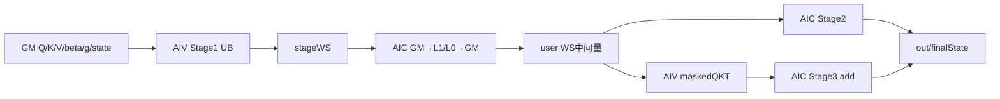
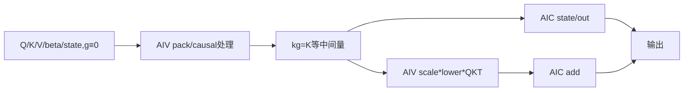

# ChunkGatedDeltaRule A2/A3 ACLNN 算子知识

## 算子速览

| 项目 | 内容 |
|---|---|
| 实际入口 | `aclnnChunkGatedDeltaRuleGetWorkspaceSize` + `aclnnChunkGatedDeltaRule`，无版本后缀的公开两段式 ACLNN |
| 计算语义 | 对 TND 序列按 64-token chunk 执行 Gated Delta Rule，递推状态 `S_t` 并输出 `o_t=S_t(q_t·scale)`。 |
| 输入输出 | Q/K/V/beta/state 为 BF16，lengths 为 INT32，可选 g 为 FP32；out/finalState 为 BF16。 |
| 执行类型 | 单 Kernel `MIX_CV`，`KERNEL_TYPE_MIX_AIC_1_2`。 |
| Kernel 路线 | R-001 g 存在；R-002 `gOptional=nullptr`。 |
| 核心资源 | user workspace、Matmul L1/L0、AIV UB/TQue/TBuf、AIC/AIV soft-sync flag。 |
| 来源闭包 | `source_closed`：ACLNN→L0→Host/Tiling/POD→单 MIX Kernel→Stage1/2/3 与构建接线闭合；Matmul 库内部是仓外公共边界。 |
| 验证状态 | 已完成源码闭包检查；本次知识提取未执行编译、真机、数值或性能测试。 |

## 接口与语义

### 计算语义

```text
alpha_t = exp(g_t)；gOptional 缺省时 g_t=0、alpha_t=1
S_t = alpha_t*S_(t-1) + beta_t*(v_t-alpha_t*S_(t-1)*k_t)*k_t^T
o_t = S_t*(q_t*scaleValue)
```

`S∈R^(Dv×Dk)`。对 value head `h_v`，源码以 `h_k=floor(h_v*Nk/Nv)` 选择 Q/K head，因此 `Nv%Nk==0` 时每个 Q/K head 服务连续 `Nv/Nk` 个 value head。Device 按 `C=64` 切 chunk：Stage1 使用严格下三角 mask 构造块内三角求逆及 `kCumDecay/vInner/qPrime/kg/qkt`，Stage2 按 chunk 串行递推 state，Stage3 使用含对角线的下三角 mask 补加块内注意力项。

### 输入、输出与属性

| 参数 | shape/layout | dtype | 约束、默认值与语义 |
|---|---|---|---|
| query/key | `(T,Nk,Dk)`/ND(TND) | BF16 | 必选非空；`0<Nk≤64`，`0<Dk≤128`；公开数值前提均为 `0<x<1`。 |
| value | `(T,Nv,Dv)`/ND | BF16 | `0<Nv≤64`，`0<Dv≤128`，`Nv%Nk=0`。 |
| beta | `(T,Nv)`/ND | BF16 | 公开数值前提 `0<beta<1`。 |
| initialState | `(B,Nv,Dv,Dk)`/ND | BF16 | 每 batch 初始状态。 |
| actualSeqLengths | `(B)`/ND | INT32 | 约定 `T=sum(length_i)`；固定源码的 Host/Tiling 不读取元素值，也不校验该等式。 |
| gOptional | `(T,Nv)`/ND | FP32 | 可选；`nullptr` 表示全零 g；传入时公开数值前提为 `g<0`。 |
| scaleValue | 标量 | FP32 | 默认 1.0。 |
| out | `(T,Nv,Dv)`/ND | BF16 | L0 输出经 ViewCopy 回写。 |
| finalState | `(B,Nv,Dv,Dk)`/ND | BF16 | 最终状态。 |

### 入口与版本

固定提交只公开无后缀 `aclnnChunkGatedDeltaRule`，无 V2/V3，因此这是 A2/A3 实际最新公开版本。README/API 产品表明确 A2/A3 支持、Ascend 950PR/950DT 不支持；OpDef 接线 `ascend910b` 与 `ascend910_93`。

## Host/Launcher 执行流程

### 参数校验与前处理

第一段创建 executor；除 g 外的 tensor 指针必须非空，dtype 固定为上表。`PreProcess` 把输入 original shape 同步成 view shape；若两个输出同时 empty，返回 workspace 0 且不加节点。六个必选输入和存在的 g 依次 Contiguous；L0 分配两个 ND 临时输出，`InferShapeChunkGatedDeltaRule` 先由 value/initialState 推输出形状，再添加唯一 AICore launcher，最后两个 ViewCopy 回写用户输出。其余 shape/rank 由 Tiling 检查。

### 参数、Workspace 与生命周期

令 `A=平台AIC数`、`C=64`、`S=2AC`、`H=Nv`：

```text
interWorkspaceSz = 4[HS(1+3Dk+2Dv+C)+BHDvDk+4AC²]
stageWorkspaceSz = 16AC(2C+3Dk+Dv)
kernelWorkspace[0] = 16MiB(system)+interWorkspaceSz+stageWorkspaceSz
```

这是 Tiling 写给该 AICore 节点的 workspace，不等于第一段 ACLNN 最终返回值：`*workspaceSize=uniqueExecutor->GetWorkspaceSize()` 由 executor 汇总 Contiguous、两个 L0 临时输出、AICore 节点和 ViewCopy 等规划，固定仓未展开其精确聚合公式。Kernel 通过 `GetUserWorkspace` 跳过 16 MiB system 区。Device 对 BF16 slice 用 2 字节重新累加 offset，故 `stageWsAddr_` 是 Device 实际前缀末尾，并非 `user+interWorkspaceSz`；Host 对这些 slice 按 4 字节保守预留。各节点在传入 stream 上按 executor 顺序消费；输入、输出和 workspace 至少须保持到 stream 完成，executor 的确切释放时点属于仓外 `CommonOpExecutorRun` 生命周期边界。

### 启动图与失败传播

```text
GetWorkspaceSize -> Contiguous -> l0op::ChunkGatedDeltaRule
 -> InferShape -> ADD_TO_LAUNCHER_LIST_AICORE
 -> Tiling(priority0,key0,blockDim=A,scheduleMode=1)
 -> chunk_gated_delta_rule [MIX 1:2]
    -> InitMatmul/InitMask
    -> for batch/group: Stage1 -> SyncAll -> Stage2 -> SyncAll -> Stage3 -> SyncAll
 -> ViewCopy(out/finalState)
Run -> CommonOpExecutorRun(workspace,executor,stream)
```

第一段任一 executor/Contiguous/InferShape/launcher/ViewCopy 失败立即返回；Tiling 的校验或 Matmul tiling 失败使 launcher 无法建立；第二段把 `CommonOpExecutorRun` 状态原样返回。三 Stage 是同一 MIX launch 内的阶段图，非三个 Host kernel；AIC/AIV 的可见性由 soft-sync flags、阶段间 `SyncAll<false>` 与同 stream executor 顺序共同保证。

## Route 与参数设计

### 分核与资源计算

- `aiCoreNum=AIC num`，`blockDim=A`，MIX 每 logical AIC 配两个 AIV sub-block。
- chunk 固定 64，group 最大 `S=2AC`。Stage1 把 `H*ceil(groupLen/C)` 个任务 former/tail 均分到 A 核，每轮最多4个；两 AIV 各处理32行。
- Stage2 按 `ceil(H/A)` 个 head 分核，head 内 chunk 串行；Stage3 把 head×chunk 任务按 `ceil(total/A)` 分核。
- Matmul 固定 GM ND BF16 A/B/C、base M/N/K=128、无 bias、dim1，`dbL0C/step/depth=1`；每次以实际 C/Dk/Dv/32/tail 设置 single shape。

### Route 选择

| 顺序 | Route | Key/模板 | 精确选择条件与优先级 | 不适用去向 |
|---:|---|---|---|---|
| 1 | R-001 门控 MIX | priority0，key0，`CGDR<bf16,float>` | g 的 desc/tensor/shape 全存在，FP32 `(T,Nv)`，`hasGamma=1` | g 缺省转 R-002；三者不一致或非法则失败。 |
| 2 | R-002 零门控 MIX | 同上 | g 三者全缺失，`hasGamma=0` | 其它 shape/resource/tiling 失败。 |

```text
双输出 empty -> 成功且不 launch
否则 priority0/IsCapable=true -> 校验
 -> hasGamma=1 -> key0/R-001
 -> hasGamma=0 -> key0/R-002
 -> 校验或 Matmul tiling 失败 -> GRAPH_FAILED
```

### 模板/实现执行矩阵

| Route | key/selector | dtype/shape/platform 完整命中条件 | 执行族与 kernel 节点 | 实际模板/body | 内存与同步特征 | tail/fallback |
|---|---|---|---|---|---|---|
| R-001 | key0/hasGamma1 | A2/A3、固定 dtype/TND、正维与上界 | 单 MIX：Stage1→2→3 | `CGDR<bf16,float>`、Stage1/2/3、3个 MatmulImpl | FP32 gCum、BF16交接、flags+SyncAll | tail 1..64；无 fallback。 |
| R-002 | key0/hasGamma0 | 同上但 g=null | 同节点图，跳过 g 分支 | 同模板 | 不建 gOutQueue，ABI不变 | 同上。 |

### 隐藏性能 Guard

| Guard | Host/Tiling 条件 | Device/资源原因 | 影响 Route | 不满足时去向 | 源码符号 |
|---|---|---|---|---|---|
| 平台 | A2/A3公开支持，950不支持 | OpDef只接线两平台 | 两 Route | 不发布 | README/OpDef |
| dtype | BF16/INT32/FP32固定 | 模板固定 | 两 Route | ACLNN/Tiling失败 | `AnalyzeDtype` |
| 维度 | 正维；heads≤64，dims≤128，Nv%Nk=0 | head映射和UB/Matmul上界 | 两 Route | Tiling失败 | `CheckDerivedDimConstraints` |
| exact shape | 与接口表完全相等 | 无runtime broadcast | 两 Route | Tiling失败 | `CheckExpectedShapes` |
| layout | OpDef/API为ND；Tiling拒绝FRACTAL_NZ | 线性ND stride | 两 Route | 注册/Tiling失败 | `AnalyzeFormat` |
| chunk | C64、half/inverse32 | 两AIV和32×32求逆写死 | 两 Route | 无fallback | `INVERSE_SHAPE` |
| UB | D≤128使Stage1 maxLen=64 | queue各16KiB，tmp140KiB | 两 Route | 上界外已失败 | `InitLocalBuffers` |
| Matmul | base128且 GetTiling成功 | 全部MNK≤128 | 两 Route | GRAPH_FAILED | `DoMatmulTiling` |
| lengths内容 | Host不校验元素/总和 | Device直接推进offset | 两 Route | 无fallback | `CGDR::Process` |

### POD/ABI

`ChunkGatedDeltaRuleTilingData` 使用 `#pragma pack(8)` 与 `alignas(8)`；固定仓可确定前 108 字节标量区，随后为对齐 padding 与仓外 `TCubeTiling`，因此该结构总 `sizeof` 以及最后一字段的精确 `offsetof/alignof` 不可见。下表中的标量 `offsetof` 均由声明顺序与 pack 直接确定。

| 结构 | 字段 | 类型/位宽 | ABI 布局 | 单位 | Host/launcher producer | Device consumer | 边界 |
|---|---|---|---|---|---|---|---|
| TilingData | aiCoreNum | int64_t/64 | `sizeof=8, alignof=8, offsetof=0` | AIC cores | `InitCompileInfo: GetCoreNumAic()` | CGDR/Stage1/2/3 分核 | 支持平台应大于0；初始化函数只记录零核错误，未向外返回状态。 |
| 同上 | t | int64_t/64 | `8/8/off8` | tokens | `AnalyzeShapes: query.dim0` | GM 长度 | `t>0`；不与 lengths 求和核对。 |
| 同上 | nk | int64_t/64 | `8/8/off16` | heads | `AnalyzeShapes: query.dim1` | Q/K head 映射 | `0<nk<=64`。 |
| 同上 | dk | int64_t/64 | `8/8/off24` | elements/row | `AnalyzeShapes: query.dim2` | workspace/UB/Matmul K/N | `0<dk<=128`。 |
| 同上 | nv | int64_t/64 | `8/8/off32` | heads | `AnalyzeShapes: value.dim1` | 三 Stage 任务域 | `0<nv<=64` 且 `nv%nk==0`。 |
| 同上 | dv | int64_t/64 | `8/8/off40` | elements/row | `AnalyzeShapes: value.dim2` | workspace/UB/Matmul M/N | `0<dv<=128`。 |
| 同上 | b | int64_t/64 | `8/8/off48` | batches | `AnalyzeShapes: initialState.dim0` | CGDR batch loop/state offset | `b>0`；无显式上界。 |
| 同上 | hasGamma | int64_t/64 | `8/8/off56` | boolean | `GetOptionalInput` 根据 desc/tensor/shape 三者 | Host dtype/shape分支；Device POD本身不读 | 只能为0/1；Device实际 `gFlag_` 由入口指针是否为空产生，二者须一致。 |
| 同上 | chunkSize | int64_t/64 | `8/8/off64` | tokens | `DoOpTiling: 64` | 全部 Stage | 固定64。 |
| 同上 | maxGroupLength | int64_t/64 | `8/8/off72` | tokens | `DoOpTiling: 2*aiCoreNum*64` | CGDR group loop/中间量 stride | `S=2AC`。 |
| 同上 | interWorkspaceSz | int64_t/64 | `8/8/off80` | bytes | `DoOpTiling` 的九项 FP32 公式 | `GetWorkspaceSize`；Device不读字段 | Host 对 BF16 中间量保守按4字节计。 |
| 同上 | stageWorkspaceSz | int64_t/64 | `8/8/off88` | bytes | `DoOpTiling` | `GetWorkspaceSize`；Device不读字段 | `16AC(2C+3Dk+Dv)`。 |
| 同上 | stageOneParaNum | int64_t/64 | `8/8/off96` | tasks/round/core | `DoOpTiling: 4` | Stage1 per-core slice 与批次循环 | 固定4，不得超过成员数组容量6。 |
| 同上 | scale | float/32 | `sizeof=4, alignof=4, offsetof=104` | scalar | `GetScale: attr[0]` | Stage1 QPrime、Stage3 masked QKT | 默认1.0；未检查 NaN/Inf。 |
| 同上 | matmulTilingFp32 | `TCubeTiling`/仓外 | `offsetof/sizeof/alignof` 固定仓不可见（位于标量区之后） | Matmul POD | `DoMatmulTiling/GetTiling` 后覆写 db/step/depth | 三个 `MatmulImpl::Init` | A/B/C GM traits 实为 BF16 ND；字段名不能证明 FP32 累加。 |

### Route 源码闭包

| Route | Key/selector | Host/Tiling producer | POD/参数 | Kernel entry/router | Kernel body/直接依赖 | 构建接线 |
|---|---|---|---|---|---|---|
| R-001 | key0/hasGamma1 | `op_host/chunk_gated_delta_rule_tiling.cpp`：`GetShapeAttrsInfo/DoOpTiling/DoMatmulTiling/PostTiling` | `ChunkGatedDeltaRuleTilingData` | `op_kernel/chunk_gated_delta_rule.cpp`：`chunk_gated_delta_rule`→`CGDR<bf16,float>` | `chunk_gated_delta_rule.h` + `stage1/2/3.h` + `utils.h` | `op_host/CMakeLists.txt`、`chunk_gated_delta_rule_def.cpp`、`cmake/level2_ops_list` |
| R-002 | key0/hasGamma0 | 同文件：`GetOptionalInput` 写0，其余 producer相同 | 同一 ABI | 同一 entry/template | 同一 body，命中 `gOptional_==false` 分支 | 同上 |

## Kernel 实现

### 公共执行流程

entry 解析默认 tiling、取 user workspace并构造 `CGDR<bf16,float>`。`blockDim=A` 搭配 `KERNEL_TYPE_MIX_AIC_1_2`：AIC 使用 `GetBlockIdx()`，AIV 以 `GetBlockIdx()/2` 映射回同一 logical core。AIC 初始化三份共享同一 `TCubeTiling` 的 Matmul；AIV 构造64×64 Stage1/3 mask。所有核按 batch/group 顺序执行三 Stage，每 Stage 后 `SyncAll<false>` 和 pipe reset。

| 同一 launch 阶段 | AIC 节点 | AIV 节点 | 交接与终点 |
|---|---|---|---|
| Init | 初始化 Stage1/2/3 `MatmulImpl` | 每个 AIV block 生成 Stage1/3 mask，MTE3_MTE2 后 Reset | 首个 `SyncAll<false>` 后进入 group。 |
| Stage1 | KK、QKT、跨32块 inverse 修正、KCumDecay、VInner Matmul | 两 sub-block 各处理32行：Q/K pack、g cumsum/exp、三角 inverse、GBK/VBeta/QPrime | flags 9/8/7/6/5/A；产出 user workspace 中间量。 |
| Stage2 | 每 head 串行 chunk：VInner累加、state贡献输出、state新项累加 | sub-block0 做 state BF16→FP32衰减→BF16；sub-block1不做Vector body但参与握手 | flags 2/5/4；产出 finalState 与 out 的 state 项。 |
| Stage3 | `maskedQKT@VInner` 以 accumulate=1 加到 out | sub-block0 生成 maskedQKT；sub-block1不做Vector body但参与握手 | flags 4/3；最后 `SyncAll<false>` 后下一 group/batch。 |

### Route R-001：门控 MIX

#### 适用条件

##### 选择证据

| 层级 | 文件 | 符号 | 源码谓词/参数 | 结果/下一跳 |
|---|---|---|---|---|
| ACLNN | op_api/aclnn_chunk_gated_delta_rule.cpp | CheckDtypeValid/PreProcess | g非空则FP32并Contiguous | L0或失败 |
| Tiling | chunk_gated_delta_rule_tiling.cpp | GetOptionalInput | g三元组全存在 | hasGamma1 |
| Router | tiling.cpp/kernel.cpp | GetTilingKey/entry | key0/CGDR模板 | R-001 |

#### Device 数据流

##### 函数级调用链

```text
entry -> CGDR::Init/Process
 -> Stage1::Process -> ParaChunkAIV(QK,gCum,gamma,inverse,Kbeta,Vbeta,Qprime)
                    -> ParaChunkAIC(KK,QKT,inverseMM,Kdecay,Vinner)
 -> Stage2::Process -> AIV stateDecay + AIC Vprime/attn/stateNew
 -> Stage3::Process -> AIV maskedQKT + AIC Matmul-add
```

##### 源码等价伪码

```text
for batch/group/head/chunk:
  G=cumsum(g); E=exp(G); KK=K@K^T; QKT=Q@K^T
  A=源码32x32分块算法在严格下三角依赖上构造的因果三角逆
  Kdecay=A@(-beta*E*K); Vinner=A@(beta*V)
  Qprime=scale*E*Q; kg=exp(G_last-G)*K
SyncAll
for head and chunks in order:
  Vinner += Kdecay@state^T; out += Qprime@state^T
  state = exp(G_last)*state + Vinner^T@kg
SyncAll
out += [scale*QKT*exp(G_i-G_j)*tril_inclusive]@Vinner
```

#### 内存与数据搬运

##### 资源与搬运表

令 O0=0，offset相对 user workspace，`S=2AC,H=Nv`。

| 层级/缓冲区 | offset/地址公式 | extent/容量公式 | dtype/layout | producer | consumer | owner/lifetime | 对齐/复用 |
|---|---|---|---|---|---|---|---|
| gCum | O0 | 4HS | FP32(H,S) | Stage1 AIV | Stage2/3 | group | 覆盖复用 |
| kCumDecay | O1=4HS | 2HSDk | BF16 | Stage1 AIC | Stage2 | group | Matmul GM |
| vInner | O2=O1+2HSDk | 2HSDv | BF16 | Stage1/2 AIC | Stage2/3 | group | 累加 |
| qPrime | O3=O2+2HSDv | 2HSDk | BF16 | Stage1 AIV | Stage2 | group | RINT |
| attnInter保留 | O4=O3+2HSDk | 2HSDv | BF16 | 无 | 无 | launch | 仅建指针 |
| kg | O5=O4+2HSDv | 2HSDk | BF16 | Stage1 AIV | Stage2 | group | RINT |
| qkt | O6=O5+2HSDk | 2HSC | BF16 | Stage1 AIC | Stage3 | group | tail valid shape |
| highState保留 | O7=O6+2HSC | 4BHDvDk | FP32 | 无 | 无 | launch | 仅建指针 |
| 两mask | O8=O7+4BHDvDk | 各8AC² | FP32 | InitMask | Stage1/3 | launch | 2A slices |
| stageWS/S0 gBK | O10=O8+16AC² | 8ACDk | BF16 `[A,4,C,Dk]` | Stage1 AIV | Stage1 AIC | round | 每 logical core/slot 独占 |
| stageWS/S1 queryCon | O10+8ACDk | 8ACDk | BF16 `[A,4,C,Dk]` | Stage1 AIV | Stage1 AIC | round | 两 AIV 各写32行 |
| stageWS/S2 keyCon | O10+16ACDk | 8ACDk | BF16 `[A,4,C,Dk]` | Stage1 AIV | Stage1 AIC | round | 两 AIV 各写32行 |
| stageWS/S3 KK | O10+24ACDk | 8AC² | BF16 `[A,4,C,C]` | Stage1 AIC | Stage1 AIV | round | 0x8保护 |
| stageWS/S4 inverse/attn | O10+24ACDk+8AC² | 8AC² | BF16 `[A,4,C,C]` | Stage1 AIV/AIC | Stage1 AIC | round | 0x7/内部 FIX_MTE2 |
| stageWS/S5 vBeta | O10+24ACDk+16AC² | 8ACDv | BF16 `[A,4,C,Dv]` | Stage1 AIV | Stage1 AIC | round | 0x5保护；Stage1实际末端 |
| stageWS Host容量 | O10 | 16AC(2C+3Dk+Dv) | bytes | Tiling | 三 Stage | launch内复用 | 大于 Stage1 实际 `8AC(3Dk+2C+Dv)`；Stage3另行覆盖 |
| L1/L0 | Matmul内部 | bytes仓不可见；base128/depth1 | BF16 GM | MatmulImpl | GM | IterateAll | 公共库边界 |
| InitMask UB | AIV tmpBuff | 4C²=16384 | FP32 `[C,C]` | Duplicate/标量写 | 两 mask GM | InitMask | 写完经 MTE3_MTE2 后 pipe Reset |
| Stage1 UB | queues+tmp | 16K+16K+256+140K | BF16/FP32 | MTE/Vector | MTE/Vector | round | tmp子区别名 |
| Stage2 UB | DkA=align16(Dk) | in=2max(C,Dv)DkA；out=max(2C²,2DvDkA)；tmp=4(max(C,Dv)DkA+8) | BF16/FP32 | state | Vector | chunk | 每个AIV均分配；仅sub0执行state Vector body，sub1只握手 |
| Stage3 UB | DvA=align16(Dv) | in=2Cmax(C,DvA)；out=max(4C²,2CDvA)；tmp=16C² | BF16/FP32 | qkt/g/mask | Vector | task | sub0 |

##### 分层内存布局



##### 字节账、交接边与复用顺序

```text
kernelWorkspace[0]=16MiB+4[HS(1+3Dk+2Dv+C)+BHDvDk+4AC²]+16AC(2C+3Dk+Dv)
ACLNN workspaceSize=executor聚合值（固定仓未给出闭式；不得用kernelWorkspace[0]替代）
Device inter-prefix=4HS+2HS(3Dk+2Dv+C)+4BHDvDk+16AC²
Stage1 actual slices=8AC(3Dk+2C+Dv)
Stage3 tmp=stageWs+4AC²，BF16 extent=2AC²
Stage1 UB=176384 bytes（含gOutQueue）
```

| 边/复用子区 | producer | offset/extent | dtype/layout | consumer | ordering/sync | owner/lifetime | 安全条件 |
|---|---|---|---|---|---|---|---|
| Q/K pack→KK/QKT | `QKPreProcess`(AIV) | S1/S2，各 logical core/slot 的 `2C*Dk` bytes | BF16 ND | `ParaChunkAIC` | AIV `SetFlag<PIPE_MTE3>(0x9)`→AIC wait9 | 当前 round | 两 AIV sub-block 各写32行；tail补0。 |
| KK→三角逆 | Stage1 AIC `K@K^T` | S3，`2C²` bytes/slot | BF16 ND | `KKBetaCompute/InverseCompute`(AIV) | AIC `SetFlag<PIPE_FIX>(0x8)`→AIV wait8 | 当前 round | logical core 与 slot 一致。 |
| inverse块→跨块修正 | `InverseCompute`(AIV) | S4，`2C²` bytes/slot | BF16 ND | `AttnInverseMMCompute`(AIC) | AIV `SetFlag<PIPE_MTE3>(0x7)`→AIC wait7 | 当前 round | 两个32×32对角逆写完。 |
| `-beta*exp(G)*K`→kCumDecay | `GBKCompute`(AIV) | S0，`2CDk` bytes/slot | BF16 ND | Stage1 AIC `attn@gBK` | AIV `SetFlag<PIPE_MTE3>(0x6)`→AIC wait6 | 当前 round | R-002省略exp但边不变。 |
| `beta*V`→vInner | `VBetaCompute`(AIV) | S5，`2CDv` bytes/slot | BF16 ND | Stage1 AIC `attn@vBeta` | AIV `SetFlag<PIPE_MTE3>(0x5)`→AIC wait5 | 当前 round | tail行补0。 |
| QKT完成确认 | Stage1 AIC `Q@K^T` | O6，`2*validLen²` 有效写入、物理 slice `2C²`/task | BF16 ND | Stage3 AIV（经后续 Stage2） | AIC `SetFlag<PIPE_FIX>(0xA)`→Stage1 AIV waitA；Stage1/2边界另有SyncAll | 当前 group | Stage1 AIV退出/reset前确认，Stage3读取前还有两个全核屏障。 |
| 旧state读取→衰减state | Stage2 AIC `CalVPrime/CalAttnInter` | finalState，`2DvDk` bytes/head | BF16 ND | Stage2 AIV `CopyOutState` | AIC set2→AIV wait2；AIV set5→AIC wait5 | 当前 head/chunk | 旧state读完才允许覆盖。 |
| 衰减state→累加新state | Stage2 AIV | finalState，同一 `2DvDk` bytes/head | BF16 ND | Stage2 AIC `CalStateNew(..., accumulate=1)` | AIV set5→AIC wait5；AIC set4→AIV wait4 | 当前 head/chunk | 下一 chunk 在握手完成后复用。 |
| maskedQKT→Stage3 Matmul | `CalMaskedQKT`(AIV sub0) | `stageWs+4AC²+2*coreId*C²`，`2C²` bytes/core | BF16 ND | Stage3 AIC | AIV set4→AIC wait4；AIC set3→AIV wait3 | 当前 Stage3 task | AIC 完成 output 累加后才覆盖 per-core slice。 |

#### 同步、精度与尾块

##### 同步与数值边界表

| 阶段 | primitive/机制 | producer | consumer/等待点 | 保护对象 | 精度/尾块 |
|---|---|---|---|---|---|
| Stage边界 | SyncAll | 全核 | 下一Stage/group | user/stage WS | group串行 |
| Stage1 | flags 9/8/7/6/5/A | AIV/AIC | 对端 | Stage1 slices | Vector FP32，RINT BF16；gCum FP32 |
| Stage2 | flags2/5/4+FIX_MTE2 | AIC/AIV | 对端/下一chunk | state | BF16→FP32衰减→RINT；tail curChunkSize |
| Stage3 | flags4/3 | AIV/AIC | 对端 | tmp/out | FP32门控后RINT BF16；tail有效行列 |
| AIV管线 | HardEvent/PipeBarrier/TQue | MTE2/V/S | V/MTE3 | UB | Dk/Dv补16元素，CopyOut真实列 |

#### 关键实现

##### 符号证据表

| 阶段 | 文件 | 符号/模板实例 | 实现事实 |
|---|---|---|---|
| Host/Tiling producer | tiling.cpp | DoOpTiling/DoMatmulTiling/PostTiling | workspace/key/blockDim |
| Kernel entry/router | kernel.cpp | entry/CGDR模板 | MIX1:2 |
| Device body/helper | stage1.h | ParaChunkAIV/AIC | 三角逆、中间量、flags |
| Device body/helper | stage2.h | Stage2::Process | state递推 |
| Device body/helper | stage3.h | CalMaskedQKT/AICProcess | 块内项 |

### Route R-002：零门控 MIX

#### 适用条件

##### 选择证据

| 层级 | 文件 | 符号 | 源码谓词/参数 | 结果/下一跳 |
|---|---|---|---|---|
| ACLNN | aclnn cpp | CheckNotNull/PreProcess | g可空且不Contiguous | L0 |
| Tiling | tiling.cpp | GetOptionalInput | g三项全空 | hasGamma0 |
| Device | kernel.h | CGDR::Init | g指针空 | gFlag=false |

#### Device 数据流

##### 函数级调用链

```text
entry->CGDR(gFlag=false)->Stage1[跳过gCum/Gamma]->Stage2[lastGCum=1]->Stage3[门控=1]
```

##### 源码等价伪码

```text
同R-001，但kg=K、Kbeta=-beta*K、Qprime=scale*Q、stateDecay=state，
maskedQKT=scale*QKT*lowerTriangle；其余Matmul和状态链不变。
```

#### 内存与数据搬运

##### 资源与搬运表

| 层级/缓冲区 | offset/地址公式 | extent/容量公式 | dtype/layout | producer | consumer | owner/lifetime | 对齐/复用 |
|---|---|---|---|---|---|---|---|
| user WS | 同R-001 | ABI不缩小 | 混合 | Stage | Stage | launch | gCum保留但无有效消费 |
| kg | O5 | 2HSDk | BF16 | QKPreProcess直接复制K | Stage2 | group | 两半写入 |
| Stage1 UB | 同R-001 | 176128 bytes | BF16/FP32 | AIV | AIV | round | 无256B gOutQueue |
| Stage2/3 UB、L1/L0 | 同R-001 | 同公式/仓外边界 | BF16/FP32 | Stage | Stage | task | 同步不变 |

##### 分层内存布局



##### 字节账、交接边与复用顺序

```text
`kernelWorkspace[0]` 与 R-001 相同；ACLNN 总 workspace 仍取 executor 聚合值。Stage1 UB=176128 bytes，仅少条件 `gOutQueue` 256 bytes。
```

| 边/复用子区 | producer | offset/extent | dtype/layout | consumer | ordering/sync | owner/lifetime | 安全条件 |
|---|---|---|---|---|---|---|---|
| K→kg | Stage1 AIV | kg/2HSDk | BF16 | Stage2 | SyncAll | group | !gOptional&&kgFlag |
| state identity | Stage2 AIV | finalState | BF16 | AIC/下一chunk | 2→5→4 | head | 仍经FP32×1和RINT |
| Stage3 tmp | AIV | 同R-001 | BF16 | AIC | 4→3 | task | causal mask保留 |

#### 同步、精度与尾块

##### 同步与数值边界表

| 阶段 | primitive/机制 | producer | consumer/等待点 | 保护对象 | 精度/尾块 |
|---|---|---|---|---|---|
| Stage1 | 同R-001 flags | AIV/AIC | 对端 | WS | 跳过exp，仍FP32 Vector→RINT BF16 |
| Stage2 | 2/5/4 | AIC/AIV | 对端 | state | lastGCum=1，tail不变 |
| Stage3 | 4/3 | AIV/AIC | 对端 | tmp/out | 门控Duplicate1，仍乘scale/mask |

#### 关键实现

##### 符号证据表

| 阶段 | 文件 | 符号/模板实例 | 实现事实 |
|---|---|---|---|
| Host/Tiling producer | tiling.cpp | GetOptionalInput | hasGamma0 |
| Kernel entry/router | kernel.h | CGDR::Init | gFlag false |
| Device body/helper | stage1.h | QKPreProcess/GBK/QPrime | kg=K及无g分支 |
| Device body/helper | stage2.h/stage3.h | CalGCumExp/CalMaskedQKT | 因子1 |

## 算子特定优化

### Trick T-001：按 AIC 数绑定 chunk-group 并复用 workspace

#### 触发与源码依据

- 适用 Route：R-001、R-002
- 触发条件：固定 C64、group 上限为每 AIC 两个 chunk，Stage1 每核每轮最多批处理四个任务。
- Golden 来源：[`tiling.cpp:112-140`](../../../../../../../cann-ops-raw/ascendc/ops-transformer/be33d95bb755cedec3108f70805c1874d1792540/attention/chunk_gated_delta_rule/op_host/chunk_gated_delta_rule_tiling.cpp#L112-L140)

**官方源码（固定 Commit 连续逐字摘录）**：

```cpp
int64_t c = 64;    // chunk size 取 64
int64_t p = P_NUM; // 一个 chunk 组中，单核最大处理 chunk 数
tilingData_.chunkSize = c;
tilingData_.maxGroupLength = p * tilingData_.aiCoreNum * tilingData_.chunkSize;
tilingData_.stageOneParaNum = STAGE_ONE_PARA_NUM; // stage1 并行数
```

#### 机制与设计原因

workspace 只按最大 group `2AC` 分配并跨 group 覆盖；C64又匹配两个32-row AIV和32×32求逆块，使Matmul维度落在base128内。

#### 迁移边界

- 适用：chunk间仅state依赖的同类递推。
- 前提：1:2核比、C64、D≤128、屏障和slice一致。
- 失效：改变C/核比/并发group时须重算全部资源与同步。
- 未验证：本次知识提取未执行编译、真机、数值或性能测试。

#### 错误做法

固定仓未提供可验证反例。

### Trick T-002：单 launch 内 soft-sync 串联 AIV 与 AIC

#### 触发与源码依据

- 适用 Route：两 Route
- 触发条件：Stage1 MIX 1:2 round。
- Golden 来源：[`stage1.h:296-312`](../../../../../../../cann-ops-raw/ascendc/ops-transformer/be33d95bb755cedec3108f70805c1874d1792540/attention/chunk_gated_delta_rule/op_kernel/chunk_gated_delta_rule_stage1.h#L296-L312)

**官方源码（固定 Commit 连续逐字摘录）**：

```cpp
AscendC::CrossCoreWaitFlag(0x9); // 同步0
for (uint32_t i = 0; i < curParaNum; ++i) {
    AICProcess(keyConGm_[i * ckOffset_], keyConGm_[i * ckOffset_], kkWsGm_[i * ccOffset_],
               {chunkSize_, chunkSize_, dk_, chunkSize_, chunkSize_, dk_}, true);
}
AscendC::CrossCoreSetFlag<0x2, PIPE_FIX>(0x8); // 同步1
```

#### 机制与设计原因

AIV打包Q/K后以0x9放行AIC，AIC完成KK后以0x8放行AIV；0x7/6/5/A继续保护inverse、Kbeta/Vbeta和QKT，避免额外Host kernel。

#### 迁移边界

- 适用：同logical core共享per-slot GM slice的融合图。
- 前提：flag、PIPE、coreId/2与offset完全一致。
- 失效：拆kernel或改变核比需重做协议。
- 未验证：本次知识提取未执行编译、真机、数值或性能测试。

#### 错误做法

固定仓未提供可验证反例。

### Trick T-003：state读写握手保持chunk递推

#### 触发与源码依据

- 适用 Route：两 Route
- 触发条件：Stage2同head连续chunk。
- Golden 来源：[`stage2.h:111-135`](../../../../../../../cann-ops-raw/ascendc/ops-transformer/be33d95bb755cedec3108f70805c1874d1792540/attention/chunk_gated_delta_rule/op_kernel/chunk_gated_delta_rule_stage2.h#L111-L135)

**官方源码（固定 Commit 连续逐字摘录）**：

```cpp
CrossCoreWaitFlag(0x2);
if (GetSubBlockIdx() == 0) {
    CopyOutState(finalState);
}
CrossCoreSetFlag<0x2, PIPE_MTE3>(0x5);
CrossCoreWaitFlag(0x4);
```

#### 机制与设计原因

AIC先读旧state后发0x2；AIV写衰减state后发0x5；AIC累加新state后发0x4，下一chunk才复用。Stage3延后补加块内项，保持state串行而head×chunk项可并行。

#### 迁移边界

- 适用：输出可分为state贡献和块内贡献的递推。
- 前提：chunk顺序、Matmul累加和三flag不变。
- 失效：跨chunk并行或多state写者。
- 未验证：本次知识提取未执行编译、真机、数值或性能测试。

#### 错误做法

固定仓未提供可验证反例。

## 模板与实现对比

| 对比维度 | R-001 门控 | R-002 零门控 | 设计选择依据 |
|---|---|---|---|
| 命中条件/优先级 | key0/hasGamma1 | key0/hasGamma0 | runtime可选输入分支 |
| 执行族/节点图 | MIX Stage1→2→3 | 相同 | g不改launch图 |
| M/N/K、tile与scheduler | C64/base128 | 相同 | shape上界相同 |
| workspace/L1/L0/UB | gCum有效，多256B queue | gCum保留，少256B | ABI统一 |
| AIC/AIV交接 | 全部flags | 相同 | 防覆盖不变 |
| 同步、精度与tail | FP32 exp，RINT BF16 | 无exp，仍state cast | g=null等价g=0 |
| fallback/失败边界 | g非法失败 | 完整缺省命中 | 无其它key |

## 平台差异

| 项目 | A2 | A3 | 950 |
|---|---|---|---|
| 支持状态 | 公开支持 | 公开支持 | 950PR/DT明确不支持 |
| Host/Launcher | `ascend910b` 使用 `aicoreConfig`，显式 `softsync.flag=true` | `ascend910_93` 以默认 config 接入，未显式附加该扩展项 | 不接入 |
| Kernel/资源 | 共用 MIX body；Tiling 查询 AIC/AIV/UB/L1/L0C | 共用同一 body 与查询流程；CrossCore 协议不变 | 不得外推 |

## 限制与失败边界

- 只支持固定dtype/TND shape，无大维、其它dtype/layout或其它key fallback。
- lengths内容与 `sum==T` 未校验，调用方必须保证；Device直接据其推进offset。
- `B`、`T` 无显式上界，Tiling 的 workspace 乘法使用 `int64_t` 且未见溢出检查；超大 shape 不得依赖回绕后的 workspace。
- 公开/OpDef为ND，而Tiling局部只拒绝FRACTAL_NZ，不能据此宣称其它layout公开支持。
- Host按4字节保守计BF16 slice；复用时必须采用Device实际offset，不能把 `interWorkspaceSz` 当stageWS起点。
- Tiling 公式只描述该 AICore 节点的 workspace；ACLNN 第一段返回 executor 聚合值，不能以公式替代实际返回值。
- `attnInter_`、`highState_` 只建指针/占slice，当前body无读写；`CopyCast` 未调用。
- `matmulTilingFp32` 名称不能证明FP32 Matmul：A/B/C GM配置为BF16；accumulator、L1/L0 bytes和TCubeTiling完整ABI在仓外。
- scale未检查NaN/Inf，公开数值范围由调用方保证。
- API 文档把必选 tensor 空指针列为 `ACLNN_ERR_PARAM_NULLPTR`，但固定入口实现的 `CheckNotNull` 失败实际经 `CHECK_RET` 返回 `ACLNN_ERR_PARAM_INVALID`；调用方按固定实现处理该差异。
- `InitCompileInfo` 遇到 AIV/AIC 核数为0只记录错误并从 `void` 函数返回，未直接向 Tiling 流程传播失败；A2/A3正常平台资源是正式 Route 前提。
- 本次知识提取未执行编译、真机、数值或性能测试。

## 源码索引

### 链路索引

| 链路阶段 | 文件 | 关键符号 | 支撑内容 |
|---|---|---|---|
| 平台/语义 | README.md | 产品表/公式 | 支持与语义 |
| 公开API | docs/aclnnChunkGatedDeltaRule.md | 两段式原型 | 参数约束 |
| 入口声明 | op_host/op_api/aclnn_chunk_gated_delta_rule.h | ACLNN符号 | 最新入口 |
| 入口实现 | op_host/op_api/aclnn_chunk_gated_delta_rule.cpp | GetWorkspaceSize | executor/Contiguous/ViewCopy |
| L0声明 | op_host/op_api/chunk_gated_delta_rule.h | l0op::ChunkGatedDeltaRule | executor参数契约 |
| L0 | op_host/op_api/chunk_gated_delta_rule.cpp | l0op函数 | InferShape/launcher |
| 图原型 | op_graph/chunk_gated_delta_rule_proto.h | REG_OP | 输入输出与默认属性 |
| 平台注册 | op_host/chunk_gated_delta_rule_def.cpp | OpDef | config/softsync |
| Shape推导 | op_host/chunk_gated_delta_rule_infershape.cpp | InferShapeChunkGatedDeltaRule | L0临时输出形状与dtype |
| Tiling声明 | op_host/chunk_gated_delta_rule_tiling.h | ChunkGatedDeltaRuleTiling | priority模板与平台编译信息 |
| POD | op_kernel/chunk_gated_delta_rule_tiling_data.h | TilingData | ABI |
| Host/Tiling | op_host/chunk_gated_delta_rule_tiling.cpp | Tiling类 | 校验/workspace/key |
| Kernel entry | op_kernel/chunk_gated_delta_rule.cpp | entry | MIX模板 |
| 编排 | op_kernel/chunk_gated_delta_rule.h | CGDR | slice/Stage图 |
| Stage1 | op_kernel/chunk_gated_delta_rule_stage1.h | Stage1 | 中间量/flags |
| Stage2 | op_kernel/chunk_gated_delta_rule_stage2.h | Stage2 | state递推 |
| Stage3 | op_kernel/chunk_gated_delta_rule_stage3.h | Stage3 | 块内项 |
| Kernel公共量 | op_kernel/chunk_gated_delta_rule_utils.h | soft-sync/event/align常量 | 跨族协议与对齐 |
| 构建接线 | op_host/CMakeLists.txt | add_op/add_modules | 编译接线 |
| ACLNN头发布 | cmake/level2_ops_list | aclnn_chunk_gated_delta_rule.h | 公开L2头纳入列表 |

每行只写一个文件，并确保该文件存在于 Frontmatter `sources`。

### 实现复用检查

| 检查项 | 可复用事实 | 不得改变的约束 | 源码符号 |
|---|---|---|---|
| ABI/POD | 标量producer/consumer与共用Matmul POD | pack8、顺序/单位、key0、仓外ABI | TilingData |
| 调用顺序 | ACLNN→L0→单MIX→三Stage→ViewCopy | Stage/group屏障、head内chunk串行 | GetWorkspaceSize/CGDR::Process |
| workspace/内存 | 最大group复用、Device slice、stageWS复用 | stageWsAddr实际offset | DoOpTiling/CGDR::Init |
| 同步 | 9/8/7/6/5/A、2/5/4、4/3 | PIPE、ID、core映射、轮次 | Stage1/2/3 Process |
| 精度与尾块 | Vector FP32、RINT BF16、gCum FP32 | 不臆测Matmul累加；padding非有效输出 | GBK/QPrime/CalGCum/MaskedQKT |
| 失败边界 | 固定校验失败关闭，g=null合法 | 不补造950/layout/key | GetOptionalInput/Analyze*/GetTilingKey |
