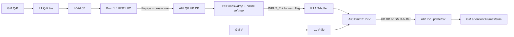
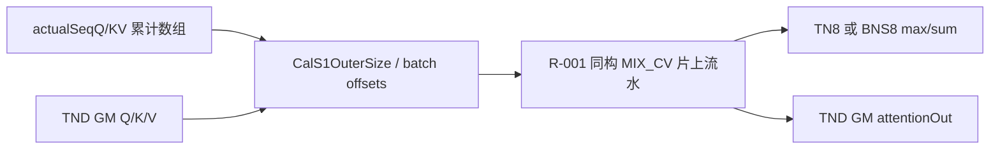

# FlashAttentionScore 950 ACLNN 算子知识

## 算子速览

| 项目 | 内容 |
|---|---|
| 实际入口 | `aclnnFlashAttentionScoreV4GetWorkspaceSize` / `aclnnFlashAttentionScoreV4`，公开 ACLNN V4 |
| 950 产品范围 | 文档仅列 Ascend 950PR、Ascend 950DT；A2/A3 明确不支持 V4 |
| 数据类型 | V4 950 实际可达 Tiling 路线仅 FP16、BF16、FP32；不发布 OpDef/key 中存在、但 arch35 `AnalyzeDtype` 拒绝的 FP8/HIFLOAT8 路线 |
| 布局 | BSH、SBH、BSND、BNSD、TND |
| 执行族 | `MIX_CV`，`KERNEL_TYPE_MIX_AIC_1_2`，一份 AIC 配两份 AIV |
| Kernel 路线 | R-001 非 TND regular；R-002 非 TND optionalDn；R-003 TND regular；R-004 TND optionalDn；R-005 empty |
| 核心资源 | GM/workspace、512 KiB L1、64 KiB L0A、64 KiB L0B、256 KiB L0C、AIV UB/SSBUF；外部 bit dropMask 必要时在同一 MIX launch 中先适配 |
| 输出 | `softmaxMax`、`softmaxSum`、`attentionOut`；L0 将 `softmaxOut` 推断为 `[0,0,0,0]`，V4 ACLNN 不 ViewCopy 它 |
| 来源闭包 | `source_closed`：公开 V4 ACLNN → L0/InferShape → 950 Tiling → 64-bit key/POD → APT/MIX entry → noquant Cube/Vector body → ascend950 构建 |
| 验证状态 | 已完成源码闭包检查；本次知识提取未执行编译、真机、数值或性能测试。 |

## 接口与语义

### 计算语义

对每个 batch、head 与 query 行，核心计算可写为：

```text
score = scaleValue * (Q [+ Q_rope]) * (K [+ K_rope])^T
score = ApplyPseAndMask(score, realShift, attenMask, pseType,
                        sparseMode, preTokens, nextTokens, prefix)
(rowMax, rowSum, P) = OnlineSoftmax(score)
P = Dropout(P, keepProb, dropMask or RNG(seed, offset))
attentionOut = P * V
```

`pseType` 决定缩放与 PSE 的先后顺序，不能把所有 PSE 统一解释成一次普通加法。`sink` 存在时参与行最大值和分母更新，因而改变 softmax 归一化，而不是 attentionOut 末端加数。`keepProb < 1` 时优先消费外部 `dropMask`；未给外部 mask 时使用 `seed/offset` 的内部随机语义。V4 的公开形式参数保留 `dScaleQ/K/V` 和 `outDtype`，但本 Commit 的 950 formal route 只接收 FP16/BF16/FP32，实际 key 行中这些量化扩展不活跃。

### 输入、输出与属性

| 参数 | shape/layout | dtype | 950 V4 语义与边界 |
|---|---|---|---|
| `query` | BSH/SBH/BSND/BNSD/TND | FP16/BF16/FP32 | 必需；提供 B/T、query head、S1、D |
| `key` | 同族布局 | 同 `query` | 必需；K/V head 可与 Q 构成 GQA |
| `value` | 同族布局 | 同 `query` | 必需；末维为 Dv，输出末维随 Dv |
| `realShift` | score 可广播形状 | 浮点 | 可选 PSE；形状和 `pseType` 决定 PSE mode |
| `dropMask` | score 域 bit/byte mask | UINT8 | 可选；特定形状先经 adapter 转成 bool workspace |
| `paddingMask` | 公开参数保留 | — | 本链路无发布级 Device 消费证据，视为未生效输入 |
| `attenMask` | score 可广播或压缩 mask | BOOL/UINT8/浮点兼容形态 | 可选；与 `sparseMode`、`preTokens`、`nextTokens` 共同裁剪有效区 |
| `prefix` | batch 维 prefix | INT64 | prefix sparse 语义 |
| `actualSeqQlen` | TND 累计长度 | INT64 | TND 变长边界 |
| `actualSeqKvlen` | TND 累计长度 | INT64 | TND 变长 K/V 边界 |
| `qStartIdx` | 标量数组 | INT64 | query 位置起点 |
| `kvStartIdx` | 标量数组 | INT64 | key/value 位置起点 |
| `dScaleQ/K/V` | 标量或文档允许形状 | FP32 | formal 参数存在；950 V4 可达 dtype route 中不激活 |
| `queryRope/keyRope` | 与 Q/K 的 RoPE 维对应 | 同主输入 | 可选；`hasRope` 进入 key，D 模板包含 `dSizeRope` |
| `sink` | 可选一维 | FP32 | 空一维在 Host 归一为 null；非空改变 max/denominator |
| `headNum` | 属性 | INT64 | query head 数；与布局共同解析 N2/G |
| `inputLayout` | 属性 | string | BSH/SBH/BSND/BNSD/TND |
| `scaleValue` | 属性 | double | QK score 缩放 |
| `keepProb` | 属性 | double | dropout 保留率 |
| `preTokens/nextTokens` | 属性 | INT64 | sparse window 边界 |
| `innerPrecise` | 属性 | INT64 | 映射 `implMode` |
| `sparseMode` | 属性 | INT64 | mask 压缩与有效窗口模式 |
| `pseType` | 属性 | INT64 | PSE 计算顺序/编码 |
| `softmaxOutLayout` | 属性 | string | TND max/sum 采用 TN8 或 BNS8 表达 |
| `seed/offset` | 属性 | INT64 | 内部 dropout 随机状态 |
| `outDtype` | 属性 | INT64 | formal 参数；本 950 formal key 路线不形成独立量化输出路线 |
| `softmaxMax` | 非 TND `[B,N,S,8]`；TND `[T,N,8]` | FP32 | 必需输出之一 |
| `softmaxSum` | 同 `softmaxMax` | FP32 | 必需输出之一 |
| `softmaxOut` | `[0,0,0,0]` | 空输出 | L0 保留槽位；ACLNN V4 不做 ViewCopy |
| `attentionOut` | query 形状末维 D 替换为 Dv | 同主输出类型 | 最终 PV 结果 |

### 入口与版本

`README.md`、V4 文档、`aclnn_flash_attention_score.h/.cpp` 共同给出定长公开最高版本 V4。`aclnnFlashAttentionVarLenScoreV5` 是不同公开逻辑算子，不能作为 FlashAttentionScore 的后续版本并入本卡。V4 文档产品表只包含 Ascend 950PR/950DT，并明确 A2/A3 不支持，因此本文件是 `_950` 卡。

## Host/Launcher 执行流程

### 参数校验与前处理

1. `aclnnFlashAttentionScoreV4GetWorkspaceSize` 先由 `CheckFaParam` 检查 Q/K/V、max/sum/out 等必需指针。
2. `softmaxMax`、`softmaxSum`、`attentionOut` 同时为空时，直接返回 workspace 0，不建立 launch。
3. ACLNN `InputDtypeCheck` 在 950 检查 Q/K/V 同 dtype、输出 dtype 以及 PSE/sink dtype 关系；真正把可达 950 Tiling 限为 FP16、FP32、BF16 的是 arch35 `FlashAttentionScoreTilingRegbase::AnalyzeDtype`。随后 `AnalysisInput` 解析 layout/head/shape。
4. 输入经 `Contiguous`，`PreprocessQKV` 形成 L0 所需视图。950 的 `StrideLimited()` 为 false，DAV2201 专用 pad/transpose 前后处理不执行。
5. shape 为空的一维 `sink` 被置为 null；`aclIntArray` 序列参数在 L0 转为 INT64 tensor。
6. L0 `l0op::FlashAttentionScore` 做 shape 推断并加入 launcher；Host 只对 max、sum、attentionOut 建立 `ViewCopy`，不复制 `softmaxOut`。

### 参数、Workspace 与生命周期

L0 为缺省 optional 输入构造零维占位 tensor，使固定输入序号与 Host Tiling 一致。`FlashAttentionScoreSimplifiedTilingData` 以值拷贝方式随 launch 进入 Device，包括 input、多核、dropmask 与初始化四段。非空路线 workspace 由主流水、可选 adapter 和固定保留区组成：

```text
bmm2Bytes = AlignUp512(S1Base * bmm2ResultBlock * sizeof(calcType))
vec2Bytes = AlignUp512(S1Base * DvBasic * sizeof(calcType))
             when DTemplate > 256 or splitD, otherwise 0
mainBytes = (bmm2Bytes + vec2Bytes) * 3 * coreNum

adapterBytes = AlignUp512(scoreElementCount) when needDropMaskOp, otherwise 0
workspaceBytes = mainBytes(if ordinary non-Dn D>128,
                           or implicit-Dn(no PSE/mask/drop/RoPE) D>192;
                           optionalDn 带 attenMask，故仍按 D>128)
               + adapterBytes + 16 MiB reserve
```

adapter 的 `dropMaskAddrOffset` 指向主区之后。`GetWorkspaceSize` 返回 executor 保存的整个图生命周期；`aclnnFlashAttentionScoreV4` 只把 workspace、stream 交给 `CommonOpExecutorRun`，任一前处理、L0、后处理或 launch 错误原样向 ACLNN 状态码传播。

### 启动图与失败传播

```text
ACLNN V4
  -> AnalysisInput / Contiguous / PreprocessQKV
  -> l0op::FlashAttentionScore
     -> InferShape
     -> TilingFlashAttentionScore
        -> empty check
        -> priority 81 DropMask producer (写 adapter 参数后返回不匹配以继续)
        -> priority 82 VarLen producer (仅 TND)
        -> priority 83 Basic producer (非 TND)
     -> flash_attention_score_apt MIX launch
        -> optional DropMaskAdapter prefix
        -> FlashAttentionScoreKernelTrain
  -> ViewCopy(max, sum, attentionOut) / Postprocess
```

`TilingFlashAttentionScore` 在 DAV_3510 先判空；非空才进入注册模板。priority 81 的 DropMask producer 只补充 adapter 参数并故意返回 `GRAPH_PARAM_INVALID` 让 registry 继续，不能误判为 Host 失败。VarLen 与 Basic 都不 capable 时才终止。

非空无 adapter 时 `PostTiling` 以 `CalcTschBlockDim(coreNum*2,aicNum,aivNum)` 编码 1 AIC:2 AIV；需要 adapter 时以全部 AIV 重算 blockDim，但 entry 仍是同一个 `KERNEL_TYPE_MIX_AIC_1_2`，AIV 先执行 adapter 再进入主流水。empty 的 `CalcTschBlockDim(aivActualNum,0,aivNum)` 只调度 AIV。所有节点由同一 executor 在用户 stream 上提交；L0/launcher 失败时不形成有效 executor，第二段 `CommonOpExecutorRun` 返回运行状态。

## Route 与参数设计

### 分核与资源计算

Basic 默认 `S1Base=128,S2Base=128`。任务数少于 AIC 数、实现不是 invalid-line、无 RoPE、非 FP32 且 D≤256 时可把 S1 降到 64；此时若 S2>1024 且无 mask/PSE/drop，可把 S2 放到 256。D=64、Dv=64、S1 可整除 128、S2 可整除 256 且无 optional 时采用 128×256。`DTemplate=AlignUp(D+DRope,64)`，超过 256 归入 768 桶；DTemplate=192 且含 RoPE，或 DvBasic=128 时，DvTemplate 可取 128。

TND 常规输入由累计 `actualSeq*` 端点作差得到各 batch 的 S1/S2，`CalcRealCoreIdxVarlen` 以正/反循环分配不等长任务。V4 文档另允许尾部直接传 0 表示这些 batch 不参与计算：Host `GetActualSeqLenData` 对负差钳为 0，Device 在负 S1 差且 S2≤0 时用总 T 减去已累计长度，将剩余输出填 0。非 TND Basic 由 B、N2、G 与 S1Outer 形成任务，`bnStartIdx[48]`、`sparseStartIdx[48]` 给各核起点。

### Route 选择

| 顺序 | Route | Host producer / key | 精确条件 | 不满足时 |
|---:|---|---|---|---|
| 1 | R-005 empty | empty check，`KernelTypeKey=1` | Q/K/V 任一 shapeSize=0，且 attentionOut 或 softmaxSum 非空 | 非空继续 registry |
| 2 | R-003/R-004 TND | priority 82 `FlashAttentionScoreTilingVarLen`，layout=4 | 非空且 `inputLayout=TND` | 交 Basic；Basic 会拒绝 TND |
| 3 | R-001/R-002 非 TND | priority 83 `FlashAttentionScoreTilingBasic`，layout=1..3 | 非空、DAV_3510、BSH/BSND/SBH/BNSD | 无 producer 时失败 |
| 4 | optionalDn 分叉 | key `optionalDn=1` | causal 压缩 mask；无 PSE/RoPE/drop；非 FP32；DTemplate≤256 且等于 DvTemplate；S1Template≠64；Basic 的 S1/S2 均≥1536，VarLen 的平均 S1/S2 均≥1536 | regular Route |
| 前缀 | dropMask adapter | `needDropMaskOp=1` | 外部 mask 且非 TND `S2%8!=0`；TND 还包括 `B>1` | 直接消费原 mask |

### 模板/实现执行矩阵

| Route | key/selector | dtype/shape/platform 完整命中条件 | 执行族与 kernel 节点 | 实际模板/body | 内存与同步特征 | tail/fallback |
|---|---|---|---|---|---|---|
| R-001 非 TND regular | `KernelTypeKey=0, Layout=1/2/3, optionalDn=0`；其余位由 Host 逐项写入 | DAV_3510；FP16/BF16/FP32；BSH/BSND/SBH/BNSD；非空；R-002 谓词不成立 | 单 launch `MIX_CV`：AIC Bmm1→AIV Vec1→AIC Bmm2→AIV Vec2 | `FlashAttentionScoreKernelTrain<FANoQuantBlockCube,FANoQuantBlockVecTrain>`；无 optional 且 FP16/BF16、S1Base≠64、D≤256 时 `IsDn` 可隐式选择 Dn；D>128 regular 选 L0 split，FP32/D>256 选 L1 split-K | QK UB 双缓冲、P L1 三缓冲；Bmm2 由 `GetC2Position` 选择 UB 双缓冲或 GM 三缓冲；SSBUF flag 15 初始化共享参数 | S1/S2/D/Dv 由 real size 和 Fixpipe/DataCopyPad 处理；不存在的 key 组合编译期无实例，不运行时降级 |
| R-002 非 TND optionalDn | 同 R-001，但 `optionalDn=1` | causal 压缩 mask；无 PSE/RoPE/drop；FP16/BF16；DTemplate=DvTemplate≤256；S1Base≠64；S1、S2≥1536 | 同一 `MIX_CV` 四阶段图 | QK：D≤128 `IterateBmm1Dn`，D>128 `IterateBmm1DnSplitK`；Vec1 走 `ProcessVec1Dn` | Bmm2 固定可写 UB；PV UB 单槽；因 `hasAtten=true`，Host workspace 判定不是无 optional 的隐式 Dn，实际 D>128 即分配 GM 主区 | causal 尾部仅末一/两轮加载 mask；任一 guard 不满足回 R-001 |
| R-003 TND regular | `KernelTypeKey=0, Layout=4, optionalDn=0` | DAV_3510；FP16/BF16/FP32；非空 TND；R-004 谓词不成立 | 同一 `MIX_CV` 四阶段图；GM offset 由累计 actualSeq 解析 | 与 R-001 相同的 Cube/Vec dispatcher，另经 `CalcRealCoreIdxVarlen/CalS1OuterSize` | 片上策略同相同 key 的 R-001；TND 的 mask/PSE/drop offset 和 softmax 输出布局不同 | 每 batch 独立 S1/S2 tail；实际 S2≤0 时 AIV 清零该 batch 并 `SyncAll` |
| R-004 TND optionalDn | `KernelTypeKey=0, Layout=4, optionalDn=1` | R-003 + causal-only/no PSE/no RoPE/no drop/FP16或BF16/D=Dv≤256/S1Base≠64，且累计长度平均 S1、S2≥1536 | TND 分核 + Dn `MIX_CV` 四阶段图 | `CalcRealCoreIdxVarlen` + `IterateBmm1Dn{SplitK}` + `ProcessVec1Dn` | 与 R-002 相同的 Dn 交接；workspace 仍按 D>128；实际 GM 搬运用各 batch 真长，不用平均值 | 每 batch tail；guard 不满足回 R-003 |
| R-005 empty | `KernelTypeKey=1` | Q/K/V 任一 storage shape size 为 0，且仍有输出需初始化 | AIV_VECTOR：`FlashAttentionScoreEmptyTensorRegbase`；该 Route 无 AIC，但属于同一公开入口的可达图 | `<half>`/`<bfloat16_t>`/`<float>` `ComputeEachCore` | 不走 L1/L0/主 UB 流水；各 AIV 写不重叠 GM | former/tail/last-core 显式分段；三个用户输出全空已在 ACLNN 返回 workspace 0 |

key 是固定 64-bit schema，依次编码 kernel type、impl、layout、S1/S2、D/Dv、PSE、atten/drop/rope、outDtype、regbase、optionalDn。只有 `flash_attention_score_template_tiling_key.h` 中实例化的组合可 launch；未知组合没有通用运行时 fallback。

### 隐藏性能 Guard

| Guard | Host/Tiling 条件 | Device/资源原因 | 影响 Route | 不满足时去向 | 源码符号 |
|---|---|---|---|---|---|
| 小任务 S1=64 | `totalSize<aicNum && implMode!=invalidLine && !hasRope && dtype!=FP32 && DBasic≤256` | 增加 S1 outer task 数；该模板改变 UB/L1 tile | R-001/R-003 | 保持 S1Base=128 | `FlashAttentionScoreTilingBasic::CalcTotalSize`、VarLen 同名 override |
| S1=64 时 S2=256 | 上述 guard + `S2>1024 && !mask && !PSE && !drop` | 放大一次 QK 的 S2 tile | R-001/R-003 | S2Base=128 | `CalcTotalSize` |
| 128×256 特例 | `D=Dv=64 && S1%128=0 && S2%256=0 && no optional && dtype!=FP32` | 命中更大的 Matmul tile 和专用 UB 配置 | R-001/R-003 | 128×128 | `CalcS1S2BasicBlock` |
| D 桶 | `DBasic=AlignUp(D+DRope,64)`；>256 统一 768；Dv 由 `CalcDVBasicBlock` | 决定 L1/L0 split、Fixpipe stride、UB/GM 输出位置 | R-001~R-004 | 非法 >768 在 Host 失败 | `CalcDBasicBlock/CalcDVBasicBlock` |
| optionalDn | causal-only、无 PSE/RoPE/drop、非 FP32、DTemplate=DvTemplate≤256、S1Base≠64；Basic 真长或 TND 平均长≥1536 | Dn QK 改变 A/B 角色、mask 只处理末轮 | R-002/R-004 | regular R-001/R-003 | `AnalyzeOptionalDn` |
| Bmm2 UB/GM | `GetC2Position(DvTemplate,UbOutCondition(...),...,optionalDn)` | UB 容量不足时改为 GM 三槽；Dv>256 还需 vec2 GM 累积片 | R-001~R-004 | 无 fallback，Host key 必须与编译 specialization 一致 | `GetC2Position`、`InitMMResBuf` |
| 主 workspace | ordinary D>128；仅 no-PSE/no-mask/no-drop/no-RoPE implicit-Dn 时 D>192 | 承载每 AIC 三槽 `bmm2`，splitD 再加三槽 vec2 | R-001~R-004 | 小 D 直接 UB；allocation 失败为 launch/executor 错误 | `FlashAttentionScoreTilingBasic/VarLen::GetWorkspaceSize` |
| dropMask adapter | `dropMaskOuter && (S2%8!=0 \|\| (layout=TND && B>1))` | bit packing 不能由主 Vec1 按 bool 字节直接读 | R-001/R-003 的 hasDrop key | 不触发则直接读原 bit mask | `AnalyzeDropOptionalInput`、`FlashAttentionScoreTilingDropMaskRegbase` |
| TND 正倒序分核 | `layout=TND && splitCoreMode=1` | 交替正/反映射长短 batch 的 S1 outer | R-003/R-004 | 使用 `sparseStartIdx` 普通范围 | `CalcRealCoreIdxVarlen` |

### POD/ABI

固定仓没有 `static_assert(sizeof/alignof/offsetof)`；下表因此不补造数值 offset，ABI 一律写为“声明序；自然对齐；数值未显式断言”。`FlashAttentionScoreSimplifiedTilingData` 按 `InputParamsRegbase → MultiCoreParamsRegbase → DropmaskParamsRegbase → InitOutputParams` 顺序值拷贝；每个数组长度是 ABI 的一部分。

| 结构 | 字段 | 类型/位宽 | ABI 布局 | 单位 | Host/launcher producer | Device consumer | 边界 |
|---|---|---|---|---|---|---|---|
| `InputParamsRegbase` | `bSize` | `int64_t/64` | 声明序；自然对齐；offset 未断言 | batch | `AnalyzeLayout/GetShapeAttrsInfo` | `InitCubeVecSharedParams` | ≥0 |
| 同上 | `t1Size` | `int64_t/64` | 同上 | token | 固定仓当前 formal producer 未见显式 set | 共享结构保留 | 本路线 inactive，禁止读取未初始化语义 |
| 同上 | `t2Size` | `int64_t/64` | 同上 | token | 同上 | 共享结构保留 | inactive |
| 同上 | `n2Size` | `int64_t/64` | 同上 | KV head | `GetShapeAttrsInfo` | Cube/Vec stride | >0 或 empty |
| 同上 | `gSize` | `int64_t/64` | 同上 | Q:KV head ratio | `GetShapeAttrsInfo` | Cube/Vec axis | >0 或 empty |
| 同上 | `s1Size` | `int64_t/64` | 同上 | element | `GetShapeAttrsInfo`；TND `SetSparseParamsRegbase` 可覆写 `realT1Size` | task/GM offset | ≥0 |
| 同上 | `s2Size` | `int64_t/64` | 同上 | element | `GetShapeAttrsInfo` | task/GM offset | ≥0 |
| 同上 | `alignedS2` | `int64_t/64` | 同上 | element | 固定仓 formal producer 未见显式 set | 共享结构保留 | inactive |
| 同上 | `dSize` | `int64_t/64` | 同上 | element | `GetShapeAttrsInfo` | QK K 维 | 1..768，empty 可 0 |
| 同上 | `dSizeV` | `int64_t/64` | 同上 | element | `GetShapeAttrsInfo` | PV N 维/输出 stride | ≥0 |
| 同上 | `dSizeRope` | `int64_t/64` | 同上 | element | `GetShapeAttrsInfo` | hasRope specialization | 无 RoPE 时 consumer 强制 0 |
| 同上 | `keepProb` | `float/32` | 同上 | probability | `GetShapeAttrsInfo` | Vec dropout | (0,1] |
| 同上 | `scaleValue` | `float/32` | 同上 | scalar | `GetShapeAttrsInfo` | Vec1 `ProcessVec1Vf` | double 在 ACLNN/L0 窄化为 float |
| 同上 | `preTokens` | `int64_t/64` | 同上 | token | `SetSparseTilingInfo` | `GetS2LoopRange/attenMaskInfo` | sparse mode 校验后值 |
| 同上 | `nextTokens` | `int64_t/64` | 同上 | token | 同上 | 同上 | 同上 |
| 同上 | `pseS1Size` | `int64_t/64` | 同上 | element | `SetPseAlibiParamsRegbase` | PSE offset | no-PSE key inactive |
| 同上 | `pseS2Size` | `int64_t/64` | 同上 | element | 同上 | PSE stride | no-PSE inactive |
| 同上 | `pseBSize` | `uint32_t/32` | 同上 | batch | `AnalyzePseOptionalInput` | `pseInfo` | no-PSE inactive |
| 同上 | `bandIndex` | `uint32_t/32` | 同上 | batch/index | `AnalyzeTndLayout` | mask/PSE band | 非 band inactive |
| 同上 | `layoutType` | `uint8_t/8` | 同上 | enum | `Analyze3Dim/4Dim/TndLayout` | GM offset dispatcher | 1 BSH/BSND，2 SBH，3 BNSD，4 TND |
| 同上 | `pseShapeType` | `uint8_t/8` | 同上 | enum | `AnalyzePseOptionalInput` | `pseInfo` | no-PSE inactive |
| 同上 | `attenMaskShapeType` | `uint8_t/8` | 同上 | enum | `AnalyzeAttenOptionalInput` | mask copy | no-mask inactive |
| 同上 | `attenMaskDataType` | `uint8_t/8` | 同上 | enum | `AnalyzeAttenOptionalInput` | mask copy | formal BOOL 路线写 1 |
| 同上 | `attenMaskCompressMode` | `uint8_t/8` | 同上 | enum | `SetSparseTilingInfo` | mask copy/Dn | no-mask inactive |
| 同上 | `implMode` | `uint8_t/8` | 同上 | enum | `DoOpTiling` | invalid-line check | 0/1/2 |
| 同上 | `sparseType` | `uint8_t/8` | 同上 | enum | `SetSparseTilingInfo` | `GetS2LoopRange` | Host 归一化后 |
| 同上 | `needDropMaskOp` | `uint8_t/8` | 同上 | bool | `AnalyzeDropOptionalInput` | entry adapter/Vec boolMode | 0/1 |
| 同上 | `dropMaskOuter` | `uint8_t/8` | 同上 | bool | 同上 | dropout producer choice | 0 RNG，1 外部 mask |
| 同上 | `pseEncodeType` | `uint8_t/8` | 同上 | enum | `SetPseAlibiParamsRegbase` | PSE decode | no-PSE inactive |
| 同上 | `tndSoftmaxOut` | `uint8_t/8` | 同上 | enum | `GetShapeAttrsInfo` | `SoftmaxDataCopyOut` | TND: TN8/BNS8；非 TND inactive |
| 同上 | `remain` | `uint8_t/8` | 同上 | reserved | zero-init | 无正式消费 | 必须保持 0 |
| 同上 | `attenMaskS2Size` | `uint32_t/32` | 同上 | element | `AnalyzeAttenOptionalInput` | mask GM stride | no-mask inactive |
| 同上 | `pseType` | `uint32_t/32` | 同上 | enum | `GetShapeAttrsInfo` | PSE/update order | 0..3 |
| 同上 | `rsv1` | `uint32_t/32` | 同上 | reserved | zero-init | 无正式消费 | 0 |
| 同上 | `qStartIdx` | `int64_t/64` | 同上 | token | `SetQKVStartIdx` | inner PSE offset | 缺省 0 |
| 同上 | `kvStartIdx` | `int64_t/64` | 同上 | token | 同上 | inner PSE offset | 缺省 0 |
| 同上 | `s1SparseValidSize` | `int64_t/64` | 同上 | token | `SetSparseParamsRegbase` | S2 range | 非 sparse 可 0 |
| 同上 | `s2SparseValidSize` | `int64_t/64` | 同上 | token | 同上 | S2 range | 非 sparse 可 0 |
| 同上 | `seed` | `int64_t/64` | 同上 | RNG | `GetShapeAttrsInfo` | `InitUniqueLocalBuffer` | 内部 dropout 时生效 |
| 同上 | `offset` | `int64_t/64` | 同上 | RNG | 同上 | 同上 | 同上 |
| 同上 | `keepProbUint8` | `int64_t/64` | 同上 | uint8 threshold | `GetShapeAttrsInfo` | dropout generator | Device 窄化 uint8 |
| 同上 | `pseAlibiBaseS1` | `int64_t/64` | 同上 | element | PSE helper | PSE offset | 非 ALiBi inactive |
| 同上 | `pseAlibiBaseS2` | `int64_t/64` | 同上 | element | PSE helper | PSE offset | 非 ALiBi inactive |
| 同上 | `deqScaleFlag` 至 `antiquantParaSeqSize` | 按声明含 `uint8/16/32/int32` | 声明序；自然对齐；逐字段 offset 未断言 | shared PFA ABI | constructor memset/默认值；本 formal producer不赋业务值 | 当前 V4 noquant 实例模板参数把 PFA/PA/quant 能力关闭 | inactive storage 必须保持初始化值；不得据字段名补造路线 |
| `MultiCoreParamsRegbase` | `coreNum` | `int32_t/32` | 声明序；自然对齐；offset 未断言 | AIC core | `SetMultiCoreParamsRegbase` | AIV→SSBUF→AIC sharedParams | 1..aicNum，empty 另用专用 POD |
| 同上 | `totalSize` | `int64_t/64` | 同上 | task | 同上 | Kernel `Process` | >0 非空 |
| 同上 | `s1OuterSize` | `int64_t/64` | 同上 | tile | `DoOpTiling/CalcTotalSize` | axis decode | `ceil(S1/S1Base)` |
| 同上 | `splitFactorSize` | `int64_t/64` | 同上 | task/core | `SetMultiCoreParamsRegbase` | default core range | ceil-div |
| 同上 | `splitFactorTailSize` | `int64_t/64` | 同上 | task | 同上 | 固定 body 无直接读取证据 | ABI 保留 |
| 同上 | `bnStartIdx[48]` | `uint32_t[48]` | 数组长度 48 固定 | task index | sparse partition helper | shared实现保留 | 不得改长度 |
| 同上 | `sparseStartIdx[48]` | `int64_t[48]` | 数组长度 48 固定 | task index | `SetSparseStartIdx` | `GetS1LoopRange` | `coreNum` 范围内有效 |
| 同上 | `firstFullLoadS1OuterIdx` | `int64_t/64` | 同上 | tile index | `SetSplitCoreModeParam` | symmetric split | -1 表示无部分区 |
| 同上 | `splitCoreMode` | `uint8_t/8` | 同上 | enum | 同上 | Kernel `Process` | 0/1 |
| 同上 | `reserve[3]` | `uint8_t[3]` | 固定 3 字节 | reserved | zero-init | 无消费 | 0 |
| `DropmaskParamsRegbase` | `multiCoreFactorSize` | `int32_t/32` | 声明序；自然对齐；offset 未断言 | loop/core | DropMask tiling priority 81 | adapter `Process` | adapter inactive 时 0 |
| 同上 | `baseUbCalSize` | `int32_t/32` | 同上 | element | 同上 | adapter UB allocation | 2048 元素对齐 |
| 同上 | `multiCoreTotalSize` | `int64_t/64` | 同上 | loop | 同上 | adapter | ≥0 |
| 同上 | `shapeTotalSize` | `int64_t/64` | 同上 | element | 同上 | adapter output extent | 512 对齐后值 |
| 同上 | `dropMaskAddrOffset` | `int64_t/64` | 同上 | byte | `PostTiling` | adapter/Vec dropout GM base | 主 workspace 之后 |
| `InitOutputParams` | `singleCoreSize` | `uint32_t/32` | 声明序；自然对齐；offset 未断言 | element | shared base initialization helper | noquant shared code | 当前 formal 非 empty 路线使用按 key |
| 同上 | `needInit` | `uint8_t/8` | 同上 | bool | 同上 | shared output init | 0/1 |
| 同上 | `isOneN` | `uint8_t/8` | 同上 | bool | 同上 | shared output init | 0/1 |
| 同上 | `rsvd[2]` | `uint8_t[2]` | 固定 2 字节 | reserved | zero-init | 无消费 | 0 |
| 同上 | `totalOutputSize` | `int64_t/64` | 同上 | element | shared init helper | output init | ≥0 |
| 同上 | `totalSoftMaxLseOutputSize` | `int64_t/64` | 同上 | element | shared init helper | shared init | 本 ACLNN 不导出 LSE |
| `FlashAttentionScoreEmptyInputTilingDataRegbase` | `coreNum` | `uint32_t/32` | 声明序；自然对齐；offset 未断言 | AIV core | `GetEmptyArgs/IsEmptyInputRegbase` | empty `ComputeEachCore` | R-005 only |
| 同上 | `attentionOutFormerNum` | `uint32_t/32` | 同上 | core | 同上 | empty body | R-005 |
| 同上 | `attentionOutTailNum` | `uint32_t/32` | 同上 | core | 同上 | empty body | R-005 |
| 同上 | `softmaxMaxFormerNum` | `uint32_t/32` | 同上 | core | 同上 | empty body | R-005 |
| 同上 | `softmaxMaxTailNum` | `uint32_t/32` | 同上 | core | 同上 | empty body | R-005 |
| 同上 | `attentionOutSingleCoreDataSize` | `uint64_t/64` | 同上 | element | 同上 | `InitOutput` | R-005 |
| 同上 | `attentionOutTailCoreDataSize` | `uint64_t/64` | 同上 | element | 同上 | `InitOutput` | R-005 |
| 同上 | `softmaxMaxSingleCoreDataSize` | `uint64_t/64` | 同上 | element | 同上 | max/sum init | R-005 |
| 同上 | `softmaxMaxTailCoreDataSize` | `uint64_t/64` | 同上 | element | 同上 | max/sum init | R-005 |
| 同上 | `attentionOutLastCoreDataSize` | `uint64_t/64` | 同上 | element | 同上 | last-core init | R-005 |
| 同上 | `attentionOutLastCoreIndex` | `uint64_t/64` | 同上 | core index | 同上 | last-core branch | R-005 |

### Route 源码闭包

| Route | Key/selector | Host/Tiling producer | POD/参数 | Kernel entry/router | Kernel body/直接依赖 | 构建接线 |
|---|---|---|---|---|---|---|
| R-001 非 TND regular | layout 1/2/3，optionalDn 0 | `op_host/arch35/flash_attention_score_tiling_basic.cpp::FlashAttentionScoreTilingBasic` | simplified POD | `op_kernel/flash_attention_score_apt.cpp::flash_attention_score` → `entry_regbase` | `kernel_train` + noquant base/Cube/Vec | `flash_attention_score_def.cpp` + `op_host/CMakeLists.txt` |
| R-002 非 TND optionalDn | layout 1/2/3，optionalDn 1 | Basic `AnalyzeOptionalDn/GetTilingKey` | 同 R-001 | 同 R-001 | `IterateBmm1Dn{SplitK}` + `ProcessVec1Dn` | 同 R-001 |
| R-003 TND regular | layout 4，optionalDn 0 | `flash_attention_score_tiling_varlen.cpp::FlashAttentionScoreTilingVarLen` | simplified POD + actualSeq GM | 同 R-001 | `CalcRealCoreIdxVarlen/CalS1OuterSize` + common noquant body | 同 R-001 |
| R-004 TND optionalDn | layout 4，optionalDn 1 | VarLen `AnalyzeOptionalDn/GetTilingKey` | 同 R-003 | 同 R-001 | TND offset + Dn body | 同 R-001 |
| R-005 empty | KernelTypeKey 1 | `flash_attention_score_tiling.cpp::IsEmptyInputRegbase` | empty POD | APT `if constexpr(KernelTypeKey==1)` | `flash_attention_score_empty_tensor_regbase.h` | 同 R-001 |

## Kernel 实现

### 公共执行流程

非空 entry 的任务类型是 `KERNEL_TYPE_MIX_AIC_1_2`。AIV 的 subBlock 0 在 `InitVecBlock` 生成 `CVSharedParams`，写入 SSBUF address 0 并 `CrossCoreSetFlag<4, PIPE_S>(15)`；AIC 通过 `CrossCoreWaitFlag<4, PIPE_S>(15)` 后复制同一份共享参数。ascend950 构建定义 `ENABLE_CV_COMM_VIA_SSBUF=true` 且关闭编译器 auto-sync，说明同步边必须由源码显式维护。

`FlashAttentionScoreKernelTrain::Process` 采用四阶段时序：任务 t 的 AIC 做 Bmm1，t-1 的 AIV 做 Vec1，t-2 的 AIC 做 Bmm2，t-3 的 AIV 做 Vec2，末尾追加三次 drain。QK 结果、P、PV 结果分别经 UB/L1/UB 或 GM 交接，在线 softmax 在跨 S2 block 时维护 max/sum 并重缩放旧 PV 累积。

### Route R-001：非 TND regular

#### 适用条件

BSH、BSND、SBH、BNSD 的非空 FP16/BF16/FP32，且 optionalDn 谓词不成立。PSE、mask、dropout、RoPE、sink 可由 key/POD 打开；外部 dropMask 需要转换时先跑 adapter。

##### 选择证据

| 层级 | 文件 | 符号 | 源码谓词/参数 | 结果/下一跳 |
|---|---|---|---|---|
| ACLNN | `op_api/aclnn_flash_attention_score.cpp` | `aclnnFlashAttentionScoreV4GetWorkspaceSize` | 必需指针、非全空输出、dtype/shape/layout 校验 | 构造 L0 节点；失败返回 ACLNN 错误 |
| Tiling | `op_host/arch35/flash_attention_score_tiling_regbase.cpp` | `AnalyzeDtype` | FP16/FP32/BF16 | 其它 dtype 返回 false |
| Tiling | `op_host/arch35/flash_attention_score_tiling_basic.cpp` | `IsCapable` | DAV_3510；基类 layout 分析后非 TND 才由 Basic 完成 | layout 1/2/3，生成 R-001/R-002 key |
| Tiling | 同上 | `AnalyzeOptionalDn` | R-002 全谓词不成立 | `optionalDn=0`，R-001 |
| Router | `op_kernel/arch35/flash_attention_score_template_tiling_key.h` | `ASCENDC_TPL_SEL` | key 组合必须已实例化，Regbase=1 | 命中 `flash_attention_score_regbase`；否则无通用 fallback |

#### Device 数据流

##### 函数级调用链

```text
flash_attention_score_apt
 -> optional FlashAttentionScoreDropMaskAdapterRegbase::Process
 -> FlashAttentionScoreEntryRegbase
    -> FlashAttentionScoreKernelTrain::Init/Process
       -> FANoQuantBlockCube::IterateBmm1 / IterateBmm2
       -> FANoQuantBlockVecTrain::ProcessVec1 / ProcessVec2
          -> PSE / mask / sink / dropout
          -> FlashUpdateNew / FlashUpdateLast / LastDivNew
          -> copy attentionOut / softmaxMax / softmaxSum
```

##### 源码等价伪码

```cpp
for (int t = 0; t < taskCount + 3; ++t) {
  if (isAIC && t < taskCount) cube.Bmm1(runInfo[t % 4]);
  if (isAIV && t >= 1 && t - 1 < taskCount) vec.Vec1(runInfo[(t - 1) % 4]);
  if (isAIC && t >= 2 && t - 2 < taskCount) cube.Bmm2(runInfo[(t - 2) % 4]);
  if (isAIV && t >= 3 && t - 3 < taskCount) vec.Vec2(runInfo[(t - 3) % 4]);
}
```

#### 内存与数据搬运

##### 资源与搬运表

| 层级/缓冲区 | offset/地址公式 | extent/容量公式 | dtype/layout | producer | consumer | owner/lifetime | 对齐/复用 |
|---|---|---|---|---|---|---|---|
| GM Q/K/V | layout 与 `RunInfo` 计算的 batch/head/S offset | 逻辑 tensor | FP16/BF16/FP32，BSH/BSND/SBH/BNSD | ACLNN input | Cube copy helper | 用户，stream 完成前有效 | D/S tail 用 `DataCopyPad` |
| L1 manager | policy 顺序分配；P 必须是第一项 | 524288 B | Q/K/V NZ tile；P 为 INPUT_T row-major/NZ consumer view | GM copy / Vec1 | L0A/L0B / Bmm2 | 单 AIC launch 生命周期 | Q/K/V 按 specialization single/DB/4-buffer；P 三缓冲 |
| L0A | manager offset | 65536 B manager；FP32 单 64 KiB，FP16/BF16 双 32 KiB | Cube A tile | L1 load | Matmul | AIC | single/DB |
| L0B | manager offset | 65536 B manager；同上 | Cube B tile | L1 load | Matmul | AIC | single/DB |
| L0C | manager offset | 262144 B；条件满足时 4×64 KiB，否则 2×128 KiB | FP32 accumulator | Matmul | Fixpipe | AIC | `M_FIX/FIX_M` |
| QK UB `bmm1Buffers` | policy slot | `S1Base/2*S2Base*sizeof(float)` ×2 | FP32 row-major | Bmm1 Fixpipe | Vec1 | AIC→AIV | 双向 cross-core flag 防覆盖 |
| P L1 `l1PBuffers` | L1 第一个 policy | `S1Base*S2Base*sizeof(INPUT_T)` ×3 | INPUT_T | Vec1 | Bmm2 | AIV→AIC | forward cross-core，三槽 |
| PV UB | policy slot | `S1Base/2*Align64(DvTemplate)*sizeof(float)`；通常 ×2，implicit/optional Dn 可单槽 | FP32 | Bmm2 Fixpipe | Vec2 | AIC→AIV | 双向 cross-core |
| PV GM workspace | `aicIdx*3*singleCoreOffset + slot*mm2Offset` | `mm2Offset=AlignUp128(S1Base*bmm2ResBlock)*sizeof(float)`，三槽 | FP32 row-major | Bmm2 Fixpipe | Vec2 | executor workspace | 512 B Host allocation粒度；仅 `!bmm2Write2Ub` |
| splitD Vec2 GM | 每核主区内 `mm2Offset` 后三片 | `vec2Offset=AlignUp128(S1Base*DvBasic)*sizeof(float)`，三槽 | FP32 | Vec2 partial update | 下一 S2 block Vec2 | executor workspace | DvTemplate>256 |
| Adapter GM | `dropMaskAddrOffset` | `AlignUp512(scoreElements)` B | bool byte | DropMask adapter | Vec1 | executor workspace | adapter `SyncAllCores` 后只读 |
| Vector local UB | 各 `InitBuffer` 固定地址 | softmax max/sum/exp 各 3×256 B；broadcast 2048 B；stage/optional queue 依 key 为 512/4096/8192/16384/16640/32768/33024/33280 B 等 | FP32 state、INPUT_T P、uint8 mask | MTE/Vector | Vector/MTE | 每 AIV | 以 key 条件分配；不可按一个总常数外推所有 key |

##### 分层内存布局



FP32 时 L0A/L0B 各使用单个 64 KiB buffer；FP16/BF16 使用两个 32 KiB buffer。若 QK 与 PV 的 FP32 tile 都不超过 64 KiB，L0C 切成四个 64 KiB 槽，否则为两个 128 KiB 槽。L1 的第一次分配是 P 三缓冲，地址必须与 AIV 视图一致。

##### 字节账、交接边与复用顺序

```text
qk_ub = 2 * (S1Base/2) * S2Base * 4
p_l1 = 3 * S1Base * S2Base * sizeof(INPUT_T)
pv_ub = depth(1 or 2) * (S1Base/2) * Align64(DvTemplate) * 4
workspace_main = 3 * coreNum * (AlignUp512(S1Base*bmm2ResBlock*4)
                               + splitD*AlignUp512(S1Base*DvBasic*4))
workspace_total = workspace_main + needAdapter*AlignUp512(scoreElements) + 16 MiB
```

| 边/复用子区 | producer | offset/extent | dtype/layout | consumer | ordering/sync | owner/lifetime | 安全条件 |
|---|---|---|---|---|---|---|---|
| sharedParams SSBUF | AIV subBlock 0 | SSBUF address 0，`sizeof(CVSharedParams)` | uint32 copy | paired AIC | set/wait flag 15，mode 4，PIPE_S | launch | 仅 subBlock0 写 |
| QK UB slot | Bmm1 Fixpipe | DB slot；`S1Base/2*S2Base*4` | FP32 row-major | Vec1 | `SetCrossCore/WaitCrossCore` 双向 | buffer policy | Vec1 release 后 Bmm1 才覆盖 |
| P L1 slot | Vec1 DataCopy | 3-buffer slot；`S1Base*S2Base*sizeof(INPUT_T)` | INPUT_T | Bmm2 | forward cross-core | L1 manager | Bmm2 消费后复用 |
| PV UB/GM slot | Bmm2 Fixpipe | UB DB/单槽或每核 GM 三槽 | FP32 row-major | Vec2 | cross-core flag | UB/Workspace | Vec2 release 后覆盖 |
| vec2 GM slot | Vec2 partial update | splitD 三槽 | FP32 aligned-D | 后续 Vec2 | taskId mod3 + MTE events | Workspace | 仅非末 S2 block 保存 |

#### 同步、精度与尾块

##### 同步与数值边界表

| 阶段 | primitive/机制 | producer | consumer/等待点 | 保护对象 | 精度/尾块 |
|---|---|---|---|---|---|
| Host→MIX | launch + by-value POD | Tiling/L0 | AIC/AIV entry | key、POD、GM pointers | key 与 POD 同次生成 |
| sharedParams | SSBUF address 0；`CrossCoreSet/WaitFlag<4,PIPE_S>(15)` | AIV subBlock0 | paired AIC `InitBaseAPI` | `CVSharedParams` | uint32 逐字复制；sizeof 必须双方一致 |
| policy flag 分配 | `idCounterNum=0`；`MAKE_ID=(++id)%11`；AIV1 peer id=`id+16` | `Buffer::Init` 构造顺序 | 各 `WaitCrossCore` | QK/P/PV slot | 具体 id 随 UB/GM specialization 的构造顺序变化，不能硬编码成固定 QK id |
| Bmm1→Vec1/返还 | UB `CROSS_CORE_SYNC_BOTH`；AIC PIPE_FIX→两 AIV，AIV PIPE_V/MTE3→AIC | Bmm1 Fixpipe / Vec1 | `ProcessVec1::WaitCrossCore` / 下次 Bmm1 | QK DB | FP32；空 halfS1 仍返还 flag |
| Vec1→Bmm2 | L1 `CROSS_CORE_SYNC_FORWARD`；AIV PIPE_MTE3→AIC PIPE_MTE1 | Vec1 DataCopy | Bmm2 `mm2A.WaitCrossCore` | P 3-buffer | cast 到 INPUT_T 后可见；tail 行不写无效域 |
| Bmm2→Vec2/返还 | UB BOTH 或 GM FORWARD；Fixpipe/Vector pipes | Bmm2 | `ProcessVec2::WaitCrossCore` | PV slot | FP32；GM 行 stride按实际 Dv/模板对齐 |
| L0/MTE/Fixpipe | `MTE2_MTE1/MTE1_MTE2`、`M_FIX/FIX_M`、`V_MTE3/MTE3_V` | copy/Matmul/Vector | 下一 pipeline stage | L1/L0C/UB local buffers | realM/realN、DataCopyPad、Fixpipe m/nSize 保护 tail |
| online softmax | FP32 max/sum/exp + `FlashUpdate*` | Vec1/Vec2 | 下一 S2 block/末块 copyout | 行状态与 PV 累积 | 新 max 重缩放旧累积；末块除 sum |

#### 关键实现

##### 符号证据表

| 阶段 | 文件 | 符号/模板实例 | 实现事实 |
|---|---|---|---|
| Host/Tiling producer | `op_host/arch35/flash_attention_score_tiling_basic.cpp` | `FlashAttentionScoreTilingBasic` | 非 TND tile/key/workspace |
| Kernel entry/router | `op_kernel/flash_attention_score_apt.cpp`、`op_kernel/arch35/flash_attention_score_entry_regbase.h` | `flash_attention_score` / `flash_attention_score_regbase` | key→dtype specialization→MIX body |
| Device body/helper | `op_kernel/arch35/flash_attention_score_kernel_train.h` | `FlashAttentionScoreKernelTrain::Process` | 四阶段流水与三次 drain |
| Device Cube | `attention/common/op_kernel/arch35/flash_attention_noquant_block_cube.h` | `FANoQuantBlockCube::IterateBmm1/IterateBmm2` | ND/Dn/L0 split/L1 split dispatcher、L0/Fixpipe |
| Device Vector | `attention/common/op_kernel/arch35/flash_attention_noquant_block_vec_base.h` | `ProcessVec1/ProcessVec2` | PSE/mask/drop/softmax/PV update/tail |

### Route R-002：非 TND optionalDn

#### 适用条件

非 TND、causal 压缩 mask、无 PSE/RoPE/drop、非 FP32、DTemplate=DvTemplate≤256、S1Template≠64，并且 S1、S2 都至少 1536。

##### 选择证据

| 层级 | 文件 | 符号 | 源码谓词/参数 | 结果/下一跳 |
|---|---|---|---|---|
| Tiling | `op_host/arch35/flash_attention_score_tiling_basic.cpp` | `AnalyzeOptionalDn` | causal mask；no PSE/RoPE/drop；非 FP32；D=Dv≤256；S1Base≠64；S1,S2≥1536 | `optionalDn=true`；否则 R-001 |
| Tiling | 同上 | `GetTilingKey` | 其它 key 位与 R-001 同源 | bit62=1 |
| Device | `attention/common/op_kernel/arch35/flash_attention_noquant_block_cube.h` | `useDn` / `IterateBmm1` | `optionalDn=true`，DTemplate≤128 或 >128 | `IterateBmm1Dn` / `IterateBmm1DnSplitK` |
| Device | `attention/common/op_kernel/arch35/flash_attention_noquant_block_vec_base.h` | `ProcessVec1Dn` | `optionalDn=true` | causal mask 只在末一/两轮加载 |

#### Device 数据流

##### 函数级调用链

与 R-001 相同，但 `FANoQuantBlockCube` 在 D≤128 选择 `IterateBmm1Dn`，D>128 选择 Dn split-K；Vec 流程仍做 causal mask 和在线 softmax。

##### 源码等价伪码

```cpp
if constexpr (optionalDn) {
  static_assert(hasAtten && !hasPse && !hasDrop && !hasRope);
  if constexpr (DTemplate <= 128) IterateBmm1Dn();
  else IterateBmm1DnSplitK();
} else {
  IterateBmm1RegularDispatcher();
}
```

#### 内存与数据搬运

##### 资源与搬运表

| 层级/缓冲区 | offset/地址公式 | extent/容量公式 | dtype/layout | producer | consumer | owner/lifetime | 对齐/复用 |
|---|---|---|---|---|---|---|---|
| GM Q/K | non-TND layout offset | tensor extent | FP16/BF16 | ACLNN | Dn QK | user/stream | causal valid range |
| L1/L0A/B/C | 同 R-001 manager | 512 KiB L1；64/64/256 KiB L0 manager | Dn A/B transpose | GM/LoadData | Dn Matmul/Fixpipe | AIC | D≤128 direct；D>128 split-K |
| QK UB/P L1 | 同 R-001 | QK DB；P 3-buffer | FP32→INPUT_T | Cube/Vec1 | Vec1/Bmm2 | MIX launch | cross-core |
| PV UB | policy slot | `S1Base/2*Align64(Dv)*4`，单槽 | FP32 | Bmm2 | Vec2 | AIC→AIV | optionalDn specialization |
| GM workspace | 每核三槽 | D>128 时按 R-001 公式；不是 D>192 | FP32 | Bmm2 | Vec2 | executor | Host `useDn` 判定含 `!hasAttenMask`，optionalDn 不命中 192 门槛 |

##### 分层内存布局


##### 字节账、交接边与复用顺序

```text
qk_ub = 2 * (S1Base/2) * S2Base * 4
p_l1 = 3 * S1Base * S2Base * sizeof(INPUT_T)
pv_ub = 1 * (S1Base/2) * Align64(Dv) * 4
workspace_main = (D>128) * 3 * coreNum * AlignUp512(S1Base*Dv*4)
```

| 边/复用子区 | producer | offset/extent | dtype/layout | consumer | ordering/sync | owner/lifetime | 安全条件 |
|---|---|---|---|---|---|---|---|
| QK→Vec1 | Dn Bmm1 | QK DB slot | FP32 | `ProcessVec1Dn` | bidirectional cross-core | UB policy | causal tail mask 完成前不释放 |
| Vec1→Bmm2 | `ProcessVec1Dn` | P L1 3-slot | INPUT_T | Bmm2 | forward cross-core | L1 | 仅 valid causal P |
| Bmm2→Vec2 | Bmm2 | PV UB single 或 GM slot | FP32 | Vec2 | cross-core | UB/workspace | 单槽消费后才复用 |

#### 同步、精度与尾块

##### 同步与数值边界表

| 阶段 | primitive/机制 | producer | consumer/等待点 | 保护对象 | 精度/尾块 |
|---|---|---|---|---|---|
| shared/QK/P/PV | 同 R-001 SSBUF 与 buffer policy | AIV/AIC | AIC/AIV waits | 全流水 buffer | FP32 softmax/PV；INPUT_T P |
| Dn causal | `AttenMaskCopyInDn` + `ProcessVec1VfDnCausal` | mask MTE | Vec1 | 末一/两轮 causal 区 | 仅 valid triangle；无 dense 替代 |
| route fallback | Host guard | Basic selector | regular key | optionalDn bit | guard 不符回 R-001，不是运行错误 |

#### 关键实现

##### 符号证据表

| 阶段 | 文件 | 符号/模板实例 | 实现事实 |
|---|---|---|---|
| Host/Tiling producer | `op_host/arch35/flash_attention_score_tiling_basic.cpp` | `AnalyzeOptionalDn` | non-TND Dn 谓词与 key 写入 |
| Kernel entry/router | `op_kernel/arch35/flash_attention_score_entry_regbase.h` | `optionalDn` template arg | 路由到 noquant Dn specialization |
| Device body/helper | `attention/common/op_kernel/arch35/flash_attention_noquant_block_cube.h` | `IterateBmm1Dn/IterateBmm1DnSplitK` | D≤128 / D>128 QK |
| Device body/helper | `attention/common/op_kernel/arch35/flash_attention_noquant_block_vec_base.h` | `ProcessVec1Dn` | causal-only online softmax 与 P 交接 |

### Route R-003：TND regular

#### 适用条件

非空 TND 输入，`actualSeqQlen/actualSeqKvlen` 提供累计序列边界，optionalDn 谓词不成立。支持 PSE、mask、dropout、RoPE、sink 等正式 feature 组合。

##### 选择证据

| 层级 | 文件 | 符号 | 源码谓词/参数 | 结果/下一跳 |
|---|---|---|---|---|
| Tiling registry | `op_host/arch35/flash_attention_score_tiling_varlen.cpp` | registration priority 82 | DAV_3510 + layout TND | 优先于 Basic |
| Tiling | 同上 | `IsCapable` | `tilingKeyLayout==LAYOUT_TND` | layout key 4；否则 priority 83 Basic |
| Tiling | 同上 | `AnalyzeOptionalDn` | R-004 谓词不成立 | R-003 |
| Device | `op_kernel/arch35/flash_attention_score_kernel_train.h` | `CalcRealCoreIdxVarlen/CalS1OuterSize` | layout compile-time TND | 由累计 actualSeq 生成 batch/token offset |

#### Device 数据流

##### 函数级调用链

```text
FlashAttentionScoreTilingVarLen
 -> actualSeq cumulative offsets / average length / per-core starts
 -> KernelTrain::CalcRealCoreIdxVarlen
 -> CalcBatchOffset
 -> common Cube/Vec four-stage pipeline
```

##### 源码等价伪码

```cpp
for (batch in positive_and_reverse_cycles) {
  s1 = batch == 0 ? actualSeqQ[0] : actualSeqQ[batch] - actualSeqQ[batch - 1];
  s2 = batch == 0 ? actualSeqKV[0] : actualSeqKV[batch] - actualSeqKV[batch - 1];
  if (s2 <= 0 && s1 != 0) {
    if (s1 < 0 && previousQEndpoint > 0) s1 = totalT1 - previousQEndpoint;
    FillOutputZeroAndSyncAll();
  }
  else ProcessBatchTiles(batchOffset, s1, s2);
}
```

#### 内存与数据搬运

##### 资源与搬运表

| 层级/缓冲区 | offset/地址公式 | extent/容量公式 | dtype/layout | producer | consumer | owner/lifetime | 对齐/复用 |
|---|---|---|---|---|---|---|---|
| GM Q/K/V | 前一累计长度 + batch 内 token/head offset | T1/T2 token extent | TND FP16/BF16/FP32 | ACLNN actualSeq arrays | Cube/Vec | user/stream | 每 batch 独立 tail |
| GM max/sum | `tndSoftmaxOut=1` 用 TN8；否则 BNS8 offset | 每行 8 FP32 | FP32 | Vec1 | ACLNN output | user | broadcast copyout |
| L1/L0/UB | 同 key 的 R-001 | 同 R-001 公式 | 同 R-001 | Cube/Vec | Cube/Vec | launch | TND 仅改变 GM/runInfo |
| workspace | 每核三槽 + adapter + reserve | R-001 公式；VarLen ordinary D>128 | FP32/bool | Bmm2/adapter | Vec2/Vec1 | executor | adapter 在 TND B>1 时触发 |

##### 分层内存布局



##### 字节账、交接边与复用顺序

```text
scoreElements = N2*G*Σ_b(actualS1[b]*actualS2[b])
adapterBytes = needDropMaskOp * AlignUp512(scoreElements)
片上 QK/P/PV 与主 workspace = 同 key 的 R-001 公式
```

| 边/复用子区 | producer | offset/extent | dtype/layout | consumer | ordering/sync | owner/lifetime | 安全条件 |
|---|---|---|---|---|---|---|---|
| actualSeq→runInfo | Host tensor | B 个 int64 端点 | INT64 | `CalS1OuterSize/GetSeqQlenKvlenByBoidx` | GM load before task | executor/user | 常规为累计端点；文档允许尾部 0 sentinel，Host 钳零负差，Device 用剩余 T1 清零分支收口 |
| QK/P/PV | 同 R-001 | 同 R-001 | 同 R-001 | 同 R-001 | 同 R-001 | launch/workspace | 每 batch real size 不得替换为平均值 |
| adapter bool | adapter | scoreElements bytes | bool | Vec1 | `SyncAllCores` + pipe reset | workspace | B>1 强制消除跨 batch bit packing |

#### 同步、精度与尾块

##### 同步与数值边界表

| 阶段 | primitive/机制 | producer | consumer/等待点 | 保护对象 | 精度/尾块 |
|---|---|---|---|---|---|
| TND 分核 | `CalcRealCoreIdxVarlen` 正/反映射 | Host total/sparseStart | per-core scheduler | task ownership | 每 batch 独立 valid S1/S2 |
| zero-S2 | `Fill` + `SyncAll` | 各 AIV | 所有 AIV barrier | 该 batch max/sum/out | 数值 0；防止核间越过初始化 |
| QK/P/PV | 同 R-001 buffer policy | AIC/AIV | paired waits |片上/GM slots | FP32 softmax/update；TND offset |
| adapter | `SyncAllCores` 后 `TPipe::Reset` | adapter AIV | main Vec init | bool workspace/pipe state | score tail 按 real batch size |

#### 关键实现

##### 符号证据表

| 阶段 | 文件 | 符号/模板实例 | 实现事实 |
|---|---|---|---|
| Host/Tiling producer | `op_host/arch35/flash_attention_score_tiling_varlen.cpp` | `FlashAttentionScoreTilingVarLen` | TND 唯一 950 producer、actualSeq 分核 |
| Kernel entry/router | `op_kernel/flash_attention_score_apt.cpp` | layout key 4 | 进入同一 MIX entry |
| Device body/helper | `op_kernel/arch35/flash_attention_score_kernel_train.h` | `CalcRealCoreIdxVarlen/CalS1OuterSize` | 正反分核与累计 offset |
| Device body/helper | `attention/common/op_kernel/arch35/flash_attention_noquant_kernel_base.h` | TND zero-S2 branch | Fill max/sum/out 0 后 `SyncAll` |

### Route R-004：TND optionalDn

#### 适用条件

R-003 的 TND 条件成立，另要求 causal 压缩 mask、无 PSE/RoPE/drop、非 FP32、DTemplate=DvTemplate≤256、S1Template≠64，且按累计长度计算的平均 S1、S2 均至少 1536。

##### 选择证据

| 层级 | 文件 | 符号 | 源码谓词/参数 | 结果/下一跳 |
|---|---|---|---|---|
| Tiling | `op_host/arch35/flash_attention_score_tiling_varlen.cpp` | `AnalyzeOptionalDn` | causal/no PSE/no RoPE/no drop/非 FP32/D=Dv≤256/S1Base≠64 | 继续计算平均长度 |
| Tiling | 同上 | 同上 | Host 作差后的 `Σ_b lenQ[b]/B>=1536 && Σ_b lenKV[b]/B>=1536` | optionalDn=1；否则 R-003 |
| Device | `kernel_train` + noquant Cube/Vec | TND offset + Dn dispatcher | layout 4、optionalDn 1 | R-004 |

#### Device 数据流

##### 函数级调用链

TND 分核/offset 取自 R-003，Cube Dn dispatcher 取自 R-002，Vector 与在线 softmax仍由 common noquant train body 完成。

##### 源码等价伪码

```cpp
bool dn = IsCausalOnly() && avgS1 >= 1536 && avgS2 >= 1536 &&
          DTemplate == DvTemplate && DTemplate <= 256 && S1Template != 64;
key.optionalDn = dn;
ProcessVarlen(dn ? Bmm1Dn : Bmm1Regular);
```

#### 内存与数据搬运

##### 资源与搬运表

| 层级/缓冲区 | offset/地址公式 | extent/容量公式 | dtype/layout | producer | consumer | owner/lifetime | 对齐/复用 |
|---|---|---|---|---|---|---|---|
| GM Q/K/V | actualSeq cumulative offset | 每 batch 真长 | TND FP16/BF16 | ACLNN | Dn Cube | user/stream | 平均值只选 route，不参与地址 |
| L1/L0 | R-002 Dn manager | 512 KiB L1；64/64/256 KiB L0 | Dn QK/common PV | Cube | Cube | AIC | per-batch tail |
| QK/P/PV UB/L1 | R-002 | QK DB、P 3-buffer、PV single | FP32/INPUT_T | Cube/Vec | Vec/Cube | MIX | cross-core |
| workspace | 每核三槽 + reserve | D>128；不是 D>192 | FP32 | Bmm2 | Vec2 | executor | R-004 hasAtten，因此 Host implicit-Dn 192 guard 不成立 |

##### 分层内存布局


##### 字节账、交接边与复用顺序

```text
qk_ub/p_l1/pv_ub = R-002
workspace_main = (D>128) * 3 * coreNum * AlignUp512(S1Base*Dv*4)
```

| 边/复用子区 | producer | offset/extent | dtype/layout | consumer | ordering/sync | owner/lifetime | 安全条件 |
|---|---|---|---|---|---|---|---|
| actualSeq→Dn task | Host | B cumulative int64 | INT64 | TND scheduler | GM visibility in launch | user/executor | actual size, not average |
| QK→P→PV | Dn Cube/Vec | 同 R-002 slots | FP32/INPUT_T | Vec/Cube | cross-core policies | launch | per-batch tail |

#### 同步、精度与尾块

##### 同步与数值边界表

| 阶段 | primitive/机制 | producer | consumer/等待点 | 保护对象 | 精度/尾块 |
|---|---|---|---|---|---|
| TND scheduler | 正反 core mapping | actualSeq/Host POD | per-core runInfo | task ownership | actual size，不用 average 搬运 |
| Dn MIX | R-002 buffer policy | AIC/AIV | paired waits | QK/P/PV | FP32 online state，FP16/BF16 IO |
| zero-S2 | `Fill + SyncAll` | AIV | AIV barrier | output slice | 写 0 |
| causal tail | Dn mask last-loop guard | mask copy | Vec1 | triangle boundary | 每 batch独立，Dn 不取消 mask |

#### 关键实现

##### 符号证据表

| 阶段 | 文件 | 符号/模板实例 | 实现事实 |
|---|---|---|---|
| Host/Tiling producer | `op_host/arch35/flash_attention_score_tiling_varlen.cpp` | `AnalyzeOptionalDn` | 平均长度门槛 |
| Kernel entry/router | `op_kernel/arch35/flash_attention_score_entry_regbase.h` | layout 4 + optionalDn 1 | TND Dn 实例 |
| Device body/helper | `op_kernel/arch35/flash_attention_score_kernel_train.h` | `CalcRealCoreIdxVarlen` | TND 分核仍生效 |
| Device body/helper | `attention/common/op_kernel/arch35/flash_attention_noquant_block_cube.h` | Dn dispatcher | 与 non-TND Dn body 复用 |

### Route R-005：空维初始化

#### 适用条件

Q/K/V 任一 shapeSize 为 0，且 attentionOut 或 softmaxSum 仍有元素需要定义。若三个用户输出都为空，ACLNN 已更早以 workspace 0 返回，不到达本 Route。

##### 选择证据

| 层级 | 文件 | 符号 | 源码谓词/参数 | 结果/下一跳 |
|---|---|---|---|---|
| ACLNN | `op_api/aclnn_flash_attention_score.cpp` | V4 workspace | max/sum/out 三者全空 | workspace 0，结束；否则进 L0 |
| Tiling | `op_host/flash_attention_score_tiling.cpp` | `IsEmptyInputRegbase` | Q/K/V 任一 storage shape size 0 | key 1、empty POD、100 MiB workspace |
| Router | `op_kernel/flash_attention_score_apt.cpp` | `KernelTypeKey==1` | ORIG_DTYPE_QUERY 三种实例 | empty AIV body并 return |

#### Device 数据流

##### 函数级调用链

```text
TilingFlashAttentionScore(empty)
 -> FlashAttentionScoreEmptyInputTilingDataRegbase
 -> flash_attention_score_apt KernelTypeKey=1
 -> FlashAttentionScoreEmptyTensorRegbase<T>::ComputeEachCore
 -> AscendC::InitOutput(attentionOut, softmaxMax, softmaxSum, 0)
```

##### 源码等价伪码

```cpp
if (blockIdx < formerNum) InitOutput(formerOffset, formerSize, 0);
else if (blockIdx < formerNum + tailNum) InitOutput(tailOffset, tailSize, 0);
if (blockIdx == lastCoreIndex) InitOutput(lastOffset, lastCoreSize, 0);
```

#### 内存与数据搬运

##### 资源与搬运表

| 层级/缓冲区 | offset/地址公式 | extent/容量公式 | dtype/layout | producer | consumer | owner/lifetime | 对齐/复用 |
|---|---|---|---|---|---|---|---|
| attentionOut GM | former/tail/last core prefix sum | empty POD 元素数 | query dtype | AIV `InitOutput` | user | user/stream | 分片不重叠、32 B 处理粒度 |
| softmaxMax GM | former/tail prefix sum | empty POD 元素数 | FP32 | AIV `InitOutput` | user | user/stream | 与 sum 同分核 |
| softmaxSum GM | 同 max | 同 max | FP32 | AIV `InitOutput` | user | user/stream | 同上 |
| workspace | N/A：body 不读 | Host 固定报告 100 MiB | bytes | executor | 无 | executor | 仅 ABI/框架保留 |
| L1/L0A/L0B/L0C/UB queue | N/A | N/A | N/A | N/A | N/A | N/A | 实际替代路径为 AIV `InitOutput` 直写 GM |

##### 分层内存布局


##### 字节账、交接边与复用顺序

```text
attention_write_bytes = initialized_attention_elements * sizeof(query_dtype)
softmax_write_bytes = initialized_softmax_elements * sizeof(float) * 2
workspace_reported = 100 * 1024 * 1024; workspace_consumed_by_body = 0
L1/L0/UB = N/A
```

| 边/复用子区 | producer | offset/extent | dtype/layout | consumer | ordering/sync | owner/lifetime | 安全条件 |
|---|---|---|---|---|---|---|---|
| per-core output slice | empty Host tiling | former/tail/last offsets | output dtype/FP32 | AIV `InitOutput` | 各核不重叠，无 cross-core wait | user output | lastCoreIndex 单独保护 |

#### 同步、精度与尾块

##### 同步与数值边界表

| 阶段 | primitive/机制 | producer | consumer/等待点 | 保护对象 | 精度/尾块 |
|---|---|---|---|---|---|
| empty launch | AIV-only `CalcTschBlockDim` | Host empty tiling | APT key1 | block ownership | 无 Cube |
| output init | `AscendC::InitOutput(...,0)` | each AIV | user stream completion | non-overlap GM slices | exact zero in output dtype/FP32 |
| last slice | `attentionOutLastCoreIndex/Size` | Host POD | matching AIV branch | residual elements | former/tail/last 显式处理 |

#### 关键实现

##### 符号证据表

| 阶段 | 文件 | 符号/模板实例 | 实现事实 |
|---|---|---|---|
| Host/Tiling producer | `op_host/flash_attention_score_tiling.cpp` | `IsEmptyInputRegbase/GetEmptyArgs` | empty POD、blockDim、100 MiB |
| Kernel entry/router | `op_kernel/flash_attention_score_apt.cpp` | `KernelTypeKey==1` | dtype 分派并 return |
| Device body/helper | `op_kernel/arch35/flash_attention_score_empty_tensor_regbase.h` | `ComputeEachCore` / `AscendC::InitOutput` | former/tail/last GM 清零 |

## 算子特定优化

### Trick T-001：显式四阶段 AIC/AIV 软件流水

#### 触发与源码依据

- 适用 Route：R-001~R-004。
- 触发条件：`KernelTypeKey=0` 的全部 950 noquant 实例。
- Golden 来源：[`attention/flash_attention_score/op_kernel/arch35/flash_attention_score_kernel_train.h:300-340`](../../../../../../../cann-ops-raw/ascendc/ops-transformer/be33d95bb755cedec3108f70805c1874d1792540/attention/flash_attention_score/op_kernel/arch35/flash_attention_score_kernel_train.h#L300-L340)

**官方源码（固定 Commit 连续摘录）**：

```cpp
for (int64_t s2LoopCount = 0; s2LoopCount <= s2LoopLimit; s2LoopCount++) {
    if (notLastThreeLoop) {
        RunInfo<isInfer> &runInfo1 = runInfo[taskId & 3];
        this->SetRunInfo(runInfo1, runParam, taskId, s2LoopCount, s2LoopLimit, realCoreInnerIdx);
        if (this->sharedParams.splitCoreMode == 1) {
            runInfo1.multiCoreIdxMod3 = realMultiCoreInnerIdxInS2 % 3;
        }
        if ASCEND_IS_AIC {
            this->cubeBlock.IterateBmm1(this->bmm1Buffers.Get(), runInfo1, this->constInfo);
        }
    }
    if (taskId > 0 && notLastTwoLoop) {
        if ASCEND_IS_AIV {
            auto &runInfo3 = runInfo[(taskId + 3) & 3];
            this->vecBlock.ProcessVec1(this->l1PBuffers.Get(), this->bmm1Buffers.Get(), runInfo3,
                this->constInfo);
        }
    }
    if (taskId > 1 && notLast) {
        RunInfo<isInfer> &runInfo2 = runInfo[(taskId + 2) & 3];
        if ASCEND_IS_AIC {
            if constexpr (BaseClass::bmm2Write2Ub) {
                this->cubeBlock.IterateBmm2(this->bmm2Buffers.Get(), this->l1PBuffers, runInfo2,
                    this->constInfo);
            } else {
                this->cubeBlock.IterateBmm2(this->bmm2ResGmBuffers.Get(), this->l1PBuffers, runInfo2,
                    this->constInfo);
            }
        }
    }
    if (taskId > 2) {
        if ASCEND_IS_AIV {
            RunInfo<isInfer> &runInfo3 = runInfo[(taskId + 1) & 3];
            if constexpr (BaseClass::bmm2Write2Ub) {
                this->vecBlock.ProcessVec2(this->bmm2Buffers.Get(), runInfo3, this->constInfo);
            } else {
                this->vecBlock.ProcessVec2(this->bmm2ResGmBuffers.Get(), runInfo3, this->constInfo);
            }
        }
    }
    taskId++;
}
```

#### 机制与设计原因

`taskId` 的环形 `RunInfo[4]` 将 Bmm1(t)、Vec1(t-1)、Bmm2(t-2)、Vec2(t-3) 叠加；循环上限额外加 3 负责 drain。QK UB 双缓冲、P L1 三缓冲和 PV UB/GM buffer policy 提供所有权，显式 cross-core flag 提供可见性。

#### 迁移边界

- 适用：单 launch 1 AIC:2 AIV 的训练 FA。
- 前提：950 MIX task type、相同 buffer policy、SSBUF/sharedParams ABI、auto-sync off 下的显式 flag。
- 失效：R-005 empty；或修改 AIC:AIV 比例、buffer depth、task drain 次数时必须重建协议。
- 未验证：本次知识提取未执行编译、真机、数值或性能测试。

#### 错误做法

固定仓提供的可验证反例是空槽保护分支：`ProcessVec1` 在 `halfS1RealSize==0` 仍必须返还 QK/P buffer flag；删除返还会令后继槽等待不结束。

### Trick T-002：online softmax 与 PV 重缩放融合

#### 触发与源码依据

- 适用 Route：R-001~R-004。
- 触发条件：S2 被切为一个或多个 `s2BaseSize` block；单块走末块路径，多块保存/update 历史 PV。
- Golden 来源：[`attention/common/op_kernel/arch35/flash_attention_noquant_block_vec_base.h:1348-1392`](../../../../../../../cann-ops-raw/ascendc/ops-transformer/be33d95bb755cedec3108f70805c1874d1792540/attention/common/op_kernel/arch35/flash_attention_noquant_block_vec_base.h#L1348-L1392)

**官方源码（固定 Commit 连续摘录）**：

```cpp
if (runInfo.s2LoopCount < runInfo.s2LoopLimit) {
    if constexpr (isFp8 || isMlaNoQuant) {
        if (unlikely(runInfo.s2LoopCount == 1)) {
            FlashUpdateNew<T, INPUT_T, OUTPUT_T, dTemplateAlign64, true, isMlaFullQuant>(
                vec2ResUb, mmRes, vec2ResUb, expUb, pScaleUb, runInfo.vec2S1RealSize, dTemplateAlign64,
                deSCaleVValue, deSCalePreVValue);
        } else {
            FlashUpdateNew<T, INPUT_T, OUTPUT_T, dTemplateAlign64, false, isMlaFullQuant>(
                vec2ResUb, mmRes, vec2ResUb, expUb, pScaleUb, runInfo.vec2S1RealSize, dTemplateAlign64,
                deSCaleVValue, deSCalePreVValue);
        }
    } else {
        FlashUpdateNew<T, INPUT_T, OUTPUT_T, dTemplateAlign64, false, isMlaFullQuant>(
                vec2ResUb, mmRes, vec2ResUb, expUb, pScaleUb, runInfo.vec2S1RealSize, dTemplateAlign64,
                1.0, 1.0);
    }
} else {
    if constexpr (isFp8 || isMlaNoQuant) {
        if (unlikely(runInfo.s2LoopCount == 1)) {
            LocalTensor<float> sumUb = this->softmaxSumBuf[runInfo.multiCoreIdxMod3].template Get<float>();
            FlashUpdateLastNew<T, INPUT_T, OUTPUT_T, dTemplateAlign64, true, isMlaFullQuant>(
                vec2ResUb, mmRes, vec2ResUb, expUb, pScaleUb, sumUb, runInfo.vec2S1RealSize, dTemplateAlign64,
                deSCaleVValue, deSCalePreVValue);
        } else {
            LocalTensor<float> sumUb = this->softmaxSumBuf[runInfo.multiCoreIdxMod3].template Get<float>();
            FlashUpdateLastNew<T, INPUT_T, OUTPUT_T, dTemplateAlign64, false, isMlaFullQuant>(
                vec2ResUb, mmRes, vec2ResUb, expUb, pScaleUb, sumUb, runInfo.vec2S1RealSize, dTemplateAlign64,
                deSCaleVValue, deSCalePreVValue);
        }
    } else {
        LocalTensor<float> sumUb = this->softmaxSumBuf[runInfo.multiCoreIdxMod3].template Get<float>();
        FlashUpdateLastNew<T, INPUT_T, OUTPUT_T, dTemplateAlign64, false, isMlaFullQuant>(
            vec2ResUb, mmRes, vec2ResUb, expUb, pScaleUb, sumUb, runInfo.vec2S1RealSize, dTemplateAlign64,
            1.0, 1.0);
    }
}
bmm2ResBuf.SetCrossCore();
if (runInfo.s2LoopCount == runInfo.s2LoopLimit) {
    if (unlikely(runInfo.s2LoopCount == 0)) {
        LocalTensor<float> sumUb = this->softmaxSumBuf[runInfo.multiCoreIdxMod3].template Get<float>();
        LastDivNew<T, INPUT_T, OUTPUT_T, dTemplateAlign64, isMlaFullQuant>(
            vec2ResUb, vec2ResUb, sumUb, runInfo.vec2S1RealSize, (uint16_t)dTemplateAlign64, deSCaleVValue);
    }
    GetDerived()->CopyOutAttentionOut(runInfo, constInfo, vec2ResUb, 0, vec2CalcSize);
}
```

#### 机制与设计原因

Vec1 保存每行 FP32 max/sum/exp，Vec2 用 `expUb` 对历史 PV 重缩放；中间 block 用 `FlashUpdateNew`，末 block 用 `FlashUpdateLastNew` 合入 sum，单 block 再由 `LastDivNew` 完成最终除法。完整 score/P 不落 GM，只有 P 的当前 tile在 L1，以及大 D 时 PV 累积落 workspace。

#### 迁移边界

- 适用：FP16/BF16/FP32 formal 路线。
- 前提：max/sum/exp 与 PV FP32 中间量、相同 `multiCoreIdxMod3/taskIdMod3` 映射。
- 失效：改变 softmax block 顺序、累加 dtype 或先后关系；R-005 不适用。
- 未验证：本次知识提取未执行编译、真机、数值或性能测试。

#### 错误做法

固定仓可验证的错误边界是跳过 `FlashUpdateNew` 的历史重缩放：当相邻 block 行最大值改变时，历史 PV 与新分母不在同一指数尺度。

### Trick T-003：极长 causal 场景 optionalDn

#### 触发与源码依据

- 适用 Route：R-002、R-004。
- 触发条件：causal compressed mask；无 PSE/RoPE/drop；FP16/BF16；DTemplate=DvTemplate≤256；S1Base≠64；非 TND 真长或 TND 平均长 S1/S2≥1536。
- Golden 来源：[`attention/flash_attention_score/op_host/arch35/flash_attention_score_tiling_basic.cpp:182-192`](../../../../../../../cann-ops-raw/ascendc/ops-transformer/be33d95bb755cedec3108f70805c1874d1792540/attention/flash_attention_score/op_host/arch35/flash_attention_score_tiling_basic.cpp#L182-L192)

**官方源码（固定 Commit 连续摘录）**：

```cpp
if ((hasAttenMask && attenMaskCompressMode != static_cast<uint8_t>(AttenMaskCompressMode::LEFT_UP_CAUSAL_MODE)
    && attenMaskCompressMode != static_cast<uint8_t>(AttenMaskCompressMode::RIGHT_DOWN_CAUSAL_MODE)) ||
    !hasAttenMask || hasPse || hasRope || hasDropOut || inputDtypeBytes == DATA_TYPE_FP32 ||
    inputDtypeBytes == DATA_TYPE_FP8 || dTemplateType > DTemplateType::ALIGNED_256 ||
    dTemplateType != dVTemplateType || s1TemplateType == STemplateType::ALIGNED_64 ||
    s1Size < NUM_1536 || s2Size < NUM_1536) {
    return;
}
optionalDn = true;
```

#### 机制与设计原因

Host 将 bit62 写 1；Cube `useDn=optionalDn||IsDn(...)`，D≤128 走 `IterateBmm1Dn`，D>128 走 `IterateBmm1DnSplitK`；Vec1 只在 causal 末一/两轮搬 mask。TND 复用相同 body，但门槛计算用累计长度平均值。

#### 迁移边界

- 适用：长 causal-only FP16/BF16，D=Dv≤256。
- 前提：全部 selector 条件同时成立；Host key 已在 template selection 中实例化。
- 失效：任一 optional、FP32、D/Dv 不等、S1Base=64 或长度不足，回 R-001/R-003。注意 optionalDn 带 mask，workspace 门槛实际是 D>128；D>192 仅无 mask 的隐式 Dn。
- 未验证：本次知识提取未执行编译、真机、数值或性能测试。

#### 错误做法

固定仓直接提供反例/fallback：上面任一 guard 为真就 `return`，key 保持 `optionalDn=0`，进入 regular Route。

### Trick T-004：dropMask 位流适配前缀

#### 触发与源码依据

- 适用 Route：R-001、R-003 中 `hasDrop=true` 且 `needDropMaskOp=1` 的 key。
- 触发条件：外部 mask，非 TND `S2%8!=0`；TND 还包括 `B>1`。
- Golden 来源：[`attention/flash_attention_score/op_kernel/arch35/flash_attention_score_drop_mask_adapter_regbase.h:114-126`](../../../../../../../cann-ops-raw/ascendc/ops-transformer/be33d95bb755cedec3108f70805c1874d1792540/attention/flash_attention_score/op_kernel/arch35/flash_attention_score_drop_mask_adapter_regbase.h#L114-L126)

**官方源码（固定 Commit 连续摘录）**：

```cpp
for (int64_t loop = 0; loop < singleCoreCalNum; ++loop) {
    int64_t totalOffset = coreOffset + loop;
    int32_t realBaseUbCalSize = baseUbCalSize;
    if (unlikely((totalOffset + 1) * baseUbCalSize > shapeTotalSize)) {
        realBaseUbCalSize = static_cast<int32_t>(shapeTotalSize - totalOffset * baseUbCalSize);
    }
    CopyIn(totalOffset * baseUbCalSize, realBaseUbCalSize);
    Compute(realBaseUbCalSize, dropMaskSelSrc, binaryRepeatParams);
    CopyOut(totalOffset * baseUbCalSize, realBaseUbCalSize);
}
SyncAllCores();
```

#### 机制与设计原因

priority 81 先零化 POD 并计算 `baseUbCalSize/multiCoreFactorSize/shapeTotalSize`，随后故意返回 `GRAPH_PARAM_INVALID` 让 registry 继续到主 Tiling。Device 同一 MIX entry 先把 bit GM 经 uint8→FP16 select→uint8 bool 写入 `workspace+dropMaskAddrOffset`，全 AIV 同步并 reset pipe 后主 Vec1 从 bool workspace 读取。

#### 迁移边界

- 适用：外部 packed dropMask 无法保持主 kernel 每 batch/每行 byte address 的场景。
- 前提：adapter slice 位于主 workspace 之后且 512 B 对齐；priority 81 与后续 producer共享同一 raw POD。
- 失效：`needDropMaskOp=0` 直接读原 mask；无 drop 时整个 prefix inactive。
- 未验证：本次知识提取未执行编译、真机、数值或性能测试。

#### 错误做法

固定仓可验证错误边界：若删除 `SyncAllCores` 或 `tPipe.Reset()` 前置协议，部分 AIV 可能在 bool slice 写完前进入主 Vec1，或旧 queue 状态污染主流水。

## 模板与实现对比

| 对比维度 | R-001 非 TND regular | R-002 非 TND optionalDn | R-003 TND regular | R-004 TND optionalDn | R-005 empty | 设计选择依据 |
|---|---|---|---|---|---|---|
| 命中条件/优先级 | priority 83，layout 1..3，optionalDn 0 | 同左 + causal long guard | priority 82，layout 4，optionalDn 0 | 同左 + causal average-long guard | registry 前 empty check | empty 最先；TND 比 Basic 高优先级；Dn 是 key bit |
| 执行族/节点图 | MIX_CV 四阶段 | MIX_CV Dn 四阶段 | TND MIX_CV 四阶段 | TND Dn MIX_CV 四阶段 | AIV_VECTOR 清零 | 同一公开入口至少一条可达路线含 MIX_CV，符合 CV 准入 |
| M/N/K、tile 与 scheduler | M=S1Base,N=S2Base,K=D+DRope；non-TND core split | 同左，Dn A/B 角色 | per-batch M/N，正反 core mapping | 同左 + Dn | N/A | Host tile 必须与 key specialization 一致 |
| workspace/L1/L0/UB | UB 或 GM 3-slot；L1 512KiB；L0 64/64/256KiB | D>128 GM 主区，PV UB single | 同 R-001；TND adapter extent 为 ΣS1S2 | 同 R-002 | 报 100MiB但 body 不读；无 L1/L0 | Bmm2 output position 与 dropmask 决定 workspace |
| AIC/AIV 或 kernel 交接 | SSBUF 15；QK DB；P 3-buffer；PV UB/GM | 同左，PV single | 同 R-001 | 同 R-002 | 无跨族边 | buffer policy 的 wait/set 是所有权协议 |
| 同步、精度与 tail | FP32 acc/softmax，layout tail | causal tail mask | per-batch tail/zero-S2 SyncAll | per-batch causal tail | 不重叠 GM slices | auto-sync off，必须保留显式同步 |
| fallback/失败边界 | key 未实例化失败 | guard 不符回 R-001 | producer失败终止 | guard 不符回 R-003 | 三输出全空 ACLNN 早退 | 不存在万能 runtime fallback |

## 平台差异

| 项目 | A2 | A3 | 950 |
|---|---|---|---|
| 支持状态 | V4 文档明确不支持 | V4 文档明确不支持 | V4 文档列 Ascend 950PR/950DT |
| Host/Launcher | 本卡不覆盖；旧版本另卡 | 本卡不覆盖；旧版本另卡 | `DAV_3510` Basic/VarLen/DropMask producer，`flash_attention_score_apt` |
| Kernel/资源 | arch22 文件不是本卡证据 | arch22 文件不是本卡证据 | arch35 RegBase，`KERNEL_TYPE_MIX_AIC_1_2`，SSBUF enabled，auto-sync off |

## 限制与失败边界

- 本卡只覆盖公开 `aclnnFlashAttentionScoreV4`；VarLen V5、Grad、增量、量化等是不同逻辑算子或不同正式路线。
- 本 Commit 的 950 V4 arch35 Tiling `AnalyzeDtype` 只接受 FP16/BF16/FP32；ACLNN `InputDtypeCheck` 在 950 并不单独施加这组三值白名单，不得混淆校验层级，也不得依据 OpDef/key 中的 dormant FP8/HIFLOAT8 实例推测可公开调用。
- `paddingMask`、共享 PFA POD 字段及量化字段没有本 formal route 的闭合消费证据，标为未生效/共享 ABI，不能补写语义。
- 未实例化的 64-bit key 组合没有通用 fallback；Host producer 不能生成任意模板组合。
- TND 常规 `actualSeq*` 是累计端点；V4 文档特别允许尾部 0 作为“不参与计算”sentinel。Host 只对作差后的负值钳零，Device 只在该尾部负差/zero-S2 分支中将剩余输出清零；这不是任意非单调数组的通用修复。
- PSE、mask、sparse、RoPE、sink 的 shape/dtype/组合限制以 V4 文档与 Host 检查为准；超界不会自动降级为 dense attention。
- 用户传入 workspace 必须至少等于 `GetWorkspaceSize` 返回值，且在 stream 执行结束前保持有效。
- 本卡没有编译、单测、真机数值或性能证据，不能把源码设计阈值解释成实测收益。

## 源码索引

### 链路索引

| 链路阶段 | 文件 | 关键符号 | 支撑内容 |
|---|---|---|---|
| 入口声明/约束 | `attention/flash_attention_score/README.md` | 产品表/API 列表 | FlashAttentionScore 总体产品与公开 API 族 |
| 入口声明/约束 | `attention/flash_attention_score/docs/aclnnFlashAttentionScoreV4.md` | V4 文档 | 950-only、参数/dtype/layout/empty 规则 |
| 入口声明/约束 | `attention/flash_attention_score/op_api/aclnn_flash_attention_score.h` | V4 两阶段原型 | 实际公开符号 |
| 入口实现 | `attention/flash_attention_score/op_api/aclnn_flash_attention_score.cpp` | V4 workspace/execute | 校验、Contiguous、L0、ViewCopy、executor |
| 入口实现 | `attention/flash_attention_score/op_api/flash_attention_score.cpp` | `l0op::FlashAttentionScore` | optional 占位、actualSeq tensor、AICore launcher |
| Host/Tiling/Launcher | `attention/flash_attention_score/op_host/flash_attention_score_infershape.cpp` | InferShape | max/sum/softmaxOut/attentionOut shape |
| Host/Tiling/Launcher | `attention/flash_attention_score/op_host/flash_attention_score_tiling.cpp` | `TilingFlashAttentionScore` | empty 优先与 registry |
| Host/Tiling/Launcher | `attention/flash_attention_score/op_host/arch35/flash_attention_score_tiling_regbase.h` | constants/base class | 950 tile/workspace 常量和 producer 接口 |
| Host/Tiling/Launcher | `attention/flash_attention_score/op_host/arch35/flash_attention_score_tiling_regbase.cpp` | common producer | dtype/layout/optional/sparse/POD/post-tiling |
| Host/Tiling/Launcher | `attention/flash_attention_score/op_host/arch35/flash_attention_score_tiling_basic.cpp` | Basic priority 83 | 非 TND tile、optionalDn、workspace |
| Host/Tiling/Launcher | `attention/flash_attention_score/op_host/arch35/flash_attention_score_tiling_varlen.cpp` | VarLen priority 82 | TND actualSeq、分核、optionalDn |
| Host/Tiling/Launcher | `attention/flash_attention_score/op_host/arch35/flash_attention_score_tiling_dropmask.cpp` | DropMask priority 81 | adapter POD/UB 粒度 |
| Kernel entry/body | `attention/flash_attention_score/op_kernel/flash_attention_score_apt.cpp` | `flash_attention_score` | key0/key1 entry |
| Kernel entry/body | `attention/flash_attention_score/op_kernel/arch35/flash_attention_score_template_tiling_key.h` | 64-bit schema/selection | 真实实例集合 |
| Kernel entry/body | `attention/flash_attention_score/op_kernel/arch35/flash_attention_score_entry_regbase.h` | `flash_attention_score_regbase` | dtype specialization/MIX task/adapter prefix |
| Kernel entry/body | `attention/flash_attention_score/op_kernel/arch35/flash_attention_score_kernel_train.h` | `FlashAttentionScoreKernelTrain::Process` | scheduler/runInfo/TND/four-stage graph |
| Kernel entry/body | `attention/flash_attention_score/op_kernel/arch35/flash_attention_score_drop_mask_adapter_regbase.h` | adapter | packed bit→bool workspace |
| Kernel entry/body | `attention/flash_attention_score/op_kernel/arch35/flash_attention_score_empty_tensor_regbase.h` | empty body | R-005 output init |
| Kernel entry/body | `attention/common/op_kernel/arch35/flash_attention_score_tiling_regbase.h` | simplified/empty POD | ABI definitions |
| Kernel entry/body | `attention/common/op_kernel/arch35/flash_attention_noquant_kernel_base.h` | `InitBaseAPI/InitMMResBuf` | sharedParams、buffer managers、workspace offsets |
| Kernel entry/body | `attention/common/op_kernel/arch35/flash_attention_noquant_block_cube.h` | `FANoQuantBlockCube` | GM→L1→L0→Matmul→Fixpipe |
| Kernel entry/body | `attention/common/op_kernel/arch35/flash_attention_noquant_block_vec_base.h` | `ProcessVec1/ProcessVec2` | UB、mask/PSE/softmax/update/tail |
| Kernel entry/body | `attention/common/op_kernel/arch35/flash_attention_noquant_block_vec_train.h` | train Vec specialization | dropout、SSBUF producer、输出 |
| Kernel entry/body | `attention/common/op_kernel/arch35/flash_attention_score_common_regbase.h` | `IsDn/UbOutCondition/GetC2Position` | Dn 与 Bmm2 UB/GM 编译期选择 |
| Kernel entry/body | `attention/common/op_kernel/arch35/dropmask.h` | `GenDropMask/CopyInDropOuter` | seed/offset RNG 与外部 mask offset |
| Kernel entry/body | `attention/common/op_kernel/buffer.h` | `Buffer::WaitCrossCore/SetCrossCore` | AIC↔两 AIV 的 flag id、PIPE 与方向 |
| Kernel entry/body | `attention/common/op_kernel/buffer_manager.h` | `BufferManager::AllocBuffer` | 各层线性 offset owner |
| Kernel entry/body | `attention/common/op_kernel/buffers_policy.h` | DB/3-buffer policies | ping-pong/三槽轮转 |
| Kernel entry/body | `attention/common/op_kernel/matmul.h` | `MatmulFull/MatmulK/MatmulN` | 当前 Cube specialization 的实际 Matmul primitive |
| 构建接线 | `attention/flash_attention_score/op_host/flash_attention_score_def.cpp` | `OpAICoreConfig` | ascend950 opFile=`flash_attention_score_apt` |
| 构建接线 | `attention/flash_attention_score/op_host/CMakeLists.txt` | compile options | common dependency、SSBUF、auto-sync off |

### 实现复用检查

| 检查项 | 可复用事实 | 不得改变的约束 | 源码符号 |
|---|---|---|---|
| ABI/POD | simplified POD 四段和 empty POD 可按原声明复用 | 字段顺序/位宽、48 长数组、自然对齐、inactive storage 初始化 | `flash_attention_score_tiling_regbase.h` |
| 调用顺序 | V4→L0→Tiling→APT→adapter(optional)→four-stage body | priority 81/82/83、empty 先行、三次 drain | `aclnnFlashAttentionScoreV4GetWorkspaceSize`、`TilingFlashAttentionScore`、`Process` |
| workspace/内存 | 每核三槽、adapter slice、16 MiB reserve | `dropMaskAddrOffset`、512 B align、L1 第一 policy 为 P、buffer depth | `GetWorkspaceSize/PostTiling/InitMMResBuf` |
| 同步 | SSBUF flag15、QK/P/PV buffer policies、M/Fixpipe events | auto-sync off；wait/set/空槽返还不可删除 | `InitBaseAPI/InitCubeVecSharedParams`、buffer policy calls |
| 精度与尾块 | FP32 Matmul accumulation/softmax/PV update；real-size copyout | PSE/mask/drop/sink 顺序，exp 重缩放，D/S tail、TND cumulative offset | `ProcessVec1Vf`、`FlashUpdate*`、`LastDivNew` |
| 失败边界 | optionalDn guard 回 regular；empty 专门处理 | 未实例化 key 无 runtime fallback；V4 仅 950 | `ASCENDC_TPL_SEL`、`AnalyzeOptionalDn`、V4 文档 |
