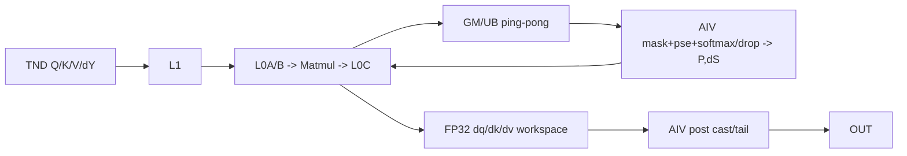
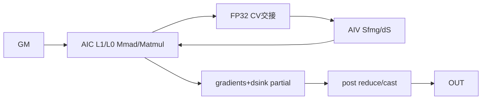

# FlashAttentionUnpaddingScoreGrad A2/A3 ACLNN 算子知识

## 算子速览

| 项目 | 内容 |
|---|---|
| 实际入口 | `aclnnFlashAttentionUnpaddingScoreGradV5GetWorkspaceSize` / `GetMaxWorkspaceSize` / `aclnnFlashAttentionUnpaddingScoreGradV5`，公开两段式 ACLNN |
| 计算语义 | TND 变长 FlashAttention 反向：重算 `P=Dropout(Softmax(mask(scale·QKᵀ+pse)))`，再求 `dV=PᵀdY`、`dS`、`dQ=scale·dS·K`、`dK=scale·dSᵀ·Q`；可选 rope、pse、dropout、mask、sink。 |
| 输入输出 | `query/key/value/dy/attentionIn` 与 softmax 中间量；累积 `actualSeqQLen/actualSeqKvLen` 划分 TND batch；输出 `dq/dk/dv`，可选 `dqRope/dkRope/dpse/dsink`。 |
| 执行类型 | `MIX_CV`；空输出为纯 AIV 清零支路 |
| Kernel 路线 | R-001 空输出；R-002 basic TND；R-003 确定性 TND；R-004 通用 unpadded；R-005 SameAB/sink |
| 核心资源 | 单次 MIX launch，GM user workspace、L1/L0A/L0B/L0C、UB/TQue、寄存器；AIC:AIV 任务类型 `KERNEL_TYPE_MIX_AIC_1_2` |
| 来源闭包 | `source_closed`：V5 ACLNN→L0 launcher→arch22 priority selector/POD→MIX entry→实际 Cube/Vector body→CMake 均固定到同一 Commit。 |
| 验证状态 | 已完成源码闭包检查；本次知识提取未执行编译、真机、数值或性能测试。 |

## 接口与语义

### 计算语义

对第 `b` 个变长段，`Sq_b=actualSeqQLen[b]-actualSeqQLen[b-1]`、`Skv_b=actualSeqKvLen[b]-actualSeqKvLen[b-1]`（首段直接取首元素）。主链为 `S=mask(scale·QKᵀ+pse)`、`P=Dropout(Softmax(S),keepProb)`、`dV=PᵀdY`、`dP=dYVᵀ`、`dS=SoftmaxGrad(dP,P)`、`dQ=scale·dSK`、`dK=scale·dSᵀQ`。sink 存在时 max/sum 还纳入 sink，`dsink` 由每头分块结果归并；FP16/BF16 主路线把梯度累加在 FP32 workspace，post 最后 cast。

### 输入、输出与属性

| 参数 | shape/layout | dtype | 约束、默认值与语义 |
|---|---|---|---|
| query/queryRope、key/keyRope、value、dy | TND；`query=[Tq,N1,D]`、`key=[Tkv,N2,D]`、`value=[Tkv,N2,Dv]` | A2/A3 API 检查允许 FP16/BF16/FP32；主输入通常同 dtype | `inputLayout` 必须是 `"TND"`；`N1=headNum`，`G=N1/N2`；queryRope/keyRope 成对使用。 |
| softmaxMax/softmaxSum | `[T,N,8]` 或 shape 为 TND、数据为 NTD | FP32 | `softmaxInLayout=""` 表示 TND；`same_as_input` 会先转置且排除 arch22 unpadded selector。 |
| attentionIn、pseShift、dropMask、attenMask、sink | TND 对应的逻辑域 | attention 与主输入一致；dropMask UINT8；sink FP32 | `keepProb<1` 与 dropMask 联动；A2/A3 V5 支持 sink；sink 输入为 1-D 时强制进入 SameAB route。 |
| actualSeqQLen/actualSeqKvLen | 一维累积长度数组 | int64 | 二者必须存在且非空才能命中 TND selector；尾部不参与 batch 用 0，API 检查 T 轴不小于有效累计长度。 |
| 属性 | 标量 | double/int64/string | `scaleValue`、`keepProb`、`preTokens`、`nextTokens`、`headNum>0`、`innerPrecise`、`sparseMode`、`pseType`、`softmaxInLayout`。 |
| 输出 | dq/dk/dv 与各输入逻辑 shape 对应 | 与对应 Q/K/V 相同 | `dpse`、rope 梯度和 `dsink` 由可选输入决定；非连续输出通过 `ViewCopy` 提交。 |

### 入口与版本

固定仓公开文档把 V5 标为 A2、A3 和 Ascend 950 支持；V5 相对 V4 增加 `sinkInOptional/dsinkOut`，是这些平台当前公开的最新 Unpadding 版本。`GetWorkspaceSize` 使用真实序列值；`GetMaxWorkspaceSize` 用 fake tensor 触发 max-workspace 路径，且拒绝非空 `dropMaskOptional`。执行接口调用 `CommonOpExecutorRun`。

## Host/Launcher 执行流程

### 参数校验与前处理

入口先要求 `inputLayout=="TND"`，创建 executor，校验必选输入/输出、workspaceSize/executor 非空和 `headNum>0`。`InputOutputDtypeAndShapeCheck` 保证输出 dtype 对应输入；sink 路线拒绝 FP32 query，且 sink/dsink 必须 FP32。全主输出及 dpse 均为空时返回 workspace 0。随后执行框架连续化；`GetInputShapeInfo` 提取 T/N/D、判断 D/Dv padding。TND 不做 BNSD transpose；必要时对 D/Dv 尾轴 Pad，`softmaxInLayout==same_as_input` 时转置 softmax max/sum。

### 参数、Workspace 与生命周期

`l0op::FlashAttentionScoreGrad` 把 IntArray 转为 executor 持有的 int64 tensor，分配七个逻辑输出并 infer-shape，然后只添加一个 `FlashAttentionScoreGrad` AICore 节点。arch22 通用/SameAB route 从 `MUL_CORE_SYNC_BUFFER` 起，按 `GM_ALIGN` 对齐分配 FP32 `dq[/dqRope]/dk[/dkRope]/dv`，再按需加入 drop-mask 展开、softmax-grad、Matmul ping-pong、sink partial sum、PSE 与确定性切片，末尾加 `WORKSPACE_BUFFER`。workspace backing 生命周期覆盖 executor 同一 stream 的完整图。

### 启动图与失败传播

```text
V5GetWorkspaceSize
  -> Contiguous/可选Pad/softmax transpose（框架节点）
  -> l0op::FlashAttentionScoreGrad::INFER_SHAPE
  -> ADD_TO_LAUNCHER_LIST_AICORE(FlashAttentionScoreGrad)
     -> TilingFlashAttentionGradScore
     -> 单次 flash_attention_score_grad MIX_CV launch
        -> Pre::Process -> SyncALLCores
        -> Cube/AIV主循环 -> SyncALLCores
        -> Post::Process
  -> 可选Slice/ViewCopy（框架节点）
V5 -> CommonOpExecutorRun(workspace, executor, stream)
```

任一校验、infer-shape、tiling、launcher 或 ViewCopy 失败都立即返回。Pad/Transpose/ViewCopy 是通用 L0 边界；算子自有 device 闭包是单 MIX Kernel，而非 pre/main/post 三个 Kernel。

## Route 与参数设计

### 分核与资源计算

arch22 registry 按 priority 数值小者优先。公共层把累积序列还原为每 batch `Sq/Skv`，得到 `B,T1,T2,N1,N2,G,D,Dv`；各模板计算 `s1Inner/s2Inner/s1CvInner/s2CvInner`、`blockOuter/blockFactor`、former/tail 和 Matmul tiling。blockDim 由 AIC/AIV 比例与有效 block 数编码；entry 固定 `KERNEL_TYPE_MIX_AIC_1_2`。FP32 梯度物理长度用 `qSizeAlign/kvSizeAlign/vSizeAlign`，逻辑段尾由 actualSeq 与 device mask/Fixpipe 参数裁剪。

### Route 选择

| 顺序 | Route | Key/模板 | 精确选择条件与优先级 | 不适用去向 |
|---:|---|---|---|---|
| 0 | R-001 空输出 | key 0 | 非 3510 且 `IsEmptyOutput \|\| IsTndAllSeqLenZero` | AIV 清零后返回 |
| 1 | R-002 basic TND | priority 1001，9/9/9 | 非 FP32、TND、非确定性、无 sink/PSE/drop；sparse 0/2/3 与 mask 配套；`D==Dv<=128 && D%16==0 && T1==T2`、各段等长且 S 不超模板上限 | R-004/R-005 |
| 2 | R-003 确定性 TND | priority 1000 S1S2_BN2；1002 basic-det；1100 SameAB-det | deterministic=1；BN2 要无 sink/rope、K/V同shape，FP32或maxS<1024；basic-det补非FP32、无PSE、D==Dv<=128；SameAB-det补其余非FP32无rope，sink直接命中 | 后续模板或失败 |
| 3 | R-004 通用 unpadded | priority 2000，S1S2_BN2GS1S2 | 无 sink；`softmaxInLayout==""`；非 tnd2bsh；actualSeq双数组存在；非 max-workspace；`!isTndSABHit` | R-005 |
| 4 | R-005 SameAB/sink | priority 15500/1100 | 1-D sink直接命中；或 TND `isTndSABHit`。FP32不支持非确定性SameAB；源码中的 D=128/B/G/keepProb 特例会再次按空段、异长段和S上限判定 | 无模板则失败 |

```text
empty/all-zero -> R-001
else deterministic -> BN2(1000) -> basic-det(1002) -> SameAB-det(1100)
else basic(1001) -> unpadded(2000,!SAB,!sink) -> SameAB(15500,SAB或sink)
只有 DoTiling 返回 GRAPH_PARAM_INVALID 才继续下一 priority。
```

### 模板/实现执行矩阵

| Route | key/selector | dtype/shape/platform 完整命中条件 | 执行族与 kernel 节点 | 实际模板/body | 内存与同步特征 | tail/fallback |
|---|---|---|---|---|---|---|
| R-001 | key 0 | 空输出/全零段 | AIV，同一entry | `FlashAttentionScoreGradEmptyTensor<T>` | former/tail分核清零 | 越界core不写 |
| R-002 | 9/9/9 | 见上 | 单Kernel MIX_CV | `FlashAttentionScoreGradBasic` | 双Matmul GM ping-pong、FP32 dq/dk/dv/sfmg；跨核flag | 不满足到后续模板 |
| R-003 | 1/3/4、9/9/9-det 或 SameAB-det | deterministic | 单Kernel MIX_CV | BN2 / BasicDet / SameAB | 固定归并workspace与跨AIC/AIV flag | 无安全fallback则失败 |
| R-004 | UB0=4,UB1=3,Block=4,IsSameAB=0,TND | DAV_2201、非sink/SAB | 单Kernel MIX_CV | `Pre`→`S1s2Bn2gs1s2`→`Post` | mm1/mm3/mm4、FP32 gradient slices、阶段barrier | actualSeq裁尾；拒绝后到R-005 |
| R-005 | 同上、IsSameAB=1 | sink/SAB，FP16/BF16；det分型 | 单Kernel MIX_CV | `Pre`→AIV `Sfmg`→`SameAB`→AIV `Post` | L1-custom/Matmul或手写Mmad；sink partial；flags | shape/template失败关闭 |

### 隐藏性能 Guard

| Guard | Host/Tiling 条件 | Device/资源原因 | 影响 Route | 不满足时去向 | 源码符号 |
|---|---|---|---|---|---|
| priority | registry map升序 | 先选窄 specialization | 全部 | 下一 priority | `TilingRegistryArch::DoTilingImpl` |
| softmax layout | `tndSoftmaxIn==""` | POD/body假定对应排布 | R-003/R-004 | 其它模板/失败 | `IsCapable` |
| sink | sink shape维数为1 | 需sink max/sum与dsink归并 | R-004→R-005 | SameAB | unpadded `IsCapable` |
| basic容量 | D==Dv<=128、D%16==0、等长、无PSE/drop | 固定64×128 softmax与16×128×128 Matmul slice | R-002 | R-004/R-005 | `IsShapeCapable` |
| deterministic | flag==1 | 禁止无序归并，追加det workspace | R-003 | 非det route | deterministic `IsCapable` |
| GM对齐 | slice按GM_ALIGN对齐 | post/Matmul独立消费 | R-002..R-005 | tiling失败 | `GetWorkspaceSize` |

### POD/ABI

| 结构 | 字段 | 类型/位宽 | ABI 布局 | 单位 | Host/launcher producer | Device consumer | 边界 |
|---|---|---|---|---|---|---|---|
| BaseParams | `b,n2,g,s1,s2,d,value_d` | int64/64 | 类声明顺序；固定仓未给sizeof/alignof/offsetof数值 | 轴长 | `Init/SaveTilingData` | 地址/循环 | 真实段长仍读actualSeq |
| SplitCoreParams | `s1Outer/s1Inner/s1CvInner/s2Outer/s2Inner/blockOuter` | int64+uint32 | 同上 | tile/块/核 | split函数 | core→tile映射 | former/tail不可互换 |
| PreParams | `qPreBlockFactor/Total/Tail` | uint32/32 | 声明顺序 | 元素/块 | `DoPreTiling` | `Pre::Process` | A2/A3为32位 |
| PreParams | `maskPreBlockTotal/dropBeginAddr` | uint64/64 | 声明顺序 | 元素/字节 | `DoPreTiling` | dropout unpack | 仅drop route active |
| PostParams | `dq/dk/dvWorkSpaceOffset` | uint64/64 | 声明顺序 | 字节 | `SetPostTilingData` | `Post::Init` | 相对user workspace |
| PostParams | `q/kv/vSizeAlign` | uint64/64 | 声明顺序 | 元素 | Host shape/alignment | post cast | 物理容量非逻辑长度 |
| PostParams | `dsinksumWorkSpaceOffset` | uint64/64 | 声明顺序 | 字节 | SameAB tiling | sink post reduce | 无sink inactive |
| TCubeTiling | base/step/depth字段 | 外部固定POD | 本仓未给offsetof | tile | Matmul tiling API | Matmul对象 | mm1/mm3/mm4不可混用 |

### Route 源码闭包

| Route | Key/selector | Host/Tiling producer | POD/参数 | Kernel entry/router | Kernel body/直接依赖 | 构建接线 |
|---|---|---|---|---|---|---|
| R-001 | key0 | `RunEmptyTiling` | empty tiling | common entry | EmptyTensor | `op_host/CMakeLists.txt` |
| R-002 | priority1001 | Mla tiling | MLA POD | basic branch | basic body | 同上 |
| R-003 | 1000/1002/1100 | det tiling classes | BN2/BasicDet/SameAB POD | det branches | BN2/basic_det/SameAB | 同上 |
| R-004 | priority2000 | unpadded继承通用tiling | S1S2BN2GS1S2 POD | IsSameAB=0 | general body+pre/post | 同上 |
| R-005 | 15500/1100 | SameAB tiling | SameAB POD | IsSameAB=1 | SAB+sfmg/pre/post | 同上 |

## Kernel 实现

### 公共执行流程

entry 取 `user=GetUserWorkspace(workspace)` 并按 compile-time key 解包 POD。pre 由 AIV 清零 FP32 gradient slice、必要时展开 bit dropMask/计算 softmax-grad，然后 `SyncALLCores`；主阶段 AIC 计算 `dY·Vᵀ`、`Q·Kᵀ`、`dS·K`、`dSᵀ·Q`、`Pᵀ·dY`，AIV 做 mask/pse/dropout/softmax backward/cast；post 在 AIV 把 FP32 dq/dk/dv 转输出dtype并裁尾。

### Route R-004：通用 unpadded S1S2_BN2GS1S2

#### 适用条件

##### 选择证据

| 层级 | 文件 | 符号 | 源码谓词/参数 | 结果/下一跳 |
|---|---|---|---|---|
| API | `op_api/aclnn_flash_attention_score_grad.cpp` | V5GetWorkspaceSize | TND与参数校验 | L0节点 |
| Tiling | `...tiling_unpadded_attension.cpp` | `IsCapable` | 无sink、softmax layout空、actualSeq存在、非max、非SAB | priority2000 |
| Router | `op_kernel/flash_attention_score_grad.cpp` | IsSameAB=0 branch | 4/3/4,TND | general宏 |

#### Device 数据流

##### 函数级调用链

```text
entry -> Pre::Process/SyncALLCores
 -> REGIST_MATMUL_OBJ(mm1,mm3,mm4)
 -> S1s2Bn2gs1s2::Process/SyncALLCores
 -> Post::Process
```

##### 源码等价伪码

```text
AIV清零dq/dk/dv FP32 slice并按需解包dropMask；barrier
for tile(b,n2,g,s1o,s2o), 用actualSeq修正base与tail:
  AIC算dY@V^T和Q@K^T；flag通知AIV
  AIV载入max/sum/mask/pse/drop，重算P和dS；flag通知AIC
  AIC累加dS@K、dS^T@Q、P^T@dY到FP32 workspace
barrier；AIV post乘scale/cast并只提交TND有效前缀
```

#### 内存与数据搬运

##### 资源与搬运表

| 层级/缓冲区 | offset/地址公式 | extent/容量公式 | dtype/layout | producer | consumer | owner/lifetime | 对齐/复用 |
|---|---|---|---|---|---|---|---|
| GM输入 | 段前缀×N×D+head/tile | s1/s2 tile×D | API dtype/TND | API | Cube/AIV | stream | actualSeq裁尾 |
| user:dq | MUL_CORE_SYNC_BUFFER | align(qSizeAlign×4) | FP32/ND | dS·K | Post | launch | 独立slice |
| user:dk/dv | 顺序对齐offset | align(kv/vSizeAlign×4) | FP32/ND | dSᵀQ/PᵀdY | Post | launch | 不别名 |
| L1 | TCubeTiling | A/B stage；精确常量固定仓不可见 | NZ/ND | MTE2 | L0A/B | tile | step/depth复用 |
| L0A/B/C | baseM/N/K | baseM×baseK、baseK×baseN、baseM×baseN×4 | 输入/FP32 | LoadData/Mmad | Fixpipe/AIV | pingpong | M/N/K tail |
| UB | POD buffer长度 | input/cast/outputBufferLen或vector tile | FP32/输入 | GM/Fixpipe | Vector/GM | loop | TQue/event |

##### 分层内存布局



##### 字节账、交接边与复用顺序

```text
workspace = MUL_CORE_SYNC_BUFFER
 + align(qSizeAlign*4) + [rope]align(qRopeSizeAlign*4)
 + align(kvSizeAlign*4) + [rope]align(kRopeSizeAlign*4)
 + align(vSizeAlign*4) + optional(drop/matmul/pse/det) + WORKSPACE_BUFFER
L0C_per_tile = baseM*baseN*4 bytes；其余容量取TCubeTiling/PreParams/PostParams。
```

| 边/复用子区 | producer | offset/extent | dtype/layout | consumer | ordering/sync | owner/lifetime | 安全条件 |
|---|---|---|---|---|---|---|---|
| QK/dYV→AIV | AIC Matmul/Fixpipe | ping/pong tile | FP32 ND/NZ | softmax backward | CrossCore flag | tile | 下一轮覆盖前消费 |
| P/dS→AIC | AIV | ping/pong tile | FP32 | gradient Matmul | set/wait flag | tile | parity一致 |
| gradients→post | AIC主阶段 | POD offsets/sizes | FP32 ND | AIV post | SyncALLCores | launch | post只读有效slice |

#### 同步、精度与尾块

##### 同步与数值边界表

| 阶段 | primitive/机制 | producer | consumer/等待点 | 保护对象 | 精度/尾块 |
|---|---|---|---|---|---|
| pre→main | SyncALLCores | clear/unpack | main | workspace/drop | 清零后累加 |
| Cube↔Vector | CrossCore+MTE/FIX/V event | AIC/AIV | 对侧wait | tile | FP32 dS，actualSeq tail |
| main→post | SyncALLCores | gradients | post | FP32 slices | 累加完成后cast |

#### 关键实现

##### 符号证据表

| 阶段 | 文件 | 符号/模板实例 | 实现事实 |
|---|---|---|---|
| Host/Tiling producer | `...tiling_unpadded_attension.cpp` | `IsCapable` | TND selector |
| Kernel entry/router | `op_kernel/flash_attention_score_grad.cpp` | general宏 | 单launch三阶段 |
| Device body/helper | `..._s1s2_bn2gs1s2.h` | `Process` | Cube/Vector、地址、tail |

### Route R-005：SameAB / sink

#### 适用条件

##### 选择证据

| 层级 | 文件 | 符号 | 源码谓词/参数 | 结果/下一跳 |
|---|---|---|---|---|
| Tiling | `..._sab.cpp` | SameAb `IsCapable` | sink 1-D或TND SAB | SameAB key |
| Tiling | 同文件 | SameABDeterministic `IsCapable` | det；sink或无rope非FP32 | det SameAB |
| Router | entry | IsSameAB=1 | dtype/rope/D template | 普通或L1-custom宏 |

#### Device 数据流

##### 函数级调用链

```text
Pre -> [AIV]Sfmg -> SameAB::ProcessFirstMM -> InitBuffer -> Process
 -> SyncALLCores -> [AIV]Post（含dsink归并）
```

##### 源码等价伪码

```text
clear gradient/sink partial
AIC firstMM与AIV sfmg通过flag交接
按s1o/s2o：GM->L1->L0A/B，Mmad/Matmul，Fixpipe写FP32 gradients
sink时各core/head写partial；barrier后AIV归并并cast/copy输出
```

#### 内存与数据搬运

##### 资源与搬运表

| 层级/缓冲区 | offset/地址公式 | extent/容量公式 | dtype/layout | producer | consumer | owner/lifetime | 对齐/复用 |
|---|---|---|---|---|---|---|---|
| dsink partial | dsinksumOffset+(core*n2*g+head)*4 | align(coreNum*n2*g*4) | FP32 | AIV | Post reduce | launch | 无sink inactive |
| CV交接 | common slices后 | align(vectorCoreNum*s1CvInner*s2CvInner*4*MATMUL_INPUT_NUM) | FP32 | AIC/AIV | 对侧 | tile | flags |
| L1/L0 | S/DTemplate | L1-custom或TCube | 输入/FP32 | MTE/Matmul | Fixpipe | tile | pipe events |
| UB | sfmg/pre/post | POD给定 | FP32/输出 | GM/Fixpipe | Vector | loop | pingpong |

##### 分层内存布局



##### 字节账、交接边与复用顺序

```text
workspace_sameab = common gradient slices
 + [sink]align(coreNum*n2*g*4) + [drop]align(dropMaskSize)
 + aligned softmax/matmul CV slices + WORKSPACE_BUFFER
```

| 边/复用子区 | producer | offset/extent | dtype/layout | consumer | ordering/sync | owner/lifetime | 安全条件 |
|---|---|---|---|---|---|---|---|
| firstMM→Sfmg | AIC | ping/pong cubeBaseMN | FP32 | AIV | CUBE2VEC | tile | parity一致 |
| Sfmg→MM | AIV | CV slice | FP32 | AIC | VEC2CUBE | tile | wait后读 |
| dsink partial→post | AIV cores | core/head | FP32 | reducer | all-core sync | launch | partial全完成 |

#### 同步、精度与尾块

##### 同步与数值边界表

| 阶段 | primitive/机制 | producer | consumer/等待点 | 保护对象 | 精度/尾块 |
|---|---|---|---|---|---|
| L1/L0 | MTE1_MTE2、M_MTE1、M_FIX/FIX_M | DMA/Mmad/Fixpipe | 后继pipe | ping/pong | M/N/K tail |
| AIC/AIV | CrossCoreSet/WaitFlag | 双方 | 对侧 | CV slice | FP32中间量 |
| sink | all-core sync | partial writers | reducer | partial | FP32归并 |

#### 关键实现

##### 符号证据表

| 阶段 | 文件 | 符号/模板实例 | 实现事实 |
|---|---|---|---|
| Host/Tiling producer | `..._sab.cpp` | `IsCapable/GetWorkspaceSize` | sink/SAB与slice |
| Kernel entry/router | entry | SAMEAB宏 | rope/L1-custom/det实例 |
| Device body/helper | `..._sab.h` | `ProcessFirstMM/Process` | Mmad、events、FP32输出 |

## 算子特定优化

### Trick T-001：priority specialization 先窄后宽

#### 触发与源码依据

- 适用 Route：R-002～R-005
- 触发条件：DAV_2201 registry 按 priority 1000、1001、1002、1100、2000、15500…升序。
- Golden 来源：[`common/include/op_host/tiling_templates_registry.h:97`](../../../../../../../cann-ops-raw/ascendc/ops-transformer/be33d95bb755cedec3108f70805c1874d1792540/common/include/op_host/tiling_templates_registry.h)

**官方源码（固定 Commit 连续逐字摘录）**：

```cpp
ge::graphStatus status = tilingTemplate->DoTiling();
if (status != ge::GRAPH_PARAM_INVALID) {
    return status;
}
```

#### 机制与设计原因

窄 capability、固定 workspace 的 basic/deterministic route 先尝试；仅 PARAM_INVALID 落到通用 unpadded/SameAB。迁移必须保留 priority 与返回码语义。

#### 迁移边界

- 适用：多套 shape/feature specialization。
- 前提：不支持返回 PARAM_INVALID，真正错误不可吞掉。
- 失效：改变 priority 或删除 sink/SAB guard。
- 未验证：本次知识提取未执行编译、真机、数值或性能测试。

#### 错误做法

把所有TND合成一个key会丢失workspace和同步差异。

### Trick T-002：单 launch 内 pre/main/post 与 FP32 workspace

#### 触发与源码依据

- 适用 Route：R-004、R-005
- 触发条件：非空 route；entry宏依次构造pre、main、post。
- Golden 来源：[`attention/flash_attention_score_grad/op_kernel/flash_attention_score_grad.cpp:62`](../../../../../../../cann-ops-raw/ascendc/ops-transformer/be33d95bb755cedec3108f70805c1874d1792540/attention/flash_attention_score_grad/op_kernel/flash_attention_score_grad.cpp)

**官方源码（固定 Commit 连续逐字摘录）**：

```cpp
opPre.Process();
opPre.SyncALLCores();
pipeIn.Destroy();
TPipe pipeBase;
```

#### 机制与设计原因

pre清零/展开、Cube+Vector主计算和post cast在一次MIX launch内重建TPipe，以全核同步隔离阶段；FP32 workspace避免跨tile累加期间提前降精度。

#### 迁移边界

- 适用：跨核累加后统一cast的MIX算法。
- 前提：offset、barrier与TPipe生命周期完整保留。
- 失效：跳过SyncALLCores或让post覆盖活跃buffer。
- 未验证：本次知识提取未执行编译、真机、数值或性能测试。

#### 错误做法

固定源码明确只有一个entry，不能描述成三个独立Kernel。

## 模板与实现对比

| 对比维度 | R-002 basic | R-003 deterministic | R-004 unpadded | R-005 SameAB/sink | 设计选择依据 |
|---|---|---|---|---|---|
| 命中条件/优先级 | 1001窄shape | 1000/1002/1100 | 2000非SAB非sink | 15500/1100 | 先窄后宽 |
| 执行族/节点图 | 单MIX basic | 单MIX固定归并 | 单MIX pre-main-post | 单MIX sfmg/firstMM/post | 均非多Kernel |
| tile/scheduler | 固定softmax/Matmul | BN2/basic/SameAB det | S1S2_BN2GS1S2 | SameAB/L1-custom | shape/det |
| workspace | q/kv/sfmg+双MM | 追加det | 对齐gradient slices | 再加sink/CV | consumer差异 |
| AIC/AIV交接 | CUBE2VEC | 固定flags | Matmul↔softmax | firstMM↔Sfmg | 防覆盖 |
| 同步、精度与tail | FP32 | 固定归并 | actualSeq | sink FP32 reduce | 语义 |
| fallback/失败边界 | 下一priority | det模板/失败 | SameAB | 失败 | 未知key不执行 |

## 平台差异

| 项目 | A2 | A3 | 950 |
|---|---|---|---|
| 支持状态 | V5公开支持 | V5公开支持 | 独立 `_950` 卡 |
| Host/Launcher | DAV_2201 arch22 registry | 共用DAV_2201源码 | DAV_3510 varlen RegBase |
| Kernel/资源 | arch22 MIX 1:2 | 同左，核数取平台 | arch35独立POD/flags |

## 限制与失败边界

- Prompt给定的 `attention/flash_attention_unpadding_score_grad/` 在固定Commit不存在；公开实现已合并到 `attention/flash_attention_score_grad/`，本卡只沿V5 unpadding入口与TND可达路线闭合。
- `GetMaxWorkspaceSize` 不支持dropMask；A2/A3 sink route不支持FP32 query。非法TND、缺actualSeq、K/V shape不支持、softmax layout不匹配或无模板时失败关闭。
- POD未提供编译后的sizeof/alignof/offsetof数值；保留声明顺序、类型和单位，不推造ABI常量。
- 本次知识提取未执行编译、真机、数值或性能测试。

## 源码索引

### 链路索引

| 链路阶段 | 文件 | 关键符号 | 支撑内容 |
|---|---|---|---|
| 入口声明/约束 | `docs/aclnnFlashAttentionUnpaddingScoreGradV5.md` | 产品表/V5原型 | 平台、公式、限制 |
| 入口声明/约束 | `op_api/aclnn_flash_attention_score_grad.h` | V5三入口 | ACLNN ABI |
| 入口实现 | `op_api/aclnn_flash_attention_score_grad.cpp` | V5 workspace helper | 校验/前后处理 |
| 入口实现 | `op_api/flash_attention_score_grad.cpp` | L0函数 | 唯一AICore节点 |
| Host/Tiling/Launcher | `op_host/flash_attention_score_grad_tiling.cpp` | tiling入口 | 空域/arch registry |
| Host/Tiling/Launcher | `op_host/arch22/flash_attention_score_grad_tiling_unpadded_attension.cpp` | `IsCapable` | 通用TND |
| Host/Tiling/Launcher | `op_host/arch22/flash_attention_score_grad_tiling_s1s2_bn2gs1s2_sab.cpp` | SameAB selectors | sink/SAB |
| Host/Tiling/Launcher | `op_kernel/arch22/flash_attention_score_grad_tiling.h` | POD classes | Device ABI |
| Kernel entry/body | `op_kernel/flash_attention_score_grad.cpp` | entry | router/launch图 |
| Kernel entry/body | `op_kernel/arch22/flash_attention_score_grad_s1s2_bn2gs1s2.h` | `Process` | 通用body |
| Kernel entry/body | `op_kernel/arch22/flash_attention_score_grad_s1s2_bn2gs1s2_sab.h` | SameAB body | sink/L1-custom |
| 构建接线 | `op_host/CMakeLists.txt` | `add_op_to_compiled_list` | 编译接线 |

### 实现复用检查

| 检查项 | 可复用事实 | 不得改变的约束 | 源码符号 |
|---|---|---|---|
| ABI/POD | Base/Split/Pre/Post/TCube字段语义 | 位宽、顺序、单位 | tiling头 |
| 调用顺序 | ACLNN→L0→单MIX pre→main→post | 不拆成无同步多launch | entry宏 |
| workspace/内存 | FP32 gradients及sink/drop/det slices | offset/alignment/lifetime | GetWorkspaceSize |
| 同步 | barrier+CrossCore/pipe events | flag轮次与pingpong | body |
| 精度与尾块 | FP32累计后cast、actualSeq裁尾 | 不提前cast/跨段 | body/Post |
| 失败边界 | 只对PARAM_INVALID fallback | 其它错误不可吞掉 | DoTilingImpl |