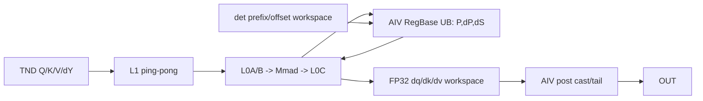
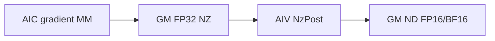

# FlashAttentionUnpaddingScoreGrad 950 ACLNN 算子知识

## 算子速览

| 项目 | 内容 |
|---|---|
| 实际入口 | `aclnnFlashAttentionUnpaddingScoreGradV5GetWorkspaceSize` / `GetMaxWorkspaceSize` / `aclnnFlashAttentionUnpaddingScoreGradV5`，公开两段式 ACLNN |
| 计算语义 | 在 TND 变长段上重算 attention 概率并求 `dV=PᵀdY`、`dS=SoftmaxGrad(dYVᵀ,P)`、`dQ=scale·dSK`、`dK=scale·dSᵀQ`。 |
| 输入输出 | `[Tq,Nq,D]` query/dy、`[Tkv,Nkv,D]` key/value、softmax统计量和累积 actualSeq；输出 dq/dk/dv 与可选 rope/dpse。950 公开文档明确暂不支持 sink。 |
| 执行类型 | 一个 `KERNEL_TYPE_MIX_AIC_1_2` 的 RegBase `MIX_CV` AICore 节点；AIC 与两路 AIV 在同一 launch 内协作。API 全空提前返回与内部 empty-key 仅是 guard 终点，不扩张公开有效域。 |
| Kernel 路线 | R-001 BN2；R-002 BN2S2 非确定性 ND；R-003 BN2S2 非确定性 TND swizzle；R-004 BN2S2 新确定性；R-005 BN2GS1S2 非确定性 ND；R-006 BN2GS1S2 非确定性 NZ；R-007 BN2GS1S2 新确定性；R-008 BN2GS1S2 旧确定性。 |
| 核心资源 | GM user workspace、L1/L0A/L0B/L0C、RegBase UB/寄存器；AIC/AIV 通过 CrossCore flags 在同一 launch 交接 |
| 来源闭包 | `source_closed`：V5 ACLNN→L0 launcher→DAV_3510 varlen selector/POD/key→RegBase MIX entry→Cube/Vector body→Ascend950 构建选项。 |
| 验证状态 | 已完成源码闭包检查；本次知识提取未执行编译、真机、数值或性能测试。 |

## 接口与语义

### 计算语义

每个 batch 的 `Sq/Skv` 由累积 actualSeq 差分得到。AIC 计算 `dP=dY·Vᵀ` 与 `Q·Kᵀ`；AIV 用 softmaxMax/softmaxSum、mask、PSE 与 dropout 重建 `P` 和 `dS`；AIC 再计算三个梯度 Matmul。FP16/BF16 route 以 FP32 累加，post 才转为输出 dtype。确定性 route 使用 `DeterType`、prefix/offset workspace 固定归并次序。950 V5 文档对 Ascend 950 标记 `sinkInOptional` 暂不支持，因此正式 route 不纳入 sink/dsink。

### 输入、输出与属性

| 参数 | shape/layout | dtype | 约束、默认值与语义 |
|---|---|---|---|
| query/key/value/dy | query `[Tq,Nq,D]`，key/value `[Tkv,Nkv,D]`，TND | FP16、BF16，四者同 dtype | `inputLayout="TND"`；`Nq/Nkv` 必须为非零整数，`Nq∈[1,256]`；公开 V5 要求 Q/K/V 的 D 相同，`D∈[1,768]`。共享 API 中 FP32/FP8/HiFloat8 与 `D!=Dv` 分支不是本入口 950 公开域。 |
| queryRope/keyRope | `[Tq,Nq,Dr]` / `[Tkv,Nkv,Dr]`，TND，可选且成对 | BF16 | rope 存在时 `SetSplitAxis` 排除 BN2/BN2S2，走 BN2GS1S2，并令 D 模板覆盖主维和 rope 维。 |
| softmaxMax/softmaxSum | 与各 token/head 对应，shape 按文档 | FP32 | 数据排布为 TND 时 `softmaxInLayout=""`；为 NTD 时传 `"same_as_input"`。950 API 不转置该统计量，但 varlen priority-900 selector 可接管两种值。 |
| softmaxIn/attentionIn | softmaxIn 为预留空参数；attentionIn 与 query shape 相同 | softmaxIn 无；attentionIn FP16/BF16/FP32 | softmaxIn 暂未使用，调用传空；attentionIn 是可选的前向输出。 |
| pse/drop/attenMask | 可选 | PSE同主dtype；drop UINT8；mask BOOL/UINT8 | `keepProb<1` 编码 `IsDrop`；dropMask 与 rope 不兼容；drop bit长非8整除会退出BN2；PSE/Mask进入key。 |
| paddingMask/sink | 预留/平台禁用 | 无 / FP32 | paddingMask 调用时传空；Ascend 950 的 sinkIn/dsinkOut 不支持。 |
| prefix/qStartIdx/kvStartIdx | 0或1维 INT64 array | INT64 | prefix 仅 sparseMode=6 压缩场景；startIdx 表示外切块在全局 Q/KV sequence 的起点。 |
| actualSeqQLen/KvLen | 相同长度的一维累积数组 | int64 | 本 Unpadding 入口的有效 TND 调用提供 actualSeqQ/KV；varlen selector要求 Q 数组存在且 size 非0，Host 差分得到每 batch 的 Sq/Skv，并剔除双侧尾零 batch。 |
| 属性 | 标量 | double/int64/string | `keepProb∈(0,1]`；sparseMode 取0..8但不含5，rope时不支持6；pseType 取0..3；innerPrecise预留；deterministic来自context。 |
| 输出 | dq/dk/dv、可选dqRope/dkRope/dpse | dq/dk/dv 与主输入同 dtype；rope 梯度 BF16 | 非连续目标由 ViewCopy 提交；`sinkInOptional`/`dsinkOut` 在 950 公开入口不可用。 |

### 入口与版本

固定 Commit 同时声明基础版、V2、V3、V4、V5；V5 是最新公开 Unpadding 版本。产品表明确支持 Ascend 950PR/950DT、A2、A3；本 `_950` 卡仅覆盖 950PR/950DT，且文档明确该平台暂不支持 `sinkInOptional`。V5 workspace helper 进入共享 L0 `FlashAttentionScoreGrad` 节点；`npuArch==DAV_3510` 与 actualSeqQ 存在使 arch35 varlen priority-900 selector 命中。

## Host/Launcher 执行流程

### 参数校验与前处理

ACLNN 层要求 TND、必选输入输出非空、`headNum>0`，完成 dtype/shape/连续性检查。`GetInputShapeInfo` 取 `Tq/Tkv/Nq/Nkv/D`；950 非 StrideLimited 分支不做 A2/A3 的 D padding/transpose。actualSeq `aclIntArray` 由 L0 转成 INT64 tensor。`NeedTransposeSoftmaxTensor` 在 Ascend 950 返回 false，所以 `softmaxInLayout="same_as_input"` 不被 API 转置；该值仍由 varlen priority-900 selector接管。前后处理保留连续化与 ViewCopy；公开 sink 输入在更外层即被平台约束排除。

### 参数、Workspace 与生命周期

`FlashAttentionScoreGradTilingVarlenRegbase` priority 900 先于 normal RegBase 950，只要 DAV_3510 且 actualSeqQ存在就接管。Host先读取 UB/L1/L0/L2 与AIC/AIV核数，再生成 `BaseParams/SplitCoreParams/PreParams/PostParams/TndParam/DeterParam`。workspace从0起按512B对齐排 dq/dk/dv FP32 slice、drop-mask展开、pre-sfmg、确定性和固定 `WORKSPACE_BUFFER`；同一 user workspace 在 pre/main/post 中按POD offset复用，owner为executor/调用者，保持到stream完成。

### 启动图与失败传播

```text
V5GetWorkspaceSize
 -> Contiguous/校验 -> l0op::FlashAttentionScoreGrad
 -> TilingFlashAttentionGradScore
    -> [empty] RunEmptyTilingRegbase
    -> [nonempty] VarlenRegbase(priority900)::DoTiling
       -> SetSplitAxis -> DoSplit -> DoSparse -> Init/Pre/PostTiling -> GetTilingKey
 -> 单次 flash_attention_score_grad_apt MIX launch
    -> RegbaseFAG -> Pre -> Kernel/KernelDeter(CubeBlock,VecBlock) -> Post
 -> ViewCopy
V5 -> CommonOpExecutorRun(same stream)
```

任何 API、tiling资源、selector、key、launcher或输出提交失败都阻止后继。单个 AICore node 的 AIC/AIV交接依赖 kernel内 CrossCore flag，不依赖额外stream/event。

## Route 与参数设计

### 分核与资源计算

`SetSplitAxis` 先判 BN2：`S1/S2<=BN2_MAX_S`、`N1==N2`、`D<=BN2_MAX_D`、共享实现排除FP32/Float8/HiFloat8、`D==Dv`、无rope、无尾零；TND且D>128或drop位数不整除8会撤销。非BN2时若无rope、D不超上限、N1==N2、共享实现非FP32/Float8、keepProb满足且TND，选择 BN2S2；其余走 BN2GS1S2。公开 FP16/BF16 TND 的 S1/S2 模板均为128，因此 `s1Inner=64`、`s1CvInner=128`、`s2Inner=128`；D模板取64/128/192/256/768，rope强制192档。随后计算 outer/tail；TND sparse函数把 `(b,n2,g,s1o,s2o)` 有效块前缀分给 AIC，blockDim由 `CalcTschBlockDim(blockOuter*2,aicNum,aivNum)` 或确定性规则给出。

### Route 选择

| 顺序 | Route | Key/模板 | 精确选择条件与优先级 | 不适用去向 |
|---:|---|---|---|---|
| 1 | R-001 BN2 | `SplitAxis=BN2`，deterministic 强制关 | `S1/S2<=128`、Nq=Nkv、D<=128、无 rope/尾零，drop 位长可被8整除，且 BN2 sparse 条件成立 | R-002/R-005 |
| 2 | R-002 BN2S2 非确定性 ND | `SplitAxis=BN2S2, Deter=NO, Swizzle=0` | BN2 未命中；无 rope、Nq=Nkv、D<=512，`keepProb==1` 或 D<=128；`DoBn2s2Sparse` 成功且 `blockOuter>=aicNum` | R-005 |
| 3 | R-003 BN2S2 非确定性 swizzle | `SplitAxis=BN2S2, Deter=NO, Swizzle=1` | R-002 条件外再要求 `enableSwizzle`、B<129、无零长度段/尾零且 sparse 类型支持 | 同 split 关闭 swizzle，即 R-002 |
| 4 | R-004 BN2S2 新确定性 | `SplitAxis=BN2S2, Deter=new` | runtime deterministic；仅 dense/band 由 `SupportTNDBns2` 保留 BN2S2；Host 生成新确定性 prefix | R-007/R-008 |
| 5 | R-005 BN2GS1S2 非确定性 ND | `SplitAxis=BN2GS1S2, Deter=NO, NZ=0` | 其余非确定性有效 TND：含 rope、GQA、BN2S2 sparse 失败、causal 等；不满足 NZ guard | 不可 tiling 则失败 |
| 6 | R-006 BN2GS1S2 非确定性 NZ | `SplitAxis=BN2GS1S2, Deter=NO, NZ=1` | R-005 外再要求 64<D<128、D%16!=0、enableSwizzle、S1/S2>=2048 | guard 不满足回 R-005 |
| 7 | R-007 BN2GS1S2 新确定性 | `SplitAxis=BN2GS1S2, Deter=new` | deterministic 且 dense/causal/band 使用新 key；causal 不允许 BN2S2，故在此 | 不支持的新 key 转 R-008 或失败 |
| 8 | R-008 BN2GS1S2 旧确定性 | `SplitAxis=BN2GS1S2, Deter=old` | deterministic 且 sparse 类型不属于新 dense/causal/band 集合 | 失败关闭 |

```text
API all-empty -> workspace=0/no Device（失败/空域 guard，不计正式 Route）
else VarlenRegbase(priority900)
  isBn2 -> R-001
  else BN2S2 candidate && sparse success:
    deterministic && SupportTNDBns2 -> R-004
    non-deterministic && swizzle guard -> R-003
    non-deterministic -> R-002
  else BN2GS1S2:
    non-deterministic && NZ guard -> R-006
    non-deterministic -> R-005
    new deterministic sparse -> R-007
    old deterministic sparse -> R-008
```

### 模板/实现执行矩阵

| Route | key/selector | dtype/shape/platform 完整命中条件 | 执行族与 kernel 节点 | 实际模板/body | 内存与同步特征 | tail/fallback |
|---|---|---|---|---|---|---|
| R-001 | BN2 key | FP16/BF16 TND，小 S、N 等、D<=128 | 单 `MIX_CV` | BN2 macro + `Kernel<CubeBlock,VecBlock>` | AIC:AIV=1:2，FP32 MM/vector 中间量 | guard 失败转 BN2S2/GS |
| R-002 | BN2S2, no-deter/no-swizzle | FP16/BF16 TND、N 等、无 rope | 单 `MIX_CV` | general macro + normal Kernel | dq 全量 FP32，dk/dv 为每 AIC slice | sparse 块不足转 R-005 |
| R-003 | BN2S2, swizzle | R-002 + B<129/无零段 | 单 `MIX_CV` | 同 R-002 + `TndSwizzleParam` | prefix 重排，其他同步相同 | 关闭 swizzle 回 R-002 |
| R-004 | BN2S2, new-deter | dense/band deterministic | 单 `MIX_CV` | `KernelDeter` + `DeterParam` | 固定 prefix/offset 归并 | causal/不支持 sparse 转 GS |
| R-005 | GS, normal ND | 其余非确定性公开域 | 单 `MIX_CV` | normal Kernel + ND post | dq/dk/dv 三个全量 FP32 slice | NZ guard 转 R-006 |
| R-006 | GS, normal NZ | 64<D<128 非16对齐等 guard | 单 `MIX_CV` | normal Kernel + `NzPost` | AIC Fixpipe 写 NZ，AIV 恢复 ND | guard 失效回 R-005 |
| R-007 | GS, new-deter | dense/causal/band deterministic | 单 `MIX_CV` | `KernelDeter` 新确定性 | `DeterParam` prefix 固定归并 | 失败关闭 |
| R-008 | GS, old-deter | 其它 sparse deterministic | 单 `MIX_CV` | `KernelDeter` 旧确定性 | 额外 per-core workspace 与 offset list | 失败关闭 |

### 隐藏性能 Guard

| Guard | Host/Tiling 条件 | Device/资源原因 | 影响 Route | 不满足时去向 | 源码符号 |
|---|---|---|---|---|---|
| varlen优先 | DAV_3510且actualSeqQ size>0，priority900；不限制 `softmaxInLayout` | TND prefix/zero-tail需要专用 producer | R-001～R-008 | normal950仅非varlen共享入口 | Varlen `IsCapable` |
| BN2 | 小S、N等、D等、无rope、无尾零；共享实现另排除FP32/FP8 | 简化head映射与output位置 | R-001 | R-002/R-005 | `SetSplitAxis` |
| drop bit对齐 | `dropoutIsDivisibleBy8!=0` | BN2直接读取bit mask，不需展开GM | R-001 | R-002/R-005 | `SetSplitAxis` |
| BN2S2 | TND、无rope、N等、D上限；共享实现另排除FP32/FP8 | 按S2开核并复用S1计算 | R-002/R-003/R-004 | R-005/R-007/R-008 | `bn2S2RouteLimit` |
| TND swizzle | 非det、BN2S2、enableSwizzle、B<129、无零段/尾零 | prefix表重排跨batch tile以改善L2/负载 | R-003 | 同route无swizzle | `tndBaseInfo.isTndSwizzle` |
| NZ output | BN2GS1S2、64<D<128、D%16!=0、非old-det、swizzle、S1/S2阈值 | Fixpipe NZ避免非对齐ND输出 | R-006 | R-005 ND输出 | `isNzOut` |
| deterministic | runtime deterministic；BN2 强制关闭；dense/causal/band 走 new，其它 sparse 走 old | 固定偏移/轮次归并 | R-004/R-007/R-008 | 非det body | `GetDeterSparseTilingKey` |

### POD/ABI

| 结构 | 字段 | 类型/位宽 | ABI 布局 | 单位 | Host/launcher producer | Device consumer | 边界 |
|---|---|---|---|---|---|---|---|
| Base | `coreNum` | int64_t/64 | 声明顺序；固定仓缺 sizeof/alignof/offsetof 数值 | 核 | `InitTilingData` | scheduler | <=36 |
| Base | `b` | int64_t/64 | 同上 | batch | actualSeq 解析 | scheduler | 公开 B<=20000 |
| Base | `n2` | int64_t/64 | 同上 | KV head | shape producer | 地址计算 | 1..256 |
| Base | `g` | int64_t/64 | 同上 | group | Nq/Nkv | 地址计算 | 正整数 |
| Base | `s1` | int64_t/64 | 同上 | token | max actualSeqQ | tail/sparse | 1..1M |
| Base | `s2` | int64_t/64 | 同上 | token | max actualSeqKV | tail/sparse | 1..1M |
| Base | `d` | int64_t/64 | 同上 | element | Q/K shape | Cube/Vec | 1..768 |
| Base | `d1` | int64_t/64 | 同上 | element | V shape | Cube | 公开域等于 d |
| Base | `scaleValue` | float/32 | 同上 | scalar | API double 窄化 | Vec mul | 有限值 |
| Base | `keepProb` | float/32 | 同上 | scalar | API double 窄化 | dropout | (0,1] |
| Base | `keepProbUint8` | int64_t/64 | 同上 | quantized scalar | dropout tiling | Vec | drop inactive 不读 |
| Base | `s1Token` | int64_t/64 | 同上 | token | preTokens | sparse | attr |
| Base | `s2Token` | int64_t/64 | 同上 | token | nextTokens | sparse | attr |
| Base | `seed` | int64_t/64 | 同上 | RNG | shared API | dropout | V5 签名未暴露，默认链路值 |
| Base | `offset` | int64_t/64 | 同上 | RNG | shared API | dropout | 同上 |
| Base | `totalPerBatchNum` | int64_t/64 | 同上 | element | shape | dropout address | drop inactive 不读 |
| Base | `layout` | uint32_t/32 | 同上 | enum | Host | address | V5 固定 TND |
| Base | `tndMaxSumLayout` | uint32_t/32 | 同上 | enum | softmaxInLayout parser | Vec | `""`/`same_as_input` |
| Base | `pseOptional` | uint32_t/32 | 同上 | flag | optional presence | Vec | 0/1 |
| Base | `pseType` | uint32_t/32 | 同上 | enum | attr | Vec | 文档合法集 |
| Base | `pseShapeType` | uint32_t/32 | 同上 | enum | shape parser | Vec | PSE active |
| Base | `pseLayoutType` | uint32_t/32 | 同上 | enum | shape parser | Vec | PSE active |
| Base | `pseDtype` | uint32_t/32 | 同上 | enum | dtype parser | Vec | PSE active |
| Base | `qStartIdx` | uint32_t/32 | 同上 | token | optional array | PSE address | inactive=0 |
| Base | `kvStartIdx` | uint32_t/32 | 同上 | token | optional array | PSE address | inactive=0 |
| Base | `attenMaskOptional` | uint32_t/32 | 同上 | flag | optional presence | Vec | 0/1 |
| Base | `attenMaskDtype` | uint32_t/32 | 同上 | enum | dtype parser | Vec | mask active |
| Base | `attenMaskShapeType` | uint32_t/32 | 同上 | enum | shape parser | Vec | mask active |
| Base | `sparseMode` | uint32_t/32 | 同上 | enum | attr | sparse decoder | 文档合法集 |
| Base | `attenMaskCompressMode` | uint32_t/32 | 同上 | enum | sparse parser | Vec | compressed mask only |
| Base | `attenMaskS2Size` | uint32_t/32 | 同上 | element | mask shape | Vec | active mask |
| Base | `sinkOptional` | uint32_t/32 | 同上 | flag | optional presence | pre/Vec/post | 950 公开域恒0 |
| Base | `isSplitByBlockIdx` | uint8_t/8 | 同上 | flag | sparse tiling | scheduler | 0/1 |
| Base | `dropMaskOuter` | uint8_t/8 | 同上 | flag | dropout tiling | Vec | drop active |
| Base | `sparseType` | uint8_t/8 | 同上 | enum | sparse tiling | scheduler | 决定 deter key |
| Base | `enablePreSfmg` | bool/实现宽度 | 同上 | flag | pre tiling | entry | 0/1 |
| Base | `s1SinkOuter` | uint64_t/64 | 同上 | tile | sink tiling | sink body | 950 inactive |
| Base | `s2SinkOuter` | uint64_t/64 | 同上 | tile | sink tiling | sink body | 950 inactive |
| Split | `s1Outer` | int64_t/64 | 同上 | tile | `DoSplit` | scheduler | ceil(s1/s1Inner) |
| Split | `s1Inner` | uint32_t/32 | 同上 | element | template | Cube/Vec | 64 |
| Split | `s1CvInner` | uint32_t/32 | 同上 | element | template | MIX edge | 128 |
| Split | `s1Tail` | uint32_t/32 | 同上 | element | `DoSplit` | tail | <=s1Inner |
| Split | `s1CvTail` | uint32_t/32 | 同上 | element | `DoSplit` | Vec tail | <=s1CvInner |
| Split | `s2Outer` | int64_t/64 | 同上 | tile | `DoSplit` | scheduler | ceil(s2/128) |
| Split | `s2Inner` | uint32_t/32 | 同上 | element | template | Cube/Vec | 128 |
| Split | `s2Tail` | uint32_t/32 | 同上 | element | `DoSplit` | tail | <=128 |
| Split | `blockOuter` | uint32_t/32 | 同上 | task | sparse tiling | blockDim | route-specific |
| Split | `maxValidBBLen` | uint32_t/32 | 同上 | task | deter tiling | old reducer | old deter active |
| Split | `noNeedDeter` | uint32_t/32 | 同上 | flag | deter tiling | KernelDeter | 0/1 |
| Split | `reserved` | uint32_t/32 | 同上 | padding | Host | 不读 | 0 |
| Split | `bandIdx` | int64_t/64 | 同上 | task | sparse tiling | band scheduler | band only |
| Split | `deterMaxRound` | int64_t/64 | 同上 | round | deter tiling | reducer | deter active |
| Split | `dqIsNeedDeter[36]` | uint64_t[36] | 内嵌数组 | per-core flag | deter tiling | KernelDeter | core<36 |
| Split | `dkDvIsNeedDeter[36]` | uint64_t[36] | 内嵌数组 | per-core flag | deter tiling | KernelDeter | core<36 |
| BlockNumList | `blockStarts[36]` | int64_t[36] | 内嵌数组 | task index | sparse splitter | scheduler | 未用项0 |
| BlockNumList | `blockEnds[36]` | int64_t[36] | 内嵌数组 | task index | sparse splitter | scheduler | 半开区间 |
| Pre | `maskPreBlockTotal` | uint64_t/64 | 声明顺序 | element | pre tiling | mask pre | mask active |
| Pre | `maskSingleCoreNum` | uint64_t/64 | 同上 | element/core | pre tiling | mask pre | mask active |
| Pre | `qPreBlockFactor` | uint64_t/64 | 声明顺序 | element/core | pre tiling | Q clear/cast | pre active |
| Pre | `qPreBlockTotal` | uint64_t/64 | 同上 | element | pre tiling | Q clear/cast | pre active |
| Pre | `qPreBlockTail` | uint64_t/64 | 同上 | element | pre tiling | Q clear/cast | pre active |
| Pre | `kPreBlockFactor` | uint64_t/64 | 同上 | element/core | pre tiling | K clear/cast | pre active |
| Pre | `kPreBlockTotal` | uint64_t/64 | 同上 | element | pre tiling | K clear/cast | pre active |
| Pre | `kPreBlockTail` | uint64_t/64 | 同上 | element | pre tiling | K clear/cast | pre active |
| Pre | `vPreBlockFactor` | uint64_t/64 | 同上 | element/core | pre tiling | V clear/cast | pre active |
| Pre | `vPreBlockTotal` | uint64_t/64 | 同上 | element | pre tiling | V clear/cast | pre active |
| Pre | `vPreBlockTail` | uint64_t/64 | 同上 | element | pre tiling | V clear/cast | pre active |
| Pre | `sinkPreBlockFactor` | uint64_t/64 | 同上 | element/core | sink tiling | sink pre | 950 inactive |
| Pre | `sinkPreBlockTotal` | uint64_t/64 | 同上 | element | sink tiling | sink pre | 950 inactive |
| Pre | `sinkPreBlockTail` | uint64_t/64 | 同上 | element | sink tiling | sink pre | 950 inactive |
| Pre | `maskCoreNum` | uint64_t/64 | 声明顺序 | core | pre tiling | mask pre | <=AIV num |
| Pre | `castBufferLen` | uint64_t/64 | 同上 | element | UB tiling | pre cast | UB bound |
| Pre | `outputBufferLen` | uint64_t/64 | 同上 | element | UB tiling | pre | UB bound |
| Pre | `inputBufferLen` | uint64_t/64 | 同上 | element | UB tiling | pre | UB bound |
| Pre | `singleUBProcessNum` | uint64_t/64 | 同上 | element/loop | UB tiling | pre loop | nonzero when active |
| Pre | `maskSingleCoreLoop` | uint64_t/64 | 同上 | loop | pre tiling | mask pre | mask active |
| Pre | `maskLastLoopNum` | uint64_t/64 | 同上 | element | pre tiling | mask pre | mask active |
| Pre | `maskTailCoreLoop` | uint64_t/64 | 同上 | loop | pre tiling | mask pre | mask active |
| Pre | `maskTailCoreLastLoopNum` | uint64_t/64 | 同上 | element | pre tiling | mask pre | mask active |
| Pre | `dropoutIsDivisibleBy8` | uint32_t/32 | 声明顺序 | flag | drop shape | BN2/Vec | 0/1 |
| Pre | `sValueZeroUnderTND` | bool/实现宽度 | 同上 | flag | actualSeq | pre/body | 0/1 |
| Pre | `hasInvalidCol` | bool/实现宽度 | 同上 | flag | sparse tiling | pre/body | 0/1 |
| Pre | `reserved2` | uint8_t/8 | 显式对齐字节 | padding | Host | 不读 | 0 |
| Pre | `reserved3` | uint8_t/8 | 显式对齐字节 | padding | Host | 不读 | 0 |
| Pre | `sfmgUsedCoreNum` | uint32_t/32 | 声明顺序 | core | pre-sfmg tiling | Presfmg | active only |
| Pre | `sfmgDyBufferLen` | uint32_t/32 | 声明顺序 | element | UB tiling | Presfmg | UB bound |
| Pre | `sfmgYBufferLen` | uint32_t/32 | 同上 | element | UB tiling | Presfmg | UB bound |
| Pre | `sfmgOutputBufferLen` | uint32_t/32 | 同上 | element | UB tiling | Presfmg | UB bound |
| Pre | `singleLoopNBurstNum` | int64_t/64 | 同上 | burst | pre-sfmg tiling | Presfmg | active only |
| Pre | `normalCoreLoopTimes` | int64_t/64 | 同上 | loop | pre-sfmg tiling | Presfmg | active only |
| Pre | `tailCoreLoopTimes` | int64_t/64 | 同上 | loop | pre-sfmg tiling | Presfmg | active only |
| Pre | `normalCoreLastLoopNBurstNum` | int64_t/64 | 同上 | burst | pre-sfmg tiling | Presfmg | active only |
| Pre | `tailCoreLastLoopNBurstNum` | int64_t/64 | 同上 | burst | pre-sfmg tiling | Presfmg | active only |
| Pre | `normalCoreNBurstNums` | int64_t/64 | 同上 | burst | pre-sfmg tiling | Presfmg | active only |
| Pre | `tailCoreNBurstNums` | int64_t/64 | 同上 | burst | pre-sfmg tiling | Presfmg | active only |
| Pre | `normalAxisSize` | int64_t/64 | 同上 | element | pre-sfmg tiling | Presfmg | active only |
| Post | `postUbBaseSize` | uint64_t/64 | 声明顺序 | byte | post tiling | post InitBuffer | UB bound |
| Post | `qPostBlockFactor` | uint64_t/64 | 声明顺序 | element/core | post tiling | dq post | post active |
| Post | `qPostBlockTotal` | uint64_t/64 | 同上 | element | post tiling | dq post | post active |
| Post | `qPostBaseNum` | uint64_t/64 | 同上 | element | post tiling | dq post | post active |
| Post | `qPostTailNum` | uint64_t/64 | 同上 | element | post tiling | dq post | post active |
| Post | `kPostBlockFactor` | uint64_t/64 | 同上 | element/core | post tiling | dk post | post active |
| Post | `kPostBlockTotal` | uint64_t/64 | 同上 | element | post tiling | dk post | post active |
| Post | `kPostBaseNum` | uint64_t/64 | 同上 | element | post tiling | dk post | post active |
| Post | `kPostTailNum` | uint64_t/64 | 同上 | element | post tiling | dk post | post active |
| Post | `vPostBlockFactor` | uint64_t/64 | 同上 | element/core | post tiling | dv post | post active |
| Post | `vPostBlockTotal` | uint64_t/64 | 同上 | element | post tiling | dv post | post active |
| Post | `vPostBaseNum` | uint64_t/64 | 同上 | element | post tiling | dv post | post active |
| Post | `vPostTailNum` | uint64_t/64 | 同上 | element | post tiling | dv post | post active |
| Post | `dqWorkSpaceOffset` | uint64_t/64 | 声明顺序 | byte | workspace planner | main/post | 512B formula |
| Post | `dkWorkSpaceOffset` | uint64_t/64 | 同上 | byte | workspace planner | main/post | 512B formula |
| Post | `dvWorkSpaceOffset` | uint64_t/64 | 同上 | byte | workspace planner | main/post | 512B formula |
| Post | `vScaleDsWorkSpaceOffset` | uint64_t/64 | 同上 | byte | planner | quant helper | public V5 inactive |
| Post | `dropMaskGmOffset` | uint64_t/64 | 同上 | byte | planner | pre/Vec | drop active |
| Post | `deterGmOffset` | uint64_t/64 | 同上 | byte | deter planner | KernelDeter | deter active |
| Post | `deterWorkSpaceOffset` | uint64_t/64 | 同上 | byte | deter planner | KernelDeter | deter active |
| Post | `sfmgWorkSpaceOffset` | uint64_t/64 | 同上 | byte | planner | Presfmg/body | active only |
| Post | `dsinkWorkSpaceOffset` | uint64_t/64 | 同上 | byte | sink planner | sink post | 950 inactive |
| Post | `sinkReduceAxis` | uint64_t/64 | 同上 | axis | sink tiling | sink post | 950 inactive |
| Post | `sinkPostBlockTotal` | uint64_t/64 | 同上 | element | sink tiling | sink post | 950 inactive |
| Post | `sinkPostBlockFactor` | uint64_t/64 | 同上 | element/core | sink tiling | sink post | 950 inactive |
| Post | `sinkPostTailNum` | uint64_t/64 | 同上 | element | sink tiling | sink post | 950 inactive |
| Deter | `coreDivide` | bool/实现宽度 | 声明顺序 | flag | new-deter tiling | KernelDeter | R-004/R-007 |
| Deter | `reserved1` | uint8_t/8 | 显式对齐 | padding | Host | 不读 | 0 |
| Deter | `reserved2` | uint8_t/8 | 显式对齐 | padding | Host | 不读 | 0 |
| Deter | `reserved3` | uint8_t/8 | 显式对齐 | padding | Host | 不读 | 0 |
| Deter | `reserved4` | uint32_t/32 | 显式对齐 | padding | Host | 不读 | 0 |
| Deter | `deterPrefixStep` | int64_t/64 | 声明顺序 | task | new-deter tiling | reducer | new deter |
| Deter | `deterPrefix[132]` | int64_t[132] | 内嵌数组 | prefix | new-deter tiling | reducer | R-004/R-007 |
| Deter | `deterPrefixAlign[132]` | int64_t[132] | 内嵌数组 | prefix | new-deter tiling | reducer | 同上 |
| Deter | `deterPrefix0[132]` | int64_t[132] | 内嵌数组 | prefix | new-deter tiling | reducer | 同上 |
| Deter | `deterPrefix1[132]` | int64_t[132] | 内嵌数组 | prefix | new-deter tiling | reducer | 同上 |
| Deter | `deterPrefix2[132]` | int64_t[132] | 内嵌数组 | prefix | new-deter tiling | reducer | 同上 |
| Tnd | `tndStartBIdx[36]` | uint64_t[36] | 条件 POD | batch index | varlen tiling | scheduler | non-new-deter TND |
| Tnd | `tndS1S2PrefixSum[36]` | uint64_t[36] | 条件 POD | task prefix | varlen tiling | scheduler | 同上 |
| Tnd | `tndS1S2AlignPrefixSum[36]` | uint64_t[36] | 条件 POD | aligned prefix | varlen tiling | scheduler | 同上 |
| Tnd | `tndPrefixSum[36]` | uint64_t[36] | 条件 POD | token prefix | varlen tiling | address | 同上 |
| TndSwizzle | `tndSwizzleS1S2PrefixSum[129]` | uint64_t[129] | 条件 POD | task prefix | swizzle tiling | scheduler | R-003 |
| TndSwizzle | `tndSwizzleS1S2AlignPrefixSum[129]` | uint64_t[129] | 条件 POD | aligned prefix | swizzle tiling | scheduler | R-003 |
| TndSwizzle | `tndS2BlockPrefixSum[129]` | uint64_t[129] | 条件 POD | S2-block prefix | swizzle tiling | scheduler | R-003 |

### Route 源码闭包

| Route | Key/selector | Host/Tiling producer | POD/参数 | Kernel entry/router | Kernel body/直接依赖 | 构建接线 |
|---|---|---|---|---|---|---|
| R-001 | BN2 | Varlen→`SetSplitAxis` | Base/Split/Pre/Post/Tnd | `RegbaseFAG` BN2 macro | Kernel + Cube/Vec | CMake Ascend950 |
| R-002 | BN2S2/no-deter | `DoBn2s2Sparse` | Base/Split/Block/Pre/Post/Tnd | general BN2S2 | Kernel + Cube/Vec + Post | 同上 |
| R-003 | BN2S2/swizzle | `CalcTNDSwizzleParam` | R-002 + TndSwizzle | general BN2S2 swizzle | Kernel + Cube/Vec + Post | 同上 |
| R-004 | BN2S2/new-deter | `SupportTNDBns2/CalcleTNDDeterParam` | Base/Split/Block/Pre/Post/Deter | general BN2S2 deter | KernelDeter + Cube/Vec + Post | 同上 |
| R-005 | GS/no-deter/ND | `GetSparseUnpadBlockInfo` | Base/Split/Block/Pre/Post/Tnd | general GS normal | Kernel + Cube/Vec + Post | 同上 |
| R-006 | GS/no-deter/NZ | R-005 + `isNzOut` | 同 R-005 | general GS NZ | Kernel + Cube/Vec + NzPost | 同上 |
| R-007 | GS/new-deter | `GetDeterSparseTilingKey/CalcleTNDDeterParam` | Base/Split/Block/Pre/Post/Deter | general GS new-deter | KernelDeter + Cube/Vec + Post | 同上 |
| R-008 | GS/old-deter | `GetDeterSparseTilingKey` old branch | Base/Split/Block/Pre/Post/Tnd | general GS old-deter | KernelDeter + Cube/Vec + Post | 同上 |

## Kernel 实现

### 公共执行流程

apt entry以完整key模板实参调用 `RegbaseFAG`。entry按 `g_coreType` 选择真实 `FAGBlockCube` 或 dummy，以及真实 `FAGBlockVec` 或 dummy，从而让同一代码实例在AIC/AIV各自执行；AIC 的 `cBlockIdx=GetBlockIdx()`，AIV 的 `vBlockIdx=GetBlockIdx()`、`cBlockIdx=vBlockIdx/2`、`vSubBlockIdx=vBlockIdx%2`，对应 1:2 核映射。general route先按 `enablePreSfmg` 选择 `PresfmgRegbase` 或 gradient clear/drop preprocess，再构造 `FlashAttentionScoreGradKernel`/`KernelDeter`。主循环的两级task ping-pong中，AIC输出 `dYV/QK` 后set flag；AIV等待并生成P/dS；AIC再等待dS并完成dq/dk/dv Matmul。公开 FP16/BF16 路线全核同步后由 post 把FP32 workspace cast到GM。

### Route R-001：BN2 小序列 RegBase

#### 适用条件

##### 选择证据

| 层级 | 文件 | 符号 | 源码谓词/参数 | 结果/下一跳 |
|---|---|---|---|---|
| Selector | `tiling_varlen_regbase.cpp` | `IsCapable` | DAV_3510 且 actualSeqQ 非空 | priority 900 |
| Split | `tiling_common_regbase.cpp` | `SetSplitAxis` | Sq/Skv<=128、Nq=Nkv、D<=128、无 rope/尾零、drop bit 对齐 | BN2；deterministic 置 false |
| Router | `entry_regbase.h` | `RegbaseFAG` | `SPLIT_AXIS==BN2` | BN2 specialization |

#### Device 数据流

##### 函数级调用链

```text
APT -> RegbaseFAG<BN2> -> Kernel<FAGBlockCube,FAGBlockVec>::Init/Process
```

##### 源码等价伪码

```text
按 (b,n2) 小域分 task；AIC 计算 dYV/QK，AIV 重建 P/dS，AIC 再算 dQ/dK/dV；
同一 task 的 producer/consumer 通过 parity flags 交接，actualSeq tail 限制 GM 访问。
```

#### 内存与数据搬运

##### 资源与搬运表

| 层级/缓冲区 | offset/容量 | dtype/layout | producer→consumer | 生命周期/对齐 |
|---|---|---|---|---|
| GM TND 输入输出 | actualSeq prefix + head + D | FP16/BF16 ND | caller↔Cube/Vec | stream；段尾裁剪 |
| L1/L0A/B/C | 128×128，K 由 D 模板 64/128/192/256/768 | input/FP32 | MTE2→Mmad→Fixpipe | task ping-pong |
| UB/RegBase | `s1CvInner=128,s2Inner=128` | FP32/mask | AIC交接→AIV | parity flags |

##### 分层内存布局


##### 字节账、交接边与复用顺序

BN2 不启用确定性；950 又无 sink，因此不读取 sink/deter POD。L1/L0/UB 的物理字节由 key 选中的 D 模板和 block class 常量确定，固定仓没有把总字节导出到 Tiling POD，不能以逻辑 shape 冒充容量。

| 边 | producer | extent/dtype | consumer | 同步/安全条件 |
|---|---|---|---|---|
| mm1/mm2 | AIC | 当前 128×128 FP32 tile | AIV | C1/C2 flag，下一同 parity task 前等待 |
| P/dS | AIV | 当前 tile FP32 | AIC | V3/V4 flag，MTE3 完成后 set |

#### 同步、精度与尾块

##### 同步与数值边界表

| 阶段 | 机制 | 保护对象 | 精度/tail |
|---|---|---|---|
| AIC↔AIV | CrossCore flag 0..10；第二 AIV 使用对应 id+16 | 双路 AIV task | FP32 中间量；Sq/Skv tail |
| GM 写回 | Fixpipe/DataCopy | 梯度输出 | FP32 累加后转 FP16/BF16 |

#### 关键实现

##### 符号证据表

| 阶段 | 文件 | 符号 | 实现事实 |
|---|---|---|---|
| Host | `tiling_common_regbase.cpp` | `SetSplitAxis` | BN2 guard 与 det 关闭 |
| Router/body | `entry_regbase.h` / `kernel.h` | `RegbaseFAG` / `Process` | MIX_CV graph |

### Route R-002：BN2S2 非确定性 ND

#### 适用条件

##### 选择证据

| Route | Host 谓词 | POD/key 差异 | 失败/退化 |
|---|---|---|---|
| R-002 | BN2S2 candidate，非 det，swizzle guard 假 | TndParam，Swizzle=0 | sparse 块不足转 R-005 |
| R-003 | R-002 + enableSwizzle、B<129、无零段/尾零 | TndParam+TndSwizzleParam | guard 假回 R-002 |
| R-004 | deterministic 且 dense/band `SupportTNDBns2` | DeterParam，new-deter key | causal/其它 sparse 转 GS |

#### Device 数据流

##### 函数级调用链

```text
APT -> RegbaseFAG<BN2S2>
 -> Pre/Presfmg -> Kernel or KernelDeter<FAGBlockCube,FAGBlockVec>
 -> PostRegbase
```

##### 源码等价伪码

```text
Host按S2 block建立任务；R-003用129项prefix重排，R-004用确定性prefix。
AIC: dY@V^T, Q@K^T -> AIV: mask/PSE/drop/P/dS -> AIC: dQ/dK/dV。
dq写全量FP32 slice；dk/dv先写各AIC独占slice，再由post归并并cast。
```

#### 内存与数据搬运

##### 资源与搬运表

| 缓冲区 | extent | dtype/layout | producer→consumer | 生命周期 |
|---|---|---|---|---|
| dq workspace | `qSize*4` 后按源码 512B 公式推进 | FP32 ND | AIC→Post | launch |
| dk/dv per-core | 各 `s2Inner*sfmgdInner*36*4` B | FP32 | AIC core→Post | core 独占 |
| TND prefix | 36项；swizzle route 另129项 | uint64 | Host→scheduler | launch POD |
| L1/L0/UB | S1/S2=128×128，D模板 | FP32 | Cube↔Vec | task parity |

##### 分层内存布局


##### 字节账、交接边与复用顺序

```text
qSize = align(Tq*Nq,128)*D
dkCoreBytes = dvCoreBytes = s2Inner*sfmgdInner*36*4
workspace = RESERVED_WORKSPACE_SIZE + aligned-source-formula(qSize*4)
          + aligned-source-formula(dkCoreBytes) + aligned-source-formula(dvCoreBytes)
          + optional(drop/sfmg/deter) + WORKSPACE_BUFFER
```

源码的对齐推进式是 `(x + GM_ALIGN) / GM_ALIGN * GM_ALIGN`，`GM_ALIGN=512`；这里保持其“加512”语义，不替换成常见的 `+511`。`RESERVED_WORKSPACE_SIZE=64 KiB`，`WORKSPACE_BUFFER=20 MiB`。

#### 同步、精度与尾块

##### 同步与数值边界表

| Route | 调度/同步 | 数值与 tail |
|---|---|---|
| R-002 | TndParam + parity CrossCore + all-core post | FP32，S2 tail |
| R-003 | 129项单调 prefix + 同 R-002 | 禁止零段以保证解码；S2 tail |
| R-004 | DeterParam 固定 prefix/round + KernelDeter | 固定归并顺序；FP32 workspace |

#### 关键实现

##### 符号证据表

| 阶段 | 文件 | 符号 | 实现事实 |
|---|---|---|---|
| Host | `tiling_normal_regbase.cpp` | `DoBn2s2Sparse` / `CalcTNDSwizzleParam` | split 与 swizzle |
| Host | `tiling_varlen_regbase.cpp` | `SupportTNDBns2` / `CalcleTNDDeterParam` | new deter |
| Device | `kernel.h` / `kernel_deter.h` | `Process` | normal/deter graph |

### Route R-003：BN2S2 非确定性 TND swizzle

#### 适用条件

##### 选择证据

在 R-002 全部条件上，`CalcTNDSwizzleParam` 还要求非 deterministic、`enableSwizzle`、B<`TND_SWIZZLE_PREFIX_NUM`(129)、无零长度段和双侧尾零，且 sparse 类型受支持；key 置 `IsTndSwizzle=1`。

#### Device 数据流

##### 函数级调用链

```text
RegbaseFAG<BN2S2,IS_TND_SWIZZLE=1> -> Kernel<Cube,Vec>::Process -> PostRegbase
```

##### 源码等价伪码

Host写三张129项prefix表；Device按 `tndS2BlockPrefixSum` 定位 batch/S2 task，再执行与 R-002 相同的 AIC→AIV→AIC 流水。

#### 内存与数据搬运

##### 资源与搬运表

| 层级 | extent | producer→consumer | 边界 |
|---|---|---|---|
| POD prefix | 3×129×8 B | Host→Device scheduler | B<129、前缀单调 |
| GM/L1/L0/UB/workspace | 同 R-002 | Cube↔Vec→Post | actualSeq tail |

##### 分层内存布局


##### 字节账、交接边与复用顺序

TndSwizzleParam 随 POD 传入，不增加 user workspace slice；dq/dk/dv 与 flags 完全沿用 R-002，prefix 在整个 launch 内只读。

#### 同步、精度与尾块

##### 同步与数值边界表

| 阶段 | 同步 | 精度/tail |
|---|---|---|
| 调度 | launch 前 POD 可见 | 零段 guard 保证 prefix 解码有效 |
| main/post | 同 R-002 | FP32 中间量，S2 tail |

#### 关键实现

##### 符号证据表

| 文件 | 符号 | 事实 |
|---|---|---|
| `tiling_normal_regbase.cpp` | `CalcTNDSwizzleParam` | guard 与129项prefix producer |
| `kernel_base.h` | TND swizzle task decoder | prefix consumer |

### Route R-004：BN2S2 新确定性

#### 适用条件

##### 选择证据

runtime deterministic 开启，sparse 为 dense 或 band，且 `SupportTNDBns2` 成功时保留 BN2S2；causal 与其它不支持类型转 BN2GS1S2。key 选择 new-deter，POD 的条件成员由 TndParam 切换为 DeterParam。

#### Device 数据流

##### 函数级调用链

```text
RegbaseFAG<BN2S2,new-deter> -> Pre -> KernelDeter<Cube,Vec>::Process -> PostRegbase
```

##### 源码等价伪码

Host生成 deterPrefix/Align/0/1/2 与 `deterPrefixStep`；AIC/AIV沿固定 task round 产生 FP32 partial，KernelDeter 按固定 offset 归并后由 post cast。

#### 内存与数据搬运

##### 资源与搬运表

| 层级 | extent | producer→consumer | 生命周期 |
|---|---|---|---|
| DeterParam | 5×132 个 int64 + step/flag | Host→KernelDeter | launch POD |
| gradient/deter workspace | R-002 slices + planner 生成的 deter slices | AIC/AIV→fixed reducer | launch |

##### 分层内存布局


##### 字节账、交接边与复用顺序

基础 dq 与 per-core dk/dv 字节账同 R-002；确定性附加 slice 的 offset 由 `deterGmOffset/deterWorkSpaceOffset` 给出。固定仓未把 new-deter 总式导出成一个常量表达式，本卡不推测。

#### 同步、精度与尾块

##### 同步与数值边界表

| 阶段 | 同步 | 精度/tail |
|---|---|---|
| partial | KernelDeter flags/round | FP32，actualSeq tail |
| reduce→post | all-core sync | 固定归并顺序后最后一次 cast |

#### 关键实现

##### 符号证据表

| 文件 | 符号 | 事实 |
|---|---|---|
| `tiling_varlen_regbase.cpp` | `SupportTNDBns2` / `CalcleTNDDeterParam` | selector 与prefix producer |
| `kernel_deter.h` | `FlashAttentionScoreGradKernelDeter::Process` | fixed-order consumer |

### Route R-005：BN2GS1S2 非确定性 ND

#### 适用条件

##### 选择证据

| 层级 | 文件 | 符号 | 源码谓词/参数 | 结果/下一跳 |
|---|---|---|---|---|
| API | `op_api/aclnn_flash_attention_score_grad.cpp` | V5GetWorkspaceSize | TND/shape/dtype/headNum有效，sink为空 | L0节点 |
| Tiling | `...tiling_varlen_regbase.cpp` | `IsCapable` | DAV_3510且actualSeqQ size非0 | priority900 |
| Split | `...tiling_common_regbase.cpp` | `SetSplitAxis` | BN2与BN2S2条件均不成立/回退 | splitAxis=0 |
| Key | `...tiling_normal_regbase.cpp` | `GetDeterSparseTilingKey` / `isNzOut` | no-deter ND/NZ 或 new/old deter | R-005/006/007/008 |
| Router | `...entry_regbase.h` | `RegbaseFAG` | splitAxis==BN2GS1S2 + key feature | normal/deter + ND/NZ post |

#### Device 数据流

##### 函数级调用链

```text
flash_attention_score_grad_apt
 -> RegbaseFAG
 -> Pre/Presfmg::Process -> SyncALLCores
 -> FlashAttentionScoreGradKernel[ Deter ]::Init/Process
    -> FAGBlockCube::IterateMmDyV / IterateMmQK
    -> FAGBlockVec::ProcessVec1 / ProcessVec2
    -> FAGBlockCube::IterateMmDsK / IterateMmDsQ / IterateMmPDy
 -> SyncALLCores -> PostRegbase/NzPost::Process
```

##### 源码等价伪码

```text
pre: AIV清零FP32 gradients，按需展开drop/预计算softmax-grad；barrier
for task in scheduler(blockStarts[core]..blockEnds[core]):
  解码(b,n2,g,s1o,s2o)，actualSeq与sparse得到real M/N及offset
  AIC: mm1=dY@V^T; set C1_TO_V2[parity]
  AIC: mm2=Q@K^T; set C2_TO_V2[parity]
  AIV: wait两flag，载max/sum/mask/pse，得到P/dS，写交接片；set V3/V4_TO_C*
  AIC: wait后算dQ/dK/dV并写FP32 workspace或输出
det route另按prefix/offset固定归并
barrier；非FP32由post ping/pong读取FP32、cast并按TND tail写GM
```

#### 内存与数据搬运

##### 资源与搬运表

| 层级/缓冲区 | offset/地址公式 | extent/容量公式 | dtype/layout | producer | consumer | owner/lifetime | 对齐/复用 |
|---|---|---|---|---|---|---|---|
| GM Q/K/V/dY | TND prefix×N×D+tile | realS1/realS2×D | input/TND | API | BlockCube/Vec | stream | actualSeq tail |
| FP32 dq | `dqOffset` | `align(T1*N1,128)*D*4`（NZ时D align16） | FP32 ND/NZ | AIC | post | launch | 512B slice |
| FP32 dk/dv | 后续offset | `align(T2*N2,128)*D/D1*4` | FP32 | AIC | post | launch | 不别名 |
| L1 | `dyL1Buffer/vL1Buffer/...` | 当前template与double-buffer；精确字节由类常量/tiling | input/NZ | MTE2 | L0A/B | tile | MTE events |
| L0A/B/C | M/N/K template | A/B tile和FP32 C tile | input/FP32 | LoadData/Mmad | Fixpipe/UB/GM | task | pingpong |
| UB/RegBase | BlockVec queues/buffers | template M/N/D、两task parity | FP32/OUTDTYPE | Fixpipe/GM | vector/cube/post | task | TQue/TBuf/RegTensor |
| det slices | deter offsets | old-det公式或BN2S2 dense/band公式 | FP32+int64 offsets | AIC/AIV | fixed reducer | launch | route专属 |

##### 分层内存布局



##### 字节账、交接边与复用顺序

```text
qSize = align(T1*N1,128)*D                    (NZ: *align(D,16))
kSize = align(T2*N2,128)*D                    (NZ: *align(D,16))
vSize = align(T2*N2,128)*D1                   (NZ: *align(D1,16))
workspace_BN2GS1S2 = sourceAlign(qSize*4)+sourceAlign(kSize*4)+sourceAlign(vSize*4)
 + optional(dropMask,preSfmg,deter) + WORKSPACE_BUFFER
sourceAlign(x)=(x+512)/512*512；L0C 每个活跃 Matmul 的逻辑 tile 为 M*N 个 FP32，物理 L1/L0/UB 容量由所选 DTemplate 和 InitBuffer 常量决定。
```

| 边/复用子区 | producer | offset/extent | dtype/layout | consumer | ordering/sync | owner/lifetime | 安全条件 |
|---|---|---|---|---|---|---|---|
| mm1/mm2→Vec | AIC BlockCube | parity task local/交接位置 | FP32 | AIV BlockVec | `SYNC_C1_TO_V2_FLAG[p]`、`C2...` | task | 下一同parity任务前wait |
| dS/P→Cube | AIV BlockVec | current tile | FP32 | AIC gradient MM | `SYNC_V3_TO_C3/V4_TO_C5` | task | AIC等待两侧flag |
| gradients→post | AIC | POD workspace slices | FP32 | AIV Post | `SyncALLCores` | launch | 非FP32才post |

#### 同步、精度与尾块

##### 同步与数值边界表

| 阶段 | primitive/机制 | producer | consumer/等待点 | 保护对象 | 精度/尾块 |
|---|---|---|---|---|---|
| QK/dYV | CrossCoreSetFlag PIPE_FIX | AIC | AIV PIPE_V wait | 两个L0C/Fixpipe结果 | FP32，M/N real size |
| P/dS | CrossCoreSetFlag PIPE_MTE3 | AIV | AIC PIPE_MTE1 wait | vector输出 | FP32 softmax/dS |
| L1/L0 | LocalTensor Wait/Set MTE/FIX/M | DMA/MM | 后继pipe | ping/pong buffers | K tail由Matmul参数 |
| post | HardEvent MTE3_S/V_S/S_MTE3 | post DMA/vector/scalar | 下一阶段 | cast/reduce buffers | FP32→OUT，TND尾块DataCopyPad |

#### 关键实现

##### 符号证据表

| 阶段 | 文件 | 符号/模板实例 | 实现事实 |
|---|---|---|---|
| Host/Tiling producer | `...tiling_normal_regbase.cpp` | `DoOpTiling/GetWorkspaceSize/GetTilingKey` | split、workspace、完整key |
| Kernel entry/router | `...entry_regbase.h` | `RegbaseFAG` | dtype/split/template到真实block |
| Device body/helper | `...kernel.h` | `FlashAttentionScoreGradKernel::Process` | task图与CrossCore flags |
| Device body/helper | `...block_cube.h` | `FAGBlockCube::IterateMm*` | GM→L1→L0→Fixpipe |
| Device body/helper | `...block_vec.h` | `FAGBlockVec` | softmax、mask、dS、det归并 |

### Route R-006：BN2GS1S2 非确定性 NZ

#### 适用条件

##### 选择证据

R-005 基础上，`isNzOut` 要求 BN2GS1S2、64<D<128、D%16!=0、非 old-deter、`enableSwizzle` 且 S1/S2 均达到 2048 阈值；公开 dtype 已是 FP16/BF16。任一 guard 失败即用 R-005 ND post。

#### Device 数据流

##### 函数级调用链

```text
RegbaseFAG<BN2GS1S2,NZ=1> -> Kernel<Cube,Vec> -> Fixpipe NZ -> NzPost -> ND output
```

##### 源码等价伪码

AIC 将 D 维按16对齐写 NZ FP32 gradient workspace；全核同步后 AIV `NzPost` 解冲突、转置/裁剪到逻辑 D，再 cast 到 FP16/BF16。

#### 内存与数据搬运

##### 资源与搬运表

| 层级 | extent/layout | producer→consumer | 对齐 |
|---|---|---|---|
| gradient workspace | `align(T*N,128)*align(D,16)*4` B，NZ | AIC Fixpipe→NzPost | 512B slice |
| post UB | key/template 决定 | NzPost load→ND GM | D tail 裁剪 |

##### 分层内存布局



##### 字节账、交接边与复用顺序

R-006 用 `align(D,16)` 替换 R-005 q/k/v size 中的逻辑 D；三个 slice 不别名，NzPost 只在 main 全核完成后读取。

#### 同步、精度与尾块

##### 同步与数值边界表

| 阶段 | 同步 | 精度/tail |
|---|---|---|
| main→NZ post | `SyncALLCores` | FP32 NZ 完整可见 |
| NZ→ND | HardEvent MTE3_S/V_S/S_MTE3 | D%16 tail，仅写逻辑 D |

#### 关键实现

##### 符号证据表

| 文件 | 符号 | 事实 |
|---|---|---|
| `tiling_normal_regbase.cpp` | `isNzOut` | NZ key guard |
| `flash_attention_score_grad_nz_post.h` | `NzPost::Process` | NZ→ND consumer |

### Route R-007：BN2GS1S2 新确定性

#### 适用条件

##### 选择证据

runtime deterministic 且 sparse key 为 dense、causal 或 band 时，`GetDeterSparseTilingKey` 选择 new-deter；其中 causal 强制 GS，dense/band 在 BN2S2 不可用或回退时也进入本 Route。

#### Device 数据流

##### 函数级调用链

```text
RegbaseFAG<BN2GS1S2,new-deter> -> KernelDeter<Cube,Vec> -> PostRegbase
```

##### 源码等价伪码

按 DeterParam 的五组 prefix 解码固定 round，产生 dq/dk/dv partial 并按固定顺序归并；post 在归并完成后一次 cast。

#### 内存与数据搬运

##### 资源与搬运表

| 层级 | extent | producer→consumer | 生命周期 |
|---|---|---|---|
| full gradient slices | qSize/kSize/vSize×4 | AIC→fixed reducer/post | launch |
| DeterParam/workspace | Host prefix + planner offsets | Host/AIC/AIV→KernelDeter | launch |

##### 分层内存布局


##### 字节账、交接边与复用顺序

全量 gradient slice 公式同 R-005；附加区从 `deterGmOffset`/`deterWorkSpaceOffset` 开始并保持 512B planner 边界。new-deter 精确总式未以单一源码公式导出。

#### 同步、精度与尾块

##### 同步与数值边界表

| 阶段 | 同步 | 精度/tail |
|---|---|---|
| task/reduce | fixed prefix/round + CrossCore flags | FP32，actualSeq/sparse tail |
| post | all-core sync | fixed-order complete 后 cast |

#### 关键实现

##### 符号证据表

| 文件 | 符号 | 事实 |
|---|---|---|
| `tiling_varlen_regbase.cpp` | `CalcleTNDDeterParam` | DeterParam producer |
| `kernel_deter.h` | `Process` | new-deter graph |

### Route R-008：BN2GS1S2 旧确定性

#### 适用条件

##### 选择证据

runtime deterministic 且 sparse 类型不属于 new-deter 的 dense/causal/band 集合时，`GetDeterSparseTilingKey` 选择 old-deter GS key；该 Route 不启用 NZ。

#### Device 数据流

##### 函数级调用链

```text
RegbaseFAG<BN2GS1S2,old-deter> -> KernelDeter<Cube,Vec> -> old fixed reducer -> PostRegbase
```

##### 源码等价伪码

Host写每 core 的 `dqIsNeedDeter/dkDvIsNeedDeter`、`maxValidBBLen/deterMaxRound`；Device向两组 partial 与 int64 offset-list workspace 写入，再按既定轮次归并。

#### 内存与数据搬运

##### 资源与搬运表

| 层级 | extent | producer→consumer | 生命周期 |
|---|---|---|---|
| partial workspace | `(s1CvInner+2*s2Inner)*sfmgdInner*aicNum*4*2` B | AIC/AIV→old reducer | launch |
| offset lists | `maxValidBBLen*aicNum*INT64_BLOCK_NUM*3*8` B | Host/device scheduler→reducer | launch |

##### 分层内存布局


##### 字节账、交接边与复用顺序

上述两项加到 R-005 全量 dq/dk/dv slices 与可选 drop/sfmg 之后，再加 `WORKSPACE_BUFFER`。两组 partial 不能在对应 round 完成前覆盖。

#### 同步、精度与尾块

##### 同步与数值边界表

| 阶段 | 同步 | 精度/tail |
|---|---|---|
| partial | per-core need flags + parity CrossCore | FP32，跳过无需 deter core |
| reduce/post | `deterMaxRound` + all-core sync | maxValidBBLen tail；最后 cast |

#### 关键实现

##### 符号证据表

| 文件 | 符号 | 事实 |
|---|---|---|
| `tiling_normal_regbase.cpp` | old-deter workspace branch | 两项附加字节公式 |
| `kernel_deter.h` / `deter.h` | old reducer | round/offset consumer |

## 算子特定优化

### Trick T-001：compile-time g_coreType 选择真实 Cube/Vector block

#### 触发与源码依据

- 适用 Route：R-001～R-008
- 触发条件：同一 MIX key在AIC/AIV编译实例中选择real block或dummy。
- Golden 来源：[`attention/flash_attention_score_grad/op_kernel/arch35/flash_attention_score_grad_entry_regbase.h:45`](../../../../../../../cann-ops-raw/ascendc/ops-transformer/be33d95bb755cedec3108f70805c1874d1792540/attention/flash_attention_score_grad/op_kernel/arch35/flash_attention_score_grad_entry_regbase.h)

**官方源码（固定 Commit 连续逐字摘录）**：

```cpp
using CubeBlockType = typename std::conditional<
    g_coreType == AscendC::AIC,
    FagBaseApi::FAGBlockCube<INPUT_TYPE, CALC_TYPE, OUTDTYPE, IS_ATTEN_MASK, IS_PSE, IS_DROP, IS_TND,
```

#### 机制与设计原因

同一entry和POD描述完整任务图，但AIC只实例化Cube body、AIV只实例化Vector body；dummy类型保持统一Kernel骨架。跨族数据通过显式flags交接。

#### 迁移边界

- 适用：单launch MIX_CV。
- 前提：real/dummy模板参数完全一致，CrossCore协议成对保留。
- 失效：两侧对key或tile解释不同。
- 未验证：本次知识提取未执行编译、真机、数值或性能测试。

#### 错误做法

只迁移Cube或Vector一侧会留下永远等待的flag。

### Trick T-002：TND BN2S2 prefix swizzle

#### 触发与源码依据

- 适用 Route：R-003
- 触发条件：非det BN2S2、enableSwizzle、B<129、无零段和尾零、sparseType支持。
- Golden 来源：[`attention/flash_attention_score_grad/op_host/arch35/flash_attention_score_grad_tiling_normal_regbase.cpp:452`](../../../../../../../cann-ops-raw/ascendc/ops-transformer/be33d95bb755cedec3108f70805c1874d1792540/attention/flash_attention_score_grad/op_host/arch35/flash_attention_score_grad_tiling_normal_regbase.cpp)

**官方源码（固定 Commit 连续逐字摘录）**：

```cpp
tndBaseInfo.isTndSwizzle = fBaseParams.enableSwizzle && fBaseParams.layoutType == INPUT_FORMAT_TND &&
                           templateSupportCond && fBaseParams.b < TND_SWIZZLE_PREFIX_NUM &&
                           !tndBaseInfo.isSeqExistZero && fBaseParams.tailZeroCount == 0;
```

#### 机制与设计原因

Host将各batch的S2 block计数累积到前缀表，Device按前缀解码任务；只有不会被零段破坏单调性的场景开启。

#### 迁移边界

- 适用：变长TND且按S2分核。
- 前提：prefix容量129、无零段/尾零、相同split-axis。
- 失效：deterministic、B>=129、rope或fallback到BN2GS1S2。
- 未验证：本次知识提取未执行编译、真机、数值或性能测试。

#### 错误做法

忽略零段guard会让前缀任务映射与actualSeq有效域不一致。

### Trick T-003：奇偶 task 双缓冲与双 AIV flag 镜像

#### 触发与源码依据

- 适用 Route：R-001～R-008。
- 触发条件：任一非空 `MIX_CV` key；AIC:AIV 为 1:2。
- Golden 来源：[`flash_attention_score_grad_kernel.h:111`](../../../../../../../cann-ops-raw/ascendc/ops-transformer/be33d95bb755cedec3108f70805c1874d1792540/attention/flash_attention_score_grad/op_kernel/arch35/flash_attention_score_grad_kernel.h#L111)

**官方源码（固定 Commit 连续逐字摘录）**：

```cpp
CrossCoreSetFlag<SYNC_MODE, PIPE_FIX>(SYNC_C1_TO_V2_FLAG[taskId & 1]);
CrossCoreSetFlag<SYNC_MODE, PIPE_FIX>(16 + SYNC_C1_TO_V2_FLAG[taskId & 1]);
```

#### 机制与设计原因

`taskId&1` 选择 mm1/mm2 双槽；AIC 分别向两个 AIV 设置基础 flag 与 `+16` 镜像 flag。AIV 消费前一 task，AIC 同时生产当前 task；进入同 parity 的下一轮前再 wait，防止覆盖仍在使用的 FP32 tile。

#### 迁移边界

- 必须同时迁移 cBlock/vBlock 映射、两组 buffer、基础与 `+16` flag，以及每轮 wait/set 顺序。
- 改变 AIC:AIV 比、task 数或将 MIX 拆成多 launch 时需要重新证明同步；不能沿用现有编号。
- 本次知识提取未执行编译、真机、数值或性能测试。

#### 错误做法

只保留基础 flag 会使第二 AIV 永久等待；只保留双槽而省略覆盖前 wait 会产生跨 task 数据竞争。

## 模板与实现对比

| 对比维度 | R-001 BN2 | R-002/R-003 BN2S2 normal | R-004 BN2S2 deter | R-005/R-006 GS normal | R-007/R-008 GS deter |
|---|---|---|---|---|---|
| 命中条件/优先级 | 小S/N等/D<=128 | N等/无rope/sparse成功 | dense/band det | 其余非det | GS deterministic |
| 节点图 | 单MIX normal | 单MIX normal | 单MIX KernelDeter | 单MIX normal | 单MIX KernelDeter |
| tile/scheduler | BN2 | 按S2；R-003 prefix swizzle | S2 + deter prefix | GS1S2；R-006 NZ | GS1S2 fixed reduce |
| workspace | route局部 | dq全量+per-core dk/dv | 同左+deter | dq/dk/dv全量 | 全量+new/old deter |
| AIC/AIV交接 | parity flags | parity flags | deter flags+prefix | parity flags | deter flags+prefix |
| output/tail | ND，det关 | ND actualSeq tail | ND fixed order | R-005 ND/R-006 NZ | ND fixed order |
| fallback | BN2S2/GS | GS/关闭swizzle | GS deter | 失败关闭 | 失败关闭 |

## 平台差异

| 项目 | A2 | A3 | 950 |
|---|---|---|---|
| 支持状态 | V5公开支持，归无后缀卡 | V5公开支持，归无后缀卡 | V5公开支持 Ascend 950PR/950DT；sink 暂不支持 |
| Host/Launcher | 非 950 实现不在本卡外推 | 同左 | DAV_3510 varlen priority900 |
| Kernel/资源 | 见无后缀卡 | 见无后缀卡 | arch35 RegBase、BN2/BN2S2/BN2GS1S2、AIC:AIV=1:2 flags |

## 限制与失败边界

- 指定扫描起点 `attention/flash_attn/`、`attention/flash_attn_metadata/` 中没有 `FlashAttentionUnpaddingScoreGrad` 入口或实现；它们属于独立逻辑算子。V5 的真实共享实现位于 `attention/flash_attention_score_grad/`。
- 公开文档明确 Ascend 950 暂不支持sink，因此即使共享Host/Kernel含sink字段，也不能把它发布为950可达正式route。
- `softmaxInLayout="same_as_input"` 在 950 不被 API 转置，但 varlen priority-900 `IsCapable` 不检查该字符串，仍可达；只有 normal priority-950 selector要求空字符串，不能把后者误套到本 Unpadding 有效链路。`GetMaxWorkspaceSize` 另拒绝 dropMask。
- 共享 API/Host 有 FP32/FP8/HiFloat8、D 与 Dv 不同、sink、空输出等分支，但 V5 950 公开文档只发布 FP16/BF16、Q/K/V 同 D、sink 不支持且 T/B/N/S/D 均为正；这些共享分支不是正式 Route。
- 公开 shape 上界为 T(B*S)≤1M、B≤20000（使用 prefix 时 B≤1K）、N≤256、S≤1M、D≤768；`Nq/Nkv` 必须为非零整数。keepProb 超出 (0,1]、actualSeq 累积长度非法、mask/PSE shape 或 sparseMode/pseType 组合非法时在 API/Tiling 失败。
- API 在 dq/dk/dv 全空且 dpse 缺省/空时以 workspace=0 提前返回；顶层 DAV_3510 empty Tiling 还能清零输出。二者是防御性空域终点，不扩张公开 `T>=1` 的有效域。
- POD为手写类/条件模板，固定仓未提供最终二进制sizeof/alignof/offsetof数值；不得跨A2/A3复用其ABI。
- 本次知识提取未执行编译、真机、数值或性能测试。

## 源码索引

### 链路索引

| 链路阶段 | 文件 | 关键符号 | 支撑内容 |
|---|---|---|---|
| 入口声明/约束 | `docs/aclnnFlashAttentionUnpaddingScoreGradV5.md` | 产品表/V5原型 | 950支持与sink限制 |
| 入口声明/约束 | `op_api/aclnn_flash_attention_score_grad.h` | V5入口 | ABI |
| 入口实现 | `op_api/aclnn_flash_attention_score_grad.cpp` | V5 workspace helper | 校验/前后处理 |
| 入口实现 | `op_api/flash_attention_score_grad.cpp` | L0函数 | 唯一AICore节点 |
| Host/Tiling/Launcher | `op_host/flash_attention_score_grad_tiling.cpp` | tiling入口 | DAV_3510 empty/registry |
| Host/Tiling/Launcher | `op_host/arch35/flash_attention_score_grad_tiling_common_regbase.cpp` | `SetSplitAxis` | split谓词 |
| Host/Tiling/Launcher | `op_host/arch35/flash_attention_score_grad_tiling_varlen_regbase.cpp` | Varlen class | TND selector/prefix/det |
| Host/Tiling/Launcher | `op_host/arch35/flash_attention_score_grad_tiling_normal_regbase.cpp` | DoOpTiling/GetKey/Workspace | tile/key/slices |
| Host/Tiling/Launcher | `op_kernel/arch35/flash_attention_score_grad_tiling_data_regbase.h` | POD classes | Device ABI |
| Kernel entry/body | `op_kernel/flash_attention_score_grad_apt.cpp` | apt entry | key解包 |
| Kernel entry/body | `op_kernel/arch35/flash_attention_score_grad_template_tiling_key.h` | RegBase key定义 | split/dtype/feature key 域 |
| Kernel entry/body | `op_kernel/arch35/flash_attention_score_grad_entry_regbase.h` | `RegbaseFAG` | split/dtype router |
| Kernel entry/body | `op_kernel/arch35/flash_attention_score_grad_kernel.h` | Kernel::Process | AIC/AIV任务图 |
| Kernel entry/body | `op_kernel/arch35/flash_attention_score_grad_kernel_base.h` | KernelBase | core映射、地址与buffer |
| Kernel entry/body | `op_kernel/arch35/flash_attention_score_grad_kernel_deter.h` | KernelDeter::Process | new/old确定性归并 |
| Kernel entry/body | `op_kernel/arch35/flash_attention_score_grad_block_cube.h` | `FAGBlockCube` | L1/L0/Matmul |
| Kernel entry/body | `op_kernel/arch35/flash_attention_score_grad_block_vec.h` | `FAGBlockVec` | RegBase Vector/det |
| Kernel pre/post | `op_kernel/arch35/flash_attention_score_grad_presfmg_regbase.h` | `PresfmgRegbase` | softmax-grad前置 |
| Kernel pre/post | `op_kernel/arch35/flash_attention_score_grad_s1s2_bn2gs1s2_pre_regbase.h` | `PreRegbase` | clear/drop预处理 |
| Kernel pre/post | `op_kernel/arch35/flash_attention_score_grad_s1s2_bn2gs1s2_post_regbase.h` | `PostRegbase` | FP32→输出dtype |
| Kernel pre/post | `op_kernel/arch35/flash_attention_score_grad_nz_post.h` | `NzPost` | NZ→ND与tail |
| 防御性空域 | `op_kernel/arch35/flash_attention_score_grad_empty_tensor_regbase.h` | EmptyTensorRegbase | 非正式 Route 的 empty-key 清零终点 |
| 构建接线 | `op_host/CMakeLists.txt` | ascend950/Ascend950PR_9599 options | arch35依赖与 `ENABLE_CV_COMM_VIA_SSBUF` |

### 实现复用检查

| 检查项 | 可复用事实 | 不得改变的约束 | 源码符号 |
|---|---|---|---|
| ABI/POD | Base/Split/Pre/Post/Tnd/Deter结构 | 条件模板、64位字段、36核数组 | tiling_data_regbase |
| 调用顺序 | ACLNN→L0→单MIX pre/main/post | real/dummy block实例配对 | RegbaseFAG |
| workspace/内存 | split-axis专属FP32 slices | 512B offset、inactive字段、owner | GetWorkspaceSize |
| 同步 | parity CrossCore flags与pipe events | flag编号/两侧wait-set | Kernel::Process |
| 精度与尾块 | FP32累加、post cast、actualSeq prefix | 不跨段/不提前cast | Blocks/Post |
| 失败边界 | varlen900优先、split fallback | sink平台限制；`same_as_input` 由varlen接管 | IsCapable/SetSplitAxis |