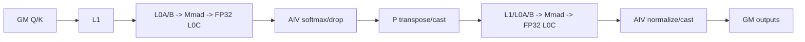
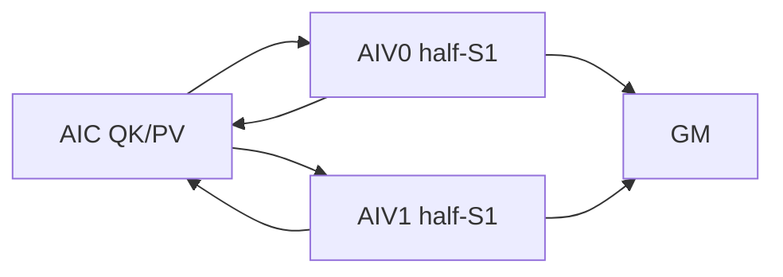

# FlashAttentionVarLenScore A2/A3 ACLNN 算子知识

## 算子速览

| 项目 | 内容 |
|---|---|
| 实际入口 | `aclnnFlashAttentionVarLenScoreV5GetWorkspaceSize` / `GetMaxWorkspaceSize` / `aclnnFlashAttentionVarLenScoreV5`，公开 ACLNN |
| 计算语义 | TND 变长训练 attention：QK/RoPE、PSE、稀疏 mask、stable softmax、sink、dropout、PV |
| 输入输出 | TND Q/K/V；optional RoPE/PSE/mask/sink/length/start；FP32 max/sum、attentionOut；用户softmax输出未提交 |
| 执行类型 | 单 Kernel `MIX_CV`，AIC:AIV=1:2 |
| Kernel 路线 | R-001 general TND；R-002 SameAB TND；R-003 empty 初始化 |
| 核心资源 | GM/user workspace、L1/L0A/L0B/L0C、UB、Matmul objects |
| 来源闭包 | `source_closed`：V5 ACLNN→L0→DAV_2201 Tiling/POD/key→MIX general/SameAB/empty→A2/A3 config |
| 验证状态 | 已完成源码闭包检查；本次知识提取未执行编译、真机、数值或性能测试。 |

## 接口与语义

### 计算语义

每个 batch 由累计 `actualSeqQLen/actualSeqKvLen` 划定 TND 段。非空路线计算 `S=scaleValue*(QK^T+queryRope*keyRope^T)+PSE`，按 sparse/pre/next/prefix/attenMask 屏蔽；以 FP32 在线更新行 max/sum，sink 存在时把 `sink[n]` 纳入 max 与分母；dropout 后计算并归一化 `O=PV`。V5 Host 明确将 L0 第三个 softmax 输出标为 “not used now”，没有把它 `ViewCopy` 到传入的 `softmaxOutOut`，因此不能宣称该 ACLNN 输出已提交。

### 输入、输出与属性

| 参数 | shape/layout | dtype | 约束、默认值与语义 |
|---|---|---|---|
| `query/key/value` | ND，逻辑 `[T,N,D]` | FP16/BF16/FP32 | dtype一致；V5只接受 TND；`Nq/Nkv` 为非零整数 |
| `queryRope/keyRope` | optional TND | 文档约束 BF16 | 成对参与额外点积；组合由 `isSupportMultiInput` 校验 |
| `realShift/dropMask/paddingMask/attenMask/sink` | optional | PSE浮点、drop UINT8、mask BOOL/UINT8、sink FP32 | A2/A3支持 sink；各 shape/组合由 Host/Tiling 校验 |
| `prefix/actualSeqQ/KvLen/qStartIdx/kvStartIdx` | `[B]` | INT64 | TND分段、prefix sparse与PSE起点 |
| 属性 | scalar/string | double/int64/string | scale、keepProb、pre/next、headNum、innerPrecise、sparseMode、pseType、softmaxOutLayout |
| `softmaxMax/Sum` | 逻辑 `[T,N,8]` | FP32 | Host `ViewCopy` 提交 |
| `softmaxOut` | 文档依 softmaxOutLayout | 文档允许类型 | Device有内部写路；固定V5 Host不提交到用户参数 |
| `attentionOut` | TND `[T,N,Dv]` | 与接口约束一致 | `Postprocess` 后 `ViewCopy` |

### 入口与版本

固定仓公开 VarLen、V2、V3、V4、V5；V5 产品表明确支持 A2/A3，因此选择同平台最新 V5。V5 增加 sink 并保留 V4 的 softmaxOutLayout。递归扫描 `attention/flash_attn/` 与 `attention/flash_attn_metadata/` 只发现独立公开符号 `aclnnFlashAttn` 和 `aclnnFlashAttnMetadata`：前者使用 INT32 `cuSeqlens*`/`seqused*`、统一 `attnOut/softmaxLse` 接口，后者单独生成其 metadata；两者均不复用 `aclnnFlashAttentionVarLenScoreV5` 的声明、Host helper 或 `FlashAttentionScore` launch 链，故不并入本版本族，也不能据此把 A2/A3 入口升级为“V6”。`GetMaxWorkspaceSize` 复用 V5 helper，但强制 dropMask=null、keepProb=1、`isMaxWorkspace=true`；第二段统一由 `CommonOpExecutorRun` 在传入 stream 上执行。

## Host/Launcher 执行流程

### 参数校验与前处理

入口先由 `CheckFaParam` 检查必需指针；max/sum/attention 三项都空则 workspace=0 快返。其余拒绝非 TND，执行 format/dtype/shape/actual-length 校验、所有输入 `Contiguous`、`PreprocessQKV` 与 multi-input 检查；一维零长 sink 转 null。随后创建内部 `l0op::FlashAttentionScore` 节点，校验 max/sum/attention 三个内部输出，执行 attention `Postprocess` 和 max/sum/attention `ViewCopy`。任一步失败即返回，softmaxOut未加入 executor。

### 参数、Workspace 与生命周期

非空路线的 user workspace 以 `GetUserWorkspace(workspace)` 为基址。每实际 split 核占 `3*bmm1Bytes + 2*stage1Bytes + 4*s1Base*alignedD*calcTypeSize + pseAlignSize`，总量末尾加 16 MiB reserve；`stage1Bytes` 仅 FP32 非零。max-workspace 令 `bmm1Bytes=8*512*128*calcTypeSize` 并按 `max(aicNum,aivNum)` 上界计算。R-003 固定请求 100 MiB，body不读取该区。executor持有前/后处理、L0及ViewCopy节点到stream完成，POD在launch前按值复制。

### 启动图与失败传播

```text
V5 API -> Contiguous/Preprocess -> L0 FlashAttentionScore
  -> TilingFlashAttentionScore -> empty? R-003
  -> priority90 dropmask probe -> priority94 VarLen
  -> isSameAB ? R-002 : R-001
  -> single MIX launch: optional adapter -> bmm1 -> Vector1 -> bmm2 -> Vector2
-> Postprocess/ViewCopy(max,sum,attention) -> CommonOpExecutorRun(stream)
```

priority90 在填完 dropmask POD 后返回 `GRAPH_PARAM_INVALID` 以继续 priority94；这不是公开失败。参数、Matmul tiling、POD序列化或key白名单失败均阻止launch，Device无unknown-key fallback。

## Route 与参数设计

### 分核与资源计算

`accumS1BlockNum=Σ_b ceil(S1_b/s1Base)`，`totalSize=accumS1BlockNum*n2Outer*gOuter`。general 以 `min(totalSize,aivNum)` 切分；SameAB以 `min(totalSize,aicNum)` 切分、POD `coreNum=2*usedAic`。`splitFactorSize=ceil(totalSize/actualSplitCore)` 并单独生成 tail。SameAB：`s1Base=min(256,alignedS1)`、`s1VecBase=s1Base/2`；general取 `s1BasicBlockBest`，有mask时上限256；共同 `s2Base=min(128,alignedS2)`、`dBase=min(128,alignedD)`。bmm1 是 GM ND×GM ND^T→FP32，bmm2 是 GM ND×GM ND→FP32；两个 `TCubeTiling` 冻结 base/step/depth/L1/L0。

### Route 选择

| 顺序 | Route | Key/模板 | 精确选择条件与优先级 | 不适用去向 |
|---:|---|---|---|---|
| 1 | R-003 empty | key `1` | `(querySize==0 \|\| keySize==0) && (attentionOutSize!=0 \|\| softmaxSumSize!=0)` | 全输出空已API快返；非空继续 |
| 2 | R-002 SameAB | priority94；`UB0=3,UB1=9,Block=9,Layout=4` | `((B>=4&&accumS1>=8192&&accumS2>=8192&&S1>=512&&S2>=512)\|\|(S1>5120&&S2>5120))`，且非FP32、非`Nq=Nkv=1`、非invalid-line-high-precision | R-001 |
| 3 | R-001 general | priority94；`UB0=3,UB1=4,Block=9,Layout=4` | 非空TND且未命中SameAB；FP16/BF16/FP32实例在白名单 | 非TND或无合法实例失败 |

```text
all outputs empty -> API return
input empty but output nonempty -> R-003
non-TND -> fail
SameAB full predicate -> R-002
otherwise -> R-001
```

### 模板/实现执行矩阵

| Route | key/selector | dtype/shape/platform 完整命中条件 | 执行族与 kernel 节点 | 实际模板/body | 内存与同步特征 | tail/fallback |
|---|---|---|---|---|---|---|
| R-001 | 20段key，`3/4/9/Layout4` | DAV_2201、TND、非空、非SameAB；FP16/BF16/FP32 | 单MIX：AIC bmm1/bmm2，AIV Vector1/2 | `FlashAttentionVarLenScore<...,NZ,hasRope>`；可 `ProcessL1Carry` | per-AIV workspace、Matmul/queue events | actual-length+S1/S2/D tail；无key失败 |
| R-002 | 20段key，`3/9/9/Layout4` | SameAB完整谓词；FP16/BF16 | 单MIX 1:2 | `FlashAttentionVarLenScoreSameAB<...,NORMAL/UNSPLITK,...>` | per-AIC组workspace、三槽、双AIV半S1 | guard假回R-001；tail专用body |
| R-003 | key1 | 输入空但输出非空 | 纯AIV初始化 | `FlashAttentionScoreEmptyTensor<T>` | UB→GM，不相交分核；100MiB reserve | former/tail/last-core |

### 隐藏性能 Guard

| Guard | Host/Tiling 条件 | Device/资源原因 | 影响 Route | 不满足时去向 | 源码符号 |
|---|---|---|---|---|---|
| SameAB门槛/排除 | 上表完整谓词 | 双AIV与AIC分核仅为该集合实例化 | R-002 | R-001 | `IsCapable` |
| L1 carry | 非SameAB、非FP32、无RoPE、`s1Base<=128&&D<=256&&D2<=256` | 两份shareL1Size=0，body自主L1，bmm2固定split | R-001 | 普通Process | `SetBmm2TilingInput/PostTiling` |
| Softmax UB | `apiMaxUBSize=2*s1Base*s2Base*sizeof(float)` | 两倍FP32 score API区 | R-001/R-002 | Tiling失败 | `CalcUBSize/SetSoftMaxTiling` |
| Matmul容量 | 两个 `SetBufferSpace(l1Size,l0cSize)==0` | TCube tile必须落入L1/L0C | R-001/R-002 | Tiling失败 | `SetBmm*Til­ingInput` |
| drop adapter | `needDropMaskOp`；`baseUbCalSize=AlignDown(ceil(ubSize/6),2048)` | bit输入+两份FP16 select+UINT8输出 | R-001/R-002 | 无adapter/失败 | `FlashAttentionScoreTilingDropMask` |
| empty 32B分块 | `GetEmptyArgs`按blocks/core三种关系 | 保证各核连续且尾块不越界 | R-003 | 全空快返 | `IsEmptyInput` |

### POD/ABI

固定仓未为整结构提供 `sizeof/alignof/offsetof` static_assert；以下每个字段独占一行，ABI布局由类声明顺序决定，实际offset不可外推，arch22与950 POD不可互换。

| 结构 | 字段 | 类型/位宽 | ABI 布局 | 单位 | Host/launcher producer | Device consumer | 边界 |
|---|---|---|---|---|---|---|---|
| `FlashAttentionScoreGeneralTilingData` | `inputParams` | nested | 第1成员；结构offset固定仓不可见 | 参数 | shape/attr analyzers | general/SameAB body | inactive字段由reset清零 |
| `InputParams` | `bSize` | int64/64 | 声明顺序；offset固定仓不可见 | element/count | layout/length analyzers | TND地址、轴解码与tile | 乘积保持64位 |
| `InputParams` | `n2Size` | int64/64 | 声明顺序；offset固定仓不可见 | element/count | layout/length analyzers | TND地址、轴解码与tile | 乘积保持64位 |
| `InputParams` | `gSize` | int64/64 | 声明顺序；offset固定仓不可见 | element/count | layout/length analyzers | TND地址、轴解码与tile | 乘积保持64位 |
| `InputParams` | `s1Size` | int64/64 | 声明顺序；offset固定仓不可见 | element/count | layout/length analyzers | TND地址、轴解码与tile | 乘积保持64位 |
| `InputParams` | `s2Size` | int64/64 | 声明顺序；offset固定仓不可见 | element/count | layout/length analyzers | TND地址、轴解码与tile | 乘积保持64位 |
| `InputParams` | `alignedS2` | int64/64 | 声明顺序；offset固定仓不可见 | element/count | layout/length analyzers | TND地址、轴解码与tile | 乘积保持64位 |
| `InputParams` | `dSize` | int64/64 | 声明顺序；offset固定仓不可见 | element/count | layout/length analyzers | TND地址、轴解码与tile | 乘积保持64位 |
| `InputParams` | `keepProb` | float/32 | 声明顺序；offset固定仓不可见 | scalar | 属性double窄化 | dropout | max-workspace固定1 |
| `InputParams` | `scaleValue` | float/32 | 声明顺序；offset固定仓不可见 | scalar | 属性double窄化 | score scale | 按接口范围 |
| `InputParams` | `preTokens` | int64/64 | 声明顺序；offset固定仓不可见 | token | sparse analyzer | 有效S2范围 | 须满足sparse约束 |
| `InputParams` | `nextTokens` | int64/64 | 声明顺序；offset固定仓不可见 | token | sparse analyzer | 有效S2范围 | 须满足sparse约束 |
| `InputParams` | `pseS1Size` | int64/64 | 声明顺序；offset固定仓不可见 | element | PSE analyzer | PSE offset | 无PSE为0 |
| `InputParams` | `pseS2Size` | int64/64 | 声明顺序；offset固定仓不可见 | element | PSE analyzer | PSE offset | 无PSE为0 |
| `InputParams` | `pseBSize` | uint32/32 | 声明顺序；offset固定仓不可见 | count | PSE analyzer | PSE broadcast | 无PSE为0 |
| `InputParams` | `bandIndex` | uint32/32 | 声明顺序；offset固定仓不可见 | index | sparse analyzer | band route | inactive为0 |
| `InputParams` | `layoutType` | uint8/8 | 声明顺序；offset固定仓不可见 | enum/bool | Host selector/analyzer | runtime/compile branch | V5 TND为4 |
| `InputParams` | `pseShapeType` | uint8/8 | 声明顺序；offset固定仓不可见 | enum/bool | Host selector/analyzer | runtime/compile branch | 枚举/布尔有效域 |
| `InputParams` | `attenMaskShapeType` | uint8/8 | 声明顺序；offset固定仓不可见 | enum/bool | Host selector/analyzer | runtime/compile branch | 枚举/布尔有效域 |
| `InputParams` | `attenMaskDataType` | uint8/8 | 声明顺序；offset固定仓不可见 | enum/bool | Host selector/analyzer | runtime/compile branch | 枚举/布尔有效域 |
| `InputParams` | `attenMaskCompressMode` | uint8/8 | 声明顺序；offset固定仓不可见 | enum/bool | Host selector/analyzer | runtime/compile branch | 枚举/布尔有效域 |
| `InputParams` | `implMode` | uint8/8 | 声明顺序；offset固定仓不可见 | enum/bool | Host selector/analyzer | runtime/compile branch | 枚举/布尔有效域 |
| `InputParams` | `sparseType` | uint8/8 | 声明顺序；offset固定仓不可见 | enum/bool | Host selector/analyzer | runtime/compile branch | 枚举/布尔有效域 |
| `InputParams` | `needDropMaskOp` | uint8/8 | 声明顺序；offset固定仓不可见 | enum/bool | Host selector/analyzer | runtime/compile branch | 枚举/布尔有效域 |
| `InputParams` | `pseEncodeType` | uint8/8 | 声明顺序；offset固定仓不可见 | enum/bool | Host selector/analyzer | runtime/compile branch | 枚举/布尔有效域 |
| `InputParams` | `rsv` | uint8/8 | 声明顺序；offset固定仓不可见 | enum/bool | Host selector/analyzer | runtime/compile branch | reserved=0 |
| `InputParams` | `needL1Carry` | uint8/8 | 声明顺序；offset固定仓不可见 | enum/bool | Host selector/analyzer | runtime/compile branch | 枚举/布尔有效域 |
| `InputParams` | `remainPH[1]` | uint8[1]/8 | 显式padding；offset固定仓不可见 | byte | reset | N/A | 必须为0 |
| `InputParams` | `remain` | uint16/16 | 声明顺序；offset固定仓不可见 | reserved | reset | 固定仓未见语义消费 | 0 |
| `InputParams` | `attenMaskS2SizePH[2]` | uint8[2]/16 | 显式padding；offset固定仓不可见 | byte | reset | N/A | 必须为0 |
| `InputParams` | `attenMaskS2Size` | uint32/32 | 声明顺序；offset固定仓不可见 | element | mask analyzer | Vector mask地址 | shape边界 |
| `InputParams` | `pseType` | uint32/32 | 声明顺序；offset固定仓不可见 | enum | PSE analyzer | PSE branch | 接口枚举 |
| `InputParams` | `rsv1` | uint32/32 | 声明顺序；offset固定仓不可见 | reserved | reset | N/A | 0 |
| `InputParams` | `qStartIdxPH[4]` | uint8[4]/32 | 显式padding；offset固定仓不可见 | byte | reset | N/A | 必须为0 |
| `InputParams` | `qStartIdx` | int64/64 | 声明顺序；offset固定仓不可见 | token | start-index analyzer | PSE/sparse地址 | optional为0 |
| `InputParams` | `kvStartIdx` | int64/64 | 声明顺序；offset固定仓不可见 | token | start-index analyzer | PSE/sparse地址 | optional为0 |
| `InputParams` | `tndSoftmaxOut` | uint8/8 | 声明顺序；offset固定仓不可见 | bool | softmaxOutLayout analyzer | softmax输出布局分支 | V5 Host未提交用户softmax |
| `InputParams` | `needSinkOp` | uint8/8 | 声明顺序；offset固定仓不可见 | bool | sink analyzer | Vector softmax sink | sink为空时0 |
| `InputParams` | `InputParamsPH[6]` | uint8[6]/48 | 尾部padding；offset固定仓不可见 | byte | reset | N/A | 必须为0 |
| `FlashAttentionScoreGeneralTilingData` | `multiCoreParams` | nested | 第2成员；结构offset固定仓不可见 | task | SetMultiCoreParams/SetSparseStartIdx | scheduler | 数组固定48项 |
| `MultiCoreParams` | `coreNum` | int32/32 | 声明顺序；offset固定仓不可见 | core | SetMultiCoreParams | core scheduler | general为usedAIV；SameAB为2*usedAIC |
| `MultiCoreParams` | `reserve` | int32/32 | 声明顺序；offset固定仓不可见 | reserved | reset | N/A | 0 |
| `MultiCoreParams` | `totalSize` | int64/64 | 声明顺序；offset固定仓不可见 | task | SetMultiCoreParams | per-core task loop | 向上取整与tail |
| `MultiCoreParams` | `splitFactorSize` | int64/64 | 声明顺序；offset固定仓不可见 | task | SetMultiCoreParams | per-core task loop | 向上取整与tail |
| `MultiCoreParams` | `splitFactorTailSize` | int64/64 | 声明顺序；offset固定仓不可见 | task | SetMultiCoreParams | per-core task loop | 向上取整与tail |
| `MultiCoreParams` | `sparseStartIdx[48]` | int64[48] | 声明顺序；offset固定仓不可见 | task index | SetSparseStartIdx | sparse scheduler | 有效索引<48 |
| `FlashAttentionScoreGeneralTilingData` | `coreParams` | nested | 第3成员；结构offset固定仓不可见 | tile | SetCoreParams | Cube/Vector | base/tail成对 |
| `CoreParams` | `s1BaseSize` | int32/32 | 声明顺序；offset固定仓不可见 | element/count | tile/PSE producer | Cube/Vector tile与地址 | tail/ratio按Route |
| `CoreParams` | `s1BaseTailSize` | int32/32 | 声明顺序；offset固定仓不可见 | element/count | tile/PSE producer | Cube/Vector tile与地址 | tail/ratio按Route |
| `CoreParams` | `s1Vec2BaseSize` | int32/32 | 声明顺序；offset固定仓不可见 | element/count | tile/PSE producer | Cube/Vector tile与地址 | tail/ratio按Route |
| `CoreParams` | `s1Vec2BaseTailSize` | int32/32 | 声明顺序；offset固定仓不可见 | element/count | tile/PSE producer | Cube/Vector tile与地址 | tail/ratio按Route |
| `CoreParams` | `s2BaseSize` | int32/32 | 声明顺序；offset固定仓不可见 | element/count | tile/PSE producer | Cube/Vector tile与地址 | tail/ratio按Route |
| `CoreParams` | `s2BaseTailSize` | int32/32 | 声明顺序；offset固定仓不可见 | element/count | tile/PSE producer | Cube/Vector tile与地址 | tail/ratio按Route |
| `CoreParams` | `dBaseSize` | int32/32 | 声明顺序；offset固定仓不可见 | element/count | tile/PSE producer | Cube/Vector tile与地址 | tail/ratio按Route |
| `CoreParams` | `dBaseTailSize` | int32/32 | 声明顺序；offset固定仓不可见 | element/count | tile/PSE producer | Cube/Vector tile与地址 | tail/ratio按Route |
| `CoreParams` | `bBaseSize` | int32/32 | 声明顺序；offset固定仓不可见 | element/count | tile/PSE producer | Cube/Vector tile与地址 | tail/ratio按Route |
| `CoreParams` | `bBaseTailSize` | int32/32 | 声明顺序；offset固定仓不可见 | element/count | tile/PSE producer | Cube/Vector tile与地址 | tail/ratio按Route |
| `CoreParams` | `n2BaseSize` | int32/32 | 声明顺序；offset固定仓不可见 | element/count | tile/PSE producer | Cube/Vector tile与地址 | tail/ratio按Route |
| `CoreParams` | `n2BaseTailSize` | int32/32 | 声明顺序；offset固定仓不可见 | element/count | tile/PSE producer | Cube/Vector tile与地址 | tail/ratio按Route |
| `CoreParams` | `gBaseSize` | int32/32 | 声明顺序；offset固定仓不可见 | element/count | tile/PSE producer | Cube/Vector tile与地址 | tail/ratio按Route |
| `CoreParams` | `gBaseTailSize` | int32/32 | 声明顺序；offset固定仓不可见 | element/count | tile/PSE producer | Cube/Vector tile与地址 | tail/ratio按Route |
| `CoreParams` | `nRatio` | int32/32 | 声明顺序；offset固定仓不可见 | element/count | tile/PSE producer | Cube/Vector tile与地址 | tail/ratio按Route |
| `CoreParams` | `dRopeSize` | int32/32 | 声明顺序；offset固定仓不可见 | element/count | tile/PSE producer | Cube/Vector tile与地址 | tail/ratio按Route |
| `CoreParams` | `d2Size` | int32/32 | 声明顺序；offset固定仓不可见 | element/count | tile/PSE producer | Cube/Vector tile与地址 | tail/ratio按Route |
| `CoreParams` | `s1SparseValidSizePH[4]` | uint8[4]/32 | 显式padding；offset固定仓不可见 | byte | reset | N/A | 必须为0 |
| `CoreParams` | `s1OuterSize` | int64/64 | 声明顺序；offset固定仓不可见 | loop | tile/sparse/PSE producer | Cube/Vector loop与地址 | 按Route有效 |
| `CoreParams` | `s1Vec2OuterSize` | int64/64 | 声明顺序；offset固定仓不可见 | loop | tile/sparse/PSE producer | Cube/Vector loop与地址 | 按Route有效 |
| `CoreParams` | `s2OuterSize` | int64/64 | 声明顺序；offset固定仓不可见 | loop | tile/sparse/PSE producer | Cube/Vector loop与地址 | 按Route有效 |
| `CoreParams` | `dOuterSize` | int64/64 | 声明顺序；offset固定仓不可见 | loop | tile/sparse/PSE producer | Cube/Vector loop与地址 | 按Route有效 |
| `CoreParams` | `bOuterSize` | int64/64 | 声明顺序；offset固定仓不可见 | loop | tile/sparse/PSE producer | Cube/Vector loop与地址 | 按Route有效 |
| `CoreParams` | `n2OuterSize` | int64/64 | 声明顺序；offset固定仓不可见 | loop | tile/sparse/PSE producer | Cube/Vector loop与地址 | 按Route有效 |
| `CoreParams` | `gOuterSize` | int64/64 | 声明顺序；offset固定仓不可见 | loop | tile/sparse/PSE producer | Cube/Vector loop与地址 | 按Route有效 |
| `CoreParams` | `s1SparseValidSize` | int64/64 | 声明顺序；offset固定仓不可见 | element/token | tile/sparse/PSE producer | Cube/Vector loop与地址 | 按Route有效 |
| `CoreParams` | `s2SparseValidSize` | int64/64 | 声明顺序；offset固定仓不可见 | element/token | tile/sparse/PSE producer | Cube/Vector loop与地址 | 按Route有效 |
| `CoreParams` | `pseAlibiBaseS1` | int64/64 | 声明顺序；offset固定仓不可见 | element/token | tile/sparse/PSE producer | Cube/Vector loop与地址 | 按Route有效 |
| `CoreParams` | `pseAlibiBaseS2` | int64/64 | 声明顺序；offset固定仓不可见 | element/token | tile/sparse/PSE producer | Cube/Vector loop与地址 | 按Route有效 |
| `FlashAttentionScoreGeneralTilingData` | `tensorSizeParams` | nested | 第4成员；结构offset固定仓不可见 | byte/element | SetTensorSizeParams | UB/workspace slice init | int32上界 |
| `TensorSizeParams` | `bmm1ResUbSize` | int32/32 | 声明顺序；offset固定仓不可见 | element | UB layout producer | buffer/API stage | inactive可0 |
| `TensorSizeParams` | `attenMaskUbSize` | int32/32 | 声明顺序；offset固定仓不可见 | element | UB layout producer | buffer/API stage | inactive可0 |
| `TensorSizeParams` | `pseUbSize` | int32/32 | 声明顺序；offset固定仓不可见 | element | UB layout producer | buffer/API stage | inactive可0 |
| `TensorSizeParams` | `dropMaskUbSize` | int32/32 | 声明顺序；offset固定仓不可见 | element | UB layout producer | buffer/API stage | inactive可0 |
| `TensorSizeParams` | `castUbSize` | int32/32 | 声明顺序；offset固定仓不可见 | element | UB layout producer | buffer/API stage | inactive可0 |
| `TensorSizeParams` | `softmaxMaxUbSize` | int32/32 | 声明顺序；offset固定仓不可见 | element | UB layout producer | buffer/API stage | inactive可0 |
| `TensorSizeParams` | `softmaxSumUbSize` | int32/32 | 声明顺序；offset固定仓不可见 | element | UB layout producer | buffer/API stage | inactive可0 |
| `TensorSizeParams` | `softmaxExpUbSize` | int32/32 | 声明顺序；offset固定仓不可见 | element | UB layout producer | buffer/API stage | inactive可0 |
| `TensorSizeParams` | `bmm2ResUbSize` | int32/32 | 声明顺序；offset固定仓不可见 | element | UB layout producer | buffer/API stage | inactive可0 |
| `TensorSizeParams` | `bmm1ProcessTInStage2Size` | int32/32 | 声明顺序；offset固定仓不可见 | element | UB layout producer | buffer/API stage | inactive可0 |
| `TensorSizeParams` | `apiTmpBufferBytes` | int32/32 | 声明顺序；offset固定仓不可见 | byte | UB/workspace layout producer | LocalTensor/API slice | 活跃区不得非法重叠 |
| `TensorSizeParams` | `inputQueBytes` | int32/32 | 声明顺序；offset固定仓不可见 | byte | UB/workspace layout producer | LocalTensor/API slice | 活跃区不得非法重叠 |
| `TensorSizeParams` | `outputQueBytes` | int32/32 | 声明顺序；offset固定仓不可见 | byte | UB/workspace layout producer | LocalTensor/API slice | 活跃区不得非法重叠 |
| `TensorSizeParams` | `tmpBufBytes` | int32/32 | 声明顺序；offset固定仓不可见 | byte | UB/workspace layout producer | LocalTensor/API slice | 活跃区不得非法重叠 |
| `TensorSizeParams` | `softmaxMaxOffsetBytes` | int32/32 | 声明顺序；offset固定仓不可见 | byte | UB/workspace layout producer | LocalTensor/API slice | 活跃区不得非法重叠 |
| `TensorSizeParams` | `softmaxSumOffsetBytes` | int32/32 | 声明顺序；offset固定仓不可见 | byte | UB/workspace layout producer | LocalTensor/API slice | 活跃区不得非法重叠 |
| `TensorSizeParams` | `maxSumApiOffsetBytes` | int32/32 | 声明顺序；offset固定仓不可见 | byte | UB/workspace layout producer | LocalTensor/API slice | 活跃区不得非法重叠 |
| `TensorSizeParams` | `customSoftmaxApiOffsetBytes` | int32/32 | 声明顺序；offset固定仓不可见 | byte | UB/workspace layout producer | LocalTensor/API slice | 活跃区不得非法重叠 |
| `TensorSizeParams` | `pseTbufOffsetBytes` | int32/32 | 声明顺序；offset固定仓不可见 | byte | UB/workspace layout producer | LocalTensor/API slice | 活跃区不得非法重叠 |
| `TensorSizeParams` | `dropoutApiOffsetBytes` | int32/32 | 声明顺序；offset固定仓不可见 | byte | UB/workspace layout producer | LocalTensor/API slice | 活跃区不得非法重叠 |
| `TensorSizeParams` | `maxSumApiSize` | int32/32 | 声明顺序；offset固定仓不可见 | byte | UB/workspace layout producer | LocalTensor/API slice | 活跃区不得非法重叠 |
| `TensorSizeParams` | `customSoftmaxApiSize` | int32/32 | 声明顺序；offset固定仓不可见 | byte | UB/workspace layout producer | LocalTensor/API slice | 活跃区不得非法重叠 |
| `TensorSizeParams` | `dropoutApiSize` | int32/32 | 声明顺序；offset固定仓不可见 | byte | UB/workspace layout producer | LocalTensor/API slice | 活跃区不得非法重叠 |
| `TensorSizeParams` | `attenMaskApiSize` | int32/32 | 声明顺序；offset固定仓不可见 | byte | UB/workspace layout producer | LocalTensor/API slice | 活跃区不得非法重叠 |
| `TensorSizeParams` | `attenMaskApiOffsetBytes` | int32/32 | 声明顺序；offset固定仓不可见 | byte | UB/workspace layout producer | LocalTensor/API slice | 活跃区不得非法重叠 |
| `TensorSizeParams` | `bmm1ProcessTInStage2OffsetBytes` | int32/32 | 声明顺序；offset固定仓不可见 | byte | UB/workspace layout producer | LocalTensor/API slice | 活跃区不得非法重叠 |
| `TensorSizeParams` | `wkspSection1OffsetBytes` | int32/32 | 声明顺序；offset固定仓不可见 | byte | UB/workspace layout producer | LocalTensor/API slice | 活跃区不得非法重叠 |
| `TensorSizeParams` | `wkspSection2OffsetBytes` | int32/32 | 声明顺序；offset固定仓不可见 | byte | UB/workspace layout producer | LocalTensor/API slice | 活跃区不得非法重叠 |
| `FlashAttentionScoreGeneralTilingData` | `bmm1TilingData` | external/nested POD | 第5成员；offset固定仓不可见 | API/adapter POD | Matmul tiling func | bmm1 | 外部TCube ABI |
| `FlashAttentionScoreGeneralTilingData` | `bmm2TilingData` | external/nested POD | 第6成员；offset固定仓不可见 | API/adapter POD | Matmul tiling func | bmm2 | 外部TCube ABI |
| `FlashAttentionScoreGeneralTilingData` | `softmaxFlashTilingData` | external/nested POD | 第7成员；offset固定仓不可见 | API/adapter POD | SoftMax tiling func | softmax | 外部SoftMax ABI |
| `FlashAttentionScoreGeneralTilingData` | `transposeTilingData` | external/nested POD | 第8成员；offset固定仓不可见 | API/adapter POD | copy tiling producer | transpose body | 主核参数 |
| `FlashAttentionScoreGeneralTilingData` | `transposeTilingDataTailCore` | external/nested POD | 第9成员；offset固定仓不可见 | API/adapter POD | copy tiling producer | transpose body | tail核参数 |
| `FlashAttentionScoreGeneralTilingData` | `dropmaskParams` | nested | 第10成员；offset固定仓不可见 | API/adapter POD | priority90 | drop adapter | needDropMaskOp条件有效 |
| `DropmaskParams` | `multiCoreFactorSize` | int32/32 | 声明顺序；offset固定仓不可见 | loop | priority90 drop tiling | drop adapter | >0 when active |
| `DropmaskParams` | `baseUbCalSize` | int32/32 | 声明顺序；offset固定仓不可见 | element | priority90 drop tiling | drop adapter | 2048对齐 when active |
| `DropmaskParams` | `multiCoreTotalSize` | int64/64 | 声明顺序；offset固定仓不可见 | loop | priority90 drop tiling | drop adapter | inactive为0 |
| `DropmaskParams` | `shapeTotalSize` | int64/64 | 声明顺序；offset固定仓不可见 | element | priority90 drop tiling | drop adapter | TND按各batch有效面积求和 |
| `FlashAttentionScoreTilingData` | `emptyInputTilingData` | nested | 第17成员；结构offset固定仓不可见 | empty POD | IsEmptyInput/GetEmptyArgs | empty body | key1专用 |
| `FlashAttentionScoreEmptyInputTilingData` | `coreNum` | uint32/32 | 声明顺序；offset固定仓不可见 | core | GetEmptyArgs | empty scheduler | 32B partition |
| `FlashAttentionScoreEmptyInputTilingData` | `attentionOutFormerNum` | uint32/32 | 声明顺序；offset固定仓不可见 | count | GetEmptyArgs | empty scheduler | 32B partition |
| `FlashAttentionScoreEmptyInputTilingData` | `attentionOutTailNum` | uint32/32 | 声明顺序；offset固定仓不可见 | count | GetEmptyArgs | empty scheduler | 32B partition |
| `FlashAttentionScoreEmptyInputTilingData` | `softmaxMaxFormerNum` | uint32/32 | 声明顺序；offset固定仓不可见 | count | GetEmptyArgs | empty scheduler | 32B partition |
| `FlashAttentionScoreEmptyInputTilingData` | `softmaxMaxTailNum` | uint32/32 | 声明顺序；offset固定仓不可见 | count | GetEmptyArgs | empty scheduler | 32B partition |
| `FlashAttentionScoreEmptyInputTilingData` | `reserved` | uint32/32 | 声明顺序；offset固定仓不可见 | count | GetEmptyArgs | empty scheduler | 0 |
| `FlashAttentionScoreEmptyInputTilingData` | `attentionOutSingleCoreDataSize` | uint64/64 | 声明顺序；offset固定仓不可见 | element/index | GetEmptyArgs | empty copy loops | 32B尾界 |
| `FlashAttentionScoreEmptyInputTilingData` | `attentionOutTailCoreDataSize` | uint64/64 | 声明顺序；offset固定仓不可见 | element/index | GetEmptyArgs | empty copy loops | 32B尾界 |
| `FlashAttentionScoreEmptyInputTilingData` | `softmaxMaxSingleCoreDataSize` | uint64/64 | 声明顺序；offset固定仓不可见 | element/index | GetEmptyArgs | empty copy loops | 32B尾界 |
| `FlashAttentionScoreEmptyInputTilingData` | `softmaxMaxTailCoreDataSize` | uint64/64 | 声明顺序；offset固定仓不可见 | element/index | GetEmptyArgs | empty copy loops | 32B尾界 |
| `FlashAttentionScoreEmptyInputTilingData` | `attentionOutLastCoreDataSize` | uint64/64 | 声明顺序；offset固定仓不可见 | element/index | GetEmptyArgs | empty copy loops | 32B尾界 |
| `FlashAttentionScoreEmptyInputTilingData` | `attentionOutLastCoreIndex` | uint64/64 | 声明顺序；offset固定仓不可见 | element/index | GetEmptyArgs | empty copy loops | 32B尾界 |
### Route 源码闭包

| Route | Key/selector | Host/Tiling producer | POD/参数 | Kernel entry/router | Kernel body/直接依赖 | 构建接线 |
|---|---|---|---|---|---|---|
| R-001 | priority94 general key | `FlashAttentionVarLenScoreTiling` | General POD | `flash_attention_score` general宏 | varlen general→s1s2 base | ascend910b/910_93+CMake |
| R-002 | priority94 SameAB key | 同producer isSameAB分支 | General POD，不同core/shareL1 | entry SameAB宏 | varlen_sab→s1s2_sab base | 同上 |
| R-003 | key1 | `IsEmptyInput/GetEmptyArgs` | empty POD | entry key1分支 | empty tensor body | 同上 |

## Kernel 实现

### 公共执行流程

R-001/R-002 同一MIX entry先可选执行 drop adapter并 `TPipe::Reset`，注册bmm1/bmm1Nz/bmm2对象，再按key实例化TND类；流水为 QK→Vector1(mask/PSE/sink/softmax/drop)→P→PV→Vector2(rescale/div/cast/store)。R-003在key1分支提前返回，不注册Matmul。

### Route R-001：general TND MIX

#### 适用条件

##### 选择证据

| 层级 | 文件 | 符号 | 源码谓词/参数 | 结果/下一跳 |
|---|---|---|---|---|
| API | `op_api/aclnn_flash_attention_score.cpp` | V5 helper | 非全空、TND且参数合法 | L0节点 |
| Tiling | `op_host/arch22/flash_attention_score_tiling_general.cpp` | `IsCapable/GetTilingKey/PostTiling` | TND且SameAB为假；可命中L1 carry | general key/POD |
| Router | `op_kernel/flash_attention_score.cpp` | `3/4/9/Layout4` branch | dtype1/2/3 | general class |

#### Device 数据流

##### 函数级调用链

```text
flash_attention_score -> optional DropMaskAdapter -> FlashAttentionVarLenScore::UnpackInit
  -> ProcessL1Carry/Process -> bmm1 -> Vector1 -> transpose -> bmm2 -> Vector2 -> CopyOut
```

##### 源码等价伪码

```text
for task in splitFactor: decode b,n2,g,s1Outer from actual-length prefixes
  derive sparse S2 start/end
  for s2 tile: AIC Q/K->L1/L0->FP32 QK; AIV scale/PSE/mask/sink/softmax/drop
               AIC P/V->L1/L0->FP32 PV; AIV rescale online accumulator
  divide by final sum; write FP32 max/sum and cast attentionOut
  protect actualSeq and S1/S2/D tails
```

#### 内存与数据搬运

##### 资源与搬运表

| 层级/缓冲区 | offset/地址公式 | extent/容量公式 | dtype/layout | producer | consumer | owner/lifetime | 对齐/复用 |
|---|---|---|---|---|---|---|---|
| GM Q/K/V | `(prefix*N+head)*D + seqOffset*N*D` | TND真实域 | input ND | caller | bmm1/bmm2 | stream | actualSeq限域 |
| workspace/core | `coreIdx*coreStride` | Host公式 | FP32/compute | Cube/Vector | 后续stage | 当前launch | per-AIV独立 |
| L1/L0A/L0B/L0C | TCube地址 | base/step/depth；L0C FP32 | fractal | MTE/Load/Mmad | Fixpipe | AIC tile | event保护；L1 carry可自主 |
| UB | tensorSize offsets | score/mask/PSE/drop/cast/max/sum/exp/tmp/PV | FP32/input | Fixpipe/GM | AIV | task槽 | 条件slice可0 |

##### 分层内存布局



##### 字节账、交接边与复用顺序

```text
bmm1Bytes=(isMax?8*512*128:nRatio*bmm1ResUbSize)*calcTypeSize
stage1Bytes=(input==FP32?bmm1Bytes:0)
coreStride=3*bmm1Bytes+2*stage1Bytes+4*s1Base*alignedD*calcTypeSize+pseAlignSize
workspace_total=coreStride*usedAiv+16MiB
UB_API=2*s1Base*s2Base*sizeof(float)
```

| 边/复用子区 | producer | offset/extent | dtype/layout | consumer | ordering/sync | owner/lifetime | 安全条件 |
|---|---|---|---|---|---|---|---|
| bmm1→Vector1 | Mmad/Fixpipe | task score slice | FP32 | mask/softmax | Matmul/Fixpipe event | task槽 | consumer后复用 |
| Vector1→bmm2 | transpose | P slice | compute/NZ | bmm2A | queue/Matmul协议 | S2 tile | tail padding不参与K |
| bmm2→Vector2 | Mmad/Fixpipe | PV slice | FP32 | accumulator | event/queue | task槽 | 等待后覆盖 |

#### 同步、精度与尾块

##### 同步与数值边界表

| 阶段 | primitive/机制 | producer | consumer/等待点 | 保护对象 | 精度/尾块 |
|---|---|---|---|---|---|
| adapter→main | 顺序+`TPipe::Reset` | adapter | Vector1 | drop workspace | 2048-element tail |
| Cube↔Vector | Matmul/Fixpipe/queue events | QK/P/PV | next stage | tile slices | L0C与state FP32 |
| output | V→MTE3/DataCopy | normalize/cast | GM | valid TND rows | actualSeq+mask tail |

#### 关键实现

##### 符号证据表

| 阶段 | 文件 | 符号/模板实例 | 实现事实 |
|---|---|---|---|
| Host/Tiling producer | `op_host/arch22/flash_attention_score_tiling_general.cpp` | `FlashAttentionVarLenScoreTiling` | general tile/workspace/L1 carry |
| Kernel entry/router | `op_kernel/flash_attention_score.cpp` | general invocation macro | key到body |
| Device body/helper | `op_kernel/arch22/flash_attention_var_len_score.h` | `UnpackInit/Process*` | TND地址/调度 |
| Device body/helper | `op_kernel/arch22/flash_attention_score_s1s2_bn2gs1.h` | base methods | Cube/Vector/sink/output |

### Route R-002：SameAB TND MIX

#### 适用条件

##### 选择证据

| 层级 | 文件 | 符号 | 源码谓词/参数 | 结果/下一跳 |
|---|---|---|---|---|
| API | API cpp | V5 helper | 非空TND | L0节点 |
| Tiling | arch22 tiling cpp | `IsCapable/GetTilingKey` | 完整SameAB谓词 | `3/9/9/Layout4` |
| Router | entry cpp | SameAB constexpr branch | FP16/BF16，NORMAL/UNSPLITK | SameAB class |

#### Device 数据流

##### 函数级调用链

```text
entry -> FlashAttentionVarLenScoreSameAB::Init -> Process
  -> SetExtraInfo[3] -> ComputeMm1/ComputeBmm1Tail -> base Vector1
  -> ComputeMm2 -> base Vector2/CopyOut
```

##### 源码等价伪码

```text
按AIC数切任务；每AIC对应两个AIV，各处理s1Base/2行；extraInfo[3]轮转。
AIC计算QK，两个AIV分别softmax/drop并交P，AIC计算PV，两个AIV归一化并写不相交TND行。
```

#### 内存与数据搬运

##### 资源与搬运表

| 层级/缓冲区 | offset/地址公式 | extent/容量公式 | dtype/layout | producer | consumer | owner/lifetime | 对齐/复用 |
|---|---|---|---|---|---|---|---|
| GM/workspace | 同R-001地址；`logicalAicIdx*coreStride` | per-AIC group | input/FP32 | caller/AIC/AIV | stages | AIC+2AIV组 | 组间不重叠 |
| L1/L0 | SameAB手写copy/Matmul | s1<=256,s2<=128,D tile | fractal/FP32 L0C | AIC | Fixpipe/AIV | task槽 | 特定D shareL1=0 |
| UB | subBlock半S1区 | `s1VecBase=s1Base/2` × S2/D | FP32/compute | Fixpipe | AIV | extraInfo三槽 | 双AIV不重叠 |

##### 分层内存布局



##### 字节账、交接边与复用顺序

```text
workspace_total=coreStride*usedAic+16MiB
UB logical half per AIV=s1Base/2；extraInfo depth=3
```

| 边/复用子区 | producer | offset/extent | dtype/layout | consumer | ordering/sync | owner/lifetime | 安全条件 |
|---|---|---|---|---|---|---|---|
| AIC→AIV score | ComputeMm1/Fixpipe | 两个半S1 | FP32 | Vector1 | SameAB pipe/三槽 | group/task | 槽等待后复用 |
| AIV→AIC P | Vector1 | 两个P子区 | compute/NZ | ComputeMm2 | queue/Matmul | task | 双方完成 |
| AIC→AIV PV | ComputeMm2 | 两个半S1×D2 | FP32 | Vector2 | event/pipe | task | M/D tail |

#### 同步、精度与尾块

##### 同步与数值边界表

| 阶段 | primitive/机制 | producer | consumer/等待点 | 保护对象 | 精度/尾块 |
|---|---|---|---|---|---|
| three-stage | extraInfo[3]+events | task t | t-1/t-2 stage | score/P/PV | final flush |
| dual AIV | subBlock offsets/flags | AIC/AIV | opposite stage | half-S1 buffers | `ComputeBmm1Tail`/real sizes |

#### 关键实现

##### 符号证据表

| 阶段 | 文件 | 符号/模板实例 | 实现事实 |
|---|---|---|---|
| Host/Tiling producer | arch22 tiling cpp | SameAB branches | guard/core/workspace |
| Kernel entry/router | entry cpp | SameAB invocation | key/policy |
| Device body/helper | `flash_attention_var_len_score_sab.h` | `Process/ComputeMm1/2` | 三槽和TND调度 |
| Device body/helper | `flash_attention_score_s1s2_bn2gs1_sab.h` | base methods | 双AIV/sink/output |

### Route R-003：empty 初始化

#### 适用条件

##### 选择证据

| 层级 | 文件 | 符号 | 源码谓词/参数 | 结果/下一跳 |
|---|---|---|---|---|
| API | API cpp | V5 helper | 输出不全空 | L0 |
| Tiling | common tiling cpp | `IsEmptyInput` | 输入空且输出非空 | key1、100MiB |
| Router | entry cpp | `KernelTypeKey==1` | supported dtype | EmptyTensor |

#### Device 数据流

##### 函数级调用链

```text
IsEmptyInput -> GetEmptyArgs -> flash_attention_score<1> -> EmptyTensor::Init -> Process
```

##### 源码等价伪码

```text
按32B blocks产生former/tail/last-core区间；UB生成约定初值；只写POD给出的max/sum/attention有效元素。
```

#### 内存与数据搬运

##### 资源与搬运表

| 层级/缓冲区 | offset/地址公式 | extent/容量公式 | dtype/layout | producer | consumer | owner/lifetime | 对齐/复用 |
|---|---|---|---|---|---|---|---|
| GM outputs | former/tail prefix | empty POD sizes | target/FP32 | UB init | caller | stream | 32B+last tail |
| UB | local tile | body buffer | target/FP32 | Duplicate | DataCopy | AIV loop | mask tail |
| workspace | 0 | 100MiB requested, body unused | bytes | runtime | N/A | executor | 不得写成0 |
| L1/L0A/B/C | N/A | N/A | N/A | N/A | N/A | N/A | UB直接GM |

##### 分层内存布局


##### 字节账、交接边与复用顺序

```text
workspace_total=100*1024*1024 bytes; L1=L0A=L0B=L0C=0
```

| 边/复用子区 | producer | offset/extent | dtype/layout | consumer | ordering/sync | owner/lifetime | 安全条件 |
|---|---|---|---|---|---|---|---|
| UB→GM | Duplicate | per-core extent | target/FP32 | DataCopy | Vector pipe | AIV | last mask |

#### 同步、精度与尾块

##### 同步与数值边界表

| 阶段 | primitive/机制 | producer | consumer/等待点 | 保护对象 | 精度/尾块 |
|---|---|---|---|---|---|
| init/store | queue/pipe | UB | GM | tile | max/sum FP32；disjoint core ranges |

#### 关键实现

##### 符号证据表

| 阶段 | 文件 | 符号/模板实例 | 实现事实 |
|---|---|---|---|
| Host/Tiling producer | `op_host/flash_attention_score_tiling.cpp` | `IsEmptyInput/GetEmptyArgs` | key/workspace/partition |
| Kernel entry/router | entry cpp | key1 branch | dtype router |
| Device body/helper | empty header | `Init/Process` | init/tail |

## 算子特定优化

### Trick T-001：大TND切SameAB双AIV

#### 触发与源码依据

- 适用 Route：R-002
- 触发条件：SameAB完整大形状谓词且三个排除项均假。
- Golden 来源：[`attention/flash_attention_score/op_host/arch22/flash_attention_score_tiling_general.cpp:4020`](../../../../../../../cann-ops-raw/ascendc/ops-transformer/be33d95bb755cedec3108f70805c1874d1792540/attention/flash_attention_score/op_host/arch22/flash_attention_score_tiling_general.cpp#L4020)

**官方源码（固定 Commit 连续逐字摘录）**：

```cpp
if ((bSize >= SPACE_NUM_4 && accumS1 >= SAMEAB_TND_BASIC_SIZE && accumS2 >= SAMEAB_TND_BASIC_SIZE &&
    s1Size >= S2_REUSE_SIZE_512 && s2Size >= S2_REUSE_SIZE_512) ||
    (s2Size > S2_REUSE_SIZE_5120 && s1Size > S2_REUSE_SIZE_5120)) {
```

#### 机制与设计原因

Host按AIC切任务、Device把S1分给两个AIV并以三槽衔接QK、softmax、PV；改变了core映射、buffer owner和同步图。

#### 迁移边界

- 适用：DAV_2201、TND、FP16/BF16大序列。
- 前提：完整guard、key和POD一致。
- 失效：FP32、单头或invalid-line high precision回R-001。
- 未验证：本次知识提取未执行编译、真机、数值或性能测试。

#### 错误做法

只看S1/S2而忽略累计长度与排除项会错配coreNum和双AIV内存。

### Trick T-002：general L1 carry

#### 触发与源码依据

- 适用 Route：R-001
- 触发条件：非FP32、无RoPE、`s1Base<=128&&D<=256&&D2<=256`。
- Golden 来源：[`attention/flash_attention_score/op_host/arch22/flash_attention_score_tiling_general.cpp:4582`](../../../../../../../cann-ops-raw/ascendc/ops-transformer/be33d95bb755cedec3108f70805c1874d1792540/attention/flash_attention_score/op_host/arch22/flash_attention_score_tiling_general.cpp#L4582)

**官方源码（固定 Commit 连续逐字摘录）**：

```cpp
this->needL1Carry = true;
tilingData->bmm1TilingData.shareL1Size = 0;
tilingData->bmm2TilingData.shareL1Size = 0;
```

#### 机制与设计原因

Host把L1 owner交给算子body并令entry选择 `ProcessL1Carry`；同时bmm2固定split。flag、两份shareL1和Device分支必须成套迁移。

#### 迁移边界

- 适用：R-001 FP16/BF16无RoPE小head dim。
- 前提：自主L1 helper存在。
- 失效：任一guard假走普通Process。
- 未验证：本次知识提取未执行编译、真机、数值或性能测试。

#### 错误做法

仅复制flag或仅清零shareL1会破坏owner协议。

### Trick T-003：drop adapter后重置pipe

#### 触发与源码依据

- 适用 Route：R-001、R-002
- 触发条件：`needDropMaskOp!=0`。
- Golden 来源：[`attention/flash_attention_score/op_kernel/flash_attention_score.cpp:341`](../../../../../../../cann-ops-raw/ascendc/ops-transformer/be33d95bb755cedec3108f70805c1874d1792540/attention/flash_attention_score/op_kernel/flash_attention_score.cpp#L341)

**官方源码（固定 Commit 连续逐字摘录）**：

```cpp
        if (tilingData->inputParams.needDropMaskOp) {                                                                  \
            FlashAttentionScoreDropMaskAdapter dropMaskAdapter;                                                        \
            dropMaskAdapter.Init(dropMask, user, tilingData, &tPipe);                                                  \
            dropMaskAdapter.Process();                                                                                 \
        }                                                                                                              \
        tPipe.Reset();                                                                                                 \
```

#### 机制与设计原因

`needDropMaskOp` 为真时，adapter先把TND有效mask展开到workspace；无论是否执行adapter，VAR_LEN宏都在进入主attention前重置pipe，执行adapter时该reset释放其UB/queue事件后供主流程复用。

#### 迁移边界

- 适用：需adapter的dropout。
- 前提：mask workspace offset与POD一致。
- 失效：无需adapter直接主流程。
- 未验证：本次知识提取未执行编译、真机、数值或性能测试。

#### 错误做法

固定源码明确reset；省略会保留旧pipe状态。

## 模板与实现对比

| 对比维度 | R-001 general | R-002 SameAB | R-003 empty | 设计选择依据 |
|---|---|---|---|---|
| 命中条件/优先级 | priority94剩余TND | priority94大形状子集 | 注册表前empty | 先空域再特化 |
| 执行族/节点图 | 单MIX通用Matmul | 单MIX双AIV手写流水 | 纯AIV | body/sync不同不可合并 |
| M/N/K、tile与scheduler | 按AIV切task | 按AIC切task、每AIV半M | N/A | SameAB core映射 |
| workspace/L1/L0/UB | per-AIV，可L1 carry | per-AIC组、三槽 | 100MiB+UB init | Host公式不同 |
| AIC/AIV交接 | Matmul/queue | half-S1 flags/三槽 | N/A | 各自同步协议 |
| 同步、精度与tail | FP32 state+runtime tail | 同精度+双AIV tail | disjoint GM tail | 保留真实body |
| fallback/失败边界 | key失败 | guard假回R-001 | 全输出空API快返 | 无跨架构fallback |

## 平台差异

| 项目 | A2 | A3 | 950 |
|---|---|---|---|
| 支持状态 | V5支持 | V5支持 | V5支持，独立卡 |
| Host/Launcher | DAV_2201 priority90/94 | 同A2 | DAV_3510 priority81/82 |
| Kernel/资源 | arch22 general/SameAB | 同A2 | RegBase；V5文档不支持sink/softmaxOutLayout |

## 限制与失败边界

- V5只接受TND；actual lengths与sparse inequalities是地址边界。
- A2/A3 Device/Tiling有sink与softmax布局逻辑，但V5 Host不回写用户softmaxOut，属于固定源码缺口。
- 20段key白名单外无fallback；General POD含外部Matmul/SoftMax ABI且无整结构static_assert。
- empty请求100MiB，非空加16MiB reserve；不得用逻辑元素数替代物理字节。
- 本次知识提取未执行编译、真机、数值或性能测试。

## 源码索引

### 链路索引

| 链路阶段 | 文件 | 关键符号 | 支撑内容 |
|---|---|---|---|
| 入口声明/约束 | `attention/flash_attention_score/docs/aclnnFlashAttentionVarLenScoreV5.md` | 产品表/公式 | 公开支持与语义 |
| 入口声明/约束 | `attention/flash_attention_score/op_api/aclnn_flash_attention_score.h` | V5声明 | ABI |
| 入口声明/约束 | `attention/flash_attn/op_api/aclnn_flash_attn.h` | `aclnnFlashAttn`声明 | 独立统一接口，不属于VarLenScore版本族 |
| 入口实现 | `attention/flash_attn/op_api/flash_attn.cpp` | `l0op::FlashAttn` | 单独注册并添加 `FlashAttn` launcher，不进入 `FlashAttentionScore` 链 |
| 入口声明/约束 | `attention/flash_attn_metadata/op_host/op_api/aclnn_flash_attn_metadata.h` | `aclnnFlashAttnMetadata`声明 | 独立metadata接口，不属于VarLenScore版本族 |
| 入口实现 | `attention/flash_attention_score/op_api/aclnn_flash_attention_score.cpp` | V5 helper/Run | Host流程/softmax缺口 |
| Host/Tiling/Launcher | `attention/flash_attention_score/op_host/flash_attention_score_tiling.cpp` | Tiling/empty | 平台、empty、compile info |
| Host/Tiling/Launcher | `attention/flash_attention_score/op_host/arch22/flash_attention_score_tiling_general.cpp` | VarLenTiling | selector/workspace/POD |
| Host/Tiling/Launcher | `attention/flash_attention_score/op_kernel/arch22/flash_attention_score_tiling.h` | POD classes | ABI |
| Kernel entry/body | `attention/flash_attention_score/op_kernel/arch22/flash_attention_score_template_tiling_key.h` | key schema | 白名单 |
| Kernel entry/body | `attention/flash_attention_score/op_kernel/flash_attention_score.cpp` | entry/macros | router |
| Kernel entry/body | `attention/flash_attention_score/op_kernel/arch22/flash_attention_var_len_score.h` | general class | TND调度 |
| Kernel entry/body | `attention/flash_attention_score/op_kernel/arch22/flash_attention_var_len_score_sab.h` | SameAB class | 三槽/搬运 |
| Kernel entry/body | `attention/flash_attention_score/op_kernel/arch22/flash_attention_score_s1s2_bn2gs1.h` | general base | Cube/Vector |
| Kernel entry/body | `attention/flash_attention_score/op_kernel/arch22/flash_attention_score_s1s2_bn2gs1_sab.h` | SameAB base | 双AIV/sink/output |
| Kernel entry/body | `attention/flash_attention_score/op_kernel/arch22/flash_attention_score_empty_tensor.h` | EmptyTensor | 初始化 |
| 构建接线 | `attention/flash_attention_score/op_host/flash_attention_score_def.cpp` | A2/A3 configs | opFile |
| 构建接线 | `attention/flash_attention_score/op_host/CMakeLists.txt` | modules/options | 构建 |

每行只写一个文件，并确保该文件存在于 Frontmatter `sources`。

### 实现复用检查

| 检查项 | 可复用事实 | 不得改变的约束 | 源码符号 |
|---|---|---|---|
| ABI/POD | General十成员与empty POD | 顺序/padding/外部ABI/inactive清零 | tiling header |
| 调用顺序 | preprocess→L0→post/ViewCopy | max-workspace重写；softmax不提交 | V5 helper |
| workspace/内存 | coreStride、16MiB、empty100MiB | usedAIV/AIC、owner、对齐 | GetWorkspaceSize/IsEmptyInput |
| 同步 | MIX1:2、adapter reset、三槽 | general/SameAB协议不可混用 | entry/body |
| 精度与尾块 | FP32 score/state/PV | actualSeq、implMode、S1/S2/D tail | body/TCube POD |
| 失败边界 | TND/key/sparse边界 | 不回退旧V或950 ABI | IsCapable/key selector |