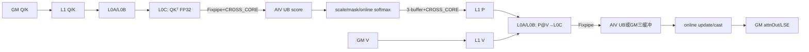
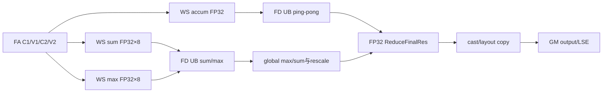

# FlashAttn 950 ACLNN 算子知识

## 算子速览

| 项目 | 内容 |
|---|---|
| 实际入口 | 公开二段式 `aclnnFlashAttnGetWorkspaceSize` / `aclnnFlashAttn`；本固定提交没有 V2/V3 后缀入口。 |
| 计算语义 | 非量化 GQA/MQA/MHA 前向：分块计算 `S=softmax_scale·QK^T`，可加 causal/band mask，在线 softmax 后计算 `O=softmax(S)V`；可返回 FP32 `softmax_lse`。 |
| 输入输出 | Q/K/V 与输出为同 dtype FP16 或 BF16、ND；Q 支持 BSND/BNSD/TND，连续 KV 与 Q layout 对应，分页 KV 支持 PA_BBND/PA_BNBD/PA_NZ；`Dqk=Dv∈{64,128,256}`。 |
| 执行类型 | 单 Kernel `MIX_CV`：AIC 做两次 Cube matmul，两个 AIV sub-block 做 mask/在线 softmax/归一化与输出；运行时 metadata 可追加同一 kernel 内 AIV FlashDecode 规约。 |
| Kernel 路线 | R-001 直接 FA 提交（metadata `isFd=0`）；R-002 FA workspace 分片 + FD 规约（metadata `isFd!=0`）。每条路线再由四字段 tiling key 展开 layout×KV layout×mask×config 实例。 |
| 核心资源 | 用户 workspace、固定 512 KiB L1 manager、64 KiB L0A、64 KiB L0B、256 KiB L0C、AIC/AIV 共享 UB/L1 buffer policy 与 AIV 寄存器 VF。 |
| 来源闭包 | `source_closed`：公开 ACLNN→L0 launcher→OpDef/checker→arch35 tiling/key/POD→单 MIX_CV entry→Cube/Vector/FD body→Ascend950 构建接线闭合；另审计官方前置 `aclnnFlashAttnMetadata`→AICPU producer，但它属于主 executor 之外的显式输入生产链。 |
| 验证状态 | 已完成源码闭包检查；本次知识提取未执行编译、真机、数值或性能测试。 |

## 接口与语义

### 计算语义

令 `Nq=Nkv·G`，每个 KV head 服务 `G` 个 query heads。对每个 batch、KV head 和 query group，AIC 的 BMM1 计算 FP32 分数块，AIV 将 `softmax_scale` 乘入分数、施加 `mask_mode` 对应的有效窗口，并以跨 S2 块保存的 `max/sum` 做在线 softmax；AIC 的 BMM2 计算概率块与 V 的乘积，AIV 用 `FlashUpdateNew/FlashUpdateLastNew` 按在线 softmax比例更新 FP32 累积结果，最后 cast 为输入 dtype 写出。若 metadata 把一个 `(B,Nkv,M)` 的 S2 域拆给多个 FA 工作单元，FA 阶段把局部 FP32 `accumOut/max/sum` 写入 workspace，FD 阶段先合并 max/sum，再缩放并规约各局部输出。

公开文档给出 sink 语义，但固定提交的 `SinksChecker::CheckSinglePara` 对任何非空 sinks 返回失败，因此本卡的 Host 可达路线不含 sink。公开头写 `softmaxScale=0.0` 表示 `1/sqrt(D)`，而 `FaInfoParser::ParseFeatureInfo` 与 `SetFATilingData` 直接把属性值写入 `scaleValue`，Device 又直接使用该值；固定源码没有找到 `0→1/sqrt(D)` 转换，不能把该注释当作已实现事实。

### 输入、输出与属性

| 参数 | shape/layout | dtype | 约束、默认值与语义 |
|---|---|---|---|
| `q` | BSND `(B,Sq,Nq,D)`；BNSD `(B,Nq,Sq,D)`；TND `(Tq,Nq,D)` | FP16/BF16 | required、ND、AutoContiguous；`B,Sq,Nq>0`。 |
| `k`,`v` | 连续 BSND/BNSD/TND；PA_BBND `(blockNum,blockSize,Nkv,D)`、PA_BNBD `(blockNum,Nkv,blockSize,D)`、PA_NZ `(blockNum,Nkv,D/16,blockSize,16)` | 与 q 相同 | ACLNN 外层显式拒绝非连续 K/V；`Dk=Dv=Dq∈{64,128,256}`，`Nq≥Nkv` 且整除。PA blockSize∈[16,1024] 且 16 对齐。 |
| `blockTableOptional` | `(B,maxBlockNumPerBatch)` ND | INT32 | PA layout 必须存在；值在 Tiling 不可见，由调用者保证合法。 |
| `cuSeqlensQ/KvOptional` | `(B+1)` ND | INT32 | TND 对应输入必须存在；与各自 `seqused` 互斥。元素值不由 Tiling 校验。 |
| `sequsedQ/KvOptional` | `(B)` ND | INT32 | Q 或 KV 一侧只传一项时，另一项必须同时存在；控制实际序长与输出预清零。 |
| `sinksOptional` | 文档为 `(Nq)` | FLOAT32 | 空 shape `{0}` 在 ACLNN 层转 `nullptr`；固定 Host checker 拒绝任何非空 sinks。 |
| `attnMaskOptional` | `(2048,2048)` ND | INT8 | mode 0 必须空；mode 3/4 必须存在。 |
| `metadataOptional` | 正长度一维 ND | INT32 | 头文件/OpDef 标为 optional，但 `MetadataChecker` 实际要求非空；头 16×u32，其中 `[0]=sectionNum,[1]=isFd,[2]=mBaseSize,[3]=s2BaseSize`，随后按 section 排列 FA/FD 记录。官方 producer 写入至少 `16+sectionNum*(36+72)*16` 个 u32。 |
| `softmaxScale` | scalar attr | double→L0 float | OpDef 默认 0；固定 Host/Kernel 直接使用 float 值，未实现头文件所述的 0 默认换算。 |
| `maskMode` | scalar attr | int64→int32 | checker 只接受 0(no mask)、3(causal)、4(band)，并非头文件注释中的 0..4 全集。 |
| `winLeft`,`winRight` | scalar attr | int64→int32 POD | 必须 ≥-1；mode 0/3 要求均为 -1，mode 4 可设置窗口；-1 在 POD 转 `INT_MAX`。 |
| `maxSeqlenQ/KV` | scalar attr | int64→Host | ≥-1；参与 tile 选择，-1 在选择器中按 `INT32_MAX`。 |
| `layoutQ/Kv/Out` | attr | string | 大小写敏感 map：Q 为 BSND/BNSD/TND；连续 KV 必须同 Q，PA 可配任一 Q；BNSD Q 可输出 BNSD/BSND，其余只能同 layout。 |
| `returnSoftmaxLse` | scalar attr | int64→u8 | 非 0 开启 FP32 LSE；为 0 时 ACLNN 外层创建 shape `{0}` 的占位输出并在第一段结束后销毁临时 tensor。 |
| `attnOut` | 与 Q 逻辑 B/S/N、V 的 D 一致 | 与 q 相同 | required、ND；全 mask/零实际长度可能先清零。 |
| `softmaxLseOptional` | BSND/BNSD 为 `(B,Nq,Sq)`，TND 为 `(Tq,Nq)` | FP32 | `returnSoftmaxLse!=0` 时必须有有效输出描述；否则使用占位。 |

### 入口与版本

固定提交公开的最新版符号就是无后缀 `aclnnFlashAttnGetWorkspaceSize/aclnnFlashAttn`。第一段只做外层 K/V contiguous 检查、sinks `{0}` 归一化与 LSE placeholder，再进入 generated `aclnnInnerFlashAttnGetWorkspaceSize`；其具体生成实现不在仓内。可见的 L0 `l0op::FlashAttn` 为每个空 optional 分配空 tensor，调用 `INFER_SHAPE`，再用 `ADD_TO_LAUNCHER_LIST_AICORE` 添加唯一 FlashAttn 节点。第二段委托 generated `aclnnInnerFlashAttn` 在传入 stream 执行 executor。

950 支持由三层证据一致确认：扩展文档只声明 Ascend 950PR/950DT 支持；`FlashAttn` OpDef 只 `AddConfig("ascend950")`；CMake 仅在 `ASCEND_COMPUTE_UNIT=ascend950` 时声明依赖和 `Ascend950PR_9599` 编译选项。没有更高后缀版本可选。

## Host/Launcher 执行流程

### 参数校验与前处理

1. `aclnnFlashAttnGetWorkspaceSize` 把 shape `{0}` 的 sinks 改成空；若 K/V 任一非 contiguous，返回 `ACLNN_ERR_INNER_TILING_ERROR`。
2. `returnSoftmaxLse==0` 时创建 FLOAT/ND/shape `{0}` placeholder；否则使用用户的 LSE tensor。
3. generated inner bridge（固定仓只见声明）进入 `l0op::FlashAttn`。L0 为缺省 optional 创建空 tensor，完成 infer-shape 和单 AICore 节点注册；任一步失败返回 `{nullptr,nullptr}` 并向 ACLNN status 传播。
4. Tiling 依次 `FaInfoParser::Parse`、七个 checker、`FiaTilingRegistry::DoTilingImpl`。必选张量、layout、dtype、shape、head 比、mask 组合、PA、seq-len、metadata、LSE 任一失败即 `GRAPH_FAILED`。
5. 唯一 950 模板 `FlashAttnTilingImpl` priority=1 且 `IsCapable()==true`，然后生成 blockDim、workspace、POD、schedule mode 与四字段 key。

官方文档要求在主接口前调用独立公开入口 `aclnnFlashAttnMetadataGetWorkspaceSize/aclnnFlashAttnMetadata`。该入口从当前平台读取 AIC/AIV 核数，L0 以 `ADD_TO_LAUNCHER_LIST_AICPU` 添加 `FlashAttnMetadata`，AICPU 的 `SectionStreamK::Compute` 产生 section 划分并写 runtime metadata。它不是 `aclnnFlashAttn` executor 内部节点：调用者可以提供已生成的 tensor，但必须保证 producer 完成且参数与主算子一致。

### 参数、Workspace 与生命周期

`SetPlatMemoryInfo` 读取 AIC/AIV 数、CV ratio、UB/L0/L1/L2 与系统 workspace。`CalcNumBlocks` 使用 `aivNum=aicNum·cvRatio`，再调用 `CalcTschBlockDim(aivNum,aicNum,aivNum)` 编码 MIX blockDim。用户 workspace 由框架系统区加算子区组成，Kernel 先 `GetUserWorkspace` 跳过系统区：

```text
m = sOuterFactor * cvRatio
d = vHeadDim
dBasic = 64 / 128 / 256 / 512 中首个 >= d 的值
bmm2Block = (dBasic > 256 ? 512 : dBasic)
bmm2Bytes = ((!dnFlag && d>128) || (dnFlag && d>192)) ? m*bmm2Block*4 : 0
vec2Bytes = (上述条件 && dBasic>256) ? m*dBasic*4 : 0
paSyncBytes = pageAttention ? coreNum*2*2*64 : 0
accumOutSize(elements) = coreNum*2*m*d
logSumExpSize(elements) = coreNum*2*m*8
fdBytes = (accumOutSize + 2*logSumExpSize)*4
workspaceSize = defaultSysWorkspaceSize + 3*coreNum*(bmm2Bytes+vec2Bytes) + paSyncBytes + fdBytes
```

当前 checker 限制 `d≤256`，所以 dBasic=512/vec2Bytes 分支不可达；但 `dnFlag_` 固定初始化为 false，故 d=256 会预留 `3*coreNum*m*256*4` 的 BMM2 GM 三缓冲。FD 区总是预留，因为 `SplitPolicy` 总把 `flashDecodeFlag_` 置 true，即使运行时 metadata 的 `isFd=0`。executor、连续化临时 tensor、workspace 与输入输出必须至少活到第二段同一 stream 完成；仓内 generated inner bridge 的精确释放实现不可见。若 metadata 由前置 ACLNN 产生，其输出 tensor 由调用者持有到主 MIX kernel 读完；同 stream 提交提供顺序，不同 stream 必须由调用者建立 event/同步，主接口没有补建依赖。

### 启动图与失败传播

```text
[官方推荐的外部前置链；不属于主 executor]
aclnnFlashAttnMetadataGetWorkspaceSize / aclnnFlashAttnMetadata
  -> l0op::FlashAttnMetadata
    -> AICPU FlashAttnMetadataCpuKernel::Compute
      -> GM metadata
        -> caller stream/event ordering

[主 FlashAttn executor]
aclnnFlashAttnGetWorkspaceSize
  -> generated aclnnInnerFlashAttnGetWorkspaceSize [仓内边界]
    -> l0op::FlashAttn::INFER_SHAPE
    -> ADD_TO_LAUNCHER_LIST_AICORE(FlashAttn)
      -> TilingFlashAttn -> FaInfoParser -> FAChecker
      -> FlashAttnTilingImpl(priority=1, DAV_3510)
        -> key/blockDim/workspace/POD
aclnnFlashAttn(workspace, executor, stream)
  -> generated aclnnInnerFlashAttn [仓内边界]
    -> 单节点 flash_attn<K>(..., userWorkspace, tiling)
      -> 同一 MIX launch: AIC BMM1 -> AIV Vec1 -> AIC BMM2 -> AIV Vec2
      -> metadata.isFd ? AIV FlashDecode : 直接结束
```

主 FlashAttn Host 只添加一个 MIX kernel 节点，没有内部跨 kernel workspace 边。外部 metadata producer 是独立 AICPU 节点，其失败不会由主 executor 自动传播，调用者必须在创建主 executor 前检查状态；主入口的 InferShape、launcher 添加、parser/checker、模板设置或 tiling data 获取失败都会阻止 MIX 节点执行。Device 没有 unknown-key 分支，因为编译期 tiling key 直接实例化 entry，未编译 key 在框架选择阶段失败。

## Route 与参数设计

### 分核与资源计算

Parser 从 layout 映射获得 `B,Nq,Nkv,Sq,Skv,D,Tq,Tkv`，计算 `G=Nq/Nkv`；PA 的逻辑 `S2=maxBlockNumPerBatch*blockSize`。`AdjustSinnerAndSouter` 默认 `(sOuter,sInner)=(64,128)`；当 `D≤128`、`maxSeqQ≤64`、`maxSeqKv>128` 且窗口谓词成立时改为 `(32,256)`；D=256 固定 `(32,256)`。key config 再映射为：

| config | D/DV | sOuter/sInner | Device `mBase/s2Base` | `useDn` | BMM2 输出 |
|---:|---:|---:|---:|---|---|
| 0 | 64 | 64/128 | 128/128 | 无 mask 且 mBase=128 时 true | UB |
| 1 | 64 | 32/256 | 64/256 | false | UB（`isNdS2Size256`） |
| 2 | 128 | 64/128 | 128/128 | 无 mask且 mBase=128 时 true | UB |
| 3 | 128 | 32/256 | 64/256 | false | UB（`isNdS2Size256`） |
| 4 | 256 | 32/256 | 64/256 | false | GM 三缓冲 |

metadata 将每个 section 的 AIC 范围编码为 `(BN2Start,MStart,S2Start)→(BN2End,MEnd,S2End)`，AIV 再按 `GetSubBlockNum()` 将每个 `mBase` 分半。S2 tail 为 `min(s2Base, actS2-s2Idx)` 并按 `32/sizeof(input)` 对齐；M tail 为 `min(mBase, actS1*G-gS1Idx)`。

前置 AICPU 与主 Tiling 共用 `AdjustSinnerAndSouter`，随后把 `mBase=sOuterFactor*(aivCoreNum/aicCoreNum)`、`s2Base=sInnerFactor` 交给 `SectionStreamK`。固定 producer 取 `l2Byte=96 MiB`、`fdTolerance=10`、`fdLeastBlock=3`、`fdOn=true`：先按每个 `(B,Nkv)` 的 Q/O 与 K/V 字节量划 section，再在每个 section 比较禁止/允许跨 AIC 切 S2 的最小慢核 cost；多 section 强制选择 FD，单 section 仅当 no-FD 慢核 cost 超过 `3*fullBlockCost` 且比 FD 路线至少差 `10*fullBlockCost` 时选择 FD。FD 任务再按 `s2SplitNum*mSize` 负载分给最多 72 个 AIV。

### Route 选择

| 顺序 | Route | Key/模板 | 精确选择条件与优先级 | 不适用去向 |
|---:|---|---|---|---|
| 1 | R-001 直接 FA | `(inOutLayout,kvLayout,hasMask,config)` + runtime metadata `isFd=0` | checker 全通过；唯一 arch35 模板 priority=1；metadata 各 section 给出 FA 范围且 header[1]==0。官方 producer 仅在单 section 且 `noFd.maxCost<=3*fullBlockCost`，或 `noFd.maxCost-10*fullBlockCost<=withFd.maxCost` 时选择 no-FD | metadata `isFd!=0` 进入 R-002；非法 metadata 是未定义行为/Device 越界风险 |
| 2 | R-002 FA+FD | 同一四字段 key + runtime metadata `isFd!=0` | 与 R-001 相同，但 FA metadata 存在 S2 split，并由 FD records 给出非零 `mLen` 与 workspace 规约范围。官方 producer 在多 section 时强制 FD；单 section 需同时满足 `noFd.maxCost>3*fullBlockCost` 与 `noFd.maxCost-10*fullBlockCost>withFd.maxCost` | FD record `mLen=0` 的 AIV core跳过；非法 offset/份数无 Device 校验 |

```text
DAV_3510 + parser/checker success
  -> inOutLayout = BSND/BNSD/TND/BNSD_BSND
  -> kvLayout = continuous/PA_BBND/PA_BNBD/PA_NZ
  -> hasMask = (maskMode != 0)
  -> config = D 与 sOuter 的 0..4 映射
  -> metadata.header.isFd == 0 ? R-001 : R-002
```

### 模板/实现执行矩阵

| Route | key/selector | dtype/shape/platform 完整命中条件 | 执行族与 kernel 节点 | 实际模板/body | 内存与同步特征 | tail/fallback |
|---|---|---|---|---|---|---|
| R-001 直接 FA | 4×4×2×5 的编译选择域，实际受 layout/checker/config 约束 | Ascend950；FP16/BF16 同 dtype；合法 layout；D=DV=64/128/256；metadata isFd=0 | 单 MIX_CV：AIC C1→AIV V1→AIC C2→AIV V2 | `FlashAttentionNoQuantGqaKernel<FANoQuantGqaBlockCube,FANoQuantGqaBlockVec,FiaBlockVecFlashDecode>`，FD 分支返回 | bmm1 UB DB双向跨核；P L1 3-buffer前向跨核；config0..3 bmm2 UB DB，config4 bmm2 GM 3-buffer | M/S2/D按实际长度；空行清零；无fallback |
| R-002 FA+FD | 与 R-001 同 key，runtime metadata isFd!=0 | 同上，且 metadata FD record 与 FA workspace index 有效 | 同一 MIX_CV FA pipeline，随后 AIV-only FD reduce | 同上，`FlashDecode→FiaBlockVecFlashDecode::FlashDecode` | FA局部 accum/max/sum写workspace；section内`SyncAll`后FD，FD前后`SyncAll` | 每次FD处理8行，最后`mLen%8`；`mLen=0` core返回 |

四字段 key 的每一个合法 tuple 都是独立编译实例；表中以 Route 汇总仅表示 launch graph 相同，不能把 layout/PA/mask/config 实参互换。

### 隐藏性能 Guard

| Guard | Host/Tiling 条件 | Device/资源原因 | 影响 Route | 不满足时去向 | 源码符号 |
|---|---|---|---|---|---|
| tile 64×128 / 32×256 | `AdjustSinnerAndSouter` 的 maxSeq/window/D 谓词 | 改变 mBase、s2Base、DN 与 UB/L1 policy | 两 Route | 另一 config | `fa_tiling_util::AdjustSinnerAndSouter` |
| D 离散集 | `Dqk=Dv∈{64,128,256}` | key只有config0..4 | 两 Route | checker失败 | `CommonChecker::CheckAxis` |
| DN | 无 optional mask、mBase=128、D≤256 | BMM1交换M/N方向并让两个AIV分片消费 | config0/2无mask | ND body | `BaseApi::IsDn` / `IterateBmm1Dn` |
| BMM2→UB | DV≤128或s2Base=256 | UB可容纳每AIV半块；避免GM中间 | config0..3 | config4的GM三缓冲 | `GetC2Position` |
| L0C 4-buffer | 两个FP32 tile均≤256KiB/4 | 同时覆盖C1/C2 pipeline | 当前全部config | 否则DB（当前key不可达） | `L0CBuffSel` |
| Q/K/V L1 buffer | D≤256且非`(s2Base=256,D>128)`时Q/K/V DB；config4 K/V single | 512KiB L1 manager容量与复用 | 两 Route | 编译期另一policy | `FANoQuantGqaBlockCube::InitBuffers` |
| metadata | 非空INT32 1D、dim0>0；Device要求header+records完整 | 调度范围和FD workspace offset完全由它给出 | 两 Route | checker仅检查外形；内容错误无安全fallback | `MetadataChecker` / `GetFASectionInfo` |
| metadata/main tile 一致性 | producer 与主入口必须使用相同 layout/headDim/maxSeq/mask/window 与 AIC:AIV 核数 | AICPU 用这些值写 header[2]/[3] 和 FA/FD tile 索引，主 Kernel 却只读 header[0]/[1] | 两 Route | 无比较/fallback；参数不一致属于调用者错误 | `FlashAttnMetadataCpuKernel::InitLoadBalanceParams`; `FlashAttnTilingImpl::SplitPolicy`; `FlashAttentionNoQuantGqaKernel::Init` |
| output init | seqused任一存在；或TND mask；或causal Sq>Skv；或band可能整行无效 | 未计算行必须为零 | 两 Route | 不预清零 | `CheckNeedInitOutput` |

### POD/ABI

下表 ABI 偏移由该固定文件中普通 C++ 字段顺序与自然对齐得到；固定仓没有 `static_assert(sizeof/offsetof)`，因此迁移时仍应以目标编译器 ABI 复核。`FlashAttnNoQuantTilingArch35` 预计 144 B，`FlashAttnTilingData` 预计 7056 B（base 144 B + metadata arrays 6912 B，最大对齐 8 B）。

| 结构 | 字段 | 类型/位宽 | ABI 布局 | 单位 | Host/launcher producer | Device consumer | 边界 |
|---|---|---|---|---|---|---|---|
| `FlashAttnBaseParams` | `bSize,t1Size,t2Size,n2Size,gSize,s1Size,s2Size,dSize,dSizeV` | 各u32 | offsets0..32，每项4B；struct76B/align4 | batch/token/head/element | `SetFATilingData` | `InitConstInfo`、address calculators | Host int64窄化未见显式上溢检查；checker限制有效域 |
| 同上 | `dSizeRope` | u32 | offset36 | element | 固定Host未赋值 | 本实例不读取 | inactive，值不可依赖 |
| 同上 | `cuSeqLensQSize,cuSeqLensKVSize,seqUsedQSize,seqUsedKvSize` | 各u32 | offsets40,44,48,52 | entries/batch | `SetFATilingData` | seq parsers | inactive为0 |
| 同上 | `scaleValue` | float32 | offset56 | scalar | parser→`SetFATilingData` | Vec1 VF | 0不会自动换成`1/sqrt(D)` |
| 同上 | `iscuSeqLengthsNull,iscuSeqLengthsKVNull,isKvContinuous,isSoftMaxLseEnable` | 各u8 | offsets60..63 | bool | `SetFATilingData` | Kernel（主要读LSE；连续标志固定true） | PA仍写`isKvContinuous=true`，实际地址由编译期KvLayout |
| 同上 | `coreNum` | u32 | offset64 | MIX blockDim编码值 | `CalcNumBlocks` | core guard/workspace offset | `aicIdx<coreNum` guard |
| 同上 | `outputLayout` | u32 | offset68 | enum | 固定Host未赋值 | `InitConstInfo`保存，实际模板layout控制写出 | inactive，值不可依赖 |
| 同上 | `needInitOutput` | bool/u8 | offset72，尾padding至76 | bool | `CheckNeedInitOutput` | `ClearOutput` | 仅AIV清零 |
| `FlashAttnAttenMaskParams` | `sparseMode` | u8 | offset0；struct28B/align4 | enum0/3/4 | `ComputeTilingData` | sparse window/Vec mask | 仅checker允许值 |
| 同上 | `winLefts,winRights` | 各i32 | offsets4,8 | token | `SetFATilingData`，-1→INT_MAX | token window | mode0/3在SplitPolicy按INT_MAX选tile |
| 同上 | `attenMaskBatch` | u32 | offset12 | batch | 固定Host计算局部`maskBatch`但未写字段 | `InitConstInfo` | 固定源码缺失producer，不得依赖 |
| 同上 | `attenMaskS1Size,attenMaskS2Size` | 各u32 | offsets16,20 | token | `ComputeTilingData` | mask offset/copy | hasMask=false inactive |
| 同上 | `isExistRowInvalid` | u8 | offset24，尾padding至28 | bool | 默认成员初始化0 | `InitConstInfo` | Host无其它赋值 |
| `FlashAttnPageAttentionParams` | `paLayoutType` | u8 | offset0；struct12B/align4 | enum0/1/2 | `ComputeTilingData` | PA address helper | 非PA inactive；BBND写1、BNBD写0、NZ写2 |
| 同上 | `blockSize,maxBlockNumPerBatch` | 各u32 | offsets4,8 | token/block | `SetFATilingData` | block-table offset | 非PA为0/inactive |
| `FlashAttnWorkspaceParams` | `accumOutSize,logSumExpSize` | 各u32 | offsets0,4；struct8B | FP32 elements | `CalcWorkspaceSize` | Vec FA/FD workspace slicing | 公式乘积写u32，Host未见显式溢出guard |
| `FlashAttnS1OuterSplitCoreParams` | `enableS1OutSplit,totalSize` | bool/u64 | offsets0,8；struct16B/align8 | bool/elements | 默认false；`totalSize`固定Host未赋值 | 本实例未读取 | inactive |
| `FlashAttnMetaData` | `FAMetadata[36][16]` | u32[576] | baseTiling后offset144，2304B | indices | 固定Host只打印，未填 | Device不读tiling内数组 | runtime metadata才是实际producer |
| 同上 | `FDMetadata[72][16]` | u32[1152] | offset2448，4608B | indices | 同上 | 同上 | inactive tiling payload |
| runtime metadata header | `[0] sectionNum,[1] isFd,[2] mBaseSize,[3] s2BaseSize,[4..15] reserved` | u32×16 | byte0..63 | section/bool/element | `FlashAttnMetadataCpuKernel::GenMetadata` | Kernel `Init`只读[0]/[1]；[2]/[3]用于producer/consumer参数一致性审计 | 主checker不校验总长度、[2]/[3]或内容 |
| runtime FA record | `[bn2Start,mStart,s2Start,bn2End,mEnd,s2End,firstWsIdx,...]` | 每section×36×16 u32 | `16+section*36*16+aicIdx*16`个u32 | tile/workspace index | `GenMetadata`从`SectionStreamKFaResult`写入 | `GetFASectionInfo` | 内容无Device边界检查 |
| runtime FD record | `[bn2Idx,mIdx,workspaceIdx,workspaceNum,mStart,mNum,...]` | FA records后，每section×72×16 u32 | `16+sectionNum*36*16+section*72*16+aivIdx*16`个u32 | tile/workspace index | `GenMetadata`从`SectionStreamKFdResult`写入 | `GetFDSectionInfo` | `mNum==0`禁用该AIV core |

### Route 源码闭包

| Route | Key/selector | Host/Tiling producer | POD/参数 | Kernel entry/router | Kernel body/直接依赖 | 构建接线 |
|---|---|---|---|---|---|---|
| R-001 直接FA | key四字段+metadata isFd=0 | `TilingFlashAttn` / `FlashAttnTilingImpl::DoOpTiling` | `FlashAttnTilingData`+runtime metadata | `flash_attn`→`flash_attn_kernel_run` | `FlashAttentionNoQuantGqaKernel::FlashAttention`; Cube/Vec GQA blocks | `flash_attn_def.cpp` Ascend950 config + op_host CMake |
| R-002 FA+FD | key四字段+metadata isFd!=0 | 同上；workspace总是含FD slices | 同上，FD record字段激活 | 同一entry/router | R-001 body + `FlashDecode` / `FiaBlockVecFlashDecode::FlashDecode` | 同上，`ENABLE_CV_COMM_VIA_SSBUF=true`、auto-sync off |

## Kernel 实现

### 公共执行流程

entry 注册 `FlashAttnTilingData`，取得 user workspace，声明 `KERNEL_TYPE_MIX_AIC_1_2`；TND continuous 先 `dc_preload` 两个 prefix数组。dtype 宏只实例化 BF16/BF16 或 half/half。router 将 key 映射到 input/output layout、KV format、mask 与 ConfigValue，并推导 `useDn`、`bmm2Write2Ub`；AIC 编译真实 Cube block+AIV dummy，AIV 编译 Cube dummy+真实 FA/FD vector blocks。

`Process` 先初始化跨核 buffer token；每 section 执行预取深度2的 `C1/V1` 与延迟两轮的 `C2/V2`，任务 cache 为4槽、索引用 `loop&3`。C1 把 Q/K 从 GM 搬到 L1，经 L0A/L0B matmul 到 L0C，Fixpipe 到共享 UB；V1 等 C1 token后做 scale/mask/在线 softmax，概率写共享三缓冲 L1；C2 等概率 token并与 V 做 matmul；V2 等 C2 token后做在线输出更新并直接写 output或局部 workspace。section 的 FA 后，R-002 AIV 才执行 FD。

### Route R-001：直接 FA 提交

#### 适用条件

##### 选择证据

| 层级 | 文件 | 符号 | 源码谓词/参数 | 结果/下一跳 |
|---|---|---|---|---|
| API | `op_api/aclnn_flash_attn.cpp` | `aclnnFlashAttnGetWorkspaceSize` | K/V contiguous；sinks `{0}`→null | inner bridge或错误 |
| Host | `op_host/checkers/*.cpp` | `FAChecker::Process` | dtype/layout/shape/mask/metadata全部成功 | registry |
| Tiling | `op_host/arch35/flash_attn_tiling.cpp` | `GenTilingKey` | layout、PA、mask、config | 编译key |
| Router | `op_kernel/arch35/flash_attn_entry_regbase.h` | `flash_attn_kernel_run` | key推导block；metadata header `isFd=0` | FA后结束 |

#### Device 数据流

##### 函数级调用链

```text
flash_attn<K>
  -> flash_attn_kernel_run::Kernel::Init
  -> FlashAttentionNoQuantGqaKernel::Process
    -> FlashAttention(section)
      -> CreateTask/CalcParams
      -> ExecuteTask: IterateBmm1 / ProcessVec1
      -> ExecuteTask(loop-2): IterateBmm2 / ProcessVec2
    -> FlashDecode(section) [isFd=false，立即返回]
```

##### 源码等价伪码

```text
for section:
  range = runtimeMetadata.FA[section][aicIdx]
  while range仍有任务 or pipeline仍有有效任务:
    按 batch真实Sq/Skv、mask窗口裁剪S2块
    task[created & 3] = {b,n2,gS1,s2,actualM,actualS2,first/last}
    C1: Q_tile @ K_tile^T -> FP32 score UB
    V1: score*scale -> mask -> online max/sum -> exp(P) L1
    延迟2轮:
      C2: P @ V_tile -> FP32 UB或GM
      V2: online rescale/accumulate；last S2时cast并写attnOut/LSE
```

#### 内存与数据搬运

##### 资源与搬运表

| 层级/缓冲区 | offset/地址公式 | extent/容量公式 | dtype/layout | producer | consumer | owner/lifetime | 对齐/复用 |
|---|---|---|---|---|---|---|---|
| GM Q/K/V | layout-specific calculator `(b,n2,g,s,d)`；PA经blockTable | 逻辑tensor | FP16/BF16 ND/PA | caller | Cube copy helpers | caller至stream完成 | PA_NZ d0=16 |
| runtime metadata | `64+section*36*16*4`；FD在全部FA记录后 | header+section records | INT32 ND | upstream/caller | scheduler | caller | 64B header |
| L1 manager | manager base | 固定524288B | Q/K/V NZ与P | Cube/V1 | Matmul/C2 | kernel | policy切片；P为3-buffer |
| L0A/L0B | manager base | 各65536B；每policy slot32768B | matrix tiles | L1 load | Matmul | AIC task | DB；config4 L0B single |
| L0C | manager base | 262144B；当前四缓冲每slot65536B | FP32 | Matmul | Fixpipe | AIC task | `M_FIX/FIX_M` |
| bmm1 UB | UB manager | `2*(mBase/2*s2Base*4)` | FP32 | Fixpipe C1 | V1 | paired AIC/AIV | DB+CROSS_CORE_BOTH |
| P L1 | L1 policy | `3*(mBase*s2Base*2)` | input dtype | V1 | C2 | paired cores | 3-buffer+FORWARD sync |
| bmm2 UB | UB manager | config0..3: `2*(mBase/2*align64(DV)*4)` | FP32 | Fixpipe C2 | V2 | paired cores | DB+CROSS_CORE_BOTH |
| bmm2 GM | user WS core slice | config4: `aicIdx*3*mBase*align64(DV)` elements | FP32 | C2 | V2 | workspace | 3-buffer；AIV取半M |
| AIV local | 2×33024 + 2×8192 + TBuf32768；softmax 3×(sum/max/exp 256)+2×2048 | 固定 | FP32/input | MTE/Fixpipe | VF/MTE3 | launch | queue/event复用 |
| GM output/LSE | layout-specific | 有效逻辑域 | input dtype/FP32 | V2 | caller | caller | 最后一S2块提交 |

##### 分层内存布局



##### 字节账、交接边与复用顺序

```text
L1_manager = 524288 B
L0A/L0B/L0C managers = 65536 / 65536 / 262144 B
bmm1_UB = 2*(mBase/2)*s2Base*4
P_L1 = 3*mBase*s2Base*2
bmm2_UB(config0..3) = 2*(mBase/2)*align64(DV)*4
bmm2_GM(config4) = coreNum*3*mBase*align64(DV)*4
FD workspace虽R-001不消费，Host仍分配 (coreNum*2*m*D + 2*coreNum*2*m*8)*4
```

| 边/复用子区 | producer | offset/extent | dtype/layout | consumer | ordering/sync | owner/lifetime | 安全条件 |
|---|---|---|---|---|---|---|---|
| C1→V1 | `FixpipeMm1` | 当前DB slot，`mBase/2*s2Base*4`/AIV | FP32 | `ProcessVec1` | `WaitCrossCore/SetCrossCore`双向 | UB manager | init/uninit补token |
| V1→C2 | `ProcessVec1*` | 当前3-buffer slot，`mBase*s2Base*2` | input dtype | `IterateBmm2` | FORWARD cross-core | L1 manager | C2等待后复用 |
| C2→V2 UB | `FixpipeMm2PartialN` | DB slot，半M×align64(DV)×4 | FP32 | `ProcessVec2OnUb` | BOTH cross-core | UB manager | config0..3 |
| C2→V2 GM | 同上 | per-AIC `3*mBase*align64(DV)`，slot轮转 | FP32 | `ProcessVec2_C2GmUpdateUb` | FORWARD cross-core | workspace | config4；三轮后复用 |

#### 同步、精度与尾块

##### 同步与数值边界表

| 阶段 | primitive/机制 | producer | consumer/等待点 | 保护对象 | 精度/尾块 |
|---|---|---|---|---|---|
| GM→L1→M | `MTE1_MTE2`,`MTE2_MTE1` | DataCopy | Matmul/下一copy | Q/K/V L1 slot | M/S2/D real size；S2对齐到32B元素数 |
| Matmul→Fixpipe | `M_FIX`,`FIX_M` | Matmul | Fixpipe | L0C slot | BMM1/BMM2 FP32累加 |
| AIC↔AIV | buffer policy cross-core token | C1/V1/C2 | paired consumer | UB/L1/GM slot | 两个AIV按M分半，空半块也归还token |
| AIV VF | register VF+MTE events | Vec1/Vec2 | copyout | softmax state/result | scale/mask在FP32，最终cast到输入dtype |
| 空行 | output pre-init+range skip | `ClearOutput` | final output | 未执行行 | actM/actS2为0则跳任务，保持0 |

#### 关键实现

##### 符号证据表

| 阶段 | 文件 | 符号/模板实例 | 实现事实 |
|---|---|---|---|
| Host/Tiling producer | `op_host/arch35/flash_attn_tiling.cpp` | `SplitPolicy/CalcWorkspaceSize/GenTilingKey` | tile、blockDim、workspace、key |
| Kernel entry/router | `op_kernel/flash_attn.cpp`; `flash_attn_entry_regbase.h` | `flash_attn` / `flash_attn_kernel_run` | MIX 1:2、dtype和四字段实例 |
| Device body/helper | kernel/cube/vec headers | `ExecuteTask`, `IterateBmm1/2`, `ProcessVec1/2` | C1-V1-C2-V2流水、内存与同步 |

### Route R-002：FA 分片与 FlashDecode 规约

#### 适用条件

##### 选择证据

| 层级 | 文件 | 符号 | 源码谓词/参数 | 结果/下一跳 |
|---|---|---|---|---|
| API/Host | 同R-001 | metadata必须存在且外形合法 | metadata内容由caller提供 | 进入同一kernel |
| Router | `flash_attn_kernel_noquant_gqa.h` | `Init` | `isFd=((u32*)metadata)[1]` | 初始化accum/max/sum GM |
| Runtime route | 同文件 | `FlashDecode` | `isFd`且FD record `mLen>0` | FD规约；否则core返回 |

#### Device 数据流

##### 函数级调用链

```text
R-001 的 FlashAttention(section)
  -> Vec2::Bmm2ResForFDCopyOut + SoftmaxDataCopyOut
  -> SyncAll
  -> GetFDSectionInfo
  -> FiaBlockVecFlashDecode::FlashDecode
     -> CopyLseIn / ComputeScaleValue
     -> CopyAccumOutIn / ReduceFinalRes
     -> CopyFinalResOut (+ optional LSE)
  -> SyncAll
```

##### 源码等价伪码

```text
for each FA split:
  workspace.accum[faTmpOutWsPos] = local FP32 numerator
  workspace.sum/max[faTmpOutWsPos] = local online-softmax state
SyncAll()
if FD.mLen > 0:
  for rows in chunks of 8:
    load all split max/sum, derive global rescale factors
    preload up to 2 accum slices with ping-pong MTE2 flags
    reduce Σ(localAccum * factor) in FP32
    cast/copy final rows and optional LSE
SyncAll()
```

#### 内存与数据搬运

##### 资源与搬运表

| 层级/缓冲区 | offset/地址公式 | extent/容量公式 | dtype/layout | producer | consumer | owner/lifetime | 对齐/复用 |
|---|---|---|---|---|---|---|---|
| accum workspace | metadata workspace index×`s1Base*D` | `accumOutSize=coreNum*2*m*D` elements | FP32 row-major | FA Vec2 | FD `CopyAccumOutIn` | workspace | FD按8行、D align64 copy |
| sum workspace | `workspace+accumOutSize` | `logSumExpSize=coreNum*2*m*8` elements | FP32，行8元素对齐 | FA Vec1 | FD `CopyLseIn` | workspace | 32B |
| max workspace | `workspace+accumOutSize+logSumExpSize` | 同sum | FP32 | FA Vec1 | FD | workspace | 32B |
| FD UB ping-pong | SharedBuffer1/2/3重解释 | mm2两份各16KiB；reduce16KiB；sum/max各6KiB段 | FP32/output dtype | MTE2/VF | VF/MTE3 | FD阶段 | flags8..13、6..7 |
| final output/LSE | layout-specific GM | mLen有效行 | input dtype/FP32 | FD | caller | caller | FP16 RINT、BF16 ROUND；tail m≤8 |

##### 分层内存布局



##### 字节账、交接边与复用顺序

```text
accum_bytes = coreNum*2*m*D*4
sum_bytes = max_bytes = coreNum*2*m*8*4
FD_total = accum_bytes + sum_bytes + max_bytes
FD每个AIV每轮处理 min(8, remaining mLen) 行；accum copy按 dSizeV_Align=align(D,64 FP32 elements)
```

| 边/复用子区 | producer | offset/extent | dtype/layout | consumer | ordering/sync | owner/lifetime | 安全条件 |
|---|---|---|---|---|---|---|---|
| FA→FD accum | `Bmm2ResForFDCopyOut` | metadata index的局部M×D | FP32 | `CopyAccumOutIn` | 同section FA后`SyncAll` | workspace至FD结束 | metadata两侧参数一致 |
| FA→FD sum/max | `BroadCastAndCopyOut` | 每行8 FP32 | FP32 | `CopyLseIn` | 同上；UB flag8/9 | workspace | workspaceNum为真实split份数 |
| FD ping-pong | MTE2 copy | 两个16KiB half | FP32 | `ReduceFinalRes` | flags10/11 | shared queue | 消费后归还token |
| FD→output | `CopyFinalResOut` | layout-specific | input dtype | caller | flags6/7与末尾SyncAll | output | 无效mask行先清零 |

#### 同步、精度与尾块

##### 同步与数值边界表

| 阶段 | primitive/机制 | producer | consumer/等待点 | 保护对象 | 精度/尾块 |
|---|---|---|---|---|---|
| FA→FD | `SyncAll` | 全部FA AIC/AIV | FD AIV | 三个workspace slices | 防止FD读未完成分片 |
| FD load/VF | 固定flag8..13、6..7 | MTE2/VF/MTE3 | 对应wait | LSE/accum/output UB | mLen按8切尾；split count循环 |
| FD reduce | `ComputeScaleValue`+`ReduceFinalRes` | local max/sum/accum | final copy | FP32 state | 先全局max再sum/accum rescale |
| FD结束 | `SyncAll` | active AIV | section/launch结束 | output/workspace | 最后copy可见后释放buffer |

#### 关键实现

##### 符号证据表

| 阶段 | 文件 | 符号/模板实例 | 实现事实 |
|---|---|---|---|
| Host/Tiling producer | `op_host/arch35/flash_attn_tiling.cpp` | `CalcWorkspaceSize` | 无条件预留accum/sum/max FD slices |
| Kernel entry/router | `flash_attn_kernel_noquant_gqa.h` | `Init/GetFDSectionInfo/FlashDecode` | metadata header/record驱动FD |
| Device body/helper | `flash_attn_block_vec_noquant_flashdecode.h` | `FlashDecode/ReduceFinalRes/CopyFinalResOut` | 8行分块、双缓冲、FP32规约与cast |

## 算子特定优化

### Trick T-001：四槽位任务环隐藏 C1/V1 与 C2/V2 延迟

#### 触发与源码依据

- 适用 Route：R-001、R-002。
- 触发条件：所有合法 key；`PRELOAD_N=2`。
- Golden 来源：[`flash_attn_kernel_noquant_gqa.h:65-73`](../../../../../../../cann-ops-raw/ascendc/ops-transformer/be33d95bb755cedec3108f70805c1874d1792540/attention/flash_attn/op_kernel/arch35/flash_attn_kernel_noquant_gqa.h#L65-L73)

**官方源码（固定 Commit 连续逐字摘录）**：

```cpp
static constexpr uint32_t PRELOAD_N = 2; // C1 C1 C1 C2
static constexpr uint32_t PRELOAD_TASK_CACHE_SIZE = 4;
static constexpr uint32_t PRELOAD_TASK_CACHE_MASK = PRELOAD_TASK_CACHE_SIZE - 1;
```

#### 机制与设计原因

每轮先执行当前任务 C1/V1，延迟两轮执行该任务 C2/V2；四槽是覆盖 `PRELOAD_N+1` 所需三槽后的二次幂，索引用 `loop&3`，避免热循环取模。三缓冲 P L1和可选BMM2 GM与这一预取距离一致。

#### 迁移边界

- 适用：同一 MIX kernel 内有明确跨核token的两级matmul/向量流水。
- 前提：task slot至少 `PRELOAD_N+1`，buffer depth与延迟一致。
- 失效：改变延迟或buffer depth时必须同步改cache、flush逻辑与cross-core token。
- 未验证：本次知识提取未执行编译、真机、数值或性能测试。

#### 错误做法

固定源码以 `static_assert` 明确禁止小于 `PRELOAD_N+1` 或非二次幂的cache；否则覆盖尚未执行C2/V2的 `RunInfoX`。

### Trick T-002：BMM2 在 UB 与 GM 三缓冲之间编译期选择

#### 触发与源码依据

- 适用 Route：两 Route；config0..3为UB，config4为GM。
- 触发条件：`GetC2Position` 基于DV、optional、s2Base；本实例D=256/config4落GM。
- Golden 来源：[`flash_attn_entry_regbase.h:73-86`](../../../../../../../cann-ops-raw/ascendc/ops-transformer/be33d95bb755cedec3108f70805c1874d1792540/attention/flash_attn/op_kernel/arch35/flash_attn_entry_regbase.h#L73-L86)

**官方源码（固定 Commit 连续逐字摘录）**：

```cpp
constexpr TPosition bmm2OutPos =
    BaseApi::GetC2Position(dVTemplateType,
                           BaseApi::UbOutCondition<INPUT_T>(false, PseTypeEnum::PSE_NONE_TYPE, hasAttenMask, false,
                                                            false, (uint32_t)s1TemplateType == 64),
                           ((uint32_t)s2TemplateType == 256 && (uint32_t)s1TemplateType == 64), false);
constexpr bool bmm2Write2Ub = (bmm2OutPos == TPosition::VECCALC);
```

#### 机制与设计原因

小DV/256-wide S2实例让 Fixpipe 直接把C2结果交给AIV UB；D=256时切到每AIC三份FP32 GM buffer，AIV按32KiB分段读，避免UB常驻超界。Host用同一条件族预留GM容量，Device buffer类型由模板常量决定。

#### 迁移边界

- 适用：C2输出可由编译期shape上界决定位置。
- 前提：Host workspace公式必须与 `BMM2_TOUB`、`mBase/align64(DV)`完全一致。
- 失效：新增D/DV或optional会改变 `UbOutCondition/GetC2Position`，不能只复制config表。
- 未验证：本次知识提取未执行编译、真机、数值或性能测试。

#### 错误做法

不能让Host按实际D紧缩而Device按模板 `dVTemplateType/align64`寻址；会使三缓冲slot重叠。

### Trick T-003：分片 softmax 用 max/sum/accum 三元组做 FD 合并

#### 触发与源码依据

- 适用 Route：R-002。
- 触发条件：runtime metadata `isFd!=0` 且当前FD record `mLen>0`。
- Golden 来源：[`flash_attn_block_vec_noquant_flashdecode.h:505-520`](../../../../../../../cann-ops-raw/ascendc/ops-transformer/be33d95bb755cedec3108f70805c1874d1792540/attention/flash_attn/op_kernel/arch35/flash_attn_block_vec_noquant_flashdecode.h#L505-L520)

**官方源码（固定 Commit 连续逐字摘录）**：

```cpp
WaitFlag<AscendC::HardEvent::V_MTE2>(SYNC_LSE_MAX_SUM_BUF1_FLAG + (reduceMLoop & 1));
CopyLseIn(startRow, actualGSplitSize, taskOffset, reduceMLoop);
SetFlag<AscendC::HardEvent::MTE2_V>(SYNC_LSE_MAX_SUM_BUF1_FLAG + (reduceMLoop & 1));
for (uint32_t preLoadIdx = 0; preLoadIdx < preLoadNum; preLoadIdx++) {
    LocalTensor<T> mm2Res = (((reduceGlobaLoop + preLoadIdx) & 1) == 0) ? fdMm2ResBuf1 : fdMm2ResBuf2;
    CopyAccumOutIn(mm2Res, preLoadIdx, taskOffset + startRow, actualGSplitSize);
}
ComputeScaleValue(lseExp, actualGSplitSize, taskInfo.actualCombineLoopSize, reduceMLoop, startRow);
```

#### 机制与设计原因

每个S2分片保留局部max、局部sum和未最终归一化的FP32 numerator。FD先用局部max/sum求全局归一化系数，再缩放规约accum，数学上等价于完整softmax，且允许S2分片跨AIC并行。

#### 迁移边界

- 适用：按softmax归约轴分片的attention。
- 前提：metadata中的分片数、workspace index、M范围必须与FA producer完全一致。
- 失效：只保存局部归一化output而丢max/sum，不能正确合并。
- 未验证：本次知识提取未执行编译、真机、数值或性能测试。

#### 错误做法

固定源码的正确路径先 `ComputeScaleValue` 再 `ReduceFinalRes`；直接平均或相加局部softmax输出会改变数值语义。

## 模板与实现对比

| 对比维度 | R-001 直接 FA | R-002 FA+FD | 设计选择依据 |
|---|---|---|---|
| 命中条件/优先级 | metadata isFd=0 | metadata isFd!=0 | runtime metadata header，不在四字段key中 |
| 执行族/节点图 | 单MIX launch C1→V1→C2→V2 | 同一FA图→AIV FD | S2是否跨工作单元分片 |
| M/N/K、tile 与 scheduler | config0..4；metadata FA ranges | 同左，另有FD M范围/份数 | Host key决定tile，metadata决定工作范围 |
| workspace/L1/L0/UB | FD区分配但不消费；config4消费BMM2 GM | 消费accum/sum/max FD区 | Host固定预留公共布局 |
| AIC/AIV 或 kernel 交接 | cross-core UB/L1/GM token | 同左+workspace+section `SyncAll` | 同kernel跨族可见性 |
| 同步、精度与 tail | FP32 matmul/softmax，最后cast；M/S2 tail | FP32 FD合并，M按8 tail后cast | 保持在线softmax等价性 |
| fallback/失败边界 | 无fallback | mLen=0仅该core跳过 | metadata内容不校验 |

## 平台差异

| 项目 | A2 | A3 | 950 |
|---|---|---|---|
| 支持状态 | 官方扩展文档明确不支持 | 官方扩展文档明确不支持 | Ascend 950PR/950DT支持 |
| Host/Launcher | 无公开接线 | 无公开接线 | OpDef仅`AddConfig("ascend950")`；DAV_3510模板 |
| Kernel/资源 | N/A | N/A | arch35 RegBase，MIX AIC:AIV=1:2，CMake启用SSBUF CV通信 |

## 限制与失败边界

- `metadata` 在头文件/OpDef是 optional，但固定 checker要求必传；且只校验INT32/ND/1D/正长度，不校验header、section record、workspace index。metadata与主算子参数不一致可能导致错误结果或越界。
- 官方 metadata ACLNN 自身只检查输出 tensor 非空，没有按 `sectionNum` 复核 dtype、shape 或容量；AICPU 会清零并写入 `16+sectionNum*(36+72)*16` 个 u32。调用者必须按文档先分配足够的 `max_schedule_size`，并保证 producer 完成后才启动主 kernel。
- metadata header[2]/[3] 虽记录 producer 使用的 `mBaseSize/s2BaseSize`，主 Kernel 只读 header[0]/[1]，不会把它们与主 Tiling 的 config 交叉校验；两个公开入口的 shape/layout/head/mask/window/maxSeq 和平台核数必须一致。
- `sinks` 虽在公开API/文档中出现，但本提交 `SinksChecker` 明确不支持非空值，Host可达实现不含sink。
- 头文件描述 maskMode 0..4，但 checker仅支持0、3、4；mode3/4必须传 `(2048,2048)` INT8 mask，mode0必须不传。
- 头文件描述 `softmaxScale=0` 自动使用 `1/sqrt(D)`，固定 Host/Kernel链没有该转换；调用者不应依据本提交源码假定0具有该语义。
- parser的layout map大小写敏感，与头文件“大小写不敏感”描述冲突；固定实现只接受大写枚举字符串。
- `FlashAttnTilingData` 内嵌FA/FD metadata数组没有producer且Device实际读取runtime metadata输入；`dSizeRope/outputLayout/attenMaskBatch/totalSize`也缺少完整producer。不得把这些inactive字段用于派生行为。
- Host workspace中若干元素乘积落入u32字段，固定 checker没有为所有乘积给出显式溢出证明；复用时应新增宽类型检查，而不能改变ABI字段位宽。
- 本次知识提取未执行编译、真机、数值或性能测试。

## 源码索引

### 链路索引

| 链路阶段 | 文件 | 关键符号 | 支撑内容 |
|---|---|---|---|
| 产品/API文档 | `torch_extension/cann_ops_transformer/docs/zh/flash_attn.md` | 产品支持/公式/约束 | 950独占支持、metadata前置、公开语义 |
| 入口声明/约束 | `attention/flash_attn/op_api/aclnn_flash_attn.h` | `aclnnFlashAttn*` | ACLNN参数与二段式入口 |
| 入口实现 | `attention/flash_attn/op_api/aclnn_flash_attn.cpp` | `aclnnFlashAttnGetWorkspaceSize` | contiguous、placeholder、inner bridge |
| L0 launcher | `attention/flash_attn/op_api/flash_attn.cpp` | `l0op::FlashAttn` | optional placeholder、InferShape、节点添加 |
| OpDef/平台 | `attention/flash_attn/op_host/flash_attn_def.cpp` | `FlashAttn::FlashAttn` | dtype、attr默认值、ascend950配置 |
| Host入口 | `attention/flash_attn/op_host/flash_attn_tiling.cpp` | `TilingFlashAttn` | parser→checker→registry |
| Host解析 | `attention/flash_attn/op_host/flash_attn_tiling_info_parser.cpp` | `FaInfoParser::Parse` | shape/layout/属性推导 |
| Host约束 | `attention/flash_attn/op_host/checkers/common_checker.cpp` | `CommonChecker` | dtype/layout/shape/head约束 |
| metadata约束 | `attention/flash_attn/op_host/checkers/metadata_checker.cpp` | `MetadataChecker` | runtime metadata实际必选 |
| Tiling | `attention/flash_attn/op_host/arch35/flash_attn_tiling.cpp` | `FlashAttnTilingImpl` | tile/key/blockDim/workspace/POD |
| Tile helper | `attention/flash_attn/op_host/fa_adjust_sinner_souter.h` | `AdjustSinnerAndSouter` | tile谓词 |
| POD | `attention/flash_attn/op_kernel/arch35/flash_attn_tiling_data.h` | `FlashAttnTilingData` | ABI字段和metadata常量 |
| Key | `attention/flash_attn/op_kernel/arch35/flash_attn_template_tiling_key.h` | `ASCENDC_TPL_ARGS_DECL/SEL` | 四字段选择域 |
| Kernel entry | `attention/flash_attn/op_kernel/flash_attn.cpp` | `flash_attn` | MIX任务类型、dtype分发 |
| Router | `attention/flash_attn/op_kernel/arch35/flash_attn_entry_regbase.h` | `flash_attn_kernel_run` | Config、block实例与UB/GM选择 |
| Scheduler | `attention/flash_attn/op_kernel/arch35/flash_attn_kernel_noquant_gqa.h` | `FlashAttentionNoQuantGqaKernel` | metadata调度、C1V1C2V2、FD |
| Cube body | `attention/flash_attn/op_kernel/arch35/flash_attn_block_cube_noquant_gqa.h` | `FANoQuantGqaBlockCube` | GM-L1-L0-Matmul-Fixpipe |
| Vector body | `attention/flash_attn/op_kernel/arch35/flash_attn_block_vec_noquant_gqa.h` | `FANoQuantGqaBlockVec` | mask、在线softmax、输出更新 |
| FD body | `attention/flash_attn/op_kernel/arch35/flash_attn_block_vec_noquant_flashdecode.h` | `FiaBlockVecFlashDecode` | workspace规约与同步 |
| 构建接线 | `attention/flash_attn/op_host/CMakeLists.txt` | `add_op_to_compiled_list/add_ops_compile_options` | Ascend950依赖、SSBUF、auto-sync off |
| metadata入口 | `attention/flash_attn_metadata/op_host/op_api/aclnn_flash_attn_metadata.cpp` | `aclnnFlashAttnMetadata*` | 前置参数检查、平台核数与executor生命周期 |
| metadata L0 | `attention/flash_attn_metadata/op_host/op_api/l0_flash_attn_metadata.cpp` | `l0op::FlashAttnMetadata` | AICPU节点添加与属性传递 |
| metadata ABI | `attention/flash_attn_metadata/op_kernel_aicpu/flash_attn_metadata.h` | `FaMetadata` | 16-u32头、36/72核记录布局与offset |
| metadata producer | `attention/flash_attn_metadata/op_kernel_aicpu/flash_attn_metadata_aicpu.cpp` | `FlashAttnMetadataCpuKernel` | tile、SectionStreamK输入、FA/FD记录写入 |
| metadata调度入口 | `attention/common/op_kernel/load_balance/section_stream_k/section_stream_k.h` | `SectionStreamK::Compute` | producer到调度实现与结果结构映射 |
| metadata调度body | `attention/common/op_kernel/load_balance/section_stream_k/section_stream_k_impl.h` | `SectionStreamKImpl` | section、no-FD/FD选择、S2切分与AIV分配 |

每行只写一个文件，并确保该文件存在于 Frontmatter `sources`。

### 实现复用检查

| 检查项 | 可复用事实 | 不得改变的约束 | 源码符号 |
|---|---|---|---|
| ABI/POD | base/mask/PA/workspace字段与runtime metadata格式 | 字段顺序、u32元素单位、64B header、36/72核×16字段、header[2]/[3] tile一致性 | `FlashAttnTilingData`; `FaMetadata`; `GetFA/FDSectionInfo` |
| 调用顺序 | 单MIX launch内C1→V1→延迟2轮C2→V2→可选FD | preload深度、task cache、section边界 | `ExecuteTask/Process` |
| workspace/内存 | config4 BMM2三缓冲与FD accum/sum/max slices | Host extent覆盖Device offset；system/user workspace边界 | `CalcWorkspaceSize/InitMMResBuf/InitVecInput` |
| 同步 | cross-core policy、L0 hard event、FD flags与SyncAll | wait/set轮次、buffer depth、AIC:AIV=1:2 | `CrossCoreBufferInit/UnInit`; block methods |
| 精度与尾块 | FP32 matmul/softmax/update/FD，最后cast；真实M/S2/D裁剪 | scale/mask顺序、max/sum rescale、round、32B对齐 | `ProcessVec1/2`; `FlashDecode` |
| 失败边界 | checker失败关闭；metadata内容是调用者契约 | 不把optional注释覆盖实际checker；不猜测fallback | `FAChecker`; `MetadataChecker` |