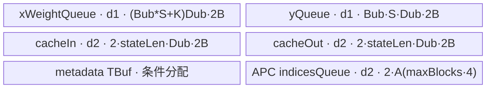
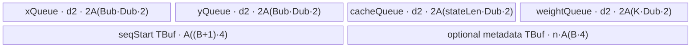

# FusedCausalConv1d 950 ACLNN 算子知识

## 算子速览

| 项目 | 内容 |
|---|---|
| 实际入口 | 最新且唯一公开版本 `aclnnFusedCausalConv1dGetWorkspaceSize` / `aclnnFusedCausalConv1d`，两段式非原地 ACLNN |
| 计算语义 | 以长度 `K-1` 的历史状态左补序列，逐 channel 做 depthwise causal Conv1d；可加 residual，并更新 `convStates`；覆盖普通 cache、MTP、APC 与 PD 混部 |
| 输入输出 | `x/weight/convStates/y` 为 FP16 或 BF16、ND；元数据为 INT32；`x` 为 `[B,S,D]` 或 `[T,D]`，`weight=[K,D]`，公开场景 `K=3` |
| 执行类型 | `AIV_VECTOR`；唯一 entry 调用 `KERNEL_TASK_TYPE_DEFAULT(KERNEL_TYPE_AIV_ONLY)` |
| Kernel 路线 | R-001 CutBH：3D 或 2D 且 `maxQueryLen<=8`；R-002 CutBSH：其余 2D（公开长序列为 `maxQueryLen>8`） |
| 核心资源 | GM、UB `TQue/TQueBind/TBuf`、MicroAPI FP32 寄存器、MTE2/V/MTE3 event；R-002 另有跨 AIV 核 `SyncAll` |
| 来源闭包 | `source_closed`：公开 ACLNN→L0 launcher→rank/属性 dispatcher→两套 Tiling/POD→4 key AIV router→BH/BSH body 与 VF helper→Ascend 950 构建接线 |
| 验证状态 | 已完成源码闭包检查；本次知识提取未执行编译、真机、数值或性能测试。 |

## 接口与语义

### 计算语义

令单个 batch 的输入为 `x[0:S,0:D]`，卷积核为 `w[0:K,0:D]`，有效历史尾部为 `state[0:K-1,0:D]`，则 `padded=concat(state,x)`，输出为 `y[t,d]=Σ(k=0..K-1) padded[t+k,d]*w[k,d] + residualConnection*x[t,d]`。VF 先把 FP16/BF16 输入与权重升为 FP32，FP32 乘加，最后以 `CAST_RINT` 降回输入 dtype。处理结束后按 `stateLen` 右对齐写回旧 state 尾部与当前 x 尾部；APC 根据二维 `cacheIndices`、首末调度 block 和 initial-state block 选择物理 cache 行，MTP 由 accepted/computed token 决定状态偏移。`convMode==1` 且给出 `numComputedTokens` 时，Pangu V2 的起始 `K-1-numComputed` 个输出按实现重置。

### 输入、输出与属性

| 参数 | shape/layout | dtype | 约束、默认值与语义 |
|---|---|---|---|
| `x` | `[T,D]` 或 `[B,S,D]`，ND，可带 storage stride/view offset | FP16/BF16 | 非空；2D 必须用 `queryStartLoc` 划分 batch；3D 仅进入 BH |
| `weight` | `[K,D]`，ND | 与 x 相同 | 非空；公开文档场景 `K=3`；ACLNN 强制 Contiguous |
| `convStates` | `[...,stateLen,D]`，ND，可写 view | 与 x 相同 | 非空；`stateLen=K-1+m`，公开约束 `m∈[0,7]`；作为 in/out 更新 |
| `queryStartLoc` | `[B+1]` | INT32 | 2D 输入需要；首值 0、末值 T、相邻值不同 |
| `cacheIndices` | `[B]` 或 `[B,maxNumBlocks]` | INT32 | 可选；二维表示 APC，`maxNumBlocks∈[1,1024]`；`padSlotId` 行跳过 |
| `initialStateMode/bias` | 可选 ND | INT32/与 x 相同 | 公开文档明确当前不支持；ACLNN 仍把非空 tensor Contiguous 并传入 L0，Kernel entry 不消费二者 |
| `numAcceptedTokens` | `[B]` | INT32 | 可选 MTP 元数据；有效值满足 `1<=value<=seqLen` |
| `numComputedTokens` | `[B]` | INT32 | 可选；0 触发零历史，且参与 MTP/Pangu 状态偏移 |
| `blockIdxFirstScheduledToken` | `[B]` | INT32 | APC 必需，定位本轮首 block |
| `blockIdxLastScheduledToken` | `[B]` | INT32 | APC 必需，Host 也据其存在判定 APC |
| `initialStateIdx` | `[B]` | INT32 | APC 必需，定位读取 initial state 的 block |
| `activationMode/runMode` | scalar | int64 | 历史保留；固定 Kernel body 不读取 |
| `padSlotId/maxQueryLen` | scalar | int64 | pad 行跳过；`maxQueryLen` 决定 BH/BSH，dispatcher 缺省局部值为 0 |
| `residualConnection` | scalar | int64 | 0/1，决定是否在 FP32 累加中加入原始 x |
| `blockSize/convMode` | scalar | int64 | APC block 大小；`convMode` 0=Qwen3-Next、1=Pangu V2 |
| `y` | 与 x 的逻辑 shape 相同 | 与 x 相同 | 公开 ACLNN 为独立输出；L0 注册输出顺序为 `convStates,y` |

### 入口与版本

固定 Commit 仅声明无版本后缀的上述两段式接口，没有 V2/V3 等并存版本，因此它就是 950 实际支持的最新公开版本。README 和 ACLNN 文档产品表只列 `Ascend 950PR/Ascend 950DT` 为支持；`FusedCausalConv1d` OpDef 只 `AddConfig("ascend950", config_950)` 且 `opFile.value=fused_causal_conv1d_apt`，Host CMake 只对 `ASCEND_COMPUTE_UNIT=ascend950` 加专用编译选项，三层证据一致，无平台发布冲突。

## Host/Launcher 执行流程

### 参数校验与前处理

`aclnnFusedCausalConv1dGetWorkspaceSize` 创建 executor。`x` 与可写 `convStates` 用保留 view/storage shape、stride、offset 的 `CreateView`，不复制；`weight` 必经 `l0op::Contiguous`；九个 optional tensor 非空时逐一 Contiguous。随后 `l0op::FusedCausalConv1d` 通过 `ADD_TO_LAUNCHER_LIST_AICORE` 注册 12 输入、`convStates/y` 两输出和 7 属性。`CreateView/Contiguous` 空指针、launcher 注册失败或 L0 返回 false 分别传播 ACLNN 参数/内部 tiling 错误；更细的 shape、dtype、stride、APC 和资源校验在选中 Tiling 类中失败为 `GRAPH_FAILED`。

### 参数、Workspace 与生命周期

第一段接口把 launcher 节点与临时 Contiguous tensor 的生命周期保存在 executor，并返回 `uniqueExecutor->GetWorkspaceSize()`；第二段 `CommonOpExecutorRun(workspace,workspaceSize,executor,stream)` 在给定 stream 执行。

- R-001：`GetWorkspaceSize` 只返回平台 `GetLibApiWorkSpaceSize()`；Device body 没有 workspace 参数。
- R-002：当前公开 ACLNN 由 dispatcher 以默认 `isInplace=false` 构造 Tiling，workspace 固定 `16 MiB` 系统区；body 收到 workspace 但非原地分支不读它。源码保留的内部 `inplace=true` 分支会再加 `align32(T*xStride*sizeof(T))` 的 y backup，但该分支不是本 ACLNN 可达语义。
- 两套 POD 均由 Host `memcpy_s(...,sizeof(struct))` 原样写 raw tiling buffer；entry 依 key 选择正确结构解析，ABI 不能互换。

### 启动图与失败传播

```text
aclnnFusedCausalConv1dGetWorkspaceSize
  -> FusedCausalConv1dCommonProcess
    -> l0op::FusedCausalConv1d / ADD_TO_LAUNCHER_LIST_AICORE
      -> TilingFusedCausalConv1d
        -> CutBH::DoTiling or CutBSH::DoTiling
          -> SetBlockDim + key + raw POD + workspace
            -> fused_causal_conv1d(..., workspace, tiling)
              -> exact-key BF16/FP16 AIV body
aclnnFusedCausalConv1d(workspace,...,stream) -> CommonOpExecutorRun
```

| 节点 | Host 添加/启动 | Kernel entry / 执行族 | blockDim 与 POD | 输入、输出与 workspace | ordering、owner/lifetime 与失败传播 |
|---|---|---|---|---|---|
| N-001（R-001） | `l0op::FusedCausalConv1d` / `ADD_TO_LAUNCHER_LIST_AICORE`，由 executor 在调用 stream 启动 | `fused_causal_conv1d` / `AIV_VECTOR` | `usedCoreNum=dimCoreCnt*batchCoreCnt`；`FusedCausalConv1dCutBHTilingData` | 12 个 L0 输入；输出 `convStates,y`；仅 LibAPI system workspace，entry/body 不消费 workspace | 单 stream 单 Kernel，无 Kernel 间边；executor 持有 View/Contiguous 临时量到运行完成；Tiling/launcher 失败阻断启动 |
| N-001（R-002） | 同一 launcher 节点 | `fused_causal_conv1d` / `AIV_VECTOR` | `realCoreNum=dimCoreNum*bsCoreNum`；`FusedCausalConv1dCutBSHTilingData` | 同上；16 MiB system workspace，公开 `inplace=0` body 不读该指针 | 单 Kernel 内以 event 与两次 `SyncAll` 排序；executor/stream 持有生命周期；Tiling/launcher 失败阻断启动 |

两 Route 都是单 Kernel launch graph，因此不存在 Kernel 间 workspace slice、event 边或中间张量 owner；R-002 的跨核 cache ordering 发生在 N-001 内部，不能误写成第二个 Kernel 节点。

未知 key 在 entry 中不命中四个独立 `if`，因而无输出；但 Host 仅为已校验 BF16/FP16 生成 10000/10001/20000/20001。无另一 Device fallback，也无 AIC/Cube 路线。

## Route 与参数设计

### 分核与资源计算

R-001 令 `N=floor(D/128)`、`rem=D%128`；`D<1024` 时从 `searchN=max(N,1)` 向下搜索 `dimCoreCnt`，令 `batchCoreCnt=min(B,floor(min(AIVCore,limitedCore)/dimCoreCnt))` 并最大化乘积。D 对齐块和 batch 均按前大核/后小核非均匀分配，最后一个 dim 核再承担 `rem`。`D>=1024` 改以 1024 元素粗块分 dim 核，余数仍按 128/末尾元素处理。核内先扣 8 KiB 和元数据，再按 `UB_dynamic(Dub,Bub)=[K+4*stateLen+2*Bub*Sbound]*Dub*2 bytes` 选择 D/BS tile，其中 2 个 `Bub*Sbound` 分别是 x 与 y，4 个 state 是 in/out 各 depth 2。

R-002 以 `overlap=K-1`，对候选 `dimCoreNum` 与 `bsCoreNum` 计算 `effectiveTotal=T+(bsCoreNum-1)*overlap`；优先可均分方案，再最大化总核数。BS 核间与核内相邻 tile 都保留 overlap。`GetPlatformInfo` 先令 `ubSize_=physicalUb-8 KiB`，`Calculate2DTiling` 再扣 metadata；其 Host 动态 UB 公式为 `2*(K+stateLen)*Dub*2 + 4*Bub*Dub*2`。

### Route 选择

| 顺序 | Route | Key/模板 | 精确选择条件与优先级 | 不适用去向 |
|---:|---|---|---|---|
| 1 | R-001 CutBH | BF16 `20000` / FP16 `20001` | dispatcher：`rank(x)==3 \|\| (rank(x)==2 && maxQueryLen<=8)`；属性缺失时本函数局部 `maxQueryLen=0`，也命中 BH | 条件 false 转 R-002；BH 内校验失败直接 `GRAPH_FAILED` |
| 2 | R-002 CutBSH | BF16 `10000` / FP16 `10001` | dispatcher 的 `useBH==false`；公开有效域即 2D 且 `maxQueryLen>8`；BSH 自身还要求 rank 2 | 校验失败，无 Device fallback |

```text
rank=3 ------------------------------------------> R-001
rank=2 and maxQueryLen<=8 ----------------------> R-001
otherwise --------------------------------------> R-002 constructor
  R-002 CheckXDim requires rank=2; otherwise ---> GRAPH_FAILED
selected route: x.dtype BF16/FP16 -> route key; other dtype -> GRAPH_FAILED
```

### 模板/实现执行矩阵

| Route | key/selector | dtype/shape/platform 完整命中条件 | 执行拓扑与 Kernel 节点 | 实际模板/body | 内存与同步特征 | tail/fallback |
|---|---|---|---|---|---|---|
| R-001 CutBH | 20000/20001 | 950；rank 3，或 rank 2 且 `maxQueryLen<=8`；BF16/FP16；BH 实现内校验通过 | 单 Kernel：`fused_causal_conv1d`，AIV-only | `FusedCausalConv1dCutBH<bfloat16_t/half>::Process/CopyIn/Compute/UpdateConvStates/WriteApcPrefixCache` + aligned/single/double-tail VF | x+weight 共用单 depth queue；cache in/out 各 depth2；核内 event，无跨核 barrier | BS/D 主尾块与 last-dim remainder；失败终点为 tiling error |
| R-002 CutBSH | 10000/10001 | 950；rank 2 且 dispatcher 未选 BH；BF16/FP16；BSH 校验和 core/UB search 通过 | 单 Kernel：`fused_causal_conv1d`，AIV-only | `FusedCausalConv1dCutBSH<bfloat16_t/half>::Process/CopyIn/Compute/PrepareBatchMeta/WriteDeferredCacheSimple/FillApcCachePrefixChunks` + 同组 VF | x/y/cache/weight 各 depth2；跨 BS 核两阶段 cache read/write 以 `SyncAll` 隔离 | BS overlap、D last-core remainder；失败无 fallback |

### 隐藏性能 Guard

| Guard | Host/Tiling 条件 | Device/资源原因 | 影响 Route | 不满足时去向 | 源码符号 |
|---|---|---|---|---|---|
| 公开平台 | docs 支持 950 且 OpDef 仅 `ascend950` | 仅 arch35 AIV body 被接线 | 全部 | 不发布 A2/A3 | README 产品表；`FusedCausalConv1d::FusedCausalConv1d` |
| 短长序列 | `rank3 \|\| (rank2 && maxQueryLen<=8)` | BH 以 batch×dim 分核；BSH 以连续 token×dim 分核并处理 overlap | R-001/R-002 | 另一 Route 或校验失败 | `TilingFusedCausalConv1d` |
| dtype key | BF16/FP16 | entry 只有四个精确 key 实例 | 全部 | Host dtype 校验失败；未知 key 无输出 | 两个 `GetTilingKey`；`fused_causal_conv1d` |
| dim 粒度 | BH `D<1024` 用 128，`D>=1024` 用 1024+128；BSH 128 | DMA/VF 主路径按对齐 channel 块工作，余数交 last core/masked VF | 全部 | 专用 last-core tail；非法 D 失败 | `DoOpTiling/ApplyDimSplit` |
| BH UB 上界 | `available=ubSize-8192-fixedUB`，tile 由 `ComputeUbFor*` 求解 | 单核必须容纳 x/y、weight、cache queue 与 metadata | R-001 | 源码无 `available<=0` 或最终总字节复核，`ComputeUbFor*` 会把 batch 至少钳为 1；超资源输入属于固定实现边界 | `ComputeIntraCoreUbTiling*`；`ComputeUbFor*` |
| BH APC 双 buffer 账差 | Host `fixedUB` 对 APC indices 加 `A(maxNumBlocks*4)`，Device `indicesQueue` 实际为 `2*A(maxNumBlocks*4)` | Host 固定项少一份 indices slot；公开 `maxNumBlocks<=1024` 时差额至多 4096 B，小于已扣的 8 KiB，但固定仓无逐项总量断言 | R-001 APC | 超出公开有效域不得据此推断安全；迁移时按 Device 实际字节复核 | `ComputeIntraCoreUbTiling*`；`InitQueues` |
| BSH UB 上界 | `GetPlatformInfo: ubSize_=physicalUb-8192`；`Calculate2DTiling: available=ubSize_-fixedUbSize` | 四个 queue 都 depth2，metadata 为 TBuf；两级扣减共同形成可用 UB | R-002 | `physicalUb<=8192` 或 `available<=0` 失败；更小动态空间由 `CalcCoreUbTiling` 缩 tile | `GetPlatformInfo`；`Calculate2DTiling/CalcCoreUbTiling` |
| overlap 步长 | 多 loop 必须使 `ubFactorBS>K-1`；Device 在不满足时把 `step` 钳为 1，但 Host 的 `CalcCoreUbTiling` 直接使用无符号 `ubFactorBS-(K-1)` | 正常条件下保证 causal window 跨 tile/核连续；Device 钳位不能替代 Host 覆盖域计算 | R-002 | 固定仓无显式资源错误终点；不满足属于资源/迁移边界 | `CalcCoreUbTiling`；`Process` |
| cache 写冲突 | 非首 BS 核首 batch可能跨核；APC read/write physical line 可相同 | 提前回写会覆盖别核仍需读取的原 cache | R-002 | deferred write + 两次 `SyncAll` | `Process/WriteDeferredCacheSimple/ExecuteDeferredRunningCache` |

### POD/ABI

两个结构均只含连续 64 位标量，Host 和 Device 共用同一头文件并以 `sizeof(struct)` 序列化；固定仓没有 `static_assert(sizeof/alignof/offsetof)`，因此下表 ABI 布局写“64 位槽序号”，不虚构编译器数值。每个字段的 producer 都是对应 `PostTiling` 的同名赋值，consumer 为 `InitParams`（BH）或 `ParseTiling/Init/Process`（BSH）及所列用途。

| 结构 | 字段 | 类型/位宽 | ABI 布局 | 单位 | Host/launcher producer | Device consumer | 边界 |
|---|---|---|---|---|---|---|---|
| BH | `usedCoreNum` | int64/64 | 槽0 | 核 | `PostTiling` | raw block 上界语义 | `SetBlockDim` 同值 |
| BH | `dimCoreCnt` | int64/64 | 槽1 | 核 | 同上 | `InitParams` 核映射 | >0 |
| BH | `batchCoreCnt` | int64/64 | 槽2 | 核 | 同上 | 分核闭包字段 | `used=dim*batch` |
| BH | `dimMainCoreCnt` | int64/64 | 槽3 | 核 | 同上 | `InitParams` 大小核分支 | <=dimCoreCnt |
| BH | `dimTailCoreCnt` | int64/64 | 槽4 | 核 | 同上 | Host/ABI 保留 | 可为0 |
| BH | `mainCoredimLen` | int64/64 | 槽5 | 元素 | 同上 | `InitParams` dim offset | 128/1024 派生 |
| BH | `tailCoredimLen` | int64/64 | 槽6 | 元素 | 同上 | `InitParams` dim offset | 可等于 main |
| BH | `batchMainCoreCnt` | int64/64 | 槽7 | 核 | 同上 | `InitParams` batch 分支 | <=batchCoreCnt |
| BH | `batchTailCoreCnt` | int64/64 | 槽8 | 核 | 同上 | Host/ABI 保留 | 可为0 |
| BH | `mainCoreBatchNum` | int64/64 | 槽9 | batch | 同上 | `InitParams` | >0 |
| BH | `tailCoreBatchNum` | int64/64 | 槽10 | batch | 同上 | `InitParams` | 无尾核时复制 main |
| BH | `loopNumBS` | int64/64 | 槽11 | loop | 同上 | `Process` | 主 batch 核 |
| BH | `loopNumDim` | int64/64 | 槽12 | loop | 同上 | `Process` | 主 dim 核 |
| BH | `ubMainFactorBS` | int64/64 | 槽13 | batch | 同上 | `InitQueues/Process` | 主 tile |
| BH | `ubTailFactorBS` | int64/64 | 槽14 | batch | 同上 | `Process` | 尾迭代 |
| BH | `ubMainFactorDim` | int64/64 | 槽15 | 元素 | 同上 | `InitQueues/Process` | 主 tile |
| BH | `ubTailFactorDim` | int64/64 | 槽16 | 元素 | 同上 | `Process` | 尾迭代 |
| BH | `tailBlockloopNumBS` | int64/64 | 槽17 | loop | 同上 | `InitParams` | 尾 batch 核 |
| BH | `tailBlockloopNumDim` | int64/64 | 槽18 | loop | 同上 | `InitParams` | 尾 dim 核 |
| BH | `tailBlockubFactorBS` | int64/64 | 槽19 | batch | 同上 | `InitParams` | 尾核主 tile |
| BH | `tailBlockubTailFactorBS` | int64/64 | 槽20 | batch | 同上 | `InitParams` | 尾核尾 tile |
| BH | `tailBlockubFactorDim` | int64/64 | 槽21 | 元素 | 同上 | `InitParams` | 尾核主 tile |
| BH | `tailBlockubTailFactorDim` | int64/64 | 槽22 | 元素 | 同上 | `InitParams` | 尾核尾 tile |
| BH | `batchSize` | int64/64 | 槽23 | batch | 同上 | GM/meta extent | 1..256 |
| BH | `seqLen` | int64/64 | 槽24 | token | 同上 | x/y extent | 3D；2D 用保守上界 |
| BH | `cuSeqLen` | int64/64 | 槽25 | token | 同上 | 2D x/y extent | 2D 有效 |
| BH | `dim` | int64/64 | 槽26 | 元素 | 同上 | GM stride/weight extent | 64..16384（BH 校验） |
| BH | `kernelSize` | int64/64 | 槽27 | token | 同上 | weight/cache/VF | 公开 K=3 |
| BH | `stateLen` | int64/64 | 槽28 | token | 同上 | cache queue/回写 | >=K-1 |
| BH | `xStride` | int64/64 | 槽29 | 元素 | 同上 | x GM offset | 来自 storage stride |
| BH | `cacheStride0` | int64/64 | 槽30 | 元素 | 同上 | cache line offset | 来自 storage stride |
| BH | `cacheStride1` | int64/64 | 槽31 | 元素 | 同上 | cache row offset | 来自 storage stride |
| BH | `padSlotId` | int64/64 | 槽32 | 索引 | 同上 | batch skip | 默认语义 -1 |
| BH | `xInputMode` | int64/64 | 槽33 | enum | 同上 | 2D/3D 地址 | 0/1 |
| BH | `hasAcceptTokenNum` | int64/64 | 槽34 | bool | 同上 | metadata load | 0/1 |
| BH | `residualConnection` | int64/64 | 槽35 | bool | 同上 | VF wrapper | 0/1 |
| BH | `apcEnable` | int64/64 | 槽36 | bool | 同上 | APC 分支 | 0/1 |
| BH | `blockSize` | int64/64 | 槽37 | token | 同上 | APC block math | APC 有效 |
| BH | `maxNumBlocks` | int64/64 | 槽38 | block | 同上 | 2D indices extent | APC 有效 |
| BH | `hasCacheIndices` | int64/64 | 槽39 | bool | 同上 | cache line 选择 | 0/1 |
| BH | `inplace` | int64/64 | 槽40 | bool | 同上 | y GM binding | 公开 ACLNN 为0 |
| BH | `convMode` | int64/64 | 槽41 | enum | 同上 | Pangu reset | 0/1 |
| BH | `hasNumComputedTokens` | int64/64 | 槽42 | bool | 同上 | zero-cache/MTP | 0/1 |
| BH | `maxQueryLen` | int64/64 | 槽43 | token | 同上 | 2D queue bound | BH <=8 |
| BH | `dimRemainderElems` | int64/64 | 槽44 | 元素 | 同上 | last dim core | 0..127 |
| BH | `lastCoreloopNumDim` | int64/64 | 槽45 | loop | 同上 | last dim core | remainder 参数 |
| BH | `lastCoreubMainFactorDim` | int64/64 | 槽46 | 元素 | 同上 | last dim core | 主 tile |
| BH | `lastCoreubTailFactorDim` | int64/64 | 槽47 | 元素 | 同上 | last dim core | 尾 tile |
| BSH | `loopNumBS` | uint64/64 | 槽0 | loop | `PostTiling` | `ParseTiling/Process` | 主 BS 核 |
| BSH | `loopNumDim` | uint64/64 | 槽1 | loop | 同上 | 同上 | 主 dim 核 |
| BSH | `ubFactorBS` | uint64/64 | 槽2 | token | 同上 | `InitQueues/Process` | 含 overlap |
| BSH | `ubTailFactorBS` | uint64/64 | 槽3 | token | 同上 | `Process` | 尾 tile |
| BSH | `ubFactorDim` | uint64/64 | 槽4 | 元素 | 同上 | `InitQueues/Process` | 主 tile |
| BSH | `ubTailFactorDim` | uint64/64 | 槽5 | 元素 | 同上 | `Process` | 尾 tile |
| BSH | `tailBlockloopNumBS` | uint64/64 | 槽6 | loop | 同上 | 尾 BS 核 | >=1 |
| BSH | `tailBlockloopNumDim` | uint64/64 | 槽7 | loop | 同上 | 尾 dim 核 | >=1 |
| BSH | `tailBlockubFactorBS` | uint64/64 | 槽8 | token | 同上 | 尾 BS 核 | 含 overlap |
| BSH | `tailBlockubTailFactorBS` | uint64/64 | 槽9 | token | 同上 | 尾 BS 核 | 尾 tile |
| BSH | `tailBlockubFactorDim` | uint64/64 | 槽10 | 元素 | 同上 | 尾 dim 核 | 主 tile |
| BSH | `tailBlockubTailFactorDim` | uint64/64 | 槽11 | 元素 | 同上 | 尾 dim 核 | 尾 tile |
| BSH | `dimCoreNum` | uint64/64 | 槽12 | 核 | 同上 | block→dim 映射 | >0 |
| BSH | `dimRemainderCores` | uint64/64 | 槽13 | 核 | 同上 | 大/小 dim 核 | 可为0 |
| BSH | `dimBlockFactor` | uint64/64 | 槽14 | 元素 | 同上 | dim start | 128 倍数或0 |
| BSH | `dimBlockTailFactor` | uint64/64 | 槽15 | 元素 | 同上 | dim start | 128 倍数或0 |
| BSH | `bsCoreNum` | uint64/64 | 槽16 | 核 | 同上 | ABI/分核闭包 | `real/dim` 与之相符 |
| BSH | `bsRemainderCores` | uint64/64 | 槽17 | 核 | 同上 | BS 大小核 | 可为0 |
| BSH | `bsBlockFactor` | uint64/64 | 槽18 | token | 同上 | `Process` bsStart | 含 overlap |
| BSH | `bsBlockTailFactor` | uint64/64 | 槽19 | token | 同上 | `Process` bsStart | 含 overlap |
| BSH | `realCoreNum` | uint64/64 | 槽20 | 核 | 同上 | block 上界 | `SetBlockDim` 同值 |
| BSH | `kernelWidth` | uint64/64 | 槽21 | token | 同上 | causal window | K |
| BSH | `cuSeqLen` | uint64/64 | 槽22 | token | 同上 | x/y extent | 1..1048576 |
| BSH | `dim` | uint64/64 | 槽23 | 元素 | 同上 | GM/VF extent | 16..16384 |
| BSH | `batch` | uint64/64 | 槽24 | batch | 同上 | metadata extent | 1..256 |
| BSH | `padSlotId` | int64/64 | 槽25 | 索引 | 同上 | batch skip | 有符号；默认-1 |
| BSH | `stateLen` | uint64/64 | 槽26 | token | 同上 | cache queue | >=K-1 |
| BSH | `xStride` | uint64/64 | 槽27 | 元素 | 同上 | x/y GM offset | storage stride |
| BSH | `cacheStride0` | uint64/64 | 槽28 | 元素 | 同上 | cache line offset | storage stride |
| BSH | `cacheStride1` | uint64/64 | 槽29 | 元素 | 同上 | cache row offset | storage stride |
| BSH | `residualConnection` | uint64/64 | 槽30 | bool | 同上 | VF wrapper | 0/1 |
| BSH | `apcEnabled` | uint64/64 | 槽31 | bool | 同上 | APC metadata/cache | 0/1 |
| BSH | `blockSize` | uint64/64 | 槽32 | token | 同上 | APC block math | APC 有效 |
| BSH | `maxNumBlocks` | uint64/64 | 槽33 | block | 同上 | 2D index GM | APC 有效 |
| BSH | `convMode` | uint64/64 | 槽34 | enum | 同上 | Pangu reset | 0/1 |
| BSH | `inplace` | uint64/64 | 槽35 | bool | 同上 | y binding/final copy | 公开 ACLNN 为0 |
| BSH | `hasAcceptTokenNum` | uint64/64 | 槽36 | bool | 同上 | metadata TBuf | 0/1 |
| BSH | `hasNumComputedTokens` | uint64/64 | 槽37 | bool | 同上 | zero-cache/MTP | 0/1 |
| BSH | `hasCacheIndices` | uint64/64 | 槽38 | bool | 同上 | cache line 选择 | 0/1 |
| BSH | `dimRemainderElems` | uint64/64 | 槽39 | 元素 | 同上 | last dim core | 0..127 |
| BSH | `lastCoreloopNumDim` | uint64/64 | 槽40 | loop | 同上 | last dim core | remainder 参数 |
| BSH | `lastCoreubFactorDim` | uint64/64 | 槽41 | 元素 | 同上 | last dim core | 主 tile |
| BSH | `lastCoreubTailFactorDim` | uint64/64 | 槽42 | 元素 | 同上 | last dim core | 尾 tile |

### Route 源码闭包

| Route | Key/selector | Host/Tiling producer | POD/参数 | Kernel entry/router 节点 | Kernel body/直接依赖 | 构建接线 |
|---|---|---|---|---|---|---|
| R-001 CutBH | dispatcher rank/threshold；20000/20001 | `fused_causal_conv1d_tiling.cpp::TilingFusedCausalConv1d` → `FusedCausalConv1dCutBHTiling::{DoOpTiling,PostTiling}` | `FusedCausalConv1dCutBHTilingData` | `fused_causal_conv1d` exact key | `FusedCausalConv1dCutBH` + 四个 VF 头 | OpDef `ascend950/opFile=fused_causal_conv1d_apt`；Host CMake |
| R-002 CutBSH | dispatcher fallthrough；10000/10001 | 同 dispatcher → `FusedCausalConv1dCutBSHTiling::{DoOpTiling,PostTiling}` | `FusedCausalConv1dCutBSHTilingData` | 同一 AIV entry exact key | `FusedCausalConv1dCutBSH` + 四个 VF 头 | 同一 950 接线 |

## Kernel 实现

### 公共执行流程

唯一 entry 先声明 `KERNEL_TYPE_AIV_ONLY`，默认注册 BSH POD，并对 `TILING_KEY_VAR>=20000` 注册 BH POD；四个 exact-key 分支分别构造 BF16/half body。两 Route 均执行 GM→UB 的 x/weight/cache 搬运，在 MicroAPI 寄存器中 B16/BF16→FP32、K 项 `Mul+Add`、可选 residual `Add`、`CAST_RINT` 回原 dtype，再 UB→GM 写 y 并更新 cache。aligned、single-tail、double-tail helper 只改变寄存器展开和 mask，不改变数学语义。

### Route R-001：CutBH 短序列

#### 适用条件

##### 选择证据

| 层级 | 文件 | 符号 | 源码谓词/参数 | 结果/下一跳 |
|---|---|---|---|---|
| API | `op_api/aclnn_fused_causal_conv1d.cpp` | `FusedCausalConv1dCommonProcess` | View/Contiguous/L0 成功 | launcher node |
| Dispatcher | `op_host/fused_causal_conv1d_tiling.cpp` | `TilingFusedCausalConv1d` | `xDimNum==3 \|\| (xDimNum==2 && maxQueryLen<=8)` | CutBH `DoTiling` |
| Tiling | `op_host/fused_causal_conv1d_cut_bh_tiling_arch35.cpp` | `GetTilingKey` | BF16→20000，FP16→20001 | raw BH POD |
| Router | `op_kernel/fused_causal_conv1d_apt.cpp` | `fused_causal_conv1d` | exact key | `FusedCausalConv1dCutBH<T>` |

#### Device 数据流

##### 函数级调用链

```text
fused_causal_conv1d
  -> FusedCausalConv1dCutBH<T>::Init
    -> InitParams -> InitQueues
  -> Process
    -> CopyIn
    -> Compute
      -> Conv1dNeedStateBH / Conv1dNeedStateSingleTailBH
      -> Conv1dNoNeedState (aligned/single/double tail wrappers)
      -> UpdateConvStates -> WriteApcPrefixCache (条件)
      -> DataCopyPad(yGM)
```

##### 源码等价伪码

```text
// 伪码；offset 单位均为元素
(batchIdx,dimIdx)=divmod(blockIdx,dimCoreCnt)
按 main/tail/last-dim POD 求 firstBatch, coreDimStart, BS/D loop 与 tile
预载 accepted/cache-index/queryStart/numComputed/APC metadata；MTE2_S 等待
for bLoop in BS loops:
  for dLoop in D loops:
    Bcur=last?Btail:Bmain; Dcur=last?Dtail:Dmain
    tokenStart=3D?firstBatch*S:queryStart[firstBatch]
    xOff=tokenStart*xStride+coreDimStart+dLoop*Dmain
    GM x[Bcur*Sbound,Dcur] 与 weight[K,Dcur] -> 同一 xWeightQueue
    for each batch b in tile:
      read/write cache line = APC block mapping, 1D cacheIndices[b], or b
      if line==padSlotId: continue
      numComputed==0 ? Duplicate zero state : GM state -> cacheQueueIn
      对前 need-state token 与后 no-state token 调 VF；FP32 累加，tail mask
      UpdateConvStates: 旧 state 尾 + x 尾右对齐写 GM
      APC 时 WriteApcPrefixCache 写已完成 block 的 prefix state
    yQueue -> DataCopyPad yGM，有效 blockCount/Dcur 之外不写
```

#### 内存与数据搬运

##### 资源与搬运表

| 层级/缓冲区 | offset/地址公式 | extent/容量公式 | dtype/layout | producer | consumer | owner/lifetime | 对齐/复用 |
|---|---|---|---|---|---|---|---|
| GM x/y | `token*xStride+dimOff` / `token*yDim+dimOff` | 逻辑 B*S*D 或 T*D | FP16/BF16 ND/view | caller/VF | MTE2/caller | stream | D tail 用 `DataCopyPad` |
| GM weight | `k*D+dimOff` | K*D | 同 x | caller | VF | stream | K 行，srcStride=`D-Dcur` |
| GM cache | `line*cacheStride0+row*cacheStride1+dimOff` | lines*stateLen*D | 同 x | caller/Kernel | VF/Kernel | stream | 右对齐回写；APC 物理行 |
| `xWeightQueue` | x 从0；weight 从 `xPartSize` | `(Bub*Sbound+K)*Dub*2` B，depth1 | 同 x，拼接子区 | MTE2 | VF | 每 tile至 `FreeTensor` | x/weight 共一 allocation，不别名 |
| `yQueue` | token*Dub | `Bub*Sbound*Dub*2` B，depth1 | 同 x | VF | MTE3 | 每 tile | 输出直接物化于 output queue |
| `cacheQueueIn` | row*Dub | `2*stateLen*Dub*2` B | 同 x | MTE2/Duplicate | VF | 每 batch | depth2 |
| `cacheQueueOut` | row*Dub | `2*stateLen*Dub*2` B | 同 x | V copy | MTE3/APC helper | 每 batch | depth2，与 input 分离 |
| metadata TBuf | 槽0 | `A(B*4)` 等条件项 | INT32 | MTE2/Duplicate | scalar branch | 整个 Process | `A(z)=align32(z)` |
| APC `indicesQueue` | 当前 batch | `2*A(maxNumBlocks*4)` B | INT32 | MTE2 | cache mapping | 每 batch | depth2 |
| workspace/L1/L0 | N/A | body 无 workspace；L1/L0 未分配 | N/A | N/A | N/A | N/A | 纯 AIV，以 UB/寄存器替代 |

##### 分层内存布局



图中 `S` 对 2D 为 `maxQueryLen` 的保守值；非 APC 不分配 `indicesQueue`，无 cacheIndices 时也不分配 `indicesBuf`。

##### 字节账与复用顺序

```text
UB_device = (Bub*S+K)*Dub*2 + Bub*S*Dub*2
          + 2*stateLen*Dub*2 + 2*stateLen*Dub*2
          + A(B*4)                                      // acceptTokenBuf
          + [nonAPC && hasCacheIndices] A(B*4)
          + [APC] 2*A(maxNumBlocks*4)
          + [2D] A((B+1)*4)
          + [hasNumComputed] A(B*4)
          + [APC] 3*A(B*4)
Host_dynamic + Host_fixed <= ubSize-8192
APC 的 Host_fixed 比 Device 少一个 A(maxNumBlocks*4) slot；公开 maxNumBlocks<=1024 时差额<=4096 B，
小于 Host 已扣的 8192 B，但源码没有逐 buffer 总量 static/runtime assert。
```

| 复用子区 | 写入者 | 读取者/消费点 | 下一次覆盖 | 同步或释放依据 | 安全条件 |
|---|---|---|---|---|---|
| `xWeightQueue` x/weight 子区 | `CopyIn` 两次 MTE2 | `Compute` VF | 下一 tile `AllocTensor` | `EnQue→DeQue→FreeTensor` | 两子区 offset 必须保持 `xPartSize` |
| cache in slot | MTE2或Duplicate | VF、cache-out copy | 下一 batch | `EnQue→DeQue→FreeTensor` | depth2 且消费后释放 |
| cache out slot | V copy/VF更新 | GM/APC write | 下一 batch | `EnQue→DeQue→FreeTensor` | MTE3 完成前不可覆盖 |
| y slot | VF | `DataCopyPad(yGM)` | 下一 tile | `EnQue→DeQue→FreeTensor` | 仅写有效 `blockCount*Dcur` |

#### 同步、精度与尾块

##### 同步与数值边界表

| 阶段 | primitive/机制 | producer | consumer/等待点 | 保护对象 | 精度/尾块 |
|---|---|---|---|---|---|
| metadata 初始化 | `V_MTE2` event | `Duplicate(accepted=1)` | 可选 MTE2 覆盖 | accepted TBuf | INT32 |
| metadata GM→UB | `MTE2_S` | `DataCopyPad` | scalar `GetValue` | indices/query/APC meta | 精确 B/B+1 元素 |
| x/weight/cache | TQue + MTE2/V event | `CopyIn` | VF/标量 | queue slot | Dcur 和 GM stride |
| VF | `LoadAlign/Cast/Mul/Add/StoreAlign` | FP16/BF16 UB | FP32 RegTensor | y UB | 全 mask 每64个 FP32 lane；尾部 `UpdateMask(dimRem)` |
| 降精度 | `CastTrait B32→B16` | FP32 accumulator | Store | y | `NO_SAT + CAST_RINT + ZEROING` |
| cache/y回写 | `MTE3_V/V_MTE3` + queue | V | MTE3 | cache/y UB | `DataCopyPad` 仅提交有效 D tail |
| 核间 | N/A | 每核独占 batch×dim tile | N/A | GM y/cache | BH 无 `SyncAll`；依赖分核不重叠 |

#### 关键实现

##### 符号证据表

| 阶段 | 文件 | 符号/模板实例 | 实现事实 |
|---|---|---|---|
| Host/Tiling producer | `op_host/fused_causal_conv1d_cut_bh_tiling_arch35.cpp` | `DoOpTiling/ComputeInterCoreSplit*/ComputeIntraCoreUbTiling*/PostTiling` | 细/粗分核、UB 公式、POD/key |
| Kernel entry/router | `op_kernel/fused_causal_conv1d_apt.cpp` | key 20000/20001 | BF16/half BH 实例，AIV-only |
| Device body/helper | `op_kernel/arch35/fused_causal_conv1d_cut_bh.h` | `InitQueues/Process/Compute/UpdateConvStates/WriteApcPrefixCache` | queue 字节、地址、cache 更新、event |
| VF | `op_kernel/arch35/vf/fused_causal_conv1d_state_single_tail.h` | `Conv1dNeedStateSingleTail*VF` | FP32 累加、RINT、masked tail |
| VF | `op_kernel/arch35/vf/fused_causal_conv1d_128dim.h` 等 | aligned/no-state helpers | 展开 token 与 D 主块 |

### Route R-002：CutBSH 长序列

#### 适用条件

##### 选择证据

| 层级 | 文件 | 符号 | 源码谓词/参数 | 结果/下一跳 |
|---|---|---|---|---|
| API | `op_api/aclnn_fused_causal_conv1d.cpp` | `FusedCausalConv1dCommonProcess` | 2D x View、optional Contiguous 成功 | launcher node |
| Dispatcher | `op_host/fused_causal_conv1d_tiling.cpp` | `TilingFusedCausalConv1d` | `useBH==false` | CutBSH `DoTiling` |
| Tiling | `op_host/fused_causal_conv1d_cut_bsh_tiling_arch35.cpp` | `IsCapable/GetTilingKey` | rank2；短 1..8 自身返回 false；BF16/FP16 | 10000/10001 |
| Router | `op_kernel/fused_causal_conv1d_apt.cpp` | `fused_causal_conv1d` | exact key | `FusedCausalConv1dCutBSH<T>` |

#### Device 数据流

##### 函数级调用链

```text
fused_causal_conv1d
  -> FusedCausalConv1dCutBSH<T>::Init
    -> ParseTiling -> InitQueues
  -> Process
    -> LoadMetadata
    -> CopyIn -> Compute -> PrepareBatchMeta
      -> Conv1dNeedState/SingleTail + Conv1dNoNeedState tail wrappers
      -> WriteCacheToStates / deferred state capture
    -> SyncAll -> WriteDeferredCacheSimple
    -> FillApcCachePrefixChunks -> SyncAll -> ExecuteDeferredRunningCache
```

##### 源码等价伪码

```text
// 伪码；当前 ACLNN inplace=false，因此省略不可达的 CopyYToX 分支
if blockIdx>=realCoreNum: return
(bsIdx,dimIdx)=divmod(blockIdx,dimCoreNum)
bsStart=前 BS 核有效步长之和；每步=blockFactor-(K-1)
dimStart=前大 dim 核长度 + 前小 dim 核长度；末核加 D%128
LoadMetadata(); wait MTE2_S
for bsLoop:
  curBS=main/tail; iStart=(首BS核首次?0:K-1)
  for dimLoop:
    CopyIn x[curBsStart:curBsStart+curBS,dimTile] 和 weight[:,dimTile]
    while i<curBS:
      b=FindBatchIdx(globalToken); meta=PrepareBatchMeta(b,seqPos)
      if writeCIdx==padSlotId: 跳过当前 batch 有效域
      useZeroCache ? 无 GM load : GM state[readCIdx,mtpOffset:,...] -> cacheQueue
      need-state tokens 与 no-state tokens 分别调 VF，FP32 累加并 masked tail
      若写 cache 会与别核读冲突则记录 deferred，否则立即 WriteCacheToStates
    yLocal[有效且去重 overlap 的 token] -> yGM
SyncAll(); WriteDeferredCacheSimple()
FillApcCachePrefixChunks(); SyncAll(); ExecuteDeferredRunningCache()
```

#### 内存与数据搬运

##### 资源与搬运表

| 层级/缓冲区 | offset/地址公式 | extent/容量公式 | dtype/layout | producer | consumer | owner/lifetime | 对齐/复用 |
|---|---|---|---|---|---|---|---|
| GM x/y | `token*xStride+dimStart` / `token*dim+dimStart` | T×logical/storage D | FP16/BF16 ND/view | caller/VF | MTE2/caller | stream | overlap 只读；iStart 防重复写 y |
| GM cache | `physicalLine*cacheStride0+row*cacheStride1+dimStart` | lines×stateLen×D | 同 x | caller/Kernel | VF/deferred helper | stream | APC 可读写同 physical line |
| `xQueue_` | token*Dub | `2*A(Bub*Dub*2)` B | 同 x | MTE2 | VF/deferred temp | tile | `TQueBind` depth2；helper 可临时复用 |
| `yQueue_` | token*Dub | `2*A(Bub*Dub*2)` B | 同 x | VF | MTE3 | tile | depth2 |
| `cacheQueue_` | row*Dub | `2*A(stateLen*Dub*2)` B | 同 x | MTE2/zero | VF/cache write | batch | `TQueBind` depth2 |
| `weightQueue_` | k*Dub | `2*A(K*Dub*2)` B | 同 x | MTE2 | VF | tile | depth2 |
| `seqStartBuf_` | 0 | `A((B+1)*4)` B | INT32 | MTE2 | batch search | Process | 常驻 TBuf |
| optional metadata TBuf | 0 | 每项 `A(B*4)` B | INT32 | MTE2 | meta/cache branch | Process | cacheIdx、numComputed、accepted、APC三项按 flag分配 |
| workspace | runtime system area | 16 MiB | byte | runtime | 当前 body 不读 | executor | 公开非原地 ACLNN |
| L1/L0 | N/A | N/A | N/A | N/A | N/A | N/A | 纯 AIV，以 UB/寄存器替代 |

##### 分层内存布局



##### 字节账与复用顺序

```text
n = [hasCacheIndices && !APC] + [hasNumComputed] + [hasAccepted] + 3*[APC]
UB_device = 2*A(Bub*Dub*2) + 2*A(Bub*Dub*2)
          + 2*A(stateLen*Dub*2) + 2*A(K*Dub*2)
          + A((B+1)*4) + n*A(B*4)
Host 先令 ubSize_ = physicalUb - 8192，再使用
available = ubSize_ - A((B+1)*4) - n*A(B*4)
并以未逐 buffer A() 的系数式选择 Bub/Dub；固定仓未执行运行验证。
```

| 复用子区 | 写入者 | 读取者/消费点 | 下一次覆盖 | 同步或释放依据 | 安全条件 |
|---|---|---|---|---|---|
| x queue slot | `CopyIn` MTE2 | VF | 下一 tile | `EnQue→DeQue→FreeTensor` | overlap 行只读；有效输出从 iStart 开始 |
| x queue临时 slot | deferred/APC helper GM read | GM cache write | helper下一块 | 本地 `Alloc→EnQue→DeQue→Free` | 不与尚未释放主 x slot 并发占满 depth |
| cache slot | MTE2/zero | VF、cache update | 下一 batch | queue lifecycle + event | deferred 冲突路径不得提前写 GM |
| y slot | VF | yGM MTE3 | 下一 tile | `V_MTE3` 后 Free | overlap 输出只提交一次 |
| GM cache（跨核逻辑复用） | 主循环/Fill APC | 其它核的原 cache read | 两次 `SyncAll` 后 deferred 覆盖 | 全核 barrier | 所有读必须先于冲突写 |

#### 同步、精度与尾块

##### 同步与数值边界表

| 阶段 | primitive/机制 | producer | consumer/等待点 | 保护对象 | 精度/尾块 |
|---|---|---|---|---|---|
| metadata | `MTE2_S` | `LoadMetadata` | scalar batch/meta logic | 常驻 TBuf | INT32 精确 B/B+1 |
| x/weight/cache | depth2 queue + `MTE2_S/S_MTE2` | MTE2 | VF/scalar | UB slot | BS overlap、Dcur |
| VF/MTE3 | `S_V/MTE3_V/V_MTE3` | MicroAPI | GM copy | y/cache | B16/BF16→FP32，K项累加，RINT 回写；tail mask |
| 第一次跨核 barrier | `SyncAll` | 主循环所有原 cache 读/立即写 | `WriteDeferredCacheSimple` | 跨 BS 核 batch 状态 | 防首 batch 冲突 |
| 第二次跨核 barrier | `SyncAll` | `FillApcCachePrefixChunks` 的原 cache 读 | `ExecuteDeferredRunningCache` | APC 同物理行 | 防 prefix 读被覆盖 |
| inplace barrier | 条件第三次 `SyncAll` | y workspace 写 | `CopyYToX` | xGM | 公开 ACLNN `inplace=0`，inactive |
| 空/尾域 | block上界、padSlot、iStart、main/tail/last-core | Host POD | body branches | GM有效域 | 无效 lane mask zeroing；pad batch不写 |

#### 关键实现

##### 符号证据表

| 阶段 | 文件 | 符号/模板实例 | 实现事实 |
|---|---|---|---|
| Host/Tiling producer | `op_host/fused_causal_conv1d_cut_bsh_tiling_arch35.cpp` | `SearchBestCoreSplit/Calculate2DTiling/CalcCoreUbTiling/PostTiling` | overlap 分核、UB、POD、workspace |
| Kernel entry/router | `op_kernel/fused_causal_conv1d_apt.cpp` | key 10000/10001 | BF16/half BSH 实例，AIV-only |
| Device body/helper | `op_kernel/arch35/fused_causal_conv1d_cut_bsh.h` | `Process/Compute/PrepareBatchMeta/WriteDeferredCacheSimple/FillApcCachePrefixChunks` | token/batch 地址、cache 冲突与 barrier |
| VF | 四个 `op_kernel/arch35/vf/*.h` | aligned/state/no-state/tail helpers | FP32 寄存器乘加、RINT、mask |

## 算子特定优化

### Trick T-001：按 rank/最大查询长度分离 BH 与 BSH 调度

#### 触发与源码依据

- 适用 Route：R-001、R-002
- 触发条件：`rank==3 || (rank==2 && maxQueryLen<=8)` 选 BH，否则构造 BSH
- Golden 来源：[`attention/fused_causal_conv1d/op_host/fused_causal_conv1d_tiling.cpp:37-58`](../../../../../../../cann-ops-raw/ascendc/ops-transformer/be33d95bb755cedec3108f70805c1874d1792540/attention/fused_causal_conv1d/op_host/fused_causal_conv1d_tiling.cpp#L37-L58)

**官方源码（固定 Commit 连续逐字摘录）**：

```cpp
int64_t maxQueryLen = 0;
if (context->GetAttrs() != nullptr && context->GetAttrs()->GetInt(ATTR_MAX_QUERY_LEN_INDEX) != nullptr) {
    maxQueryLen = *(context->GetAttrs()->GetInt(ATTR_MAX_QUERY_LEN_INDEX));
}

bool useBH = (xDimNum == 3) || (xDimNum == 2 && maxQueryLen <= MAX_BH_SEQ_LEN);
```

#### 机制与设计原因

短序列由 batch×hidden 分核，避免为每个短 batch 引入跨 token overlap 与全核 cache barrier；长 2D 序列则沿连续 token×hidden 分核，提高可用并行域，同时用 `K-1` overlap 保持 causal window。选择发生在 Host，Device 内层无需判断两套完全不同的同步图。

#### 迁移边界

- 适用：同一逻辑算子存在短序列 batch 并行与长序列 token 并行两种实现。
- 前提：可获得可靠 rank/maxQueryLen，且两 Route 的独立 POD、entry 映射和 cache 语义闭合。
- 失效：阈值外必须进入 BSH；非 2D/3D 最终校验失败，不能强行套用。
- 未验证：本次知识提取未执行编译、真机、数值或性能测试。

#### 错误做法

把缺失 `maxQueryLen` 当成 BSH 的 `-1` 规则会改变实际 dispatcher 语义；本入口局部默认值是 0，会选 BH。

### Trick T-002：FP32 寄存器累加与动态 tail mask 一体化

#### 触发与源码依据

- 适用 Route：R-001、R-002 的 state/no-state、aligned/tail VF
- 触发条件：输入 dtype 为 FP16/BF16；`dimRem` 非零时使用 `UpdateMask<float>`
- Golden 来源：[`attention/fused_causal_conv1d/op_kernel/arch35/vf/fused_causal_conv1d_state_single_tail.h:45-75`](../../../../../../../cann-ops-raw/ascendc/ops-transformer/be33d95bb755cedec3108f70805c1874d1792540/attention/fused_causal_conv1d/op_kernel/arch35/vf/fused_causal_conv1d_state_single_tail.h#L45-L75)

**官方源码（固定 Commit 连续逐字摘录）**：

```cpp
MicroAPI::RegTensor<float> xB32, mulB32, weightB32, yB32;
MicroAPI::RegTensor<T> xB16, weightB16, yB16;
uint8_t dimLoopNum = dimLen / B32_REP_SIZE;
uint16_t dimRem = dimLen - dimLoopNum * B32_REP_SIZE;
MicroAPI::MaskReg maskB32 = MicroAPI::CreateMask<float, MicroAPI::MaskPattern::ALL>();
MicroAPI::MaskReg maskRem;
```

#### 机制与设计原因

每 256B 寄存器覆盖 64 个 FP32 lane。权重与 x/state 以 `DIST_UNPACK_B16` 载入，按 `castTraitB162B32` 升到 FP32，K 项 `Mul+Add` 和 residual 均在 FP32 完成；最后按 `castTraitB322B16` 的 `NO_SAT/CAST_RINT/ZEROING` 降精度。尾部用 `UpdateMask(dimRem)` 复用同一计算顺序，避免把 padding lane 混入 y。

#### 迁移边界

- 适用：低精度输入、短 K 的逐 channel stencil/卷积。
- 前提：目标平台支持相同 MicroAPI cast/load/store 分布与 256B register，tail 长度以 FP32 lane 计。
- 失效：换成其它累加 dtype、round mode 或 register 宽度时，必须重算 loop/mask 并重新验证精度。
- 未验证：本次知识提取未执行编译、真机、数值或性能测试。

#### 错误做法

直接在 FP16/BF16 中逐项累加或用 `dimLen` 作为尾 mask 会改变固定源码的精度顺序或越过有效 lane。

### Trick T-003：BSH 将冲突 cache 回写延迟到两级全核屏障后

#### 触发与源码依据

- 适用 Route：R-002
- 触发条件：跨 BS 核的首 batch 或 APC running-cache 读写同一物理 cache 行
- Golden 来源：[`attention/fused_causal_conv1d/op_kernel/arch35/fused_causal_conv1d_cut_bsh.h:705-713`](../../../../../../../cann-ops-raw/ascendc/ops-transformer/be33d95bb755cedec3108f70805c1874d1792540/attention/fused_causal_conv1d/op_kernel/arch35/fused_causal_conv1d_cut_bsh.h#L705-L713)

**官方源码（固定 Commit 连续逐字摘录）**：

```cpp
SyncAll();

WriteDeferredCacheSimple();

FillApcCachePrefixChunks();
SyncAll(); // cross-core barrier: ensure FillApc reads complete before deferred writes
if (cacheDeferred_.active) {
    ExecuteDeferredRunningCache();
```

#### 机制与设计原因

BS 分核为卷积引入 overlap，同一 batch 或 APC physical line 可能被多个核读取。主循环仅记录冲突写；第一次 barrier 保证所有主循环原 cache 读取完成，再提交普通 deferred state。APC prefix fill 仍可能读取旧 cache，所以第二次 barrier 后才执行 running-cache deferred 写。该顺序把跨核 data hazard 从常规 tile 快路径移到批次尾部。

#### 迁移边界

- 适用：多核分割序列且状态既读又写、物理索引可能别名的算子。
- 前提：所有参与核进入相同 barrier 次数；deferred 结构能完整重建目标 state。
- 失效：若存在提前 return、不同核 barrier 次数不一致或 cache alias 规则变化，必须重设计同步，不能只移动写回。
- 未验证：本次知识提取未执行编译、真机、数值或性能测试。

#### 错误做法

删除或合并第二次 `SyncAll` 会允许 `ExecuteDeferredRunningCache` 覆盖 `FillApcCachePrefixChunks` 尚未读取的旧 cache。

## 模板与实现对比

| 对比维度 | R-001 CutBH | R-002 CutBSH | 设计选择依据 |
|---|---|---|---|
| 命中条件/优先级 | rank3 或短 rank2，先判断 | dispatcher fallthrough，实际公开长 rank2 | rank/`maxQueryLen` |
| 模板与 dtype | `CutBH<BF16/half>`，20000/20001 | `CutBSH<BF16/half>`，10000/10001 | dtype 只分实例，不改变 Route 语义 |
| 循环与分核 | batch×D；D<1024细粒度、否则粗粒度 | token BS×D；核间/核内均含 K-1 overlap | 可用并行域与 causal window |
| Queue/TBuf/寄存器 | x+weight d1，y d1，cache in/out d2，条件 metadata | x/y/cache/weight 均 d2，条件 metadata | 长序列增加 pipeline depth |
| UB 总占用与复用 | 扣8KiB；APC indices Host/Device depth 账有一份 slot 差异 | `GetPlatformInfo` 扣8KiB，再扣 metadata；队列逐项32B对齐 | 迁移必须以 `InitBuffer` 为最终字节账 |
| 搬运/Vector API | batch tile搬运；同组 FP32 MicroAPI VF | overlap token tile搬运；同组 VF | 数值核心共用，地址/调度不同 |
| 同步、精度与 tail | 核内 event；无 `SyncAll`；last D core/mask | 核内 event + 两次跨核 barrier；last D core/mask | BSH cache读写冲突 |
| fallback/失败边界 | Tiling 失败，无 Device fallback | Tiling 失败，无 Device fallback | entry 只有4 exact key |

## 平台差异

| 项目 | A2 | A3 | 950 |
|---|---|---|---|
| 支持状态 | 公开产品表未列支持，OpDef 无配置 | 公开产品表未列支持，OpDef 无配置 | README/docs 明确支持 Ascend 950PR/DT |
| Host/Launcher | N/A | N/A | rank/maxQueryLen dispatcher + arch35 BH/BSH Tiling |
| Kernel/资源 | N/A | N/A | `KERNEL_TYPE_AIV_ONLY`，UB/MicroAPI；BSH 使用 `SyncAll` |

## 限制与失败边界

- 公开文档要求 FP16/BF16 输入及 INT32 元数据、不允许空 tensor、Inf/NaN，并给出多场景 shape/属性限制；Host 实现还分别约束 BH 与 BSH 的 D、B、T、K、stride、APC block。失败直接终止 Tiling，不存在通用 fallback。
- `initialStateMode`、`bias`、`activationMode`、`runMode` 保留在公开 ABI/L0，但固定 Kernel entry/body不消费；不得推测其效果。
- 当前公开 ACLNN 是独立 y 输出，`convStates` 仍原地更新。两个 Tiling 类保留 `isInplace` 内部分支，但 dispatcher 不传 true，不能把它发布成另一公开 API。
- BH APC 的 Host fixed UB 只计一份 `maxNumBlocks` indices，而 Device `indicesQueue` 为 depth2；公开 `maxNumBlocks<=1024` 时额外 slot 不超过 4096 B，小于 Host 已扣的 8 KiB，但源码没有逐项总量断言。BSH 则在 `GetPlatformInfo` 明确先扣 8 KiB，再在 `Calculate2DTiling` 扣 metadata。
- BH 没有像 BSH 那样强制 `kernelSize==3`，但四个 VF helper 的权重展开固定为 3 项；因此 `K!=3` 不能因 BH Host 校验放行而视为支持，公开有效域仍严格是 `K=3`。
- BSH 多 loop 的覆盖公式依赖 `ubFactorBS>K-1`；Host 对无符号差值没有显式 guard，Device 的 `step=1` 钳位不足以证明异常资源点的完整覆盖，迁移时必须保留这一前提。
- 两个 POD 依赖原生 struct ABI 和 `memcpy_s(sizeof)`；固定仓无数值 `static_assert(sizeof/offsetof)`，跨编译器/语言重建必须保持字段类型与顺序，并在目标工具链另验 ABI。
- BSH 所有核必须以相同顺序经过 `SyncAll`。入口的 `blockIdx>=realCoreNum` return 与 runtime `SetBlockDim(realCoreNum)` 配套；若改变 launch blockDim，可能造成 barrier 参与者不一致。
- 本次知识提取未执行编译、真机、数值或性能测试；不提供吞吐、误差或 UB 安全裕量的实测结论。

## 源码索引

### 链路索引

| 链路阶段 | 文件 | 关键符号 | 支撑内容 |
|---|---|---|---|
| 公开约束 | `attention/fused_causal_conv1d/README.md` | 产品表/功能/约束 | 950-only、APC/MTP/PD/残差语义 |
| 公开接口文档 | `attention/fused_causal_conv1d/docs/aclnnFusedCausalConv1d.md` | 两段式接口/参数/错误码 | ACLNN ABI 与公开有效域 |
| 入口声明 | `attention/fused_causal_conv1d/op_api/aclnn_fused_causal_conv1d.h` | 两个 ACLNN symbol | 最新无后缀入口 |
| 入口实现 | `attention/fused_causal_conv1d/op_api/aclnn_fused_causal_conv1d.cpp` | `FusedCausalConv1dCommonProcess` | View/Contiguous/executor |
| L0 launcher | `attention/fused_causal_conv1d/op_api/fused_causal_conv1d.cpp` | `l0op::FusedCausalConv1d` | 输入/输出/属性与 AICore launcher |
| Host dispatcher | `attention/fused_causal_conv1d/op_host/fused_causal_conv1d_tiling.cpp` | `TilingFusedCausalConv1d` | BH/BSH 选择 |
| Host/Tiling | `attention/fused_causal_conv1d/op_host/fused_causal_conv1d_cut_bh_tiling_arch35.cpp` | `FusedCausalConv1dCutBHTiling::*` | R-001 校验/分核/UB/POD/workspace |
| Host/Tiling | `attention/fused_causal_conv1d/op_host/fused_causal_conv1d_cut_bsh_tiling_arch35.cpp` | `FusedCausalConv1dCutBSHTiling::*` | R-002 校验/overlap/UB/POD/workspace |
| POD ABI | `attention/fused_causal_conv1d/op_kernel/arch35/fused_causal_conv1d_cut_bh_struct.h` | `FusedCausalConv1dCutBHTilingData` | BH 字段顺序 |
| POD ABI | `attention/fused_causal_conv1d/op_kernel/arch35/fused_causal_conv1d_cut_bsh_struct.h` | `FusedCausalConv1dCutBSHTilingData` | BSH 字段顺序 |
| Kernel entry | `attention/fused_causal_conv1d/op_kernel/fused_causal_conv1d_apt.cpp` | `fused_causal_conv1d` | AIV-only、POD 注册、4 key router |
| Kernel body | `attention/fused_causal_conv1d/op_kernel/arch35/fused_causal_conv1d_cut_bh.h` | `FusedCausalConv1dCutBH` | BH queue/循环/cache回写 |
| Kernel body | `attention/fused_causal_conv1d/op_kernel/arch35/fused_causal_conv1d_cut_bsh.h` | `FusedCausalConv1dCutBSH` | BSH overlap/deferred/barrier |
| VF helper | `attention/fused_causal_conv1d/op_kernel/arch35/vf/fused_causal_conv1d_128dim.h` | aligned VF wrappers | D 主块、FP32 寄存器乘加 |
| VF helper | `attention/fused_causal_conv1d/op_kernel/arch35/vf/fused_causal_conv1d_state_single_tail.h` | state tail VF | cast trait、need-state mask |
| VF helper | `attention/fused_causal_conv1d/op_kernel/arch35/vf/fused_causal_conv1d_no_state_single_tail.h` | no-state single tail | 单尾展开 |
| VF helper | `attention/fused_causal_conv1d/op_kernel/arch35/vf/fused_causal_conv1d_no_state_double_tail.h` | no-state double tail | 双尾展开 |
| 平台接线 | `attention/fused_causal_conv1d/op_host/fused_causal_conv1d_def.cpp` | `FusedCausalConv1d` OpDef | dtype/format/output/ascend950 opFile |
| 构建接线 | `attention/fused_causal_conv1d/op_host/CMakeLists.txt` | `add_op_to_compiled_list/add_ops_compile_options` | Host/API与Ascend950编译选项 |

### 实现复用检查

| 检查项 | 可复用事实 | 不得改变的约束 | 源码符号 |
|---|---|---|---|
| ABI/POD | 两 Route 都是 Host 同名赋值→raw memcpy→Device 同头解析 | BH int64 与 BSH uint64、字段顺序、key/POD 注册阈值 | 两 struct；`PostTiling`；entry register |
| 调用顺序 | ACLNN View/Contiguous→L0→Tiling→AIV | x/convStates 的 view stride、输出顺序 `convStates,y`、两段式 executor 生命周期 | `FusedCausalConv1dCommonProcess/l0op::FusedCausalConv1d` |
| workspace/内存 | 非原地 ACLNN：BH libapi workspace；BSH 16MiB；Device 以 UB queue 实现 | depth、32B alignment、BH APC extra slot 与两 Route 的 8KiB 预留顺序必须保留 | 两 `GetWorkspaceSize/GetPlatformInfo/InitQueues` |
| 同步 | BH queue/event；BSH queue/event+两级全核 barrier | producer→consumer event 和 APC read-before-deferred-write 顺序 | 两 body `Process/Compute` |
| 精度与尾块 | FP16/BF16 load→FP32 RegTensor Mul/Add→RINT pack；last-core remainder | cast trait、64 FP32 lane、`UpdateMask(dimRem)`、overlap iStart | 四个 VF 头；BSH `Process` |
| 失败边界 | rank/threshold/dtype/shape/resource 决定唯一 Route | 不得添加未知-key fallback、A2/A3或内部 inplace 公共入口 | dispatcher、`GetTilingKey`、entry、OpDef |