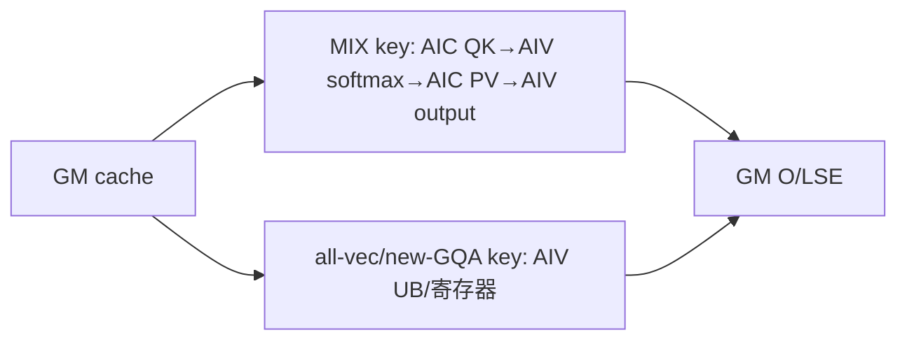

# FusedInferAttentionScore A2/A3 ACLNN 算子知识

## 算子速览

| 项目 | 内容 |
|---|---|
| 实际入口 | `aclnnFusedInferAttentionScoreV4GetWorkspaceSize` / `aclnnFusedInferAttentionScoreV4`，公开 ACLNN 两段式接口 |
| 计算语义 | `S=QK^T*scale+pse+mask`，逐行 softmax 后计算 `O=softmax(S)V`；可选 page attention、RoPE、公共前缀、量化/反量化、后量化与 `softmaxLse` |
| 输入输出 | Q、动态 Key/Value 列表及可选特征张量；支持 BSH/BSND/BNSD/TND 等已校验布局，输出 D 取 Value head dim |
| 执行类型 | 单 Kernel；R-001/R-002/R-004 含 `MIX_CV`，R-003 按 IFA key 命中 `MIX_CV` 或 `AIV_VECTOR` all-vec body；同一公开入口无第二个语义 kernel 节点 |
| Kernel 路线 | R-001 注册式 FIA（空域/MLA/通用非量化）；R-002 TND SplitFuse；R-003 legacy IFA；R-004 legacy PFA |
| 核心资源 | GM、user workspace、L1、L0A/L0B/L0C、UB；AIC/AIV 以 cross-core flag 和 pipe event 交接 |
| 来源闭包 | `source_closed`：V4 API→generated inner 边界→FIA Host selector/POD→单 MIX_CV entry→可达 body/helper→构建接线闭合 |
| 验证状态 | 固定提交源码提取；按任务要求未执行编译、测试、validator 或 review。 |

## 接口与语义

### 计算语义

对每个 batch、query head 和有效 query token，用对应 KV head（`G=numHeads/numKeyValueHeads`）形成 QK 分数，乘 `scaleValue`，再按 route 加 PSE/ALiBi、稀疏窗口或显式 mask。Vector 侧执行行最大值、指数、行和与归一化；AIC 执行 PV；Vector 侧用前一轮 `(max,sum,O)` 在线 rescale/累加。`softmaxLseFlag` 打开时额外提交 FP32 LSE。INT32 KV 在 API 层仅作 INT4 打包载体：末轴乘 8 并把 view dtype 改为 INT4。

### 输入、输出与属性

| 参数 | shape/layout | dtype | 约束、默认值与语义 |
|---|---|---|---|
| `query` | BSH/BSND/BNSD/TND/组合布局 | FP16/BF16/部分全量化 INT8 | 必选；决定 B、N、S1、D；空 query 进入空域 |
| `key`,`value` | `aclTensorList`；连续 KV/TensorList；page-cache ND/NZ | FP16/BF16/INT8/INT4 | 列表数量、shape、dtype 配对；INT32 表示每元素打包 8 个 INT4 |
| PSE/mask/序列 | PSE、mask、`actualSeqLengths*` | PSE 同计算类型；mask BOOL/UINT8/INT8；长度 INT64 | TND 长度为累积长度；mask 与 sparseMode 联合决定窗口 |
| 量化参数 | dequant/quant/offset、key/value antiquant、query dequant | OpDef 组合类型 | 存在性与 shape 决定 no/anti/full/post quant；必须整体通过 checker |
| cache/前缀/RoPE/padding | block table、shared-prefix、query/key rope、padding | block table INT32；其余按输入 | block table 存在即 PA；RoPE 成对；prefix/padding 改地址和有效长度 |
| 属性 | heads、scale、tokens、layout、sparse/precise/block/quant modes、LSE flag | 标量 | `numKeyValueHeads=0` 表示与 Q head 数相同；枚举由 checker 限制 |
| 输出 | `attentionOut`,`softmaxLse` | 输出匹配类型；LSE FP32 | `softmaxLseFlag=false` 时 API 创建 shape `{0}` FP32 占位；空 KV 时初始化输出 |

### 入口与版本

A2/A3 最新公开版本是 V4：README 的 A2/A3 示例指向 V4，V4 产品表对 A2/A3 标为支持；V5 产品表对 A2/A3 明确标为不支持。V4 比 V3 增加 `dequantScaleQueryOptional`、`learnableSinkOptional`、`queryQuantMode` 与 ALiBi full-mask 能力。V4 API 还显式拒绝 `DAV_3510`，因此不能把 950 V5 路线写入本卡。

## Host/Launcher 执行流程

### 参数校验与前处理

V4 先拒绝 `DAV_3510`。`TensorPreProcess` 仅在 K/V 首元素均为 INT32 时逐元素把末轴乘 8、view dtype 改 INT4；`PrefixTensorPreProcess` 对共享前缀相同处理。关闭 LSE 时 `FusedInferAttentionScoreProcessSoftmaxLse` 创建 `{0}` FP32 占位。随后进入 generated `aclnnInnerFusedInferAttentionScoreGetWorkspaceSize`；该 generated bridge 是固定仓外边界，仓内从 OpDef/checker/Tiling 继续。成功后弱符号 `NnopbaseDisableOptionalInput` 禁用 IR 29/30 占位。任一步失败都立即返回。

### 参数、Workspace 与生命周期

用户按第一段结果分配 workspace，executor、临时 tensor 与 workspace 必须活到 stream 完成。R-001 通用非量化普通 workspace 为 `libapi + preload*core*(mm1*4+mm1*2+mm2*4+mm2*4)`；MLA 另加每核 `preload*mBase*(nUpdate:int32+softmaxSum:int32)`；split-K/FD 再加 FP32 `accumOut` 与两份 `max/sum`。R-002 含 16 MiB system 区、每核三重预载 block、`splitLseTotalSize/splitOTotalSize`。R-003/R-004 的 slice 由 IFA/PFA POD 产生；entry 统一以 `GetUserWorkspace(workspace)` 跳过 system 区。

### 启动图与失败传播

```text
V4GetWorkspaceSize -> INT4 view/LSE placeholder -> generated inner graph
  -> DoOpTilingFusedInferAttentionScore -> non-DAV_3510 TilingFusedInferAttentionScore
     -> RouteToFia ? registry : IsUsingFAI ? SplitFuse : IsUsingIFA ? IFA : PFA
  -> executor records one fused_infer_attention_score node
V4(workspace,executor,stream) -> generated inner submits that one MIX_CV kernel
```

Tiling/checker/POD/workspace 失败阻止节点提交。需要 `SyncAll` 的路线设置 batch schedule，避免多流调度下部分核未同时启动造成死锁。

## Route 与参数设计

### 分核与资源计算

依赖顺序是 `layout/shape -> B,N2,G,S1,S2,D,Dv,ropeD -> effective lengths/mask -> route -> mBase/sInner -> core split -> workspace/POD/key`。R-001 注册优先级为 empty 0、MLA 9、general 29；`CalcTschBlockDim(aivNum,aicNum,aivNum)` 编码 CV 1:1/1:2。FIA 中 `mm1=sInnerAlign*align16(min(G*S1,mBase))`，`mm2=headDimAlign*align16(min(G*S1,mBase))`。R-002 固定 QK L1 `(Q_TILE_CEIL,128,128)`/L0 `(128,128,128)`，PV L1 `(128,128,256)`/L0 `(128,128,128)`。

### Route 选择

| 顺序 | Route | Key/模板 | 精确选择条件与优先级 | 不适用去向 |
|---:|---|---|---|---|
| 1 | R-001 注册式 FIA | 18 位 `10x...`；p0/p9/p29 | 非 310P；AIC:AIV=1:1/1:2；Q/K 同 FP16/BF16；非 legacy-preferred/特殊条件/NSD；再逐模板 `IsCapable` | 顶层 false 转 legacy；registry 内 invalid 转下一优先级，最终无模板失败 |
| 2 | R-002 TND SplitFuse | dtype×cache×mask×LSE×FD key | legacy 路径中 `IsUsingFAI`：TND、无 split rope、sparse 0/3/4、精度/MHA-GQA guard，D=KD=VD≤256并满足 PA 限制 | false 转 R-003/R-004；tiling error失败 |
| 3 | R-003 legacy IFA | IFA key | R-002 false 且 GQA decode/MTP/ATB PA antiquant/MLA/sliding 联集 | false 转 R-004；tiling error失败 |
| 4 | R-004 legacy PFA | `1e18+PFA key` | 前三路均未命中且 PFA 对齐/checker/tiling 成功 | 无 fallback |

```text
RouteToFia ? empty(0)->MLA(9)->general(29)
           : IsUsingFAI ? R-002 : IsUsingIFA ? R-003 : R-004
```

### 模板/实现执行矩阵

| Route | key/selector | dtype/shape/platform 完整命中条件 | 执行族与 kernel 节点 | 实际模板/body | 内存与同步特征 | tail/fallback |
|---|---|---|---|---|---|---|
| R-001 | registry p0/9/29 | RouteToFia；MLA 还要求 split rope、D=512、ropeD=64、N2=1、G 白名单 | 单 MIX_CV | `FiaKernelEmptyTensor` / `FiaKernelNonQuantMla` / `FiaKernelNonQuant` | AIC QK/PV，AIV softmax/rescale；cross-core flags；FD `SyncAll` | POD tail；模板拒绝转下一优先级 |
| R-002 | FAI key | TND、FP16/BF16、D=KD=VD≤256，cache/mask/LSE/sink/FD 编 key | 单 MIX_CV SplitFuse | `FAInfer`/`FAInferDecoding` | fixed tile；online softmax；FD workspace；batch schedule | row/KV tile tail |
| R-003 | IFA key 集合 | `IsUsingIFA` 联集；key 继续区分 dtype、layout、PA/FD/prefix、antiquant、`C1V1/C1V2/CALL/VALL` | `MIX_CV` split/preload/MLA/antiquant，或 `AIV_VECTOR` all-vec/new-GQA | `IncreFlashAttentionAttenSplitBbn2s2Us2`、`IncreFlashAttentionAttenPreload{Dd/Mla}`、`IncreFlashAttentionAttenAllVecNew`、`PagedAttentionDecoderMask` | MIX 路线用 Matmul+flags；all-vec 的 L1/L0 为 N/A，实际走 GM→UB→寄存器→GM | key 自带 page/FD/prefix/core-ratio 与 tail；unknown key 无 fallback |
| R-004 | `1e18+key` | 剩余合法 prefill；FP 16 对齐，INT8 参与 32 对齐 | 单 MIX_CV | included PFA body | PFA Matmul+Vector | PFA tail；无 fallback |

### 隐藏性能 Guard

| Guard | Host/Tiling 条件 | Device/资源原因 | 影响 Route | 不满足时去向 | 源码符号 |
|---|---|---|---|---|---|
| CV 比例 | `aicNum==aivNum \|\| 2*aicNum==aivNum` | AIC/AIV pairing 与 flag 编号 | R-001 | legacy/失败 | `CheckRouteToFiaPrerequisites` |
| legacy 特例 | D=Dv、ropeD=0、S1=1、MHA、非 PA，且 D=256 无 prefix 或 D=80 有 prefix | 保留旧 IFA 特化 | R-001/R-003 | R-003 | `IsLegacyTemplatePreferred` |
| MLA 注册模板 | D/Dv=512、ropeD=64、N2=1、无 sink/prefix/PSE/padding/postquant/TensorList | MLA 固定内存/地址 specialization | R-001 | p29/失败 | `FiaTilingNonQuantMla::IsCapable` |
| SplitFuse D | D=KD=VD≤256；FP 16 对齐；INT8 32 对齐 | fixed MMAD/DMA tile | R-002 | R-003/R-004/失败 | `IsUsingFAI`,`TilingProcess4PFA` |
| batch schedule | `SyncAll` route | 所有核同时到 barrier | R-001/R-002 | schedule 失败 | `CalcScheduleMode`,`TilingProcess4SplitFuse` |
| FD workspace | splitKV/flashDecode | 多 KV slice 需 FP32 O/max/sum | R-001/R-002 | 非 FD 不分配 | `CalcFlashDecodeWorkspace` |

### POD/ABI

宏生成 arch22 POD 的可移植 `sizeof/alignof/offsetof` 数值在固定仓不可见；表中保留声明顺序、类型与 producer/consumer，禁止猜测 ABI 数字。

| 结构 | 字段 | 类型/位宽 | ABI 布局 | 单位 | Host/launcher producer | Device consumer | 边界 |
|---|---|---|---|---|---|---|---|
| `BaseParams` | `bSize,n2Size,gSize,s1Size,s2Size` | uint32/32（逐字段） | 声明顺序；offset 不可见 | elements | `FillTilingBaseParams` | address/loop | parser 窄化 |
| 同上 | `headDim,headDimRope` | uint32/32（逐字段） | 同上 | elements | tiling | QK/PV | 物理容量另对齐 |
| 同上 | `actualSeqS1Dims,actualSeqS2Dims,accumQSeqFlag,accumKVSeqFlag` | uint32/32（逐字段） | 同上 | count/flag | parser | actual-length reader | TND 累积语义 |
| 同上 | `scaleValue` | float/32 | 同上 | scalar | API double 窄化 | Vec1 | FP32 scale |
| 同上 | `usedCoreNum,outputLayout,batchContinuous,softmaxLseFlag,needInit,slidingFlag,l2CacheOffFlag,isLegacyIfa` | uint32/32（逐字段） | 同上 | core/enum/flag | tiling | scheduler/branches | inactive 仍序列化 |
| 同上 | `isEmptyBatchOverHalf` | bool/实现位宽 | 同上 | flag | tiling | init/schedule | ABI 数值不可见 |
| `PageAttentionParams` | `blockSize,maxBlockNumPerBatch` | uint32/32（逐字段） | 同上 | elements/blocks | PA tiling | KV address | 非 PA inactive |
| `MaskParams` | `attenMaskFlag,attenMaskBatchStride,attenMaskStride` | uint32/32（逐字段） | 同上 | flag/stride | mask tiling | Vec1 | 无 mask inactive |
| 同上 | `preToken,nextToken` | int32/32（逐字段） | 同上 | token | attrs | window | int64 窄化 |
| 同上 | `isRowInvalid,isExistRowInvalid,sparseMode` | uint32/32（逐字段） | 同上 | flag/enum | checker/tiling | row guard | enum checked |
| `InnerSplitParams` | `mBaseSize,s2BaseSize` | uint32/32（逐字段） | 同上 | elements | split | loop | tail=min |
| `WorkspaceParams` | `mm1ResSize,mm2ResSize,fdAccumOutSize,fdLogSumExpSize` | uint32/32（逐字段） | 同上 | elements | workspace tiling | slicer | bytes=dtype×elements |
| `OuterSplitParams` | `bN2End,gS1End,s2End` | uint32[26]（逐数组） | 同上 | cumulative index | split | per-core scheduler | index<26 |
| `FlashDecodeParams` | `numOfFdHead,reserved,gS1BaseSizeOfFd,usedVecNumOfFd` | uint32/32（逐字段） | 同上 | count | FD split | FD scheduler | 非 FD inactive |
| 同上 | `bN2IdxOfFdHead,gS1IdxOfFdHead,s2SplitNumOfFdHead,s2SplitStartIdxOfCore,gS1SplitNumOfFdHead,gS1LastPartSizeOfFdHead` | uint32[26]（逐数组） | 同上 | index/count | FD split | FD Vec | bounds 26 |
| 同上 | `gS1IdxEndOfFdHead,gS1IdxEndOfFdHeadSplit` | uint32[52]（逐数组） | 同上 | cumulative index | FD split | two AIV/core | bounds 52 |
| `PrefixParams` | `prefixMaxLen,prefixLen` | uint64/64（逐字段） | 同上 | token | prefix tiling | address/window | 非 prefix inactive |
| 同上 | `prefixFlag` | bool/实现位宽 | 同上 | flag | tiling | branch | offset不可见 |
| `PseParams` | `pseShiftFlag,pseShiftByBatch,pseShiftS1,pseShiftS2` | uint32/32（逐字段） | 同上 | flag/elements | PSE tiling | Vec1 | 非 PSE inactive |
| `LeftPaddingParams` | `qPaddingFlag,kvPaddingFlag` | uint32/32（逐字段） | 同上 | flag | tiling | address | inactive when absent |
| `PostQuantParams` | `isPerChnOut,isOutQuantTypeBf16` | uint32/32（逐字段） | 同上 | flag | quant tiling | Vec2 | no postquant inactive |
| `EmptyTensorTilingData` | `totalOutputSize,singleCoreSize,totalLseSize,singleCoreLseSize` | uint64/64（逐字段） | 同上 | elements | empty tiling | empty kernel | bytes需乘 dtype |
| 同上 | `usedCoreNum,softmaxLseFlag,headDim` | uint32/32（逐字段） | 同上 | core/flag/elements | empty tiling | empty kernel | empty key only |
| `IncreFlashAttentionTilingDataV2` | `tilingBase` | `IncreFlashAttentionTilingData` | 宏生成；数值 size/offset 固定仓不可见 | nested POD | IFA `DoSubOpTiling` | split/preload IFA macros 与 body | 非 prefix 路线仍读取本成员 |
| 同上 | `tilingPrefix` | `IncreFlashAttentionTilingDataPrefix` | 紧随 `tilingBase`；数值 offset 不可见 | nested POD | IFA prefix tiling | `INVOKE_IFA_GENERAL_OP_IMPL_PREFIX` | 仅 prefix key 生效 |
| `IncreFlashAttentionTilingAtbDataV2` | `tilingBase` | `IncreFlashAttentionBaseParams` | 宏生成；数值 size/offset 不可见 | nested POD | IFA ATB/new-GQA tiling | antiquant/new-GQA body | 对应注册 key 才读取 |
| 同上 | `tilingPerCore` | `IncreFlashAttentionSplitCoreParams` | 紧随 `tilingBase`；数值 offset 不可见 | per-core split POD | IFA ATB/new-GQA tiling | per-core scheduler | 对应注册 key 才读取 |
| `PromptFlashAttentionTilingData` | `bmm1TilingDataRect` | `TCubeTiling` | 宏生成；声明首字段 | Matmul POD | PFA sub-op tiling | PFA `REGIST_MATMUL_OBJ` BMM1 | high-level PFA key |
| 同上 | `bmm2TilingDataRect` | `TCubeTiling` | 紧随 BMM1；数值 offset 不可见 | Matmul POD | PFA sub-op tiling | PFA `REGIST_MATMUL_OBJ` BMM2 | high-level PFA key |
| 同上 | `promptAttentionBaseParams,promptAttentionSeqParams,promptAttentionSingleCoreParams,promptAttentionTensorSizeRect,promptAttentionInitOutputParams` | 五个嵌套 POD（逐成员） | 声明顺序；数值 offset 不可见 | shape/core/workspace/output | PFA sub-op tiling | PFA address/scheduler/buffer/init | key 决定 inactive 子字段 |
| 同上 | `softmaxTilingDataRect,softmaxFlashTilingDataRect,transposeTilingDataRect` | API tiling POD（逐成员） | 声明末尾；数值 offset 不可见 | softmax/transpose | PFA sub-op tiling | Vector softmax/transpose | body specialization 对应读取 |
| `PromptFlashAttentionBaseApiTilingData` | `promptAttentionBaseApiBaseParams` | `PromptAttentionBaseApiBaseParams` | 宏生成；声明首字段 | nested POD | PFA BaseAPI tiling | BaseAPI PFA body | BaseAPI key |
| 同上 | `promptAttentionSplitCoreParams` | `PromptAttentionSplitCoreParams` | 紧随 base；数值 offset 不可见 | per-core split | PFA BaseAPI tiling | BaseAPI scheduler | BaseAPI key |
| `MLAGeneralTilingData` | `PFAinputParams,PFAmultiCoreParams,PFAcoreParams,PFAtensorSizeParams` | 四个嵌套 POD（逐成员） | 声明顺序；数值 offset 不可见 | shape/core/workspace | PFA MLA tiling | MLA scheduler/address/body | MLA/TND key |
| 同上 | `bmm1TilingData,bmm2TilingData,softmaxFlashTilingData,transposeTilingData,transposeTilingDataTailCore` | Matmul/Vector tiling POD（逐成员） | 声明顺序；数值 offset 不可见 | MM/softmax/transpose | PFA MLA tiling | MLA Cube/Vector body | tail-core 使用独立 transpose POD |

### Route 源码闭包

| Route | Key/selector | Host/Tiling producer | POD/参数 | Kernel entry/router | Kernel body/直接依赖 | 构建接线 |
|---|---|---|---|---|---|---|
| R-001 | `RouteToFia` + p0/9/29 | arch22 tiling v3 + common FIA tilings | FIA nested POD | entry -> v3 router | common arch22 FIA kernel/block helpers | CMake common/IFA/PFA deps |
| R-002 | `IsUsingFAI` | `TilingProcess4SplitFuse` | `FAInferTilingData` | entry FAI branch | `flash_attention_interface.cpp` + attn_infra | same |
| R-003 | `IsUsingIFA` + IFA key 集合 | `TilingProcess4IFA` | `IncreFlashAttentionTilingDataV2` / `IncreFlashAttentionTilingAtbDataV2` / MLA POD | unified entry→`incre_flash_attention_FIAS_arch22` | split/preload/all-vec/antiquant/MLA/new-GQA bodies | IFA dependency |
| R-004 | final else | `TilingProcess4PFA` | PFA POD | entry PFA keys | included PFA arch22 body | PFA dependency |

## Kernel 实现

### 公共执行流程

公开入口只记录一个 `fused_infer_attention_score` 节点。R-001/R-002/R-004 以及 R-003 的 split/preload/MLA/antiquant key 中，AIC 做 GM→L1→L0A/L0B→QK MMAD→L0C，AIV Vec1 做 scale/PSE/mask/online-softmax，AIC 再做 PV，AIV Vec2 rescale、累加、可选量化并写 GM；flags 与 MTE/L0/Fixpipe event 保护交接和 ping-pong。R-003 的 `IncreFlashAttentionAttenAllVecNew`/`PagedAttentionDecoderMask` key 不进入 Cube，实际为 GM→UB/寄存器→GM 的 AIV 路线；空域同样只由 AIV 分核初始化 O/LSE。

### Route R-001：注册式 FIA

#### 适用条件

##### 选择证据

| 层级 | 文件 | 符号 | 源码谓词/参数 | 结果/下一跳 |
|---|---|---|---|---|
| Host | arch22 tiling v3 | `RouteToFia` | ratio/dtype/layout/legacy guards | true→registry |
| Tiling | common arch22 empty | `IsCapable` p0 | empty | empty key |
| Tiling | common arch22 MLA | `IsCapable` p9 | split rope D512/64/N2=1 等 | MLA；false→p29 |
| Tiling | common arch22 general | `IsCapable` p29 | nonempty FP16/BF16 Q=K dtype | general；false→失败 |

#### Device 数据流

##### 函数级调用链

```text
entry -> v3 key router -> FiaKernelNonQuant{Mla}::Init
  -> Process -> AIC ProcessMm1 -> AIV ProcessVec1 -> AIC ProcessMm2 -> AIV ProcessVec2 -> optional FD
```

##### 源码等价伪码

```text
if empty: each AIV zeros its O/LSE interval; return
for task in POD interval:
  AIC QK FP32 MMAD; set C1V1
  AIV wait; scale+PSE+mask+online softmax; cast P; set V1C2
  AIC wait; PV FP32 MMAD; set C2V2
  AIV wait; online-rescale O; write output or FD slices
if splitKV: all launched cores SyncAll; vector reducers combine slices
```

#### 内存与数据搬运

##### 资源与搬运表

| 层级/缓冲区 | offset/地址公式 | extent/容量公式 | dtype/layout | producer | consumer | owner/lifetime | 对齐/复用 |
|---|---|---|---|---|---|---|---|
| GM Q/K/V/O | POD strides | B/N/S/D valid domains | route dtype/layout | caller/kernel | kernel/caller | stream | checker/tail |
| workspace MM1/Vec1 | per-core preload | `preload*core*mm1*(4+2)` | FP32→input | AIC/AIV | AIV/AIC | workspace | ping-pong |
| workspace MM2/Vec2 | following slice | `preload*core*mm2*(4+4)` | FP32 | AIC/AIV | AIV/output | workspace | ping-pong |
| FD slices | after normal | `(accum+2*lse)*4` | FP32 ND | Vec2 | reducer | kernel | splitKV only |
| L1/L0/UB | specialization | body `InitBuffer`/tile | input/FP32/output | DMA/MMAD/Vec | next stage | core | event-protected |

##### 分层内存布局


##### 字节账、交接边与复用顺序

```text
normal = preload*core*(mm1ResSize*6 + mm2ResSize*8)
MLA_extra = preload*core*mBase*8
FD = (accumOutElems + 2*logSumExpElems)*4
total = libapi + normal + MLA_extra(if MLA) + FD(if splitKV)
```

| 边/复用子区 | producer | offset/extent | dtype/layout | consumer | ordering/sync | owner/lifetime | 安全条件 |
|---|---|---|---|---|---|---|---|
| C1→V1 | MM1 | current tile | FP32 row | Vec1 | `syncC1V1` | ping/pong | reverse event |
| V1→C2 | Vec1 | P tile | input row | MM2 | `syncV1C2` | ping/pong | padded tail |
| C2→V2 | MM2 | O partial | FP32 | Vec2 | `syncC2V2` | ping/pong | Fixpipe done |
| FD | Vec2 | POD slices | FP32 | reducer | `SyncAll` | workspace | all cores participate |

#### 同步、精度与尾块

##### 同步与数值边界表

| 阶段 | primitive/机制 | producer | consumer/等待点 | 保护对象 | 精度/尾块 |
|---|---|---|---|---|---|
| DMA/MMAD | MTE/L0 events | DMA/MMAD | next pipe | L1/L0 ping-pong | D/K tail padded |
| C1/V1/C2/V2 | cross-core flags | AIC/AIV | next stage | workspace/L1 tiles | FP32 QK/max/sum/PV/O；P cast |
| FD | `SyncAll` | split writers | reducer | O/max/sum | empty superkernel cores也同步 |

#### 关键实现

##### 符号证据表

| 阶段 | 文件 | 符号/模板实例 | 实现事实 |
|---|---|---|---|
| Host/Tiling producer | common arch22 `fia_tiling_nonquant*.cpp` | `IsCapable`,`Split`,`CalcWorkspaceSize` | priority、split、workspace、key |
| Kernel entry/router | `fused_infer_attention_score.cpp` | entry + v3 router | key→FIA body |
| Device body/helper | common arch22 `fia_kernel_nonquant*.h` | `Process` | MM1/Vec1/MM2/Vec2、flags、FD |

### Route R-002：TND SplitFuse

#### 适用条件

##### 选择证据

| 层级 | 文件 | 符号 | 源码谓词/参数 | 结果/下一跳 |
|---|---|---|---|---|
| Host | fused tiling | `IsUsingFAI` | TND、D/KD/VD≤256 equal、sparse/precision/cache guards | SplitFuse |
| Tiling | same | `TilingProcess4SplitFuse` | FAI tiling success；batch schedule | key/blockDim/workspace |
| Router | entry | FAI key branch | dtype/cache/layout/mask/LSE/sink/FD | `FAInfer*` |

#### Device 数据流

##### 函数级调用链

```text
entry -> SplitFuse::FAInfer[Decoding] -> FAInferKernel -> QK BlockMmad -> OnlineSoftmax -> PV BlockMmad -> RescaleO
```

##### 源码等价伪码

```text
for TND row/S2 tile: QK MMAD -> scale/mask/online max-sum -> cast P -> PV MMAD -> FP32 rescale O
if FD: store split O/max/sum and combine after batch barrier; optionally write FP32 LSE
```

#### 内存与数据搬运

##### 资源与搬运表

| 层级/缓冲区 | offset/地址公式 | extent/容量公式 | dtype/layout | producer | consumer | owner/lifetime | 对齐/复用 |
|---|---|---|---|---|---|---|---|
| GM | cumulative TND metadata | valid rows | row-major/KV NZ | caller | kernel | stream | actual-length tail |
| L1/L0 | fixed shapes | QK L1 `(Q_TILE_CEIL,128,128)`; PV L1 `(128,128,256)`; L0 128³ | input/FP32 | DMA/MMAD | MMAD/epilogue | core | tile tail |
| UB | softmax/rescale tiles | selected body | FP32/input/output | Fixpipe/Vec | MMAD/MTE3 | AIV | mask/tail |
| FD workspace | after 16MiB system | splitO+splitLSE | FP32 | Vec2 | combine | workspace | batch barrier |

##### 分层内存布局


##### 字节账、交接边与复用顺序

```text
workspace = 16MiB + core*WORKSPACE_BLOCK_SIZE_DB*4*3*4 + splitLseTotalSize + splitOTotalSize
```

| 边/复用子区 | producer | offset/extent | dtype/layout | consumer | ordering/sync | owner/lifetime | 安全条件 |
|---|---|---|---|---|---|---|---|
| QK→SM→PV | MMAD/Fixpipe | current tile | FP32→input | epilogue/PV | MIX_CV pipe flags | core | key/tail match |
| FD | RescaleO | split slice | FP32 | CombineScale | `SyncAll` | workspace | batch schedule |

#### 同步、精度与尾块

##### 同步与数值边界表

| 阶段 | primitive/机制 | producer | consumer/等待点 | 保护对象 | 精度/尾块 |
|---|---|---|---|---|---|
| QK/PV | BlockMmad events | AIC | AIV/AIC | tile | FP32 except explicit low-prec key |
| online/FD | max-sum rescale + SyncAll | current tile/split | next tile/reducer | row state | actual-length mask |

#### 关键实现

##### 符号证据表

| 阶段 | 文件 | 符号/模板实例 | 实现事实 |
|---|---|---|---|
| Host/Tiling producer | fused tiling | `IsUsingFAI`,`TilingProcess4SplitFuse` | selector/workspace/schedule |
| Kernel entry/router | entry | FAI key list | key→template |
| Device body/helper | `flash_attention_interface.cpp` | `FAInfer`,`FAInferDecoding` | fixed QK/PV shapes |

### Route R-003：legacy IFA

#### 适用条件

##### 选择证据

| 层级 | 文件 | 符号 | 源码谓词/参数 | 结果/下一跳 |
|---|---|---|---|---|
| Host | fused tiling | `IsUsingIFA` | GQA qS=1/TND D512、MTP、ATB PA antiquant、MLA、sliding 联集 | IFA |
| Tiling | same | `TilingProcess4IFA` | context conversion success | `DoSubOpTiling` |
| Router | `incre_flash_attention_arch22.h` | key | `VALL`/all-vec 与 new-GQA key 进入 AIV body；`C1V1/C1V2/CALL`、preload、prefix、antiquant、MLA key 进入对应 MIX body | 未编译 key 无 Device fallback |

#### Device 数据流

##### 函数级调用链

```text
entry -> incre_flash_attention_FIAS_arch22
  -> all-vec/new-GQA key: AllVec/PagedAttentionDecoder Init/Process -> output
  -> split/preload/prefix/antiquant/MLA key: Init/InitQuant -> Bmm1/Vec1/Bmm2/Vec2 -> optional FD -> output
```

##### 源码等价伪码

```text
map core to batch/head/query and iterate KV/page blocks
if all-vec/new-GQA key:
  load Q/K/V to UB/registers; vector dot/reduce -> mask/softmax -> weighted V; write valid O/LSE
else:
  QK MMAD -> mask/softmax -> PV MMAD -> FP32 online accumulation; cast/write valid O/LSE
```

#### 内存与数据搬运

##### 资源与搬运表

| 层级/缓冲区 | offset/地址公式 | extent/容量公式 | dtype/layout | producer | consumer | owner/lifetime | 对齐/复用 |
|---|---|---|---|---|---|---|---|
| GM Q/K/V/O | IFA POD 的 batch/head/page/sequence offset | 每 key 分配的有效 query/KV/output 区间 | key dtype/layout | caller/IFA body | IFA body/caller | stream | actual-seq/page/tail 限界 |
| MIX 的 workspace/L1/L0/UB | `IncreFlashAttentionTilingDataV2`/MLA POD 与 Matmul tiling | split/preload/prefix/FD key 产生的 per-core slice 与 tile | input/FP32/output | Bmm1/Vec1/Bmm2/Vec2 | 下一阶段 | workspace/core | flag/event 后复用 |
| all-vec/new-GQA UB/寄存器 | all-vec 或 ATB POD | body 的 `InitBuffer`/vector tile | input/FP32/output | GM CopyIn | vector reduce/CopyOut | AIV core | L1/L0A/L0B/L0C=N/A；mask 保护 tail |

##### 分层内存布局



##### 字节账、交接边与复用顺序

```text
MIX workspace_total = system workspace + selected IFA tiling-produced per-core/FD/prefix slices
all-vec/new-GQA = selected IFA tiling workspace；L1/L0 bytes = 0
具体数值 ABI 与 slice 公式由 IFA 子算子 POD 产生；固定 FusedInferAttentionScore Host 只把同一 workspace 指针和该 POD 原样交给 entry，不重算 offset
```

| 边/复用子区 | producer | offset/extent | dtype/layout | consumer | ordering/sync | owner/lifetime | 安全条件 |
|---|---|---|---|---|---|---|---|
| C1/V1/C2/V2 | split/preload/MLA body | key/POD 的 Matmul tile 与 workspace slice | FP32/input | next stage | IFA flags/events | workspace/core | selected key 与 core-ratio 匹配 |
| all-vec tile | GM CopyIn/vector loop | per-core UB/register tile | input/FP32 | vector reduce/CopyOut | 单 AIV pipe；无跨 AIC flag | AIV core | VALL/new-GQA key、mask/tail 限界 |

#### 同步、精度与尾块

##### 同步与数值边界表

| 阶段 | primitive/机制 | producer | consumer/等待点 | 保护对象 | 精度/尾块 |
|---|---|---|---|---|---|
| IFA MIX pipeline | flags/events | AIC/AIV | next stage | MM/Vec buffers | FP32 accumulation；page/actual-seq tail |
| IFA all-vec | vector pipe/reduce barrier | AIV stages | CopyOut | UB/register tile | 无 AIC 交接；vector mask 处理尾块 |

#### 关键实现

##### 符号证据表

| 阶段 | 文件 | 符号/模板实例 | 实现事实 |
|---|---|---|---|
| Host/Tiling producer | fused tiling | `IsUsingIFA`,`TilingProcess4IFA` | 联集 selector |
| Kernel entry/router | entry | IFA key branches | included IFA |
| Device body/helper | `incre_flash_attention_arch22.h` | `INVOKE_IFA_*` + concrete key branches | split/preload/prefix/antiquant/MLA 的 MIX_CV 与 all-vec/new-GQA 的 AIV 路线 |

### Route R-004：legacy PFA

#### 适用条件

##### 选择证据

| 层级 | 文件 | 符号 | 源码谓词/参数 | 结果/下一跳 |
|---|---|---|---|---|
| Host | fused tiling | final else | preceding routes false | PFA |
| Tiling | same | `TilingProcess4PFA` | D alignment/checker | PFA key +1e18 |
| Router | included PFA | key | compiled key | body |

#### Device 数据流

##### 函数级调用链

```text
entry -> PFA router -> PromptFlashAttention Init/Process -> Bmm1/Vec1/Bmm2/Vec2 -> output
```

##### 源码等价伪码

```text
split long prefill S1/S2; QK MMAD -> scale/PSE/mask/softmax -> P cast -> PV MMAD -> rescale/cast O/LSE
```

#### 内存与数据搬运

##### 资源与搬运表

| 层级/缓冲区 | offset/地址公式 | extent/容量公式 | dtype/layout | producer | consumer | owner/lifetime | 对齐/复用 |
|---|---|---|---|---|---|---|---|
| GM/workspace/L1/L0/UB | PFA POD | selected slices/tiles | selected dtype/layout | PFA stages | output | stream/core | D16/D32,S1/S2 tail |

##### 分层内存布局


##### 字节账、交接边与复用顺序

```text
workspace_total = PromptFlashAttentionTilingData selected-route workspace
```

| 边/复用子区 | producer | offset/extent | dtype/layout | consumer | ordering/sync | owner/lifetime | 安全条件 |
|---|---|---|---|---|---|---|---|
| MM/Vec stages | PFA body | POD-defined | FP32/input | next stage | PFA flags/events | workspace/core | key/alignment |

#### 同步、精度与尾块

##### 同步与数值边界表

| 阶段 | primitive/机制 | producer | consumer/等待点 | 保护对象 | 精度/尾块 |
|---|---|---|---|---|---|
| PFA pipeline | AIC/AIV flags/events | QK/Vec1/PV | next stage | tile buffers | FP32 online state；S tail |

#### 关键实现

##### 符号证据表

| 阶段 | 文件 | 符号/模板实例 | 实现事实 |
|---|---|---|---|
| Host/Tiling producer | fused tiling | `TilingProcess4PFA` | context/alignment/key |
| Kernel entry/router | entry | PFA key branches | key→template |
| Device body/helper | `prompt_flash_attention_arch22.h` | PFA Process | prefill MIX_CV |

## 算子特定优化

### Trick T-001：注册式 FIA 优先并保留 legacy 路由

#### 触发与源码依据

- 适用 Route：R-001/R-002/R-003/R-004
- 触发条件：按 `RouteToFia`、`IsUsingFAI`、`IsUsingIFA` 顺序。
- Golden 来源：[`fused_infer_attention_score_tiling.cpp:2191-2247`](../../../../../../../cann-ops-raw/ascendc/ops-transformer/be33d95bb755cedec3108f70805c1874d1792540/attention/fused_infer_attention_score/op_host/fused_infer_attention_score_tiling.cpp#L2191-L2247)

**官方源码（固定 Commit 连续逐字摘录）**：

```cpp
if (RouteToFia(context)) {
    return TilingFusedInferAttentionScoreV3(context);
}
// ...
bool usingIFA = IsUsingIFA(*context, inputLayoutStr, queryD, queryS);
bool usingFAI = IsUsingFAI(*context, inputLayoutStr, queryD);
if (usingFAI) {
    OP_CHECK_IF(TilingProcess4SplitFuse(context) != ge::GRAPH_SUCCESS,
        OPS_REPORT_VECTOR_INNER_ERR(context->GetNodeName(), "tiling process for split fuse failed"),
        return ge::GRAPH_FAILED);
} else if (usingIFA) {
```

#### 机制与设计原因

统一 FIA 注册模板优先覆盖空域/MLA/通用非量化；未覆盖或保留特化才进入 FAI/IFA/PFA。判断顺序不可交换。尤其 `RouteToFia=true` 后 registry 无有效模板会失败，不会自动退回 legacy。

#### 迁移边界

- 适用：新旧实现并存且有精确能力谓词的单入口。
- 前提：平台 core ratio、dtype/layout 与注册接线一致。
- 失效：310P、NSD、legacy-preferred 或特殊条件。
- 未验证：本次知识提取未执行编译、真机、数值或性能测试。

#### 错误做法

把 registry `GRAPH_PARAM_INVALID` 当作顶层 legacy fallback 会改变失败边界。

### Trick T-002：MLA 固定 D/ropeD 的单 launch CV 交接

#### 触发与源码依据

- 适用 Route：R-001 MLA
- 触发条件：D=512、ropeD=64、N2=1 以及完整 feature guard。
- Golden 来源：[`fia_tiling_nonquant_mla.cpp:111-128`](../../../../../../../cann-ops-raw/ascendc/ops-transformer/be33d95bb755cedec3108f70805c1874d1792540/attention/common/op_host/arch22/fia_tiling_nonquant_mla.cpp#L111-L128)

**官方源码（固定 Commit 连续逐字摘录）**：

```cpp
if (fiaInfo_->ropeMode != RopeMode::ROPE_SPLIT) {
    return false;
}
constexpr uint32_t QK_HEAD_DIM_512 = 512U;
constexpr uint32_t ROPE_HEAD_DIM_64 = 64U;
if ((fiaInfo_->qkHeadDim != fiaInfo_->vHeadDim) ||
    (fiaInfo_->qkHeadDim != QK_HEAD_DIM_512) ||
    (fiaInfo_->ropeHeadDim != ROPE_HEAD_DIM_64)) {
    return false;
}
```

#### 机制与设计原因

固定维度使 AIC/AIV 使用预定 L1/L0/UB 形状与 flag 周期，在一个 launch 内交接 QK、softmax、PV 与 rescale，避免逐阶段独立 launch。

#### 迁移边界

- 适用：同构 FP16/BF16 MLA。
- 前提：无 sink/prefix/PSE/padding/postquant/TensorList，G 在白名单。
- 失效：任一 guard 不满足转通用/legacy route。
- 未验证：本次知识提取未执行编译、真机、数值或性能测试。

#### 错误做法

仅凭 device body 存在而绕过 `IsCapable` 会破坏容量与同步配对。

### Trick T-003：SplitFuse 固定 QK/PV tile 与在线归一化

#### 触发与源码依据

- 适用 Route：R-002
- 触发条件：完整 `IsUsingFAI` guards。
- Golden 来源：[`flash_attention_interface.cpp:55-91`](../../../../../../../cann-ops-raw/ascendc/ops-transformer/be33d95bb755cedec3108f70805c1874d1792540/attention/fused_infer_attention_score/op_kernel/flash_attention_interface.cpp#L55-L91)

**官方源码（固定 Commit 连续逐字摘录）**：

```cpp
using L1TileShapeQK = GemmShape<Q_TILE_CEIL, 128, 128>;
using L0TileShapeQK = GemmShape<128, 128, 128>;
using DispatchPolicyQK = Gemm::MmadAtlasA2FAIQK<PagedCacheFlag, false>;
// ...
using L1TileShapePV = GemmShape<128, 128, 256>;
using L0TileShapePV = GemmShape<128, 128, 128>;
using DispatchPolicyPV = Gemm::MmadAtlasA2FAIPV<PagedCacheFlag, false>;
```

#### 机制与设计原因

QK/PV 使用固定 A2 MMAD policy，Vector epilogue 维持 FP32 online max/sum/O；cache、mask、LSE、sink、FD 编入模板，减少热循环分支。

#### 迁移边界

- 适用：满足 FAI selector 的 TND inference attention。
- 前提：D/KD/VD≤256且相等，cache block/alignment 合法。
- 失效：不满足必须走其他 route。
- 未验证：本次知识提取未执行编译、真机、数值或性能测试。

#### 错误做法

固定仓已有反例：`IsUsingFAI=false` 时不得强用这些 tile，而要继续 IFA/PFA。

## 模板与实现对比

| 对比维度 | R-001 注册 FIA | R-002 SplitFuse | R-003 IFA | R-004 PFA | 设计选择依据 |
|---|---|---|---|---|---|
| 命中条件/优先级 | registry 0/9/29 | TND FAI guard | decode/MTP/MLA/sliding | final prefill | selector 顺序 |
| 执行族/节点图 | 单 MIX_CV（空域为 AIV） | 单 MIX_CV | 单节点内按 key 为 MIX_CV 或 AIV_VECTOR | 单 MIX_CV | one entry；IFA all-vec 不伪装成 Cube |
| M/N/K、tile 与 scheduler | mBase/sInner | fixed 128 tile | IFA POD | PFA POD | shape specialization |
| workspace/L1/L0/UB | explicit normal/MLA/FD | 16MiB+split | MIX 使用 IFA POD slices；all-vec 的 L1/L0=N/A | PFA POD/Matmul slices | producer-specific |
| AIC/AIV 或 kernel 交接 | C1V1/V1C2/C2V2 | MMAD/epilogue | MIX 用 IFA flags；all-vec 无 AIC 边 | PFA flags | single launch 内按实际执行族交接 |
| 同步、精度与 tail | FP32 online；FD barrier | FP32/lowprec key | MIX FP32 online；all-vec vector reduce/mask | PFA FP32 online/route cast | key/POD |
| fallback/失败边界 | registry next/failed | false才继续 | false才PFA | none | errors not swallowed |

## 平台差异

| 项目 | A2 | A3 | 950 |
|---|---|---|---|
| 支持状态 | V4 公开支持 | V4 公开支持 | V4 API 拒绝；使用 V5 |
| Host/Launcher | non-DAV_3510 selector | 同 A2；无独立 A3 selector | DAV_3510 arch35 V5 |
| Kernel/资源 | arch22 entry/A2 MMAD/CV1:1或1:2 | 同源，资源由 platform 注入 | `_apt` RegBase |

## 限制与失败边界

- V4 只发布于 A2/A3；DAV_3510 两段接口均返回运行时错误。
- generated `aclnnInnerFusedInferAttentionScore*` 实现固定仓不可见；不可补造额外 launch。
- OpDef dtype 列表是组合，不是各输入任意笛卡尔积。
- 宏 POD 的 ABI 数值固定仓不可见，二进制复用须用同版本生成头。
- `RouteToFia=true` 后 registry 无匹配直接失败；unknown key 无 device fallback。
- 本次知识提取未执行编译、真机、数值或性能测试。

## 源码索引

### 链路索引

| 链路阶段 | 文件 | 关键符号 | 支撑内容 |
|---|---|---|---|
| 入口声明/约束 | `attention/fused_infer_attention_score/docs/aclnnFusedInferAttentionScoreV4.md` | 产品表/prototype | A2/A3 最新公开版本 |
| 入口声明/约束 | `attention/fused_infer_attention_score/op_api/aclnn_fused_infer_attention_score_v4.h` | V4 APIs | 参数顺序 |
| 入口实现 | `attention/fused_infer_attention_score/op_api/aclnn_fused_infer_attention_score_v4.cpp` | workspace/execute | platform guard/inner bridge |
| 入口实现 | `attention/fused_infer_attention_score/op_api/aclnn_fused_infer_attention_score_inner.cpp` | preprocess | INT4 view |
| Host/Tiling/Launcher | `attention/fused_infer_attention_score/op_host/fused_infer_attention_score_tiling.cpp` | top selector | four routes |
| Host/Tiling/Launcher | `attention/fused_infer_attention_score/op_host/arch22/fused_infer_attention_score_tiling_v3.cpp` | registry routing | RouteToFia |
| Host/Tiling/Launcher | `attention/common/op_host/arch22/fia_tiling_nonquant.cpp` | general FIA | split/workspace |
| Host/Tiling/Launcher | `attention/common/op_host/arch22/fia_tiling_nonquant_mla.cpp` | MLA FIA | guards/workspace |
| POD | `attention/fused_infer_attention_score/op_host/fused_infer_attention_score_tiling.h` | nested structs | ABI fields |
| Kernel entry/body | `attention/fused_infer_attention_score/op_kernel/fused_infer_attention_score.cpp` | unified entry | route router |
| Kernel entry/body | `attention/fused_infer_attention_score/op_kernel/flash_attention_interface.cpp` | FAI | fixed tiles |
| Kernel entry/body | `attention/common/op_kernel/arch22/fia_kernel_nonquant.h` | general kernel | MIX pipeline |
| Kernel entry/body | `attention/common/op_kernel/arch22/fia_kernel_nonquant_mla.h` | MLA kernel | sync/FD |
| POD | `attention/incre_flash_attention/op_host/incre_flash_attention_tiling.h` | `IncreFlashAttentionTilingDataV2`,`IncreFlashAttentionTilingAtbDataV2` | R-003 key 对应 POD 结构 |
| Kernel entry/body | `attention/incre_flash_attention/op_kernel/incre_flash_attention_arch22.h` | IFA tiling-key router/macros | R-003 IFA 模板实例与 `Init/Process` 接线 |
| POD | `attention/prompt_flash_attention/op_host/prompt_flash_attention_tiling.h` | `PromptFlashAttentionTilingData`,`PromptFlashAttentionBaseApiTilingData`,`MLAGeneralTilingData` | R-004 key 对应 POD 结构 |
| Kernel entry/body | `attention/prompt_flash_attention/op_kernel/prompt_flash_attention_arch22.h` | PFA tiling-key router/macros | R-004 PFA 模板实例与 `Init/Process` 接线 |
| 构建接线 | `attention/fused_infer_attention_score/op_host/CMakeLists.txt` | sources/dependencies/options | compilation |

每行只写一个文件，并确保该文件存在于 Frontmatter `sources`。

### 实现复用检查

| 检查项 | 可复用事实 | 不得改变的约束 | 源码符号 |
|---|---|---|---|
| ABI/POD | nested field semantics | order/width/unit/generated version | tiling structs |
| 调用顺序 | preprocess→inner→tiling→entry | selector order | `TilingFusedInferAttentionScore` |
| workspace/内存 | normal/MLA/FD/FAI formulas | system prefix/per-core/dtype bytes | `Calc*Workspace*` |
| 同步 | C1V1→V1C2→C2V2/FD barrier | flag rounds/batch schedule | Process stages |
| 精度与尾块 | FP32 accum/max/sum/O | P cast/output cast/actual lengths | epilogues |
| 失败边界 | false vs error distinction | no silent fallback | registry/router |