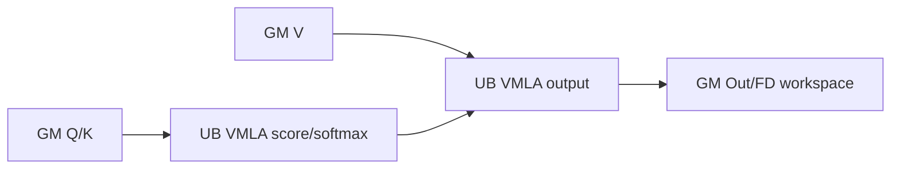

# IncreFlashAttention A2/A3 ACLNN 算子知识

## 算子速览

| 项目 | 内容 |
|---|---|
| 实际入口 | `aclnnIncreFlashAttentionV4GetWorkspaceSize` / `aclnnIncreFlashAttentionV4`，公开两段式 ACLNN |
| 计算语义 | `Softmax(scaleValue·QKᵀ+pseShift+mask)·V`；V4 在 V3 上新增 KV 左 padding |
| 输入输出 | Q/Out FP16、BF16（Out 还可 INT8）；K/V FP16、BF16、INT8；ND，逻辑 BNSD/BSND/BSH |
| 执行类型 | AIV Vector 或单 Kernel `MIX_CV` |
| Kernel 路线 | R-001 全 Vector；R-002 常规 C1V2 MIX；R-003 C1V1 MIX；R-004 page preload MIX；前三族有显式 FlashDecode specialization |
| 核心资源 | GM、user workspace、L1/L0A/L0B/L0C、UB；FlashDecode 使用 FP32 accum/LSE workspace |
| 来源闭包 | `source_closed`：V4 API→generated inner 边界→OpDef/Host selector→Tiling/POD/key→arch22 entry/body→CMake |
| 验证状态 | 已完成源码闭包检查；本次知识提取未执行编译、真机、数值或性能测试。 |

## 接口与语义

### 计算语义

令 `Nq=numHeads`、`Nkv=(numKeyValueHeads==0?Nq:numKeyValueHeads)`、`G=Nq/Nkv`。每个 query head 对对应 KV head 做缩放点积、可选 PSE 和 mask、online softmax，再乘 V。INT8 K/V 先按 antiquant 参数恢复；INT8 输出在 BMM2 后用 `quantScale2/quantOffset2` 量化。左 padding 有效区间是 `[Smax-kvPaddingSize-actualSeqLengths, Smax-kvPaddingSize)`，端点为负时输出零。FlashDecode 将 S2 分片写 FP32 partial output 和 `(sum,max)`，`SyncAll` 后按 max-shift 权重归并。

### 输入、输出与属性

| 参数 | shape/layout | dtype | 约束、默认值与语义 |
|---|---|---|---|
| query / attentionOut | BNSD `(B,N,1,D)`、BSND `(B,1,N,D)`、BSH `(B,1,H)` | Q FP16/BF16；Out FP16/BF16/INT8 | shape 相同，S1=1，`N=numHeads` |
| key/value | TensorList；同布局，S 为 cache 长度 | FP16/BF16/INT8 | 对应 shape 相同；非连续 list 个数为 B、各 tensor B=1 |
| pseShift / attenMask | `(B或1,N,1,S)`；mask 还可 `(B,S)/(B,1,S)` | PSE 同 Q；mask BOOL/INT8/UINT8 | 可选；mask 整数值为 0/1 |
| actualSeqLengths / kvPaddingSize | `(B)` | INT64 | page 必须有 actual lengths；负 padding 按 0 |
| dequantScale1/quantScale1/dequantScale2 | scalar | UINT64/FP32，quantScale1 可 BF16 | 中间量化链参数，组合由 Host 校验 |
| quantScale2/quantOffset2 | scalar 或每通道 N*D/H | FP32/BF16 | Out INT8 时 scale 必选；offset shape/dtype 与 scale 一致 |
| antiquantScale/Offset | `(2)`、`(2,N,D)`、`(2,N,1,D)`、`(2,H)` | FP16/BF16/FP32 | K/V INT8 的 per-tensor/per-channel 参数 |
| blocktable/blockSize | `(B,maxBlocks)` / scalar | INT32 / INT64 | 开启 page；blockSize≤512，FP16/BF16 按16、INT8按32对齐 |
| numHeads/numKeyValueHeads | scalar | INT64 | `Nq%Nkv==0`，Nkv=0 表示 Nq |
| scaleValue/inputLayout/innerPrecise | scalar/string/scalar | double/string/INT64 | layout 为 BNSD/BSND/BSH；公开 innerPrecise 仅 0/1 |

### 入口与版本

固定仓公开索引把 V1/V2/V3 标为待废弃并指向 V4，因此 V4 是 A2/A3 最新公开版本。V4 wrapper 在非 DAV_3510 上调用 generated `aclnnInnerIncreFlashAttention*`；generated bridge 不在仓内，属于允许的框架边界。Host OpDef/Tiling、key router 和实际 body 均在固定仓闭合。

## Host/Launcher 执行流程

### 参数校验与前处理

V4 先拒绝 DAV_3510。A2/A3 经 inner bridge 创建基础 `IncreFlashAttention` 节点；OpDef 对主输入和可选 tensor 设置 `AutoContiguous()`。`ConvertContext` 读取 shape/desc、六个属性和 workspace slot；`actualSeqLengths` 是 Host/AICPU value dependency。`RunBigKernelTiling` 依序执行 `GetNpuInfo→PreProcess→ZeroTensorProcess→Split→FillTiling→CalcWorkSpace→CalcNumBlocks→GenTilingKey`，任一步失败即 `GRAPH_FAILED`。

### 参数、Workspace 与生命周期

平台提供 UB/L1/L0B/L0C、AIC/AIV 数和 `libapiSize`。Host 从 `workspaceSize_=libapiSize_` 起计；非全 Vector 路线按 `preLoadNum` 预留 `mm1Res→vec1Res→mm2Res→vec2Res→可选queryPre→nUpdate→softmaxSum`，随后追加可选 FlashDecode `accumOut/LSE` 和 page callback 两个 64 B/core 区。普通 Split 的 `preLoadNum=1`，page preload 的 `preLoadNum=4`；`nUpdate/softmaxSum` 是 Host 统一公式中的各 `128×actCoreNum×4 B` 保留区，普通 Split body 不取其地址。Device 收到的 user 指针相对系统 workspace 的重定位属于框架边界。executor、连续化临时 tensor、TensorList 描述和 workspace 必须存活到同 stream Kernel 完成；generated executor 的释放实现固定仓不可见。

### 启动图与失败传播

```text
V4GetWorkspaceSize -> generated inner -> IncreFlashAttention
  -> TilingIncreFlashAttentionAdapter -> IFATiling(DAV_2201, priority 90)
  -> key/blockDim/POD
V4(workspace,executor,stream) -> generated inner
  -> incre_flash_attention -> incre_flash_attention_FIAS_arch22 -> one specialized body
```

公开 V4 只有一个 Kernel 节点；AIC/AIV 在该节点内交接。`DoSubOpTiling` 无论成功失败都设 `BATCH_MODE_SCHEDULE`，这是含 `SyncAll` route 的生命周期约束。

## Route 与参数设计

### 分核与资源计算

默认 `sInnerSize=8192`；非量化 GQA 随 G 取 8192/4096/2048；伪量化 GQA 取 1024，Cube-view 取 2048；page 再向下对齐至 blockSize。`loops=ceil(S2/sInnerSize)`，tail 为余数。A2/A3 要求 AIC:AIV 比为 1:1 或 1:2；普通/Vector 按 AIV 分核，Cube-view 按 AIC 分核，最终由 `CalcTschBlockDim(aiv,aic,aiv)` 编码 blockDim。

### Route 选择

| 顺序 | Route | Key/模板 | 精确选择条件与优先级 | 不适用去向 |
|---:|---|---|---|---|
| 1 | R-001 全 Vector | perf=1，`VALL` | 非 page/前缀、G=1、D≤512、Q/KV/Out 都是 FP16 | NORMAL |
| 2 | R-004 preload | perf=3，`CALL` | page+BNSD，D=128、G≤16、innerPrecise!=0、ND2NZ stride 合法、支持 dtype，且 `B*Nkv*ceil(maxS/2048)>128` | NORMAL |
| 3 | R-002 C1V2 | perf=0，`C1V2` | 前两者不命中，且不是小 BN C1V1 | FD key 或输出 |
| 4 | R-003 C1V1 | perf=2，`C1V1` | NORMAL、非 splitKV/前缀，`2*B*Nkv<=aivNum` | R-002 |

```text
EnableAllVec ? R-001 : EnableCubeViewMM ? R-004 : NORMAL
NORMAL && !splitKV && 2*B*Nkv<=AIV ? R-003 : R-002
IsFlashDecode 根据 BN/core/G/maxS/page guard 给 key 增加 split 位
```

### 模板/实现执行矩阵

| Route | key/selector | dtype/shape/platform 完整命中条件 | 执行族与 kernel 节点 | 实际模板/body | 内存与同步特征 | tail/fallback |
|---|---|---|---|---|---|---|
| R-001 | `VALL/FLASHDECODING_VALL` | 上述全 FP16 条件 | AIV single body | `IncreFlashAttentionAttenAllVecNew` | UB VMLA；FD 写 accum/LSE 后 SyncAll | DataCopyPad；否则 NORMAL |
| R-002 | `C1V2`，page/split/quant 子位 | 通用合法域、大 BN | MIX AIC1:AIV2 | `IncreFlashAttentionAttenSplitBbn2s2Us2` | GM workspace 四段；PA 2×64B callback | Matmul SetTail；未知 key 终止 |
| R-003 | `C1V1` | 小 BN、非 FD | MIX AIC1:AIV1 | 同 Split body | odd/even logical core 重映射 | 不允许 splitKV |
| R-004 | `PAGEDCACHE_CALL`，可 FD | page D128/G≤16 高工作量 | MIX preload | `IncreFlashAttentionAttenPreload` | 四深度 workspace ring | selector 不满足回 NORMAL |

### 隐藏性能 Guard

| Guard | Host/Tiling 条件 | Device/资源原因 | 影响 Route | 不满足时去向 | 源码符号 |
|---|---|---|---|---|---|
| CV 比 | `aiv/aic in {1,2}` | 只编译 1:1/1:2 | MIX | Tiling 失败 | `GetNpuInfo` |
| 全 Vector | 非PA、G=1、D≤512、全FP16 | 32K UB VMLA | R-001 | NORMAL | `EnableAllVec` |
| Cube-view | G≤16,D=128,非高精度，BSH stride `<65536` | 固定 tile/ND2NZ | R-004 | NORMAL | `CheckConstraints/CheckDataCopyNd2Nz` |
| workload | `B*Nkv*ceil(maxS/2048)>128` | preload 收益阈值 | R-004 | NORMAL | `EnableCubeViewMM` |
| FD | Cube族 `B*Nkv<=0.5*cores`；G=1或maxS≥2048 | 用 S2 分核补足闲核 | FD子路线 | BN分核 | `CheckCoreOkFlag` |
| page短S | page、910B、非MLA、maxS≤1024 禁 FD | 避免短序列分片 | FD | 非FD | `IsFlashDecode` |
| schedule | BATCH_MODE | SyncAll 要求全核同时启动 | FD | 源码强制 | `DoSubOpTiling` |

### POD/ABI

宏生成结构的 `sizeof/alignof/offsetof` 数值在固定仓不可见；字段声明顺序是序列化顺序。

| 结构 | 字段 | 类型/位宽 | ABI 布局 | 单位 | Host/launcher producer | Device consumer | 边界 |
|---|---|---|---|---|---|---|---|
| `InitOutputParams` | `isPerChnOut` | uint32/32 | 宏生成，偏移数值不可见 | bool | `FillTilingOutputParams` | `PostQuant` | 非逐通道为0 |
| 同上 | `isOutQuantTypeBf16` | uint32/32 | 同上 | bool | 同上 | 输出量化读取 | 非 BF16 scale 为0 |
| 同上 | `singleCoreSize` | uint32/32 | 同上 | 元素/core | 同上 | 输出初始化 | 不超过单核输出域 |
| 同上 | `singleCoreLseSize` | uint32/32 | 同上 | FP32元素/core | 同上 | LSE初始化 | V4 无 LSE 输出 |
| 同上 | `totalOutputSize` | int64/64 | 同上 | 元素 | 同上 | 输出初始化循环 | 非负 |
| 同上 | `totalLseOutputSize` | int64/64 | 同上 | FP32元素 | 同上 | LSE初始化循环 | V4 为0 |
| 同上 | `needInit` | uint32/32 | 同上 | bool | 同上 | 零序列输出路径 | 按 shape/seq 激活 |
| 同上 | `isBSNDOut` | uint32/32 | 同上 | bool | 同上 | 输出地址映射 | BSND 为1 |
| `BaseParams` | `batchSize` | uint32/32 | 宏生成，偏移数值不可见 | batch | `FillTilingBaseParams` | BN/core 地址映射 | `B<=65536` |
| 同上 | `seqSize` | uint32/32 | 同上 | token | 同上 | K/V GM extent | `sMax=0` 时 tiling 暂用1024，body仍读实际长度 |
| 同上 | `qSeqSize` | uint32/32 | 同上 | token | 同上 | query 地址 | V4 为1 |
| 同上 | `headSize` | uint32/32 | 同上 | 元素 | 同上 | BMM1 K / 输出列 | `D<=512` |
| 同上 | `headSizeV` | uint32/32 | 同上 | 元素 | 同上 | BMM2 N | V4 非 sliding 时等于 D |
| 同上 | `blockSize` | uint32/32 | 同上 | token/block | page preprocess | PA callback | 非 page 为0 |
| 同上 | `maxBlockNumPerBatch` | uint32/32 | 同上 | block | page preprocess | blocktable 地址 | 非 page inactive |
| 同上 | `maxBlockNumPerSeq` | uint32/32 | 同上 | block | page preprocess | page 循环 | 非 page inactive |
| 同上 | `scaleValue` | float/32 | 同上 | scalar | API double 经属性/Host 窄化 | AIV `Muls` | FP32 运算值 |
| 同上 | `kvHeadNum` | uint32/32 | 同上 | head | shape/属性 | BN2/GM 地址 | 非零 |
| 同上 | `headNumRatio` | uint32/32 | 同上 | head ratio | `numHeads/numKvHeads` | GQA 地址 | 必须整除 |
| 同上 | `qHeadNum` | uint32/32 | 同上 | head | query shape/numHeads | 输出地址 | `<=256` |
| 同上 | `nNumOfQInOneGroup` | uint32/32 | 同上 | row/head | GQA preprocess | Matmul M/Vector 行数 | 等于 G |
| 同上 | `batchContinuousFlag` | uint32/32 | 同上 | bool | K/V TensorList 检查 | `ListTensorDesc` | 0 为逐 batch tensor |
| 同上 | `pseShiftFlag` | uint32/32 | 同上 | bool | PSE 可选输入检查 | PSE CopyIn | 空 tensor 为0 |
| 同上 | `pseShiftB` | uint32/32 | 同上 | batch | PSE shape | PSE batch offset | 广播时为1 |
| 同上 | `pseShiftS` | uint32/32 | 同上 | token | PSE shape | PSE stride | 可选 |
| 同上 | `pseShiftS0` | uint32/32 | 同上 | token | PSE shape | PSE 起点 | 可选 |
| 同上 | `selectWithByteMaskTmpMinSize` | uint32/32 | 同上 | byte | `CalcUbAttenMask` | Select tmp | 不超过可用 UB |
| 同上 | `actualLenQDims` | uint32/32 | 同上 | 维数 | actual Q 解析 | query 长度读取 | V4 无 actual Q，inactive |
| 同上 | `actualLenDims` | uint32/32 | 同上 | 维数 | actual KV 解析 | KV 长度读取 | 0/1维 |
| 同上 | `qPaddingFlag` | uint32/32 | 同上 | bool | query padding 检查 | query offset | V4 无 query padding，inactive |
| 同上 | `kvPaddingFlag` | uint32/32 | 同上 | bool | `ProcessKVPaddingSize` | KV 有效区间 | V4 可激活 |
| 同上 | `msdIterNum` | uint32/32 | 同上 | iteration | quant preprocess | MSD 循环 | 非反量化通常1 |
| 同上 | `l2CacheOffFlag` | uint32/32 | 同上 | bool | `UpdateL2CacheOffFlag` | GM cache hint | 公开 route 通常0 |
| 同上 | `antiquantPerTensorFlag` | uint32/32 | 同上 | bool | antiquant shape 检查 | scale/offset 索引 | INT8 KV |
| 同上 | `antiquantPerHeadFlag` | uint32/32 | 同上 | bool | antiquant mode 归一化 | head 参数索引 | 模式2/3 |
| 同上 | `antiquantParamsInPagedAttentionFlag` | uint32/32 | 同上 | bool | antiquant mode 归一化 | page 参数地址 | 模式4/5且 page |
| 同上 | `attenMaskFlag` | uint32/32 | 同上 | bool | mask 检查 | mask CopyIn/Select | 空 tensor 为0 |
| 同上 | `attenMaskBatch` | uint32/32 | 同上 | batch | mask shape | mask batch offset | 1或B |
| 同上 | `attenMaskQSize` | uint32/32 | 同上 | token | mask shape | Q stride | V4 S1=1 |
| 同上 | `attenMaskSize` | uint32/32 | 同上 | token | mask shape | S2 extent | 不小于有效域 |
| 同上 | `softmaxLseFlag` | uint32/32 | 同上 | bool | 输出存在性 | body LSE 提交 | V4 为0 |
| 同上 | `totalBlockNum` | uint32/32 | 同上 | block | blocktable 检查 | PA 边界 | 非 page inactive |
| 同上 | `paKvShapeType` | uint32/32 | 同上 | enum | page K/V rank 解析 | callback 地址公式 | 公开支持的两种 PA shape |
| 同上 | `antiqSeqSize` | uint32/32 | 同上 | token | antiquant shape | per-token 参数 offset | 非 per-token inactive |
| 同上 | `preToken` | int32/32 | 同上 | token | sparse 属性归一化 | mask window | V4 inner 默认域 |
| 同上 | `nextToken` | int32/32 | 同上 | token | sparse 属性归一化 | mask window | V4 inner 默认域 |
| 同上 | `isRowInvalid` | uint32/32 | 同上 | bool | sparse/零长度检查 | 行清零 | 按 batch 激活 |
| 同上 | `sparseMode` | uint32/32 | 同上 | enum | sparse 检查 | mask 分支 | V4 inner 默认域 |
| 同上 | `slidingFlag` | uint32/32 | 同上 | bool | sliding 检查 | KV offset | V4 未暴露 window，inactive |
| 同上 | `windowSize` | int64/64 | 同上 | token | sliding 检查 | KV 起点 | `-1` 禁用 |
| `CoreParams` | `coreSidxEnd[50]` | uint32[50] | 首地址要求8 B对齐 | S2 block | `Split*` | 每核起止 | A2/A3，最多50项 |
| 同上 | `coreSidxEndRegbase[66]` | uint32[66] | 宏生成 | block | arch35 tiling | arch35 body | 本卡 inactive |
| 同上 | `coreSposStartRegbase[66]` | uint32[66] | 宏生成 | block | arch35 tiling | arch35 body | 本卡 inactive |
| `SingleCoreParams` | `sInnerLoopTimes` | uint32/32 | 宏生成 | loop | `CalcInnerSize` | S2 loop | `ceil(seq/sInnerSize)` |
| 同上 | `singleProcessSInnerSize` | uint32/32 | 同上 | token | 同上 | Matmul N/K、Vector tile | page 为 blockSize 倍数 |
| 同上 | `singleProcessSInnerSizeTail` | uint32/32 | 同上 | token | 同上 | 最后 S2 tile | `(0,sInnerSize]` |
| 同上 | `usedCoreNum` | uint32/32 | 同上 | core | `Split*` | core guard | 不超过平台核数 |
| 同上 | `formerCoreNum` | uint32/32 | 同上 | core | `Split*` | former/tail 分核 | `<=usedCoreNum` |
| 同上 | `blockSplitBn2Range` | uint32/32 | 同上 | BN2 item/core | `Split*` | core BN2 范围 | former 核使用 |
| 同上 | `tailSplitedBatchRange` | uint32/32 | 同上 | BN2 item/core | `Split*` | tail 核范围 | tail 核使用 |
| 同上 | `groupSplitSize` | uint32/32 | 同上 | head row | GQA split | 每核 group | 不超过 G |
| 同上 | `s1SplitSize` | uint32/32 | 同上 | token | query split | body S1 范围 | V4 为1 |
| `SingleCoreTensorSize` | `mmResUbSize` | uint32/32 | 宏生成 | 元素/core | `CalcUbBmm` | mm1/vec1 WS offset | 乘 route 元素字节数与 depth |
| 同上 | `bmm2ResUbSize` | uint32/32 | 同上 | 元素/core | `CalcUbBmm` | mm2/vec2/queryPre WS offset | 同上 |
| `SplitKVParams` | `s2` | uint32/32 | 宏生成 | split count | `FillTilingSplitKV` | FlashDecode combine | 非 FD 为0 |
| 同上 | `sInnerLoopSize` | uint32/32 | 同上 | token/split | 同上 | 分片 S2 loop | FD active |
| 同上 | `accumOutSize` | uint32/32 | 同上 | FP32元素 | `NormalCalcFDWorkSpace`/Fill | partial output offset | 非 FD 为0 |
| 同上 | `logSumExpSize` | uint32/32 | 同上 | FP32元素 | 同上 | sum/max 两区 offset | 偶数，非 FD 为0 |
| `TilingData` | `bmm1TilingData` | `TCubeTiling` | 嵌套 ABI 数值不可见 | Matmul POD | `GetBmm1Tiling` | BMM1 Matmul | R-001 不读 |
| 同上 | `bmm2TilingData` | `TCubeTiling` | 同上 | Matmul POD | `GetBmm2Tiling` | BMM2 Matmul | R-001 不读 |
| 同上 | `baseParams` | 嵌套结构 | 声明顺序 | POD | `FillTilingBaseParams` | 全 route body | inactive 字段不得读取 |
| 同上 | `splitKVParams` | 嵌套结构 | 声明顺序 | POD | `FillTilingSplitKV` | FD body | 非 FD inactive |
| 同上 | `increFlashAttentionCoreParams` | 嵌套结构 | 声明顺序 | POD | `FillTilingCoreParams` | core scheduler | 按平台数组 |
| 同上 | `increFlashAttentionSingleCoreParams` | 嵌套结构 | 声明顺序 | POD | `FillTilingSingleCoreParams` | tile loops | 全 route |
| 同上 | `increFlashAttentionSingleCoreTensorSize` | 嵌套结构 | 声明顺序 | POD | `FillTilingSingleCoreTensorSize` | WS offsets | R-001 仅部分使用 |
| 同上 | `softmaxFlashTilingData` | `SoftMaxTiling` | 嵌套 ABI 数值不可见 | Softmax POD | `FillTilingSoftmax` | SoftmaxFlashV2 | 按 route |
| 同上 | `outputParams` | 嵌套结构 | 声明顺序 | POD | `FillTilingOutputParams` | 输出/量化路径 | 全 route |
| `TilingDataV2` | `tilingBase` | `TilingData` | 声明顺序 | POD | `IncreFlashAttentionSetTilingData` | `COPY_TILING_DATA*` | V4 主体 |
| 同上 | `tilingPrefix` | `TilingDataPrefix` | 声明顺序 | POD | 同上 | prefix router | V4 未暴露 prefix，inactive |

### Route 源码闭包

| Route | Key/selector | Host/Tiling producer | POD/参数 | Kernel entry/router | Kernel body/直接依赖 | 构建接线 |
|---|---|---|---|---|---|---|
| R-001 | perf1 VALL/FD | `EnableAllVec/IsFlashDecode/GenTilingKey` | base+可选split | arch22 router | allvec `Process` | op_host CMake |
| R-002 | perf0 C1V2 | `Split/CalcInnerSize/CalcWorkSpace` | 完整POD | arch22 router | Split body | 同上 |
| R-003 | perf2 C1V1 | `EnableC1V1/CalcNumBlocks` | 同R-002 | router+task type1:1 | Split body | 同上 |
| R-004 | perf3 CALL | `EnableCubeViewMM/GetBmmTiling` | cube+4-depth WS | arch22 router | Preload body | 同上 |

## Kernel 实现

### 公共执行流程

`incre_flash_attention` 把 V4 参数补成 FIAS 完整参数表。arch22 entry 以编译期 key 选择完整 `IFAType<Q,KV,Out,compute,page,FD,layout,...>`；未知 key 没有 body。MIX 公共顺序为 `BMM1→scale/PSE/mask/online softmax→BMM2→update/cast/quant`。PA AIV 写 64B callback 描述，S↔MTE3 event 后 AIC callback 按 blocktable 搬 page。

### Route R-001：全 Vector

#### 适用条件

##### 选择证据

| 层级 | 文件 | 符号 | 源码谓词/参数 | 结果/下一跳 |
|---|---|---|---|---|
| Host | tiling_check.cpp | `EnableAllVec` | 非PA/前缀、G1、D≤512、全FP16 | perf1 |
| Router | arch22.h | `*_VALL_*` | layout、FD bool | AllVec |

#### Device 数据流

##### 函数级调用链

```text
AllVec::Init/InitBuffers -> Process -> QueryPreProcess
 -> CopyK/ComputeMm1ByVmla -> Elewise/SoftmaxFlashV2
 -> CopyV/ComputeMm2ByVmla -> Cast/CopyOut -> [FD] SyncAll/combine
```

##### 源码等价伪码

```text
Q,K -> UB; score_fp32=VMLA(Q,K); scale+pse+mask; online softmax
V -> UB; out_fp32 += p*V; FD写partial或直接CAST_ROUND写有效D
```

#### 内存与数据搬运

##### 资源与搬运表

| 层级/缓冲区 | offset/地址公式 | extent/容量公式 | dtype/layout | producer | consumer | owner/lifetime | 对齐/复用 |
|---|---|---|---|---|---|---|---|
| L1/L0 | N/A | N/A | N/A | N/A | N/A | 不用Cube | UB VMLA替代 |
| UB | score32K；input2深度2×32K；tmp1/tmp2各32K；Q1K；out2K等 | `InitBuffers` | FP16/FP32 | MTE/V | V/MTE | TPipe | TQue协议 |
| FD WS | accum后接LSE | `4*accumOutSize+4*logSumExpSize` | FP32 | split核 | combine核 | Kernel | 独占分片 |

##### 分层内存布局



##### 字节账、交接边与复用顺序

```text
FD_workspace = 4*accumOutSize + 4*logSumExpSize
UB按InitBuffers固定分配；逻辑tile不等于物理容量
```

| 边/复用子区 | producer | offset/extent | dtype/layout | consumer | ordering/sync | owner/lifetime | 安全条件 |
|---|---|---|---|---|---|---|---|
| FD partial | split核 | POD sizes | FP32 | combine核 | SyncAll | user WS | BATCH_MODE、独占区 |

#### 同步、精度与尾块

##### 同步与数值边界表

| 阶段 | primitive/机制 | producer | consumer/等待点 | 保护对象 | 精度/尾块 |
|---|---|---|---|---|---|
| 搬运 | TQue | MTE2 | Vector | UB | DataCopyPad |
| FD | SyncAll | split核 | combine | partial WS | max-shift FP32 |
| 输出 | Cast | FP32 UB | MTE3 | Out | FP16 CAST_ROUND，有效D |

#### 关键实现

##### 符号证据表

| 阶段 | 文件 | 符号/模板实例 | 实现事实 |
|---|---|---|---|
| Host/Tiling producer | tiling_check.cpp | `EnableAllVec/IsFlashDecode` | selector |
| Kernel entry/router | arch22.h | `INVOKE_IFA_ALL_VEC_OP_IMPL` | key映射 |
| Device body/helper | allvec_new.h | `Process/ComputeMm*ByVmla` | UB VMLA/softmax/FD |

### Route R-002：常规 C1V2 MIX_CV

#### 适用条件

##### 选择证据

| 层级 | 文件 | 符号 | 源码谓词/参数 | 结果/下一跳 |
|---|---|---|---|---|
| Host | tiling.cpp | `SetupPerfMode/CalcNumBlocks` | 非其它perf且非C1V1 | perf0 MIX1:2 |
| Router | arch22.h | `*_C1V2_*` | dtype/layout/page/FD/antiquant | Split body |

#### Device 数据流

##### 函数级调用链

```text
Split::Init -> workspace slices -> Process
 -> Bmm1Compute -> ProcessVec1 -> Bmm2Compute -> ProcessVec2
 -> [FD] SyncAll -> FlashDecodeCompute
```

##### 源码等价伪码

```text
AIC QK->mm1WS; AIV scale/mask/softmax->vec1WS;
AIC vec1*V->mm2WS; AIV update/cast->Out；逐S2 tile重复
```

#### 内存与数据搬运

##### 资源与搬运表

| 层级/缓冲区 | offset/地址公式 | extent/容量公式 | dtype/layout | producer | consumer | owner/lifetime | 对齐/复用 |
|---|---|---|---|---|---|---|---|
| L1/L0 | `TCubeTiling` | base/step由tiling API生成 | ND/NZ | MTE2/Mmad | L0C/Fixpipe | AIC tile | SetTail |
| mm1/vec1/mm2/vec2 WS | 依次、每 core 独占 | `C*(mmResUbSize*(mmElem+vec1Elem)+bmm2ResUbSize*(bmm2Elem+vec2Elem))` | 非反量化为 FP32/输入类型/FP32/FP32；反量化为 INT32/INT8/INT32/FP32 | AIC/AIV | peer | Kernel | `dbWorkspaceRatio=1` |
| Host 保留区 | 四段 WS 与可选 queryPre 之后 | `128*C*4 B + 128*C*4 B` | INT32 | Host 计入 workspace | 普通 Split 不读取；preload 路线使用对应状态区 | Kernel | 不得从总 workspace 中删除 |
| UB | input 32K/16K、out32K/8K、tmp32K/32K/2K及softmax buffer | InitBuffers | typed | MTE/V | V/MTE | AIV | TQue |

##### 分层内存布局


##### 字节账、交接边与复用顺序

```text
WS_total = libapiSize
         + C*(mmResUbSize*mmElem + mmResUbSize*vec1Elem
              + bmm2ResUbSize*bmm2Elem + bmm2ResUbSize*vec2Elem
              + antiquant?bmm2ResUbSize*qPreElem:0
              + 128*4 + 128*4)
         + splitKV?(accumOutSize+logSumExpSize)*4:0
         + page?C*2*64:0
其中非反量化 (mmElem,vec1Elem,bmm2Elem,vec2Elem,qPreElem)=(4,2,4,4,0)，
反量化非 MLA 为 (4,1,4,4,1)。INT4 的 vec1/queryPre extent 另乘 0.5，但公开 V4 不支持 INT4 KV。
```

| 边/复用子区 | producer | offset/extent | dtype/layout | consumer | ordering/sync | owner/lifetime | 安全条件 |
|---|---|---|---|---|---|---|---|
| BMM1→Vec1→BMM2→Vec2 | AIC/AIV交替 | 四段WS | route dtype | peer | Matmul wait/KFC | per-core | 同tile独占 |
| PA callback | AIV/scalar | 2×64B/core | uint32描述 | AIC callback | S_MTE3/MTE3_S | iteration | 写完再读取 |

#### 同步、精度与尾块

##### 同步与数值边界表

| 阶段 | primitive/机制 | producer | consumer/等待点 | 保护对象 | 精度/尾块 |
|---|---|---|---|---|---|
| Matmul | IterateAll/Wait/End | AIC | peer | L0C/WS | SetTail(M,N,K) |
| PA | HardEvent | descriptor | callback | 64B | page尾行 |
| AIV/FD | TQue/PipeBarrier/SyncAll | MTE/V/cores | next/combine | UB/WS | FP32 softmax；最终ROUND/RINT/quant |

#### 关键实现

##### 符号证据表

| 阶段 | 文件 | 符号/模板实例 | 实现事实 |
|---|---|---|---|
| Host/Tiling producer | tiling.cpp | `Split/CalcInnerSize/CalcWorkSpace` | tile/WS/key |
| Kernel entry/router | arch22.h | `INVOKE_IFA_GENERAL_OP_IMPL` | specialization |
| Device body/helper | split_Bbn2s2_Us2.h | `SInnerLoopFunc/Bmm*Compute/ProcessVec*` | MIX链路 |

### Route R-003：C1V1 MIX_CV

#### 适用条件

##### 选择证据

| 层级 | 文件 | 符号 | 源码谓词/参数 | 结果/下一跳 |
|---|---|---|---|---|
| Host | tiling_check.cpp | `EnableC1V1` | NORMAL、非FD/前缀、`2*B*Nkv<=AIV` | perf2 |
| Router | arch22.h | `KERNEL_TASK_TYPE(...MIX_AIC_1_1)` | C1V1 key | 1:1 |

#### Device 数据流

##### 函数级调用链

```text
Split::Init(odd/even logicalCore remap) -> same Process as R-002
```

##### 源码等价伪码

```text
logicalCore = odd ? (blockIdx+blockNum*taskRatio)/2 : blockIdx/2;
paired AIC/AIV reuse same logicalCore workspace; splitKV forbidden
```

#### 内存与数据搬运

##### 资源与搬运表

| 层级/缓冲区 | offset/地址公式 | extent/容量公式 | dtype/layout | producer | consumer | owner/lifetime | 对齐/复用 |
|---|---|---|---|---|---|---|---|
| L1/L0/UB/WS | 同R-002，索引用logicalCore | 非FD公式 | route dtype | paired AIC/AIV | peer | logical pair | 映射不可改 |

##### 分层内存布局


##### 字节账、交接边与复用顺序

```text
WS=R-002非FD公式；blockDim按usedCoreNum 1:1编码
```

| 边/复用子区 | producer | offset/extent | dtype/layout | consumer | ordering/sync | owner/lifetime | 安全条件 |
|---|---|---|---|---|---|---|---|
| paired WS | AIC/AIV | logicalCore slice | 同R-002 | peer | MIX1:1 | pair | odd/even映射一致 |

#### 同步、精度与尾块

##### 同步与数值边界表

| 阶段 | primitive/机制 | producer | consumer/等待点 | 保护对象 | 精度/尾块 |
|---|---|---|---|---|---|
| AIC/AIV | MIX1:1/Matmul wait | pair | peer | WS | 同R-002；FD N/A |

#### 关键实现

##### 符号证据表

| 阶段 | 文件 | 符号/模板实例 | 实现事实 |
|---|---|---|---|
| Host/Tiling producer | tiling_check.cpp | `EnableC1V1` | 小BN |
| Kernel entry/router | arch22.h | task type1:1 | ratio |
| Device body/helper | split_Bbn2s2_Us2.h | `Init/Process` | core remap |

### Route R-004：page preload MIX_CV

#### 适用条件

##### 选择证据

| 层级 | 文件 | 符号 | 源码谓词/参数 | 结果/下一跳 |
|---|---|---|---|---|
| Host | tiling_check.cpp | `EnableCubeViewMM` | page+BNSD,D128,G≤16,高性能,workload>128 | perf3 |
| Router | arch22.h | `PAGEDCACHE_CALL` | dtype/FD | Preload |

#### Device 数据流

##### 函数级调用链

```text
Preload::Init(4-depth WS) -> Process
 -> pipelined BMM1 -> Vec1 -> BMM2 -> Vec2 -> rotate stage -> optional FD
```

##### 源码等价伪码

```text
stage=i mod 4；发射tile i的BMM1，同时消费已就绪stage做Vec1/BMM2/Vec2；
consumer完成前不得覆盖该stage
```

#### 内存与数据搬运

##### 资源与搬运表

| 层级/缓冲区 | offset/地址公式 | extent/容量公式 | dtype/layout | producer | consumer | owner/lifetime | 对齐/复用 |
|---|---|---|---|---|---|---|---|
| L1/L0 | PA callback+TCubeTiling | D128×S tile | ND→NZ | MTE2/AIC | Matmul | stage | page tail |
| stage WS | `stage*perStageExtent` | `4*C*(mm1+vec1+mm2+vec2+optionalQpre+nUpdate+softmaxSum)` | typed | AIC/AIV | later phase | ring | modulo4 |
| callback | stage后 | C×128B | uint32 | AIV | AIC | iteration | 64B对齐 |

##### 分层内存布局


##### 字节账、交接边与复用顺序

```text
WS=libapiSize
 +4*C*(mm1Bytes+vec1Bytes+mm2Bytes+vec2Bytes+optionalQpreBytes+128*4+128*4)
 +FDBytes+C*2*64
```

| 边/复用子区 | producer | offset/extent | dtype/layout | consumer | ordering/sync | owner/lifetime | 安全条件 |
|---|---|---|---|---|---|---|---|
| stage ring | each phase | stage slice | typed | next phase | preload/KFC flags | core | producer不追上consumer |

#### 同步、精度与尾块

##### 同步与数值边界表

| 阶段 | primitive/机制 | producer | consumer/等待点 | 保护对象 | 精度/尾块 |
|---|---|---|---|---|---|
| preload/PA | stage protocol+events | AIC/AIV | peer/callback | ring/descriptor | D128，S/page tail |
| FD | SyncAll | split cores | combine | accum/LSE | FP32 max-shift |

#### 关键实现

##### 符号证据表

| 阶段 | 文件 | 符号/模板实例 | 实现事实 |
|---|---|---|---|
| Host/Tiling producer | tiling_check.cpp | `EnableCubeViewMM` | guards |
| Kernel entry/router | arch22.h | `INVOKE_IFA_NO_KFC_OP_IMPL` | CALL→Preload |
| Device body/helper | incre_flash_attention_preload.h | `Init/Process` | 4-stage pipeline |

## 算子特定优化

### Trick T-001：工作量驱动的 Cube-view selector

#### 触发与源码依据

- 适用 Route：R-004
- 触发条件：page+BNSD、D128、G≤16、高性能、支持 dtype，`B*Nkv*ceil(maxS/2048)>128`
- Golden 来源：[`incre_flash_attention_tiling_check.cpp:1060-1063`](../../../../../../../cann-ops-raw/ascendc/ops-transformer/be33d95bb755cedec3108f70805c1874d1792540/attention/incre_flash_attention/op_host/incre_flash_attention_tiling_check.cpp#L1060-L1063)

**官方源码（固定 Commit 连续逐字摘录）**：

```cpp
uint32_t s2Loop = (maxActualseq_ + 2048U - 1U) / 2048U;
if (static_cast<uint64_t>(batchSize_) * numKvHeads_ * s2Loop <= 128U) { // 128: 性能收益临界值
    return false;
}
```

#### 机制与设计原因

仅高工作量才支付 ND→NZ、Cube/Vector 交接与四深度 workspace；简单 FP16 MHA 可由 R-001 UB VMLA 完成。

#### 迁移边界

- 适用：存在 Vector/Cube 两族的 decode
- 前提：目标平台 tile、stride 和 CV 比一致
- 失效：G>16、D≠128、高精度或 stride≥65536
- 未验证：本次知识提取未执行编译、真机、数值或性能测试。

#### 错误做法

绕过 selector 强制 CALL 会越过固定 specialization 边界；固定仓未提供运行性能反例。

### Trick T-002：FlashDecode 的 FP32 max-shift 归并

#### 触发与源码依据

- 适用 Route：带 `FLASHDECODING` 的 R-001/R-002/R-004
- 触发条件：BN 少；G=1 或 GQA maxS≥2048；page maxS≤1024 禁用
- Golden 来源：[`incre_flash_attention_tiling_check.cpp:1001-1004`](../../../../../../../cann-ops-raw/ascendc/ops-transformer/be33d95bb755cedec3108f70805c1874d1792540/attention/incre_flash_attention/op_host/incre_flash_attention_tiling_check.cpp#L1001-L1004)

**官方源码（固定 Commit 连续逐字摘录）**：

```cpp
if (pageAttentionFlag_ && socVersion_ == IfaSocVersion::SOC_ASCEND_910B &&
    perfMode != IfaPerfMode::CUBE_VIEW_MM_MLA && maxActualseq_ <= 1024U) { // 1024, 经验值
    return false;
}
```

#### 机制与设计原因

S2 分片提高核占用；partial output 必须随 `(sum,max)` 以全局 max 重标后归并，避免分片 softmax 改变语义。Host 用 BATCH_MODE 保护 `SyncAll`。

#### 迁移边界

- 适用：可保留 partial LSE 的 reduction
- 前提：独占 workspace、全核同时调度、FP32 sum/max
- 失效：page 短 S 或 workspace 不足
- 未验证：本次知识提取未执行编译、真机、数值或性能测试。

#### 错误做法

直接相加各分片归一化输出会产生错误结果；源码的 accum/LSE 双区是反例。

### Trick T-003：PA callback 描述的跨流水线可见性

#### 触发与源码依据

- 适用 Route：page specialization
- 触发条件：blocktable 有效
- Golden 来源：[`incre_flash_attention_split_Bbn2s2_Us2.h:2528-2536`](../../../../../../../cann-ops-raw/ascendc/ops-transformer/be33d95bb755cedec3108f70805c1874d1792540/attention/incre_flash_attention/op_kernel/arch22/incre_flash_attention_split_Bbn2s2_Us2.h#L2528-L2536)

**官方源码（固定 Commit 连续逐字摘录）**：

```cpp
event_t eventIDSToMTE3 = static_cast<event_t>(GetTPipePtr()->FetchEventID(HardEvent::S_MTE3));
SetFlag<HardEvent::S_MTE3>(eventIDSToMTE3);
WaitFlag<HardEvent::S_MTE3>(eventIDSToMTE3);

DataCopy(bmm1CallBackDataGm, bmm1PageAttentionDataUb, 16); // 对齐

event_t eventIDMTE3ToS = static_cast<event_t>(GetTPipePtr()->FetchEventID(HardEvent::MTE3_S));
SetFlag<HardEvent::MTE3_S>(eventIDMTE3ToS);
WaitFlag<HardEvent::MTE3_S>(eventIDMTE3ToS);
```

#### 机制与设计原因

AIV/Scalar 将 batch/head/S 起点和 K/blocktable 地址写成 64B 描述；双向 event 后 AIC callback 才按 page 搬入 L1，省去连续 cache 物化。

#### 迁移边界

- 适用：Matmul 支持 callback 的 paged KV
- 前提：64B 对齐、地址拆分和 event 顺序不变
- 失效：无 callback 时需显式 gather workspace
- 未验证：本次知识提取未执行编译、真机、数值或性能测试。

#### 错误做法

省略 `MTE3_S` 完成等待会允许 AIC 读取旧描述。

## 模板与实现对比

| 对比维度 | R-001 | R-002/R-003 | R-004 | 设计选择依据 |
|---|---|---|---|---|
| 命中条件/优先级 | FP16 G1非PA | 通用fallback/小BN 1:1 | page D128高工作量 | SetupPerfMode |
| 执行族/节点图 | AIV | MIX 1:2/1:1 | MIX四stage | 资源/工作量 |
| M/N/K、tile 与 scheduler | UB VMLA | BMM1 M=G,K=D,N=S；BMM2 M=G,K=S,N=D | 同尺寸、4 tile并行 | Tiling guard |
| workspace/L1/L0/UB | 非FD主要UB | 四段WS+L1/L0/UB | WS×4 | preload深度 |
| AIC/AIV 或 kernel 交接 | N/A | GM WS+KFC | ring WS | 单Kernel |
| 同步、精度与 tail | TQue/FP32 | Matmul/event/SyncAll | stage/event | key specialization |
| fallback/失败边界 | NORMAL | 未知key终止 | NORMAL | 无Device fallback |

## 平台差异

| 项目 | A2 | A3 | 950 |
|---|---|---|---|
| 支持状态 | V4支持 | V4支持 | V4文档不支持，wrapper在DAV_3510报错 |
| Host/Launcher | DAV_2201 IFATiling priority90 | 共用 | V1-V4均拒绝 |
| Kernel/资源 | arch22，资源运行时读取 | 共用 | arch35存在不能证明公开API支持 |

## 限制与失败边界

- query/out shape 必须相同，K/V 对应 shape 相同，S1=1，`Nq%Nkv==0`；page 的 blocktable/actual lengths/blockSize 约束失败即终止。
- BSH/BSND Cube-view 要求 `D*Nkv<65536`；通用 Split 不受该 selector guard 限制。
- generated inner/executor/stream 提交代码固定仓不可见，不补造其内部生命周期。
- shared-prefix、MLA、DD、ATB、INT4、TND 需要 V4 未公开的额外输入或属性域，不进入本卡 Route。
- 未知/未编译 key 没有 Device body；本次知识提取未执行编译、真机、数值或性能测试。

## 源码索引

### 链路索引

| 链路阶段 | 文件 | 关键符号 | 支撑内容 |
|---|---|---|---|
| 入口声明/约束 | attention/incre_flash_attention/docs/aclnnIncreFlashAttentionV4.md | 产品表/原型 | 公开域 |
| 入口声明/约束 | attention/incre_flash_attention/op_api/aclnn_incre_flash_attention_v4.h | `aclnnIncreFlashAttentionV4*` | C ABI 原型 |
| 入口实现 | attention/incre_flash_attention/op_api/aclnn_incre_flash_attention_v4.cpp | V4 wrappers | inner边界/950拒绝 |
| Host/OpDef | attention/incre_flash_attention/op_host/incre_flash_attention_def.cpp | `IncreFlashAttention` | dtype/format/属性与产品配置 |
| Host/Tiling | attention/incre_flash_attention/op_host/incre_flash_attention_tiling.h | POD | ABI |
| Host/Tiling | attention/incre_flash_attention/op_host/incre_flash_attention_tiling_base.h | `IfaPerfMode`/常量 | Route 枚举、tile 与精度常量 |
| Host/Tiling | attention/incre_flash_attention/op_host/incre_flash_attention_tiling_struct.h | `IfaWorkSpaceSizeParams` | workspace 各 slice 元素字节数 |
| Host/Tiling | attention/incre_flash_attention/op_host/incre_flash_attention_tiling.cpp | Run/GenKey/CalcWS | selector/参数 |
| Host/Tiling | attention/incre_flash_attention/op_host/incre_flash_attention_tiling_check.cpp | Enable*/FD | Guard |
| Host/Tiling | attention/incre_flash_attention/op_host/incre_flash_attention_tiling_register.cpp | `REGISTER_TILING_TEMPLATE_FIA` | DAV_2201/DAV_2002 priority 90 注册 |
| Kernel entry/body | attention/incre_flash_attention/op_kernel/incre_flash_attention.cpp | entry | 参数转发 |
| Kernel entry/body | attention/incre_flash_attention/op_kernel/incre_flash_attention_tilingkey.h | `IFA_GET_TILINGKEY`/key 常量 | Host key 与 router 常量编码 |
| Kernel entry/body | attention/incre_flash_attention/op_kernel/ifa_public_define.h | `IFAType` | dtype/layout/page/FD/antiquant 模板 traits |
| Kernel entry/body | attention/incre_flash_attention/op_kernel/incre_flash_attention_arch22.h | router | key实例 |
| Kernel entry/body | attention/incre_flash_attention/op_kernel/incre_flash_attention_allvec_new.h | AllVec | R-001 |
| Kernel entry/body | attention/incre_flash_attention/op_kernel/arch22/incre_flash_attention_split_Bbn2s2_Us2.h | Split | R-002/003 |
| Kernel entry/body | attention/incre_flash_attention/op_kernel/arch22/incre_flash_attention_preload.h | Preload | R-004 |
| 构建接线 | attention/incre_flash_attention/op_host/CMakeLists.txt | add_op/modules/options | 构建接线 |

### 实现复用检查

| 检查项 | 可复用事实 | 不得改变的约束 | 源码符号 |
|---|---|---|---|
| ABI/POD | base/split/core/tensor POD | 声明顺序、位宽、单位 | `TilingDataV2` |
| 调用顺序 | BMM1→Vec1→BMM2→Vec2 | PA描述先写；FD partial先完成 | `SInnerLoopFunc` |
| workspace/内存 | per-core四段、FD、PA128B | offset顺序、preload深度 | `CalcWorkSpace/Init` |
| 同步 | Matmul wait/TQue/event/SyncAll | BATCH_MODE、event方向 | `DoSubOpTiling/Bmm1Compute/Process` |
| 精度与尾块 | FP32 softmax/update | max-shift、ROUND/RINT、SetTail/Pad | body helpers |
| 失败边界 | selector回通用route | 不把内部MLA/DD/ATB接到V4 | `SetupPerfMode/arch22` |
