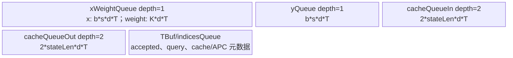
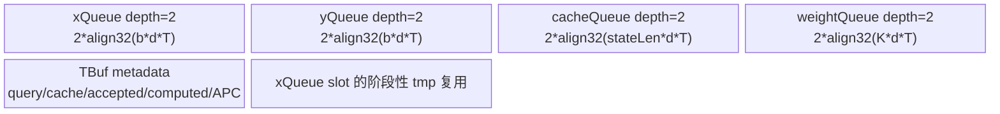

# InplaceFusedCausalConv1d 950 ACLNN 算子知识

## 算子速览

| 项目 | 内容 |
|---|---|
| 实际入口 | `aclnnInplaceFusedCausalConv1dGetWorkspaceSize` / `aclnnInplaceFusedCausalConv1d` |
| 计算语义 | 读取短窗 `x` 与历史 `convStates`，按 `weight` 做逐通道因果一维卷积，同时原地更新 `x` 与状态缓存 |
| 输入输出 | 12 个 tensor 参数、7 个 int64 属性；`x`、`convStates` 同时是输入和输出 |
| 执行类型 | `AIV_VECTOR`（entry 声明 `KERNEL_TYPE_AIV_ONLY`） |
| Kernel 路线 | R-001 BH（3D 或短 2D）；R-002 BSH（长 2D） |
| 核心资源 | GM、UB/TQue/TBuf；BSH 申请 16 MiB system workspace 与 `align32(T*xStride*2)` 的原地结果空间 |
| 来源闭包 | `source_closed`：公开 ACLNN→L0 launcher→wrapper→BH/BSH Tiling→两套 POD→四 key router→两 body/Vector helper→构建接线 |
| 验证状态 | 已完成固定提交的静态源码闭包；按任务约束未执行编译、测试、知识 validator 或 review。 |

## 接口与语义

### 计算语义

对每个有效 token 和通道，按 `K=3` 的逐通道因果卷积计算历史状态与当前 `x` 的加权和。普通模式从 `convStates` 读取前两项历史状态并追加当前 token；`convMode=1` 时根据 `numComputedTokens` 对 Pangu-v2 前缀补零；`residualConnection=1` 时再加当前 `x`。MTP/APC 元数据决定 token 到 cache line/block 的映射。接口最终把卷积结果写回 `x`，并原地更新 `convStates`。

### 输入、输出与属性

| 参数 | shape/layout | dtype | 约束、默认值与语义 |
|---|---|---|---|
| `x` | 3D `[B,m+1,D]`，`m∈[0,7]`；或 2D `[T,D]` | FP16/BF16 | 可非连续，API 用原 storage/stride 建 View；公开约束 `D∈[64,16384]` 且为 16 的倍数；同时为 `outputX` |
| `weight` | `[3,D]` | 与 `x` 相同 | 不支持非连续；API 强制 `Contiguous`；公开卷积宽度固定为 3 |
| `convStates` | 3D cache，第二维为 `stateLen` | 与 `x` 相同 | 可非连续 View；`stateLen>=K+S-2`（短 3D）或至少容纳两项历史；同时为状态输出 |
| `queryStartLoc` | 2D packed 时 `[B+1]` | INT32 | 2D 输入必需；非空时连续化，描述每个 batch 的 token 起止位置 |
| `cacheIndices` | 可选 `[B]` 或 `[B,maxNumBlocks]` | INT32 | 2D 形式开启 APC；公开 `maxNumBlocks∈[1,1024]` |
| `initialStateMode`,`bias` | 可选 tensor | INT32 / 与 `x` 相同 | 公共文档标为不支持；API 仍连续化并传给底层节点，但固定 entry 的两 body `Init` 未接收这两个地址 |
| `numAcceptedTokens` | 可选 `[B]` | INT32 | MTP 接受 token 数；参数表给出 `1<=value<=seqLen`，约束段另写 `value<=seqLen-1`，固定源码未消解此文档冲突 |
| `numComputedTokens` | 可选 `[B]` | INT32 | APC/Pangu 状态初始化依据；公开取值不小于 0，`convMode=1` 时必需 |
| `blockIdxFirstScheduledToken`,`blockIdxLastScheduledToken`,`initialStateIdx` | 可选 `[B]` | INT32 | APC 调度/初始状态映射，非空则连续化 |
| `activationMode`,`padSlotId`,`runMode`,`maxQueryLen`,`residualConnection`,`blockSize`,`convMode` | 标量 | int64 | `activationMode`、`runMode` 文档标为不支持；`maxQueryLen` 应等于 batch 最大序列长度；APC 的 `blockSize>=2`；wrapper 用 `maxQueryLen` 选路，body 使用 pad/residual/block/conv 字段 |
| 输出 | `convStates`,`x` | 原 dtype/layout | 原地输出；ACLNN DFX_OUT 明确列出两者 |

### 入口与版本

固定提交的 README、接口文档、`op_api` 只公开无版本后缀的 `aclnnInplaceFusedCausalConv1dGetWorkspaceSize` 与 `aclnnInplaceFusedCausalConv1d`，因此它们是 950 的最新公开入口。第一段创建 `x`/`convStates` View，只对 `weight` 与非空可选 tensor 做 `Contiguous`，再构造 `l0op::InplaceFusedCausalConv1d`；L0 用 `ADD_TO_LAUNCHER_LIST_AICORE` 入队并把 `convStates`、`x` 声明为输出；第二段调用 `CommonOpExecutorRun`。OpDef 只为 `ascend950` 注册 `_apt` 实现，README/文档均将 950PR/950DT 列为支持平台。

## Host/Launcher 执行流程

### 参数校验与前处理

API 的显式失败点是 executor、两个 View、weight Contiguous、L0 节点创建；非空可选 tensor 的 `ensureContiguous` 返回值没有在 CommonProcess 中逐项显式复查。shape/dtype/属性校验集中在 Tiling：公共 2D 约束包括 `T∈[B,1048576]`、`B∈[1,256]`、`D∈[64,16384]` 且为 16 的倍数、`T*D∈[64*B,4G]`；短 2D 的各序列长度为 1～8。wrapper 读取 `x` 原始 rank 和 attrs[3] 的 `maxQueryLen`：3D 必走 BH；2D 且 `maxQueryLen<=8` 走 BH；其余情况先交给 BSH，再由其 `IsCapable` 拒绝非法 rank/短序列。

### 参数、Workspace 与生命周期

公共 `TilingBaseClass::DoTiling` 顺序为 `GetShapeAttrsInfo→GetPlatformInfo→IsCapable→DoOpTiling→DoLibApiTiling→GetWorkspaceSize→PostTiling→SetTilingKey`。BH `PostTiling` memcpy `FusedCausalConv1dCutBHTilingData` 并设置 block dim；其 workspace 仅采用平台 libapi 大小，body 不读取。BSH 申请 `16 MiB + align32(cuSeqLen*xStride*sizeof(T))`；Host 注释称 y backup 位于 system workspace 之后，但固定 body 实际把传入 workspace 首地址直接绑定为 `yGM`，未加 16 MiB 偏移。因而 Device 可见的 y backup 区为首地址起的 `cuSeqLen*xStride*sizeof(T)` 字节，剩余 system 区的 runtime 归属/放置未在固定源码中闭合；不能把 Host 注释当成 Device 地址事实。所有核完成结果暂存与延迟 cache 更新后，`CopyYToX` 才将结果搬回原 `x`。

### 启动图与失败传播

```text
ACLNN View/Contiguous -> l0op::InplaceFusedCausalConv1d
  -> TilingInplaceFusedCausalConv1d
     -> FusedCausalConv1dCutBHTiling(context,true)::DoTiling
     -> FusedCausalConv1dCutBSHTiling(context,true)::DoTiling
  -> inplace_fused_causal_conv1d(key) -> 对应 AIV body
```

该图只有一个 Device Kernel 节点；BH/BSH 是同一入口内按 key 二选一的 body，不构成多 Kernel 流水。

| 节点 | producer/提交点 | blockDim | stream/依赖 | 输出与生命周期 |
|---|---|---:|---|---|
| Host Tiling | `ADD_TO_LAUNCHER_LIST_AICORE` 注册的 L0 节点调用 wrapper | BH=`usedCoreNum`；BSH=`realCoreNum` | workspace-size 阶段生成 executor | 生成 key、POD、workspace size，不启动第二个 Device 节点 |
| K-001 `inplace_fused_causal_conv1d` | executor 在第二段 `CommonOpExecutorRun` 提交 | 取 Host 设置值 | 使用调用方传入的同一 stream；无前后 Kernel 边 | BH 直接更新 `x/convStates`；BSH 在本 Kernel 内经 workspace、`SyncAll` 后更新二者 |

唯一边为 Host executor→K-001；不存在 Device Kernel→Kernel 的 workspace/event 边。BSH workspace 是 K-001 的核内 GM 暂存，不是多节点中间张量。

空 `x`/`weight`/`convStates` 由公开接口返回 `ACLNN_ERR_PARAM_NULLPTR`（161001）；L0/Tiling 失败由 CommonProcess 映射为 `ACLNN_ERR_INNER_TILING_ERROR`（561002）。第二阶段只执行 `CommonOpExecutorRun`。entry 仅处理 10000、10001、20000、20001 四个 key，不存在未命中 key 的 fallback。

## Route 与参数设计

### 分核与资源计算

BH 以 `dimCoreCnt*batchCoreCnt=usedCoreNum` 做二维分核，dim 按 128 元素块处理，分别记录 main/tail core 的 batch、dim 长度与 UB loop。BSH 以 `dimCoreNum*bsCoreNum=realCoreNum` 分核，分别记录 dim 与 BS 的 remainder core/factor；最后 dim 核另用 `dimRemainderElems` 四字段处理非 128 整除尾部。

### Route 选择

| 顺序 | Route | Key/模板 | 精确选择条件与优先级 | 不适用去向 |
|---:|---|---|---|---|
| 1 | R-001 BH | 20000 BF16 / 20001 FP16 | wrapper 谓词为 `rank==3 \|\| (rank==2 && maxQueryLen<=8)`；进入后还要通过 BH shape/dtype/resource 校验 | wrapper 谓词为假时才尝试 R-002 |
| 2 | R-002 BSH | 10000 BF16 / 10001 FP16 | wrapper 的 else 分支；BSH `IsCapable` 只接受 rank2，并拒绝 `maxQueryLen∈[1,8]`。在公开合法域内等价于 rank2 且 `maxQueryLen>8` | 非 rank2、短序列、非法 dtype 或资源不足均失败 |

```text
x.rank=3 --------------------------> BH 20000/20001
x.rank=2 && maxQueryLen<=8 --------> BH 20000/20001
x.rank=2 && maxQueryLen>8 ---------> BSH 10000/10001
其它 rank/dtype/resource ----------> Host 失败
```

`maxQueryLen` 缺失时 wrapper 使用默认 0，rank2 会进入 BH 并被 BH 校验拒绝；负值同样会进入 BH 并失败。虽然公共文档把 `-1` 列为属性可选值，固定实现不能据此形成可执行 Route，这是文档与该 Commit 实现之间的边界。

### 模板/实现执行矩阵

| Route | key/selector | dtype/shape/platform 完整命中条件 | 执行拓扑与 Kernel 节点 | 实际模板/body | 内存与同步特征 | tail/fallback |
|---|---|---|---|---|---|---|
| R-001 BH | 20000 | BF16；rank3 或 rank2 且 `maxQueryLen<=8`；ascend950；通过 BH 校验 | 单节点 K-001；`blockDim=usedCoreNum` | `FusedCausalConv1dCutBHTiling(context,true)`→`FusedCausalConv1dCutBH<bfloat16_t>`→四个 Vector helper | batch×dim 分核；x/y depth1、cache depth2；无跨核屏障 | 64/128 tail；失败不改投 BSH |
| R-001 BH | 20001 | FP16；rank3 或 rank2 且 `maxQueryLen<=8`；ascend950；通过 BH 校验 | 单节点 K-001；`blockDim=usedCoreNum` | `FusedCausalConv1dCutBHTiling(context,true)`→`FusedCausalConv1dCutBH<half>`→四个 Vector helper | batch×dim 分核；x/y depth1、cache depth2；无跨核屏障 | 64/128 tail；失败不改投 BSH |
| R-002 BSH | 10000 | BF16；rank2 且 `maxQueryLen>8`；ascend950；通过 BSH 校验 | 单节点 K-001；`blockDim=realCoreNum` | `FusedCausalConv1dCutBSHTiling(context,true)`→`FusedCausalConv1dCutBSH<bfloat16_t>`→四个 Vector helper | 重叠 BS×dim 分核；四队列 depth2；同一节点内 deferred cache + `SyncAll` | 64/128 tail；失败无 fallback |
| R-002 BSH | 10001 | FP16；rank2 且 `maxQueryLen>8`；ascend950；通过 BSH 校验 | 单节点 K-001；`blockDim=realCoreNum` | `FusedCausalConv1dCutBSHTiling(context,true)`→`FusedCausalConv1dCutBSH<half>`→四个 Vector helper | 重叠 BS×dim 分核；四队列 depth2；同一节点内 deferred cache + `SyncAll` | 64/128 tail；失败无 fallback |

### 隐藏性能 Guard

| Guard | Host/Tiling 条件 | Device/资源原因 | 影响 Route | 不满足时去向 | 源码符号 |
|---|---|---|---|---|---|
| 平台与 dtype | OpDef 只注册 `ascend950`；Tiling 只接受 BF16/FP16 | entry 只有四个 AIV 实例 | R-001/R-002 | Host/Tiling 失败，无 key | `InplaceFusedCausalConv1d::OpDef`、两类 `GetTilingKey` |
| BH dim 粒度 | `D<1024` 用 128 元素块；否则先用 1024 coarse block | 小 D 增加 dim 并行，大 D 降低分核开销 | R-001 | 余 dim 进入 128 粒度尾核/helper | `FusedCausalConv1dCutBHTiling::CalcCoreTiling` |
| BH 核数搜索 | 在 AIV 核数与 `ceil(B*D*2/blockBytes)` 上限内最大化 dim×batch 核数 | 平衡 batch 与 dim 并行，核间 slice 不重叠 | R-001 | 使用可得的较小核数组合 | `CalcCoreTiling/FindBestCoreSplit` |
| BH UB 可用量 | `UB_SIZE-8 KiB-metadata` 反推 BS factor | x/y/cache/weight 必须同时驻留 | R-001 | tile 变小；源码无负剩余量专门分支 | `CalcUBTiling` |
| BSH 重叠 BS 分核 | `effectiveTotal=T+(bsCoreNum-1)*(K-1)`；非首核跳过重叠前缀 | 相邻核需要本地卷积历史 | R-002 | 搜索更少 BS 核；极限 tile 无显式 step guard | `CalcCoreTiling/Process` |
| BSH UB 搜索 | 可用量大于 0，计入四组 depth-2 queue | 双缓冲需要成对 slot | R-002 | `availableUb<=0` 时失败，否则缩小 dim/BS tile | `CalcCoreUbTiling` |
| APC/MTP | 2D `cacheIndices` 启用 APC，相关元数据和 blockSize 通过校验 | block cache 地址与 deferred 写依赖这些字段 | R-001/R-002 | 缺失/非法时 Tiling 失败 | 两类 `CheckApc*/GetShapeAttrsInfo` |
| Vector 尾块 | 有状态余 dim 走 single-tail；无状态余数 `<=64`/`>64` 分流 | Vector 寄存器以 64 float lane、128 T 元素为处理粒度 | R-001/R-002 | 用 `UpdateMask`；D 非 16 倍数在 Host 失败 | `Compute`、四个 `vf` helper |

### POD/ABI

两结构都是显式标准布局 struct；BH 为 48 个连续 `int64_t`（384B，字段 offset 按声明顺序每次 +8），BSH 为 43 个连续 64 位字段（344B；除 `padSlotId` 为 int64，其余 uint64）。下表逐字段列出所有成员。

producer 的逐字段表达式均位于各自 `PostTiling`：除 BSH `stateLen=cacheStatesShape_.GetDim(DIM_1)` 外，源码统一为 `tilingData_.<field>=<field>_`，随后 memcpy 整个 POD，并以 `usedCoreNum_`/`realCoreNum_` 设置 block dim。entry 用 `REGISTER_TILING_DEFAULT` 按 key 注册对应 POD，body `InitParams` 再从 `tiling-><field>` 读取；BSH 多个 64 位字段随后窄化到 `uint32_t` 成员，BH 的 `padSlotId` 还窄化到 `int8_t`。下表 producer 列的 `PostTiling` 均指这一精确同名赋值，不代表隐式推导。

| 结构 | 字段 | 类型/位宽 | ABI 布局 | 单位 | Host/launcher producer | Device consumer | 边界 |
|---|---|---|---|---|---|---|---|
| `FusedCausalConv1dCutBHTilingData` | `usedCoreNum` | int64_t/64 | `sizeof=384, alignof=8, offsetof=0` | 核 | `FusedCausalConv1dCutBHTiling::PostTiling` | `FusedCausalConv1dCutBH::Process 分核/循环` | 不超过平台可用 AIV 核 |
| `FusedCausalConv1dCutBHTilingData` | `dimCoreCnt` | int64_t/64 | `sizeof=384, alignof=8, offsetof=8` | 核 | `FusedCausalConv1dCutBHTiling::PostTiling` | `FusedCausalConv1dCutBH::Process 分核/循环` | 不超过平台可用 AIV 核 |
| `FusedCausalConv1dCutBHTilingData` | `batchCoreCnt` | int64_t/64 | `sizeof=384, alignof=8, offsetof=16` | 核 | `FusedCausalConv1dCutBHTiling::PostTiling` | `FusedCausalConv1dCutBH::Process 分核/循环` | 不超过平台可用 AIV 核 |
| `FusedCausalConv1dCutBHTilingData` | `dimMainCoreCnt` | int64_t/64 | `sizeof=384, alignof=8, offsetof=24` | 核 | `FusedCausalConv1dCutBHTiling::PostTiling` | `FusedCausalConv1dCutBH::Process 分核/循环` | 不超过平台可用 AIV 核 |
| `FusedCausalConv1dCutBHTilingData` | `dimTailCoreCnt` | int64_t/64 | `sizeof=384, alignof=8, offsetof=32` | 核 | `FusedCausalConv1dCutBHTiling::PostTiling` | `FusedCausalConv1dCutBH::Process 分核/循环` | 不得超过对应 main/factor |
| `FusedCausalConv1dCutBHTilingData` | `mainCoredimLen` | int64_t/64 | `sizeof=384, alignof=8, offsetof=40` | dim 元素/核 | `FusedCausalConv1dCutBHTiling::PostTiling` | `FusedCausalConv1dCutBH::Process 分核/循环` | 128 对齐；大 D 可含 1024 coarse block |
| `FusedCausalConv1dCutBHTilingData` | `tailCoredimLen` | int64_t/64 | `sizeof=384, alignof=8, offsetof=48` | dim 元素/核 | `FusedCausalConv1dCutBHTiling::PostTiling` | `FusedCausalConv1dCutBH::Process 分核/循环` | 不大于 main core dim 长度 |
| `FusedCausalConv1dCutBHTilingData` | `batchMainCoreCnt` | int64_t/64 | `sizeof=384, alignof=8, offsetof=56` | 核 | `FusedCausalConv1dCutBHTiling::PostTiling` | `FusedCausalConv1dCutBH::Process 分核/循环` | 不超过平台可用 AIV 核 |
| `FusedCausalConv1dCutBHTilingData` | `batchTailCoreCnt` | int64_t/64 | `sizeof=384, alignof=8, offsetof=64` | 核 | `FusedCausalConv1dCutBHTiling::PostTiling` | `FusedCausalConv1dCutBH::Process 分核/循环` | 不得超过对应 main/factor |
| `FusedCausalConv1dCutBHTilingData` | `mainCoreBatchNum` | int64_t/64 | `sizeof=384, alignof=8, offsetof=72` | batch/核 | `FusedCausalConv1dCutBHTiling::PostTiling` | `FusedCausalConv1dCutBH::Process 分核/循环` | 与 batch 主核数共同覆盖 B |
| `FusedCausalConv1dCutBHTilingData` | `tailCoreBatchNum` | int64_t/64 | `sizeof=384, alignof=8, offsetof=80` | batch/核 | `FusedCausalConv1dCutBHTiling::PostTiling` | `FusedCausalConv1dCutBH::Process 分核/循环` | 不大于 mainCoreBatchNum |
| `FusedCausalConv1dCutBHTilingData` | `loopNumBS` | int64_t/64 | `sizeof=384, alignof=8, offsetof=88` | loop | `FusedCausalConv1dCutBHTiling::PostTiling` | `FusedCausalConv1dCutBH::Process 分核/循环` | 非负；地址乘加不得溢出 |
| `FusedCausalConv1dCutBHTilingData` | `loopNumDim` | int64_t/64 | `sizeof=384, alignof=8, offsetof=96` | loop | `FusedCausalConv1dCutBHTiling::PostTiling` | `FusedCausalConv1dCutBH::Process 分核/循环` | 非负；地址乘加不得溢出 |
| `FusedCausalConv1dCutBHTilingData` | `ubMainFactorBS` | int64_t/64 | `sizeof=384, alignof=8, offsetof=104` | 元素 | `FusedCausalConv1dCutBHTiling::PostTiling` | `FusedCausalConv1dCutBH::Process 分核/循环` | 非负；地址乘加不得溢出 |
| `FusedCausalConv1dCutBHTilingData` | `ubTailFactorBS` | int64_t/64 | `sizeof=384, alignof=8, offsetof=112` | 元素 | `FusedCausalConv1dCutBHTiling::PostTiling` | `FusedCausalConv1dCutBH::Process 分核/循环` | 不得超过对应 main/factor |
| `FusedCausalConv1dCutBHTilingData` | `ubMainFactorDim` | int64_t/64 | `sizeof=384, alignof=8, offsetof=120` | 元素 | `FusedCausalConv1dCutBHTiling::PostTiling` | `FusedCausalConv1dCutBH::Process 分核/循环` | 非负；地址乘加不得溢出 |
| `FusedCausalConv1dCutBHTilingData` | `ubTailFactorDim` | int64_t/64 | `sizeof=384, alignof=8, offsetof=128` | 元素 | `FusedCausalConv1dCutBHTiling::PostTiling` | `FusedCausalConv1dCutBH::Process 分核/循环` | 不得超过对应 main/factor |
| `FusedCausalConv1dCutBHTilingData` | `tailBlockloopNumBS` | int64_t/64 | `sizeof=384, alignof=8, offsetof=136` | loop | `FusedCausalConv1dCutBHTiling::PostTiling` | `FusedCausalConv1dCutBH::Process 分核/循环` | 不得超过对应 main/factor |
| `FusedCausalConv1dCutBHTilingData` | `tailBlockloopNumDim` | int64_t/64 | `sizeof=384, alignof=8, offsetof=144` | loop | `FusedCausalConv1dCutBHTiling::PostTiling` | `FusedCausalConv1dCutBH::Process 分核/循环` | 不得超过对应 main/factor |
| `FusedCausalConv1dCutBHTilingData` | `tailBlockubFactorBS` | int64_t/64 | `sizeof=384, alignof=8, offsetof=152` | 元素 | `FusedCausalConv1dCutBHTiling::PostTiling` | `FusedCausalConv1dCutBH::Process 分核/循环` | 不得超过对应 main/factor |
| `FusedCausalConv1dCutBHTilingData` | `tailBlockubTailFactorBS` | int64_t/64 | `sizeof=384, alignof=8, offsetof=160` | 元素 | `FusedCausalConv1dCutBHTiling::PostTiling` | `FusedCausalConv1dCutBH::Process 分核/循环` | 不得超过对应 main/factor |
| `FusedCausalConv1dCutBHTilingData` | `tailBlockubFactorDim` | int64_t/64 | `sizeof=384, alignof=8, offsetof=168` | 元素 | `FusedCausalConv1dCutBHTiling::PostTiling` | `FusedCausalConv1dCutBH::Process 分核/循环` | 不得超过对应 main/factor |
| `FusedCausalConv1dCutBHTilingData` | `tailBlockubTailFactorDim` | int64_t/64 | `sizeof=384, alignof=8, offsetof=176` | 元素 | `FusedCausalConv1dCutBHTiling::PostTiling` | `FusedCausalConv1dCutBH::Process 分核/循环` | 不得超过对应 main/factor |
| `FusedCausalConv1dCutBHTilingData` | `batchSize` | int64_t/64 | `sizeof=384, alignof=8, offsetof=184` | 元素 | `FusedCausalConv1dCutBHTiling::PostTiling` | `FusedCausalConv1dCutBH::Init/Compute 地址计算` | 非负；地址乘加不得溢出 |
| `FusedCausalConv1dCutBHTilingData` | `seqLen` | int64_t/64 | `sizeof=384, alignof=8, offsetof=192` | 元素 | `FusedCausalConv1dCutBHTiling::PostTiling` | `FusedCausalConv1dCutBH::Init/Compute 地址计算` | 非负；地址乘加不得溢出 |
| `FusedCausalConv1dCutBHTilingData` | `cuSeqLen` | int64_t/64 | `sizeof=384, alignof=8, offsetof=200` | 元素 | `FusedCausalConv1dCutBHTiling::PostTiling` | `FusedCausalConv1dCutBH::Init/Compute 地址计算` | 非负；地址乘加不得溢出 |
| `FusedCausalConv1dCutBHTilingData` | `dim` | int64_t/64 | `sizeof=384, alignof=8, offsetof=208` | 元素 | `FusedCausalConv1dCutBHTiling::PostTiling` | `FusedCausalConv1dCutBH::Init/Compute 地址计算` | 非负；地址乘加不得溢出 |
| `FusedCausalConv1dCutBHTilingData` | `kernelSize` | int64_t/64 | `sizeof=384, alignof=8, offsetof=216` | 元素 | `FusedCausalConv1dCutBHTiling::PostTiling` | `FusedCausalConv1dCutBH::Init/Compute 地址计算` | 非负；地址乘加不得溢出 |
| `FusedCausalConv1dCutBHTilingData` | `stateLen` | int64_t/64 | `sizeof=384, alignof=8, offsetof=224` | 元素 | `FusedCausalConv1dCutBHTiling::PostTiling` | `FusedCausalConv1dCutBH::Init/Compute 地址计算` | 非负；地址乘加不得溢出 |
| `FusedCausalConv1dCutBHTilingData` | `xStride` | int64_t/64 | `sizeof=384, alignof=8, offsetof=232` | 元素 stride | `FusedCausalConv1dCutBHTiling::PostTiling` | `FusedCausalConv1dCutBH::Init/Compute 地址计算` | 非负；地址乘加不得溢出 |
| `FusedCausalConv1dCutBHTilingData` | `cacheStride0` | int64_t/64 | `sizeof=384, alignof=8, offsetof=240` | 元素 stride | `FusedCausalConv1dCutBHTiling::PostTiling` | `FusedCausalConv1dCutBH::Init/Compute 地址计算` | 非负；地址乘加不得溢出 |
| `FusedCausalConv1dCutBHTilingData` | `cacheStride1` | int64_t/64 | `sizeof=384, alignof=8, offsetof=248` | 元素 stride | `FusedCausalConv1dCutBHTiling::PostTiling` | `FusedCausalConv1dCutBH::Init/Compute 地址计算` | 非负；地址乘加不得溢出 |
| `FusedCausalConv1dCutBHTilingData` | `padSlotId` | int64_t/64 | `sizeof=384, alignof=8, offsetof=256` | cache id | `FusedCausalConv1dCutBHTiling::PostTiling` | `FusedCausalConv1dCutBH::Init` 窄化为 int8，`Compute` 比较 | 默认 -1；超过 int8 范围会窄化，固定源码无额外 guard |
| `FusedCausalConv1dCutBHTilingData` | `xInputMode` | int64_t/64 | `sizeof=384, alignof=8, offsetof=264` | 模式 | `FusedCausalConv1dCutBHTiling::PostTiling` | `FusedCausalConv1dCutBH::Compute 语义分支` | 0=3D，1=2D |
| `FusedCausalConv1dCutBHTilingData` | `hasAcceptTokenNum` | int64_t/64 | `sizeof=384, alignof=8, offsetof=272` | 标志/枚举 | `FusedCausalConv1dCutBHTiling::PostTiling` | `FusedCausalConv1dCutBH::Compute 语义分支` | 0 或 1 |
| `FusedCausalConv1dCutBHTilingData` | `residualConnection` | int64_t/64 | `sizeof=384, alignof=8, offsetof=280` | 标志/枚举 | `FusedCausalConv1dCutBHTiling::PostTiling` | `FusedCausalConv1dCutBH::Compute 语义分支` | 0 或 1 |
| `FusedCausalConv1dCutBHTilingData` | `apcEnable` | int64_t/64 | `sizeof=384, alignof=8, offsetof=288` | 标志/枚举 | `FusedCausalConv1dCutBHTiling::PostTiling` | `FusedCausalConv1dCutBH::Compute 语义分支` | 0 或 1 |
| `FusedCausalConv1dCutBHTilingData` | `blockSize` | int64_t/64 | `sizeof=384, alignof=8, offsetof=296` | 元素 | `FusedCausalConv1dCutBHTiling::PostTiling` | `FusedCausalConv1dCutBH::Init/Compute 地址计算` | 非负；地址乘加不得溢出 |
| `FusedCausalConv1dCutBHTilingData` | `maxNumBlocks` | int64_t/64 | `sizeof=384, alignof=8, offsetof=304` | 元素 | `FusedCausalConv1dCutBHTiling::PostTiling` | `FusedCausalConv1dCutBH::Init/Compute 地址计算` | 非负；地址乘加不得溢出 |
| `FusedCausalConv1dCutBHTilingData` | `hasCacheIndices` | int64_t/64 | `sizeof=384, alignof=8, offsetof=312` | 标志/枚举 | `FusedCausalConv1dCutBHTiling::PostTiling` | `FusedCausalConv1dCutBH::Compute 语义分支` | 0 或 1 |
| `FusedCausalConv1dCutBHTilingData` | `inplace` | int64_t/64 | `sizeof=384, alignof=8, offsetof=320` | 标志/枚举 | `FusedCausalConv1dCutBHTiling::PostTiling` | `FusedCausalConv1dCutBH::Compute 语义分支` | 0 或 1 |
| `FusedCausalConv1dCutBHTilingData` | `convMode` | int64_t/64 | `sizeof=384, alignof=8, offsetof=328` | 标志/枚举 | `FusedCausalConv1dCutBHTiling::PostTiling` | `FusedCausalConv1dCutBH::Compute 语义分支` | 非负；地址乘加不得溢出 |
| `FusedCausalConv1dCutBHTilingData` | `hasNumComputedTokens` | int64_t/64 | `sizeof=384, alignof=8, offsetof=336` | 标志/枚举 | `FusedCausalConv1dCutBHTiling::PostTiling` | `FusedCausalConv1dCutBH::Compute 语义分支` | 0 或 1 |
| `FusedCausalConv1dCutBHTilingData` | `maxQueryLen` | int64_t/64 | `sizeof=384, alignof=8, offsetof=344` | 元素 | `FusedCausalConv1dCutBHTiling::PostTiling` | `FusedCausalConv1dCutBH::Init/Compute 地址计算` | 非负；地址乘加不得溢出 |
| `FusedCausalConv1dCutBHTilingData` | `dimRemainderElems` | int64_t/64 | `sizeof=384, alignof=8, offsetof=352` | 元素 | `FusedCausalConv1dCutBHTiling::PostTiling` | `FusedCausalConv1dCutBH::Process 分核/循环` | 不得超过对应 main/factor |
| `FusedCausalConv1dCutBHTilingData` | `lastCoreloopNumDim` | int64_t/64 | `sizeof=384, alignof=8, offsetof=360` | loop | `FusedCausalConv1dCutBHTiling::PostTiling` | `FusedCausalConv1dCutBH::Process 分核/循环` | 不得超过对应 main/factor |
| `FusedCausalConv1dCutBHTilingData` | `lastCoreubMainFactorDim` | int64_t/64 | `sizeof=384, alignof=8, offsetof=368` | dim 元素/tile | `FusedCausalConv1dCutBHTiling::PostTiling` | `FusedCausalConv1dCutBH::Process 分核/循环` | 最后 dim 核专用 |
| `FusedCausalConv1dCutBHTilingData` | `lastCoreubTailFactorDim` | int64_t/64 | `sizeof=384, alignof=8, offsetof=376` | dim 元素/tile | `FusedCausalConv1dCutBHTiling::PostTiling` | `FusedCausalConv1dCutBH::Process 分核/循环` | 不大于 lastCoreubMainFactorDim |
| `FusedCausalConv1dCutBSHTilingData` | `loopNumBS` | uint64_t/64 | `sizeof=344, alignof=8, offsetof=0` | loop | `FusedCausalConv1dCutBSHTiling::PostTiling` | `FusedCausalConv1dCutBSH::Process 分核/循环` | 非负；地址乘加不得溢出 |
| `FusedCausalConv1dCutBSHTilingData` | `loopNumDim` | uint64_t/64 | `sizeof=344, alignof=8, offsetof=8` | loop | `FusedCausalConv1dCutBSHTiling::PostTiling` | `FusedCausalConv1dCutBSH::Process 分核/循环` | 非负；地址乘加不得溢出 |
| `FusedCausalConv1dCutBSHTilingData` | `ubFactorBS` | uint64_t/64 | `sizeof=344, alignof=8, offsetof=16` | 元素 | `FusedCausalConv1dCutBSHTiling::PostTiling` | `FusedCausalConv1dCutBSH::Process 分核/循环` | 非负；地址乘加不得溢出 |
| `FusedCausalConv1dCutBSHTilingData` | `ubTailFactorBS` | uint64_t/64 | `sizeof=344, alignof=8, offsetof=24` | 元素 | `FusedCausalConv1dCutBSHTiling::PostTiling` | `FusedCausalConv1dCutBSH::Process 分核/循环` | 不得超过对应 main/factor |
| `FusedCausalConv1dCutBSHTilingData` | `ubFactorDim` | uint64_t/64 | `sizeof=344, alignof=8, offsetof=32` | 元素 | `FusedCausalConv1dCutBSHTiling::PostTiling` | `FusedCausalConv1dCutBSH::Process 分核/循环` | 非负；地址乘加不得溢出 |
| `FusedCausalConv1dCutBSHTilingData` | `ubTailFactorDim` | uint64_t/64 | `sizeof=344, alignof=8, offsetof=40` | 元素 | `FusedCausalConv1dCutBSHTiling::PostTiling` | `FusedCausalConv1dCutBSH::Process 分核/循环` | 不得超过对应 main/factor |
| `FusedCausalConv1dCutBSHTilingData` | `tailBlockloopNumBS` | uint64_t/64 | `sizeof=344, alignof=8, offsetof=48` | loop | `FusedCausalConv1dCutBSHTiling::PostTiling` | `FusedCausalConv1dCutBSH::Process 分核/循环` | 不得超过对应 main/factor |
| `FusedCausalConv1dCutBSHTilingData` | `tailBlockloopNumDim` | uint64_t/64 | `sizeof=344, alignof=8, offsetof=56` | loop | `FusedCausalConv1dCutBSHTiling::PostTiling` | `FusedCausalConv1dCutBSH::Process 分核/循环` | 不得超过对应 main/factor |
| `FusedCausalConv1dCutBSHTilingData` | `tailBlockubFactorBS` | uint64_t/64 | `sizeof=344, alignof=8, offsetof=64` | 元素 | `FusedCausalConv1dCutBSHTiling::PostTiling` | `FusedCausalConv1dCutBSH::Process 分核/循环` | 不得超过对应 main/factor |
| `FusedCausalConv1dCutBSHTilingData` | `tailBlockubTailFactorBS` | uint64_t/64 | `sizeof=344, alignof=8, offsetof=72` | 元素 | `FusedCausalConv1dCutBSHTiling::PostTiling` | `FusedCausalConv1dCutBSH::Process 分核/循环` | 不得超过对应 main/factor |
| `FusedCausalConv1dCutBSHTilingData` | `tailBlockubFactorDim` | uint64_t/64 | `sizeof=344, alignof=8, offsetof=80` | 元素 | `FusedCausalConv1dCutBSHTiling::PostTiling` | `FusedCausalConv1dCutBSH::Process 分核/循环` | 不得超过对应 main/factor |
| `FusedCausalConv1dCutBSHTilingData` | `tailBlockubTailFactorDim` | uint64_t/64 | `sizeof=344, alignof=8, offsetof=88` | 元素 | `FusedCausalConv1dCutBSHTiling::PostTiling` | `FusedCausalConv1dCutBSH::Process 分核/循环` | 不得超过对应 main/factor |
| `FusedCausalConv1dCutBSHTilingData` | `dimCoreNum` | uint64_t/64 | `sizeof=344, alignof=8, offsetof=96` | 核 | `FusedCausalConv1dCutBSHTiling::PostTiling` | `FusedCausalConv1dCutBSH::Process 分核/循环` | 不超过平台可用 AIV 核 |
| `FusedCausalConv1dCutBSHTilingData` | `dimRemainderCores` | uint64_t/64 | `sizeof=344, alignof=8, offsetof=104` | 核 | `FusedCausalConv1dCutBSHTiling::PostTiling` | `FusedCausalConv1dCutBSH::Process 分核/循环` | 不得超过对应 main/factor |
| `FusedCausalConv1dCutBSHTilingData` | `dimBlockFactor` | uint64_t/64 | `sizeof=344, alignof=8, offsetof=112` | 元素 | `FusedCausalConv1dCutBSHTiling::PostTiling` | `FusedCausalConv1dCutBSH::Process 分核/循环` | 非负；地址乘加不得溢出 |
| `FusedCausalConv1dCutBSHTilingData` | `dimBlockTailFactor` | uint64_t/64 | `sizeof=344, alignof=8, offsetof=120` | 元素 | `FusedCausalConv1dCutBSHTiling::PostTiling` | `FusedCausalConv1dCutBSH::Process 分核/循环` | 不得超过对应 main/factor |
| `FusedCausalConv1dCutBSHTilingData` | `bsCoreNum` | uint64_t/64 | `sizeof=344, alignof=8, offsetof=128` | 核 | `FusedCausalConv1dCutBSHTiling::PostTiling` | `FusedCausalConv1dCutBSH::Process 分核/循环` | 不超过平台可用 AIV 核 |
| `FusedCausalConv1dCutBSHTilingData` | `bsRemainderCores` | uint64_t/64 | `sizeof=344, alignof=8, offsetof=136` | 核 | `FusedCausalConv1dCutBSHTiling::PostTiling` | `FusedCausalConv1dCutBSH::Process 分核/循环` | 不得超过对应 main/factor |
| `FusedCausalConv1dCutBSHTilingData` | `bsBlockFactor` | uint64_t/64 | `sizeof=344, alignof=8, offsetof=144` | 元素 | `FusedCausalConv1dCutBSHTiling::PostTiling` | `FusedCausalConv1dCutBSH::Process 分核/循环` | 非负；地址乘加不得溢出 |
| `FusedCausalConv1dCutBSHTilingData` | `bsBlockTailFactor` | uint64_t/64 | `sizeof=344, alignof=8, offsetof=152` | 元素 | `FusedCausalConv1dCutBSHTiling::PostTiling` | `FusedCausalConv1dCutBSH::Process 分核/循环` | 不得超过对应 main/factor |
| `FusedCausalConv1dCutBSHTilingData` | `realCoreNum` | uint64_t/64 | `sizeof=344, alignof=8, offsetof=160` | 核 | `FusedCausalConv1dCutBSHTiling::PostTiling` | `FusedCausalConv1dCutBSH::Process 分核/循环` | 不超过平台可用 AIV 核 |
| `FusedCausalConv1dCutBSHTilingData` | `kernelWidth` | uint64_t/64 | `sizeof=344, alignof=8, offsetof=168` | 元素 | `FusedCausalConv1dCutBSHTiling::PostTiling` | `FusedCausalConv1dCutBSH::Init/Compute 地址计算` | 非负；地址乘加不得溢出 |
| `FusedCausalConv1dCutBSHTilingData` | `cuSeqLen` | uint64_t/64 | `sizeof=344, alignof=8, offsetof=176` | 元素 | `FusedCausalConv1dCutBSHTiling::PostTiling` | `FusedCausalConv1dCutBSH::Init/Compute 地址计算` | 非负；地址乘加不得溢出 |
| `FusedCausalConv1dCutBSHTilingData` | `dim` | uint64_t/64 | `sizeof=344, alignof=8, offsetof=184` | 元素 | `FusedCausalConv1dCutBSHTiling::PostTiling` | `FusedCausalConv1dCutBSH::Init/Compute 地址计算` | 非负；地址乘加不得溢出 |
| `FusedCausalConv1dCutBSHTilingData` | `batch` | uint64_t/64 | `sizeof=344, alignof=8, offsetof=192` | 元素 | `FusedCausalConv1dCutBSHTiling::PostTiling` | `FusedCausalConv1dCutBSH::Init/Compute 地址计算` | 非负；地址乘加不得溢出 |
| `FusedCausalConv1dCutBSHTilingData` | `padSlotId` | int64_t/64 | `sizeof=344, alignof=8, offsetof=200` | cache id | `FusedCausalConv1dCutBSHTiling::PostTiling` | `FusedCausalConv1dCutBSH::Compute 语义分支` | 默认 -1；保持 int64 比较 |
| `FusedCausalConv1dCutBSHTilingData` | `stateLen` | uint64_t/64 | `sizeof=344, alignof=8, offsetof=208` | 元素 | `FusedCausalConv1dCutBSHTiling::PostTiling` | `FusedCausalConv1dCutBSH::Init/Compute 地址计算` | 非负；地址乘加不得溢出 |
| `FusedCausalConv1dCutBSHTilingData` | `xStride` | uint64_t/64 | `sizeof=344, alignof=8, offsetof=216` | 元素 stride | `FusedCausalConv1dCutBSHTiling::PostTiling` | `FusedCausalConv1dCutBSH::Init/Compute 地址计算` | 非负；地址乘加不得溢出 |
| `FusedCausalConv1dCutBSHTilingData` | `cacheStride0` | uint64_t/64 | `sizeof=344, alignof=8, offsetof=224` | 元素 stride | `FusedCausalConv1dCutBSHTiling::PostTiling` | `FusedCausalConv1dCutBSH::Init/Compute 地址计算` | 非负；地址乘加不得溢出 |
| `FusedCausalConv1dCutBSHTilingData` | `cacheStride1` | uint64_t/64 | `sizeof=344, alignof=8, offsetof=232` | 元素 stride | `FusedCausalConv1dCutBSHTiling::PostTiling` | `FusedCausalConv1dCutBSH::Init/Compute 地址计算` | 非负；地址乘加不得溢出 |
| `FusedCausalConv1dCutBSHTilingData` | `residualConnection` | uint64_t/64 | `sizeof=344, alignof=8, offsetof=240` | 标志/枚举 | `FusedCausalConv1dCutBSHTiling::PostTiling` | `FusedCausalConv1dCutBSH::Compute 语义分支` | 0 或 1 |
| `FusedCausalConv1dCutBSHTilingData` | `apcEnabled` | uint64_t/64 | `sizeof=344, alignof=8, offsetof=248` | 标志/枚举 | `FusedCausalConv1dCutBSHTiling::PostTiling` | `FusedCausalConv1dCutBSH::Compute 语义分支` | 0 或 1 |
| `FusedCausalConv1dCutBSHTilingData` | `blockSize` | uint64_t/64 | `sizeof=344, alignof=8, offsetof=256` | 元素 | `FusedCausalConv1dCutBSHTiling::PostTiling` | `FusedCausalConv1dCutBSH::Init/Compute 地址计算` | 非负；地址乘加不得溢出 |
| `FusedCausalConv1dCutBSHTilingData` | `maxNumBlocks` | uint64_t/64 | `sizeof=344, alignof=8, offsetof=264` | 元素 | `FusedCausalConv1dCutBSHTiling::PostTiling` | `FusedCausalConv1dCutBSH::Init/Compute 地址计算` | 非负；地址乘加不得溢出 |
| `FusedCausalConv1dCutBSHTilingData` | `convMode` | uint64_t/64 | `sizeof=344, alignof=8, offsetof=272` | 标志/枚举 | `FusedCausalConv1dCutBSHTiling::PostTiling` | `FusedCausalConv1dCutBSH::Compute 语义分支` | 非负；地址乘加不得溢出 |
| `FusedCausalConv1dCutBSHTilingData` | `inplace` | uint64_t/64 | `sizeof=344, alignof=8, offsetof=280` | 标志/枚举 | `FusedCausalConv1dCutBSHTiling::PostTiling` | `FusedCausalConv1dCutBSH::Compute 语义分支` | 0 或 1 |
| `FusedCausalConv1dCutBSHTilingData` | `hasAcceptTokenNum` | uint64_t/64 | `sizeof=344, alignof=8, offsetof=288` | 标志/枚举 | `FusedCausalConv1dCutBSHTiling::PostTiling` | `FusedCausalConv1dCutBSH::Compute 语义分支` | 0 或 1 |
| `FusedCausalConv1dCutBSHTilingData` | `hasNumComputedTokens` | uint64_t/64 | `sizeof=344, alignof=8, offsetof=296` | 标志/枚举 | `FusedCausalConv1dCutBSHTiling::PostTiling` | `FusedCausalConv1dCutBSH::Compute 语义分支` | 0 或 1 |
| `FusedCausalConv1dCutBSHTilingData` | `hasCacheIndices` | uint64_t/64 | `sizeof=344, alignof=8, offsetof=304` | 标志/枚举 | `FusedCausalConv1dCutBSHTiling::PostTiling` | `FusedCausalConv1dCutBSH::Compute 语义分支` | 0 或 1 |
| `FusedCausalConv1dCutBSHTilingData` | `dimRemainderElems` | uint64_t/64 | `sizeof=344, alignof=8, offsetof=312` | 元素 | `FusedCausalConv1dCutBSHTiling::PostTiling` | `FusedCausalConv1dCutBSH::Process 分核/循环` | 不得超过对应 main/factor |
| `FusedCausalConv1dCutBSHTilingData` | `lastCoreloopNumDim` | uint64_t/64 | `sizeof=344, alignof=8, offsetof=320` | loop | `FusedCausalConv1dCutBSHTiling::PostTiling` | `FusedCausalConv1dCutBSH::Process 分核/循环` | 不得超过对应 main/factor |
| `FusedCausalConv1dCutBSHTilingData` | `lastCoreubFactorDim` | uint64_t/64 | `sizeof=344, alignof=8, offsetof=328` | dim 元素/tile | `FusedCausalConv1dCutBSHTiling::PostTiling` | `FusedCausalConv1dCutBSH::Process 分核/循环` | 最后 dim 核专用 |
| `FusedCausalConv1dCutBSHTilingData` | `lastCoreubTailFactorDim` | uint64_t/64 | `sizeof=344, alignof=8, offsetof=336` | dim 元素/tile | `FusedCausalConv1dCutBSHTiling::PostTiling` | `FusedCausalConv1dCutBSH::Process 分核/循环` | 不大于 lastCoreubFactorDim |

### Route 源码闭包

| Route | Key/selector | Host/Tiling producer | POD/参数 | Kernel entry/router | Kernel body/直接依赖 | 构建接线 |
|---|---|---|---|---|---|---|
| R-001 BH | rank3 或短 rank2；20000/20001 | wrapper `TilingInplaceFusedCausalConv1d`→`FusedCausalConv1dCutBHTiling::DoTiling/PostTiling` | `FusedCausalConv1dCutBHTilingData` 全字段 | `_apt.cpp::inplace_fused_causal_conv1d` | `fused_causal_conv1d_cut_bh.h::FusedCausalConv1dCutBH<bf16/half>` | inplace Host CMake + entry include dependency body |
| R-002 BSH | 长 rank2；10000/10001 | wrapper→`FusedCausalConv1dCutBSHTiling::DoTiling/GetWorkspaceSize/PostTiling` | `FusedCausalConv1dCutBSHTilingData` 全字段 | 同 entry | `fused_causal_conv1d_cut_bsh.h::FusedCausalConv1dCutBSH<bf16/half>` | 同上 |

## Kernel 实现

### 公共执行流程

entry 声明 `KERNEL_TYPE_AIV_ONLY`，默认注册 BSH POD，并用 `TILING_KEY_VAR>=20000` 改注册 BH POD。四个独立 `TILING_KEY_IS` 分支只改变 body 与 element type；`initialStateMode`、`bias`、`outputConvStates` entry 参数没有传给 body Init，状态通过 `convStates` 地址原地更新。

### Route R-001：BH 短序列 AIV

#### 适用条件

##### 选择证据

| 层级 | 文件 | 符号 | 源码谓词/参数 | 结果/下一跳 |
|---|---|---|---|---|
| Tiling wrapper | `inplace_fused_causal_conv1d_tiling.cpp` | `TilingInplaceFusedCausalConv1d` | `xDimNum==3 \|\| (xDimNum==2 && maxQueryLen<=8)` | `FusedCausalConv1dCutBHTiling(context,true)` |
| BH Tiling | `fused_causal_conv1d_cut_bh_tiling_arch35.cpp` | `GetTilingKey` | x BF16/FP16 | 20000/20001 |
| Router | `inplace_fused_causal_conv1d_apt.cpp` | `TILING_KEY_IS` | key 20000/20001 | `FusedCausalConv1dCutBH<T>` |

#### Device 数据流

##### 函数级调用链

```text
inplace_fused_causal_conv1d -> FusedCausalConv1dCutBH<T>::Init
  -> InitParams/InitQueues -> Process
  -> CopyIn(batchLoop,dimLoop,blockCount,xOffset)
  -> Compute(...) -> x/convStates GM DataCopyPad
```

##### 源码等价伪码

```text
batchCore=blockIdx/dimCoreCnt；dimCore=blockIdx%dimCoreCnt
batchStart=(batchCore<batchMainCoreCnt?batchCore*mainCoreBatchNum:
            batchMainCoreCnt*mainCoreBatchNum+(batchCore-batchMainCoreCnt)*tailCoreBatchNum)
dimStart=(dimCore<dimMainCoreCnt?dimCore*mainCoredimLen:
          dimMainCoreCnt*mainCoredimLen+(dimCore-dimMainCoreCnt)*tailCoredimLen)
先搬 accepted/cache/query/APC 元数据到 UB
for batchLoop, dimLoop:
  CopyIn 当前 x tile 和当前 dim 的 weight
  对每 batch/token 解析 cache line 或 APC block，搬 state window
  逐 kernelSize 乘加；按 residualConnection/convMode 处理输出
  只把 blockCount×curDim 有效结果写回 x，并更新对应 convStates 行
```

#### 内存与数据搬运

##### 资源与搬运表

| 层级/缓冲区 | offset/地址公式 | extent/容量公式 | dtype/layout | producer | consumer | owner/lifetime | 对齐/复用 |
|---|---|---|---|---|---|---|---|
| GM x/weight | `xOffset`；`weightOffset=dimStart` | `blockCount*dimSizeInLoop` / `kernelSize*dimSizeInLoop` | FP16/BF16 | caller | `CopyIn/Compute` | stream | `DataCopyPad` 处理 dim tail |
| GM convStates | cache line×`cacheStride0` + state row×`cacheStride1` + dim offset | 当前 cache window×dim tile | FP16/BF16 | caller/body | Compute/body | stream | APC/普通索引两种地址 |
| UB queues | queue 内 offset 由 `batchLoop*ubMainFactorBS` 与 `dimLoop*ubMainFactorDim` 定位 | x=`blockCount*dimSizeInLoop`，weight=`kernelSize*dimSizeInLoop`，state=`stateLen*dimSizeInLoop` | T/整型 | `CopyIn` | `Compute` | 当前 loop | TQue producer/consumer 后复用 |
| workspace/L1/L0 | body 不读 workspace；L1/L0 不使用 | runtime/system workspace | byte | runtime | N/A | executor | 纯 AIV |

##### 分层内存布局



`xWeightQueue` 的一个 slot 内按 x 后接 weight 排列；cache 输入、输出各为 depth-2 队列。普通元数据使用 `TBuf`，APC 的二维 `cacheIndices` 使用 depth-2 `indicesQueue`。这些区域由 `InitQueues` 分别申请，不发生物理重叠。

##### 字节账与复用顺序

令 `b=ubMainFactorBS`、`s=seqLen`（3D）或 `maxQueryLen`（2D）、`d=ubMainFactorDim`、`K=kernelSize=3`、`L=stateLen`、元素字节 `e=2`，主动态区为：

```text
xWeightQueue = (b*s*d + K*d) * e
yQueue       =  b*s*d * e
cacheIn      = 2*L*d * e
cacheOut     = 2*L*d * e
合计         = (2*b*s + K + 4*L) * d * e
```

令 `A(z)=align32(z)`，Device 实际元数据占用为：

```text
M_BH = A(B*4)
     + I(nonAPC && hasCacheIndices)*A(B*4)
     + I(2D)*A((B+1)*4)
     + I(hasNumComputedTokens)*A(B*4)
     + I(APC)*(2*A(maxNumBlocks*4) + 3*A(B*4))
UB_Device = (2*b*s + K + 4*L)*d*e + M_BH
```

其中 APC 的 `indicesQueue` 是 depth 2，所以必须乘 2。Host `ComputeIntraCoreUbTiling` 则无条件扣一次 cache-index 区：非 APC 为 `A(B*4)`，APC 为 `A(maxNumBlocks*4)`；这对“非 APC 且无 cacheIndices”多扣一块，却对 APC Device 的双 slot 少扣 `A(maxNumBlocks*4)`。这是固定提交中可见的 Host/Device UB 账目不一致，不能描述成一律保守。总预算另预留 8 KiB；每轮依次 `Alloc→GM DataCopyPad→EnQue→DeQue→Vector Compute→DataCopyPad→Free`，下一轮只有在 `FreeTensor` 后复用对应 slot。

| 复用子区 | 写入者 | 读取者/消费点 | 下一次覆盖 | 同步或释放依据 | 安全条件 |
|---|---|---|---|---|---|
| `xWeightQueue` slot | `CopyIn` 写 x 与 weight | `Compute`/Vector helper | 下一 BS×dim loop | `EnQue→DeQue→FreeTensor` | weight 必须在当前 token 卷积结束后才释放 |
| `cacheQueueIn` 两个 slot | cache GM `DataCopyPad` 或 `Duplicate` | 状态卷积与 cache 拼接 | 下一 batch/cache window | dequeue 后完成 Vector 读，再 `FreeTensor` | `MTE2_S`/queue 顺序完成后才能复用 |
| `cacheQueueOut` 两个 slot | cache 拼接结果 | convStates GM `DataCopyPad` | 下一状态写回 | `V_MTE3` 与 `FreeTensor` | MTE3 不得仍引用该 slot |
| `yQueue` slot | Vector helper | x GM `DataCopyPad` | 下一 loop | `MTE3_V`/`V_MTE3` 与 `FreeTensor` | 原地输出写完且 GM 搬运完成 |

#### 同步、精度与尾块

##### 同步与数值边界表

| 阶段 | primitive/机制 | producer | consumer/等待点 | 保护对象 | 精度/尾块 |
|---|---|---|---|---|---|
| GM→UB→算术 | TQue + `DataCopyPad`，以及 `MTE2_S`/`MTE3_V`/`V_MTE3` hard event | CopyIn/Vector | dequeue 或对应搬运流水 | x/weight/state/y tile | `blockCount`、dim tail 精确限界 |
| 卷积 | Vector MicroAPI helper | FP16/BF16 x、weight、state | y LocalTensor | 当前 token×dim tile | helper 将输入转换为 FP32 寄存器执行乘加和可选残差，再以 `CAST_RINT` 转回 T |
| 尾块 | `UpdateMask` | dim remainder | Vector 指令 | 无效通道 | 有状态尾部用 single-tail；无状态余数不大于 64 用 single-tail，大于 64 用 double-tail；整 128 路径无尾 mask |
| 状态/输出提交 | `DataCopyPad` | Compute | GM | 每核互斥的 batch×dim slice | BH 不需要 `SyncAll`；同 batch 的不同核只拥有不重叠 dim slice |

#### 关键实现

##### 符号证据表

| 阶段 | 文件 | 符号/模板实例 | 实现事实 |
|---|---|---|---|
| Host/Tiling producer | `fused_causal_conv1d_cut_bh_tiling_arch35.cpp` | `GetTilingKey/PostTiling` | 20000/20001、48 字段 POD 与二维分核 |
| Kernel entry/router | `inplace_fused_causal_conv1d_apt.cpp` | `inplace_fused_causal_conv1d` | BH POD 注册和两 dtype 分支 |
| Device body/helper | `fused_causal_conv1d_cut_bh.h` | `FusedCausalConv1dCutBH::Process/CopyIn/Compute` | cache 地址、卷积、输出与状态更新 |
| Vector helper | `vf/fused_causal_conv1d_{128dim,state_single_tail,no_state_single_tail,no_state_double_tail}.h` | `Conv1dNeedState*`/`Conv1dNo*` | FP32 寄存器乘加、RINT 回写与 64/128 通道 tail mask |

### Route R-002：BSH 长 packed 序列 AIV

#### 适用条件

##### 选择证据

| 层级 | 文件 | 符号 | 源码谓词/参数 | 结果/下一跳 |
|---|---|---|---|---|
| Tiling wrapper | `inplace_fused_causal_conv1d_tiling.cpp` | `TilingInplaceFusedCausalConv1d` | BH 谓词为假时进入 else；BSH 再要求 rank2 且不为 1～8 的短序列 | `FusedCausalConv1dCutBSHTiling(context,true)` |
| BSH Tiling | `fused_causal_conv1d_cut_bsh_tiling_arch35.cpp` | `GetTilingKey/GetWorkspaceSize` | BF16/FP16；inplace=1 | 10000/10001 + y backup workspace |
| Router | `inplace_fused_causal_conv1d_apt.cpp` | `TILING_KEY_IS` | key 10000/10001 | `FusedCausalConv1dCutBSH<T>` |

#### Device 数据流

##### 函数级调用链

```text
inplace_fused_causal_conv1d -> FusedCausalConv1dCutBSH<T>::Init/InitQueues
  -> Process -> CopyIn -> Compute
  -> state-update helpers -> SyncAll -> CopyYToX
```

##### 源码等价伪码

```text
由 blockIdx 解码 BS tile 与 dim tile；最后 dim core 采用 dimRemainderElems
先搬 queryStartLoc/cache/APC/MTP 元数据
for bsLoop, dimLoop:
  搬 weight 与 x tile；按 packed sequence 找本 token 的 cache 行
  搬历史 state，执行 kernelWidth 逐通道卷积并暂写 y backup
  依据 APC/MTP/convMode 更新状态缓存
SyncAll；处理跨核/APC 延迟 cache 写；必要时再 SyncAll
inplace 时再次 SyncAll，再按本核 BS×dim 有效区域把 y workspace 搬回 xGM
```

#### 内存与数据搬运

##### 资源与搬运表

| 层级/缓冲区 | offset/地址公式 | extent/容量公式 | dtype/layout | producer | consumer | owner/lifetime | 对齐/复用 |
|---|---|---|---|---|---|---|---|
| GM x/convStates | token×`xStride`+dim；cache×`cacheStride0`+state×`cacheStride1`+dim | 本核 BS×dim tile 与 state window | T packed ND | caller/body | body/caller | stream | queryStartLoc/APC 控制地址 |
| workspace y 暂存 | body 以传入 workspace 首地址作为 `yGM`，行地址为 `token*xStride+dim` | Device 映射 `[0,cuSeqLen*xStride*sizeof(T))`；Tiling 总申请 `16 MiB+A(cuSeqLen*xStride*sizeof(T))` | T | Compute | `CopyYToX` | K-001 全生命周期 | Host 注释称 backup 在 16 MiB 后，body 却未加偏移；按源码分别记录，不推测 runtime 修正 |
| UB queues/TBuf | x、weight、state、metadata、tmp | BSH POD main/tail factor | T/整型 | DataCopyPad | Compute/更新 helper | loop | queue 交接，尾 dim 用独立字段 |
| L1/L0 | 未使用 | N/A | N/A | N/A | N/A | N/A | 纯 AIV |

##### 分层内存布局



四个主队列均为 depth 2。元数据 `TBuf` 与主队列独立；APC 的二维 cacheIndices 由 GM 按需读取，不为整表建立 UB 队列。`xQueue` 在当前 x tensor 已经 `FreeTensor` 后才被延迟 cache/APC 处理借作临时缓冲。

##### 字节账与复用顺序

令 `b=ubFactorBS`、`d=ubFactorDim`、`K=3`、`L=stateLen`、`e=2`，`A(z)=align32(z)`，动态队列占用为：

```text
xQueue      = 2*A(b*d*e)
yQueue      = 2*A(b*d*e)
cacheQueue  = 2*A(L*d*e)
weightQueue = 2*A(K*d*e)
合计        = 4*A(b*d*e) + 2*A(L*d*e) + 2*A(K*d*e)
```

元数据精确为：

```text
M_BSH = A((B+1)*4)
      + I(hasCacheIndices && !APC)*A(B*4)
      + I(hasNumComputedTokens)*A(B*4)
      + I(hasAcceptTokenNum)*A(B*4)
      + I(APC)*3*A(B*4)
UB_Device = 4*A(b*d*e) + 2*A(L*d*e) + 2*A(K*d*e) + M_BSH
```

二维 APC `cacheIndices[B,maxNumBlocks]` 由 GM 标量读取，不进 UB 整表。与 BH 不同，BSH `Calculate2DTiling` 从完整 `ubSize_` 中只扣 `M_BSH`，没有额外 8 KiB 预留。主循环对四队列实行双缓冲；每个 tensor 必须先完成对应 hard event、出队并释放，之后才允许下一 tile 或 tmp 别名复用。GM 的 y 暂存贯穿所有计算与延迟 cache 写，直到末尾 `CopyYToX`。

| 复用子区 | 写入者 | 读取者/消费点 | 下一次覆盖 | 同步或释放依据 | 安全条件 |
|---|---|---|---|---|---|
| `xQueue` depth-2 slot | `CopyIn` | Vector helper、cache/APC prefix 组装 | 下一 BS tile，或释放后被 tmp 借用 | `EnQue→DeQue→FreeTensor` 与对应 hard event | 旧 x 的所有卷积/cache 读取已经完成 |
| `yQueue` depth-2 slot | Vector helper | workspace `DataCopyPad` | 下一 BS tile | `V_MTE3` 后释放 | y 必须已落入 workspace，不能直接覆盖 x |
| `cacheQueue` depth-2 slot | cache GM 或零填充 | Vector helper、`WriteCacheToStates` | 下一 batch/window | queue 释放与 `S_MTE2`/`V_MTE3` | deferred 路径不能保留指向已复用 UB 的引用 |
| `weightQueue` depth-2 slot | `CopyIn` | 当前 dim tile 的所有 token | 下一 dim/BS tile | dequeue 后完成 Vector 读再释放 | K×dim 权重消费完毕 |
| workspace `yGM` | `Compute` | `CopyYToX` | executor 生命周期结束 | deferred cache 后的 inplace `SyncAll` | 全核不再读取旧 x，且写入覆盖本核有效 slice |

#### 同步、精度与尾块

##### 同步与数值边界表

| 阶段 | primitive/机制 | producer | consumer/等待点 | 保护对象 | 精度/尾块 |
|---|---|---|---|---|---|
| tile 搬运/计算 | TQue、`DataCopyPad` 与 `MTE2_S`/`S_MTE2`/`S_MTE3`/`S_V`/`MTE3_V`/`V_MTE3` hard event | CopyIn/Vector | Compute/GM 搬运 | UB slot 与流水依赖 | BS/dim main、tail 因子分别限界 |
| 卷积与尾块 | 与 BH 相同的四个 Vector helper | FP16/BF16 x、weight、state | y LocalTensor | 当前 token×dim tile | FP32 寄存器乘加；RINT 转回 T；64/128 通道 mask 路由同 BH |
| cache 冲突 | 第一次 `SyncAll`，APC prefix 填充后按需第二次 `SyncAll` | 各 BS 核完成可立即写的 cache | deferred running-cache 写 | 跨 BS 核读取旧 x/cache 与写新 cache 的先后 | 避免首 batch 跨核和 APC read/write collision |
| 原地安全 | inplace 分支额外 `SyncAll` | 所有核完成 y 暂存与 cache 更新 | `CopyYToX` | 原 x 与暂存 y | 按本核有效 BS×dim slice 搬回，保留 `xStride` |

#### 关键实现

##### 符号证据表

| 阶段 | 文件 | 符号/模板实例 | 实现事实 |
|---|---|---|---|
| Host/Tiling producer | `fused_causal_conv1d_cut_bsh_tiling_arch35.cpp` | `GetWorkspaceSize/PostTiling` | backup 公式、10000/10001 与完整 BSH POD |
| Kernel entry/router | `inplace_fused_causal_conv1d_apt.cpp` | `REGISTER_TILING_DEFAULT`/四 key 分支 | BSH POD 与 dtype 实例 |
| Device body/helper | `fused_causal_conv1d_cut_bsh.h` | `Process/Compute/WriteDeferredCacheSimple/FillApcCachePrefixChunks/ExecuteDeferredRunningCache/CopyYToX` | packed 地址、延迟状态更新和跨核原地保护 |
| Vector helper | `vf/fused_causal_conv1d_{128dim,state_single_tail,no_state_single_tail,no_state_double_tail}.h` | `Conv1dNeedState*`/`Conv1dNo*` | 与 BH 共用的 FP32 乘加和 tail mask |

## 算子特定优化

### Trick T-001：BSH 延迟 cache 写与原地结果分阶段提交

#### 触发与源码依据

- 适用 Route：R-002 BSH。
- 触发条件：长 packed 2D 路线；跨 BS 核 batch、APC cache 前缀碰撞按元数据进入 deferred 路径；本算子固定 `inplace=true`。
- Golden 来源：[`attention/fused_causal_conv1d/op_kernel/arch35/fused_causal_conv1d_cut_bsh.h:705-719`](../../../../../../../cann-ops-raw/ascendc/ops-transformer/be33d95bb755cedec3108f70805c1874d1792540/attention/fused_causal_conv1d/op_kernel/arch35/fused_causal_conv1d_cut_bsh.h#L705-L719)

**官方源码（固定 Commit 连续逐字摘录）**：

```cpp
    SyncAll();

    WriteDeferredCacheSimple();

    FillApcCachePrefixChunks();
    SyncAll(); // cross-core barrier: ensure FillApc reads complete before deferred writes
    if (cacheDeferred_.active) {
        ExecuteDeferredRunningCache();
        cacheDeferred_.active = false;
    }

    // inplace=true：把 y workspace 搬回 xGM_ 完成 inplace 语义。
    if (inplace_) {
        SyncAll();
        CopyYToX();
    }
```

#### 机制与设计原因

BSH 的相邻 BS 核带有 `K-1` token 重叠，且 APC 可能先从旧 cache/x 填充 block 前缀、再写同一 cache line。body 因而先把卷积结果写入 workspace，并把存在读写碰撞的 running-cache 更新延迟到第一次全核屏障之后；APC prefix 读取完成后再以第二次屏障隔离 deferred 写。原地 `x` 回写又在独立屏障之后发生，避免某核过早覆盖仍被其他核作为卷积历史读取的输入。

#### 迁移边界

- 适用：存在跨核重叠输入、输出原地覆盖，或 cache read/write alias 的 packed Vector kernel。
- 前提：所有参与核使用相同 block dim 与 workspace 生命周期，deferred 元数据足以重放目标 cache 地址，并可调用 `SyncAll`。
- 失效：无全核驻留/屏障保证、workspace 容量不足，或输出与输入并不 alias 时，必须重新设计提交协议；不能机械复制这些屏障。
- 未验证：本次知识提取未执行编译、真机、数值或性能测试。

#### 错误做法

在 `FillApcCachePrefixChunks` 读取完成前写 deferred running cache，或在 cache 更新结束前直接将 y 覆盖回 x，会破坏后续核仍需读取的旧状态/输入。固定源码通过三处阶段性 `SyncAll` 明确排除了这两种顺序。

## 模板与实现对比

| 对比维度 | R-001 BH 短序列 | R-002 BSH 长 packed 序列 | 设计选择依据 |
|---|---|---|---|
| 命中条件/优先级 | rank3，或 rank2 且 `maxQueryLen<=8`；wrapper 优先 | wrapper else 后由 `IsCapable` 限定 rank2；公开合法域为 `maxQueryLen>8` | 短序列按 batch×dim 切分，长序列需要沿 packed token 轴切分 |
| 模板与 dtype | key 20000 BF16 / 20001 FP16 | key 10000 BF16 / 10001 FP16 | dtype 只影响实例/key，不改变 selector |
| 循环与分核 | `batchCoreCnt*dimCoreCnt`；D 以 128，且大 D 先按 1024 coarse block | `bsCoreNum*dimCoreNum`；相邻 BS 核重叠 `K-1` token | BH 扩大小 batch 并行；BSH 保留每个 BS tile 的卷积历史 |
| Queue/TBuf/寄存器 | x+weight/y depth1，cache in/out depth2；条件元数据 TBuf/queue | x/y/cache/weight 全 depth2；元数据 TBuf；xQueue 释放后可作 tmp | BSH 用双缓冲隐藏长序列搬运，BH 降低短序列 UB 常驻量 |
| UB 总占用与复用 | `(2*b*s+K+4*L)*d*2+M_BH`；Host 在 APC 下少计 indicesQueue 的第二个 slot | `4*A(b*d*2)+2*A(L*d*2)+2*A(K*d*2)+M_BSH`；无 8 KiB 额外预留 | 两路线分别按短序列容量和长序列吞吐反推 tile；BH APC 账目不一致属于源码边界 |
| 搬运/Vector API | 2D/3D stride-aware `DataCopyPad`；四种 Vector helper | packed stride-aware `DataCopyPad`；复用同四种 helper | 都支持 x/convStates 非连续 View，并只写有效 dim |
| 同步、精度与 tail | 队列/hard event，无跨核屏障；FP32 累加、RINT；64/128 tail mask | hard event + deferred cache 的多次 `SyncAll`；同一 FP32/helper 路径 | BSH 存在跨 BS 核读写依赖，BH 的核只拥有互斥 dim slice |
| fallback/失败边界 | 进入 BH 后校验失败不会改投 BSH | `IsCapable` 失败不会退回 BH | wrapper 是单次分派，entry 也没有 generic key fallback |

## 平台差异

| 项目 | A2 | A3 | 950 |
|---|---|---|---|
| 支持状态 | README/文档明确不支持 | README/文档明确不支持 | 950PR/950DT 支持；OpDef 注册 `ascend950` |
| Host/Launcher | 无公开支持入口 | 无公开支持入口 | rank/maxQueryLen 分发 BH/BSH，opFile 为 `inplace_fused_causal_conv1d_apt` |
| Kernel/资源 | N/A | N/A | `KERNEL_TYPE_AIV_ONLY`；两套 AIV body；BSH 有原地结果 workspace |

## 限制与失败边界

- 仅覆盖固定提交的 FP16/BF16 四个已接线 key；其它 dtype、rank、shape 或资源失败不会 fallback。公开数据不得包含 Inf/NaN。
- 公共 2D 域要求 `B∈[1,256]`、`T∈[B,1048576]`、`D∈[64,16384]` 且为 16 的倍数、`T*D∈[64*B,4G]`；3D 仅覆盖 `[B,m+1,D]`、`m∈[0,7]`。Tiling 内部个别下界更宽（例如 BSH 接受 D 从 16 起）不扩张公开 ACLNN 契约。
- `weight` 必须为 `[3,D]`；BSH Tiling 显式校验 K=3，BH 仅校验 rank/D，但公共文档固定 K=3。不得用 BH 内部缺少 K 检查推导公开支持其它卷积宽度。
- 2D 必须提供 `queryStartLoc` 且 `maxQueryLen` 应为最大 batch 序列长度。文档允许 `maxQueryLen=-1`，但固定 wrapper 会将其送入 BH，随后 BH 拒绝；缺失属性的默认 0 同样失败。
- APC 需要二维 `cacheIndices` 及配套 block index/initial state 元数据；内部 Tiling 只拒绝 `blockSize==0`，公开契约更严格地要求 `blockSize>=2`。应服从公开契约。
- `numAcceptedTokens` 的参数表允许 `value==seqLen`，约束段却要求 `value<=seqLen-1`；Device 还直接使用 `accepted-1` 形成状态 offset。固定 Host 主要校验 tensor shape/dtype，没有消解这组文档值域冲突，边界值不得据静态源码宣称已验证。
- API 将 `initialStateMode`、`bias` 连续化并传给 L0，且 `activationMode`、`runMode` 也进入图属性，但文档标为不支持，固定 entry 的 body `Init` 也未消费前两者；不得声称 Device 实现这些语义。
- 公共文档声明 `cacheIndices[i]==padSlotId` 时该 batch 的 `x` 保持不变；固定 Device 与之不闭合：BH 为跳过 batch 只推进 `yUbOffset`，但 `yLocal` 未整体初始化，稍后仍整块回写；BSH 则先把 `yLocal` 全部清零，跳过后把零暂存并最终回写 `x`。两条路线都不能从静态源码证明“保持原值”，且 BSH 明确表现为零填充路径。
- BH Host UB 反推前未显式处理扣减后小于等于零；更重要的是 APC Host 仅计一次 `A(maxNumBlocks*4)`，Device 的 `indicesQueue` 实际 depth 2，少计一个 slot。BSH 的 BS 步长依赖 `ubFactorBS-(K-1)`，也没有独立的小 tile guard。资源极限输入应视为失败/未验证域，不能假定安全窄化。
- Tiling/Kernel 将多项维度、stride、字节数下转到 `uint16_t`/`uint32_t` 搬运参数；公开上界必须结合 tile 切分成立，不可绕过 Host 直接构造超界 POD。
- BH POD 的 `padSlotId` 是 int64，但 body 保存为 int8；超出 int8 范围会发生窄化，固定 Host 未提供额外范围 guard。
- POD 大小/offset 由显式 struct 的连续 64 位字段计算；上表保持声明顺序。改动 struct 或 producer 后必须同步重算 ABI，不能在 BH/BSH 之间交叉解包。
- BSH Host 注释称 y backup 位于 16 MiB system workspace 之后，Device `Init` 却把 workspace 首地址直接设为 `yGM`；固定仓未给出中间 runtime 偏移修正，故只记录总申请量和 Device 实际首地址映射，不宣称两者已消歧。
- 本次仅完成固定 Commit 的静态源码闭包；按任务约束未执行编译、测试、知识 validator 或 review。

## 源码索引

### 链路索引

| 链路阶段 | 文件 | 关键符号 | 支撑内容 |
|---|---|---|---|
| 入口声明/约束 | `attention/inplace_fused_causal_conv1d/README.md` | 平台支持表、功能说明 | 950PR/950DT 支持，A2/A3 不支持 |
| 入口声明/约束 | `attention/inplace_fused_causal_conv1d/docs/aclnnInplaceFusedCausalConv1d.md` | 接口说明、约束、错误码 | 公开 shape/dtype/APC 契约与两段式调用 |
| 入口声明/约束 | `attention/inplace_fused_causal_conv1d/op_api/aclnn_inplace_fused_causal_conv1d.h` | 两个 ACLNN 声明 | 12 tensor、7 attr ABI |
| 入口实现 | `attention/inplace_fused_causal_conv1d/op_api/aclnn_inplace_fused_causal_conv1d.cpp` | `InplaceFusedCausalConv1dCommonProcess` | View/Contiguous、L0、workspace/executor 与错误映射 |
| 入口实现 | `attention/inplace_fused_causal_conv1d/op_api/inplace_fused_causal_conv1d.cpp` | `l0op::InplaceFusedCausalConv1d` | AICore launcher 入队与两个输出 |
| Host/OpDef | `attention/inplace_fused_causal_conv1d/op_host/inplace_fused_causal_conv1d_def.cpp` | `InplaceFusedCausalConv1d::OpDef` | ascend950 dtype/layout 与 `_apt` 注册 |
| Host/Tiling | `attention/inplace_fused_causal_conv1d/op_host/inplace_fused_causal_conv1d_tiling.cpp` | `TilingInplaceFusedCausalConv1d` | BH/BSH 真实选择谓词与 inplace 构造参数 |
| Host/Tiling | `common/include/op_host/tiling_base.h` | `TilingBaseClass::DoTiling` | 通用 Tiling 阶段顺序、workspace/key 提交 |
| Host/Tiling | `attention/fused_causal_conv1d/op_host/fused_causal_conv1d_cut_bh_tiling_arch35.cpp` | `GetShapeAttrsInfo/DoOpTiling/PostTiling/GetTilingKey` | BH 校验、分核、UB、POD 与 key |
| Host/Tiling | `attention/fused_causal_conv1d/op_host/fused_causal_conv1d_cut_bsh_tiling_arch35.cpp` | `IsCapable/DoOpTiling/GetWorkspaceSize/PostTiling/GetTilingKey` | BSH 校验、重叠 BS 分核、UB、workspace、POD 与 key |
| POD/ABI | `attention/fused_causal_conv1d/op_kernel/arch35/fused_causal_conv1d_cut_bh_struct.h` | `FusedCausalConv1dCutBHTilingData` | BH 48 个 int64 字段布局 |
| POD/ABI | `attention/fused_causal_conv1d/op_kernel/arch35/fused_causal_conv1d_cut_bsh_struct.h` | `FusedCausalConv1dCutBSHTilingData` | BSH 43 个 64 位字段布局 |
| Kernel entry | `attention/inplace_fused_causal_conv1d/op_kernel/inplace_fused_causal_conv1d_apt.cpp` | `inplace_fused_causal_conv1d` | AIV-only 声明、POD 注册与四 key router |
| Kernel body | `attention/fused_causal_conv1d/op_kernel/arch35/fused_causal_conv1d_cut_bh.h` | `FusedCausalConv1dCutBH` | BH queue、地址、卷积和原地状态更新 |
| Kernel body | `attention/fused_causal_conv1d/op_kernel/arch35/fused_causal_conv1d_cut_bsh.h` | `FusedCausalConv1dCutBSH` | BSH 双缓冲、延迟 cache、屏障和 CopyYToX |
| Vector helper | `attention/fused_causal_conv1d/op_kernel/arch35/vf/fused_causal_conv1d_128dim.h` | `Conv1dNeedStateBH/Conv1dNoNeedState` | 128 通道整块 FP32 乘加 |
| Vector helper | `attention/fused_causal_conv1d/op_kernel/arch35/vf/fused_causal_conv1d_state_single_tail.h` | `Conv1dNeedStateSingleTail*` | 有状态 64 通道 tail mask 与 RINT 回写 |
| Vector helper | `attention/fused_causal_conv1d/op_kernel/arch35/vf/fused_causal_conv1d_no_state_single_tail.h` | `Conv1dNoStateSingleTail` | 无状态单尾块路径 |
| Vector helper | `attention/fused_causal_conv1d/op_kernel/arch35/vf/fused_causal_conv1d_no_state_double_tail.h` | `Conv1dNoStateDoubleTail` | 无状态双尾块路径 |
| 构建接线 | `attention/inplace_fused_causal_conv1d/op_host/CMakeLists.txt` | `add_op_to_compiled_list`/`OP_API_INDEPENDENT` | ascend950 编译选项与 fused body 依赖 |

### 实现复用检查

| 检查项 | 可复用事实 | 不得改变的约束 | 源码符号 |
|---|---|---|---|
| ABI/POD | BH/BSH 各自全字段 standard-layout struct | 不可交叉解包；`>=20000` 才注册 BH POD | 两个 `*_struct.h`/entry |
| 调用顺序 | ACLNN View/Contiguous→L0→wrapper→body | rank/maxQueryLen 优先级 | `CommonProcess/TilingInplace*` |
| workspace/内存 | BSH 总申请 `16 MiB+align32(T*xStride*2)`，body 用 workspace 首地址暂存 y | Host 注释的 16 MiB 后置布局与 Device 零偏移绑定不一致；不得自行替任一侧补偏移 | `GetWorkspaceSize/Init/CopyYToX` |
| 同步 | hard event 保护流水，BSH 以多次 `SyncAll` 隔离 deferred cache/APC/x 回写 | 原地 x 写回不得提前；BH 无跨核 barrier | `SetWaitFlag/Process/CopyYToX` |
| 精度与尾块 | FP16/BF16 输入、FP32 寄存器乘加、RINT 回写，64/128 通道 mask | helper dispatch 与 main/tail POD 不可混用 | `Conv1dNeedState*/Conv1dNo*` |
| 失败边界 | 只有四 key | 无 generic fallback | entry 四个 `TILING_KEY_IS` |