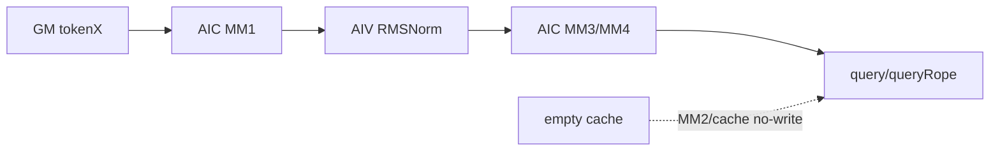

# MlaProlog A2/A3 ACLNN 算子知识

## 算子速览

| 项目 | 内容 |
|---|---|
| 实际入口 | `aclnnMlaPrologV3WeightNzGetWorkspaceSize` / `aclnnMlaPrologV3WeightNz`，公开 ACLNN V3 WeightNz |
| 计算语义 | 四个 Matmul + 两个 RMSNorm + Query/Key RoPE + KV/KR cache 原地更新 |
| 输入输出 | `tokenX:(B,S,He)/(T,He)`；`query:(B,S,N,D)/(T,N,D)`；`queryRope:(B,S,N,Dr)/(T,N,Dr)` |
| 执行类型 | `MIX_CV`；单 Kernel 内 AIC Cube + AIV Vector |
| Kernel 路线 | R-001 empty-query；R-002 empty-cache；R-003 arch22 split-N（quant 0..6） |
| 核心资源 | GM workspace、L1A/L1B、L0A/L0B/L0C、AIV UB |
| 来源闭包 | `source_closed`：ACLNN→generated inner bridge→OpDef/Tiling/POD→entry→arch22 body/CMake |
| 验证状态 | 已完成源码闭包检查；本次知识提取未执行编译、真机、数值或性能测试。 |

## 接口与语义

### 计算语义

```text
Cq    = qcQrScale * RMSNorm(tokenX*WDq, gammaCq, epsilonCq)
[Qc,Qr] = Cq*[WUq,WQr]; query=Qc*WUk; queryRope=RoPE(Qr)
[Ckv,Kr] = tokenX*[WDkv,WKr]
kvCache[index] = kcScale*RMSNorm(Ckv); krCache[index] = RoPE(Kr)
```

INT8 全量化的 MM1/2/3 累加为 INT32，AIV 以 FP32 反量化/RMSNorm 后再 cast/quant；Query per-tensor 量化时 MM4 先写 BF16 workspace，AIV 产生 INT8 query 和 FP32 scale。

### 输入、输出与属性

| 参数 | shape/layout | dtype | 约束、默认值与语义 |
|---|---|---|---|
| `tokenX` | 2D/3D ND | BF16/INT8 | A2/A3 不支持 FP8/HIF8/MXFP8 |
| `weightDq/UqQr/DkvKr` | 逻辑 `(K,N)`/FRACTAL_NZ | BF16/INT8 | `WUqQr` 部分量化；三者全量化 |
| `weightUk` | `(N,D,Hckv)` ND | BF16 | MM4 权重 |
| gamma/sin/cos | ND | BF16 | `sin/cos` 末轴 `Dr` |
| cache/index/actualSeqLen | ND | BF16/INT8, INT64, INT32 | PA/PA_BLK/BSND/TND 定位 |
| 量化可选量 | ND | FP32 | 由 quant mode 决定必选或必须为空 |
| outputs | ND | BF16/INT8/FP32 scale | `queryNormOut!=nullptr` 推导内部 `queryNormFlag` |
| attrs | scalar | float/int/string | epsilon=`1e-5`，cache=`PA_BSND`，tile=128，scale=1 |

### 入口与版本

V3 README 与公开 ACLNN 文档都列出 A2/A3/950 支持，并明确相比 V2 增加 scale、queryNorm、repo/quant mode 与 tile；V2 头文件和文档同时指向 V3 作为替代，因此 V3 是三个平台在固定 Commit 的最新公开版本。OpDef 又把同一 `MlaPrologV3` 分别注册到 `ascend910b`、`ascend910_93` 和 `ascend950`，平台证据无冲突。外层 `TensorHolder` 以 shape `{0}` 的临时 tensor 表示未传 optional 项并校验组合，然后进入仓外生成边界 `aclnnInnerMlaPrologV3*`；生成桥本身不可见，但算子自有 OpDef/Tiling/Kernel 链闭合。

## Host/Launcher 执行流程

### 参数校验与前处理

API 先校验 A2/A3 `weightQuantMode∈{0,1,2}`、kv/query mode 组合及可选输出空值。OpDef 以 `AutoContiguous` 声明连续化。`RunBigKernelTiling` 依次检查 NPU 资源、attrs、required tensors、cacheMode、shape 和量化场景；任一失败返回 `GRAPH_FAILED`。

### 参数、Workspace 与生命周期

`stepBS=min(128,T)`。Host `CalcWorkSpace` 从 `libapiSize` 开始，Device `WorkspaceInit` 按相同顺序切 `dequantScaleCq?`、`mmCkvKrRes`、`mmCqRes/rmsNormCqRes`、`mmQcQrRes`、`mmQcQrResDequant`、`mmQnRes?`。`queryNormFlag=1` 时 normCq 直出；否则在 workspace。workspace 由 caller 提供，executor/临时张量须保持到 stream 完成。

### 启动图与失败传播

```text
ACLNN GetWorkspaceSize -> generated inner -> MlaPrologV3 -> TilingMlaProlog
 -> key/POD/workspace/blockDim -> ACLNN execute(stream)
 -> mla_prolog_v3<key> -> MlaPrologVecS1CubS2::Init/Process
```

只有一个 MIX_CV launch；检查、POD、workspace 或 key 失败均不启动。empty query 用 `blockDim=1`，非空用 `aicNum`。

## Route 与参数设计

### 分核与资源计算

A2/A3 `splitMFlag=0`。MM1: `(T,Hcq,He)`；MM2: `(T,Hckv+Dr,He)`；MM3: `(T,N*(D+Dr),Hcq)`；MM4 按 head 分核。MM1 `singleN=max(64,ceil(Hcq/(align*aic))*align)`，MM2 在 AIC≥9 时 64 列/核，`vectorBlockNum=min(stepBS,aivNum)`。Cube buffer 固定为 L1A/L1B 各 `2*128KiB`、L0A/L0B 各 `2*32KiB`、L0C `2*64KiB`；AIV 以 `192KiB-usedBytes` 作 `shareBuffer_`。

### Route 选择

| 顺序 | Route | Key/模板 | 精确选择条件与优先级 | 不适用去向 |
|---:|---|---|---|---|
| 1 | R-001 empty | `EMPTY=2` | `T==0` 或 `B*S==0` | entry return |
| 2 | R-002 empty-cache | `EMPTY=1` | Query 非空、`blockNum==0`，且模板已注册：q0..4 仅 cache key 1..4，q5 仅 key 1 | MM2/cache 子图为空，Query 子图继续；未注册组合为构建缺口 |
| 3 | R-003 split-N | quant 0..6 | Query 与 cache 均非空；wq/kv=`0/0`,`1/{0,2,3}`,`2/{0,1,3}` | 非法组合失败 |

```text
empty -> R-001
else cache blockNum==0 && empty-cache key 已注册 -> R-002, EMPTY_CACHE
else cache blockNum==0 -> 固定构建无对应模板实例
else legal A2/A3 quant combination -> R-003, SPLIT_M=0
else -> GRAPH_FAILED
```

### 模板/实现执行矩阵

| Route | key/selector | dtype/shape/platform 完整命中条件 | 执行族与 kernel 节点 | 实际模板/body | 内存与同步特征 | tail/fallback |
|---|---|---|---|---|---|---|
| R-001 | empty=2 | Query 元素数 0 | entry only | constexpr return | 仅 libapi workspace | 无写 |
| R-002 | empty=1；q0..4@cache key 1..4，q5@key 1 | Query 非空、`blockNum==0`，且命中固定 selector 已注册组合 | `MIX_CV`；MM1→norm→MM3→MM4 与 query RoPE 保留，MM2/cache 更新为空 | 对应 `MLAPType<..., emptyMode=EMPTY_CACHE>` | MM2 helper 早退；仍用 flag 发布空的 CkvKr 阶段，AIV cache helper 按 empty mode 不写 | q6 或 cache key 0 无 empty 实例，不能进入 Kernel |
| R-003a | q0 | 非空 cache，BF16，wq0/kv0 | MIX_CV | `MLAPType<bf16,bf16,bf16,float>` | BF16 MM result | M tail |
| R-003b | q1/2/5 | 非空 cache，BF16 token + INT8 WUqQr，kv none/channel/tile | MIX_CV | `MLAPType<bf16,int8,bf16/int8,float,...>` | MM3 INT32、AIV dequant/quant | invalid optional fails |
| R-003c | q3/4/6 | 非空 cache，INT8 token/weights，kv none/tensor/tile | MIX_CV | `MLAPType<int8,int8,bf16/int8,float,...>` | MM1/2/3 INT32，可选 MMQn temp | FP8/HIF8 fails |

### 隐藏性能 Guard

| Guard | Host/Tiling 条件 | Device/资源原因 | 影响 Route | 不满足时去向 | 源码符号 |
|---|---|---|---|---|---|
| CV ratio | `aic==aiv \|\| 2*aic==aiv` | 只有 1:1/1:2 | R-002/R-003 | fail | `GetNpuInfo` |
| CV1:1 | 仅 q0 + PA_BSND/PA_NZ | 其它路线需额外 AIV | R-002/R-003 | fail | `GenTilingKey` |
| group | partial,T=1,Nkv=8,aiv≥32,aic≥16,ratio!=1 | Qc/Qr 用 8/4 AIC | R-002/R-003b | normal split-N | `ProcessBaseInputs` |
| dequant-opt | WUqQr INT8 且 N≥8 | split-N dequant/RoPE 流水 | R-002/R-003b/c | normal path | 同上 |
| A full-load | BF16 M≤32，INT8 M≤64 | MM3 A 常驻 L1 | R-002/R-003 | split K/N | `MatmulQcQr` |
| PA_BLK | T 合轴时 actualSeqLen 非空 | 还原 batch prefix | R-002/R-003 | fail | `SetScenarioInfo` |

### POD/ABI

`MlaPrologTilingData` 仅含 `MlaPrologBaseParams`。按固定宽度字段的声明顺序可推导 35×`uint32_t` + 7×`float` + 2×`uint16_t` = 172 bytes，通常对齐为 4 bytes；固定仓没有 `static_assert(sizeof/alignof/offsetof)`，下表 offset 是由声明顺序推导的 ABI，本次未编译验证。

| 结构 | 字段 | 类型/位宽 | ABI 布局 | 单位 | Host/launcher producer | Device consumer | 边界 |
|---|---|---|---|---|---|---|---|
| Base | `batchSize` | u32/32 | off 0；struct 172/align 4 为声明推导 | batch | `FillTilingCoreParams`←`bSize` | actualSeq/cache 索引 | T 合轴 PA_BLK 时来自 actualSeqLen shape |
| Base | `stepBatchSize` | u32/32 | off 4 | token/step | `ProcessBaseInputs=min(128,T)` | 四 MM 的 M、workspace/UB | Query 非空时 1..128 |
| Base | `mSubSize` | u32/32 | off 8 | token/core | A2/A3 `splitMFlag=0`，保持零初值 | arch22 split-N 不活跃 | inactive |
| Base | `mSubCoreNum` | u32/32 | off 12 | core count | A2/A3 `splitMFlag=0`，保持零初值 | arch22 split-N 不活跃 | inactive |
| Base | `stepNumHeadDequant` | u32/32 | off 16 | head/step | D=128 取64，否则 min(16,N) | dequant/Qn 分步 | 不超过 N |
| Base | `tokenSize` | u32/32 | off 20 | token | `FillTiling`←`tSize` | `Process` 外层 loop | 0 只进 R-001 |
| Base | `seq1Size` | u32/32 | off 24 | token/batch | token shape S | cache/token 寻址 | T 合轴时可为零初值 |
| Base | `seq2Size` | u32/32 | off 28 | token/cache | `nkvSize` | cache 寻址 | 与 cache shape 关联 |
| Base | `headSizeX` | u32/32 | off 32 | element/row | tokenX He | MM1/MM2 K、GM offset | 必须通过 shape check |
| Base | `headSizeCq` | u32/32 | off 36 | element/row | Wdq 逻辑 N | MM1 N、RMSNorm/WS、MM3 K | reciprocal 分母非 0 |
| Base | `headSizeCkv` | u32/32 | off 40 | element/row | WdkvKr 逻辑 N - Dr | MM2/cache/MM4 N | reciprocal 分母非 0 |
| Base | `headSizeQc` | u32/32 | off 44 | element/row | `N*D` | MM3/Qc slice | 乘法结果窄化到 u32，由 shape check 限制 |
| Base | `headSizeQr` | u32/32 | off 48 | element/row | `N*Dr` | MM3/RoPE slice | 同上 |
| Base | `headSizeKr` | u32/32 | off 52 | element/row | `Dr` | MM2 Kr tail/RoPE | 与 rope 末轴一致 |
| Base | `numHeadSize` | u32/32 | off 56 | head | WUk 第 0 轴 N | MM3/MM4/head tail | N>0 |
| Base | `numHeadKvSize` | u32/32 | off 60 | head | kvCache Nkv | cache layout/group guard | group route 需 Nkv=8 |
| Base | `dimHeadSizeQc` | u32/32 | off 64 | element/head | WUk 第 1 轴 D | MM3/MM4 K/Qc offset | D 通过 `CheckDSize` |
| Base | `dimHeadRope` | u32/32 | off 68 | element/head | ropeCos 末轴 Dr | MM2/MM3/RoPE | Dr 通过 shape check |
| Base | `blockNum` | u32/32 | off 72 | cache block | kvCache 第 0 轴 | empty-cache selector/cache 寻址 | 0 先生成 empty candidate；仅已注册 key 进 R-002 |
| Base | `blockSize` | u32/32 | off 76 | token/block | 4D cache 第 1 轴 | PA_BLK 索引 | 非 PA_BLK 可为零 |
| Base | `mm1BlockNum` | u32/32 | off 80 | AIC count | `FillMatmul1Tiling` | MM1 block guard | `ceil(Hcq/singleN)` |
| Base | `mm2BlockNum` | u32/32 | off 84 | AIC count | `FillMatmul2Tiling` | MM2 block guard | R-002 可保持 0 |
| Base | `mm3BlockNum` | u32/32 | off 88 | AIC count | `FillMatmul3Tiling` | MM3 block guard | `ceil(N*(D+Dr)/singleN)` |
| Base | `mm4BlockNum` | u32/32 | off 92 | AIC count | `FillMatmul4Tiling` | MM4 head block guard | `ceil(N/singleHead)` |
| Base | `vectorBlockNum` | u32/32 | off 96 | AIV count | `min(stepBatchSize,aivNum)` | AIV token 分核 | 最后步由 `UpdateStepBatchParams` 缩 M |
| Base | `mm1SingleCoreN` | u32/32 | off 100 | column/core | `FillMatmul1Tiling` | MM1 n/offset | 最小64，末核裁剪 |
| Base | `mm2SingleCoreN` | u32/32 | off 104 | column/core | `FillMatmul2Tiling` | MM2 n/offset | AIC≥9时固定64；R-002 inactive |
| Base | `mm3SingleCoreN` | u32/32 | off 108 | column/core | group/dequant/normal selector | MM3 n/offset | 末核裁剪 |
| Base | `mm4SingleCoreBatch` | u32/32 | off 112 | head/core | `ceil(N/aicNum)` | `mmQnLoops` | 末核按 `N-numHeadOffset` |
| Base | `dtileSize` | u32/32 | off 116 | element | kvCache 末轴 | cache scatter stride | repo layout 约束 |
| Base | `kvQuantMode` | u32/32 | off 120 | enum | V3 attr | cache quant helper | 0/1/2/3 且受 wq 组合约束 |
| Base | `tileSize` | u32/32 | off 124 | element/tile | V3 attr | pertoken-pergroup helper | 该模式必须128 |
| Base | `ckvkrRepoMode` | u32/32 | off 128 | enum | V3 attr | cache repository 地址 | per-tile 与 scale repo 同时为1 |
| Base | `quantScaleRepoMode` | u32/32 | off 132 | enum | V3 attr | scale repository 地址 | 与 `ckvkrRepoMode` 成对 |
| Base | `queryNormFlag` | u32/32 | off 136 | bool | API 以 optional output 非空推导 | `WorkspaceInit` alias/直出 | 0/1 |
| Base | `reciprocalCq` | f32/32 | off 140 | scalar | `1.0f/Hcq` | RMSNormCq | Hcq 非 0 |
| Base | `epsilonCq` | f32/32 | off 144 | scalar | V3 attr | RMSNormCq | API double 转 f32 |
| Base | `reciprocalCkv` | f32/32 | off 148 | scalar | `1.0f/Hckv` | RMSNormCkv | Hckv 非 0 |
| Base | `epsilonCkv` | f32/32 | off 152 | scalar | V3 attr | RMSNormCkv | API double 转 f32 |
| Base | `kNopeClipAlpha` | f32/32 | off 156 | scalar | Host 不赋值 | 无合法 POD consumer；Device 从 GM input 读 | 不得从 POD 消费 |
| Base | `qcQrScale` | f32/32 | off 160 | scalar | V3 attr | RMSNormCq scale | default 1 |
| Base | `kcScale` | f32/32 | off 164 | scalar | V3 attr | RMSNormCkv scale | default 1 |
| Base | `isQcQrScaleEnable` | u16/16 | off 168 | bool | `abs(qcQrScale-1)>=epsilon` | RMSNormCq 分支 | 0/1 |
| Base | `isKcScaleEnable` | u16/16 | off 170 | bool | `abs(kcScale-1)>=epsilon` | RMSNormCkv 分支 | 0/1 |

### Route 源码闭包

| Route | Key/selector | Host/Tiling producer | POD/参数 | Kernel entry/router | Kernel body/直接依赖 | 构建接线 |
|---|---|---|---|---|---|---|
| R-001 | empty | `SetScenarioInfo/RunBigKernelTiling` | 172B POD | `mla_prolog_v3` | constexpr return | V3 CMake |
| R-002 | emptyCache=1；q0..4@key1..4、q5@key1 | `SetScenarioInfo` + `FillMatmul*/CalcWorkSpace/GenTilingKey` + template selector | 同上 | `mla_prolog_v3` | arch22 split-N；`MatmulSplitN<...,needCheckEmptyTensor=true>` 与 cache helper early-return | V3 CMake depends mla_prolog |
| R-003 | nonempty,q0..6 | `FillMatmul*/CalcWorkSpace/GenTilingKey` | 同上 | `mla_prolog_v3` | arch22 split-N + comm/matmul/vector services | V3 CMake depends mla_prolog |

## Kernel 实现

### 公共执行流程

entry 将 key 解为 `MLAPType<X,W,Cache,Scale,cacheMode,dequantOpt,groupOpt,empty,actualSeq,isPertile,cvRatio>`。AIC 走 GM ND/NZ→L1→L0A/B→Mmad→L0C→Fixpipe→workspace/output；AIV 从 workspace 读 Cq/CkvKr/QcQr，做 norm/dequant/RoPE/quant/scatter。

### Route R-001：empty-query

#### 适用条件

##### 选择证据

| 层级 | 文件 | 符号 | 源码谓词/参数 | 结果/下一跳 |
|---|---|---|---|---|
| Host | tiling cpp | `SetScenarioInfo` | T=0/B*S=0 | EMPTY_QUERY |
| entry | v3 cpp | `mla_prolog_v3` | constexpr empty | return |

#### Device 数据流

##### 函数级调用链

```text
mla_prolog_v3 -> return
```

##### 源码等价伪码

```text
if constexpr emptyQuery: return
```

#### 内存与数据搬运

##### 资源与搬运表

| 层级/缓冲区 | offset/地址公式 | extent/容量公式 | dtype/layout | producer | consumer | owner/lifetime | 对齐/复用 |
|---|---|---|---|---|---|---|---|
| workspace | 0 | libapiSize | byte | runtime | framework | executor | N/A |
| L1/L0/UB | N/A | 0 | N/A | N/A | N/A | N/A | 早退 |

##### 分层内存布局


##### 字节账、交接边与复用顺序

```text
workspace_total=libapiSize; L1=L0=UB=0
```

| 边/复用子区 | producer | offset/extent | dtype/layout | consumer | ordering/sync | owner/lifetime | 安全条件 |
|---|---|---|---|---|---|---|---|
| N/A | N/A | N/A | N/A | N/A | return | N/A | empty |

#### 同步、精度与尾块

##### 同步与数值边界表

| 阶段 | primitive/机制 | producer | consumer/等待点 | 保护对象 | 精度/尾块 |
|---|---|---|---|---|---|
| entry | constexpr | key | return | outputs/cache | 不写 |

#### 关键实现

##### 符号证据表

| 阶段 | 文件 | 符号/模板实例 | 实现事实 |
|---|---|---|---|
| Host/Tiling producer | tiling cpp | `RunBigKernelTiling` | blockDim=1 |
| Kernel entry/router | v3 cpp | `mla_prolog_v3` | early return |
| Device body/helper | N/A | N/A | inactive |

### Route R-002：empty-cache MIX_CV

#### 适用条件

##### 选择证据

| 层级 | 文件 | 符号 | 源码谓词/参数 | 结果/下一跳 |
|---|---|---|---|---|
| Tiling | `attention/mla_prolog/op_host/mla_prolog_tiling.cpp` | `SetScenarioInfo` | Query 非空且 `baseShapeInfo_.blockNum == 0U` | `EMPTY_CACHE` |
| key/selector | `attention/mla_prolog/op_kernel/mla_prolog_template_tiling_key.h` | `ASCENDC_TPL_SEL` | q0..4 的 `EMPTY=1` 仅注册 cache key 1..4；q5 仅 key 1；q6 未注册 | 已注册组合进入 empty-cache specialization，其余为构建缺口 |
| Device | `arch22/kernel_mla_prolog_split_n.h` | `MatmulSplitN<...,needCheckEmptyTensor=true>` | `MLAPT::emptyMode == EMPTY_CACHE` | MM2 直接返回，Query 支路继续 |

#### Device 数据流

##### 函数级调用链

```text
mla_prolog_v3<..., empty=1> -> MlaPrologVecS1CubS2::Process
  -> AIC: MM1 -> (MM2 early-return) -> MM3 -> MM4
  -> AIV: normCq -> (cache helper no-write) -> Qc/Qr epilogue
```

##### 源码等价伪码

```text
for each non-empty Query step:
  AIC computes Cq and signals FINISH_MM_CQ
  MM2 helper sees EMPTY_CACHE and returns; AIC still signals FINISH_MM_CKVKR
  AIV consumes Cq, skips empty cache writes, then query MM3/MM4/RoPE continues
```

#### 内存与数据搬运

##### 资源与搬运表

| 层级/缓冲区 | offset/地址公式 | extent/容量公式 | dtype/layout | producer | consumer | owner/lifetime | 对齐/复用 |
|---|---|---|---|---|---|---|---|
| cache GM | cache shape product 0 | 0 | 按 quant key | N/A | N/A | caller | 不写 |
| MM2 workspace slice | `WorkspaceInit` 的首个 CkvKr slice | Host 总量仍按 `step*(Hckv+Dr)*sizeof(mm2out)` 预留 | BF16/INT32 ND | 无有效 MM2 数据 | cache helper按 empty mode跳过 | executor | 仅为统一 ABI/offset |
| Query workspace/L1/L0/UB | 与 R-003 同式 | 与 R-003 同式 | typed | MM1/MM3/AIV | MM3/MM4/输出 | step | 同 R-003 同步 |

##### 分层内存布局



##### 字节账、交接边与复用顺序

```text
workspace_total = R-003 对应 quant key 的统一上界；cache_extent = 0
```

| 边/复用子区 | producer | offset/extent | dtype/layout | consumer | ordering/sync | owner/lifetime | 安全条件 |
|---|---|---|---|---|---|---|---|
| 空 MM2 阶段 | AIC 控制流 | CkvKr slice/0 有效元素 | typed ND | AIV empty-cache 分支 | `FINISH_MM_CKVKR` | executor/step | 两侧使用同一 `emptyMode=1` |
| Query 主边 | 与 R-003 | Cq/QcQr slices | typed ND | 与 R-003 | 同 R-003 flags | executor/step | Query 非空 |

#### 同步、精度与尾块

##### 同步与数值边界表

| 阶段 | primitive/机制 | producer | consumer/等待点 | 保护对象 | 精度/尾块 |
|---|---|---|---|---|---|
| empty cache | compile-time `emptyMode` + CrossCore stage flag | AIC | AIV | 空 MM2/cache 子图 | 不读取无效 CkvKr，不写 cache |
| Query | 同 R-003 | AIC/AIV | 对端 | Cq/QcQr/Qn | 保留 Query 的 M/N/head tail |

#### 关键实现

##### 符号证据表

| 阶段 | 文件 | 符号/模板实例 | 实现事实 |
|---|---|---|---|
| Host/Tiling producer | `attention/mla_prolog/op_host/mla_prolog_tiling.cpp` | `SetScenarioInfo` | `blockNum==0` 生成 `EMPTY_CACHE`；模板 selector 另行限制可落地组合 |
| Kernel entry/router | `attention/mla_prolog_v3/op_kernel/mla_prolog_v3.cpp` | `mla_prolog_v3<...,EmptyTensorMode=1>` | empty mode 编译期进入 MLAPType |
| Device body/helper | `attention/mla_prolog/op_kernel/arch22/kernel_mla_prolog_split_n.h` | `MatmulSplitN` / cache helpers | MM2/cache no-op，Query 子图继续 |

### Route R-003：arch22 split-N MIX_CV

#### 适用条件

##### 选择证据

| 层级 | 文件 | 符号 | 源码谓词/参数 | 结果/下一跳 |
|---|---|---|---|---|
| API | API cpp | mode checks | wq 0/1/2 legal kv | inner |
| Tiling | tiling cpp | `GenTilingKey` | splitM=0, q0..6 | key |
| router | v3 cpp | `mla_prolog_v3` | Scenario/QuantMode | MLAPType instance |

#### Device 数据流

##### 函数级调用链

```text
Process
 AIC: MatmulCq -> MatmulCkvKr -> MatmulQcQr -> MatmulQn
 AIV: RmsNormCq -> RmsNorm/RoPE/scatter CkvKr -> dequant/RoPE QcQr -> optional Query quant
```

##### 源码等价伪码

```text
for batchOffset+=stepBS:
 AIC MM1; set MM_CQ; wait prior V_CKVKR; MM2; set MM_CKVKR; wait V_NORM_CQ; MM3; MM4
 AIV wait MM_CQ; all-vector; normCq; all-vector; set V_NORM_CQ
     wait MM_CKVKR; norm/rope/scatter cache; set V_CKVKR; wait MM3; dequant/rope; optional quant query
```

#### 内存与数据搬运

##### 资源与搬运表

| 层级/缓冲区 | offset/地址公式 | extent/容量公式 | dtype/layout | producer | consumer | owner/lifetime | 对齐/复用 |
|---|---|---|---|---|---|---|---|
| MM2 | first after scale | `step*(Hckv+Dr)*sizeof(mm2out)` | BF16/INT32 ND | Cube | AIV | workspace step | V_CKVKR 防覆盖 |
| MM1/norm | next | dtype-dependent `step*Hcq` slices | BF16/INT32/INT8 | Cube/AIV | AIV/MM3 | workspace/output | same dtype 可 alias |
| MM3/Qc | next | `step*N*(D+Dr)*4 + step*N*D*2` | INT32/BF16 | Cube/AIV | AIV/MM4 | workspace step | flags |
| MM4 temp | final | `step*N*Hckv*2` only per-tensor query | BF16 | Cube | AIV | workspace | flag |
| L1/L0 | fixed | L1 512KiB; L0 256KiB | ND/NZ/FP32 L0C | GM | Mmad/Fixpipe | AIC | double buffer |
| UB | fixed+share | 192KiB | staged views | GM/workspace | vector/out | AIV | 32B/events |

##### 分层内存布局


##### 字节账、交接边与复用顺序

```text
full = libapi + step*Hcq*4 + step*Hcq*2 + step*(Hckv+Dr)*4
     + step*N*(D+Dr)*4 + step*N*D*2 + (kvMode==1?step*N*Hckv*2:0) + optScale
nonfull = libapi + 2*step*Hcq*2 + step*(Hckv+Dr)*2
        + step*N*(D+Dr)*4 + step*N*D*2 + optScale
optScale = (groupOpt||dequantOpt)?step*32:0
```

| 边/复用子区 | producer | offset/extent | dtype/layout | consumer | ordering/sync | owner/lifetime | 安全条件 |
|---|---|---|---|---|---|---|---|
| Cq | MM1 | Hcq slice | BF16/INT32 | normCq | FINISH_MM_CQ | step | active block |
| normCq | AIV | Hcq slice/output | BF16/INT8 | MM3 | FINISH_VEC_RMSNORM_CQ | step | all-AIV barrier |
| CkvKr | MM2 | `(Hckv+Dr)` slice | BF16/INT32 | cache vector | FINISH_MM_CKVKR/VEC_CKVKR | step | producer waits reuse |
| QcQr | MM3 | `N*(D+Dr)` | BF16/INT32 | MM4/RoPE | FINISH_MM_QCQR | step | split stride |

#### 同步、精度与尾块

##### 同步与数值边界表

| 阶段 | primitive/机制 | producer | consumer/等待点 | 保护对象 | 精度/尾块 |
|---|---|---|---|---|---|
| CV | `CrossCore` mode 0x2 flags 0x6/0x9 | AIC/AIV | reciprocal side | workspace | dtype by MLAPType |
| all vector | mode 0x0 flag 0x7 | AIVs | MM3/cache | full row domain | prevents partial norm |
| local Cube | HardEvent A/B/L0/Fix | pipelines | next buffer user | L1/L0 ping-pong | K/N tail in helper |
| M tail | `UpdateStepBatchParams` | Process | four MM/AIV | last step | valid rows only |

#### 关键实现

##### 符号证据表

| 阶段 | 文件 | 符号/模板实例 | 实现事实 |
|---|---|---|---|
| Host/Tiling producer | tiling cpp | `FillMatmul*/CalcWorkSpace/GenTilingKey` | key/POD/resources |
| Kernel entry/router | v3 cpp | `mla_prolog_v3` | q0..6 MLAPType |
| Device body/helper | arch22 kernel | `Process/AicProcess/AivProcess` | CV graph/workspace/tail |
| Device body/helper | arch22 service_matmul | `MatmulSplitK/MatmulL1/GetTensorC` | L1/L0/Mmad/Fixpipe |

## 算子特定优化

### Trick T-001：CV flag 保护 step workspace 流水

#### 触发与源码依据

- 适用 Route：R-002、R-003
- 触发条件：非空 split-N
- Golden 来源：[`kernel_mla_prolog_split_n.h:794-808`](../../../../../../../cann-ops-raw/ascendc/ops-transformer/be33d95bb755cedec3108f70805c1874d1792540/attention/mla_prolog/op_kernel/arch22/kernel_mla_prolog_split_n.h#L794-L808)

**官方源码（固定 Commit 连续逐字摘录）**：

```cpp
MatmulSplitN<mmInputType, mmCqOutputType, dequantScaleType>(
    mmCqResGm_[aicOffset.cqResOffset], tokenXGm_[tokenXOffset], weightDqGm_[aicOffset.weightDqOffset], mmCqParam_,
    UsedBlockParams{0, baseParams_->mm1BlockNum});
CrossCoreSetFlag<SYNC_MODE_CUBE_VEC, PIPE_FIX>(FINISH_MM_CQ);
CrossCoreWaitFlag(FINISH_VEC_CKVKR);
```

#### 机制与设计原因

MM1 完成即唤醒 AIV，MM2 在覆盖上一 step CkvKr slice 前等待 AIV cache consumer；反向 flag 保证 MM3 只读完整 normCq。这同时是流水与 lifetime 协议。

#### 迁移边界

- 适用：单 MIX kernel 的 AIC producer/AIV consumer。
- 前提：flag ID/mode/pipe、workspace offset 和 CV ratio 一致。
- 失效：更改 owner/step 或去掉 all-AIV barrier 需重新证明。
- 未验证：本次知识提取未执行编译、真机、数值或性能测试。

#### 错误做法

未等 `FINISH_VEC_CKVKR` 就开始下一 MM2 会覆盖尚未 scatter 的 CkvKr。

## 模板与实现对比

| 对比维度 | R-001 empty-query | R-002 empty-cache | R-003 split-N | 设计选择依据 |
|---|---|---|---|---|
| 命中条件/优先级 | T/B*S=0 | Query 非空、blockNum=0，且 empty key 已注册 | Query/cache 非空且 q0..6 合法 | Host selector + build selector |
| 执行族/节点图 | entry return | MIX_CV；Query 子图，MM2/cache no-op | 完整 MIX_CV single kernel | key/emptyMode |
| M/N/K、tile 与 scheduler | N/A | Query MM 同 R-003 | stepBS≤128, split N | FillMatmul* |
| workspace/L1/L0/UB | libapi only | 统一上界，cache 有效 extent=0 | dtype-dependent slices + fixed Cube/UB | CalcWorkSpace/WorkspaceInit |
| AIC/AIV 或 kernel 交接 | N/A | 空 MM2 阶段仍以 flag 对齐双方控制流 | flags + GM workspace | Process |
| 同步、精度与 tail | N/A | Query tail 保留、cache 不写 | BF16/INT32/FP32/INT8；M/N/head tails | MLAPType/helpers |
| fallback/失败边界 | explicit return | 已注册组合返回 Query；未注册 empty key 为构建缺口 | illegal mode fails | checks/selector |

## 平台差异

| 项目 | A2 | A3 | 950 |
|---|---|---|---|
| 支持状态 | 支持，无 FP8/HIF8/MXFP8 | 同 A2 | 见 `_950` |
| Host/Launcher | shared tiling, split-N | 同 A2 | DAV_3510 扩展 |
| Kernel/资源 | arch22 | arch22 | arch35 |

## 限制与失败边界

- cacheMode 仅 BSND/TND/PA_BSND/PA_NZ/PA_BLK_BSND/PA_BLK_NZ；PA_BLK + T 合轴必须有 actualSeqLen。
- README 把 `Skv=0` 泛化为支持场景，但固定构建的 selector 并未覆盖所有 `EMPTY=1` key：A2/A3 仅 q0..4@cache key 1..4 与 q5@key 1 可落地；q6 和 cache key 0 的空 Cache key 由 Host 生成却无 Kernel 模板，不得按相邻实例补齐。
- V3 README 参数表把 `actual_seq_len` 写为“预留、必须空”，但同文档 shape 约束与 `SetScenarioInfo` 又要求 T 合轴 + PA_BLK 时必须传入，Device 也读取该 GM 输入；本卡以后三者闭合的可达路径为准，并保留此文档内部冲突。
- per-token-per-group 需 repo modes 成对为 1、tileSize=128 且只用文档支持的 cache mode。
- `kNopeClipAlpha` POD 字段 Host 未写，Device 实际从 GM 可选输入读。
- generated inner bridge 为仓外框架边界。本次知识提取未执行编译、真机、数值或性能测试。

## 源码索引

### 链路索引

| 链路阶段 | 文件 | 关键符号 | 支撑内容 |
|---|---|---|---|
| 入口声明/约束 | `attention/mla_prolog_v3/README.md` | 产品表/V3 公式 | 平台与语义 |
| 入口声明/约束 | `attention/mla_prolog_v3/docs/aclnnMlaPrologV3WeightNz.md` | 产品表/两段式接口 | 公开 ACLNN 约束 |
| 入口声明/约束 | `attention/mla_prolog_v3/op_api/aclnn_mla_prolog_v3_weight_nz.h` | ACLNN symbols | ABI |
| 入口实现 | `attention/mla_prolog_v3/op_api/aclnn_mla_prolog_v3_weight_nz.cpp` | checks/TensorHolder | API bridge |
| Host/Tiling/Launcher | `attention/mla_prolog/op_host/mla_prolog_tiling.cpp` | `RunBigKernelTiling` | selector/POD/workspace |
| Kernel entry/body | `attention/mla_prolog_v3/op_kernel/mla_prolog_v3.cpp` | `mla_prolog_v3` | router |
| Kernel entry/body | `attention/mla_prolog/op_kernel/arch22/kernel_mla_prolog_split_n.h` | `MlaPrologVecS1CubS2` | body |
| 构建接线 | `attention/mla_prolog_v3/op_host/CMakeLists.txt` | `add_op_to_compiled_list` | build/dependency |

### 实现复用检查

| 检查项 | 可复用事实 | 不得改变的约束 | 源码符号 |
|---|---|---|---|
| ABI/POD | 172B POD | field order/offset/inactive fields | `MlaPrologBaseParams` |
| 调用顺序 | MM1/norm/MM3/MM4 + MM2/cache | CV dependencies | Aic/AivProcess |
| workspace/内存 | sequential dtype slices | alias/queryNorm/lifetime | CalcWorkSpace/WorkspaceInit |
| 同步 | CrossCore + HardEvent | IDs/modes/pipes | comm/Process |
| 精度与尾块 | typed MLAPType + valid tails | cast/quant order | MLAPType/UpdateStep |
| 失败边界 | API/Tiling fail closed | no 950 dtype/splitM | checks/GenTilingKey |