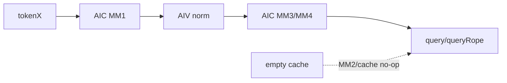
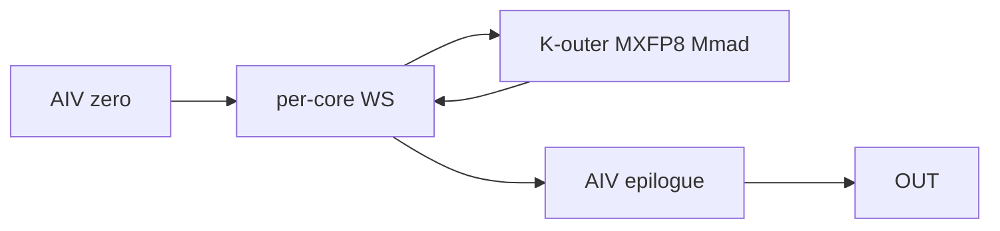
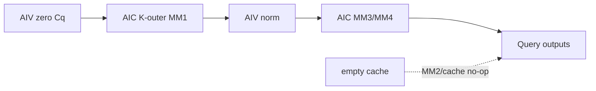

# MlaProlog 950 ACLNN 算子知识

## 算子速览

| 项目 | 内容 |
|---|---|
| 实际入口 | `aclnnMlaPrologV3WeightNzGetWorkspaceSize` / `aclnnMlaPrologV3WeightNz` |
| 计算语义 | 四 Matmul、两 RMSNorm、RoPE、Query 量化与 KV/KR cache 更新 |
| 输入输出 | `(B,S,He)/(T,He)`→`query:(...,N,D)`,`queryRope:(...,N,Dr)` |
| 执行类型 | 单 Kernel `MIX_CV` |
| Kernel 路线 | R-001 empty-query；R-002 empty-cache split-N；R-003 arch35 split-N；R-004 MXFP8 split-M；R-005 MXFP8 empty-cache split-M |
| 核心资源 | GM workspace，double-buffered L1/L0，AIV UB，MXFP8 scale |
| 来源闭包 | `source_closed`：ACLNN→Host/Tiling/POD→entry→arch35 split-N/split-M→CMake |
| 验证状态 | 已完成源码闭包检查；本次知识提取未执行编译、真机、数值或性能测试。 |

## 接口与语义

### 计算语义

`Cq=αq*RMSNorm(X*WDq)`，`[Qc,Qr]=Cq*[WUq,WQr]`，`query=Qc*WUk`，`queryRope=RoPE(Qr)`；`[Ckv,Kr]=X*[WDkv,WKr]`，`αkv*RMSNorm(Ckv)` 与 `RoPE(Kr)` 写 cache。950 额外支持 MXFP8/FP8/HIF8；MXFP8 MM 以 FP8E8M0 scale 并累加为 FP32。

### 输入、输出与属性

| 参数 | shape/layout | dtype | 约束、默认值与语义 |
|---|---|---|---|
| X/三个 NZ 权重 | ND/FRACTAL_NZ | BF16/INT8/FP8E4M3/HIF8 | wq 0..5 |
| WUk/gamma/sin/cos | ND | BF16 | MM4/norm/RoPE |
| dequant scales | ND | FP32 或 FP8E8M0 | MXFP8 以 32 元素 block scale |
| caches | 3D/4D ND | BF16/INT8/FP8/HIF8 | repo/cache mode 决定布局 |
| outputs | ND | BF16/INT8/FP8/HIF8 + scale | queryNorm 可选 |
| attrs | scalar | float/int/string | epsilon 1e-5，tile 128，α=1 |

### 入口与版本

V3 README 与公开 ACLNN 文档均明确支持 Ascend 950PR/950DT；V2 公开头文件/文档指向 V3 作为替代，因此 V3 是固定 Commit 上 950 最新公开版本。OpDef 为 `ascend950` 单独列出 FP8/HIF8/MXFP8 dtype 组合；外层 API 在 `DAV_3510` 允许 wq 0..5，平台证据无冲突。generated inner 为框架生成边界；算子自有 OpDef/Tiling/Kernel 链闭合。

## Host/Launcher 执行流程

### 参数校验与前处理

API 检查 wq/kv/query mode 与 optional outputs；OpDef `AutoContiguous`/`IgnoreContiguous` 区分普通输入与 cache。Tiling 按 NPU→attrs→shape→scenario→quant→special shape 顺序失败关闭。

### 参数、Workspace 与生命周期

`stepBS=min(128,T)`。Device split-N 的 workspace 顺序为 scale?、CkvKr、Cq/normCq、QcQr、dequant-Qc、MMQn?；split-M 则为 scale?、Cq/normCq、CkvKr、QcQr、dequant-Qc、MMQn?，并把相应 slice 乘 `mm1/2/3/4BlockNum`，某些 MXFP8 非 per-tile 路线再增一份 Qc BF16 slice。caller workspace/executor 保持到 stream 完成。

### 启动图与失败传播

```text
ACLNN -> generated inner -> TilingMlaProlog -> key/POD/workspace/blockDim
 -> mla_prolog_v3 -> splitM? MlaPrologV3SplitM : MlaPrologVecS1CubS2
```

单 MIX_CV launch；任一 Host 失败不 launch。entry 在 DAV_3510 临时把 `GLOBAL_OVERFLOW_MODE_CTRL` 设 0，末尾恢复。

## Route 与参数设计

### 分核与资源计算

split-N 与 A2/A3 同样按 MM N/head 分核。split-M 使 `mSubSize=ceil(T/aicNum)`，前 `mSubCoreNum=T-(mSubSize-1)*aicNum` 核多处理一 token，四 MM 的 N/head 都全量交给每个 M 分片核。L1/L0 仍为 2×128KiB L1A/B、2×32KiB L0A/B、2×64KiB L0C。

### Route 选择

| 顺序 | Route | Key/模板 | 精确选择条件与优先级 | 不适用去向 |
|---:|---|---|---|---|
| 1 | R-001 empty | empty=2 | T/B*S=0 | return |
| 2 | R-005 empty-cache split-M | empty=1,splitM=1 | Query 非空、`blockNum==0`，MXFP8 精确 split-M 谓词，且 q7/8@cache key 0..4 或 q9@key 0/1 | MM2/cache no-op，其他使用 split-M body |
| 3 | R-002 empty-cache split-N | empty=1,splitM=0 | Query 非空、`blockNum==0`，不命中 split-M，且 key 属于固定 selector 已注册集合 | MM2/cache no-op，Query split-N 继续；未注册组合为构建缺口 |
| 4 | R-004 split-M | empty=0,splitM=1 | cache 非空，MXFP8(wq=3),T≥8192,CV1:2,He=7168/7680,N=128 | 条件任一不满足转 R-003 |
| 5 | R-003 split-N | empty=0,splitM=0 | cache 非空且其他合法 q0..15 | illegal mode fails |

```text
empty -> R-001
else if cache blockNum==0 && exact MXFP8 splitM predicate && empty split-M key 已注册 -> R-005
else if cache blockNum==0 && empty split-N key 已注册 -> R-002
else if cache blockNum==0 -> 固定构建无对应模板实例
else if exact MXFP8 splitM predicate -> R-004
else -> R-003
```

### 模板/实现执行矩阵

| Route | key/selector | dtype/shape/platform 完整命中条件 | 执行族与 kernel 节点 | 实际模板/body | 内存与同步特征 | tail/fallback |
|---|---|---|---|---|---|---|
| R-001 | empty | zero query | entry | return | libapi only | no write |
| R-002 | empty=1,splitM0；已注册子集 | Query 非空、`blockNum==0`；q0..4/q10..13@key1..4，q5/q14/q15@key1，q7/8@key0..4，q9@key0/1；q6 不可达 | MIX_CV split-N；MM1→norm→MM3→MM4 保留，MM2/cache no-op | `MlaPrologVecS1CubS2<MLAPType<...,EMPTY_CACHE>>` | 统一 workspace ABI，cache 有效 extent=0 | 未注册 empty key 不能进入 Kernel |
| R-003 | q0..15,splitM0 | cache 非空，BF16/INT8/MXFP8/FP8/HIF8 legal combination | MIX_CV | arch35 `MlaPrologVecS1CubS2<MLAPType>` | typed MM output BF16/INT32/FP32 | M/N/head tail |
| R-004 | q7/8/9,splitM1 | cache 非空，MXFP8 + exact Host predicate | MIX_CV | `MlaPrologV3SplitM<FP8E4M3,...,FP8E8M0>` | per-AIC slices, K-outer MXFP8 MM | otherwise R-003 |
| R-005 | empty=1,q7/8/9,splitM1 | Query 非空、cache 空、MXFP8 + exact Host predicate；q7/8@key0..4，q9@key0/1 | MIX_CV split-M；MM2/cache no-op | `MlaPrologV3SplitM<...,EMPTY_CACHE>` | per-AIC slices/K-outer，MM2 block count 0 | Query mSub tail；cache no-write |

### 隐藏性能 Guard

| Guard | Host/Tiling 条件 | Device/资源原因 | 影响 Route | 不满足时去向 | 源码符号 |
|---|---|---|---|---|---|
| split-M exact | wq3,T≥8192,ratio2,He 7168/7680,N128 | K-outer/full-N specialization | R-004/R-005 | R-003/R-002 | `SetScenarioInfo` |
| zero-init | split-M 每 step | AIV MTE3 清 AIC FP32 workspace | R-004/R-005 | N/A | split-M `Process` |
| CV1:1 | 仅 nonquant PA_BSND/PA_NZ | quant vector capacity | R-002/R-003 | fail | `GenTilingKey` |
| MXFP8 scale | scale dtype FP8E8M0 | 32-element block scale | R-002/R-003/R-004/R-005 | dtype mismatch fails | `MLAPType/service_matmul` |

### POD/ABI

POD 与 A2/A3 共用同一声明：`MlaPrologTilingData{MlaPrologBaseParams}`。按声明顺序推导 35×`uint32_t` + 7×`float` + 2×`uint16_t` = 172 bytes，通常 align 4；固定仓无 `static_assert(sizeof/alignof/offsetof)`，下表 offset 是声明推导，本次未编译验证。

| 结构 | 字段 | 类型/位宽 | ABI 布局 | 单位 | Host/launcher producer | Device consumer | 边界 |
|---|---|---|---|---|---|---|---|
| Base | `batchSize` | u32/32 | off 0；172/align4 为推导 | batch | `FillTilingCoreParams`←bSize | actualSeq/cache | T 合轴 PA_BLK 时来自 actualSeqLen shape |
| Base | `stepBatchSize` | u32/32 | off 4 | token/step | `min(128,T)` | 四 MM/workspace/UB | 1..128 for nonempty |
| Base | `mSubSize` | u32/32 | off 8 | token/core | split-M: `ceil(T/aicNum)` | `MlaPrologV3SplitM::Process` | split-N inactive |
| Base | `mSubCoreNum` | u32/32 | off 12 | core count | `T-(mSubSize-1)*aicNum` | split-M former/tail core | split-N inactive |
| Base | `stepNumHeadDequant` | u32/32 | off 16 | head/step | D=128 取64，否则 min(16,N) | dequant/Qn 分步 | ≤N |
| Base | `tokenSize` | u32/32 | off 20 | token | tSize | Process loop/split-M partition | 0→R-001 |
| Base | `seq1Size` | u32/32 | off 24 | token/batch | token shape S | cache/token address | fused T 时可0 |
| Base | `seq2Size` | u32/32 | off 28 | token/cache | nkvSize | cache address | shape-derived |
| Base | `headSizeX` | u32/32 | off 32 | element/row | tokenX He | MM1/MM2 K | split-M guard 只允7168/7680 |
| Base | `headSizeCq` | u32/32 | off 36 | element/row | Wdq logical N | MM1/RMSNorm/MM3/workspace | nonzero |
| Base | `headSizeCkv` | u32/32 | off 40 | element/row | WdkvKr N-Dr | MM2/cache/MM4 | nonzero |
| Base | `headSizeQc` | u32/32 | off 44 | element/row | `N*D` | MM3/Qc | shape-check bounded |
| Base | `headSizeQr` | u32/32 | off 48 | element/row | `N*Dr` | MM3/RoPE | shape-check bounded |
| Base | `headSizeKr` | u32/32 | off 52 | element/row | Dr | MM2/RoPE | rope last axis |
| Base | `numHeadSize` | u32/32 | off 56 | head | WUk axis0 | MM3/MM4/head tail | split-M 要求128 |
| Base | `numHeadKvSize` | u32/32 | off 60 | head | cache Nkv | cache/group guard | group route Nkv=8 |
| Base | `dimHeadSizeQc` | u32/32 | off 64 | element/head | WUk axis1 D | MM3/MM4/Qc offset | `CheckDSize` |
| Base | `dimHeadRope` | u32/32 | off 68 | element/head | ropeCos last axis | MM2/MM3/RoPE | checked |
| Base | `blockNum` | u32/32 | off 72 | cache block | cache axis0 | empty-cache selector/address | 0 先生成 empty candidate；已注册 key→R-002/R-005 |
| Base | `blockSize` | u32/32 | off 76 | token/block | 4D cache axis1 | PA_BLK address | other modes may be0 |
| Base | `mm1BlockNum` | u32/32 | off 80 | AIC count | `FillMatmul1Tiling` | MM1 guard/split-M WS multiplier | split-M=aicNum |
| Base | `mm2BlockNum` | u32/32 | off 84 | AIC count | `FillMatmul2Tiling` | MM2 guard/split-M WS multiplier | R-002/R-005 为0 |
| Base | `mm3BlockNum` | u32/32 | off 88 | AIC count | `FillMatmul3Tiling` | MM3 guard/split-M WS multiplier | split-M=aicNum |
| Base | `mm4BlockNum` | u32/32 | off 92 | AIC count | `FillMatmul4Tiling` | MM4/split-M WS multiplier | split-M=aicNum |
| Base | `vectorBlockNum` | u32/32 | off 96 | AIV count | `min(step,aiv)` | AIV mapping | tail adjusted |
| Base | `mm1SingleCoreN` | u32/32 | off 100 | column/core | FillMM1 | MM1 N/offset | split-M=Hcq |
| Base | `mm2SingleCoreN` | u32/32 | off 104 | column/core | FillMM2 | MM2 N/offset | split-M=Hckv+Dr |
| Base | `mm3SingleCoreN` | u32/32 | off 108 | column/core | FillMM3 | MM3 N/offset | split-M=N*(D+Dr) |
| Base | `mm4SingleCoreBatch` | u32/32 | off 112 | head/core | FillMM4 | mmQnLoops | split-M=N |
| Base | `dtileSize` | u32/32 | off 116 | element | cache last axis | scatter stride | repo layout |
| Base | `kvQuantMode` | u32/32 | off 120 | enum | V3 attr | cache quant | 0..3 + wq combination |
| Base | `tileSize` | u32/32 | off 124 | element/tile | V3 attr | pertoken-pergroup | must128 when active |
| Base | `ckvkrRepoMode` | u32/32 | off 128 | enum | V3 attr | cache address | paired with scale repo |
| Base | `quantScaleRepoMode` | u32/32 | off 132 | enum | V3 attr | scale address | paired with ckvkr repo |
| Base | `queryNormFlag` | u32/32 | off 136 | bool | optional output presence | WorkspaceInit alias/direct output | 0/1 |
| Base | `reciprocalCq` | f32/32 | off 140 | scalar | `1/Hcq` | RMSNormCq | nonzero denominator |
| Base | `epsilonCq` | f32/32 | off 144 | scalar | API attr cast to f32 | RMSNormCq | double→float |
| Base | `reciprocalCkv` | f32/32 | off 148 | scalar | `1/Hckv` | RMSNormCkv | nonzero denominator |
| Base | `epsilonCkv` | f32/32 | off 152 | scalar | API attr cast to f32 | RMSNormCkv | double→float |
| Base | `kNopeClipAlpha` | f32/32 | off 156 | scalar | Host not assigned | no valid POD consumer; Device uses GM input | never consume POD field |
| Base | `qcQrScale` | f32/32 | off 160 | scalar | attr | RMSNormCq scale | default1 |
| Base | `kcScale` | f32/32 | off 164 | scalar | attr | RMSNormCkv scale | default1 |
| Base | `isQcQrScaleEnable` | u16/16 | off 168 | bool | `abs(scale-1)>=epsilon` | RMSNormCq | 0/1 |
| Base | `isKcScaleEnable` | u16/16 | off 170 | bool | `abs(scale-1)>=epsilon` | RMSNormCkv | 0/1 |

### Route 源码闭包

| Route | Key/selector | Host/Tiling producer | POD/参数 | Kernel entry/router | Kernel body/直接依赖 | 构建接线 |
|---|---|---|---|---|---|---|
| R-001 | empty | shared tiling | 172B | v3 entry | return | V3 CMake |
| R-002 | emptyCache=1,splitM0，固定 selector 子集 | shared tiling/key | 172B | v3 MLAPType | arch35 split-N empty-cache specialization | V3 CMake |
| R-003 | nonempty,q0..15 splitN | shared tiling/key | 172B | v3 MLAPType | arch35 split-N/comm/service | V3 CMake |
| R-004 | nonempty,q7..9 splitM | `SetScenarioInfo` | 172B incl mSub | v3 splitM branch | arch35 split-M + K-outer matmul | V3 CMake |
| R-005 | emptyCache=1；q7/8@key0..4、q9@key0/1；splitM | `SetScenarioInfo` + key selector + `FillMatmul2Tiling` early-return | 172B incl mSub/mm2BlockNum=0 | v3 splitM branch | arch35 split-M with MM2/cache no-op | V3 CMake |

## Kernel 实现

### 公共执行流程

AIC 走 GM→L1→L0→Mmad→L0C→Fixpipe→workspace，AIV 做 norm/dequant/RoPE/quant/scatter；CV flags 保护 Cq/CkvKr/QcQr/Qn 交接，HardEvent 保护 L1/L0 ping-pong。

### Route R-001：empty-query

#### 适用条件

##### 选择证据

| 层级 | 文件 | 符号 | 源码谓词/参数 | 结果/下一跳 |
|---|---|---|---|---|
| Host/entry | tiling/v3 cpp | empty selector | T=0/B*S=0 | return |
#### Device 数据流

##### 函数级调用链

```text
entry -> return
```
##### 源码等价伪码

```text
if empty: return
```
#### 内存与数据搬运

##### 资源与搬运表

| 层级/缓冲区 | offset/地址公式 | extent/容量公式 | dtype/layout | producer | consumer | owner/lifetime | 对齐/复用 |
|---|---|---|---|---|---|---|---|
| workspace | 0 | libapi | bytes | runtime | framework | executor | N/A |
##### 分层内存布局


##### 字节账、交接边与复用顺序

```text
workspace=libapi; local=0
```
| 边/复用子区 | producer | offset/extent | dtype/layout | consumer | ordering/sync | owner/lifetime | 安全条件 |
|---|---|---|---|---|---|---|---|
| N/A | N/A | N/A | N/A | N/A | return | N/A | empty |
#### 同步、精度与尾块

##### 同步与数值边界表

| 阶段 | primitive/机制 | producer | consumer/等待点 | 保护对象 | 精度/尾块 |
|---|---|---|---|---|---|
| entry | constexpr | key | return | outputs | no write |
#### 关键实现

##### 符号证据表

| 阶段 | 文件 | 符号/模板实例 | 实现事实 |
|---|---|---|---|
| Host/Tiling producer | tiling cpp | RunBigKernelTiling | blockDim1 |
| Kernel entry/router | v3 cpp | entry | return |
| Device body/helper | N/A | N/A | inactive |

### Route R-002：empty-cache MIX_CV

#### 适用条件

##### 选择证据

| 层级 | 文件 | 符号 | 源码谓词/参数 | 结果/下一跳 |
|---|---|---|---|---|
| Tiling | `attention/mla_prolog/op_host/mla_prolog_tiling.cpp` | `SetScenarioInfo` | Query 非空、`blockNum==0`，且 `splitMFlag==0` | `EMPTY_CACHE` split-N |
| key/selector | `attention/mla_prolog/op_kernel/mla_prolog_template_tiling_key.h` | `ASCENDC_TPL_SEL` | `EMPTY=1,SPLIT_M=0` 仅注册：q0..4/q10..13@key1..4，q5/q14/q15@key1，q7/8@key0..4，q9@key0/1；无 q6 | 已注册组合进入 empty-cache split-N specialization |
| Device | `arch35/kernel_mla_prolog_split_n.h` | `MatmulSplitN<...,needCheckEmptyTensor=true>` | `emptyMode==EMPTY_CACHE` | MM2 early-return，cache no-write |

#### Device 数据流

##### 函数级调用链

```text
mla_prolog_v3<...,empty=1> -> MlaPrologVecS1CubS2::Process
  -> AIC MM1 -> MM2 no-op -> MM3 -> MM4
  -> AIV normCq -> cache no-op -> Qc/Qr/optional query quant
```
##### 源码等价伪码

```text
for Query step: compute Query graph; publish the empty MM2 stage flag; never dereference/write zero-sized cache
```

#### 内存与数据搬运

##### 资源与搬运表

| 层级/缓冲区 | offset/地址公式 | extent/容量公式 | dtype/layout | producer | consumer | owner/lifetime | 对齐/复用 |
|---|---|---|---|---|---|---|---|
| cache GM | zero-size cache shape | 0 valid byte | q key 决定 | N/A | N/A | caller | no-write |
| MM2 slice | `WorkspaceInit` CkvKr slice | 统一上界 `step*(Hckv+Dr)*sizeof(mm2out)` | BF16/INT32/FP32 ND | no valid MM2 result | empty helper | executor/step | 仅保持 ABI/offset |
| Query local/WS | 同 R-003 | 同 R-003 | typed | MM1/MM3/AIV | MM3/MM4/output | step | flags |
##### 分层内存布局


##### 字节账、交接边与复用顺序

```text
workspace_total = 当前 q key 的 R-003 统一上界；cache_extent=0
```
| 边/复用子区 | producer | offset/extent | dtype/layout | consumer | ordering/sync | owner/lifetime | 安全条件 |
|---|---|---|---|---|---|---|---|
| empty MM2 stage | AIC control | 0 valid element | typed | AIV empty branch | `FINISH_MM_CKVKR` | executor/step | AIC/AIV 共享 `emptyMode=1` |
| Query edges | 同 R-003 | Cq/QcQr/Qn | typed ND | 同 R-003 | common CV flags | executor/step | Query non-empty |

#### 同步、精度与尾块

##### 同步与数值边界表

| 阶段 | primitive/机制 | producer | consumer/等待点 | 保护对象 | 精度/尾块 |
|---|---|---|---|---|---|
| empty cache | compile-time empty mode + CrossCore | AIC | AIV | empty MM2 stage | no cache load/store |
| Query | common flags/events | AIC/AIV | reciprocal side | Query workspace | 已注册 empty 子集的 type/tail 保留 |

#### 关键实现

##### 符号证据表

| 阶段 | 文件 | 符号/模板实例 | 实现事实 |
|---|---|---|---|
| Host/Tiling producer | `attention/mla_prolog/op_host/mla_prolog_tiling.cpp` | `SetScenarioInfo` | `blockNum==0` 产生 empty mode 1 |
| Kernel entry/router | `attention/mla_prolog_v3/op_kernel/mla_prolog_v3.cpp` | `mla_prolog_v3` | empty mode 进入 `MLAPType` |
| Device body/helper | `attention/mla_prolog/op_kernel/arch35/kernel_mla_prolog_split_n.h` | `MatmulSplitN` / cache helpers | MM2/cache no-op，Query 子图继续 |

### Route R-003：arch35 split-N

#### 适用条件

##### 选择证据

| 层级 | 文件 | 符号 | 源码谓词/参数 | 结果/下一跳 |
|---|---|---|---|---|
| Host/router | tiling/v3 cpp | splitMFlag/quant branches | legal and not exact splitM | split-N MLAPType |
#### Device 数据流

##### 函数级调用链

```text
splitN Process -> AIC(MM1,MM2,MM3,MM4) || AIV(norm,rope,quant,scatter)
```
##### 源码等价伪码

```text
for each stepBS: execute CV dependency graph; FP8/HIF8/MXFP8 select typed dequant scales and FP32 MM outputs
```
#### 内存与数据搬运

##### 资源与搬运表

| 层级/缓冲区 | offset/地址公式 | extent/容量公式 | dtype/layout | producer | consumer | owner/lifetime | 对齐/复用 |
|---|---|---|---|---|---|---|---|
| workspace slices | sequential | Host formula, multiplier1 | BF16/INT32/FP32 | AIC/AIV | reciprocal | step | flags |
| L1/L0 | fixed | 512KiB/256KiB | typed/NZ/FP32 | GM | Mmad/Fix | AIC | double |
| UB | remaining | MAX_UB-used | staged | GM/WS | outputs | AIV | events |
##### 分层内存布局


##### 字节账、交接边与复用顺序

```text
workspace = libapi + CalcWorkSpace dtype slices; multipliers=1
```
| 边/复用子区 | producer | offset/extent | dtype/layout | consumer | ordering/sync | owner/lifetime | 安全条件 |
|---|---|---|---|---|---|---|---|
| Cq/CkvKr/QcQr/Qn | AIC | POD-derived slices | typed ND | AIV/MM | CV flags | step | wait before reuse |
#### 同步、精度与尾块

##### 同步与数值边界表

| 阶段 | primitive/机制 | producer | consumer/等待点 | 保护对象 | 精度/尾块 |
|---|---|---|---|---|---|
| CV/local | CrossCore + HardEvent | AIC/AIV/pipes | reciprocal | GM/L1/L0/UB | typed MLAPType; last M/head/N |
#### 关键实现

##### 符号证据表

| 阶段 | 文件 | 符号/模板实例 | 实现事实 |
|---|---|---|---|
| Host/Tiling producer | tiling cpp | Fill*/Calc/Gen | resources/key |
| Kernel entry/router | v3 cpp | q0..15 | types |
| Device body/helper | arch35 split-N/service | Process/MatmulSplitK | graph/memory |

### Route R-004：MXFP8 split-M

#### 适用条件

##### 选择证据

| 层级 | 文件 | 符号 | 源码谓词/参数 | 结果/下一跳 |
|---|---|---|---|---|
| Host | tiling cpp | `SetScenarioInfo` | wq3,T≥8192,ratio2,He set,N128 | splitM1 |
| router | v3 cpp | MXFP8 branch | splitM enabled | `MlaPrologV3SplitM` |
#### Device 数据流

##### 函数级调用链

```text
SplitM::Process -> per-core M range -> zero workspace -> MatmulSplitMKOuter MM1/MM2 -> MM3/MM4 + AIV epilogues
```
##### 源码等价伪码

```text
assign ceil/floor M rows per AIC; AIV MTE3-zero per-core FP32 slices; signal; AIC K-outer computes; CV epilogues
```
#### 内存与数据搬运

##### 资源与搬运表

| 层级/缓冲区 | offset/地址公式 | extent/容量公式 | dtype/layout | producer | consumer | owner/lifetime | 对齐/复用 |
|---|---|---|---|---|---|---|---|
| per-AIC slices | `cubeIdx*step*logical_extent` | MM1/2/3/4 extents×blockNum | FP32/BF16 | AIV zero/AIC | AIV/MM | step/core | initial CV flag |
| L1/L0 | fixed | same split-N | FP8+scale/FP32 | GM | K-outer Mmad | AIC | ping-pong |
##### 分层内存布局


##### 字节账、交接边与复用顺序

```text
workspace = libapi + scale*mm1Blocks + Cq*mm1Blocks + CkvKr*mm2Blocks
          + QcQr*mm3Blocks + QcBF16*mm4Blocks (+ second Qc for q7/q8) + optional Qn
```
| 边/复用子区 | producer | offset/extent | dtype/layout | consumer | ordering/sync | owner/lifetime | 安全条件 |
|---|---|---|---|---|---|---|---|
| zero→MM | AIV MTE3 | per-core Cq/Ckv | FP32 ND | AIC | flag mode0x2 | step/core | zero before accumulation |
| MM→vector | AIC | per-core slices | FP32 | AIV | FINISH flags | step/core | mSub tail |
#### 同步、精度与尾块

##### 同步与数值边界表

| 阶段 | primitive/机制 | producer | consumer/等待点 | 保护对象 | 精度/尾块 |
|---|---|---|---|---|---|
| init | MTE3 + CrossCore | AIV | AIC PIPE_FIX wait | FP32 accumulation target | zero exact step extent |
| MM | K-outer + scales | AIC | AIV | per-core slices | FP8×scale→FP32; mSub ceil/floor |
#### 关键实现

##### 符号证据表

| 阶段 | 文件 | 符号/模板实例 | 实现事实 |
|---|---|---|---|
| Host/Tiling producer | tiling cpp | SetScenarioInfo/ProcessBaseInputs | selector/mSub |
| Kernel entry/router | v3 cpp | MXFP8 splitM branch | instance |
| Device body/helper | split-M/service_matmul | Process/MatmulSplitMKOuter | zero/K-outer/tail |

### Route R-005：MXFP8 empty-cache split-M

#### 适用条件

##### 选择证据

| 层级 | 文件 | 符号 | 源码谓词/参数 | 结果/下一跳 |
|---|---|---|---|---|
| Host | tiling cpp | `SetScenarioInfo` | `blockNum==0` 与 wq3/T≥8192/CV1:2/He/N 谓词同时成立 | `empty=1,splitM=1` |
| key/selector | `attention/mla_prolog/op_kernel/mla_prolog_template_tiling_key.h` | `ASCENDC_TPL_SEL` | split-M empty 实例仅 q7/8@cache key 0..4、q9@key 0/1 | 固定模板实例存在 |
| Tiling | tiling cpp | `FillMatmul2Tiling` | `emptyMode==EMPTY_CACHE` | 不设置 MM2 block，`mm2BlockNum=0` |
| router | v3 cpp | MXFP8 branch | splitM enabled + empty mode 1 | `MlaPrologV3SplitM<...,EMPTY_CACHE>` |

#### Device 数据流

##### 函数级调用链

```text
MlaPrologV3SplitM::Process -> AIV zero -> AIC MM1 -> MM2 block guard false -> MM3/MM4 -> Query outputs
```
##### 源码等价伪码

```text
partition T by mSub; zero per-core FP32 Cq slice; K-outer MM1; publish empty MM2 stage; skip cache; finish query graph
```

#### 内存与数据搬运

##### 资源与搬运表

| 层级/缓冲区 | offset/地址公式 | extent/容量公式 | dtype/layout | producer | consumer | owner/lifetime | 对齐/复用 |
|---|---|---|---|---|---|---|---|
| per-core Cq/QcQr/Qc | 同 R-004 | split-M multiplier | FP32/BF16 | AIV zero/AIC | AIV/MM4 | executor/step | per-AIC slices |
| CkvKr/cache | `mm2BlockNum=0`，CkvKr pointer 与后继 QcQr slice 同 offset | MM2 active extent=0；AIV zero 仍写每核 `step*(Hckv+Dr)*4` 前缀 | FP32/cache dtype | AIV zero | 后继 MM3 覆盖同区；cache无 consumer | executor/step | 写发生在 MM3 前，且 `Hckv+Dr <= N*(D+Dr)` |
| L1/L0/UB | Query path 同 R-004 | fixed double buffers + typed UB | MXFP8/FP32/BF16 | GM/AIC/AIV | Mmad/Fixpipe/output | core/step | events |
##### 分层内存布局


##### 字节账、交接边与复用顺序

```text
active MM2/cache semantic bytes = 0
mm2BlockNum=0 使 CkvKr slice 不推进 offset，故 AIV 对 CkvKr 地址的清零别名到后继 QcQr slice 前缀；
R-005 固定 N=128，因而 `Hckv+Dr <= N*(D+Dr)`，清零不越出已分配 QcQr slice，且 MM3 随后覆盖。
```
| 边/复用子区 | producer | offset/extent | dtype/layout | consumer | ordering/sync | owner/lifetime | 安全条件 |
|---|---|---|---|---|---|---|---|
| zero→MM1 | AIV MTE3 | per-core Cq FP32 slice | FP32 ND | AIC | initial CrossCore | executor/step | zero before K-outer accumulation |
| empty MM2/alias stage | AIV zero + AIC control | MM2 0 active extent；zero 写 QcQr 前缀 | FP32 ND | MM3 后继 producer/AIV empty branch | initial flag + `FINISH_MM_CKVKR` | executor/step | zero 早于 MM3，alias extent 不超过 QcQr slice |

#### 同步、精度与尾块

##### 同步与数值边界表

| 阶段 | primitive/机制 | producer | consumer/等待点 | 保护对象 | 精度/尾块 |
|---|---|---|---|---|---|
| split-M init | MTE3 + CrossCore | AIV | AIC | FP32 Cq accumulator | mSub former/tail core |
| empty cache | compile-time mode + MM2 block guard | Host/AIC | AIV | zero cache domain | no cache read/write |
| Query | same as R-004 | AIC/AIV | reciprocal side | Cq/QcQr/Qn | MXFP8 scale→FP32 accumulation→BF16/query dtype |

#### 关键实现

##### 符号证据表

| 阶段 | 文件 | 符号/模板实例 | 实现事实 |
|---|---|---|---|
| Host/Tiling producer | `attention/mla_prolog/op_host/mla_prolog_tiling.cpp` | `SetScenarioInfo` / `FillMatmul2Tiling` | empty 与 split-M 两轴独立生成，MM2 block count 0 |
| Kernel entry/router | `attention/mla_prolog_v3/op_kernel/mla_prolog_v3.cpp` | MXFP8 split-M branch | `emptyMode` 透传 `MLAPType` |
| Device body/helper | `attention/mla_prolog/op_kernel/arch35/kernel_mla_prolog_split_m.h` | `Process/AicProcess/AivProcess` | Query split-M 闭环，MM2/cache no-op |

## 算子特定优化

### Trick T-001：MXFP8 大 T 切 M + K-outer

#### 触发与源码依据

- 适用 Route：R-004、R-005
- 触发条件：wq3,T≥8192,CV1:2,He∈{7168,7680},N=128
- Golden 来源：[`mla_prolog_tiling.cpp:272-280`](../../../../../../../cann-ops-raw/ascendc/ops-transformer/be33d95bb755cedec3108f70805c1874d1792540/attention/mla_prolog/op_host/mla_prolog_tiling.cpp#L272-L280)

**官方源码（固定 Commit 连续逐字摘录）**：

```cpp
scenarioInfo_.splitMFlag_ = 0U;
if (scenarioInfo_.weightQuantMode_ == WEIGHT_QUANT_MODE::MXFP8_FULL_QUANT &&
    baseShapeInfo_.tSize >= 8192 && cvRatio == 2) {
    if ((baseShapeInfo_.heSize == HEAD_SIZE1 || baseShapeInfo_.heSize == HEAD_SIZE2) &&
        baseShapeInfo_.nSize == 128) {
        scenarioInfo_.splitMFlag_ = 1U;
    }
}
```

#### 机制与设计原因

大 T 时把 token 均匀分给 AIC，权重 N 全量保留；`MatmulSplitMKOuter` 以 K-L1 外循环复用 A/scale，AIV 先清零每核 FP32 累加区。

#### 迁移边界

- 适用：仅精确谓词内 MXFP8 950。
- 前提：1:2 CV、FP8E8M0 scale、per-core workspace multiplier 和 zero flag。
- 失效：任一谓词不满足必须走 R-003。
- 未验证：本次知识提取未执行编译、真机、数值或性能测试。

#### 错误做法

跳过 AIV MTE3 清零就进入 K-outer 会使 FP32 累加从旧 workspace 开始；源码以 CrossCore flag 显式阻止。

## 模板与实现对比

| 对比维度 | R-002 empty split-N | R-003 split-N | R-004 split-M | R-005 empty split-M | 设计选择依据 |
|---|---|---|---|---|---|
| 命中条件/优先级 | blockNum=0、splitM0、empty key 已注册 | cache 非空、splitM0 | cache 非空、exact MXFP8 | blockNum=0、exact MXFP8、empty key 已注册 | Host + build selector |
| 执行族/节点图 | MIX_CV，MM2/cache no-op | full MIX_CV | full MIX_CV | split-M MIX_CV，MM2/cache no-op | empty/split key |
| M/N/K、tile 与 scheduler | Query split N/head | split N/head | split M,K-outer | Query split M,K-outer | T/shape |
| workspace/L1/L0/UB | 统一上界，cache extent0 | multiplier1 | per-core multipliers+zero | per-core Query slices+zero，MM2 active extent0 | CalcWorkSpace |
| AIC/AIV 或 kernel 交接 | empty-stage flag | common flags | extra zero→AIC flag | zero→AIC + empty-stage flag | Process |
| 同步、精度与 tail | Query typed tail | typed | MXFP8/FP32,mSub tail | MXFP8/FP32,mSub tail,cache no-write | MLAPType |
| fallback/失败边界 | 已注册组合非失败；未注册 key 为构建缺口 | illegal fails | predicate false→R-003 | split-M 谓词 false 后仅已注册 key→R-002，否则构建缺口 | Host/selector |

## 平台差异

| 项目 | A2 | A3 | 950 |
|---|---|---|---|
| 支持状态 | 见无后缀卡 | 见无后缀卡 | 支持全量化场景 |
| Host/Launcher | arch22 modes | arch22 modes | DAV_3510 q0..15 + split-M |
| Kernel/资源 | arch22 | arch22 | arch35 split-N/M，MXFP8 scale |

## 限制与失败边界

- split-M 不是通用 950 route，只在上述五重谓词同时成立时可达。
- README 把 `Skv=0` 泛化为支持场景，但固定构建的 selector 对 `EMPTY=1` 有更窄注册集：split-N 仅 q0..4/q10..13@cache key 1..4、q5/q14/q15@key1、q7/8@key0..4、q9@key0/1，q6 无 empty 实例；split-M 仅 q7/8@key0..4、q9@key0/1。Host 生成但 selector 未注册的 key 不得按相邻模板补齐。
- `EMPTY_CACHE` 不会关闭 split-M；当两者同时命中时，`mm2BlockNum=0` 使 CkvKr 不占独立 slice，而 AIV 清零会别名写入后续 QcQr slice 前缀。安全性依赖固定 selector 的 N=128 使 `Hckv+Dr <= N*(D+Dr)`，且 MM3 在后续覆盖该前缀；迁移时不得只复制 `mm2BlockNum=0`。
- V3 README 参数表把 `actual_seq_len` 写为预留/必须空，但同文档 shape 约束与 Host/Device 实现在 T 合轴 + PA_BLK 路线上要求并消费它；本卡明确保留该文档内部冲突。
- cache/repo/tile/actualSeqLen 组合不合法均 Host 失败；empty cache 只跳过 cache 更新。
- `kNopeClipAlpha` 从 GM input 读，不从未赋值 POD 字段读。
- generated inner 不在固定仓。本次知识提取未执行编译、真机、数值或性能测试。

## 源码索引

### 链路索引

| 链路阶段 | 文件 | 关键符号 | 支撑内容 |
|---|---|---|---|
| 入口声明/约束 | `attention/mla_prolog_v3/README.md` | support/formula | 950/V3 |
| 入口声明/约束 | `attention/mla_prolog_v3/docs/aclnnMlaPrologV3WeightNz.md` | 产品表/两段式接口 | 公开 ACLNN 约束 |
| 入口实现 | `attention/mla_prolog_v3/op_api/aclnn_mla_prolog_v3_weight_nz.cpp` | checks | modes/bridge |
| Host/Tiling/Launcher | `attention/mla_prolog/op_host/mla_prolog_tiling.cpp` | selector/CalcWorkSpace | routes/POD |
| Kernel entry/body | `attention/mla_prolog_v3/op_kernel/mla_prolog_v3.cpp` | entry | routing |
| Kernel entry/body | `attention/mla_prolog/op_kernel/arch35/kernel_mla_prolog_split_n.h` | split-N | default body |
| Kernel entry/body | `attention/mla_prolog/op_kernel/arch35/kernel_mla_prolog_split_m.h` | split-M | MXFP8 body |
| 构建接线 | `attention/mla_prolog_v3/op_host/CMakeLists.txt` | compiled list/dependency | build |

### 实现复用检查

| 检查项 | 可复用事实 | 不得改变的约束 | 源码符号 |
|---|---|---|---|
| ABI/POD | shared 172B | offsets/mSub fields | BaseParams |
| 调用顺序 | four MM + vector epilogues | CV dependency | Process |
| workspace/内存 | typed sequential slices | split-M multipliers/zero | Calc/WorkspaceInit |
| 同步 | CrossCore/HardEvent | zero flag/IDs/pipes | comm/body |
| 精度与尾块 | MXFP8 FP32 accumulation | scale/tail/cast | MLAPType/MatmulSplitMKOuter |
| 失败边界 | exact selector/fallback | no inferred split-M | SetScenarioInfo |