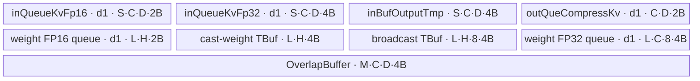

# NsaCompress A2 ACLNN 算子知识

## 算子速览

| 项目 | 内容 |
|---|---|
| 实际入口 | `aclnnNsaCompressGetWorkspaceSize` + `aclnnNsaCompress`，公开 ACLNN 两段式接口，无 V2/V3 版本 |
| 计算语义 | 对每个 batch、head 的 TND 序列，以 `compressBlockSize` 长窗口和 `compressStride` 步长做 `input × weight` 的 FP32 加权归约 |
| 输入输出 | `input[T,N,D]`、`weight[compressBlockSize,N]`、前缀和 `actSeqLenOptional[B]`；`output[sum_b max(0,floor((S_b-L)/d)+1),N,D]`；FP16/BF16、ND |
| 执行类型 | 单 Kernel `AIV_VECTOR`；唯一算子自有 Device 节点为 `nsa_compress`，`Contiguous/ViewCopy` 属于框架边界 |
| Kernel 路线 | R-001：key 0 通用滑窗压缩；FP16/BF16 仅模板类型不同，启动拓扑相同 |
| 核心资源 | GM、系统 LibAPI workspace、`VECIN/VECOUT` TQue、VECCALC/VECIN TBuf、FP32 LocalTensor；无 Cube/L1/L0、Atomic 或跨核通信 |
| 来源闭包 | `source_closed`：公开 ACLNN→L0 executor→InferShape/Host Tiling→`NsaCompressTilingData`→`nsa_compress`→`KernelNASCompress<T>`→构建接线已闭合 |
| 验证状态 | 已完成源码闭包检查；本次知识提取未执行编译、真机、数值或性能测试。 |

## 接口与语义

### 计算语义

令 `P_b=actSeqLenOptional[b]`，`P_{-1}=0`，第 `b` 个样本长度 `S_b=P_b-P_{b-1}`，窗口长 `L=compressBlockSize`、步长 `d=compressStride`。样本输出窗口数为：

```text
O_b = S_b < L ? 0 : floor((S_b - L) / d) + 1
```

对 `0 <= j < O_b`、`0 <= n < N`、`0 <= q < D`：

```text
output[sum_{k<b} O_k + j, n, q]
  = CastToInputType(
      sum_{r=0}^{L-1} float(input[P_{b-1} + j*d + r, n, q]) * float(weight[r, n]))
```

Kernel 先把 input/weight 从 FP16 或 BF16 转成 FP32，FP32 乘法和树形 Add 规约结束后以 `CAST_ROUND` 降回输入 dtype。各 batch 独立；窗口不会跨越 `actSeqLenOptional` 给出的样本边界。

### 输入、输出与属性

| 参数 | shape/layout | dtype | 约束、默认值与语义 |
|---|---|---|---|
| `input` | `[T,N,D]`，ND/TND | FP16、BF16 | 必选、非空、可非连续；与 output/weight dtype 相同；`N<=128`，`D` 是 16 的倍数且 `D<=256`；`T=actSeqLenOptional[-1]` |
| `weight` | `[L,N]`，ND | 与 input 相同 | 必选、非空、可非连续；`weight.shape[0]=L`、`weight.shape[1]=N`；`L` 是 16 的倍数且 `L<=128` |
| `actSeqLenOptional` | `[B]`，ND | INT64 | API 名称虽含 Optional，但公开接口与 Tiling 均要求非空；只支持非递减前缀和模式；L0 将 `aclIntArray` 转成 value-dependent tensor |
| `layoutOptional` | 字符串 | String | OpDef 默认 `"TND"`；公开实现只接受 `TND`，其他已枚举布局当前均失败 |
| `compressBlockSize` | 标量 `L` | INT64 | 滑窗长度；等于 weight 第一维、16 的倍数、上限 128 |
| `compressStride` | 标量 `d` | INT64 | 有效滑窗语义要求正数、16 的倍数且 `d<=L`；固定 Host 对正数条件缺少显式 guard |
| `actSeqLenType` | 标量 | INT64 | 仅 `0`，表示 `actSeqLenOptional` 是前缀和；`1` 当前不支持 |
| `output` | `[sum_b O_b,N,D]`，ND | 与 input 相同 | 必选、公开文档称不支持空 Tensor；L0 内部输出由 InferShape 分配，最后 `ViewCopy` 到调用方输出 |

### 入口与版本

固定 Commit 的公开 API 总表、目录文档、头文件与实现只给出 `aclnnNsaCompressGetWorkspaceSize`/`aclnnNsaCompress`，没有同语义 V2/V3，因此无后缀版本就是 A2 实际支持的最新公开版本。第一段接口构造 executor 和 workspace 大小，第二段在指定 stream 上执行。

平台按公开 ACLNN 文档优先判定：`docs/aclnnNsaCompress.md` 明确 A2 为支持、A3 为不支持、950 为不支持。目录 `README.md` 将 A3 标成支持，OpDef/CI 也接线 `ascend910_93`，构成“公开 ACLNN 文档不支持、实现接线支持”的冲突；本卡因此只发布 A2，不据实现接线扩展到 A3。

## Host/Launcher 执行流程

### 参数校验与前处理

1. `CheckNsaCompressParam` 检查 input、weight、output、workspaceSize、executor 指针；`actSeqLenOptional` 在后续 `AnalysisInput` 检查非空且 Size 非零。
2. `InputDtypeCheck` 要求 input/weight/output dtype 相同；可用 dtype 由 `NsaCompress` OpDef 收敛为 FP16/BF16。
3. `AnalysisAxis` 读取 TND 的 `N,D`，要求二者大于零、weight 两维分别等于 `compressBlockSize,N`，并只接受字符串 `TND`；`AnalysisInput` 只接受 `actSeqLenType=0`。
4. executor 创建后，input 与 weight 分别经框架 `l0op::Contiguous`；`actSeqLenOptional` 不做 Contiguous，而由 `ConvertToTensor(...DT_INT64)` 转换并设置 ND format。
5. `l0op::NsaCompress` 分配内部 ND 输出，调用 `InferShapeNsaCompress`。InferShape 逐 batch 计算 `O_b` 并形成 `[sum O_b,N,D]`；之后将 NsaCompress AICore 节点加入 launcher list，再以 `ViewCopy` 写入用户 output。
6. Tiling 前置 `IsEmptyInput` 拒绝 input/weight 零元素、非 1D 或无数据的 actSeqLen；`CheckParams` 再检查 TND、维度关系、16 元素对齐、`L>=d`、前缀和单调及 `P_{B-1}=T`。任一检查失败都返回错误，不启动 Kernel。

### 参数、Workspace 与生命周期

`TilingPrepareForNsaCompress` 从平台取得 `aivNum` 和 `ubSize`；模板 `NsaCompressTiling` 从 shape、属性和 actSeqLen 的 Host 可见值生成 POD。`GetWorkspaceSize` 仅把平台 `GetLibApiWorkSpaceSize()` 写入 workspace[0]；Kernel entry 的 workspace 参数未被 body 读取，因此算子没有自定义 GM workspace 分片，用户 workspace 的 owner/lifetime 仍由两段式 executor 协议管理到 stream 任务结束。

第一段返回 `uniqueExecutor->GetWorkspaceSize()` 并将 executor 所有权转交调用方。第二段 `CommonOpExecutorRun(workspace, workspaceSize, executor, stream)` 提交整张 executor 图；传入不足 workspace、空 executor 或 launch 失败由框架返回非成功状态。

### 启动图与失败传播

```text
aclnnNsaCompressGetWorkspaceSize
  -> CheckNsaCompressParam / InputDtypeCheck / AnalysisInput
  -> CREATE_EXECUTOR
  -> Contiguous(input), Contiguous(weight)
  -> l0op::NsaCompress
       -> ConvertToTensor(actSeqLenOptional)
       -> INFER_SHAPE(NsaCompress)
       -> ADD_TO_LAUNCHER_LIST_AICORE(NsaCompress)
  -> ViewCopy(internalOutput, userOutput)
  -> GetWorkspaceSize / ReleaseTo(executor)

aclnnNsaCompress(workspace, workspaceSize, executor, stream)
  -> CommonOpExecutorRun
       -> TilingNsaCompress -> registry NsaCompressTiling
       -> nsa_compress<<<blockDim=aivNum>>>
```

| 节点 | Host 添加/执行函数 | entry 与执行族 | blockDim/POD | 输入输出与 workspace | ordering、owner/lifetime 与失败传播 |
|---|---|---|---|---|---|
| N-001 `NsaCompress` | `l0op::NsaCompress` 中 `ADD_TO_LAUNCHER_LIST_AICORE`；第二段由 `CommonOpExecutorRun` 执行 | `nsa_compress`，`AIV_VECTOR` | `blockDim=aivNum`；`NsaCompressTilingData`；key 0 | input、weight、actSeqLen GM → internal output GM；workspace 仅含 opaque LibAPI system workspace，entry 参数不读该地址 | executor 持有图与临时 tensor 至 stream 任务完成；Tiling/launch 失败使第二段返回错误，且没有后续算子自有 Kernel 节点 |

`Contiguous(input/weight)`、InferShape 和末尾 `ViewCopy(internalOutput,userOutput)` 是 executor 中的框架边界，不是 NsaCompress 自有 Kernel Route；固定仓只暴露调用顺序和同一 executor/stream 提交，未暴露这些框架节点内部 entry、临时 workspace offset 或事件实现。该 Route 没有 Kernel 间 GM/workspace 交接边。API 的空指针、dtype/属性/shape、Contiguous、InferShape、launcher list、ViewCopy 与执行失败逐级短路；Tiling 的空输入、前缀和、UB 不足、POD 容量不足也返回 `GRAPH_FAILED`。entry 对当前 core 的 output/head 数为零时直接返回；未知 key 没有 fallback body。

## Route 与参数设计

### 分核与资源计算

记 `A=aivNum`、`U=ubSize`、`N=headNum`、`D=headDim`、`L=compressBlockSize`、输入元素字节 `e=2`、FP32 字节 `f=4`、`H=ceil(maxHeadPerCore/16)*16`。Host 枚举 `A` 的因子并升序尝试 `divHeadNum`：

```text
headsPerGroup = floor(N / divHeadNum)
resHeads      = N - headsPerGroup * divHeadNum
maxHeads      = headsPerGroup + (resHeads != 0)
divSeqNum     = A / divHeadNum
seqPerGroup   = floor(totalOutSeqLen / divSeqNum)
resSeq        = totalOutSeqLen - seqPerGroup * divSeqNum

maxOverlap = floor(2 * (L + d - 1) / d) - 1
fixedUB = H*L*(2 + 4 + 8*4)
        + maxHeads*L*8*4
        + maxHeads*(maxOverlap*D*4 + D*2)

BlocksNums = min(L,
  floor((U - fixedUB) / (maxHeads*D*(2 + 4 + 4))))
```

若 `fixedUB>U` 或 `BlocksNums=0`，继续下一个因子；首个成功因子确定切分，否则失败。随后把 `totalOutSeqLen` 均分给 `divSeqNum` 个 seq group，把 N 个 head 均分给 `divHeadNum` 个 head group，余数都给编号靠前的 group。实际 blockDim 始终设为 `A`；无输出或无 head 的 core 在 entry 返回。

每核输出起点由 `PerCoreStartOutputOffset` 给出，其中同一 seq group 的 head group 通过 `PerCoreHeadIdx*D` 偏移。每输出一个 token，Device 再增加全局行跨度 `N*D`。`kvStartBatchIdx/kvStartTokenIdx/kvStartOffset` 将每个 seq group 的首个输出窗口映回前缀和样本；`kvStartOffset` 被 Host 写入但当前 Device body 不读取。

### Route 选择

| 顺序 | Route | Key/模板 | 精确选择条件与优先级 | 不适用去向 |
|---:|---|---|---|---|
| 1 | R-001 通用滑窗压缩 | registry priority 0；`GetTilingKey()=0`；`KernelNASCompress<half>` 或 `<bfloat16_t>` | 公共校验成功；唯一模板 `IsCapable()` 恒 true；至少一个 `divHeadNum` 因子满足 `fixedUB<=U` 且 `BlocksNums>0`；编译期 `ORIG_DTYPE_INPUT` 为 FP16 或 BF16 | 无可行因子/POD/平台信息失败；entry 非 key 0 或其他 dtype 时无 body |

```text
TilingNsaCompress
  -> 输入/属性/前缀和校验失败：GRAPH_FAILED
  -> TilingRegistry 唯一 priority=0 模板 NsaCompressTiling
       -> 依 divHeadNum 升序尝试 UB 字节账
       -> 首个可行因子：key=0, blockDim=aivNum, R-001
       -> 全部不可行：GRAPH_FAILED

nsa_compress
  -> per-core output/head 为 0：return
  -> key=0 && ORIG_DTYPE_INPUT=DT_FLOAT16：KernelNASCompress<half>
  -> key=0 && ORIG_DTYPE_INPUT=DT_BF16：KernelNASCompress<bfloat16_t>
  -> 其他 key/dtype：无执行分支
```

### 模板/实现执行矩阵

| Route | key/selector | dtype/shape/platform 完整命中条件 | 执行拓扑与 Kernel 节点 | 实际模板/body | 内存与同步特征 | tail/fallback |
|---|---|---|---|---|---|---|
| R-001 通用滑窗压缩 | key 0；priority 0 | A2；TND；FP16/BF16；公开 shape/属性约束；前缀和合法；Host UB 因子搜索成功 | 单 Kernel N-001 `nsa_compress`，`blockDim=aivNum`，无 Kernel 间边 | `KernelNASCompress<half>` / `KernelNASCompress<bfloat16_t>`；`Init→ResetOverlapContext→Process→CopyIn→Compute(VecMulBlkMats/VecMulBlkMat/ReduceBlock/UpdateResult)→CopyOut`；helper 为 `SequenceManager/OverlapBufferManager_st` | depth 1 input/output queues；FP32 常驻 weight、input-cast、subResult 和 overlap ring；Queue + `PipeBarrier<PIPE_V/PIPE_ALL>`；无跨核同步 | CopyIn 的最后 chunk 缩短 `subSeqLen`；Mul 用 D/64 repeat + D%64 mask；窗口不足不输出；无 Route fallback |

### 隐藏性能 Guard

| Guard | Host/Tiling 条件 | Device/资源原因 | 影响 Route | 不满足时去向 | 源码符号 |
|---|---|---|---|---|---|
| 公开平台 | ACLNN 产品表 A2=支持 | 固定公开契约只允许发布 A2 | R-001 | A3 因文档/接线冲突不发布；950 不支持 | `docs/aclnnNsaCompress.md` 产品支持表 |
| UB 固定区 | `fixedUB<=ubSize` | weight 四区、overlap ring 与 output queue 必须先常驻 | R-001 | 尝试下一个 `divHeadNum`；最终失败 | `NsaCompressTiling::GetSplitInfo` |
| 至少一 token chunk | `(U-fixedUB)/(maxHeads*D*10)>0` | input FP16、input FP32、subResult 合计每 token/head/dim 10B | R-001 | 下一因子或失败 | `NsaCompressTiling::GetSplitInfo` |
| chunk 上限 | `BlocksNums=min(商,L)` | 单次 UB chunk 不超过一个压缩窗口；更长序列循环搬运 | R-001 | N/A，Host 截断 | `NsaCompressTiling::GetSplitInfo` |
| 正步长 | 有效域需 `d>0`；固定 `CheckParams` 只检查 `d%16==0 && d<=L` | `AnalyzeAttrs` 的 `MaxOverlap` 与 InferShape 输出公式都以 d 作除数 | R-001 | `d=0` 未被安全拒绝；负 d 会在后续转为 uint32；无 fallback | `CheckParams`; `AnalyzeAttrs`; `InferShapeNsaCompress` |
| DMA 32B 整块 | `D%16==0` 且 T 为 2B | CopyIn 的 blockLen/stride 以 32B block 表示 | R-001 | Tiling 失败 | `CheckParams`; `KernelNASCompress::CopyIn` |
| weight 行对齐 | `H=ceil(coreHeadNums/16)*16` | `DataCopyPad` 把每行 head 补到 32B，供 Cast/BroadCast | R-001 | UB 公式已计 padding；固定仓无另一 Route | `KernelNASCompress::InitWeight` |
| Vector repeat/tail | `loopCount=D/64`, `remain=D%64` | FP32 Mul 每 repeat 64 元素；尾部用单 repeat 的 `remain` mask | R-001 | N/A，原 Route 内尾处理 | `KernelNASCompress::VecMulBlkMat` |
| overlap context 上界 | `maxOverlap=floor(2*(L+d-1)/d)-1`，有效公开语义域 `L<=128,d>=16` | Device 静态 `seqContext[MAX_OVERLAP_NUM=20]` 与动态 overlap TBuf 必须匹配 | R-001 | 有效公开域最大 16；越界输入没有 Device fallback | `AnalyzeAttrs`; `OverlapBufferManager_st` |
| POD core 数 | Host 数组长度 48，`blockDim=aivNum` | entry 以 blockId 索引 48 元素数组 | R-001 | 固定源码未显式检查 `aivNum<=48` | `MAX_CORE_NUM`; `PostTiling`; `nsa_compress` |
| 空 core | `PerCoreOutputNum[id]==0 \|\| PerCoreHeadNum[id]==0` | 分组数可能大于有效输出/head 数 | R-001 | 当前 core 直接 return | `nsa_compress` |

### POD/ABI

`NsaCompressTilingData` 由固定仓中的 `BEGIN_TILING_DATA_DEF`/`TILING_DATA_FIELD_DEF` 声明并由同一名字在 Device 侧通过 `GET_TILING_DATA` 解包；宏定义来自仓外 CANN 头，因此固定仓不能给出可靠的整体 `sizeof/alignof/offsetof` 数值。下表按源码声明顺序逐字段闭合，数组均为 48 个元素。

| 结构 | 字段 | 类型/位宽 | ABI 布局 | 单位 | Host/launcher producer | Device consumer | 边界 |
|---|---|---|---|---|---|---|---|
| `NsaCompressTilingData` | `InputDtype` | uint32/32 | 宏生成；数值 offset 固定仓不可见 | `ge::DataType` 枚举 | `set_InputDtype(inputDtype)` | 当前 body 不读取 | inactive，但必须保留 ABI 顺序 |
| 同上 | `TotalKvSize` | uint64/64 | 同上 | 元素 | `T*N*D` | `setTiling`; `kvGm.SetGlobalBuffer` | 乘法在 uint64 域 |
| 同上 | `TotalCompressSize` | uint64/64 | 同上 | 元素 | `totalOutSeqLen*N*D` | `setTiling`; `compressKvGm.SetGlobalBuffer` | 输出总 extent |
| 同上 | `WeightSize` | uint64/64 | 同上 | 元素 | `L*N` | `setTiling`; `weightGm.SetGlobalBuffer` | GM 全量 extent |
| 同上 | `BatchSize` | uint32/32 | 同上 | batch | actSeqLen shape[0] | `actseqlensGm.SetGlobalBuffer` | actSeqLen Host shape 先要求 1D 非空 |
| 同上 | `CompressBlockSize` | uint32/32 | 同上 | token | INT64 attr 窄化为 uint32 | weight/metadata/loop | API/Tiling 约束 16 倍数、<=128 |
| 同上 | `CompressStride` | uint32/32 | 同上 | token | INT64 attr 窄化为 uint32 | overlap context 窗口起点 | 16 倍数且 <=L |
| 同上 | `HeadNum` | uint32/32 | 同上 | head | input dim 1 窄化 | GM 行跨度、output stride | 文档 <=128 |
| 同上 | `HeadDim` | uint32/32 | 同上 | 元素/head | input dim 2 窄化 | DMA、Mul、output | 16 倍数、<=256 |
| 同上 | `BlocksNums` | uint32/32 | 同上 | token/chunk | UB 余量公式并截到 L | `subSeqLen/maxSeqLen`、UB 分配 | 必须 >0；样本尾 chunk 可临时减小 |
| 同上 | `DivHeadNums` | uint32/32 | 同上 | head group | 首个 UB 可行因子 | 当前 body 不读取 | inactive，Host 分组派生字段仍依赖它 |
| 同上 | `DivSeqNums` | uint32/32 | 同上 | seq group | `aivNum/DivHeadNums` | 当前 body 不读取 | inactive，Host 数组生产依赖它 |
| 同上 | `MaxOverlap` | uint32/32 | 同上 | overlap context | `floor(2*(L+d-1)/d)-1` | `InitOverlapMgt`; context 循环 | 公开域最大 16，小于静态 20 |
| 同上 | `PerCoreHeadIdx[48]` | uint32[48] | 同上 | head index | `GetTilingDataInfo` | `setTiling`; input/weight/output head offset | 无效 core 可为 0 |
| 同上 | `PerCoreHeadNum[48]` | uint32[48] | 同上 | head count | 相邻 head idx 差/尾组 | entry 空核检查；`setTiling` | 可为 0 |
| 同上 | `PerCoreOutputNum[48]` | uint32[48] | 同上 | output token | seq group 均分 | entry 空核检查；Process 终止条件 | 可为 0 |
| 同上 | `PerCoreStartOutputOffset[48]` | uint32[48] | 同上 | output 元素 | seq group 前缀 `*N*D` + head offset `*D` | `coreCompressOffset`; CopyOut | uint32 producer，超大输出无显式溢出检查 |
| 同上 | `kvStartBatchIdx[48]` | uint32[48] | 同上 | batch index | 输出 token 前缀定位 | `coreBatchIdx`; Reset/sample 切换 | 必须小于 B |
| 同上 | `kvStartTokenIdx[48]` | uint32[48] | 同上 | 全局 input token | `startTokens + overOutputTokens*d` | `coreSeqIdx`; CopyIn | uint32 producer |
| 同上 | `kvStartOffset[48]` | uint32[48] | 同上 | input 元素 | `kvStartToken*N*D + headIdx*D` | 当前 body 不读取；Device 重新计算 | inactive；仍是 ABI 字段 |

### Route 源码闭包

| Route | Key/selector | Host/Tiling producer | POD/参数 | Kernel entry/router | Kernel body/直接依赖 | 构建接线 |
|---|---|---|---|---|---|---|
| R-001 通用滑窗压缩 | `REGISTER_OPS_TILING_TEMPLATE(...,0)`；`GetTilingKey=0` | `nsa_compress_tiling.cpp::TilingNsaCompress/TilingPrepareForNsaCompress`; `nsa_compress_tiling_general.cpp::NsaCompressTiling` | `nsa_compress_tiling.h::NsaCompressTilingData` 全字段 | `op_kernel/nsa_compress.cpp::nsa_compress`; FP16/BF16 编译 guard | `op_kernel/nsa_compress.h::KernelNASCompress<T>`；`nsa_compress_seq_manager.h::SequenceManager/OverlapBufferManager_st` | 顶层/算子 CMake 递归接线；`op_host/CMakeLists.txt::add_op_to_compiled_list/add_modules_sources`; obj/rty 宏收集 API、InferShape、Tiling、OpDef；`nsa_compress_def.cpp::AICore().AddConfig("ascend910b")` |

## Kernel 实现

### 公共执行流程

entry 创建每 block 私有 `TPipe`、解包 POD，并强制 `KERNEL_TYPE_AIV_ONLY`。空 core 返回；key 0 按编译 dtype 实例化同一 `KernelNASCompress<T>`。`Init` 绑定四个 GM tensor、按 Host 选出的最大 chunk/head 分配所有 UB、一次性转换和广播本核 weight，并初始化 overlap 环形 context。`Process` 在每个 sample 内循环 `CopyIn→Compute→CopyOut`；样本可输出窗口耗尽后切到下一 batch 并重置 context。

输入 chunk 只搬本核的 head slice；Compute 转 FP32 后让同一 chunk 与所有相交窗口 context 相乘、规约并累加。完成一个长度 L 的窗口时将 FP32 overlap 累加槽降精度入 output queue，CopyOut 写对应 output token/head slice。不同 core 的 `(output token group, head group)` 互不重叠，不需要 Atomic 或跨核 barrier。

### Route R-001：通用滑窗压缩

#### 适用条件

##### 选择证据

| 层级 | 文件 | 符号 | 源码谓词/参数 | 结果/下一跳 |
|---|---|---|---|---|
| API | `attention/nsa_compress/docs/aclnnNsaCompress.md` | 产品表/公开原型 | A2=支持；A3/950=不支持；两段式 `aclnnNsaCompress` | 冻结 A2 最新公开入口 |
| API/L0 | `attention/nsa_compress/op_host/op_api/aclnn_nsa_compress.cpp` | `aclnnNsaCompressGetWorkspaceSize` | 指针、dtype、TND、weight shape、actSeqLen/类型通过；Contiguous/L0/ViewCopy 成功 | executor 含 NsaCompress launch 节点 |
| Host | `attention/nsa_compress/op_host/nsa_compress_tiling.cpp` | `TilingNsaCompress` | 非空且 `CheckParams==GRAPH_SUCCESS` | 进入 Tiling registry，否则失败 |
| Tiling | `attention/nsa_compress/op_host/nsa_compress_tiling_general.cpp` | `NsaCompressTiling::GetSplitInfo/GetTilingKey/PostTiling` | 唯一模板 capable；因子搜索存在 `fixedUB<=U && BlocksNums>0` | key 0、blockDim=A、POD |
| Router | `attention/nsa_compress/op_kernel/nsa_compress.cpp` | `nsa_compress` | core 有 head/output，key 0，编译 dtype FP16/BF16 | `KernelNASCompress<T>::Init/Process`；否则 return/无分支 |

#### Device 数据流

##### 函数级调用链

```text
nsa_compress(input, weight, actSeqLen, output, workspace, tiling)
  -> GET_TILING_DATA / empty-core guard / dtype guard
  -> KernelNASCompress<T>::Init
       -> setTiling
       -> InitBuffer(input queues, output queue)
       -> InitWeight
            -> DataCopyPad(weight) -> Cast(FP32) -> BroadCast(x8) -> compact DataCopy
       -> InitSubResult
       -> OverlapBufferManager_st::InitOverlapMgt
       -> ResetOverlapContext
  -> KernelNASCompress<T>::Process
       -> CopyIn
       -> Compute
            -> Cast(input chunk to FP32)
            -> OverlapBufferManager_st::CheckSubTilingOverlap
            -> VecMulBlkMats -> VecMulBlkMat
            -> ReduceBlock
            -> SequenceManager::UpdateCompressTokenMetadata/UpdateSampleContext
            -> UpdateResult -> optional Cast/EnQue output
       -> CopyOut
       -> sample switch -> ResetOverlapContext
```

##### 源码等价伪码

```text
伪码（保持源码循环、地址与条件）：
block = GetBlockIdx()
if PerCoreOutputNum[block] == 0 or PerCoreHeadNum[block] == 0: return

N,D,L,d,Smax,M = POD fields
batch, globalToken = kvStartBatchIdx[block], kvStartTokenIdx[block]
head0, C = PerCoreHeadIdx[block], PerCoreHeadNum[block]
outBase, outNeed = PerCoreStartOutputOffset[block], PerCoreOutputNum[block]
weightFp32Broadcast = Broadcast8(CastFP32(DataCopyPad(weight[:, head0:head0+C])))
reset M window contexts at sample offsets coreInSampleOffset + i*d

outDone = 0
while outDone < outNeed:
  remainCopy = context[0].remainingCopySeq
  if remainCopy == 0:
    globalToken = actSeqLen[batch]
    batch += 1
    currentChunk = Smax
    reset M contexts for new batch
    continue

  currentChunk = min(currentChunk, remainCopy)
  inBase = globalToken*N*D + head0*D
  DataCopy2D(localT, input[inBase], blockCount=currentChunk,
             blockLen=C*D*sizeof(T)/32,
             srcStride=(N-C)*D*sizeof(T)/32)
  castInput[0:Smax*C*D] = CastFP32(localT)  // 仅 currentChunk 前缀被后续使用

  for each of M contexts in ring order:
    if its unfinished [windowStart, windowStart+L) intersects current input chunk:
      subOffset, reduceToken = exact intersection offset and length
      for r in 0..<reduceToken:
        for head in 0..<C:
          subResult[r,head,:] = castInput[subOffset+r,head,:] * weightFp32Broadcast[weightOffset+r,head]
      if reduceToken > 1: tree-add rows into subResult[0]
      update processed length, weight offset and sample offset
      if window incomplete: copy/add subResult[0] into overlapSlot
      else:
        add/copy final partial into overlapSlot
        if output queue occupied: CopyOut()
        EnQue(Cast<T, CAST_ROUND>(overlapSlot))
        advance ring index and recycle completed context for a future window

  CopyOut() if one complete token queued:
    outOffset = outBase + outDone*N*D
    DataCopy(output[outOffset], queued, C*D)
    outDone += 1
  globalToken += currentChunk
  sampleChunkOffset += currentChunk
```

#### 内存与数据搬运

##### 资源与搬运表

下表中 `C=coreHeadNums`、`H=ceil(C/16)*16`、`S=BlocksNums`、`M=MaxOverlap`、`e=sizeof(T)=2`。

| 层级/缓冲区 | offset/地址公式 | extent/容量公式 | dtype/layout | producer | consumer | owner/lifetime | 对齐/复用 |
|---|---|---|---|---|---|---|---|
| GM input `kvGm` | chunk base `globalToken*N*D + head0*D` | `TotalKvSize*T`；每次 `S_cur` 行 × `C*D` | T，TND | caller | `CopyIn` | stream | 2D DMA；行长/stride 都因 `D%16=0` 对齐 32B |
| GM weight `weightGm` | `head0`，每行 stride N | `WeightSize*T`；搬 L 行 × C head | T，[L,N] | caller | `InitWeight` | stream；每核只读一次 | `DataCopyPad` 每行补到 H 个元素 |
| GM actSeqLen | index batch/batch-1 | `BatchSize*int64` | INT64 前缀和 | L0 ConvertToTensor | sample 切换/offset | executor/stream | Kernel `GetValue`，无 UB queue |
| GM output `compressKvGm` | `outBase + outDone*N*D` | `TotalCompressSize*T`；每次 C*D | T，TND | `CopyOut` | caller | stream | 每核只写自己的 head slice |
| 系统 workspace | framework 决定 | `GetLibApiWorkSpaceSize()` | opaque | Host/platform | 框架 LibAPI | executor 到 stream 完成 | Kernel body 未读取 workspace 参数 |
| `inQueueKvFp16` VECIN depth 1 | queue slot 0 | `S*C*D*2` B | T | `CopyIn` | `Compute::Cast` | 每 chunk Alloc→EnQue→DeQue→Free | 最后 chunk 只更新有效前缀，物理容量不缩 |
| `inQueueKvFp32` VECIN depth 1 | queue slot 0 | `S*C*D*4` B | FP32 | `Compute::Cast` | VecMul | Init 时 Alloc 后常驻 | `castKvCacheLocal` 不 EnQue；按持久 local 使用 |
| `inBufOutputTmp` VECCALC | row `r*C*D` | `S*C*D*4` B | FP32 | VecMul | Reduce/UpdateResult | 全 Process 复用 | 每个相交 window 覆盖有效 reduceToken 行 |
| `OverlapBuffer` VECCALC | context `i*C*D` | `M*C*D*4` B | FP32 | UpdateResult | 累加/最终 Cast | 环形 context 生命周期 | context 完成后由 metadata/ring index 复用 |
| `outQueCompressKv` VECOUT depth 1 | queue slot 0 | `C*D*2` B | T | UpdateResult Cast/EnQue | CopyOut | 每完成窗口 Alloc→EnQue→DeQue→Free | 若已有 tensor，先 CopyOut 再分配 |
| weight FP16 queue depth 1 | padded row `r*H` | `L*H*2` B | T | DataCopyPad | Cast | InitWeight；pipe 分配保持 | 行尾 `H-C` 脏值被后续压实丢弃 |
| cast-weight TBuf VECIN | padded row `r*H` | `L*H*4` B | FP32 | Cast `CAST_NONE` | BroadCast | Init 后不再改写 | 保留 padded layout |
| broadcast-weight TBuf VECIN | scalar block `(r*H+h)*8` | `L*H*8*4` B | FP32，每标量复制 8 个 | `BroadCast<float,2,1>` | compact DataCopy | Init 后不再改写 | 8 FP32=32B；便于 scalar stride 0 Mul |
| `inQueueWeightFp32` VECIN depth 1 | `(r*C+h)*8` | `L*C*8*4` B | FP32 broadcast compact | local DataCopy | VecMul | Init 时 Alloc 后常驻 | 去掉每行 H-C padded blocks |
| Vector 寄存器 | API 内部 | 固定仓不可见 | FP32 | Mul/Add | 写回 local | 单条 Vector API | 无显式 RegTensor |

##### 分层内存布局



所有节点均对应 `KernelNASCompress::Init/InitWeight/InitSubResult` 或 `OverlapBufferManager_st::InitOverlapMgt` 的一次 `InitBuffer`。源码中没有 double buffer；所有 queue depth 均为 1。

##### 字节账与复用顺序

```text
UB_total
 = S*C*D*2                         // input T queue
 + S*C*D*4                         // input FP32 queue-backed persistent local
 + S*C*D*4                         // subResult TBuf
 + C*D*2                           // output queue
 + L*H*2 + L*H*4 + L*H*8*4       // padded/cast/broadcast weight
 + L*C*8*4                         // compact broadcast weight
 + M*C*D*4                         // overlap ring
 = 10*S*C*D + 2*C*D + 38*L*H + 32*L*C + 4*M*C*D

Host fixedUB = 2*C*D + 38*L*H + 32*L*C + 4*M*C*D
Host tokenBytes = 10*C*D
S = min(L, floor((ubSize-fixedUB)/tokenBytes))
=> UB_total <= ubSize
```

| 复用子区 | 写入者 | 读取者/消费点 | 下一次覆盖 | 同步或释放依据 | 安全条件 |
|---|---|---|---|---|---|
| input T queue slot | CopyIn | Compute Cast | 下一 chunk CopyIn | EnQue→DeQue→FreeTensor | depth 1，Free 后才再次 Alloc |
| `castKvCacheLocal` | Compute Cast | 当前 chunk 所有 overlap VecMul | 下一 chunk Cast | Cast 后 `PIPE_V`; input queue 已 Free | overlap 循环完成前不得覆盖 |
| `subResultLocal` | 每个 context 的 VecMul | ReduceBlock/UpdateResult | 下一个相交 context | 每次 Mul/Add 后 `PIPE_V` | 有效 `reduceToken*C*D` 全部先被 Mul 覆盖 |
| overlap context `i` | UpdateResult copy/add | 后续 chunk 累加或完成时 Cast | context 完成、ring index 前移后新窗口使用 | 每次 copy/add/Cast 后 `PIPE_V`; metadata 同步更新 | context 的 tokenProcessingLength 到 L 后才回收 |
| output queue slot | 完成窗口的 Cast/EnQue | CopyOut | 下一完成窗口 | 若 `HasTensorInQue` 先 CopyOut；DeQue→FreeTensor | depth 1，不允许两个完成 token 同时占槽 |
| compact broadcast weight | InitWeight | 全部 VecMul | 无覆盖，Kernel 结束释放 | weight Cast/Broadcast/DataCopy 后 `PIPE_V` | C/L 固定且 weight 只读 |

#### 同步、精度与尾块

##### 同步与数值边界表

| 阶段 | primitive/机制 | producer | consumer/等待点 | 保护对象 | 精度/尾块 |
|---|---|---|---|---|---|
| GM→input UB | TQue EnQue/DeQue | `DataCopy` + EnQue | Compute DeQue | depth-1 input slot | 最后样本 chunk 将 `subSeqLen=min(remain,S)`；2D DMA 只搬有效行 |
| input cast | `Cast(...CAST_NONE)` + `PipeBarrier<PIPE_V>` | T input | VecMul | `castKvCacheLocal` | 物理 Cast 长度仍是最大 `subKvSize=S*C*D`；后续只索引当前 `subSeqLen` 有效前缀 |
| weight prep | DataCopyPad→Cast→BroadCast→DataCopy，各阶段 `PIPE_V` | GM weight | VecMul | 四个常驻 weight 区 | FP16/BF16→FP32；padding 经 compact copy 丢弃 |
| per-head Mul | `Mul(mask=64, repeat=D/64, src0RepStride=8, src1RepStride=0, dstRepStride=8)` | input FP32 + 8-lane replicated scalar | subResult | 一 head 的 D 元素 | `D%64` 用 mask=`remain`、repeat=1；D 至少 16 对齐 |
| token 规约 | 原地 `Add` + `PIPE_V` | subResult 各 row | subResult row 0 | FP32 partial sum | 先补到 next power-of-two 的首步，再二分树形 Add；`reduceToken=1` 跳过 |
| 跨 chunk 累加 | DataCopy/Add + `PIPE_V` | subResult row 0 | overlap slot | 一个 window/head slice | 全程 FP32；initiated 用 Copy，processing 用 Add |
| 降精度入队 | `Cast(...CAST_ROUND)` + `PIPE_V` + EnQue | 完成的 overlap slot | CopyOut | output queue slot | 只在处理长度达到 L 时降为 T |
| UB→GM | `PIPE_ALL`→DataCopy→`PIPE_ALL` | output queue DeQue | GM output | 当前 C*D slice | 不写其他 head；offset 每 token 加 N*D |
| 跨核 | 无 Atomic/barrier | 每核独立 output/head 笛卡尔分片 | N/A | 不相交 GM slice | 空 core return；不存在跨核归约 |

#### 关键实现

##### 符号证据表

| 阶段 | 文件 | 符号/模板实例 | 实现事实 |
|---|---|---|---|
| Host/Tiling producer | `attention/nsa_compress/op_host/nsa_compress_tiling_general.cpp` | `NsaCompressTiling::GetSplitInfo/GetTilingDataInfo/DoOpTiling/PostTiling` | 因子优先级、UB 公式、S 上限、core/head/output 起点、POD 与 blockDim |
| Kernel entry/router | `attention/nsa_compress/op_kernel/nsa_compress.cpp` | `nsa_compress`; `KernelNASCompress<half/bfloat16_t>` | AIV-only、空核、key 0、dtype 编译 guard |
| Device body/helper | `attention/nsa_compress/op_kernel/nsa_compress.h` | `Init/InitWeight/Process/CopyIn/Compute/VecMulBlkMat/ReduceBlock/UpdateResult/CopyOut` | UB 分配、DMA 地址、FP32 pipeline、Vector 参数、overlap 累加和 tail |
| Device state helper | `attention/nsa_compress/op_kernel/nsa_compress_seq_manager.h` | `SampleManager_st/SequenceManager/OverlapBufferManager_st` | sample 边界、窗口 processing length、weight offset 与 overlap ring 生命周期 |

## 算子特定优化

### Trick T-001：Host 用 Device 同构字节账联合选择 head 分核与 token chunk

#### 触发与源码依据

- 适用 Route：R-001
- 触发条件：依升序 `divHeadNum` 因子尝试；当前因子的固定 weight/overlap/output 区能放入 UB，且剩余空间至少容纳一个 input/cast/subResult token。
- Golden 来源：[`attention/nsa_compress/op_host/nsa_compress_tiling_general.cpp:259-274`](../../../../../../../cann-ops-raw/ascendc/ops-transformer/be33d95bb755cedec3108f70805c1874d1792540/attention/nsa_compress/op_host/nsa_compress_tiling_general.cpp#L259-L274)

**官方源码（固定 Commit 连续逐字摘录）**：

```cpp
NeedUBMemory = CeilDiv(maxHeadPerCore, ubBlockHalfNum) * ubBlockHalfNum *
                   (unitWeightPadFp16Memory + unitWeightPadFp32Memory + unitWeightBroadCastFp32Memory) +
               maxHeadPerCore * unitWeightFp32Memory;
NeedUBMemory += maxHeadPerCore * (unitOverlapMemory + unitCompressKvMemory);
if (NeedUBMemory > static_cast<uint32_t>(ubSize)) {
    continue;
}

maxCopyKVTokensNums = (static_cast<uint32_t>(ubSize) - NeedUBMemory) /
                      (maxHeadPerCore * (unitKvFp16Memory + unitKvFp32Memory + unitSubResultMemory));
```

#### 机制与设计原因

Host 先计算与 chunk 长度无关的四份 weight 表、overlap 环和 output queue，再用余量同时容纳 T input、FP32 input 和 FP32 subResult。该公式与 Device 所有 `InitBuffer` 一一对应，避免用逻辑有效长度低估常驻 padding/broadcast 区；当 heads/core 太大时继续增加 head 分核，直到存在可行 UB 布局。成功后把 S 截到 L，使一个 chunk 最多覆盖一个压缩窗口，但仍可被多个相交 overlap context 复用。

#### 迁移边界

- 适用：固定 buffer 集合、head 分核数会改变常驻 UB、chunk 长度可独立缩放的纯 Vector 滑窗算子。
- 前提：所有 `InitBuffer` 容量、dtype 字节、head padding 和 overlap 上限都进入同一 Host 公式。
- 失效：加入 double buffer、条件 buffer、新 dtype 或改变 weight layout 时必须同步重算；否则应让当前因子失败而不是沿用旧 S。
- 未验证：本次知识提取未执行编译、真机、数值或性能测试。

#### 错误做法

固定仓可验证的错误终点是忽略固定区后令 `NeedUBMemory>ubSize` 或 `maxCopyKVTokensNums=0`；官方实现对此跳过当前因子，并在所有因子都失败时返回 `GRAPH_FAILED`。

### Trick T-002：weight 每核一次 FP32 八路广播，Mul 用零 stride 复用标量

#### 触发与源码依据

- 适用 Route：R-001
- 触发条件：FP16/BF16 weight `[L,N]`，本核连续 head slice C；每个权重标量要作用于该 head 的 D 个 FP32 feature。
- Golden 来源：[`attention/nsa_compress/op_kernel/nsa_compress.h:261-288`](../../../../../../../cann-ops-raw/ascendc/ops-transformer/be33d95bb755cedec3108f70805c1874d1792540/attention/nsa_compress/op_kernel/nsa_compress.h#L261-L288)

**官方源码（固定 Commit 连续逐字摘录）**：

```cpp
repeatParams.src0BlkStride = 1;
repeatParams.src0RepStride = Eight;
repeatParams.src1BlkStride = 0;
repeatParams.src1RepStride = 0;
repeatParams.dstBlkStride = 1;
repeatParams.dstRepStride = Eight;
for (uint32_t headIdx = 0; headIdx < headNum; headIdx++) {
    uint32_t src0UbOffset = headDim * headIdx;
    uint32_t src1UbOffset = Eight * headIdx;
    uint32_t dstUbOffset = headDim * headIdx;
    Mul(dstUb[dstUbOffset], src0Ub[src0UbOffset], src1Ub[src1UbOffset], mask, loopCount, repeatParams);
```

#### 机制与设计原因

`InitWeight` 仅在 Kernel 初始化时读取本核 weight，将每个 FP32 标量复制成 8 个元素（正好 32B），再压实掉 head padding。Mul 对 input/dst 采用连续 block、每 repeat 跨 8 个 32B block，而 `src1BlkStride=src1RepStride=0` 让同一 32B 标量块广播到该 head 的所有 64 元素 repeat；D 的不足 64 部分复用相同参数配单次 remain mask。这样 weight 不随 input chunk 重复从 GM 搬运或重复 Cast/Broadcast。

#### 迁移边界

- 适用：一个标量沿连续 feature 轴广播，且 FP32 Vector repeat 为 64 元素的场景。
- 前提：每标量预扩成 8 FP32/32B；compact 表按 `[L,C,8]` 排列；D 的地址和 repeat stride 保持源码关系。
- 失效：weight 随 token/chunk 改变、feature 不连续、dtype/repeat 宽度变化时必须重做 broadcast layout 与 stride，不能直接复用零 stride 参数。
- 未验证：本次知识提取未执行编译、真机、数值或性能测试。

#### 错误做法

固定仓未提供另一条可验证 Route；可验证边界是若不保留 `H` padding 的 UB 字节，Host 与 `InitWeight` 的实际分配会不一致。

### Trick T-003：一个 input chunk 扫描 overlap 环并增量完成多个滑窗

#### 触发与源码依据

- 适用 Route：R-001
- 触发条件：`d<=L`，当前 input chunk 与一个或多个未完成 `[windowStart,windowStart+L)` 相交。
- Golden 来源：[`attention/nsa_compress/op_kernel/nsa_compress.h:440-468`](../../../../../../../cann-ops-raw/ascendc/ops-transformer/be33d95bb755cedec3108f70805c1874d1792540/attention/nsa_compress/op_kernel/nsa_compress.h#L440-L468)

**官方源码（固定 Commit 连续逐字摘录）**：

```cpp
uint32_t curOverlapIdx = overlapMgt.overlapIdx;
for (int i = 0; i < overlapMgt.overlapNum; i++) {
    uint32_t dstOverlapIdx = (curOverlapIdx + i) % overlapMgt.overlapNum;
    int32_t result = overlapMgt.CheckSubTilingOverlap(dstOverlapIdx, this->coreInfo.coreBatchIdx,
                                                      this->subTiling.subKvSampleOffset, this->subTiling.subSeqLen,
                                                      &(this->subTiling), &(this->coreInfo));
    if (HAS_OVERLAP == result) {
        uint32_t subKvOffset = 0;
        uint32_t remainingSubKvLen = this->subTiling.subSeqLen;
        uint32_t compressTokenRemainingOffset =
            overlapMgt.seqContext[dstOverlapIdx].GetPreserveSamplePosDuringOverlap() +
            overlapMgt.seqContext[dstOverlapIdx].GetProcessingLenth();
```

#### 机制与设计原因

M 个 context 保存各窗口的 sample 起点、已处理长度、weight offset 和 FP32 累加槽。每个 input chunk 只搬一次、Cast 一次，然后按环形顺序找所有相交窗口；交集行乘以对应 weight 片段并规约后累加到各自槽。窗口完成时 context 前移 `M*d` 并复用同一物理槽，避免为重叠窗口重复搬运 input 或物化完整 `[L,C,D]` 窗口。context 在 batch 切换时整体重置，保证不跨样本复用。

#### 迁移边界

- 适用：固定长度/步长滑窗，多个输出共享输入区间，且窗口 partial 可结合累加。
- 前提：M 覆盖最坏同时活跃窗口数；metadata 更新与槽回收同序；FP32 累加具有结合实现语义；batch 边界显式 reset。
- 失效：非结合计算、动态逐窗口 weight、跨窗口依赖或 M 超过静态 metadata 20 时必须换实现；固定仓没有其他 fallback Route。
- 未验证：本次知识提取未执行编译、真机、数值或性能测试。

#### 错误做法

固定源码中的 `CheckSubTilingOverlap` 明确排除不同 sample 和已经处理过的区间；忽略这两个 guard 会重复累加或跨 batch 混合。固定仓未提供性能反例。

## 模板与实现对比

| 对比维度 | R-001 FP16 实例 | R-001 BF16 实例 | 设计选择依据 |
|---|---|---|---|
| 命中条件/优先级 | key 0、`ORIG_DTYPE_INPUT=DT_FLOAT16` | key 0、`ORIG_DTYPE_INPUT=DT_BF16` | Host 唯一 priority 0 模板，dtype 由编译 guard 区分 |
| 模板与 dtype | `KernelNASCompress<half>` | `KernelNASCompress<bfloat16_t>` | T 大小同为 2B，UB/DMA 布局相同 |
| 循环与分核 | 同一 A/seq/head 切分 | 同左 | POD 和 body 完全相同 |
| Queue/TBuf/寄存器/dynamic UB/通信 window | 同一 depth-1 queue 与 FP32 TBuf；无 dynamic UB/通信 window；显式寄存器不可见 | 同左 | 仅 GM/queue T 元素解释不同 |
| 内存总占用与复用 | `10*S*C*D + 2*C*D + 38*L*H + 32*L*C + 4*M*C*D` | 同左 | 两种输入 dtype 均 2B |
| 搬运/Vector/SIMT/NDDMA/通信 API | half→FP32 Cast，FP32 Mul/Add；无 SIMT/NDDMA/通信 | BF16→FP32 Cast，FP32 Mul/Add；无 SIMT/NDDMA/通信 | 核心计算固定 FP32 |
| 同步、精度与 tail | `CAST_NONE` 升精度，`CAST_ROUND` 降 half | `CAST_NONE` 升精度，`CAST_ROUND` 降 BF16 | 同一 barrier/mask/tree-reduce 顺序 |
| fallback/失败边界 | 无其他 key/body | 无其他 key/body | 非 key 0/非编译 dtype 不执行；Host 不可行则失败 |

## 平台差异

| 项目 | A2 | A3 | 950 |
|---|---|---|---|
| 支持状态 | 公开 ACLNN 文档明确支持；本卡发布 | 公开 ACLNN 文档明确不支持，但 README、OpDef `ascend910_93` 和 CI 接线称支持，属于发布冲突；本卡不发布 A3 | README 与 ACLNN 文档均明确不支持 |
| Host/Launcher | `ascend910b` OpDef/CI 接线；通用 Host 模板 | 实现源码共用，但不得越过公开文档冲突视为 ACLNN 支持 | 无公开 Host/ACLNN 支持 |
| Kernel/资源 | key 0、AIV-only `KernelNASCompress<T>` | 存在相同实现接线信号，但本卡不承诺可调用 | 无 arch35/950 Route |

## 限制与失败边界

- 公开 ACLNN 仅闭合 A2；A3 的 README/实现接线不能覆盖 ACLNN 产品表的明确“不支持”，950 明确不支持。
- 只支持 TND、FP16/BF16、非空 input/weight、非空前缀和 actSeqLen、`actSeqLenType=0`；公开范围要求 `N<=128`、`D%16=0,D<=256`、`L%16=0,L<=128`、`d%16=0,d<=L`。
- `CheckParams` 没有显式检查 `compressStride>0`；`d=0` 能通过“16 的倍数”和 `d<=L` 检查，随后 InferShape/`AnalyzeAttrs` 会以 `d` 作除数；负的 16 倍数也可能先通过再窄化为 uint32。调用者必须把滑窗步长落实为正数，不能依赖固定 Host 源码安全拒绝非法符号。
- `CheckNsaCompressParam` 未检查 `layoutOptional` 指针，`AnalysisAxis` 直接将它交给 `op::ToString`；固定仓不可见该框架转换对空指针的行为，调用者必须提供有效的 `"TND"` 字符串。
- API `AnalysisAxis` 在读取维度前未显式检查 rank；rank 3/2 主要来自公开契约和框架 OpDef，调用者不能依赖越界 shape 被该函数安全拒绝。
- Host 将多个 shape/attr INT64 窄化到 uint32，并将 per-core output/input 元素 offset 写入 uint32 数组；UB 计算也把 `ubSize` 下转为 uint32。固定源码未见对超大 T/总输出或这些窄化的显式溢出检查。
- POD 只容纳 48 core 项且 `PostTiling` 直接设置 `blockDim=aivNum`；固定源码未见 `aivNum<=48` 的显式 guard。A2 实际平台值必须与该静态 ABI 匹配。
- `totalOutSeqLen=0` 没有独立 Route。公开文档要求 output 非空；Host `GetTilingDataInfo` 的 batch 定位循环也未显式展示零输出保护，因此不能把所有样本 `S_b<L` 当作已闭合的空输出能力。
- `MAX_OVERLAP_NUM=20` 是 Device metadata 静态上限；公开 L/d 范围使 Host `MaxOverlap<=16`。扩大属性范围时必须同步证明该上限与 UB 公式。
- 最后 chunk 的 input FP32 Cast 仍使用最大 `subKvSize`，但 Mul/规约只读取 `subSeqLen` 有效前缀；不得让新代码使用未搬运的尾部 local 数据。
- Kernel 收到未知 key/非 FP16-BF16 编译类型时没有显式错误或 fallback；正确性依赖 Host/构建只发 key 0 的已接线实例。
- `kvStartOffset`、`InputDtype`、`DivHeadNums`、`DivSeqNums` 写入 POD 但当前 body 不读取；复用 ABI 时不得删除或重排。
- workspace 仅闭合为平台 LibAPI system workspace；Kernel body 不读取自定义 workspace。固定仓不可见框架内部 allocator/launcher 实现。
- 本次知识提取未执行编译、真机、数值或性能测试；不据源码机制给出实测收益。

## 源码索引

### 链路索引

| 链路阶段 | 文件 | 关键符号 | 支撑内容 |
|---|---|---|---|
| 公开平台/接口约束 | `attention/nsa_compress/docs/aclnnNsaCompress.md` | 产品表、函数原型、约束 | A2-only ACLNN、两段式入口、shape/dtype/属性范围 |
| 公开目录说明 | `attention/nsa_compress/README.md` | 产品表、功能/参数说明 | 数学语义及 A3 文档冲突证据 |
| 公开 API 总表 | `docs/zh/op_api_list.md` | `aclnnNsaCompress` 条目 | 公开入口存在且固定 Commit 未列同语义 V2/V3 |
| 入口声明 | `attention/nsa_compress/op_host/op_api/aclnn_nsa_compress.h` | `aclnnNsaCompressGetWorkspaceSize/aclnnNsaCompress` | C ABI 参数顺序 |
| 入口实现 | `attention/nsa_compress/op_host/op_api/aclnn_nsa_compress.cpp` | `CheckNsaCompressParam/InputDtypeCheck/AnalysisInput/aclnnNsaCompress*` | ACLNN 校验、Contiguous、executor、ViewCopy、stream launch |
| L0 launcher | `attention/nsa_compress/op_host/op_api/nsa_compress.cpp` | `l0op::NsaCompress` | actSeqLen 转 tensor、InferShape、AICore launcher node |
| OpDef/平台 | `attention/nsa_compress/op_host/nsa_compress_def.cpp` | `ops::NsaCompress` | dtype/format/value dependency、ascend910b/910_93 接线 |
| InferShape | `attention/nsa_compress/op_host/nsa_compress_infershape.cpp` | `InferShapeNsaCompress` | `O_b` 与输出 `[sum O_b,N,D]` |
| Tiling 入口/校验 | `attention/nsa_compress/op_host/nsa_compress_tiling.cpp` | `CheckParams/TilingNsaCompress/TilingPrepareForNsaCompress` | 前缀和、alignment、平台 AIV/UB、失败传播 |
| POD | `attention/nsa_compress/op_host/nsa_compress_tiling.h` | `NsaCompressTilingData` | 逐字段 Host/Device ABI |
| Tiling 公共定义 | `attention/nsa_compress/op_host/nsa_compress_tiling_common.h` | `NsaCompressCompileInfo/MIN_COPY_UINT_SIZE` | 平台 AIV/UB 编译信息与 32B 单元 |
| Tiling producer | `attention/nsa_compress/op_host/nsa_compress_tiling_general.cpp` | `NsaCompressTiling` 全方法 | Route、UB 字节账、分核、POD、key/workspace/blockDim |
| Kernel entry | `attention/nsa_compress/op_kernel/nsa_compress.cpp` | `nsa_compress` | AIV-only、空核、key/dtype router |
| Kernel body | `attention/nsa_compress/op_kernel/nsa_compress.h` | `KernelNASCompress<T>` | Init/Copy/Vector/UB/同步/精度/tail |
| Kernel 公共定义 | `attention/nsa_compress/op_kernel/nsa_compress_common.h` | `CompressState/MAX_OVERLAP_NUM` | window 状态与静态 context 上限 |
| 状态 helper | `attention/nsa_compress/op_kernel/nsa_compress_seq_manager.h` | `SequenceManager/OverlapBufferManager_st` | overlap、sample、metadata 与环形复用 |
| Device 内部参数 | `attention/nsa_compress/op_kernel/nsa_compress_tiling.h` | `NSACompressTiling/CompSingleCoreInfo/SubTilingInfo` | POD 到本核/子块运行时参数的映射 |
| Tiling 基类 | `common/include/op_host/tiling_base.h` | `TilingBaseClass::DoTiling` | shape/platform/capable/tiling/workspace/PostTiling/key 的固定执行顺序与返回传播 |
| Tiling 注册表 | `common/include/op_host/tiling_templates_registry.h` | `TilingRegistry::DoTilingImpl`; `REGISTER_OPS_TILING_TEMPLATE` | priority 从小到大尝试、唯一 priority 0 模板与失败终点 |
| Device 公共 helper | `common/include/op_kernel/util.h` | `CeilDiv` | `InitWeight` 的 head 数 32B 对齐公式 |
| 顶层构建模式 | `CMakeLists.txt` | `BUILD_OPEN_PROJECT/BUILD_OPS_RTY_KERNEL` 分支 | 选择 obj/rty source-collection 宏并进入算子构建 |
| 算子目录接线 | `attention/nsa_compress/CMakeLists.txt` | `add_subdirectory` 循环 | 将 `op_host` 纳入活动构建 |
| 算子 Host 接线 | `attention/nsa_compress/op_host/CMakeLists.txt` | `add_op_to_compiled_list/add_modules_sources/add_ops_compile_options` | 注册编译算子、模块收集与 return-yellow 的自动同步关闭选项 |
| 编译算子登记 | `cmake/func.cmake` | `add_op_to_compiled_list` | 以目录名登记 `nsa_compress` 与算子路径 |
| Open/custom 模块收集 | `cmake/obj_func.cmake` | `add_modules_sources` | GLOB API/头、InferShape、Tiling、OpDef 到对应 object target |
| RTY 模块收集 | `cmake/rty_obj_func.cmake` | `add_modules_sources` | RTY 模式 GLOB API/头、OpDef，并登记活动算子路径 |
| A2 CI 接线 | `scripts/ci/ascend910b/ops_transformer_operator_list.yaml` | `operator_group_1::nsa_compress` | ascend910b 活动算子列表 |
| A3 CI 冲突信号 | `scripts/ci/ascend910_93/ops_transformer_operator_list.yaml` | `operator_group_1::nsa_compress` | 实现接线支持 A3，但公开 ACLNN 专页明确不支持 |

### 实现复用检查

| 检查项 | 可复用事实 | 不得改变的约束 | 源码符号 |
|---|---|---|---|
| ABI/POD | key 0 共用 `NsaCompressTilingData`，20 个字段逐项闭合 | 字段顺序/位宽、48 长数组、uint32 窄化、inactive 字段均不得擅改 | `NsaCompressTilingData`; `DoOpTiling`; `setTiling` |
| 调用顺序 | ACLNN 第一段冻结 Contiguous/L0/ViewCopy 图，第二段在 stream 执行 | actSeqLen 转 tensor和 value dependency、executor/workspace lifetime | `aclnnNsaCompressGetWorkspaceSize`; `l0op::NsaCompress`; `aclnnNsaCompress` |
| workspace/内存 | system workspace + 9 类 UB 物理区及精确总字节公式 | H padding、depth=1、M overlap、S 三份 token 区必须同时计入 | `GetWorkspaceSize`; `GetSplitInfo`; `Init/InitWeight/InitOverlapMgt` |
| 同步 | input/output Queue ownership，Vector 阶段 PipeBarrier，输出 PIPE_ALL | Free/覆盖只能发生在 consumer 完成后；无跨核同步是因为输出不重叠 | `CopyIn/Compute/UpdateResult/CopyOut` |
| 精度与尾块 | T→FP32 Mul/Add→`CAST_ROUND` T；D%64 mask、sample 最后 chunk 缩短 | 树形 Add 顺序、只读 current `subSeqLen`、只在 L 完成时输出 | `VecMulBlkMat/ReduceBlock/UpdateResult/CopyIn` |
| 失败边界 | API/Tiling 失败关闭、空 core return、唯一 key 0 | 不得为 A3/950、空输出、未知 key 或资源不足推测 fallback | `CheckParams/GetSplitInfo/nsa_compress`; ACLNN 产品表 |