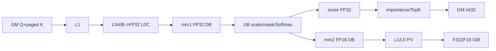
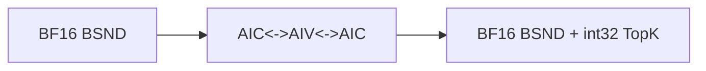

# NsaCompressAttentionInfer A2/A3 ACLNN 算子知识

## 算子速览

| 项目 | 内容 |
|---|---|
| 实际入口 | 公开两段式 `aclnnNsaCompressAttentionInferGetWorkspaceSize` / `aclnnNsaCompressAttentionInfer`，无版本后缀 |
| 计算语义 | `Pcmp=Softmax(scale·QKᵀ)`，`attentionOut=Pcmp·V`；再将压缩概率按选择块/压缩窗参数滑窗加权、跨 GQA group 求和并取 TopK 索引 |
| 输入输出 | Q 为 TND `[T,N,Dq]` 或 BSND `[B,S,N,Dq]`；paged K/V 为 `[numBlocks,pageBlockSize,Nkv·D]`；输出 D 改为 `Dv`，TopK 最后一轴为 `selectBlockCount` |
| 执行类型 | `MIX_CV`：单次 `KERNEL_TYPE_MIX_AIC_1_2` launch，1 个 AIC 配 2 个 AIV |
| Kernel 路线 | R-001 FP16/TND；R-002 FP16/BSND；R-003 BF16/TND；R-004 BF16/BSND |
| 核心资源 | paged GM K/V、四段 user workspace、512 KiB L1、64 KiB L0A、64 KiB L0B、128 KiB L0C、192 KiB UB |
| 来源闭包 | `source_closed`：公开 ACLNN→L0 executor→InferShape/Tiling/POD→MIX entry→AIC/AIV body→构建与 A2/A3 注册闭合 |
| 验证状态 | 已完成源码闭包检查；本次知识提取未执行编译、真机、数值或性能测试。 |

## 接口与语义

### 计算语义

令压缩 KV 长度为 `Scmp`，GQA 分组 `G=numHeads/numKeyValueHeads`。AIC 先以 FP32 累加生成 `QKᵀ`；AIV 依次乘 `scaleValue`、在 `attenMaskFlag==1` 时按实际 Q/选择前 KV 长度把需要屏蔽行的最后一个压缩位置写为 `-3e38`、执行 FP32 Softmax，并同时输出 FP32 概率到 importance-score 路径和 FP16/BF16 概率到第二次 MMAD。AIC 将后者与 V 相乘、FP32 累加后转回输入 dtype。AIV 按源码权重三角窗累计 `Pslc`，再对每个 KV head 的 `G` 个 Q head 求和；边界候选写入 FP32 正无穷位型，最后 `TopK<float,...TOPK_NORMAL>` 输出 `int32` 索引。

`attentionMaskOptional` 的 GM 内容虽然占据 entry 形参，但没有传给 `Run`，因此 Device 不读取其内容；它只令 Tiling 写 `attenMaskFlag=1`，实际 mask 由 `actualQSeqLenOptional`、`actualCmpKvSeqLenOptional`、`actualSelKvSeqLenOptional` 和压缩属性在 AIV 中生成。`topKMaskOptional` 同样占据 entry 形参但不传给 `Run`，是当前实现的预留参数。

### 输入、输出与属性

| 参数 | shape/layout | dtype | 约束、默认值与语义 |
|---|---|---|---|
| `query` | TND `[T,N,Dq]`；BSND `[B,S,N,Dq]`，ND | FP16/BF16 | 必选、连续；`N=numHeads`，`Dq∈(0,192]`；多 token 的实际 Q 长度为 1..4 |
| `key` | `[numBlocks,pageBlockSize,Nkv·Dq]`，ND | 与 Q 相同 | paged cache；`numBlocks>0`，page 为16..128且16对齐 |
| `value` | `[numBlocks,pageBlockSize,Nkv·Dv]`，ND | 与 Q 相同 | `Dv∈(0,128]` 且 `Dv<=Dq` |
| `attentionMaskOptional` | 可选 ND | OpDef 为 BOOL | 非空只打开由长度生成的尾部 mask；内容未传入 device body |
| `blockTableOptional` | `[B,maxBlockNumPerBatch]` | INT32 | ACLNN 实际要求非空；AIC 以 `blockTable[b,sIdx]` 映射 K/V page |
| `actualQSeqLenOptional` | `[B]` | INT64 | 缺省为空 tensor并按单 token；不合规时 Tiling 警告后退化单 token |
| `actualCmpKvSeqLenOptional` | `[B]` | INT64 | ACLNN 实际要求非空；每 batch 当前压缩 KV 长度，最大8192 |
| `actualSelKvSeqLenOptional` | `[B]` | INT64 | 多 token/mask 路径使用；关系不满足时退化单 token |
| `topKMaskOptional` | 预留 | BOOL | 可连续化但 Host/Tiling/Kernel 不消费内容 |
| `numHeads`,`numKeyValueHeads` | 标量 | INT64→uint32 | 整除；Device guard为 `G<=128 && 128%G==0` |
| `selectBlockSize` | 标量 | INT64→uint32 | 16..128、16对齐、能被压缩stride整除且不小于压缩窗 |
| `selectBlockCount` | 标量 | INT64→uint32 | 不大于最短 batch 候选块数；候选块数最大4096 |
| `compressBlockSize` | 标量 | INT64→uint32 | 16..128、16对齐且不小于stride |
| `compressBlockStride` | 标量 | INT64→uint32 | 16/32/48/64 |
| `scaleValue` | 标量 | DOUBLE→L0 float→POD float32 | Softmax 前缩放值 |
| `layoutOptional` | `TND` 或 `BSND` | C string | 决定Q/output轴解释和tiling key 0/1 |
| `pageBlockSize` | 标量 | INT64→uint32 | 等于K/V第1维，16..128且16对齐 |
| `sparseMode` | 标量 | INT64 | Context收集但无后续selector或Device consumer |
| `output` | TND `[T,N,Dv]`；BSND `[B,S,N,Dv]` | 与Q相同 | L0临时输出经`ViewCopy`提交 |
| `topKOutput` | TND `[T,Nkv,K]`；BSND `[B,S,Nkv,K]` | INT32 | `K=selectBlockCount`，经`ViewCopy`提交 |

### 入口与版本

固定 Commit 的公开目录、API 列表和详细文档只公开无后缀 `aclnnNsaCompressAttentionInfer`，没有同语义 V2/V3 后继，因此它是 A2/A3 最新公开入口。README/API 明确 A2、A3 支持且 Ascend 950 不支持；OpDef 只注册 `ascend910b` 与 `ascend910_93`。

## Host/Launcher 执行流程

### 参数校验与前处理

1. `nsaCompressAttentionInferCheckTensorNull` 要求 Q/K/V、block table、compressed-KV 长度、layout、两个输出及 `workspaceSize` 非空；未显式检查 `executor` 输出指针。
2. `ValidateParam` 把 `query->GetViewShape()[0]` 限定 `[1,10000]`，要求Q/K/V同为FP16或BF16、output同Q、block table/topK output为INT32。
3. 两输出都为空时返回 `workspaceSize=0`；layout非TND/BSND时报错。
4. Q/K/V总是`Contiguous`；block table、topK mask非空时也连续化。attention mask在helper中按值传递，得到的contiguous指针不会回写调用者变量。
5. L0把缺省mask/序列数组分配为空tensor，非空`aclIntArray`转INT64 ND tensor；InferShape后只添加一个AICore节点。
6. L0两个输出分别`ViewCopy`到调用方；第一段返回executor workspace，第二段调用`CommonOpExecutorRun`。

内部 `GetMaxWorkspaceSize` 用同长度全 `-1` 的 compressed-KV 数组调用公开第一段，Tiling据此取 `sMax=sMin=8192`；该符号在匿名namespace内，不是头文件公开API。

### 参数、Workspace 与生命周期

```text
A = ceil((kvHeadSplitSize*qSeqLenSplitSize)/2)*2
rows = groupSize*A; cols = AlignUp(sMax,16); E = rows*cols; C = coreNumUsed
mm1Bytes   = E*4*2*C       // FP32 QK，DB
scoreBytes = E*4*C         // FP32 Softmax
mm2Bytes   = E*2*2*C       // FP16/BF16 Softmax，DB
topkBytes  = E*4*C/groupSize
workspace_total = libapiSize + mm1Bytes + scoreBytes + mm2Bytes + topkBytes
```

Device经`GetUserWorkspace`跳过system/libapi区，user区按 `[mm1][score][mm2][topk]` 排列；size字段是字节，`workSpaceElemNum=E`是元素槽。executor拥有临时tensor和launcher描述；调用方workspace、输出和stream资源必须存活到stream完成。

### 启动图与失败传播

```text
GetWorkspaceSize -> Contiguous/ConvertToTensor/InferShape -> one AICore node
  -> TilingNsaCompressAttentionInfer: key0/1, blockDim=coreNumUsed
  -> nsa_compress_attention_infer [MIX_AIC_1_2]
     AIC QK -> mm1 -> flag0
     AIV0/1 wait0 -> scale/mask/Softmax -> mm2+score -> flag1
     AIC wait1 -> PV -> output
     AIV0/1 -> importance -> topk workspace -> TopK indices
  -> ViewCopy output/topK
aclnn执行段 -> CommonOpExecutorRun(workspace,executor,stream)
```

API、InferShape或Tiling失败会阻止launch。Kernel内user workspace为空时直接返回；编译dtype分支中key不是0/1时没有fallback body。

## Route 与参数设计

### 分核与资源计算

`SplitBN` 计算 `corePerBatch=ceil(aicNum/B)`，`kvHeadSplitSize=min(ceil(Nkv/corePerBatch),128/G)`，`kvHeadSplitNum=ceil(Nkv/kvHeadSplitSize)`。Q切分上限为 `(128/G)/kvHeadSplitSize`；逐batch累计后 `processNum=kvHeadSplitNum*totalQSplitNum`，`coreNumUsed=max(min(aicNum,processNum),1)`并作为`blockDim`。AIC处理 `processIdx=blockIdx+k*aicNum`；两个AIV以`vecBlockIdx/2`绑定同一AIC并按偶/奇sub-block拆行。

QK：`M=qSeqLenCurProcess*G,N=kvSeqTile<=pageBlockSize,K=Dq`；PV：`M=G,N=Dv,K=kvSeqTile`。物理tile向16对齐，page循环为`ceil(actualCmpKvSeqLen/pageBlockSize)`，最后page使用真实长度。

### Route 选择

四条 Route 共用谓词 `C`：必选指针检查成功，`query.viewShape[0]∈[1,10000]`；Q/K/V 同 dtype且 output 同 Q、block table/topK output 为 INT32；Q rank 与 layout 匹配、K/V rank=3；block table 的 B 轴非零并与 compressed-KV 长度数组相等，Q 的 T/B/S 轴满足单 token 或 TND/BSND 多 token 映射；paged K/V 的 block 数相等且非零，K/V page 维与 `pageBlockSize` 相等；Q head 维等于 `numHeads`；`numHeads%numKeyValueHeads==0`、`G∈[1,128]` 且 `128%G==0`；`Dq∈[1,192]`、`Dv∈[1,128]` 且 `Dv<=Dq`；`Scmp∈[1,8192]`；page/select/compress 属性通过 `CheckAttr`；候选块数与 `selectBlockCount` 通过 `CheckTopK`。多 token 的长度数组不合规不是失败分支，而是先退化为单 token 再进入 `C`。

| 顺序 | Route | Key/模板 | 精确选择条件与优先级 | 不适用去向 |
|---:|---|---|---|---|
| 1 | R-001 FP16/TND | FP16 binary，key0，`NCAIType<half,half,half>` | `C && dtype(Q)==FP16 && layout==TND`；TND 保持默认 key 0 | BSND→R-002；`C` 失败则 Tiling 失败 |
| 2 | R-002 FP16/BSND | FP16 binary，key1，`NCAIType<half,half,half,LAYOUT::BSND>` | `C && dtype(Q)==FP16 && layout==BSND`；`CalcTilingKey` 写 key 1 | 非FP16 binary或非法key无 body |
| 3 | R-003 BF16/TND | BF16 binary，key0，`NCAIType<bfloat16_t,bfloat16_t,bfloat16_t>` | `C && dtype(Q)==BF16 && layout==TND`；TND 保持默认 key 0 | BSND→R-004；`C` 失败则 Tiling 失败 |
| 4 | R-004 BF16/BSND | BF16 binary，key1，`NCAIType<bfloat16_t,bfloat16_t,bfloat16_t,LAYOUT::BSND>` | `C && dtype(Q)==BF16 && layout==BSND`；`CalcTilingKey` 写 key 1 | 非BF16 binary或非法key无 body |

```text
FP16 -> TND:key0:R-001 | BSND:key1:R-002
BF16 -> TND:key0:R-003 | BSND:key1:R-004
其它 -> Host/Tiling失败；已编译分支未知key -> 无输出终点
```

### 模板/实现执行矩阵

| Route | key/selector | dtype/shape/platform完整条件 | 执行族与节点 | 实际模板/body | 内存与同步 | tail/fallback |
|---|---|---|---|---|---|---|
| R-001 | FP16+key0 | `C && FP16 && TND && A2/A3` | 单MIX 1:2 | `NCAIType<half,half,half>` AIC+AIV | 四slice、flag0/1、FP32 acc | 16对齐真实M/N/K；无fallback |
| R-002 | FP16+key1 | `C && FP16 && BSND && A2/A3` | 同 | `NCAIType<half,half,half,LAYOUT::BSND>` | 同，BSND固定S跨batch地址 | 同 |
| R-003 | BF16+key0 | `C && BF16 && TND && A2/A3` | 同 | `NCAIType<bfloat16_t,bfloat16_t,bfloat16_t>` | RINT、F322BF16 | 同 |
| R-004 | BF16+key1 | `C && BF16 && BSND && A2/A3` | 同 | `NCAIType<bfloat16_t,bfloat16_t,bfloat16_t,LAYOUT::BSND>` | BSND地址+BF16精度 | 同 |

### 隐藏性能 Guard

| Guard | Host/Tiling条件 | Device/资源原因 | Route | 不满足去向 | 源码符号 |
|---|---|---|---|---|---|
| GQA行上限 | `G<=128 && 128%G==0` | process行数适配固定128行Cube tile | 全部 | Tiling失败 | `ParamsPostCheck`,`SplitBN` |
| KV/QK/V | `sMax<=8192,Dq<=192,Dv<=128,Dv<=Dq` | L1基块`128*192`、TopK输入8192 | 全部 | 失败 | `ParamsPostCheck`,`BASE_*` |
| alignment | page/select/compress均16对齐；page≤128 | Nd2Nz/LoadData/MMAD以16成块 | 全部 | 失败 | `CheckAttr` |
| TopK候选 | `ceil(((sMax-1)D+L)/l')<=4096`且最短候选≥K | TopK tiling/output边界 | 全部 | 失败 | `CheckTopK` |
| Softmax UB | `basicRows=min(floor(12Ki/alignedS),rows)`；`tile=basicRows*alignedS` | UB 前 `10*tile` 字节依次放 FP32 input、FP32 output、2-byte output，余区交给 Softmax tmp | 全部 | 行循环；`basicRows=0` 时该 AIV 无 Softmax 行循环 | `NsaCompressAttentionInferAiv::PreProcess` |
| importance UB | `(ub-18KiB-32KiB)/(2*4)`再按128行/窗重算 | 双FP32区与TopK保留 | 全部 | 无独立fallback | `InitImportanceScoreParams` |
| max-workspace | `actualCmp[0]==-1` | 以8192计算最大容量 | 全部 | 正常值走实长 | `GetNCAITiling` |

### POD/ABI

注册宏的数值 `sizeof/alignof/offsetof` 在固定仓不可见；字段声明顺序、标量位宽和嵌套顺序可确认。

| 结构 | 字段 | 类型/位宽 | ABI布局 | 单位 | Host producer | Device consumer | 边界 |
|---|---|---|---|---|---|---|---|
| Base | `batchSize` | uint32/32 | 宏布局数值不可见 | batch | Fill | AIC/AIV process | >0 |
| Base | `qSeqSize` | uint32/32 | 同 | token | GetMaxQ | 单/多token | 1..4，异常为1 |
| Base | `seqSize` | uint32/32 | 同 | token | sMax | Softmax/importance | 1..8192 |
| Base | `qHeadNum` | uint32/32 | 同 | head | attr | 地址/G | >0 |
| Base | `kvHeadNum` | uint32/32 | 同 | head | attr | 地址/G | >0 |
| Base | `headSizeQk` | uint32/32 | 同 | element | Q shape | QK MMAD | 1..192 |
| Base | `headSizeVo` | uint32/32 | 同 | element | V shape/Nkv | PV/output | 1..128且≤Dq |
| Base | `blockSize` | uint32/32 | 同 | token/page | V shape | page loop | 16..128 |
| Base | `groupSize` | uint32/32 | 同 | Qhead/KVhead | QH/KVH | M/reduce | ≤128且整除128 |
| Base | `maxBlockNumPerBatch` | uint32/32 | 同 | page | blockTable dim1 | page地址 | shape值 |
| Base | `scaleValue` | float/32 | 同 | scalar | double→float | Muls | 已窄化 |
| Base | `attenMaskFlag` | uint32/32 | 同 | bool | optional存在 | MaskApply | 0/1 |
| Base | `selectSize` | uint32/32 | 同 | token | attr | importance | 16..128 |
| Base | `selectNum` | uint32/32 | 同 | K | attr | TopK/CopyOut | ≤候选 |
| Base | `compSizeL` | uint32/32 | 同 | token | attr | window | 16..128 |
| Base | `compStrideD` | uint32/32 | 同 | token | attr | step/mask | 16..64 |
| Base | `ubSize` | uint32/32 | 同 | byte | platform uint64→uint32 | importance tile | A2/A3 192KiB |
| Base | `topKInWorkSpaceSize` | uint32/32 | 同 | byte | CalcWS | AIV slice | `E*4*C/G` |
| Base | `tilingKey` | uint32/32 | 同 | key | Fill未写；真实key在context | 不读 | inactive |
| Base | `workSpaceElemNum` | uint32/32 | 同 | element/core | CalcWS | offsets | E |
| Base | `mm1ResWorkSpaceSize` | uint32/32 | 同 | byte | CalcWS | mm1/score base | `E*4*2*C` |
| Base | `mm2InWorkSpaceSize` | uint32/32 | 同 | byte | CalcWS | mm2/topK base | `E*2*2*C` |
| Base | `scoreInWorkSpaceSize` | uint32/32 | 同 | byte | CalcWS | score/mm2 base | `E*4*C` |
| Split | `coreNumUsed` | uint32/32 | 同 | AIC core | SplitBN | Init拷贝，后续局部不读 | 1..aicNum |
| Split | `kvHeadSplitSize` | uint32/32 | 同 | KV head/process | SplitBN | process范围 | ≤128/G |
| Split | `kvHeadSplitNum` | uint32/32 | 同 | split | SplitBN | process解码 | ceil值 |
| Split | `qSeqLenSplitSize` | uint32/32 | 同 | token/process | SplitBN | process解码 | 行上限 |
| Split | `processPerBatch` | uint32/32 | 同 | process | kvHeadSplitNum | body不读 | 调测字段 |
| Split | `processNum` | uint32/32 | 同 | process | SplitBN | 主循环 | ≥1 |
| Split | `bnTotalSize` | uint32/32 | 同 | N/A | 初值0 | 不读 | inactive |
| Split | `headCoreNum` | uint32/32 | 同 | N/A | 0 | 不读 | inactive |
| Split | `tailCoreNum` | uint32/32 | 同 | N/A | 0 | 不读 | inactive |
| Split | `bnPerHeadCore` | uint32/32 | 同 | N/A | 0 | 不读 | inactive |
| Split | `bnPerTailCore` | uint32/32 | 同 | N/A | 0 | 不读 | inactive |
| Split | `rowLenPerHeadCore` | uint32/32 | 同 | row | SoftmaxTiling | 不读，AIV重算 | metadata |
| Split | `rowLenPerTailCore` | uint32/32 | 同 | row | SoftmaxTiling | 不读 | metadata |
| Split | `baseRowLenHeadCore` | uint32/32 | 同 | row/tile | SoftmaxTiling | 不读 | producer侧 |
| Split | `baseRowLenTailCore` | uint32/32 | 同 | row/tile | SoftmaxTiling | 不读 | producer侧 |
| TilingData | `baseParams` | nested | 第1字段 | struct | Fill | AIC/AIV Init | 上述 |
| TilingData | `splitBNParams` | nested | 第2字段 | struct | Split/Fill | AIC/AIV | 上述 |
| TilingData | `softmaxTilingData` | SoftMaxTiling | 第3；内部ABI仓外 | library POD | SoftMaxTilingFunc | SoftMax<float> | FP32 shape |
| TilingData | `topkTilingData` | TopkTiling | 第4；内部ABI仓外 | library POD | TopKTilingFunc | TopK<float> | align32,K=selectNum |

### Route 源码闭包

| Route | Key | Host/Tiling | POD | entry/router | body/依赖 | 构建 |
|---|---|---|---|---|---|---|
| R-001 | FP16+0 | `op_host/nsa_compress_attention_infer_tiling.cpp`：`NCAITiling::{ProcessInput,SplitBN,CalcWorkSpace,CalcTilingKey}` | `NsaCompressAttentionInferTilingData` | `op_kernel/nsa_compress_attention_infer.cpp`：FP16 `TILING_KEY_IS(0)` | `NsaCompressAttentionInfer<NCAIType<half,half,half>>` 的 AIC/AIV body | `op_host/nsa_compress_attention_infer_def.cpp` + `op_host/CMakeLists.txt` |
| R-002 | FP16+1 | 同文件；`CalcTilingKey` 的 `BSND` 分支 | 同 | 同 entry 的 FP16 `TILING_KEY_IS(1)` | `NsaCompressAttentionInfer<NCAIType<half,half,half,LAYOUT::BSND>>` | 同 |
| R-003 | BF16+0 | 同文件；TND 留 key 0 | 同 | 同 entry 的 BF16 `TILING_KEY_IS(0)` | `NsaCompressAttentionInfer<NCAIType<bfloat16_t,bfloat16_t,bfloat16_t>>` | 同 |
| R-004 | BF16+1 | 同文件；`CalcTilingKey` 的 `BSND` 分支 | 同 | 同 entry 的 BF16 `TILING_KEY_IS(1)` | `NsaCompressAttentionInfer<NCAIType<bfloat16_t,bfloat16_t,bfloat16_t,LAYOUT::BSND>>` | 同 |

## Kernel 实现

### 公共执行流程

AIC的Q/K经GM→L1 ND2NZ→L0A/L0B→FP32 L0C，Fixpipe写mm1；两个AIV分行搬入UB，缩放/mask/FP32 Softmax后把2-byte概率写mm2、FP32概率写score；AIC再做P/V的GM/L1→L0→FP32 MMAD并写output。AIV把score转置、滑窗累计、跨G求和到topK slice，最后TopK写索引。AIC/AIV每轮process以flag0/1交接，UB以HardEvent保护重叠区。

### Route R-001：FP16/TND MIX_CV

#### 适用条件

##### 选择证据

| 层级 | 文件 | 符号 | 谓词 | 结果 |
|---|---|---|---|---|
| API | `attention/nsa_compress_attention_infer/op_host/op_api/aclnn_nsa_compress_attention_infer.cpp` | `nsaCompressAttentionInferCheckDataType`、`aclnnNsaCompressAttentionInferGetWorkspaceSize` | Q/K/V/输出均 FP16；`layoutOptional=="TND"` | 建立唯一 L0 节点 |
| Tiling | `attention/nsa_compress_attention_infer/op_host/nsa_compress_attention_infer_tiling.cpp` | `NCAITiling::CheckQkv`、`CalcTilingKey` | TND 要求 Q rank=3；非 BSND 保持 `tilingKey=0` | key 0 |
| Router | `attention/nsa_compress_attention_infer/op_kernel/nsa_compress_attention_infer.cpp` | `nsa_compress_attention_infer` | FP16 binary 且 `TILING_KEY_IS(0)` | `NCAIType<half,half,half>` |

#### Device 数据流

##### 函数级调用链

```text
entry -> Run
AIC: Init -> Process -> PreProcess -> ProcessMm1 -> CopyQ/KToL1 -> LoadQKToL0 -> Mmad -> CopySToWS
     -> flag0/wait1 -> ProcessMm2 -> CopyP/VToL1 -> LoadPVToL0 -> Mmad -> CopyOToGm
AIV: Init -> wait0 -> ProcessSoftmax -> Muls/Mask/SoftMax/Cast -> write mm2+score -> flag1
     -> ProcessImportanceScore -> transpose/accumulate/reduce -> ProcessTopK -> GM
```

##### 源码等价伪码

```text
for process=coreGroup; process<processNum; process+=aicNum:
  decode TND batch/q/KV split
  AIC: for kvhead,page: mm1[db]=FP32_MMAD(Q,K)
  flag0; AIV: P32=Softmax(mask(scale*mm1)); mm2[db]=cast_fp16(P32); score=P32; flag1
  AIC: for q,head,page: O32+=MMAD(mm2,V); output=F322F16(O32)
  AIV: weighted_window(score); reduce G; TopK -> int32
```

#### 内存与数据搬运

##### 资源与搬运表

| 层级/缓冲区 | offset/地址 | extent | dtype/layout | producer | consumer | owner/lifetime | 对齐/复用 |
|---|---|---|---|---|---|---|---|
| Q/K/V GM | TND地址；K/V由blockTable映射 | API tensor | FP16 ND | caller | AIC | stream | ND2NZ/16尾 |
| mm1 WS | `db*mm1/2+core*E+row*Align16(S)+page` | `E*4*2*C`B | FP32 row-major | AIC | AIV | 到flag0消费 | DB |
| score WS | base mm1，`core*E+subcore+row*S` | `E*4*C`B | FP32 compact | AIV | importance | 当前process | event保护 |
| mm2 WS | base mm1+score | `E*2*2*C`B | FP16 compact | AIV | AIC PV | 到PV读完 | DB |
| topK WS | base mm1+score+mm2 | `E*4*C/G`B | FP32 | importance | TopK | 当前process | UB串行 |
| L1 Q/K/V/P | 0/98304/196608/294912B | 4×98304=393216B | FP16 NZ | MTE2 | MTE1 | kernel | 每区ping-pong |
| L0A/L0B | ping×16384 elem | 各65536B | FP16 fractal | LoadData | Mmad | tile | PV双缓冲 |
| L0C | ping×16384 FP32 | 131072B | FP32 | Mmad | Fixpipe | tile | DB |
| UB Softmax | 0 / `4*tile` / `8*tile` / `10*tile` | input `4*tile`B + FP32 output `4*tile`B + 2-byte output `2*tile`B；`sharedTmpBuffer` 从 `10*tile`B 起 | FP32/FP16/u8 | MTE2/Vector | MTE3 | Softmax阶段 | `tile=basicRows*Align16(curS)`；`basicRows<=floor(12Ki/Align16(curS))` |
| UB importance/TopK | importance 0/base*4/2base*4；TopK 0/32K/64K/96K/128K | 192KiB | FP32/i32/u8 | MTE2/V | MTE3 | 阶段复用 | HardEvent |
| 寄存器 | scalar offsets | 物理字节不可见 | scalar | Device | Device | 线程私有 | N/A |

##### 分层内存布局



##### 字节账、交接边与复用顺序

```text
workspace_user=E*4*2*C+E*4*C+E*2*2*C+E*4*C/G
L1=393216B; L0A=65536B; L0B=65536B; L0C=131072B; UB=196608B physical
```

| 边 | producer | offset/extent | dtype | consumer | sync | lifetime | 安全条件 |
|---|---|---|---|---|---|---|---|
| QK→Softmax | AIC Fixpipe | mm1 DB/core,E×4 | FP32 | 2 AIV | set mode2 PIPE_FIX flag0/wait0 | userWS | DB parity |
| Softmax→PV | AIV | mm2 DB/core,E×2 | FP16 | AIC | set mode2 PIPE_MTE3 flag1/wait1 | userWS | mode2语义仓内不展开 |
| Softmax→importance | AIV | score,E×4 | FP32 | 同AIV | HardEvent | process | 先写后读 |
| importance→TopK | AIV | topK,E×4/G | FP32 | 同AIV | events1/2/5 | process | TopK搬入后覆盖 |

#### 同步、精度与尾块

##### 同步与数值边界表

| 阶段 | 机制 | producer | consumer | 对象 | 精度/尾块 |
|---|---|---|---|---|---|
| GM/L1/L0 | MTE/M/FIX flags0..7 | copy/load/MMAD | next pipe | local ping-pong | 实M/N/K、物理16对齐 |
| QK→AIV | cross flag0 | AIC FIX | AIV wait | mm1 | FP32 |
| AIV→PV | cross flag1 | AIV MTE3 | AIC wait | mm2 | FP32→FP16 CAST_NONE |
| Softmax | barriers/events | Muls/Mask | SoftMax/Cast | UB | shape排除padding，尾mask=-3e38 |
| PV | FIX/M flags | FP32 MMAD | Fixpipe | L0C | 首page清零、后续累加、F322F16 |
| TopK | V/S/MTE flags | reduce | TopK/CopyOut | UB/topK | 候选align8/32，输出K个 |

#### 关键实现

##### 符号证据表

| 阶段 | 文件 | 符号 | 事实 |
|---|---|---|---|
| Host/Tiling | `attention/nsa_compress_attention_infer/op_host/nsa_compress_attention_infer_tiling.cpp` | `NCAITiling::SplitBN`、`CalcWorkSpace`、`CalcTilingKey` | process/workspace/key0/blockDim |
| Kernel entry/router | `attention/nsa_compress_attention_infer/op_kernel/nsa_compress_attention_infer.cpp` | `nsa_compress_attention_infer` 的 FP16 key0 分支 | half/TND + `KERNEL_TYPE_MIX_AIC_1_2` |
| Device body/helper | `attention/nsa_compress_attention_infer/op_kernel/nsa_compress_attention_infer.h` | `NsaCompressAttentionInferAic/Aiv::{Process,ProcessMm1,ProcessSoftmax,ProcessMm2,ProcessImportanceScore,ProcessTopK}` | QK→Softmax→PV 和 score→TopK |

### Route R-002：FP16/BSND MIX_CV

#### 适用条件

##### 选择证据

| 层级 | 文件 | 符号 | 谓词 | 结果 |
|---|---|---|---|---|
| API | `attention/nsa_compress_attention_infer/op_host/op_api/aclnn_nsa_compress_attention_infer.cpp` | `nsaCompressAttentionInferCheckDataType`、`aclnnNsaCompressAttentionInferGetWorkspaceSize` | Q/K/V/输出均 FP16；`layoutOptional=="BSND"` | 建立唯一 L0 节点 |
| Tiling | `attention/nsa_compress_attention_infer/op_host/nsa_compress_attention_infer_tiling.cpp` | `NCAITiling::CheckQkv`、`CalcTilingKey` | BSND 要求 Q rank=4；`strcmp(layOut,"BSND")==0` | key 1 |
| Router | `attention/nsa_compress_attention_infer/op_kernel/nsa_compress_attention_infer.cpp` | `nsa_compress_attention_infer` | FP16 binary 且 `TILING_KEY_IS(1)` | `NCAIType<half,half,half,LAYOUT::BSND>` |

#### Device 数据流

##### 函数级调用链

```text
entry -> half/BSND Run -> R-001调用链；PreProcess用BSND固定qSeqSize跨batch。
```

##### 源码等价伪码

```text
同R-001；qSeqLenCumSum跨batch增加qSeqSize，Q/output按[B,S,N,D]解释。
```

#### 内存与数据搬运

##### 资源与搬运表

| 层级/缓冲区 | offset/地址 | extent | dtype/layout | producer | consumer | owner/lifetime | 对齐/复用 |
|---|---|---|---|---|---|---|---|
| Q/output GM | `(b*qSeqSize+q)*N*D+head*D` | API tensor | FP16 BSND | caller/AIC | AIC/caller | stream | actualQ tail |
| WS/L1/L0/UB | R-001公式 | R-001容量 | 同R-001 | 同 | 同 | 同 | 同 |

##### 分层内存布局


##### 字节账、交接边与复用顺序

```text
与R-001相同；layout只改变Q/output地址，不改变容量与同步图。
```

| 边 | producer | offset/extent | dtype | consumer | sync | lifetime | 安全条件 |
|---|---|---|---|---|---|---|---|
| 全部 | 同R-001 | 同 | FP32/FP16 | 同 | flag0/1+events | userWS | 同R-001 |

#### 同步、精度与尾块

##### 同步与数值边界表

| 阶段 | 机制 | producer | consumer | 对象 | 精度/尾块 |
|---|---|---|---|---|---|
| 全流程 | R-001 | AIC/AIV | AIV/AIC | 四slice | FP16；BSND每batch actualQ 控制process |

#### 关键实现

##### 符号证据表

| 阶段 | 文件 | 符号 | 事实 |
|---|---|---|---|
| Host/Tiling | `attention/nsa_compress_attention_infer/op_host/nsa_compress_attention_infer_tiling.cpp` | `NCAITiling::CalcTilingKey` | BSND→1 |
| Kernel entry/router | `attention/nsa_compress_attention_infer/op_kernel/nsa_compress_attention_infer.cpp` | FP16 `TILING_KEY_IS(1)` | half/BSND 实例 |
| Device body/helper | `attention/nsa_compress_attention_infer/op_kernel/nsa_compress_attention_infer.h` | `LAYOUT_T`、`PreProcess`、`PreProcessOffset` | BSND Q/output/topK 地址映射 |

### Route R-003：BF16/TND MIX_CV

#### 适用条件

##### 选择证据

| 层级 | 文件 | 符号 | 谓词 | 结果 |
|---|---|---|---|---|
| API | `attention/nsa_compress_attention_infer/op_host/op_api/aclnn_nsa_compress_attention_infer.cpp` | `nsaCompressAttentionInferCheckDataType`、`aclnnNsaCompressAttentionInferGetWorkspaceSize` | Q/K/V/输出均 BF16；`layoutOptional=="TND"` | 建立唯一 L0 节点 |
| Tiling | `attention/nsa_compress_attention_infer/op_host/nsa_compress_attention_infer_tiling.cpp` | `NCAITiling::CheckQkv`、`CalcTilingKey` | TND 要求 Q rank=3；非 BSND 保持 `tilingKey=0` | key 0 |
| Router | `attention/nsa_compress_attention_infer/op_kernel/nsa_compress_attention_infer.cpp` | `nsa_compress_attention_infer` | BF16 binary 且 `TILING_KEY_IS(0)` | `NCAIType<bfloat16_t,bfloat16_t,bfloat16_t>` |

#### Device 数据流

##### 函数级调用链

```text
entry -> bfloat16/TND Run -> R-001链；Softmax RINT到BF16，PV Fixpipe F322BF16。
```

##### 源码等价伪码

```text
同R-001，但mm2=Cast<RINT>(P32,bf16)，output=Fixpipe<F322BF16>(O32)。
```

#### 内存与数据搬运

##### 资源与搬运表

| 层级/缓冲区 | offset/地址 | extent | dtype/layout | producer | consumer | owner/lifetime | 对齐/复用 |
|---|---|---|---|---|---|---|---|
| Q/K/V/mm2/output | R-001 | 2B/element | BF16 TND | caller/AIV/AIC | AIC/caller | stream/process | 同容量 |
| FP32中间 | R-001 | 同 | FP32 | MMAD/Softmax | AIV/Fixpipe | 同 | 不提前窄化 |

##### 分层内存布局


##### 字节账、交接边与复用顺序

```text
与R-001相同；BF16与FP16均2B。
```

| 边 | producer | offset/extent | dtype | consumer | sync | lifetime | 安全条件 |
|---|---|---|---|---|---|---|---|
| Softmax→PV | AIV | mm2 DB,E×2 | BF16 | AIC | flag1 | userWS | RINT后读 |
| 其它 | R-001 | 同 | FP32 | 同 | 同 | 同 | 同 |

#### 同步、精度与尾块

##### 同步与数值边界表

| 阶段 | 机制 | producer | consumer | 对象 | 精度/尾块 |
|---|---|---|---|---|---|
| Softmax cast | CAST_RINT | FP32 | BF16 mm2 | UB/mm2 | BF16 round |
| PV output | F322BF16 | FP32 L0C | GM | output | 实M/N tail |

#### 关键实现

##### 符号证据表

| 阶段 | 文件 | 符号 | 事实 |
|---|---|---|---|
| Host/Tiling | `attention/nsa_compress_attention_infer/op_host/nsa_compress_attention_infer_tiling.cpp` | `NCAITiling::CheckQkv`、`CalcTilingKey` | BF16/TND→key0 |
| Kernel entry/router | `attention/nsa_compress_attention_infer/op_kernel/nsa_compress_attention_infer.cpp` | BF16 `TILING_KEY_IS(0)` | bfloat16/TND 实例 |
| Device body/helper | `attention/nsa_compress_attention_infer/op_kernel/nsa_compress_attention_infer.h` | `SoftmaxCompute`、`CopyOToGm` | `CAST_RINT`/`F322BF16` |

### Route R-004：BF16/BSND MIX_CV

#### 适用条件

##### 选择证据

| 层级 | 文件 | 符号 | 谓词 | 结果 |
|---|---|---|---|---|
| API | `attention/nsa_compress_attention_infer/op_host/op_api/aclnn_nsa_compress_attention_infer.cpp` | `nsaCompressAttentionInferCheckDataType`、`aclnnNsaCompressAttentionInferGetWorkspaceSize` | Q/K/V/输出均 BF16；`layoutOptional=="BSND"` | 建立唯一 L0 节点 |
| Tiling | `attention/nsa_compress_attention_infer/op_host/nsa_compress_attention_infer_tiling.cpp` | `NCAITiling::CheckQkv`、`CalcTilingKey` | BSND 要求 Q rank=4；`strcmp(layOut,"BSND")==0` | key 1 |
| Router | `attention/nsa_compress_attention_infer/op_kernel/nsa_compress_attention_infer.cpp` | `nsa_compress_attention_infer` | BF16 binary 且 `TILING_KEY_IS(1)` | `NCAIType<bfloat16_t,bfloat16_t,bfloat16_t,LAYOUT::BSND>` |

#### Device 数据流

##### 函数级调用链

```text
entry -> bfloat16/BSND Run -> R-002布局链 + R-003精度链。
```

##### 源码等价伪码

```text
BSND地址；公共QK/Softmax/score/PV；RINT到BF16并F322BF16输出。
```

#### 内存与数据搬运

##### 资源与搬运表

| 层级/缓冲区 | offset/地址 | extent | dtype/layout | producer | consumer | owner/lifetime | 对齐/复用 |
|---|---|---|---|---|---|---|---|
| Q/output | R-002 | API tensor | BF16 BSND | caller/AIC | AIC/caller | stream | actualQ tail |
| WS/L1/L0/UB | R-001 | R-001 | BF16/FP32 | AIC/AIV | AIV/AIC | process | flag0/1 |

##### 分层内存布局



##### 字节账、交接边与复用顺序

```text
与R-001相同；layout/dtype不改变2B容量，只改变地址与round。
```

| 边 | producer | offset/extent | dtype | consumer | sync | lifetime | 安全条件 |
|---|---|---|---|---|---|---|---|
| 全部 | AIC/AIV | R-001四slice | FP32/BF16 | AIV/AIC | flag0/1+events | userWS | BSND+BF16 |

#### 同步、精度与尾块

##### 同步与数值边界表

| 阶段 | 机制 | producer | consumer | 对象 | 精度/尾块 |
|---|---|---|---|---|---|
| 全流程 | R-001 | AIC/AIV | AIV/AIC | 四slice | BSND tail+RINT/F322BF16 |

#### 关键实现

##### 符号证据表

| 阶段 | 文件 | 符号 | 事实 |
|---|---|---|---|
| Host/Tiling | `attention/nsa_compress_attention_infer/op_host/nsa_compress_attention_infer_tiling.cpp` | `NCAITiling::CheckQkv`、`CalcTilingKey` | BF16/BSND→key1 |
| Kernel entry/router | `attention/nsa_compress_attention_infer/op_kernel/nsa_compress_attention_infer.cpp` | BF16 `TILING_KEY_IS(1)` | bfloat16/BSND 实例 |
| Device body/helper | `attention/nsa_compress_attention_infer/op_kernel/nsa_compress_attention_infer.h` | `LAYOUT_T`、`SoftmaxCompute`、`CopyOToGm` | BSND 地址与 BF16 round/fixpipe 组合 |

## 算子特定优化

### Trick T-001：按process/AIC分组的四切片与双缓冲

#### 触发与源码依据

- 适用 Route：R-001～R-004
- 触发条件：成功Tiling，`E=G*AlignEven(kvSplit*qSplit)*Align16(sMax)`。
- Golden 来源：[`nsa_compress_attention_infer_tiling.cpp:367`](../../../../../../../cann-ops-raw/ascendc/ops-transformer/be33d95bb755cedec3108f70805c1874d1792540/attention/nsa_compress_attention_infer/op_host/nsa_compress_attention_infer_tiling.cpp#L367-L371)

**官方源码（固定 Commit 连续逐字摘录）**：

```cpp
mm1ResWorkSpaceSize_ = workSpaceElemNum_ * mm1ResElemSize * bufferNum * blockDim_;
```

#### 机制与设计原因

QK FP32和P的2-byte中间各开两份，parity为`(processIdx/aicNum)%2`；score与TopK在同一AIV process内串行消费而不DB。每个AIC group拥有连续E槽，两个AIV只拆行。

#### 迁移边界

- 适用：固定1:2 MIX依赖图。
- 前提：行列对齐、四slice顺序、2-byte P不变。
- 失效：改变AIV比率、group、S上限或dtype时重算offset/DB。
- 未验证：本次知识提取未执行编译、真机、数值或性能测试。

#### 错误做法

把size字段当元素数会使`workspace+size`错位；只有`workSpaceElemNum`是元素槽。

### Trick T-002：AIC/AIV两个跨核flag闭环

#### 触发与源码依据

- 适用 Route：R-001～R-004
- 触发条件：`KERNEL_TYPE_MIX_AIC_1_2`。
- Golden 来源：[`nsa_compress_attention_infer.h:661`](../../../../../../../cann-ops-raw/ascendc/ops-transformer/be33d95bb755cedec3108f70805c1874d1792540/attention/nsa_compress_attention_infer/op_kernel/nsa_compress_attention_infer.h#L661-L663)

**官方源码（固定 Commit 连续逐字摘录）**：

```cpp
CrossCoreSetFlag<SYNC_MODE2, PIPE_FIX>(MM1_READY);
CrossCoreWaitFlag(SOFTMAX_READY);
```

#### 机制与设计原因

flag0把AIC Fixpipe完成的FP32 QK交给两AIV；flag1把AIV写完的2-byte P交还AIC，从而在单kernel中闭合两次MMAD与Softmax。复用由wait、workspace DB及AIV完成TopK后进入下一process保护。

#### 迁移边界

- 适用：A2/A3 C220 MIX 1:2。
- 前提：flag0/1、mode2、PIPE_FIX/PIPE_MTE3和`vecBlockIdx/2`不变。
- 失效：AIC-only、多kernel或不同sub-block比率必须重建同步。
- 未验证：本次知识提取未执行编译、真机、数值或性能测试。

#### 错误做法

同kernel程序顺序不能替代AIC/AIV可见性，必须保留跨核flag。

### Trick T-003：FP32主链与dtype特定末端转换

#### 触发与源码依据

- 适用 Route：全部；BF16/FP16末端不同。
- 触发条件：Q/K/V同dtype，QK/PV FP32累加。
- Golden 来源：[`nsa_compress_attention_infer.h:1250`](../../../../../../../cann-ops-raw/ascendc/ops-transformer/be33d95bb755cedec3108f70805c1874d1792540/attention/nsa_compress_attention_infer/op_kernel/nsa_compress_attention_infer.h#L1250-L1254)

**官方源码（固定 Commit 连续逐字摘录）**：

```cpp
if (std::is_same<OUT_T, __bf16>::value) {
    AscendC::Cast(softmaxOut16bufTensor, softmaxOut32bufTensor, AscendC::RoundMode::CAST_RINT, softmaxTileLength);
} else {
    AscendC::Cast(softmaxOut16bufTensor, softmaxOut32bufTensor, AscendC::RoundMode::CAST_NONE, softmaxTileLength);
}
```

#### 机制与设计原因

QK、缩放、mask、Softmax、importance和PV累加保持FP32；仅供PV的概率副本与attention输出窄化。BF16用RINT/F322BF16，FP16用CAST_NONE/F322F16；TopK输入始终FP32。

#### 迁移边界

- 适用：FP16/BF16路线。
- 前提：mm1/score/topK为FP32、mm2为2B，Fixpipe模式匹配OUT_T。
- 失效：FP8/量化KV或低精度score需新POD/workspace/验证。
- 未验证：本次知识提取未执行编译、真机、数值或性能测试。

#### 错误做法

删除FP32 score并复用2-byte mm2会改变importance与TopK数值路径。

## 模板与实现对比

| 维度 | R-001 | R-002 | R-003 | R-004 | 依据 |
|---|---|---|---|---|---|
| 条件 | FP16+key0 | FP16+key1 | BF16+key0 | BF16+key1 | dtype binary+layout key |
| 执行图 | MIX1:2 | 同 | 同 | 同 | 单launch融合 |
| 调度 | TND累积地址 | BSND固定S | TND | BSND | layout地址 |
| 内存 | 公共公式 | 同 | 同 | 同 | 两dtype均2B |
| 交接 | FP32/FP16 | 同 | FP32/BF16 | 同 | flag0/1 |
| 精度/tail | CAST_NONE/F16 | +BSND | RINT/BF16 | +BSND | OUT_T特化 |
| fallback | 无 | 无 | 无 | 无 | Host失败关闭、未知key无body |

## 平台差异

| 项目 | A2 | A3 | 950 |
|---|---|---|---|
| 支持状态 | README/API支持；OpDef `ascend910b` | 支持；`ascend910_93` | README/API明确不支持 |
| Host/Launcher | 共用C220 Tiling/MIX1:2 | 共用 | 无公开route |
| Kernel/资源 | V220 512KiB L1/64KiB L0A/B/128KiB L0C/192KiB UB | 同body/常量 | 不得推定 |

## 限制与失败边界

- 只支持paged KV；block table和compressed-KV length虽在OpDef标optional，公开ACLNN实际要求非空。
- README摘要与详细API/Tiling不一致：README写`G<=16,Dq=192,Dv=128`，实现guard为`G<=128 && 128%G==0,Dq<=192,Dv<=128`；差异域不声明成统一公开保证。
- 多token不合规会退化单token；不能把警告退化当作多token成功。
- attention mask内容不进kernel，topK mask与sparseMode无Device consumer，不补造语义。
- `attenMaskFlag==1` 时 `MaskOperation` 会读取 `actualQSeqLenGm` 与 `actualSelKvSeqLenGm`；公开第一段没有显式强制这两个 optional 与 mask 同时非空，因此调用方必须遵守文档的多 token/mask 约束，固定仓没有可证明的 Device 空指针 fallback。
- workspace段字段及乘法使用`uint32_t`且无显式溢出检查；SoftMax/TopK POD内部ABI属仓外库边界。
- `topksrcLocalFinish`未见显式buffer绑定即传`TopK`；其物理需求需按对应AscendC库契约复核。
- user workspace空或未知key时直接返回/无body；本次未执行编译、真机、数值或性能测试。

## 源码索引

### 链路索引

| 阶段 | 文件 | 符号 | 支撑内容 |
|---|---|---|---|
| 支持/语义 | `attention/nsa_compress_attention_infer/README.md` | 产品表/公式 | A2/A3支持、950不支持 |
| API说明 | `attention/nsa_compress_attention_infer/docs/aclnnNsaCompressAttentionInfer.md` | 两段式原型 | 公开契约 |
| 声明 | `attention/nsa_compress_attention_infer/op_host/op_api/aclnn_nsa_compress_attention_infer.h` | 两符号 | ABI顺序 |
| 实现 | `attention/nsa_compress_attention_infer/op_host/op_api/aclnn_nsa_compress_attention_infer.cpp` | GetWS/Run | 校验/连续化/ViewCopy |
| L0 | `attention/nsa_compress_attention_infer/op_host/op_api/nsa_compress_attention_infer.cpp` | l0op函数 | optional/InferShape/node |
| OpDef | `attention/nsa_compress_attention_infer/op_host/nsa_compress_attention_infer_def.cpp` | OpDef | dtype/platform |
| InferShape | `attention/nsa_compress_attention_infer/op_host/nsa_compress_attention_infer_infershape.cpp` | InferShape | 两layout输出 |
| POD | `attention/nsa_compress_attention_infer/op_host/nsa_compress_attention_infer_tiling.h` | TilingData | 字段 |
| 常量 | `attention/nsa_compress_attention_infer/op_host/nsa_compress_attention_infer_tiling_utils.h` | limits | 128/8192/align |
| Tiling | `attention/nsa_compress_attention_infer/op_host/nsa_compress_attention_infer_tiling.cpp` | NCAITiling | guard/split/WS/key |
| Kernel类型 | `attention/nsa_compress_attention_infer/op_kernel/ncai_public_define.h` | NCAIType/BASE | 模板/资源/flag |
| entry | `attention/nsa_compress_attention_infer/op_kernel/nsa_compress_attention_infer.cpp` | entry | MIX/四实例 |
| body | `attention/nsa_compress_attention_infer/op_kernel/nsa_compress_attention_infer.h` | AIC/AIV | 数据流/同步/精度 |
| 资源 | `common/include/op_kernel/hardware.h` | HardwareInfo | 层级容量 |
| buffer | `common/include/op_kernel/mem.h` | AsdopsBuffer | 物理位置/offset |
| 构建 | `attention/nsa_compress_attention_infer/op_host/CMakeLists.txt` | add_op | 模块/选项 |

每行只写一个文件，并确保该文件存在于 Frontmatter `sources`。

### 实现复用检查

| 检查项 | 可复用事实 | 不得改变 | 源码符号 |
|---|---|---|---|
| ABI/POD | Base/Split及两库POD顺序 | 位宽、字节/元素单位、inactive不读 | header/Fill |
| 调用顺序 | ACLNN→L0→Tiling→MIX→ViewCopy | executor/stream生命周期 | GetWS/L0/Run |
| workspace | `[mm1][score][mm2][topK]`+DB | base/extent/E/2B P/owner | CalcWS/Init |
| 同步 | flag0 QK→AIV、flag1 P→AIC、HardEvent | mode2/pipe/ID/process序 | AIC/AIV Process |
| 精度/tail | FP32主链、末端cast | BF16 RINT、FP16 NONE、真实M/N/K | Softmax/MMAD/Fixpipe |
| 失败 | Host失败关闭、多token退化 | 不补mask内容/未知key fallback | checks/entry |