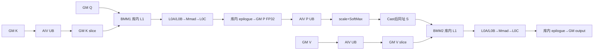
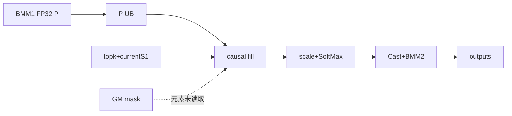

# NsaSelectedAttention A2 ACLNN 算子知识

## 算子速览

| 项目 | 内容 |
|---|---|
| 实际入口 | `aclnnNsaSelectedAttentionGetWorkspaceSize` + `aclnnNsaSelectedAttention`，公开两段式 ACLNN，无 V2/V3 同名版本 |
| 计算语义 | 对每个 query token 和 KV head 按 `topkIndices` 聚合 `C=selectedBlockCount` 个、每个长 `L_b=selectedBlockSize` 的 KV block，计算 `Softmax(mask(scale·QKᵀ))V` |
| 输入输出 | TND；`query[Tq,N1,D]`、`key[Tkv,N2,D]`、`value[Tkv,N2,Dv]`、`topkIndices[Tq,N2,C]`；输出 `softmaxMax/softmaxSum[Tq,N1,8]`、`attentionOut[Tq,N1,Dv]` |
| 执行类型 | `MIX_CV`：单一 `nsa_selected_attention` launch；AIV 负责 gather/mask/softmax/调度，Matmul API 触发 AIC BMM1/BMM2 |
| Kernel 路线 | R-001 key 0 无因果 mask；R-002 key 1 causal mask |
| 核心资源 | GM 输入输出、per-used-AIV workspace、191 KiB AIV `TBuf`、Matmul 系统 workspace 与库内 L1/L0A/L0B/L0C |
| 来源闭包 | `source_closed`：ACLNN→L0 launcher→InferShape/Tiling/POD→MIX_CV entry→AIV body/Matmul specialization→CMake 已闭合；生成式 executor 与通用 Matmul 内部为框架边界 |
| 验证状态 | 已完成源码闭包检查；本次知识提取未执行编译、真机、数值或性能测试。 |

## 接口与语义

### 计算语义

令 `G=N1/N2`、`L=C·L_b`。对 TND 中第 `t` 个 query token、KV head `n2`，按 `topkIndices[t,n2,c]` 从该 batch 的 KV 序列取出连续 `L_b` 行，依 `c=0..C-1` 拼成 `K_sel[L,D]` 与 `V_sel[L,Dv]`。该 token 的 `G` 个 query heads 组成 `Q[G,D]`，随后：

```text
P_fp32 = Q[INPUT_T] @ K_sel[INPUT_T]^T
P_fp32 = P_fp32 * float(scaleValue)
if key == 1: 对当前 query 位置之后的 causal block/lane 写 FP32 有限负极值 0xFF7FFFFF
S_fp32 = SoftMax(P_fp32)
S_input = Cast<INPUT_T>(S_fp32, CAST_ROUND)
attentionOut[INPUT_T] = S_input @ V_sel[INPUT_T]
```

`softmaxMax`、`softmaxSum` 保存 SoftMax API 的 FP32 reduce 输出，每个 head 物理占 8 个 float。key 1 的设备代码不读取 `attenMask` 的数值，而是依据 `topkIndices`、`currentS1` 和 block 大小构造左上因果遮罩；因此 mask 张量在固定实现中是“使能/形状输入”，不是逐元素掩码数据源。

### 输入、输出与属性

| 参数 | shape/layout | dtype | 约束、默认值与语义 |
|---|---|---|---|
| `query` | `[Tq,N1,D]` / ND(TND) | FP16、BF16 | 必选、允许非连续；公开域 `D=192`，与 key dtype/D 相同 |
| `key` | `[Tkv,N2,D]` / ND(TND) | 同 query | 必选、允许非连续；每 batch `S2 >= L` 且 `S2` 是 `L_b` 整数倍 |
| `value` | `[Tkv,N2,Dv]` / ND(TND) | 同 query | 必选、允许非连续；公开域 `Dv=128` 且 `D>=Dv` |
| `topkIndices` | `[Tq,N2,C]` / ND | INT32 | 必选、允许非连续；尾轴必须等于 `selectedBlockCount`；固定 kernel 未校验每个索引的上下界 |
| `attenMaskOptional` | 2-D / ND | BOOL、UINT8 | 可空、允许非连续；空时 Host 强制 `sparseMode=0`；非空且 `sparseMode=2` 才进入 R-002，设备不读取其元素 |
| `actualSeqQLenOptional` | `[B]`，元素为累计结束位置 | INT64 | ACLNN 实际强制非空；Tiling value-dependent；长度与 KV 数组相等，源码 L2 上限 3072、公开 B 上限 1024 |
| `actualSeqKvLenOptional` | `[B]`，元素为累计结束位置 | INT64 | ACLNN 实际强制非空；相邻差得到各 batch `S2` |
| `scaleValue` | 标量 | double→float | L0 属性窄化为 float；默认文档/OpDef 为 1.0 |
| `headNum` | 标量 | INT64 | `N1`；非零，且 `N1/N2=G` 为整数；公开 `G<=32` |
| `inputLayout` | 字符串 | char* | 仅大小写敏感的 ACLNN 检查 `"TND"`；InferShape 自身会转大写，但到达前已由 ACLNN 拦截 |
| `sparseMode` | 标量 | INT64 | 仅 0（无 mask）和 2（left-up causal）；Tiling 先校验只能为 0/2，再在 mask 为空时强制为 0 |
| `selectedBlockSize` | 标量 | INT64 | 公开 `[16,128]` 且 16 整数倍；Host 仅显式检查 `<=128` 与 `%16==0` |
| `selectedBlockCount` | 标量 | INT64 | 公开 `[1,128]` 且 `L<8192`；Host 仅显式检查 `<=128` |
| `softmaxMaxOut` | `[Tq,N1,8]` / ND | FP32 | 必选、允许非连续，ViewCopy 提交 |
| `softmaxSumOut` | `[Tq,N1,8]` / ND | FP32 | 必选、允许非连续，ViewCopy 提交 |
| `attentionOut` | `[Tq,N1,Dv]` / ND | 同 query | 必选、允许非连续，ViewCopy 提交 |

### 入口与版本

固定 Commit 中公开文档、头文件和实现只出现无版本后缀的 `aclnnNsaSelectedAttentionGetWorkspaceSize/aclnnNsaSelectedAttention`；没有 V2/V3 同名入口。`NsaSelectedAttentionGrad` 与 `NsaSelectedAttentionInfer` 是不同逻辑语义，不属于本版本族。

平台按公开证据保守收口：README 明确 A2 训练支持、A3 不支持，同时明确 A2 推理不支持；ACLNN 文档则把 A2 训练/推理合并标为支持，二者对 A2 推理存在发布冲突。因此本卡的 `A2` 仅覆盖无冲突的 Atlas A2 训练产品，不声明 A2 推理支持。A3 与 Ascend 950 均由公开文档明确不支持；OpDef 的 `ascend910b/ascend910_93` 和对应 CI 接线只用于佐证已有实现，不能扩张公开平台。

## Host/Launcher 执行流程

### 参数校验与前处理

第一段接口依次执行：必选 tensor、两个实际序列数组、输出、`workspaceSize/executor` 判空；若三个输出都 empty，则返回 workspace 0 和只含早退状态的 executor；否则严格检查大小写敏感的 `"TND"`，解析三维轴，检查 Q/K 的 D 相同、`D>=Dv`、T/N/D 非零、`D<=768`、两实际序列数组长度不超过 3072。随后对 Q/K/V/topk/非空 mask 逐一 `l0op::Contiguous`。源码虽然定义 `InputDtypeCheck`，但该 ACLNN 函数没有调用它；公开 dtype 组合仍由文档与 OpDef 约束。`NSAShapeInfo::needPadValue` 在固定源码没有被置 true，因此 `PreprocessQKV` 的 Pad 分支不可达。

L0 `NsaSelectedAttention` 在 mask 为空时分配一个空 BOOL tensor，把两个 `aclIntArray` 转成 INT64 ND tensor，调用 InferShape，添加一个 `ADD_TO_LAUNCHER_LIST_AICORE` 节点；最后三个 L0 输出各通过 `ViewCopy` 写入调用方输出。

### 参数、Workspace 与生命周期

Tiling 从平台取得平台总量 `A_p=aivNum`、`aicNum/UB/L1/L0C/L2`，从累计序列数组得到 B 与每 batch 长度，令 `t1Size=Tq`、`s1Size=max(S1_b)`、`s2Size=max(S2_b)`、`G=N1/N2`、`L=C·L_b`。`TilingBaseClass::DoTiling` 按 `GetShapeAttrsInfo→GetPlatformInfo→IsCapable→DoOpTiling→DoLibApiTiling→GetWorkspaceSize→PostTiling` 执行；唯一模板以 priority 0 注册，registry 按较小 priority 优先。正常 Route 的框架 workspace 请求为：

```text
calcTypeSize = 4
W_host = A_p * L * (D*4 + Dv*4 + G*4 + G*4) + 16 MiB
```

Device 令 `C_u=coreNumUsed=max(min(A_p,Tq),1)`，实际以 `sizeof(INPUT_T)=2` 切 K/V，并按 FP32 步距布置 BMM1/softmax alias：

```text
K_base(core) = core * D*L*2
V_base(core) = C_u*D*L*2 + core*Dv*L*2
P_base(core) = C_u*(D+Dv)*L*2 + core*G*L*4
S_base(core) = P_base(core)
```

Host 按平台总 AIV 数与 4-byte `calcTypeSize` 为 K/V/S 保守计费，而 Device 按实际使用核数和 2-byte INPUT_T 切片并让 P/S 同址，因此请求量大于算子显式访问跨度。16 MiB reserve 的内部用途在固定算子源码不可见。Vector pass 虽计算 `user=GetUserWorkspace(workspace)`，却把原始 `workspace` 传给 `InitWorkspace`；不能据此假定算子显式切片已跳过 system workspace。`REGIST_MATMUL_OBJ` 另取 `GetSysWorkSpacePtr()`，其内部容量与布局属于 Matmul 库边界。executor 拥有 Contiguous、L0 临时输出与 ViewCopy 图；调用方 workspace、输入输出设备存储必须保持到 stream 完成。

### 启动图与失败传播

```text
aclnnNsaSelectedAttentionGetWorkspaceSize
  -> Contiguous(Q,K,V,topk,optional mask)
  -> l0op::NsaSelectedAttention
     -> InferShapeNsaSelectedAttention
     -> ADD_TO_LAUNCHER_LIST_AICORE
        -> TilingNsaSelectedAttention
           -> NsaSelectedAttentionTiling(priority 0)
           -> key 0/1, blockDim=coreNumUsed
        -> nsa_selected_attention (single MIX_CV kernel, blockDim=C_u)
           AIC pass: 解析两份 TCubeTiling -> REGIST_MATMUL_OBJ(BMM1,BMM2)
           AIV pass: 解析完整 POD -> 注册同两对象 -> Init -> Process
             AIV gather K -> GM K slice -> AIC BMM1 -> GM P slice
             GM P slice -> AIV scale/mask/SoftMax/Cast -> 同址 GM S slice
             AIV gather V -> GM V slice -> AIC BMM2 -> GM attentionOut
  -> ViewCopy(three outputs)
aclnnNsaSelectedAttention
  -> CommonOpExecutorRun(workspace, workspaceSize, executor, stream)
```

`C_u=max(min(A_p,Tq),1)`；正常 ACLNN 已拒绝 `Tq=0`。固定算子源码没有单独编码 AIC:AIV 比例，也未用取得的 `aicNum` 计算正常 `blockDim`；MIX_CV 的 AIC 调度由 `REGIST_MATMUL_OBJ` 与 Matmul Tiling/运行库完成，不能从 `blockDim=C_u` 外推物理 AIC 数。InferShape、launcher、Tiling、Matmul tiling、Contiguous、ViewCopy 或 executor 创建任一失败都会使第一段返回错误；第二段直接返回 `CommonOpExecutorRun` 的提交状态。

## Route 与参数设计

### 分核与资源计算

`Tq` 个 token 均分给 `C_u` 个 AIV：`h=ceil(Tq/C_u)`，`tailCoreNum=h·C_u-Tq`，前 `headCoreNum=C_u-tailCoreNum` 核各处理 `h` 个 token，尾核各处理 `h-1` 个；每 token 串行遍历 `N2`。block `c` 的 token 区间是：头核 `[c·h,(c+1)·h)`，尾核从 `headCoreNum·h` 起按 `h-1` 连续切分。

BMM1 为 `M=G,N=L,K=D`，A/B/C 均 GM/ND，B 转置，C 为 FP32；固定 split 是 `(baseM,baseN,baseK)=(16,min(64,align16(L)),192)`。BMM2 为 `M=G,N=Dv,K=L`，固定 split `(16,128,128)`，Device C/output 为 INPUT_T。两者均以 `CFG_EXCEED=GetNormalConfig(true)` 实例化，Host 调用 `SetBufferSpace(platformL1,platformL0C)` 并写 `shareMode=0/shareL1Size/shareL0CSize`。step/depth、L0A/L0B 物理容量、scheduler/prologue/epilogue 未由算子源码显式选择，实际值封装在仓外 Matmul Tiling/运行库中。SoftMax 行块 `row=min(G,128KiB/(L·4))`，临时 UB 由 `GetSoftMaxMinTmpSize` 产生。

AIV 固定申请 191 KiB `vecQue`。K/V gather 每轮最多 12288 个 INPUT_T 元素；SoftMax 每轮最多 32768 个 FP32 元素。topk 按 8 个 INT32 对齐，序列缓冲按 4 个 INT64 对齐。

### Route 选择

| 顺序 | Route | Key/模板 | 精确选择条件与优先级 | 不适用去向 |
|---:|---|---|---|---|
| 1 | R-001 无因果 mask | key 0；`NsaSelectedAttention<half,false>` 或 `<bfloat16_t,false>` | 正常非空、TND、FP16/BF16、shape/attr/Matmul 检查成功，且最终 `sparseMode==0`；输入 mode 必须先是 0/2，mask 为空才把 2 改为 0 | mode 2 且 mask 非空转 R-002；其余失败 |
| 2 | R-002 causal mask | key 1；`NsaSelectedAttention<half,true>` 或 `<bfloat16_t,true>` | 公共条件 + mask 非空、BOOL/UINT8、rank=2、`sparseMode==2` | 无下一 Route；失败关闭 |

```text
三个输出都 empty -> ACLNN 早退，workspace=0
否则：
  输入 sparseMode 不在 {0,2} -> 在 mask 判空前失败
  mask 缺失/空且输入 mode 在 {0,2} -> sparseMode=0 -> key 0 -> R-001
  mask 存在且 sparseMode=0 -> key 0 -> R-001（mask 元素不使用）
  mask 存在且 sparseMode=2 -> key 1 -> R-002
  其它 mode/dtype/shape/资源 -> 失败
```

### 模板/实现执行矩阵

| Route | key/selector | dtype/shape/platform 完整命中条件 | 执行族与 kernel 节点 | 实际模板/body | 内存与同步特征 | tail/fallback |
|---|---|---|---|---|---|---|
| R-001 无因果 mask | 0 | A2 训练；FP16/BF16；TND；公共约束；最终 mode 0 | 单 MIX_CV：AIV gather→BMM1(AIC)→SoftMax(AIV)→BMM2(AIC) | `<INPUT_T,false>`；两次 `Matmul<...,CFG_EXCEED>` | per-used-core K/V/P/S；Matmul wait 保护跨族可见性 | gather/SoftMax 分轮；无 fallback |
| R-002 causal mask | 1 | 公共约束 + 非空 2-D BOOL/UINT8 mask + mode 2 | 同节点，多 `HandleMask` | `<INPUT_T,true>` | 同 R-001 + MTE2→S/V、PIPE_V | `L_b>64` 或 `L>=2048` 用逐行 mask loop |

### 隐藏性能 Guard

| Guard | Host/Tiling 条件 | Device/资源原因 | 影响 Route | 不满足时去向 | 源码符号 |
|---|---|---|---|---|---|
| Matmul buffer | 两次 `SetBufferSpace==0` 且 `GetTiling!=-1` | 固定 base 必须放入 L1/L0C | 两者 | Tiling 失败 | `SetMatMulTiling` |
| K/V gather | `L_b·D{v}<=12288` 一轮，否则 `floor(12288/D{v})` 行/轮 | K/V 共用 24 KiB UB | 两者 | 自动多轮；商为 0 无保护 | `SetTiling/SelectAndGatherK/V` |
| SoftMax | `G·L<=32768` 一轮，否则 `floor(32768/L)` 行/轮 | P UB 128 KiB FP32 | 两者 | 自动分 G；公共 `L<8192` 保证商非零 | `SetTiling/ProcessSoftmax` |
| mask stride | `L_b>64 \|\| L>=2048` | 64-bit mask 或 uint8 stride 上限 | R-002 | 改逐行 loop | `HandleMask` |
| DataCopy 对齐 | 公开 `D=192,Dv=128,L_b%16=0` | blockLen 以 32B block 计 | 两者 | 公共域外无 fallback | `SelectAndGatherK/V` |
| 固定 UB 池 | 所有切片须落入 191 KiB | 单 `TBuf` 手工切片 | 两者 | 源码无最终容量断言 | `InitBuffer` |
| workspace 核数 | Host 按 `A_p` 分配；Device 按 `C_u` 切片 | 避免把未使用 AIV 的保守空间误算进实际跨度 | 两者 | N/A，Host 天然留冗余 | `GetWorkspaceSize/InitWorkspace` |
| topk 物理读取 | `alignedBlockCount=ceil(C/8)·8` | `DataCopy` 以 32B 对齐读取 INT32 | 两者 | 无 DataCopyPad/fallback | `SetTiling/GetIndices` |

### POD/ABI

自定义结构由 `TILING_DATA_FIELD_DEF` 宏生成；固定仓未展开生成代码，故 `sizeof/alignof/offsetof` 数值不可见。下表顺序即声明/序列化顺序。

| 结构 | 字段 | 类型/位宽 | ABI 布局 | 单位 | Host/launcher producer | Device consumer | 边界 |
|---|---|---|---|---|---|---|---|
| `InputParams` | `bSize` | int64/64 | 宏生成，数值不可见 | batch | `Analyze3DimLayout` | `SetTiling/CopyInSeq` | 公开 <=1024 |
| 同上 | `n2Size` | int64/64 | 同上 | head | 同上 | N2 循环/地址 | >0 |
| 同上 | `gSize` | int64/64 | 同上 | head 比 | 同上 | BMM/SoftMax | >0，N1%N2=0 |
| 同上 | `s1Size` | int64/64 | 同上 | token | 同上 | 派生成员 | 最大 batch S1 |
| 同上 | `s2Size` | int64/64 | 同上 | token | 同上 | 派生成员 | 最大 batch S2 |
| 同上 | `alignedS2` | int64/64 | 同上 | token | `GetShapeAttrsInfo` | 未读取 | inactive |
| 同上 | `dSize` | int64/64 | 同上 | 元素 | `Analyze3DimLayout` | gather/BMM | Device 窄化 uint32 |
| 同上 | `d2Size` | int64/64 | 同上 | 元素 | 同上 | V/BMM2 | Device 窄化 uint32 |
| 同上 | `scaleValue` | float/32 | 同上 | 无量纲 | L0 double→float | `Muls` | 已窄化 |
| 同上 | `selectedBlockSize` | int64/64 | 同上 | token/block | `AnalyzeAttrs` | gather/mask | 公开 16..128 |
| 同上 | `selectedBlockCount` | int64/64 | 同上 | block | 同上 | topk/gather | 公开 1..128 |
| 同上 | `layoutType` | uint8/8 | 同上 | enum | 写 4 | 未读取 | inactive |
| 同上 | `attenMaskShapeType` | uint8/8 | 同上 | enum | 未赋值 | 未读取 | inactive |
| 同上 | `attenMaskDataType` | uint8/8 | 同上 | enum | mask 存在写 1 | 未读取 | inactive |
| 同上 | `attenMaskCompressMode` | uint8/8 | 同上 | enum | 未赋值 | 未读取 | inactive |
| 同上 | `implMode` | uint8/8 | 同上 | enum | 写 0 | 未读取 | high precision |
| 同上 | `sparseType` | uint8/8 | 同上 | enum | 未赋值 | 未读取 | key 决定 Route |
| 同上 | `attenMaskS2Size` | uint32/32 | 同上 | 元素 | `AnalyzeOptionalInput` 将 mask 尾轴 `int64` 隐式窄化写入 | 未读取 | inactive；无显式溢出检查 |
| `MultiCoreParams` | `coreNum` | int32/32 | 宏生成，数值不可见 | 核 | `SetMultiCoreParams` | `SetTiling` | min(AIV,Tq) |
| 同上 | `headCoreNum` | int64/64 | 同上 | 核 | 同上 | `SetTiling` | former cores |
| 同上 | `tailCoreNum` | int64/64 | 同上 | 核 | 同上 | 未直接读取 | 与 head 合计 |
| 同上 | `s1NumPerHeadCore` | int64/64 | 同上 | token/core | 同上 | `SetTiling` | ceilDiv |
| 同上 | `s1NumPerTailCore` | int64/64 | 同上 | token/core | 同上 | `SetTiling` | former-1 |
| 同上 | `localWorkSpaceSize` | int64/64 | 同上 | UB 字节 | `SetSoftMaxTiling` | `InitBuffer/SoftMax` | 库 API 返回 |
| `CompileInfo` | `aivNum` | uint32/32 | Host 普通 struct；精确 offsetof 未由源码断言 | 核 | `TilingPrepareForNsaSelectedAttention::GetCoreNumAiv` | `GetPlatformInfo/IsEmptyInput` | 正常 Route 的 `A_p` |
| 同上 | `aicNum` | uint32/32 | 同上 | 核 | `GetCoreNumAic` | `GetPlatformInfo` 后未用于正常 blockDim | inactive normal launch |
| 同上 | `ubSize` | uint64/64 | 同上 | 字节 | `GetCoreMemSize(UB)` | `GetPlatformInfo`；固定 191KiB 池未比较该值 | 无容量 guard |
| 同上 | `l1Size` | uint64/64 | 同上 | 字节 | `GetCoreMemSize(L1)` | 两路 `SetBufferSpace/shareL1Size` | Matmul 上界 |
| 同上 | `l0cSize` | uint64/64 | 同上 | 字节 | `GetCoreMemSize(L0_C)` | 两路 `SetBufferSpace/shareL0CSize` | Matmul 上界 |
| 同上 | `l2CacheSize` | uint64/64 | 同上 | 字节 | `GetCoreMemSize(L2)` | `GetPlatformInfo` 后未读取 | inactive |
| `EmptyInputTilingData` | `coreNum` | uint32/32 | 宏生成，数值不可见 | 核 | `IsEmptyInput` | key0/1 不读 | 公开正常域 inactive |
| 同上 | `attentionOutFormerNum` | uint32/32 | 同上 | 核 | 同上 | 未读取 | inactive |
| 同上 | `attentionOutTailNum` | uint32/32 | 同上 | 核 | 同上 | 未读取 | inactive |
| 同上 | `softmaxMaxFormerNum` | uint32/32 | 同上 | 核 | 同上 | 未读取 | inactive |
| 同上 | `softmaxMaxTailNum` | uint32/32 | 同上 | 核 | 同上 | 未读取 | inactive |
| 同上 | `attentionOutSingleCoreDataSize` | uint64/64 | 同上 | 元素 | 同上 | 未读取 | inactive |
| 同上 | `attentionOutTailCoreDataSize` | uint64/64 | 同上 | 元素 | 同上 | 未读取 | inactive |
| 同上 | `softmaxMaxSingleCoreDataSize` | uint64/64 | 同上 | FP32元素 | 同上 | 未读取 | inactive |
| 同上 | `softmaxMaxTailCoreDataSize` | uint64/64 | 同上 | FP32元素 | 同上 | 未读取 | inactive |
| 同上 | `attentionOutLastCoreDataSize` | uint64/64 | 同上 | 元素 | 同上 | 未读取 | inactive |
| 同上 | `attentionOutLastCoreIndex` | uint64/64 | 同上 | 元素offset | 同上 | 未读取 | inactive |
| `TilingData` | `inputParams` | nested | 宏生成，数值不可见 | POD | 上述 producer | `NsaSelectedAttention` | key0/1 |
| 同上 | `multiCoreParams` | nested | 同上 | POD | 上述 producer | 同上 | key0/1 |
| 同上 | `bmm1TilingData` | `TCubeTiling` | 外部 ABI 不可见 | Matmul POD | `GetTiling` | `REGIST_MATMUL_OBJ/bmm1` | `(G,L,D)` |
| 同上 | `bmm2TilingData` | `TCubeTiling` | 外部 ABI 不可见 | Matmul POD | `GetTiling` | `REGIST_MATMUL_OBJ/bmm2` | `(G,Dv,L)` |
| 同上 | `softmaxTilingData` | `SoftMaxTiling` | 外部 ABI 不可见 | SoftMax POD | `SoftMaxTilingFunc` | `SoftMax` | `[row,L]` |
| 同上 | `emptyInputTilingData` | nested | 宏生成，数值不可见 | POD | 正常 Route 未赋 | key0/1 不读 | inactive |

### Route 源码闭包

| Route | Key/selector | Host/Tiling producer | POD/参数 | Kernel entry/router | Kernel body/直接依赖 | 构建接线 |
|---|---|---|---|---|---|---|
| R-001 | key0/dtype 宏 | `TilingNsaSelectedAttention` → registry priority 0 → `TilingBaseClass::DoTiling` → `NsaSelectedAttentionTiling` | `NsaSelectedAttentionTilingData` | `nsa_selected_attention` | `<INPUT_T,false>::Process`、两路 Matmul、SoftMax | `add_op_to_compiled_list/add_modules_sources` |
| R-002 | key1/dtype 宏 | 同上 + `AnalyzeOptionalInput/GetTilingKey` | 同上 | 同 entry，`<INPUT_T,true>` | R-001 + `HandleMask/DuplicateWithLoop` | 同上 |

## Kernel 实现

### 公共执行流程

同一 `nsa_selected_attention` entry 分两种编译 pass：`__DAV_C220_CUBE__` AIC pass 只从 POD 提取两份 `TCubeTiling` 并为 `op.bmm1/op.bmm2` 注册 Matmul 对象；AIV pass 解析完整 POD、注册同一对对象，再执行 `Init/Process`。固定源码没有显式 `ASCEND_IS_AIC/AIV`、cross-core flag 或 AIC:AIV 比例；跨族派工与 Matmul 内部 L1/L0/Mmad/Fixpipe 由 `REGIST_MATMUL_OBJ` 及其库协议承担。

每个 token/N2 的真实流水是：AIV 读取 topk 并 gather K 到当前核 GM slice；除首轮外等待上一 BMM2，随后发起 AIC BMM1；AIV 在 BMM1 运行期间 gather V；`WaitBmm1Result/End` 后 AIV 从 P slice 搬入 UB，完成 scale、可选 mask、FP32 SoftMax、`CAST_ROUND`，再写同址 S slice并发起 AIC BMM2。下一迭代可先 gather K，直到覆盖 V/S 或启动下一 BMM1 前才等待上一 BMM2；循环末显式等待最后 BMM2。Vector 搬运与计算由 HardEvent/`PIPE_V` 同步。

### Route R-001：无因果 mask

#### 适用条件

##### 选择证据

| 层级 | 文件 | 符号 | 源码谓词/参数 | 结果/下一跳 |
|---|---|---|---|---|
| ACLNN | `attention/nsa_selected_attention/op_host/op_api/aclnn_nsa_selected_attention.cpp` | `aclnnNsaSelectedAttentionGetWorkspaceSize` | 三输出非全空、严格 TND，参数分析成功 | 建立 L0 节点 |
| Tiling | `attention/nsa_selected_attention/op_host/nsa_selected_attention_tiling_general.cpp` | `AnalyzeAttrs/AnalyzeOptionalInput/GetTilingKey` | mode0，或合法 mode2 但 mask 空后被改为 0 | key 0 |
| Router | `attention/nsa_selected_attention/op_kernel/nsa_selected_attention.cpp` | `nsa_selected_attention` | FP16/BF16 + key0 | `<INPUT_T,false>` |

#### Device 数据流

##### 函数级调用链

```text
nsa_selected_attention(entry, tiling)
  AIC pass -> COPY_TILING_DATA(bmm1,bmm2) -> REGIST_MATMUL_OBJ
  AIV pass -> COPY_TILING_DATA(full POD) -> REGIST_MATMUL_OBJ
    -> Init -> SetTiling/InitIOGm/InitWorkspace/InitBuffer
    -> Process -> CopyInSeq
       -> GetIndices -> SelectAndGatherK
       -> [非首轮] WaitBmm2Result -> IterateBmm1
       -> SelectAndGatherV -> WaitBmm1Result
       -> ProcessSoftmax(GetBmm1Result -> Muls -> SoftMax -> Cast -> CopyOut stats/S)
       -> IterateBmm2
    -> [末轮] WaitBmm2Result
```

##### 源码等价伪码

```text
源码等价伪码；s=sizeof(INPUT_T)=2，c=blockIdx
copy B cumulative q/kv lengths GM -> aligned UB
for t in [startBS1Offset(c), endBS1Offset(c)):
  derive batch b, local q position currentS1, kvBase
  for h2 in [0,N2):
    topkOff=(t*N2+h2)*C; copy ceil(C/8)*8 int32 to UB
    for selected block j and row-chunk r:
      srcK=(kvBase*N2 + topk[j]*Lb*N2 + h2)*D + r*N2*D
      DataCopy rows: blockCount=rows, blockLen=D/16, srcStride=(N2-1)*D/16
      append to K_c at j*Lb*D+r*D
    wait previous BMM2 unless first; launch BMM1:
      A=query[(t*N2+h2)*G*D], B=K_c(transpose), tail=(G,L), C=P_c(FP32)
    gather V analogously with blockLen=Dv/16 into V_c while BMM1 runs
    wait/end BMM1
    for g-chunk:
      P_c -> 128KiB UB; Muls(scale); SoftMax FP32; Cast<INPUT_T>(CAST_ROUND)
      write S_c at the same byte base; write max/sum at (t*N1+h2*G)*8
    launch BMM2: A=S_c, B=V_c, tail=(G,Dv,L), C=out[(t*N2+h2)*G*Dv]
wait/end final BMM2
```

#### 内存与数据搬运

##### 资源与搬运表

| 层级/缓冲区 | offset/地址公式 | extent/容量公式 | dtype/layout | producer | consumer | owner/lifetime | 对齐/复用 |
|---|---|---|---|---|---|---|---|
| GM Q/K/V/topk | TND 轴公式 | 当前 token/head/block | API dtype/ND | caller | gather/BMM | caller/stream | D/Dv 形成 32B block |
| K workspace | `W+c*D*L*2` | `D*L*2` | INPUT_T/ND `[L,D]` | AIV gather | BMM1 AIC B | 当前 token/head | `C_u` 个 slice；分 24KiB UB chunk |
| V workspace | `W+C_u*D*L*2+c*Dv*L*2` | `Dv*L*2` | INPUT_T/ND `[L,Dv]` | AIV gather | BMM2 AIC B | 到下一次 BMM2 wait | `C_u` 个 slice；分 chunk |
| P/S alias | `W+C_u*(D+Dv)*L*2+c*G*L*4` | P `G*L*4`；S `G*L*2` | P FP32/ND `[G,L]` → S INPUT_T/ND `[G,L]` | BMM1 AIC/AIV Cast | AIV SoftMax/BMM2 AIC A | 当前迭代 | 同 byte base，S 只占前半字节 |
| BMM1 L1/L0A/B/C | Matmul 库内部 | Host 仅给出 `L1=platformL1,L0C=platformL0C` 上限 | A/B INPUT_T ND，B trans；C FP32 ND | `Matmul<GM-ND,GM-ND-trans,GM-ND-fp32,CFG_EXCEED>` | Matmul/Fixpipe 到 P_c | 单次 IterateAll | base `(16,min(64,align16(L)),192)`；step/depth 精确值仓外不可见 |
| BMM2 L1/L0A/B/C | Matmul 库内部 | 同上 | A/B INPUT_T ND；Device `b2Type` 布尔为 true、C 为 INPUT_T，Host B transpose=false/C=FP32 | `Matmul<a2Type,b2Type,c2Type,bias2Type,CFG_EXCEED>` | Matmul 库输出到 output | 单次 IterateAll | base `(16,128,128)`；Host/Device B/C trait 冲突见限制 |
| Matmul system workspace | `GetSysWorkSpacePtr()` | 固定算子源码不可见 | 库私有 | runtime | 两路 Matmul | kernel launch | 与显式 `W` 切片关系不可外推 |
| AIV `vecQue` | 手工递增 | 191KiB | 多类型 | `InitBuffer` | Vector | kernel | 单 TBuf |
| topk UB | 0 | `align8(C)*4` | INT32 | MTE2 | scalar | token/head | 32B |
| K/V UB alias | topk 后 | 24KiB | INPUT_T | MTE2 | MTE3 | gather chunk | 串行复用 |
| P/S UB alias | K/V 后 | 128KiB | FP32/INPUT_T | MTE2/Vector | Vector/MTE3 | SoftMax chunk | 同址 |
| max/sum/tmp/seq UB | 后续 | `2*G*8*4+localWs+2*align4(B)*8` | FP32/uint8/int64 | SoftMax/MTE2 | output/scalar | kernel | 总计须<=191KiB |

##### 分层内存布局




##### 字节账、交接边与复用顺序

```text
workspace_host = A_p*L*(D*4 + Dv*4 + G*4 + G*4) + 16MiB
workspace_device_span = C_u*((D+Dv)*L*2 + G*L*4)
L1/L0 = 两路 Matmul 各以 platformL1/platformL0C 做 SetBufferSpace；L0A/L0B、depth/db、实际占用仓外不可见
UB = align8(C)*4 + 24KiB + 128KiB + 2*G*8*4
     + localWs + 2*align4(B)*8 <= 191KiB（源码意图，无显式断言）
```

| 边/复用子区 | producer | offset/extent | dtype/layout | consumer | ordering/sync | owner/lifetime | 安全条件 |
|---|---|---|---|---|---|---|---|
| K→BMM1 | `SelectAndGatherK` | `K_c`, `D*L*2` | INPUT_T/ND | `bmm1.SetTensorB(...,true)` | MTE2→MTE3 event 完成后才 `IterateAll` | caller workspace/当前 token-head | Gather完成；上一 BMM2 wait 后才复用 Matmul对象 |
| BMM1→SoftMax | `bmm1.IterateAll` | `P_c`, `G*L*4` | FP32/ND | `GetBmm1Result` | `WaitBmm1Result` + `End` | 同 used core slice | wait/end 后 AIV 才读 |
| P→S alias | `SoftMax/Cast` | 同 base，P `4GL` → S `2GL` 字节 | FP32→INPUT_T | `bmm2.SetTensorA` | `PIPE_V` + V_MTE3，随后 `IterateAll` | 同 token-head | S 范围不超过 P；BMM1 已 end |
| V→BMM2 | `SelectAndGatherV` | `V_c`, `Dv*L*2` | INPUT_T/ND | `bmm2.SetTensorB` | MTE3 完成；下一轮覆盖前 `WaitBmm2Result/End` | 同 used core slice | V gather 可与当前 BMM1 重叠 |
| BMM2→output | bmm2 | token/head output | INPUT_T | downstream | 下一迭代/末尾 wait | caller | 唯一区域 |

#### 同步、精度与尾块

##### 同步与数值边界表

| 阶段 | primitive/机制 | producer | consumer/等待点 | 保护对象 | 精度/尾块 |
|---|---|---|---|---|---|
| seq/topk | MTE2_S | GM copy | scalar | UB | 对齐区不消费 |
| gather | S_MTE2/MTE2_MTE3/MTE3_MTE2 | DMA | 下一 DMA | 24KiB alias | 末轮 tail size |
| BMM1 | `IterateAll<false>/WaitIterateAll/End` | AIC Matmul | AIV `GetBmm1Result` | GM P slice 与 Matmul对象 | FP32 C；M/G 与 N/L tail 由 `SetTail(G,L)` |
| SoftMax | MTE2_V/PIPE_V/V_MTE3 | AIV | 后级 | P/S UB | FP32后 CAST_ROUND |
| BMM2 | `IterateAll<false>/WaitIterateAll/End` | AIC Matmul | 下一轮 V/S 覆盖与 kernel 返回 | output、V、S 与 Matmul对象 | INPUT_T output；`SetTail(G,Dv,L)` |

#### 关键实现

##### 符号证据表

| 阶段 | 文件 | 符号/模板实例 | 实现事实 |
|---|---|---|---|
| Host/Tiling producer | `attention/nsa_selected_attention/op_host/nsa_selected_attention_tiling_general.cpp` | `SetBmm1/2TilingInput/GetWorkspaceSize` | M/N/K、base、资源 |
| Kernel entry/router | `attention/nsa_selected_attention/op_kernel/nsa_selected_attention.cpp` | key0 templates | MIX_CV 注册 |
| Device body/helper | `attention/nsa_selected_attention/op_kernel/nsa_selected_attention.h` | `Process/Gather/Softmax/IterateBmm` | 全数据流与同步 |

### Route R-002：causal mask

#### 适用条件

##### 选择证据

| 层级 | 文件 | 符号 | 源码谓词/参数 | 结果/下一跳 |
|---|---|---|---|---|
| API | `attention/nsa_selected_attention/op_host/op_api/aclnn_nsa_selected_attention.cpp` | `Contiguous/GetWorkspaceSize` | mask 非空；输入 mode 已是 2 | 传 L0 |
| Tiling | `attention/nsa_selected_attention/op_host/nsa_selected_attention_tiling_general.cpp` | `AnalyzeAttrs/AnalyzeOptionalInput/GetTilingKey` | mode2 先通过属性检查；mask 为 BOOL/UINT8、rank2 | key1 |
| Router | `attention/nsa_selected_attention/op_kernel/nsa_selected_attention.cpp` | `nsa_selected_attention` | FP16/BF16 + key1 | `<INPUT_T,true>` |

#### Device 数据流

##### 函数级调用链

```text
公共 gather/BMM1
  -> GetBmm1Result -> HandleMask
     -> DuplicateWithLoop/GetShiftLeftMask
  -> 公共 scale/SoftMax/Cast/BMM2
```

##### 源码等价伪码

```text
diagBlock=currentS1/Lb; save=currentS1%Lb+1
for selected block c:
  idx=topk[c]
  if idx==diagBlock: fill [save,Lb) with negativeScalar
  if idx>diagBlock: fill whole block
// 不读取 attenMaskGmInt
```

#### 内存与数据搬运

##### 资源与搬运表

| 层级/缓冲区 | offset/地址公式 | extent/容量公式 | dtype/layout | producer | consumer | owner/lifetime | 对齐/复用 |
|---|---|---|---|---|---|---|---|
| 公共资源 | 同 R-001，均以 `C_u` 切片 | 同 R-001 | 同 R-001 | 同上 | 同上 | 同上 | 同上 |
| GM mask | 指针绑定但无地址计算 | 0 字节读取 | BOOL/UINT8 | caller | 无 | stream | 只参与 Host key |
| P UB mask区 | `block*Lb+row*L` | 当前行块 | FP32 | BMM1 copy | Duplicate/SoftMax | chunk | 大 stride逐行 |

##### 分层内存布局



##### 字节账、交接边与复用顺序

```text
workspace/L1/L0/UB = R-001
mask_extra_workspace = 0
mask_extra_UB = 0
```

| 边/复用子区 | producer | offset/extent | dtype/layout | consumer | ordering/sync | owner/lifetime | 安全条件 |
|---|---|---|---|---|---|---|---|
| P/topk→mask | MTE2 copies | current chunk | FP32+INT32 | HandleMask | MTE2_S/MTE2_V wait | UB | 两者可见 |
| mask→SoftMax | Duplicate | causal lanes | FP32 | Muls/SoftMax | PIPE_V barrier | chunk | 有限负值 |
| 其余 | 同 R-001 | 同上 | 同上 | 同上 | 同上 | 同上 | 同上 |

#### 同步、精度与尾块

##### 同步与数值边界表

| 阶段 | primitive/机制 | producer | consumer/等待点 | 保护对象 | 精度/尾块 |
|---|---|---|---|---|---|
| key使能 | Host selector | mask presence+mode | router | bool模板 | mask值不入Device |
| mask | MTE2_S/V + Duplicate + PIPE_V | topk/P | SoftMax | P UB | `negativeScalar` 成员是 float，`GetExtremeValue` 实例化为 float，二者均填 0xFF7FFFFF 对应的有限 FP32 负极值 |
| 大 stride | 逐行 loop | HandleMask | SoftMax | G rows | `Lb>64 \|\| L>=2048` |
| 公共计算 | 同 R-001 | 同上 | 同上 | 同上 | 同上 |

#### 关键实现

##### 符号证据表

| 阶段 | 文件 | 符号/模板实例 | 实现事实 |
|---|---|---|---|
| Host/Tiling producer | `attention/nsa_selected_attention/op_host/nsa_selected_attention_tiling_general.cpp` | `AnalyzeAttrs/AnalyzeOptionalInput/GetTilingKey` | mask/mode 顺序与 key1 |
| Kernel entry/router | `attention/nsa_selected_attention/op_kernel/nsa_selected_attention.cpp` | `<half,true>/<bfloat16_t,true>` | 编译期开 mask |
| Device body/helper | `attention/nsa_selected_attention/op_kernel/nsa_selected_attention.h` | `HandleMask/DuplicateWithLoop` | topk causal，不读 mask GM |

## 算子特定优化

### Trick T-001：K/V gather 受 24 KiB 上限约束并按 head-dim 分轮

#### 触发与源码依据

- 适用 Route：R-001、R-002
- 触发条件：`L_b·D{v}>12288` 时多轮
- Golden 来源：[`op_kernel/nsa_selected_attention.h:261-275`](../../../../../../../cann-ops-raw/ascendc/ops-transformer/be33d95bb755cedec3108f70805c1874d1792540/attention/nsa_selected_attention/op_kernel/nsa_selected_attention.h#L261-L275)

**官方源码（固定 Commit 连续逐字摘录）**：

```cpp
if (selectedBlockSize * dimK <= SELECTED_KV_MAX_ELE_NUM) {
    selectedKCopyRound = 1;
    selectedKCopySize = selectedKCopySizeTail = selectedBlockSize;
} else {
    selectedKCopySize = SELECTED_KV_MAX_ELE_NUM / dimK;
    selectedKCopyRound = (selectedBlockSize + selectedKCopySize - 1) / selectedKCopySize;
    selectedKCopySizeTail = selectedBlockSize - (selectedKCopyRound - 1) * selectedKCopySize;
}
if (selectedBlockSize * dimV <= SELECTED_KV_MAX_ELE_NUM) {
    selectedVCopyRound = 1;
    selectedVCopySize = selectedVCopySizeTail = selectedBlockSize;
} else {
    selectedVCopySize = SELECTED_KV_MAX_ELE_NUM / dimV;
    selectedVCopyRound = (selectedBlockSize + selectedVCopySize - 1) / selectedVCopySize;
    selectedVCopySizeTail = selectedBlockSize - (selectedVCopyRound - 1) * selectedVCopySize;
}
```

#### 机制与设计原因

`SELECTED_KV_MAX_ELE_NUM=24KiB/sizeof(INPUT_T)=12288` 把每轮行数设为 `floor(12288/headDim)`；每轮只在 UB 保存一个 K 或 V 行块，再追加到 GM K/V slice，令 gather 的 UB 峰值不随 `C·Lb` 增长。两路 `LocalTensor` 同址复用是 `InitBuffer` 的独立内存事实。

#### 迁移边界

- 适用：离散 block gather 后接 GM Matmul。
- 前提：行宽是合法 32B block，`floor(12288/headDim)>0`。
- 失效：headDim 大于单 buffer 元素数时需分列。
- 未验证：本次知识提取未执行编译、真机、数值或性能测试。

#### 错误做法

固定源码的反例边界是零 chunk：不能在 `headDim>12288` 时原样迁移。

### Trick T-002：FP32 P 与 INPUT_T S 共址

#### 触发与源码依据

- 适用 Route：R-001、R-002
- 触发条件：每 token/N2
- Golden 来源：[`op_kernel/nsa_selected_attention.h:318-319`](../../../../../../../cann-ops-raw/ascendc/ops-transformer/be33d95bb755cedec3108f70805c1874d1792540/attention/nsa_selected_attention/op_kernel/nsa_selected_attention.h#L318-L319)

**官方源码（固定 Commit 连续逐字摘录）**：

```cpp
this->mm1Res.SetGlobalBuffer((__gm__ float *)(workspace + selectedKSize + selectedVSize + mm1ResCoreOffset));
this->softmaxRes.SetGlobalBuffer((__gm__ INPUT_T *)(workspace + selectedKSize + selectedVSize + mm1ResCoreOffset));
```

#### 机制与设计原因

等待 BMM1 后，AIV 分块读完 FP32 P，并把 cast 后的 2-byte S 写回同一 byte base。S 的总字节数恰为 P 的一半，因而无需为 BMM2 输入再物化独立的 GM 区。

#### 迁移边界

- 适用：宽 producer 结果可降精度后交给 consumer。
- 前提：先 wait BMM1，S 字节不大于 P，后续覆盖前 wait BMM2。
- 失效：BMM2 需要 FP32 S 时。
- 未验证：本次知识提取未执行编译、真机、数值或性能测试。

#### 错误做法

在 BMM1 wait 前覆写 P，或让 S 的字节范围大于 P slice，会破坏生命周期/相邻核切片。

### Trick T-003：两路 BMM 与 K/V gather 交错流水

#### 触发与源码依据

- 适用 Route：R-001、R-002
- 触发条件：当前 used AIV 至少处理两个 token/head 迭代
- Golden 来源：[`op_kernel/nsa_selected_attention.h:371-386`](../../../../../../../cann-ops-raw/ascendc/ops-transformer/be33d95bb755cedec3108f70805c1874d1792540/attention/nsa_selected_attention/op_kernel/nsa_selected_attention.h#L371-L386)

**官方源码（固定 Commit 连续逐字摘录）**：

```cpp
for (this->currentBS1 = this->startBS1Offset; this->currentBS1 < this->endBS1Offset; this->currentBS1++) {
    this->CalcRealBS();
    for (this->currentN2 = 0; this->currentN2 < this->n2; this->currentN2++) {
        this->GetIndices();
        this->SelectAndGatherK();
        this->SetExtraInfo(extraInfo);
        if (!firstLoop) {
            this->WaitBmm2Result();
        } else {
            firstLoop = false;
        }
        this->IterateBmm1(extraInfo);
        this->SelectAndGatherV();
        this->WaitBmm1Result();
        this->ProcessSoftmax(extraInfo);
        this->IterateBmm2(extraInfo);
```

#### 机制与设计原因

下一轮 K gather 先于上一轮 BMM2 wait，因为 K slice 不被 BMM2 消费；当前轮 BMM1 发起后立即 gather V，使 AIV MTE 与 AIC BMM1 交叠。V/S 和 Matmul 对象的危险复用分别受 `WaitBmm2Result` 与 `WaitBmm1Result` 约束。

#### 迁移边界

- 适用：单 launch MIX_CV 中不同阶段使用不重叠 workspace slice。
- 前提：K 不属于前一 BMM2 读集，V gather 不覆盖前一 BMM2 未完成的 V slice；保持源码 wait 位置。
- 失效：多 buffer 不再共核复用，或 Matmul API 不保证 `WaitIterateAll/End` 的完成语义时需重建同步图。
- 未验证：本次知识提取未执行编译、真机、数值或性能测试。

#### 错误做法

把 `WaitBmm2Result` 移到 K gather 之前会丢失源码中的交叠；移到 V gather之后则可能在同一 V slice 上产生读写冲突。

### Trick T-004：causal mask 按 stride 上限切换 repeat/逐行

#### 触发与源码依据

- 适用 Route：R-002
- 触发条件：`L_b>64` 或 `L>=2048` 用 loop
- Golden 来源：[`op_kernel/nsa_selected_attention.h:625-628`](../../../../../../../cann-ops-raw/ascendc/ops-transformer/be33d95bb755cedec3108f70805c1874d1792540/attention/nsa_selected_attention/op_kernel/nsa_selected_attention.h#L625-L628)

**官方源码（固定 Commit 连续逐字摘录）**：

```cpp
uint32_t dstStride = this->selectedLength / FP32_DATA_BLOCK;
// when block size > 64, total bytes in one block will exceed 256
// when selectedLength >= 2048, dstStride will be >= 256, useLoop branch avoids narrow stride param
bool useLoop = this->selectedBlockSize > UL_BIT_COUNT ||
               (this->selectedLength >= FP32_DATA_BLOCK * NUM_256);
```

#### 机制与设计原因

小 shape 用 repeat/stride 一次覆盖多行；64-bit mask 或 uint8 stride 不够时改逐行，保持相同 causal 语义。

#### 迁移边界

- 适用：二维行块常数填充。
- 前提：`Lb<=128`，L 按 8 个 FP32 对齐。
- 失效：任意逐元素 mask 必须读 mask 数据。
- 未验证：本次知识提取未执行编译、真机、数值或性能测试。

#### 错误做法

无条件将 `dstStride` 窄化为 uint8 会在 `L>=2048` 回绕。

## 模板与实现对比

| 对比维度 | R-001 无因果 mask | R-002 causal mask | 设计选择依据 |
|---|---|---|---|
| 命中条件/优先级 | 最终 mode0；mask 可空 | mode2+合法非空 mask | mode 先校验，mask 空再强制 mode0 |
| 执行族/节点图 | MIX_CV gather→BMM1→SoftMax→BMM2 | 同图+mask | compile-time bool |
| M/N/K、tile 与 scheduler | `(G,L,D)`、`(G,Dv,L)`；token分核 | 相同 | mask不改Matmul |
| workspace/L1/L0/UB | `C_u` 份 K/V/P-S，P/S alias，191KiB；Matmul L1/L0 库内 | 相同 | mask 原地修改 P UB，不增 buffer |
| AIC/AIV 或 kernel 交接 | Matmul wait/end | 同上+mask events | producer可见性 |
| 同步、精度与 tail | FP32→CAST_ROUND→INPUT_T | 同上+有限负值、loop tail | 固定高精度 |
| fallback/失败边界 | 失败关闭 | 无下一 fallback | 单 tiling template |

## 平台差异

| 项目 | A2 | A3 | 950 |
|---|---|---|---|
| 支持状态 | A2 训练：README 与 ACLNN 文档均支持；A2 推理：README 不支持而 ACLNN 文档支持，存在公开冲突，本卡不覆盖 | README 与 ACLNN 文档均不支持 | ACLNN 文档对 950PR/950DT 不支持 |
| Host/Launcher | 仅记录无冲突的 A2 训练路线；OpDef/CI 有 `ascend910b/ascend910_93` 接线 | 不发布 | 不发布 |
| Kernel/资源 | C220 单 Kernel MIX_CV | 不由源码文件存在推定 | 不由源码文件存在推定 |

## 限制与失败边界

- 正式平台范围只覆盖公开证据无冲突的 Atlas A2 训练产品；A2 推理支持表冲突，A3/950 明确不支持。
- 公共域仅 TND、FP16/BF16、`D=192`、`Dv=128`、`G<=32`、`Lb<=128` 且 16 对齐、`C∈[1,128]`、`L<8192`；Host 未复现全部文档下界、`G<=32`、`L<8192`、每 batch `S2>=L`/整块、`headNum==query.N` 与 topk 索引范围检查。
- 两个实际序列参数虽名为 Optional，ACLNN 实际强制非空。
- `AnalyzeAttrs` 早于 mask 判空：mask 为空也只会把合法输入 mode2 改为 0，非法 mode 不会因 mask 为空而被忽略。
- kernel 不读取 mask 元素；R-002 只能表示源码的 topk causal helper。
- `GetIndices` 从 GM 读取 `ceil(C/8)·8` 个 INT32，固定源码没有对最后 32B 块使用 `DataCopyPad`；复用时必须保证物理读边界安全。负 topk 会先转成 `uint64_t`，同样没有 Device fallback。
- empty tiling 可产生 key 90/92/94，但 entry 只路由 0/1；ACLNN 全空输出早退、非空输出零维报错，故这些 key 不是公开 Route。绕过 ACLNN 时 Device 闭包缺失。
- Host BMM2 `SetCType` 正常为 FP32，而 Device `c2Type/output` 为 INPUT_T；Host `SetBType(...,false)` 与 Device B2 模板转置布尔也表面不同。解释依赖仓外 Matmul ABI，本卡不推测消解。
- Host workspace 按平台总 `A_p` 与 4-byte K/V/S 计费，Device 按 `C_u`、2-byte K/V/S 且 P/S alias 访问；Vector entry 计算 `GetUserWorkspace(workspace)` 但未使用。16 MiB reserve、system/user workspace 的真实划分不可从算子源码补齐。
- 自定义 POD 数值 ABI和 Matmul 内部 step/depth/scheduler、精确 L1/L0A/L0B/L0C 容量/双缓冲属于固定仓外边界。
- 本次知识提取未执行编译、真机、数值或性能测试。

## 源码索引

### 链路索引

| 链路阶段 | 文件 | 关键符号 | 支撑内容 |
|---|---|---|---|
| 公开约束 | `attention/nsa_selected_attention/README.md` | 产品表/约束 | A2 训练支持、A2 推理/A3 不支持、公式与公共域 |
| 入口声明/约束 | `attention/nsa_selected_attention/docs/aclnnNsaSelectedAttention.md` | ACLNN | 签名、参数、A2 推理冲突及 A3/950 不支持 |
| 入口声明 | `attention/nsa_selected_attention/op_host/op_api/aclnn_nsa_selected_attention.h` | 两段式函数 | C ABI |
| 入口实现 | `attention/nsa_selected_attention/op_host/op_api/aclnn_nsa_selected_attention.cpp` | check/analysis/API | 校验/executor/ViewCopy |
| L0 Launcher | `attention/nsa_selected_attention/op_host/op_api/nsa_selected_attention.cpp` | `l0op::NsaSelectedAttention` | InferShape/launcher |
| OpDef | `attention/nsa_selected_attention/op_host/nsa_selected_attention_def.cpp` | OpDef | dtype/平台 |
| InferShape | `attention/nsa_selected_attention/op_host/nsa_selected_attention_infershape.cpp` | InferShape | 输出 |
| POD | `attention/nsa_selected_attention/op_host/nsa_selected_attention_tiling.h` | TilingData | ABI字段 |
| Host/Tiling | `attention/nsa_selected_attention/op_host/nsa_selected_attention_tiling.cpp` | Tiling入口 | 前置/资源 |
| Host/Tiling | `attention/nsa_selected_attention/op_host/nsa_selected_attention_tiling_general.cpp` | Tiling类 | key/分核/workspace |
| Kernel entry | `attention/nsa_selected_attention/op_kernel/nsa_selected_attention.cpp` | entry | router/MIX |
| Kernel body | `attention/nsa_selected_attention/op_kernel/nsa_selected_attention.h` | template class | body/同步 |
| Kernel helper | `attention/nsa_selected_attention/op_kernel/nsa_selected_attention_common.h` | config/extreme | 常量/精度 |
| 构建接线 | `attention/nsa_selected_attention/op_host/CMakeLists.txt` | build macros | 模块接线 |
| Tiling 公共框架 | `common/include/op_host/tiling_base.h` | `TilingBaseClass::DoTiling` | Tiling 阶段顺序与失败传播 |
| Tiling selector | `common/include/op_host/tiling_templates_registry.h` | `TilingRegistry/REGISTER_OPS_TILING_TEMPLATE` | priority 从小到大尝试及最终失败 |
| CI 接线 | `scripts/ci/ascend910b/ops_transformer_operator_list.yaml` | `nsa_selected_attention` | ascend910b 活动算子列表 |
| CI 接线 | `scripts/ci/ascend910_93/ops_transformer_operator_list.yaml` | `nsa_selected_attention` | ascend910_93 活动算子列表 |

每行只写一个文件，并确保该文件存在于 Frontmatter `sources`。

### 实现复用检查

| 检查项 | 可复用事实 | 不得改变的约束 | 源码符号 |
|---|---|---|---|
| ABI/POD | 输入轴/分核/BMM/SoftMax producer-consumer | 字段顺序、位宽、float窄化、key/dtype | TilingData/SetTiling |
| 调用顺序 | gatherK→BMM1→gatherV→wait→SoftMax→BMM2 | 覆盖前 wait，末轮 wait | `Process` |
| workspace/内存 | Host 保守请求与 `C_u` 份 K/V、P/S alias 公式 | 区分 `A_p`/`C_u`；K/V 2B，P stride4B，S同base；raw/user/system 边界不可臆造 | `GetWorkspaceSize/InitWorkspace` |
| 同步 | Matmul wait+HardEvent | 不以Host顺序代替单kernel协议 | wait/SoftMax |
| 精度与尾块 | FP32 BMM1/SoftMax→INPUT_T | causal有限负值、大stride loop | ProcessSoftmax/Mask |
| 失败边界 | 参数/资源失败关闭 | 不发布 keys90/92/94、A3/950 | Tiling/entry |