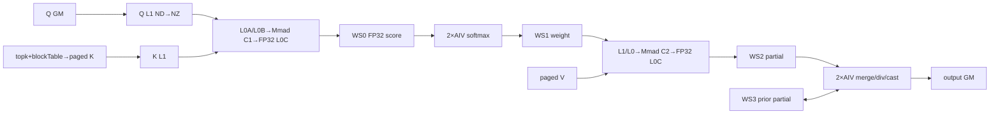
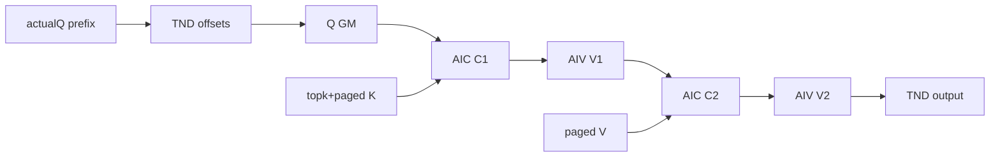

# NsaSelectedAttentionInfer A2/A3 ACLNN 算子知识

## 算子速览

| 项目 | 内容 |
|---|---|
| 实际入口 | 公开两段式 ACLNN：`aclnnNsaSelectedAttentionInferGetWorkspaceSize` → `aclnnNsaSelectedAttentionInfer`；固定仓未提供同语义 V2/V3 入口。 |
| 计算语义 | 用 `topkIndices` 选出逻辑 KV 区间，经 `blockTable` 映射到 paged KV cache，计算 `Softmax(scaleValue × QKᵀ) × V`。多 token 时按 query token 收缩可见 KV 尾部。 |
| 输入输出 | FP16/BF16 的 Q/K/V 与同 dtype 输出，INT32 `topkIndices`/`blockTable`，INT64 实际 Q/KV 长度；布局 `BSND`、`BSH`、`TND`。`Dq=Dk=192`，`Dv=128`。 |
| 执行类型 | 单 Kernel `MIX_CV`：每个逻辑 AIC 配两个 AIV，执行 `C1(QK) → V1(scale+streaming softmax) → C2(PV) → V2(跨块归并+cast+输出)`。 |
| Kernel 路线 | R-001：key 0，BSND/BSH；R-002：key 1，TND。两条路线均有 FP16 与 BF16 实例。 |
| 核心资源 | paged GM 输入；四段 user workspace；AIC 的 L1/L0A/L0B/L0C；AIV 的 UB 队列、临时缓冲及 4 槽 softmax 状态。 |
| 来源闭包 | `source_closed`：公开 ACLNN → L0 executor/InferShape → Tiling/POD/key/blockDim/workspace → MIX_CV entry → AIC/AIV body、交接边与构建接线均可追溯。 |
| 验证状态 | 已完成源码闭包检查；本次知识提取未执行编译、真机、数值或性能测试。 |

## 接口与语义

### 计算语义

对 batch `b`、query token `s1`、KV head `n2` 及该 KV head 对应的 `g=numHeads/numKeyValueHeads` 个 Q head，Kernel 依次遍历有效 `topkIndices`。每个选中索引 `t` 表示逻辑区间 `[t×selectedBlockSize, min((t+1)×selectedBlockSize, actualKvLen))`；区间内逻辑 token 再由 `blockTable[b, logicalToken/pageBlockSize]` 映射到物理 cache block。令拼接后的 K/V 分别为 `Ksel`、`Vsel`，则输出为：

```text
score = Q × Kselᵀ                         // AIC，FP32 累加
prob_state = StreamingSoftmax(scaleValue × score) // AIV，FP32 max/sum/exp 状态
partial = cast<KV_T>(exp(score-max)) × Vsel       // AIC，FP32 累加
out = cast<OUT_T>(Σ rescaled_partial / global_sum) // AIV
```

S 方向按最多 4096 个元素一块流式处理，`SoftmaxFlashV2` 将前一块的 max/sum 与当前块合并；`ProcessVec2Inner` 用 `softmaxExpUb` 重标定上一块 PV 累积，最后一块才除以总和并写输出。FP16 输出用 `CAST_ROUND`，BF16 输出用 `CAST_RINT`。`attenMaskOptional` 和 `sparseMode` 在该固定实现中是保留接口：Kernel 没有读取 mask 指针或 `sparseMode` POD 字段。

### 输入、输出与属性

| 参数 | shape/layout | dtype | 约束、默认值与语义 |
|---|---|---|---|
| `query` | BSND `[B,S,N1,192]`；BSH `[B,S,N1×192]`；TND `[T,N1,192]` | FP16/BF16 | 必选且连续化；`N1=numHeads`，`1≤S/actualQ≤4`。 |
| `key` | BSND `[blockNum,pageBlockSize,N2,192]`；BSH/TND 为 3 维扁平 head 形式 | 与 query 相同 | paged cache；`N2=numKeyValueHeads≤256`。 |
| `value` | BSND `[blockNum,pageBlockSize,N2,128]`；BSH/TND 为 3 维扁平 head 形式 | 与 query 相同 | paged cache；`Dv=128`。 |
| `topkIndices` | 非 TND 按 `[B,S,N2,K]` 读取；TND 按 `[T,N2,K]` 读取 | INT32 | `K=selectedBlockCount>0`；`-1` 表示无效项。固定 Kernel 的 base offset 由 `b/s1` 或累计 token、`kvHeadNum`、K 计算，源码表达式未额外加 `n2Idx×K`。 |
| `attenMaskOptional` | 保留 | API 文档为可选；OpDef 为 BOOL/UINT8 | 非空时连续化，空时 L0 分配空 BOOL tensor；固定 Kernel 未读取。 |
| `blockTableOptional` | `[B,maxBlockNumPerBatch]` | INT32 | 名称虽为 Optional，公开第一段接口明确判空；映射逻辑 page 到物理 cache block。 |
| `actualQSeqLenOptional` | 长度 B 的数组；TND 还用于累计 token 偏移 | INT64 | 名称虽为 Optional，公开第一段接口明确判空；每项 1～4，且不大于对应 KV 长度。 |
| `actualKvSeqLenOptional` | Tiling 的后续路径支持长度 1 或 B；逐 batch 预检要求能读取 B 项 | INT64 | 公开第一段接口明确判空；每项非负，最大值不超过 `pageBlockSize×maxBlockNumPerBatch`。固定源码在 `QKVPreProcess` 中无广播地读取 `actualKVLenData[i]`，因此 B>1 且仅传 1 项的安全性未闭合。 |
| `layoutOptional` | `BSND`/`BSH`/`TND` | C 字符串 | 公开接口要求非空；文档默认 BSND，但该 ACLNN 实现先判空。 |
| `numHeads`/`numKeyValueHeads` | 标量 | INT64 | 均大于 0；前者整除后者；`g≤16`。 |
| `selectBlockSize` | 标量 | INT64 | 16 对齐，`1..128`。 |
| `selectBlockCount` | 标量 | INT64 | 必须为正且等于 `topkIndices` 最后一维；代码中允许 `-1` 的前置判断会被随后 `<=0` 检查拒绝。 |
| `pageBlockSize` | 标量 | INT64 | 仅 64 或 128；FP16/BF16 下还要求 16 对齐。 |
| `scaleValue` | 标量 | DOUBLE→L0 attr FLOAT→POD FLOAT | V1 的 `Muls` 标量。 |
| `sparseMode` | 标量 | INT64 | 保留属性；固定 Tiling 未写 `baseParams.sparseMode`，Kernel 未读。 |
| `output` | BSND `[B,S,N1,128]`；BSH `[B,S,N1×128]`；TND `[T,N1,128]` | 与 query 相同 | InferShape 从 query 复制并替换末维/隐藏维；ACLNN 用 `ViewCopy` 提交到调用方 tensor。 |

### 入口与版本

固定仓的公开 API 清单、`cmake/level2_ops_list`、文档与头文件只公开 `aclnnNsaSelectedAttentionInfer` 两段式入口，没有同语义带版本后缀的更新入口，因此本卡选择该无后缀最新公开版本。入口实现内部另有未进入公开头文件/文档/API 清单的 `aclnnNsaSelectedAttentionInferGetMaxWorkspaceSize` 辅助符号，它复用第一段接口，不构成公开新版本。README/API 产品表明确支持 Atlas A2 与 Atlas A3，明确不支持 Ascend 950PR/950DT；OpDef 同时注册 `ascend910b` 与 `ascend910_93`，故无后缀卡平台为 A2/A3。README 另列 Kirin 支持，但它不改变本卡既定 A2/A3 平台边界。

## Host/Launcher 执行流程

### 参数校验与前处理

`aclnnNsaSelectedAttentionInferGetWorkspaceSize` 的顺序是：

1. `CheckNsaSelectParam` 要求 Q/K/V、topk、block table、两组实际长度、layout、output、workspaceSize、executor 都非空；mask 可空。
2. 若调用方 output 为空 tensor，直接返回 workspace 0 和空执行图。
3. layout 必须精确为 `BSND`、`BSH` 或 `TND`；检查 head 数、整除与 `g≤16`，再由 `AnalysisInputNsa` 检查 Q/K/V dtype 一致、topk 为 INT32、Dq=Dk=192、Dv=128、非零轴及实际长度数组规模不超过 3072。
4. `ContiguousTensors` 依次连续化 Q/K/V/topk/blockTable，mask 非空时也连续化。
5. L0 `NsaSelectedAttentionInfer`：mask 空则分配空 BOOL tensor；两组长度数组转成 INT64 ND tensor；分配内部 output；调用 InferShape；以 `ADD_TO_LAUNCHER_LIST_AICORE` 加入唯一算子 Kernel 节点。
6. ACLNN 再加入 `ViewCopy(internalOutput, output)`，返回 executor 的总 workspace。第二段接口只调用 `CommonOpExecutorRun(workspace, workspaceSize, executor, stream)`。

底层 Tiling 还会拒绝：B>3072、KV head>256、S/actualQ 不在 1～4、actualQ>actualKV、page block 非 64/128、selected block 非 16 对齐或大于 128、`N2×192>65535`、实际 KV 长度超过 block table 容量等。任何 L0 tensor 分配、InferShape、launcher 插入或 ViewCopy 失败均以 ACLNN status 结束，不启动完整计算图。

### 参数、Workspace 与生命周期

Tiling 从平台读取 `libapiSize`、UB/L1/L0C/L0B 容量以及 AIC/AIV 核数；本实现令 `coreNum=aicNum`。定义：

```text
g = numHeads / numKeyValueHeads
sMax = maxBlockNumPerBatch * pageBlockSize
sInner = min(sMax, 4096)             // g≤16，使 sInnerSize 数组总选 4096
sInnerAlignHost = align_up(sInner, 32) elements
mmRes = 1 * g * sInnerAlignHost * qSeqSize elements
bmm2Res = 1 * g * align_up(128,16) * qSeqSize elements
workspace = libapiSize
          + 4 * aicNum * mmRes * 4   // C1 FP32
          + 4 * aicNum * mmRes * 2   // V1 FP16/BF16
          + 4 * aicNum * bmm2Res * 4 // C2 FP32
          + 4 * aicNum * bmm2Res * 4 // V2 FP32 accumulation
```

entry 先用 `GetUserWorkspace(workspace)` 跳过系统/LibAPI 区。四个 user slice 依次是 `mm1ResGm`、`vec1ResGm`、`mm2ResGm`、`vec2ResGm`；每个 AIC/AIV 组以 `aiCoreIdx×4×sliceElements×sizeof(dtype)` 定位自己的 4 槽区。AIV block `tmpBlockIdx` 映射为 `aiCoreIdx=tmpBlockIdx/2`，两个 AIV 共享该 AIC 组的 workspace，但分别处理不重叠的 G 行。executor、内部连续 tensor、user workspace 与输出必须保持到 stream 上的 launcher 和 ViewCopy 完成。

### 启动图与失败传播

```text
aclnnNsaSelectedAttentionInferGetWorkspaceSize
  -> Contiguous(Q,K,V,topk,blockTable[,mask])
  -> l0op::NsaSelectedAttentionInfer
       -> InferShapeNsaSelectAttentionInfer
       -> TilingNsaSelectAttentionInfer
       -> ADD_TO_LAUNCHER_LIST_AICORE(NsaSelectedAttentionInfer)
            -> nsa_selected_attention_infer  [单次 MIX_CV launch]
                 AIC:C1 --flag7/workspace--> 2×AIV:V1
                 2×AIV:V1 --flag8/workspace--> AIC:C2
                 AIC:C2 --flag9/workspace--> 2×AIV:V2/output
  -> ViewCopy(internalOutput, callerOutput)
aclnnNsaSelectedAttentionInfer
  -> CommonOpExecutorRun(workspace, workspaceSize, executor, stream)
```

Tiling 令 AIC=`usedCoreNum`、AIV=`2×usedCoreNum`，再由 `CalcTschBlockDim(aivNum,aicNum,aivNum)` 编码 MIX blockDim。Tiling 失败则 launcher 不成立；executor 运行按同一 stream 保证算子节点完成后才执行 ViewCopy。Kernel 内没有 fallback key：entry 对 key 0/1 之外不构造实现对象，也不写输出。

## Route 与参数设计

### 分核与资源计算

任务域在单 token 时为 `B×N2`，任一 batch 的实际 Q 长度大于 1 时为 `sum(actualQSeqLen)×N2`。`SplitBN` 先把未用的 `startIdxEachCore[0..49]` 填为任务总数。若实际 KV 长度数组只有一个值、任务数不超过核数或处于最大 workspace 模式，`SplitBN_V0` 连续均分；否则以每个 `(b,n2,s1)` 的 actual KV 长度为估算负载，比较简单均分和 `SetSparseStartIdx` 粗调/精调结果，选择最大负载较小者。Device 读取 `coreSidxEnd[aiCoreIdx]` 与下一项之差作为本组任务数。

每个有效 KV 序列再按 S 内块处理。固定 `g≤16`，所以 `idx=min(g/64,2)=0`，基础 `sInner=4096`；末块由实际选中 token 数重新计算，并在 Device 对齐到 16 元素。C1 沿 N 每 128 行、K=192 按 128+64 切；C2 沿 K 每 256 行，N 固定 128。两个 AIV 将 G 行拆为 `[0,ceil(g/2))` 与 `[ceil(g/2),g)`。

### Route 选择

| 顺序 | Route | Key/模板 | 精确选择条件与优先级 | 不适用去向 |
|---:|---|---|---|---|
| 1 | R-001 BSND/BSH MIX_CV | key 0；`NSAType<half,half,half,half,false,false,LAYOUT::BSND>` 或全 `bfloat16_t` 对应实例 | Tiling layout 不是 TND，即校验后的 BSND 或 BSH；FP16 总编译，BF16 受 entry 架构 guard；所有 Host 资源/shape 检查成功 | layout=TND 转 R-002；dtype/shape/资源失败；未知 key 无 body |
| 2 | R-002 TND MIX_CV | key 1；`NSAType<half,half,half,half,false,false,LAYOUT::TND>` 或全 `bfloat16_t` 对应实例 | layout 精确为 TND；FP16 总编译，BF16 受同一架构 guard；实际 Q 长度给出 token 累计边界 | 校验/资源失败；未知 key 无 body |

```text
layout == "TND" ? key=1 (R-002) : key=0 (R-001；仅可能 BSND/BSH)
  -> ORIG_DTYPE_QUERY == FP16: half 实例
  -> ORIG_DTYPE_QUERY == BF16 且 __NPU_ARCH__ 非 3003/3113: bfloat16_t 实例
  -> 其它 dtype/未编译 BF16/未知 key: 无实现分支
```

### 模板/实现执行矩阵

| Route | key/selector | dtype/shape/platform 完整命中条件 | 执行族与 kernel 节点 | 实际模板/body | 内存与同步特征 | tail/fallback |
|---|---|---|---|---|---|---|
| R-001 BSND/BSH | 0 | A2/A3；BSND 4D 或 BSH 3D；FP16/BF16；D=192/Dv=128；paged cache 与全部 Host guard 成立 | 单节点 MIX_CV：AIC C1→双 AIV V1→AIC C2→双 AIV V2 | `NsaSelectAttentionInfer<NSAType<half,half,half,half,false,false,LAYOUT::BSND>>`；BF16 为四个类型参数全部替换为 `bfloat16_t`；BSH 复用扁平连续地址 | 四段 GM workspace、AIC L1/L0 双缓冲、AIV UB；CrossCore flag 7/8/9 | actual KV/topk 决定 S tail；key 未命中无 fallback |
| R-002 TND | 1 | A2/A3；Q/output `[T,N,D]`，实际 Q 长度数组能划分 T；其余同 R-001 | 同一单节点 MIX_CV 图 | `NsaSelectAttentionInfer<NSAType<half,half,half,half,false,false,LAYOUT::TND>>`；BF16 为四个类型参数全部替换为 `bfloat16_t` | 资源与同步同 R-001；Q/output/topk base offset 改为累计 token | 同 R-001；累计长度错误由 Host/实际数据边界失败关闭 |

### 隐藏性能 Guard

| Guard | Host/Tiling 条件 | Device/资源原因 | 影响 Route | 不满足时去向 | 源码符号 |
|---|---|---|---|---|---|
| GQA group | `numHeads%numKvHeads==0 && g≤16` | 两个 AIV 拆 G 行；L1/UB 与 mmRes 公式按 g 分配 | 两条 | GRAPH/ACLNN 失败 | `QKVPreProcess`、`InitTilingData` |
| 固定 head dim | `Dq=Dk=192 && Dv=128` | C1 K=128+64；C2 N=128；静态 L1/L0 容量按该尺寸 | 两条 | 失败 | `AnalysisInputNsa`、`CheckInputFormatAndLimits` |
| page block | `pageBlockSize∈{64,128}` 且 16 对齐 | logical token→page/offset；ND2NZ 分段搬运 | 两条 | 失败 | `CheckPABlockSize`、`ProcessBlockTable` |
| selected block | `selectedBlockSize%16==0 && 0<size≤128` | topk 区间与 S tail 的最小对齐单元 | 两条 | 失败 | `CheckInputFormatAndLimits` |
| selected count | `selectedBlockCount>0` 且等于 topk 最后一维 | Kernel 线性遍历 K，`-1` 仅跳过条目 | 两条 | 失败 | `QKVPreProcess`、`GetActualSeqLen` |
| Q token | 每项 `1..4` 且 `actualQ≤actualKV` | 多 token 任务展开及因果尾部收缩 | 两条 | 失败 | `QKVPreProcess`、`ProcessActualSeqLen` |
| KV cache stride | `numKvHeads×192≤65535` | `CopyInMm1BToL1ForPA` 的 ND2NZ `srcDValue`/搬运指令上限 | 两条 | 失败 | `ProcessBlockTable` |
| workspace 4 槽 | `PRE_LOAD_NUM=4`，Host 和 Device 常量一致 | 允许 C1/V1/C2/V2 跨四轮流水，防止槽位提前覆盖 | 两条 | 无缩小槽数 fallback | `CalcWorkSpace`、`Process` |
| UB 容量 | 固定仓仅调用 `CalcUbBmm()`，它恒返 true；未见 `ubSize_` 数值比较 | AIV 静态分配约 172 KiB UB | 两条 | 固定仓缺少显式 Host fallback | `CheckUbSpace`、`InitBuffers` |
| BF16 编译 guard | 非 `__NPU_ARCH__==3003/3113` | entry 对这些架构不实例化 BF16 | 两条 BF16 | 无 BF16 body | `nsa_selected_attention_infer` |

### POD/ABI

所有 POD 字段由 `BEGIN_TILING_DATA_DEF`/`TILING_DATA_FIELD_DEF` 宏声明。固定仓能确定字段顺序、字段 C++ 类型及嵌套顺序，但宏展开、最终 `sizeof/alignof/offsetof` 数值不在固定源码中；下表因此不伪造数值。除 `float scaleValue` 外均为 `uint32_t`。

| 结构 | 字段 | 类型/位宽 | ABI 布局 | 单位 | Host/launcher producer | Device consumer | 边界 |
|---|---|---|---|---|---|---|---|
| BaseParams | `batchSize` | uint32/32 | 第1字段；具体 offset 不可见 | batch | `FillTilingBaseParams(batchSize_)` | 任务/地址计算 | B≤3072 |
| BaseParams | `seqSize` | uint32/32 | 第2字段 | token | `sMax_` | 读入 `kvSeqSize`，之后未用 | cache 容量 |
| BaseParams | `qSeqSize` | uint32/32 | 第3字段 | token | shape S 或 max actualQ | BSND/BSH 地址 | 1..4 |
| BaseParams | `headSize` | uint32/32 | 第4字段 | element | `headDim_` | C1/K 地址 | 固定192 |
| BaseParams | `headSizeV` | uint32/32 | 第5字段 | element | `headDimV_` | C2/output 地址 | 固定128 |
| BaseParams | `headSizeRope` | uint32/32 | 第6字段 | element | `headDim_-headDimV_` | 固定 Kernel 未读 | 当前64 |
| BaseParams | `selectedBlockSize` | uint32/32 | 第7字段 | token | attr | topk 区间 | 16 对齐≤128 |
| BaseParams | `selectedBlockCount` | uint32/32 | 第8字段 | block count | attr | topk 循环/stride | >0 |
| BaseParams | `blockSize` | uint32/32 | 第9字段 | token/page | attr | page/offset | 64或128 |
| BaseParams | `maxBlockNumPerBatch` | uint32/32 | 第10字段 | page count | blockTable dim1 | blockTable base | shape 非零 |
| BaseParams | `scaleValue` | float/32 | 第11字段 | scalar | attr float | V1 `Muls` | DOUBLE 在 L0 窄化为 float |
| BaseParams | `kvHeadNum` | uint32/32 | 第12字段 | head | attr | 任务/地址 | 1..256 |
| BaseParams | `qHeadNum` | uint32/32 | 第13字段 | head | attr | Q/output 地址 | `N1=N2×g` |
| BaseParams | `nNumOfQInOneGroup` | uint32/32 | 第14字段 | head/group | `numHeads/numKvHeads` | AIC M、双 AIV G 切分 | 1..16 |
| BaseParams | `actualLenDims` | uint32/32 | 第15字段 | entry count | actualKV tensor size 或 max-workspace 3072 | GM buffer length | 1或≤B；0 路径仅记录错误 |
| BaseParams | `msdIterNum` | uint32/32 | 第16字段 | iteration | 固定成员默认1 | mm M 维 | 当前1 |
| BaseParams | `attenMaskFlag` | uint32/32 | 第17字段 | bool | 固定成员默认 false | Kernel 未读 | inactive |
| BaseParams | `attenMaskSize` | uint32/32 | 第18字段 | element | 固定成员默认0 | Kernel 未读 | inactive |
| BaseParams | `sparseMode` | uint32/32 | 第19字段 | enum | `FillTilingBaseParams` 未写 | Kernel 未读 | 序列化值固定仓不可见；inactive |
| BaseParams | `isMtpFlag` | uint32/32 | 第20字段 | bool | 任一 actualQ>1 | 读入；任务地址由相关状态决定 | 0/1 |
| BaseParams | `actualLenQDims` | uint32/32 | 第21字段 | entry count | actualQ tensor size | Q 长度 GM buffer | 应覆盖 B |
| SplitKVParams | `s2` | uint32/32 | 子结构第1字段 | split count | 先写1，因 `splitKVFlag_==false` 改写0 | 读入 `splitKVNum` 后未用 | 当前0 |
| SplitKVParams | `sInnerLoopSize` | uint32/32 | 子结构第2字段 | token | `align(maxActualSeq,blockSize)` | 读入后未用 | 当前非 flash-decode |
| CoreParams | `coreSidxEnd[50]` | uint32[50] | 要求首地址8字节对齐；具体 offset 不可见 | task index | `FillTilingCoreParams` | `InitCalcParamsEach` 取相邻边界 | 未用项填任务总数 |
| SingleCoreParams | `sInnerLoopTimes` | uint32/32 | 子结构第1字段 | loop | `ceil(sMax/sInner)` | 初值，随后按实际选中长度重算 | ≥1（有效 cache） |
| SingleCoreParams | `singleProcessSInnerSize` | uint32/32 | 第2字段 | token | `min(sMax,4096)` | S chunk | 末块另字段 |
| SingleCoreParams | `singleProcessSInnerSizeTail` | uint32/32 | 第3字段 | token | `sMax-(loops-1)×sInner` | 初值，Device 按 actual 重算 | 1..sInner |
| SingleCoreParams | `usedCoreNum` | uint32/32 | 第4字段 | AIC group | `min(taskCount,aicNum)` 或 aicNum | entry 有效核 guard | >0 |
| SingleCoreParams | `formerCoreNum` | uint32/32 | 第5字段 | core count | `taskCount%coreNum` | 读入但 body 未再用 | V0 split 元数据 |
| SingleCoreParams | `blockSplitBn2Range` | uint32/32 | 第6字段 | task/core | V0 split | Kernel 未读 | inactive body 元数据 |
| SingleCoreParams | `tailSplitedBatchRange` | uint32/32 | 第7字段 | task/core | V0 split | Kernel 未读 | inactive body 元数据 |
| SingleCoreParams | `groupSplitSize` | uint32/32 | 第8字段 | head | g | Kernel 未读 | inactive body 元数据 |
| SingleCoreTensorSize | `mmResUbSize` | uint32/32 | 子结构第1字段 | element/core/slot | `g×sInnerAlign×qSeqSize` | C1/V1 workspace stride | 乘法窄化未单独检查 |
| SingleCoreTensorSize | `bmm2ResUbSize` | uint32/32 | 子结构第2字段 | element/core/slot | `g×128×qSeqSize` | C2/V2 workspace stride | 乘法窄化未单独检查 |
| TilingData | `baseParams` | 嵌套 POD | 第1子结构 | N/A | `FillTilingBaseParams` | `InitTilingData` | 见逐字段 |
| TilingData | `splitKVParams` | 嵌套 POD | 第2子结构 | N/A | `FillTilingSplitKV` | `InitTilingData` | 当前禁用 splitKV |
| TilingData | `nsaSelectAttentionInferCoreParams` | 嵌套 POD | 第3子结构 | N/A | `FillTilingCoreParams` | `InitCalcParamsEach` | 最多50项 |
| TilingData | `nsaSelectAttentionInferSingleCoreParams` | 嵌套 POD | 第4子结构 | N/A | `FillTilingSingleCoreParams` | `InitTilingData` | 见逐字段 |
| TilingData | `nsaSelectAttentionInferSingleCoreTensorSize` | 嵌套 POD | 第5子结构 | N/A | `FillTilingSingleCoreTensorSize` | `InitTilingData` | 见逐字段 |
| TilingDataV2 | `tilingBase` | `NsaSelectAttentionInferTilingData` | 唯一字段；整体数值 ABI 不可见 | bytes | `SaveToBuffer` | entry `GET_TILING_DATA_MEMBER` | Host/Device 宏版本须一致 |

### Route 源码闭包

| Route | Key/selector | Host/Tiling producer | POD/参数 | Kernel entry/router | Kernel body/直接依赖 | 构建接线 |
|---|---|---|---|---|---|---|
| R-001 BSND/BSH | key 0 | `nsa_selected_attention_infer_tiling.cpp`: `RunBigKernelTiling`/`GenTilingKey` | `NsaSelectAttentionInferTilingDataV2` | `op_kernel/nsa_selected_attention_infer.cpp`: half/BF16 key0实例 | `op_kernel/nsa_selected_attention_infer.h`: `NsaSelectAttentionInfer` 全 body；`nsa_public_define.h`: row-wise helpers | `op_host/CMakeLists.txt`: `add_op_to_compiled_list`/compile options |
| R-002 TND | key 1 | 同上；TND 产生 key1 | 同一 POD，地址语义不同 | 同文件 half/BF16 key1实例 | 同一 body 的 `LAYOUT::TND` 编译分支 | 同上 |

## Kernel 实现

### 公共执行流程

entry 解析 `tilingBase`，调用 `GetUserWorkspace`，按 dtype 与 key 实例化 `NsaSelectAttentionInfer`。`Init` 令 AIC 的 `aiCoreIdx=GetBlockIdx()`，AIV 的 `aiCoreIdx=GetBlockIdx()/2`；初始化 AIC L1/L0 或 AIV UB，并绑定四段 workspace。`SetLoopTimes` 枚举本核组任务、处理 actual/topk 后得到所有 S 块循环数。主循环每次预取四个 loop：AIC C1 写 FP32 score 后 flag 7；两个 AIV 分别处理一半 G 行，做 scale/streaming softmax、写低精度权重后 flag 8；AIC 等待后做 PV、写 FP32 partial 后 flag 9；两个 AIV 合并跨 S 块状态，在末块输出。

### Route R-001：BSND/BSH MIX_CV

#### 适用条件

##### 选择证据

| 层级 | 文件 | 符号 | 源码谓词/参数 | 结果/下一跳 |
|---|---|---|---|---|
| API | `op_api/aclnn_nsa_selected_attention_infer.cpp` | `aclnnNsaSelectedAttentionInferGetWorkspaceSize` | layout 为 BSND/BSH，shape/dtype/head/必选参数检查成功 | 创建 L0 节点，否则 ACLNN 错误 |
| Tiling | `nsa_selected_attention_infer_tiling.cpp` | `GenTilingKey` | `layout != "TND"`（前序只允许 BSND/BSH/TND） | key 0 |
| Router | `op_kernel/nsa_selected_attention_infer.cpp` | `nsa_selected_attention_infer` | key0；FP16 或通过架构 guard 的 BF16 | `LAYOUT::BSND` 实例；无 else fallback |

#### Device 数据流

##### 函数级调用链

```text
nsa_selected_attention_infer
  -> NsaSelectAttentionInfer<NSAType<half,half,half,half,false,false,LAYOUT::BSND>>::Init
     或 NsaSelectAttentionInfer<NSAType<bfloat16_t,bfloat16_t,bfloat16_t,bfloat16_t,false,false,LAYOUT::BSND>>::Init
  -> Process
     -> SetLoopTimes -> GetBN2id/GetActualSeqLen/UpdateInnerLoopCond
     -> CalcParams
     -> ComputeMm1
        -> CopyInMm1AToL1 + CopyInMm1BToL1ForPA
        -> LoadDataMm1A/B -> Mmad -> Fixpipe(mm1ResGm)
     -> ProcessVec1L -> Muls -> SoftmaxFlashV2 -> Cast -> vec1ResGm
     -> ComputeMm2
        -> CopyInMm2AToL1 + CopyInMm2BToL1ForPA
        -> LoadData/LoadDataWithTranspose -> Mmad -> Fixpipe(mm2ResGm)
     -> ProcessVec2L -> RowMuls/Add/RowDivs -> Cast -> DataCopyPad(output)
```

##### 源码等价伪码

```text
源码等价伪码：
for each assigned (b,n2[,s1]):
  scan topk K, ignore -1, shrink selected tail by actualKV and multi-token causal tail
  split selected token stream into S chunks
  for chunks in groups of 4:
    AIC C1: Q/K pages -> L1/L0 -> FP32 Mmad -> WS0
    AIV0/1 after flag7: scale + streaming softmax -> cast weights -> WS1; flag8
    AIC after flag8: weights/V pages -> L1/L0 -> FP32 Mmad -> WS2; flag9
    AIV0/1 after flag9: rescale/add prior WS3; last chunk divide+cast+output, else WS3
```

#### 内存与数据搬运

##### 资源与搬运表

| 层级/缓冲区 | offset/地址公式 | extent/容量公式 | dtype/layout | producer | consumer | owner/lifetime | 对齐/复用 |
|---|---|---|---|---|---|---|---|
| GM Q | `b×S×N1×192+s1×N1×192+n2×g×192` | `g×192` elements/task | FP16/BF16 ND | caller | C1 | caller/executor | ND2NZ；M小于16时Mmad置16，Fixpipe只出有效行 |
| GM K/V | `blockTable[b,page]×pageBlockSize×N2×D+n2×D+inPage×N2×D` | selected rows×192/128 | paged ND→L1 NZ | caller | C1/C2 | caller | 跨page分段；K行块128，V K块256 |
| user WS C1 | slice0 + `aiCore×4×mmRes×4 + slot×mmRes×4` | `4×aicNum×mmRes×4` bytes | FP32 ND | AIC Fixpipe | 双AIV V1 | executor到launch完成 | 4槽；G行拆分 |
| user WS V1 | slice1 + `aiCore×4×mmRes×2 + slot×mmRes×2` | `4×aicNum×mmRes×2` bytes | FP16/BF16 ND | 双AIV | AIC C2 | 同上 | flag8 |
| user WS C2 | slice2 + `aiCore×4×bmm2Res×4 + slot×bmm2Res×4` | `4×aicNum×bmm2Res×4` bytes | FP32 ND | AIC Fixpipe | 双AIV V2 | 同上 | 4槽 |
| user WS V2 | slice3 + `aiCore×4×bmm2Res×4 + slot×bmm2Res×4` | `4×aicNum×bmm2Res×4` bytes | FP32 ND | AIV非末块 | 下一S块AIV | 同任务至末块 | previous slot=`(loop-1)%4` |
| L1 Q | 0 | `128×192×2=49,152` bytes | FP16/BF16 NZ | CopyIn | C1 L0A | AIC launch | 单缓冲/Q_EVENT1 |
| L1 K/weight | ping/pong | `2×49,152=98,304` bytes | FP16/BF16 NZ | paged K或V1权重 | C1 B/C2 A | AIC | KP event4/5 |
| L1 V | ping/pong | `2×65,536=131,072` bytes | FP16/BF16 NZ | paged V | C2 B | AIC | V event2/3 |
| L0A/L0B/L0C | 各ping/pong半区 | 64KiB/64KiB/128KiB | FP16/BF16/FP32 | LoadData/Mmad | Mmad/Fixpipe | AIC | event3..6 |
| AIV UB | 队列32K+16K+32K；tmp32K+32K；softmax28K | 总176,128 bytes | FP32及FP16/BF16 | GM/Vector | Vector/GM | 各AIV | 队列深度1；softmax4槽 |

##### 分层内存布局



##### 字节账、交接边与复用顺序

```text
workspace_total = libapiSize + 4*aicNum*(4*mmRes + 2*mmRes + 4*bmm2Res + 4*bmm2Res)
L1_total = 49,152 + 98,304 + 131,072 = 278,528 bytes/AIC
L0_total = 65,536 + 65,536 + 131,072 = 262,144 bytes/AIC
UB_total = 176,128 bytes/AIV
```

| 边/复用子区 | producer | offset/extent | dtype/layout | consumer | ordering/sync | owner/lifetime | 安全条件 |
|---|---|---|---|---|---|---|---|
| C1→V1 | AIC Fixpipe | WS0 slot，`g×SAlign` | FP32 ND | 双AIV各自G行 | set/wait flag7，PIPE_FIX | executor | 4轮后复用 |
| V1→C2 | 双AIV DataCopy | WS1 slot | FP16/BF16 ND | AIC | set/wait flag8，PIPE_MTE3 | executor | G行不重叠，mode2 |
| C2→V2 | AIC Fixpipe | WS2 slot，`g×128` | FP32 ND | 双AIV | set/wait flag9，PIPE_FIX | executor | 4轮后复用 |
| V2跨S块 | AIV非末块 | WS3 slot，`gHalf×128` | FP32 ND | 下一loop同AIV | MTE3_MTE2 event+主flag | 当前任务 | 先乘softmax exp再Add |
| L1/L0 ping-pong | MTE2/MTE1/M/FIX | `(iter%2)`半区 | NZ/fractal | 后继pipe | EVENT_ID2..6 Wait/Set | AIC launch | 消费完成后归还 |

#### 同步、精度与尾块

##### 同步与数值边界表

| 阶段 | primitive/机制 | producer | consumer/等待点 | 保护对象 | 精度/尾块 |
|---|---|---|---|---|---|
| GM→L1 | MTE1_MTE2/MTE2_MTE1 | ND2NZ DataCopy | LoadData | Q/K/V L1 | page/selected/tail分段 |
| L1→L0→Mmad | M_MTE1/MTE1_M、PIPE_M | LoadData | Mmad/复用 | L0A/L0B | C1 K=128+64；C2只计实际K tail |
| L0C→GM | M_FIX/FIX_M | FP32 Mmad | Fixpipe/复用 | L0C | m==1时Mmad用16，Fixpipe mSize=g |
| 跨AIC/AIV | CrossCore flag7/8/9，mode2 | AIC/双AIV交替 | 对应wait | 四段workspace | FP32 score/max/sum/PV，V1权重降精度 |
| streaming softmax | SoftmaxFlashV2+PIPE_V | 当前score与前一max/sum | C2/V2 | 4槽状态 | 首块max=-2e38,sum=0 |
| 输出 | Cast+DataCopyPad | V2 | output GM | 有效G×128 | FP16 ROUND；BF16 RINT；仅实际列 |

#### 关键实现

##### 符号证据表

| 阶段 | 文件 | 符号/模板实例 | 实现事实 |
|---|---|---|---|
| Host/Tiling producer | `op_host/nsa_selected_attention_infer_tiling.cpp` | `SplitBN`、`CalcInnerSize`、`CalcWorkSpace`、`GenTilingKey` | 任务、tile、workspace、key0 |
| Kernel entry/router | `op_kernel/nsa_selected_attention_infer.cpp` | key0 half/BF16 | BSND/BSH→`LAYOUT::BSND` |
| Device body/helper | `op_kernel/nsa_selected_attention_infer.h` | `ComputeMm1/ProcessVec1L/ComputeMm2/ProcessVec2L` | paged取数、两次Mmad、softmax、同步与tail |

### Route R-002：TND MIX_CV

#### 适用条件

##### 选择证据

| 层级 | 文件 | 符号 | 源码谓词/参数 | 结果/下一跳 |
|---|---|---|---|---|
| API | `op_api/aclnn_nsa_selected_attention_infer.cpp` | `AnalysisAxisForTND`/`AnalysisInputNsa` | layout=TND、query 3D、token/cache非零、D匹配 | L0节点或错误 |
| Tiling | `nsa_selected_attention_infer_tiling.cpp` | `QKVPreProcess`/`GenTilingKey` | batch取actualQ数组长度；layout=TND | key1 |
| Router | `op_kernel/nsa_selected_attention_infer.cpp` | entry key1 | FP16或通过guard的BF16 | `LAYOUT::TND`实例 |

#### Device 数据流

##### 函数级调用链

```text
nsa_selected_attention_infer
  -> NsaSelectAttentionInfer<NSAType<half,half,half,half,false,false,LAYOUT::TND>>::Init
     或 NsaSelectAttentionInfer<NSAType<bfloat16_t,bfloat16_t,bfloat16_t,bfloat16_t,false,false,LAYOUT::TND>>::Init
  -> Process
     -> GetBN2id + sum(actualQSeqLengths[0:b])
     -> ComputeMm1 -> ProcessVec1L -> ComputeMm2 -> ProcessVec2L
```

##### 源码等价伪码

```text
tokenBase(b) = sum(actualQSeqLengths[0:b])
qOffset   = (tokenBase+s1)*N1*192 + n2*g*192
outOffset = (tokenBase+s1)*N1*128 + n2*g*128
topkBase  = (tokenBase+s1)*N2*K
其余paged K/V、四阶段MIX流水、精度与S tail同R-001。
```

#### 内存与数据搬运

##### 资源与搬运表

| 层级/缓冲区 | offset/地址公式 | extent/容量公式 | dtype/layout | producer | consumer | owner/lifetime | 对齐/复用 |
|---|---|---|---|---|---|---|---|
| GM Q/output/topk | `(sumQBeforeB+s1)×headStride+n2×g×D`；topk base=`(sumQBeforeB+s1)×N2×K` | 当前token的g行/K项 | TND | caller | C1/V2/topk | executor | 每次按actualQ前缀求和 |
| GM K/V/blockTable | 与R-001相同batch page映射 | selected rows | paged ND | caller | C1/C2 | executor | 同R-001 |
| workspace/L1/L0/UB | 与R-001相同 | 同公式 | 同dtype/layout | 四阶段 | 四阶段 | launch | key不改变容量 |

##### 分层内存布局



##### 字节账、交接边与复用顺序

```text
workspace_total、L1_total、L0_total、UB_total与R-001相同。
差异仅是Q/output/topk的batch轴由actualQ前缀和替代固定B×S stride。
```

| 边/复用子区 | producer | offset/extent | dtype/layout | consumer | ordering/sync | owner/lifetime | 安全条件 |
|---|---|---|---|---|---|---|---|
| TND地址→C1/V2 | `CalcParams` | token前缀×N×D+head偏移 | FP16/BF16 TND | C1/V2 | 同核控制依赖 | 当前任务 | actualQ覆盖batch |
| 四段workspace | C1/V1/C2/V2 | 与R-001相同 | 同R-001 | 同R-001 | flag7/8/9 | executor | 4槽与G拆分不变 |

#### 同步、精度与尾块

##### 同步与数值边界表

| 阶段 | primitive/机制 | producer | consumer/等待点 | 保护对象 | 精度/尾块 |
|---|---|---|---|---|---|
| TND定位 | actualQ前缀和 | `GetBN2id`/`CalcParams` | 地址计算 | token边界 | 每batch actualQ 1..4 |
| MIX四阶段 | flag7/8/9及AIC events | 同R-001 | 同R-001 | workspace/L1/L0 | 同R-001 |
| 输出 | cast+DataCopyPad | V2 | TND output | g×128 | FP16 ROUND/BF16 RINT |

#### 关键实现

##### 符号证据表

| 阶段 | 文件 | 符号/模板实例 | 实现事实 |
|---|---|---|---|
| Host/Tiling producer | `op_host/nsa_selected_attention_infer_tiling.cpp` | `QKVPreProcess`、`GenTilingKey` | TND token与key1 |
| Kernel entry/router | `op_kernel/nsa_selected_attention_infer.cpp` | key1 `LAYOUT::TND` | 选择TND实例 |
| Device body/helper | `op_kernel/nsa_selected_attention_infer.h` | `GetActualSeqLen`、`CalcParams` | actualQ前缀地址；计算体共用 |

## 算子特定优化

### Trick T-001：四槽 C1/V1/C2/V2 跨执行族流水

#### 触发与源码依据

- 适用 Route：R-001、R-002。
- 触发条件：所有 Host 可达 key；`PRE_LOAD_NUM=4`，MIX blockDim 为每 AIC 两个 AIV。
- Golden 来源：[`op_kernel/nsa_selected_attention_infer.h:1601-1619`](../../../../../../../cann-ops-raw/ascendc/ops-transformer/be33d95bb755cedec3108f70805c1874d1792540/attention/nsa_selected_attention_infer/op_kernel/nsa_selected_attention_infer.h#L1601-L1619)

**官方源码（固定 Commit 连续逐字摘录）**：

```cpp
for (uint32_t i = 0; i < bn2s2LoopTimes; i = i + PRE_LOAD_NUM) {
    for (uint32_t j = 0; j < PRE_LOAD_NUM; j++) {
        uint32_t loop = i + j;
        if (i != 0) {
            if (!IsFinish(loop - PRE_LOAD_NUM)) {
                if ASCEND_IS_AIV {
                    CrossCoreWaitFlag(SYNC_C2_V2_FLAG);
                    ProcessVec2L(loop - PRE_LOAD_NUM);
                }
            }
        }

        if (!IsFinish(loop)) {
            CalcParams(loop);
            if ASCEND_IS_AIC {
                ComputeMm1(loop);
                CrossCoreSetFlag<SYNC_MODE2, PIPE_FIX>(SYNC_C1_V1_FLAG);
            }
        }
```

#### 机制与设计原因

新一组 C1 启动前，AIV 先消费四轮之前相同 slot 的 C2；随后本组依次完成 C1→V1→C2，最后 drain V2。Host workspace 与 Device `loop%4` 使用同一槽深，使阶段交错且 flag 7/8/9 明确可见性。

#### 迁移边界

- 适用：单 Kernel MIX_CV 且可为每组分配四套中间区的两段 Matmul+Vector epilogue。
- 前提：Host/Device 槽数、workspace stride、AIC:AIV=1:2 与 flag 模式一致。
- 失效：改变预取深度、核比例或阶段数时必须同时重算 workspace 和同步轮次。
- 未验证：本次知识提取未执行编译、真机、数值或性能测试。

#### 错误做法

固定仓未提供可验证反例；迁移时不得删除 flag 或在四轮完成前复用同一 slot，否则会破坏源码定义的 producer/consumer 与防覆盖协议。

### Trick T-002：按实际 KV 长度选择连续任务边界

#### 触发与源码依据

- 适用 Route：R-001、R-002。
- 触发条件：`actualLenDims!=1 && taskCount>coreNum && !isWorkspace`；否则简单连续均分。
- Golden 来源：[`op_host/nsa_selected_attention_infer_tiling.cpp:505-512`](../../../../../../../cann-ops-raw/ascendc/ops-transformer/be33d95bb755cedec3108f70805c1874d1792540/attention/nsa_selected_attention_infer/op_host/nsa_selected_attention_infer_tiling.cpp#L505-L512)

**官方源码（固定 Commit 连续逐字摘录）**：

```cpp
if ((*std::max_element(localValue.begin(), localValue.end())) >
    (*std::max_element(tmpLocalValue.begin(), tmpLocalValue.end()))) {
    localSparseStartIdx.swap(tmpsparseStartIdx);
    localValue.swap(tmpLocalValue);
}
for (uint32_t idx = 0; idx < MAX_CORE_NUM; ++idx) {
    sparseStartIdx[idx] = localSparseStartIdx[idx];
}
```

#### 机制与设计原因

任务估算代价取 actual KV 长度（0按1）。Tiling 构造简单等任务数切分和按总负载粗调/精调的连续边界，只在后者最大负载较小时采用；Device 仍只需连续 start index。

#### 迁移边界

- 适用：任务有天然顺序且代价与序列长度近似单调的 attention。
- 前提：actual length 在 Host 可见，任务总数匹配 50 项边界容量。
- 失效：单一 actual length、任务数≤核数或最大 workspace 模式走 `SplitBN_V0`。
- 未验证：本次知识提取未执行编译、真机、数值或性能测试。

#### 错误做法

固定仓未提供可验证反例；用逻辑 `sMax` 替代 actual length 会改变源码任务边界。

### Trick T-003：topk 区间直接映射 paged cache 并搬入 L1

#### 触发与源码依据

- 适用 Route：R-001、R-002。
- 触发条件：paged attention；topk项非`-1`；pageBlockSize 64/128；selectedBlockSize 16对齐且≤128。
- Golden 来源：[`op_kernel/nsa_selected_attention_infer.h:1203-1221`](../../../../../../../cann-ops-raw/ascendc/ops-transformer/be33d95bb755cedec3108f70805c1874d1792540/attention/nsa_selected_attention_infer/op_kernel/nsa_selected_attention_infer.h#L1203-L1221)

**官方源码（固定 Commit 连续逐字摘录）**：

```cpp
if (currentTopDeal > 0) {
    int64_t globalStart = idIntopK * selectedBlockSize;
    int64_t globalEnd = (globalStart + selectedBlockSize > curActualSeqLenOri ) ?
                        curActualSeqLenOri : (globalStart + selectedBlockSize);
    globalStart += x;
    int64_t start_offset = globalStart % kvCacheBlockSize;
    int64_t start_block_idx = globalStart / kvCacheBlockSize;
    int64_t end_block_idx = (globalEnd - 1) / kvCacheBlockSize;
    int64_t reaminRowCnt = start_offset;
    int64_t copyRowCnt = start_block_idx == end_block_idx ?
                    globalEnd - globalStart : kvCacheBlockSize - reaminRowCnt;
    if (copyStartRowCnt + copyRowCnt > nActCopyRowCount) {
        copyRowCnt = nActCopyRowCount - copyStartRowCnt;
    }
    int64_t idInBlockTable =
        blockTableGm.GetValue(blockTableBaseOffset + start_block_idx);
    int64_t keyOffset = idInBlockTable * kvCacheBlockSize * headDim * kvHeadNum;
    keyOffset += (int64_t)(info.n2Idx * headDim) + reaminRowCnt * headDim * kvHeadNum;
    CopyInMm1BToL1ForPA(bL1Tensor, keyOffset, nActCopyRowCountAlign, copyStartRowCnt, copyRowCnt);
```

#### 机制与设计原因

Kernel 不先物化完整 gathered KV；它在 C1/C2 的 L1 搬入阶段扫描 topk、跨 page 拆段，用 block table 求物理地址并直接 ND→NZ。workspace 因而只保存 score、权重和 PV 累积。

#### 迁移边界

- 适用：paged cache 的逻辑顺序可由 block table 恢复，Matmul L1 loader 接受分段填充。
- 前提：K/V page layout、head stride、topk顺序、actual length 与 selected block 语义一致。
- 失效：非paged KV或不同page layout必须重写地址与L1布局；当前无fallback。
- 未验证：本次知识提取未执行编译、真机、数值或性能测试。

#### 错误做法

固定仓未提供可验证反例；把 `topkIndices` 直接当物理 page id 不符合当前源码的 selected block→token→blockTable→物理 page 两级映射。

## 模板与实现对比

| 对比维度 | R-001 BSND/BSH | R-002 TND | 设计选择依据 |
|---|---|---|---|
| 命中条件/优先级 | key0，所有非TND合法布局 | key1，TND | key只有布局分支 |
| 执行族/节点图 | 单Kernel MIX_CV，C1→V1→C2→V2 | 相同 | dtype由entry编译分支选择 |
| M/N/K、tile与scheduler | C1 M=g,N=S,K=192；C2 M=g,N=128,K=S；固定B×S | 同tile；actualQ token任务 | TND只改地址/索引 |
| workspace/L1/L0/UB | 四段4槽；278,528B/262,144B/176,128B | 相同 | 同一类静态buffer |
| AIC/AIV交接 | 1:2；flag7/8/9 | 相同 | blockDim与`tmpBlockIdx/2` |
| 同步、精度与tail | FP32累加/状态；V1降精度；最终ROUND/RINT | 同；token地址为前缀和 | constexpr layout分支 |
| fallback/失败边界 | shape/resource失败；未知key无body | 同；actualQ影响地址 | 无另一Kernel路线 |

## 平台差异

| 项目 | A2 | A3 | 950 |
|---|---|---|---|
| 支持状态 | README/API支持；OpDef `ascend910b` | README/API支持；OpDef `ascend910_93` | README/API明确950PR/950DT不支持 |
| Host/Launcher | 共用Tiling，平台提供核数/system workspace | 共用Tiling | 不生成`_950`卡 |
| Kernel/资源 | 同一MIX_CV与key0/1 | 同一MIX_CV与key0/1 | 不由通用源码推定支持 |

## 限制与失败边界

- 仅paged attention；B≤3072、N2≤256、G≤16、Dq/Dk=192、Dv=128、actualQ 1～4、pageBlockSize 64/128、selectedBlockSize为16倍数且≤128。
- 参数名含Optional，但ACLNN实际要求blockTable和两组actual length非空；layout也非空。mask可空且不参与Kernel，`sparseMode`未消费。
- `selectedBlockCount=-1` 在一个判断中看似允许，但随后`<=0`失败；可达域只有正数且等于topk尾维。
- `CheckUbSpace` 未比较`ubSize_`；POD宏展开数值ABI、平台实际资源值与`CalcTschBlockDim`编码为固定仓不可见边界。
- `ProcessActualSeqLen` 对单元素 KV 长度有广播分支，但更早的 `QKVPreProcess` 逐 batch 直接读取 `actualKVLenData[i]`；B>1 且仅提供一个 KV 长度时，固定源码无法证明越界安全，不能按后续广播逻辑外推。
- Kernel 读取 `topkIndices` 时没有校验非 `-1` 索引是否落在逻辑 selected-block/block-table 有效域；调用方必须保证索引及其映射合法。源码中的 topk base 也未加 `n2Idx×selectedBlockCount`，多 KV head 的索引布局需严格遵循该固定实现的实际读取式。
- unknown key或未编译dtype/架构没有fallback/显式错误输出，依赖Host只产生可达key。
- Host按AIC总数分配workspace，Device用`GetBlockNum()`作slice stride；运行时等价由AscendC MIX框架提供，固定仓未展开。
- 本次知识提取未执行编译、真机、数值或性能测试，不从流水结构推断收益。

## 源码索引

### 链路索引

| 链路阶段 | 文件 | 关键符号 | 支撑内容 |
|---|---|---|---|
| 公开产品/约束 | `attention/nsa_selected_attention_infer/README.md` | 产品表/约束 | A2/A3支持、950不支持、语义与上界 |
| ACLNN契约 | `attention/nsa_selected_attention_infer/docs/aclnnNsaSelectedAttentionInfer.md` | 两段式原型 | 参数、dtype/layout、确定性 |
| 公开API清单 | `docs/zh/op_api_list.md` | `aclnnNsaSelectedAttentionInfer` | 公开无后缀入口与确定性状态 |
| ACLNN导出清单 | `cmake/level2_ops_list` | `aclnn_nsa_selected_attention_infer.h` | 固定仓仅列无后缀公开头 |
| 入口声明 | `attention/nsa_selected_attention_infer/op_host/op_api/aclnn_nsa_selected_attention_infer.h` | `aclnnNsaSelectedAttentionInfer*` | 公开符号与顺序 |
| 入口实现 | `attention/nsa_selected_attention_infer/op_host/op_api/aclnn_nsa_selected_attention_infer.cpp` | `CheckNsaSelectParam`等 | 校验、Contiguous、executor、ViewCopy |
| L0 launcher | `attention/nsa_selected_attention_infer/op_host/op_api/nsa_selected_attention_infer.cpp` | `l0op::NsaSelectedAttentionInfer` | optional转换、InferShape、launcher |
| OpDef/平台 | `attention/nsa_selected_attention_infer/op_host/nsa_selected_attention_infer_def.cpp` | OpDef类 | dtype/format与平台注册 |
| InferShape | `attention/nsa_selected_attention_infer/op_host/nsa_selected_attention_infer_infershape.cpp` | `InferShapeNsaSelectAttentionInfer` | 三布局output shape |
| POD | `attention/nsa_selected_attention_infer/op_host/nsa_selected_attention_infer_tiling.h` | TilingData结构 | 字段类型与顺序 |
| Tiling常量 | `attention/nsa_selected_attention_infer/op_host/nsa_selected_attention_infer_tiling_base.h` | 输入/属性索引与搬运上界 | Context索引和ND2NZ stride guard |
| Host Tiling | `attention/nsa_selected_attention_infer/op_host/nsa_selected_attention_infer_tiling.cpp` | `NsaSelectTiling::*` | 分核、workspace、POD、key、blockDim |
| Host guard | `attention/nsa_selected_attention_infer/op_host/nsa_selected_attention_infer_tiling_check.cpp` | `Check*` | shape/dtype/page/head限制 |
| Tiling注册 | `attention/nsa_selected_attention_infer/op_host/nsa_selected_attention_infer_tiling_register.cpp` | `IMPL_OP_OPTILING` | actual length Host依赖 |
| Kernel entry | `attention/nsa_selected_attention_infer/op_kernel/nsa_selected_attention_infer.cpp` | entry | key/dtype/layout实例 |
| Kernel body | `attention/nsa_selected_attention_infer/op_kernel/nsa_selected_attention_infer.h` | `NsaSelectAttentionInfer` | MIX_CV、内存、同步、精度、tail |
| Kernel helper | `attention/nsa_selected_attention_infer/op_kernel/nsa_public_define.h` | `NSAType`/Row helpers | traits与跨S归并 |
| 构建接线 | `attention/nsa_selected_attention_infer/op_host/CMakeLists.txt` | compile list/options | 编译接线与auto-sync off |

每行只写一个文件，并确保该文件存在于 Frontmatter `sources`。

### 实现复用检查

| 检查项 | 可复用事实 | 不得改变的约束 | 源码符号 |
|---|---|---|---|
| ABI/POD | 五个子结构与逐字段producer/consumer | 字段顺序、位宽、50项边界、inactive字段不能擅自启用 | TilingData、`FillTiling*`、`InitTilingData` |
| 调用顺序 | 校验/连续化→L0→Tiling→MIX Kernel→ViewCopy | executor/tensor/stream生命周期与失败短路 | ACLNN、L0 launcher |
| workspace/内存 | libapi后四段user workspace、4槽、每AIC组双AIV共享 | slice顺序、dtype字节、core stride、槽深及静态容量 | `CalcWorkSpace`、`Init`、`InitBuffers` |
| 同步 | flag7/8/9与L1/L0 event ping-pong | AIC:AIV=1:2、mode2、wait/set、pipe可见性 | `Process`、`ComputeMm1/2` |
| 精度与尾块 | FP32 Mmad/softmax/PV，V1 cast，最终按dtype round | streaming max/sum/exp、C2实际K tail、有效G×128输出 | softmax/V2/cast helpers |
| 失败边界 | Host只产生key0/1，非法shape/dtype/page失败 | 不补造unknown key、非paged或950 fallback | `Check*`、`GenTilingKey`、entry |