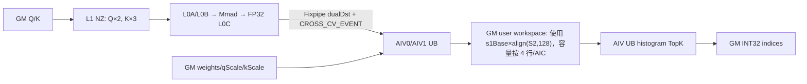

# QuantLightningIndexer 950 ACLNN 算子知识

## 算子速览

| 项目 | 内容 |
|---|---|
| 实际入口 | `aclnnQuantLightningIndexerGetWorkspaceSize` + `aclnnQuantLightningIndexer`，公开两段式 ACLNN；固定仓未出现该入口的 V2 符号。 |
| 计算语义 | 对量化 `query` 与 `key` 做 `Q·K^T`，乘 `query_dequant_scale × key_dequant_scale`、ReLU 后按 `weights` 沿 G 聚合，再对 S2 轴取 Top-k 索引。 |
| 输入输出 | Q/K 为 INT8、FLOAT8_E4M3 或 HIFLOAT8；D=128、N2=1、G=N1/N2∈{8,16,24,32,64}；输出 INT32，BSND 为 `[B,S1,N2,k]`，TND 为 `[T1,N2,k]`。 |
| 执行类型 | 单 Kernel `MIX_CV`，`KERNEL_TYPE_MIX_AIC_1_2`：1 个 AIC 对应 2 个 AIV。 |
| Kernel 路线 | R-001～R-016：4 个 dtype/精度实例 × 4 个地址/layout 实例；其中 FP8 的两种 weights/scale 精度共享 tiling key，合计 12 个唯一 key。 |
| 核心资源 | GM 输入输出；user workspace 的 per-AIC score staging；AIC 的 L1/L0A/L0B/L0C/UB；AIV 的 UB/寄存器与 TopK 临时区。 |
| 来源闭包 | `source_closed`：公开 ACLNN wrapper → generated inner bridge 边界 → OpDef/Tiling/POD/key → 单 MIX entry → AIC/AIV body、共享 VF helper与构建接线闭合。 |
| 验证状态 | 已完成源码闭包检查；本次知识提取未执行编译、真机、数值或性能测试。 |

## 接口与语义

### 计算语义

令每个 key head 对应 `G=N1/N2` 个 query heads（950 固定 `N2=1`），源码实现的有效 score 可写成：

```text
qk[g,s2] = dot(Q_quant[g,0:128], K_quant[s2,0:128])
score[s2] = keyScale[s2] * Σ_g(weights[g] * queryScale[g] * ReLU(qk[g,s2]))
out = TopKIndices(score, sparseCount)
```

INT8 路线将 `qk int32 → fp32` 后乘 `1/1024` 并以 `CAST_RINT` 往返 FP16/FP32：AIV 一次处理 1 行时先缩放/round-trip 再由 `WeightedAccum` 做 ReLU；一次处理 2 行时先 ReLU 再缩放/round-trip，随后权重累加。FP8/HIFLOAT8 的 `qk` 为 FP32。最终 score 不直接以浮点保存：BF16 精度路线编码为可排序 `uint16_t`，INT8 路线编码为可排序 `uint32_t`，随后直方图 TopK 输出索引；helper 只对与 `0x7FC0/0x7FC00000` 精确相等的规范 quiet-NaN 位型改写为 all-one，其它 NaN 不能由固定源码推导排序。`sparseMode=3` 时，逐 query token 约束可见 S2 前缀；无有效 S2 或 padding query 的输出填 `-1`。

### 输入、输出与属性

| 参数 | shape/layout | dtype | 约束、默认值与语义 |
|---|---|---|---|
| `query` | BSND `[B,S1,N1,128]`；TND `[T1,N1,128]` | INT8 / FLOAT8_E4M3 / HIFLOAT8 | 与 key dtype 相同；N1∈{8,16,24,32,64}；不支持非连续。 |
| `key` | BSND `[B,S2,1,128]`；TND `[T2,1,128]`；PA_BSND `[blockNum,blockSize,1,128]` | 同 query | PA 仅允许 0 轴非连续，wrapper 将 view stride 0 传入内部属性；其他轴连续。 |
| `weights` | BSND `[B,S1,N1]`；TND `[T1,N1]` | FP16 或 BF16 | FP8 支持 FP16/FP16 scale 或 BF16/FP32 scale；HIFLOAT8 仅 BF16/FP32；INT8 仅 FP16/FP16。 |
| `queryDequantScale` | 去掉 query 的 D 轴 | FP16 或 FP32 | shape 前缀必须逐轴等于 query；dtype 与 key scale 相同。 |
| `keyDequantScale` | 去掉 key 的 D 轴 | FP16 或 FP32 | PA 仅允许 0 轴非连续；stride 0 单独传入。 |
| `actualSeqLengthsQueryOptional` | `[B]` | INT32 | TND 必选且是前缀和；BSND 缺省时使用 S1。 |
| `actualSeqLengthsKeyOptional` | `[B]` | INT32 | TND/PA 必选；TND 是前缀和，BSND 缺省时使用 S2。 |
| `blockTableOptional` | `[B,maxBlockNumPerBatch]` | INT32 | 仅 PA_BSND 必选；逻辑 token 通过表项映射物理 block。 |
| `queryQuantMode`,`keyQuantMode` | 标量属性 | INT64/API，Host 读作 int32 | 均只允许 0（Per-Token-Head）。 |
| `layoutQueryOptional` | `BSND` / `TND` | STRING | 默认 BSND。 |
| `layoutKeyOptional` | `PA_BSND` / `BSND` / `TND` | STRING | 默认 BSND；非 PA 必须与 query layout 相同。 |
| `sparseCount` | 标量属性 | INT64/API | 1～2048；HIFLOAT8 固定 2048；默认 2048。 |
| `sparseMode` | 标量属性 | INT64/API | 0（default）或 3（right-down causal）；默认 3。 |
| `preTokens`,`nextTokens` | 标量属性 | INT64 | Host 只接受 `INT64_MAX`。 |
| `out` | BSND `[B,S1,1,k]`；TND `[T1,1,k]` | INT32 | `k=sparseCount`；无效 query/S2 填 `-1`。 |

### 入口与版本

固定 Commit 中该目录唯一公开版本是无版本后缀的 `aclnnQuantLightningIndexer`；递归搜索入口、示例、Host/Tiling 和 Kernel 未发现 V2 或更高版本符号。公开 ACLNN 文档的产品表仅对 Ascend 950PR/950DT 标记支持；A2/A3 明确为不支持。目录 README 的 A2/A3 支持表与 ACLNN 产品表冲突；OpDef 中 `ascend910b/ascend910_93` 及 arch22 实现只能证明图模式实现接线，不能覆盖公开 ACLNN 的不支持结论。因此本卡只发布 950。

## Host/Launcher 执行流程

### 参数校验与前处理

公开 wrapper 仅显式检查 `query != nullptr`；对非连续 `key` 和 `keyDequantScale` 读取 view stride 0，否则写 `-1`，然后调用 generated `aclnnInnerQuantLightningIndexerGetWorkspaceSize`。其余校验由 `QLIInfoParser::ParseAndCheck` 按源码顺序完成：节点名/平台及 workspace/tiling buffer → 装载必选与可选输入、输出、属性并先检查属性 → 必选 desc/shape/属性存在性 → dtype 组合 → layout/可选输入 → rank/N1/N2/G → B/S1/D/S2 → 主 shape 一致性 → scale shape → 950 stride 连续性。wrapper 不调用 `Contiguous`；OpDef 对 950 的 key 与 key scale 使用 `IgnoreContiguous`，设备端只实现 PA 0 轴 stride。

### 参数、Workspace 与生命周期

`DoTiling` 取 AIV/AIC 数，`blockDim=CalcTschBlockDim(aivNum,aicNum,aivNum)`，并设 schedule mode 1。总 workspace 为平台 `GetLibApiWorkSpaceSize()` 加 user score 区：

```text
scoreElemBytes = (query dtype == INT8) ? 4 : 2
scoreCapacityPerAIC = 4 * ceil(S2/128) * 128 * scoreElemBytes
workspaceTotal = libApiWorkspace + scoreCapacityPerAIC * aicNum
```

entry 用 `GetUserWorkspace(workspace)` 跳过 system/lib workspace。Device 实际以 `scoreUsedPerAIC=s1Base*align(S2,128)*scoreElemBytes` 紧凑切片，并以 `aiCoreIdx*scoreUsedPerAIC` 取本 pair 的 slice；`T<=64` 时 `s1Base=2`，Host 仍按 4 行容量分配，因而尾部留有未用容量。executor、调用方 workspace、输入/输出及可选张量都必须存活到同一 stream 完成；固定仓未展开 generated inner bridge 对 executor 内部对象的释放实现。

### 启动图与失败传播

```text
aclnnQuantLightningIndexerGetWorkspaceSize
  -> 计算 key/keyScale stride0
  -> generated aclnnInner...GetWorkspaceSize（固定仓边界）
  -> QuantLightningIndexer node
  -> TilingForQuantLightningIndexer
  -> DoTiling：POD + tiling key + blockDim + workspace + scheduleMode=1
  -> 单次 quant_lightning_indexer<<<MIX_AIC_1_2>>>
       AIC: Q/K ND→NZ -> L0A/L0B -> Mmad -> L0C -> Fixpipe 双目标 UB
       AIV0/AIV1: scale/ReLU/weight reduce -> score workspace -> TopK -> out
  -> aclnnQuantLightningIndexer 在调用方 stream 提交 executor
```

任一 wrapper/inner bridge/Tiling 校验失败即返回，不形成可达 kernel；单 kernel 内无后继 launch。空任务由 AIV 并行把完整输出填 `-1`，不是 Host fallback。

## Route 与参数设计

### 分核与资源计算

固定 950 tile 为 `S1_BASE_SIZE=4`、`S2_BASE_SIZE=128`、`D=128`，`mBase=4*G`；当 `T<=64` 时 S1 与 M tile 均减半为 2 和 `2*G`。`ConstInfo::isLDOpen` 保持默认 `false`且 950 路线无 setter，因此 `GetTotalBaseBlockNum` 对每个有效 `(B,N2,S1tile)` 只计 1 个分核单元；`SplitCore` 以 `min=floor(total/cores)` 和余数分配连续 S1 基本块，每个 AIC/AIV pair 再在本核内从 `s2Start=0` 扫完当前行的所有 128-token S2 tile；causal 只缩短该行的 `s2LoopEnd/validS2Len`，不把 S2 分给多核。多出的 pair 关闭。AIC 的 key L1 block 在 `T<=256` 时取 256，否则 128；L0 的 M/N/K 分别最多 256/128/128。

### Route 选择

| 顺序 | Route | Key/模板 | 精确选择条件与优先级 | 不适用去向 |
|---:|---|---|---|---|
| 1 | R-001～R-004 FP8+FP16 | `QLIType<fp8_e4m3fn_t,...,half,half,float,uint16>` | Q/K=FP8；weights/queryScale/keyScale=FP16；四个 layout key 见矩阵 | dtype 不符检查下一实例 |
| 2 | R-005～R-008 FP8+BF16/FP32 | `QLIType<fp8_e4m3fn_t,...,bfloat16_t,float,float,uint16>` | Q/K=FP8；weights=BF16；scales=FP32 | dtype 不符检查下一实例 |
| 3 | R-009～R-012 HIFLOAT8 | `QLIType<hifloat8,...,bfloat16_t,float,float,uint16>` | Q/K=HIFLOAT8；weights=BF16；scales=FP32；sparseCount=2048 | dtype 不符检查下一实例 |
| 4 | R-013～R-016 INT8 | `QLIType<int8_t,...,half,half,int32,uint32>` | Q/K=INT8；weights/scales=FP16 | 非法组合失败 |

```text
ParseAndCheck
  -> arch==DAV_3510 && dtype组合合法
  -> GET_TPL_TILING_KEY(DT_Q,DT_K,INT32,PAGE,Q_LAYOUT,K_LAYOUT)
     -> 每个精度族：PA+Q-BSND / PA+Q-TND / BSND+BSND / TND+TND
     -> quant_lightning_indexer 中 ORIG_DTYPE_QUERY/WEIGHTS 选实际 QLIType
  -> 未声明 key 或非法组合：Tiling/模板校验失败
```

### 模板/实现执行矩阵

| Route | key/selector | dtype/shape/platform 完整命中条件 | 执行族与 kernel 节点 | 实际模板/body | 内存与同步特征 | tail/fallback |
|---|---|---|---|---|---|---|
| R-001/R-005/R-009/R-013 | `PAGE=1,Q=BSND,K=PA_BSND` | 各精度族 + PA 必选 blockTable/seqK | 单 MIX kernel | `QuantLightningIndexerKernel`；PA block-table helper | PA stride0；AIC:AIV=1:2 flag | causal/tail；无效填 -1 |
| R-002/R-006/R-010/R-014 | `PAGE=1,Q=TND,K=PA_BSND` | 上项 + seqQ 前缀和 | 单 MIX kernel | 同上，TND query prefix offset | 同上 | 同上 |
| R-003/R-007/R-011/R-015 | `PAGE=0,Q=BSND,K=BSND` | blockTable=null；可选 seq | 单 MIX kernel | 连续 key `KeyNd2Nz` | 连续地址；同 flag | 同上 |
| R-004/R-008/R-012/R-016 | `PAGE=0,Q=TND,K=TND` | seqQ/seqK 均必选前缀和 | 单 MIX kernel | TND prefix offsets | 连续地址；同 flag | 同上 |

### 隐藏性能 Guard

| Guard | Host/Tiling 条件 | Device/资源原因 | 影响 Route | 不满足时去向 | 源码符号 |
|---|---|---|---|---|---|
| 950 G 集合 | `G∈{8,16,24,32,64}` | 固定 M tile 与 VF G 循环 specialization | 全部 | Host 失败 | `QLIInfoParser::GetGSize` |
| HIFLOAT8 TopK | `sparseCount==2048` | 公开实现约束 | R-009～012 | Host 失败 | `CheckAttrParaInfo` |
| PA block | `blockSize%16==0 && 0<blockSize<=1024` | block-table 分段 ND→NZ 搬运 | PA routes | Host 失败 | `GetAndCheckBlockSize` |
| 950 非连续 | 仅 PA 的 key/keyScale axis0 可非连续 | Device 只持有 stride0，其余轴按连续公式寻址 | PA routes | Host 失败 | `CheckContiguous` |
| 950 分核粒度 | `isLDOpen==false`（默认且无 setter） | score workspace 和 TopK 要求同一 pair 保有完整 S2 行 | 全部 | 不存在可达 S2 跨核归并 route | `ConstInfo::isLDOpen` / `GetTotalBaseBlockNum` / `SplitCore` |
| 小 T tile | `T<=64` | `mBase`、`s1Base` 减半 | 全部 | 使用正常 tile | `InitTilingData` |
| key L1 cache tile | `T<=256 ? 256 : 128` | 小 T 下复用相邻 S2 的 256-token L1 key | 全部 | 128-token 路线 | `QLIMatmul::InitParams/ComputeMm1` |
| TopK trunk | score uint32→6144；uint16→16384 | UB 容量与索引宽度 | 各精度路线 | 多 trunk ping-pong merge | `QLIVector::InitParams/ProcessTopK` |
| score workspace | `align(S2,128)` × 4 rows × score bytes × AIC | TopK 在所有 S2 tile 写完后回读整行 | 全部 | workspace 不足则 launch 前失败 | `QliCalcWorkspaceSize` |

### POD/ABI

`QLITilingData` 由 tiling 宏生成，固定源码显示 13 个连续声明的 `uint32_t` 字段；宏实现不在固定仓，故 `sizeof/alignof/offsetof` 数值不可见，不推测打包。

| 结构 | 字段 | 类型/位宽 | ABI 布局 | 单位 | Host/launcher producer | Device consumer | 边界 |
|---|---|---|---|---|---|---|---|
| QLITilingData | `bSize` | uint32/32 | 宏生成；数值不可见 | batch | `DoTiling` | batch/seq 分核 | TND 来自 seqQ 长度 |
| QLITilingData | `tSize` | uint32/32 | 同上 | token | `DoTiling` | 小 T tile/L2 hint | BSND=`B*S1` |
| QLITilingData | `n2Size` | uint32/32 | 同上 | head | 声明但 `DoTiling` 未调用 setter | Device 不读取 | inactive，固定仓未初始化事实 |
| QLITilingData | `gSize` | uint32/32 | 同上 | query heads/key head | `DoTiling` | M tile/VF reduce | 950 离散集合 |
| QLITilingData | `s1Size` | uint32/32 | 同上 | token/batch | `DoTiling` | BSND 默认 seq/output | TND 为 0 且走 prefix |
| QLITilingData | `s2Size` | uint32/32 | 同上 | token/batch上界 | `DoTiling` 从 int64 窄化 | workspace/address | 固定仓未见显式 uint32 溢出检查 |
| QLITilingData | `sparseCount` | uint32/32 | 同上 | index 数 | `DoTiling` | TopK/output stride | 1～2048 |
| QLITilingData | `keyStride0` | uint32/32 | 同上 | 元素 | wrapper→attr→`GenerateInfo`→setter | PA key 地址 | `-1` 时默认 `blockSize*N2*D`；窄化检查不可见 |
| QLITilingData | `keyDequantScaleStride0` | uint32/32 | 同上 | 元素 | 同上 | PA scale 地址 | `-1` 时默认 blockSize |
| QLITilingData | `usedCoreNum` | uint32/32 | 同上 | MIX blockDim | `DoTiling` | `SplitCore`/空任务 | 由平台 API 计算 |
| QLITilingData | `blockSize` | uint32/32 | 同上 | token/block | `DoTiling` | PA key/scale 分段 | 非 PA 为 0 |
| QLITilingData | `maxBlockNumPerBatch` | uint32/32 | 同上 | block/batch | `DoTiling` | blockTable row stride | 非 PA 为 0 |
| QLITilingData | `sparseMode` | uint32/32 | 同上 | enum | `DoTiling` | `attenMaskFlag` | 0 或 3 |

### Route 源码闭包

| Route | Key/selector | Host/Tiling producer | POD/参数 | Kernel entry/router | Kernel body/直接依赖 | 构建接线 |
|---|---|---|---|---|---|---|
| R-001～R-016 | dtype + PAGE + Q/K layout 模板 key | `TilingForQuantLightningIndexer`/`DoTiling` | `QLITilingData` 13 字段 | `quant_lightning_indexer` + `ORIG_DTYPE_*` | arch35 kernel、Cube/Vector、VF math、16/32-bit TopK gather | `add_op_to_compiled_list`、`add_modules_sources`、MIX 编译选项 |

## Kernel 实现

### 公共执行流程

entry 解包同一 POD，设 `KERNEL_TYPE_MIX_AIC_1_2`。AIC 和两个 AIV 用相同 `aiCoreIdx` 与相同分核区间：AIC 把 Q/K 由 GM ND 转 L1 NZ，再加载 L0A/L0B、`Mmad` 到 FP32 L0C，`Fixpipe` 以 dual destination 把 M 行一分为二送往两个 AIV 的 UB；AIV 等待跨核 flag，执行 scale/ReLU/权重 G-reduce，将 score 写到独占 GM workspace。最后一个 S2 tile 后，每个 AIV 对自己负责的 S1 行从 workspace 回读全部有效 S2，做 16/32-bit 直方图 TopK 并写 INT32 索引。

### Route R-001～R-016：950 MIX_CV 编译期实例

#### 适用条件

##### 选择证据

| 层级 | 文件 | 符号 | 源码谓词/参数 | 结果/下一跳 |
|---|---|---|---|---|
| API | `docs/aclnnQuantLightningIndexer.md` | 产品表/函数原型 | 仅 950PR/950DT 支持 | 进入公开两段式入口 |
| Host | `quant_lightning_indexer_tiling.cpp` | `GetAndCheckInOutDataType` | 四种精度组合 | R-001～016 或失败 |
| Tiling | `quant_lightning_indexer_template_tiling_key.h` | `ASCENDC_TPL_SEL` | 三种 Q/K dtype 各有 PA-BSND、PA-TND、BSND、TND | 12 个唯一 key；FP8 再由 weights dtype 分成两个 body |
| Router | `quant_lightning_indexer.cpp` | `quant_lightning_indexer` | `ORIG_DTYPE_QUERY` + `ORIG_DTYPE_WEIGHTS` | 选择四个 `QLIType` 精度实例 |

#### Device 数据流

##### 函数级调用链

```text
quant_lightning_indexer -> QuantLightningIndexerKernel::Init/Process
  -> SplitCore -> ProcessMain -> ProcessBaseBlock
     AIC: QLIMatmul::ComputeMm1 -> {Key,Query}Nd2Nz -> LoadData -> Mmad -> Fixp
     AIV: QLIVector::ProcessVec1 -> BatchMulWeightAndReduceSum
          -> scoreGm -> QLIVector::ProcessTopK -> LITopk::{LiTopKVF,LiTopKGatherVF} -> sparseIndices
```

##### 源码等价伪码

```text
for assigned (batch, s1Tile):
  derive actual S1/S2 and causal validS2Len; the pair owns the whole S1 tile
  for s2Tile in [0, ceil(validS2Len/128)):
    AIC waits pingpong buffer free
    AIC loads/caches K in L1 NZ; loads Q once on the first S2 tile
    AIC loads L0A/L0B; qk = Mmad(Q,K); Fixpipe dual-dst qk to AIV0/AIV1 UB
    AIC sets CROSS_CV_EVENT[pingpong] for both AIV
    each AIV waits; loads weights/qScale once and kScale in 16*S2_TILE chunks
    score = sortable(keyScale * sum_g(weight*queryScale*ReLU(qk)))
    AIV writes its S1 rows to score workspace and releases pingpong to AIC
  histogram TopK over the complete validS2Len; write indices, pad shortage with -1
```

#### 内存与数据搬运

##### 资源与搬运表

| 层级/缓冲区 | offset/地址公式 | extent/容量公式 | dtype/layout | producer | consumer | owner/lifetime | 对齐/复用 |
|---|---|---|---|---|---|---|---|
| GM Q/K/scales/weights | TND prefix 或 BSND batch offset；PA 由 blockTable×stride0 | API shape | 输入 dtype/ND | caller | AIC/AIV | caller 至 stream 完成 | PA 分 block 搬运 |
| user workspace score | `aiCoreIdx*s1Base*align(S2,128)+aivRow*align(S2,128)+s2` | Device 使用 `s1Base*align(S2,128)*sizeof(SCORE_T)`/AIC；Host 容量按 4 行 | uint16/uint32 sortable key | AIV `ProcessVec1` | 同 AIV `ProcessTopK` | executor workspace 至 kernel 完成 | 每 AIC 独占；S2 128 对齐 |
| L1 query | ping-pong `2*256*128` 元素 | 64 KiB（1-byte Q） | NZ | `QueryNd2Nz` | L0A load | AIC | 2 buffers |
| L1 key | `3*s2Basic*128` 元素 | 48 KiB（s2Basic=128）或 96 KiB（256） | NZ | `KeyNd2Nz*` | L0B load | AIC | 3 buffers/cache |
| L0A/L0B | `(l0BufIdx%2)*256*128` | 各 64 KiB | Q/K 1-byte fractal | L1 LoadData | Mmad | AIC tile | double buffer |
| L0C | `(l0BufIdx%2)*256*128` | 256 KiB FP32 | FP32 | Mmad | Fixpipe | AIC tile | double buffer |
| AIC/AIV shared UB qk | `(loop%2)*s2Base/2` 起；bank stride 512B | `2*ceil(mBase/2)*128*4` bytes | FP32/int32 bank layout | AIC Fixpipe dualDst | 两个 AIV | ping-pong tile | cross-core flag 防覆盖 |
| AIV score/TopK UB | 见字节账 | 动态依 sparseCount/score type | SCORE_T/indices/histogram | AIV | AIV | 当前行/trunk | 256 元素对齐、ping-pong history |

##### 分层内存布局



##### 字节账、交接边与复用顺序

```text
workspace_total = libApiWorkspace + aicNum * 4 * align(S2,128) * scoreBytes
workspace_used_by_device = aicNum * s1Base * align(S2,128) * scoreBytes
AIC_UB_qk = 2 * ceil(mBase/2) * 128 * 4
AIV_UB_fixed = AIC_UB_qk
  + 2*ceil(s1Base/2)*512 (weight)
  + 2*ceil(s1Base/2)*512 (weightFloat)
  + 2*128*16*sizeof(scale)
  + 2*ceil(s1Base/2)*512 (qScale)
  + 2*ceil(s1Base/2)*128*scoreBytes (tile score)
A = align(sparseCount,256)
TopK uint32 extras = (A+6144)*4 + (A+64)*4 + A*4 + (2*A+7488)*4
TopK uint16 extras = (A+16384)*2 + (A+64)*4 + A*2 + (6*A+36096)
```

| 边/复用子区 | producer | offset/extent | dtype/layout | consumer | ordering/sync | owner/lifetime | 安全条件 |
|---|---|---|---|---|---|---|---|
| AIC→AIV qk | `Fixp` | pingpong UB；dualDst 按 M/2 | FP32 或 int32，bank stride 512B | 两个 `ProcessVec1` | AIC waits VC；sets CV；AIV waits CV；sets VC | pair-local UB | 两个 AIV 都释放同一 parity 后 AIC 才覆盖 |
| AIV→TopK score | `ProcessVec1` | per-AIC `s1Base` rows × align(S2,128) | uint16/uint32 sortable | `ProcessTopK` | MTE3→MTE2 event；同 kernel program order | user workspace | last S2 tile 后读取 |
| TopK history | `LITopk` | two `align(k,256)` index banks | uint32 | next trunk gather | `PipeBarrier<PIPE_V>` | AIV UB | parity bank 与当前 merge 分离 |

#### 同步、精度与尾块

##### 同步与数值边界表

| 阶段 | primitive/机制 | producer | consumer/等待点 | 保护对象 | 精度/尾块 |
|---|---|---|---|---|---|
| L1/L0 pipeline | MTE1/MTE2、M/MTE1、FIX/M events | DMA/Mmad/Fixpipe | 下一 pipeline stage | Q/K triple/double buffer、L0C | M/N/S2 均按源码对齐，真实 extent 单独传入 |
| AIC→AIV | `CrossCoreSet/WaitFlag<MODE4>`，event 2/3 + AIV1 offset 16 | AIC Fixpipe | AIV `ProcessVec1` | parity qk UB | dualDst 将 M 行分给两个 AIV |
| AIV→AIC | event 0/1 + offset 16 | AIV0/AIV1 | 下一 AIC parity | 同 qk UB | 两个消费者都完成才覆盖 |
| score math | MicroAPI register | QK/scale/weight | sortable-key store | score | INT8 特有 `/1024` 与 FP16 round-trip；1 行时 round-trip→ReLU，2 行时 ReLU→round-trip；所有路线 FP32 累加，uint16 路线末端 cast BF16 |
| TopK | histogram + gather | score workspace | output MTE3 | indices | validS2<k 时其余填 -1；仅规范 quiet-NaN 位型转 all-one，公开文档声明 NaN 排序未定义 |
| 空域 | `InitGlobalMemory`/`CleanInvalidOutput` | AIV | output | 全部或行级输出 | 填 -1 |

#### 关键实现

##### 符号证据表

| 阶段 | 文件 | 符号/模板实例 | 实现事实 |
|---|---|---|---|
| Host/Tiling producer | `op_host/quant_lightning_indexer_tiling.cpp` | `ParseAndCheck`、`DoTiling`、`QliCalcWorkspaceSize` | 完整校验、POD、key、workspace、blockDim |
| Kernel entry/router | `op_kernel/quant_lightning_indexer.cpp` | `quant_lightning_indexer`、`INVOKE_LI_NO_KFC_OP_IMPL` | MIX 1:2 与四个精度模板 |
| Device body/helper | `op_kernel/arch35/quant_lightning_indexer_kernel.h` | `SplitCore`、`ProcessMain/BaseBlock` | block 分配、地址、跨族调用与空域 |
| Cube | `op_kernel/arch35/quant_lightning_indexer_service_cube.h` | `ComputeMm1`、`Mmad`、`Fixp` | GM→L1→L0→dualDst UB 与同步 |
| Vector/TopK | `op_kernel/arch35/quant_lightning_indexer_service_vector.h` | `ProcessVec1`、`ProcessTopK` | score staging、trunk TopK、tail |
| VF | `op_kernel/arch35/vf/quant_lightning_indexer_vector1.h` | `BatchMulWeightAndReduceSum` | scale/ReLU/G reduce 与精度路径 |

## 算子特定优化

### Trick T-001：小 T 的 256-token Key L1 复用

#### 触发与源码依据

- 适用 Route：R-001～R-016。
- 触发条件：`tSize<=256`，令 `s2BasicBlock_=256`；否则 128。
- Golden 来源：[`quant_lightning_indexer_service_cube.h:119-124`](../../../../../../../cann-ops-raw/ascendc/ops-transformer/be33d95bb755cedec3108f70805c1874d1792540/attention/quant_lightning_indexer/op_kernel/arch35/quant_lightning_indexer_service_cube.h#L119-L124)

**官方源码（固定 Commit 连续逐字摘录）**：

```cpp
constInfo_ = constInfo;
s2BasicBlock_ = (constInfo_.tSize <= 256) ? 256 : 128;
keyBufferOffset_ = s2BasicBlock_ * D_BASIC_BLOCK;
```

#### 机制与设计原因

256 路线记录 `keyGmStart_/keyLoadedSize_`；后续 128-token S2 tile 若落在已加载范围内，跳过 GM→L1，并在完全用完或最后 tile 后释放三缓冲。改变的是 key 搬运与 L1 生命周期，不改变数学结果。

#### 迁移边界

- 适用：D=128、相同 block-table/连续 key 地址语义。
- 前提：L1 容纳 `3*256*128` 个 1-byte K。
- 失效：T>256 使用 128-token triple-buffer 路线。
- 未验证：本次知识提取未执行编译、真机、数值或性能测试。

#### 错误做法

在 cache 未覆盖当前 S2 区间时复用旧 L1 会读取错误 key；源码以 `keyCacheHit` 的闭区间谓词回退到重新搬运。

### Trick T-002：Fixpipe 双目标直达两个 AIV UB

#### 触发与源码依据

- 适用 Route：R-001～R-016。
- 触发条件：单 kernel MIX_CV 1:2，M 为偶数对齐，parity buffer 已被两个 AIV 释放。
- Golden 来源：[`quant_lightning_indexer_service_cube.h:446-472`](../../../../../../../cann-ops-raw/ascendc/ops-transformer/be33d95bb755cedec3108f70805c1874d1792540/attention/quant_lightning_indexer/op_kernel/arch35/quant_lightning_indexer_service_cube.h#L446-L472)

**官方源码（固定 Commit 连续逐字摘录）**：

```cpp
fixpipeParams.dstStride = UB_BANK_DEPTH_STRIDE / sizeof(float);
fixpipeParams.dualDstCtl = 1;
Fixpipe<QK_T, QK_T, QLI_CFG_ROW_MAJOR_UB>(
    mm1ResUB_[(runInfo.loop % 2) * constInfo_.s2BaseSize / 2],
    cL0_[(l0BufIdx_ % L0_BUF_NUM) * L0C_BUFFER_OFFSET], fixpipeParams);
```

#### 机制与设计原因

L0C 不落 GM；Fixpipe 同时做 NZ→ND，并把 M 维两半送入配对 AIV 的同 parity UB。AIC/AIV 用 event parity 和 AIV1 的 `+16` event offset 完成双消费者防覆盖。

#### 迁移边界

- 适用：硬件提供 dual destination Fixpipe 与 MIX 1:2 映射。
- 前提：M 偶数、两 AIV 对同一 `aiCoreIdx`、UB bank stride 512B。
- 失效：独立 kernel 或无跨核 UB 可见性时必须物化到 GM/workspace。
- 未验证：本次知识提取未执行编译、真机、数值或性能测试。

#### 错误做法

只等待一个 AIV 的释放 flag 就覆盖 parity UB，会破坏另一个 AIV 的 QK 输入。

### Trick T-003：score 压缩为 sortable key 并分 trunk TopK

#### 触发与源码依据

- 适用 Route：uint16 score 的 R-001～012 与 uint32 score 的 R-013～016。
- 触发条件：分别采用 trunk 16384 与 6144；S2 超过 trunk 时逐段 TopK+gather。
- Golden 来源：[`quant_lightning_indexer_service_vector.h:197-204`](../../../../../../../cann-ops-raw/ascendc/ops-transformer/be33d95bb755cedec3108f70805c1874d1792540/attention/quant_lightning_indexer/op_kernel/arch35/quant_lightning_indexer_service_vector.h#L197-L204)

**官方源码（固定 Commit 连续逐字摘录）**：

```cpp
if constexpr (std::is_same_v<SCORE_T, uint32_t>) {
    trunkLen_ = TRUNK_LEN_6K;
} else {
    trunkLen_ = TRUNK_LEN_16K;
}
topkCount_ = constInfo.sparseCount;
topkOp_.Init(topkCount_, trunkLen_);
topkCountAlign256_ = QLICommon::Align(constInfo.sparseCount, (uint64_t)256);
```

#### 机制与设计原因

VF 把有符号浮点映射为保持排序的无符号 key，TopK 用逐字节直方图定位 kth value；长 S2 每段保留 topK value/index，再与下一段合并。uint16 BF16 key 减小 workspace/UB，uint32 路线保留更宽 score 但采用更短 trunk。

#### 迁移边界

- 适用：只需要索引且可按无符号 key 保序比较。
- 前提：TopK 临时区按 256 元素对齐，跨 trunk 保存真实索引。
- 失效：需要原始 score 或自定义 NaN 顺序时不可直接复用该编码。
- 未验证：本次知识提取未执行编译、真机、数值或性能测试。

#### 错误做法

直接把 IEEE 浮点 bit pattern 当普通无符号数排序会错排负数；helper 对符号位选择 xor mask，并仅把与 `NAN_MASK=0x7FC0/0x7FC00000` 精确相等的规范 quiet-NaN 位型映射为全 1。公开接口声明 NaN 排序未定义，不得把这一位型特例扩展成通用 NaN 顺序。

## 模板与实现对比

| 对比维度 | R-001～004 FP8/FP16 | R-005～012 FP8/HF8 BF16/FP32 | R-013～016 INT8 | 设计选择依据 |
|---|---|---|---|---|
| 命中条件/优先级 | FP8 + half | FP8 或 HF8 + BF16/float | int8 + half | Host dtype 组合 + entry 原始 dtype |
| 执行族/节点图 | MIX 1:2 单 kernel | 同 | 同 | 统一 arch35 body |
| M/N/K、tile 与 scheduler | M=4G或2G，N=128，K=128 | 同 | 同 | 固定 D/G 集合 |
| workspace/L1/L0/UB | score 2B | score 2B | score 4B | TopK key 精度不同 |
| AIC/AIV 或 kernel 交接 | Fixpipe dualDst UB | 同 | 同，QK int32 | compile-time QK type |
| 同步、精度与 tail | FP32 QK/acc，BF16 sortable | 同 | int32→fp32→/1024→FP16往返；FP32 sortable | 模板 type traits |
| fallback/失败边界 | 非法 dtype/layout 失败 | HF8 k!=2048 失败 | 非 half scale 失败 | 无 device dtype fallback |

## 平台差异

| 项目 | A2 | A3 | 950 |
|---|---|---|---|
| 支持状态 | 公开 ACLNN 文档明确不支持 | 公开 ACLNN 文档明确不支持 | 950PR/950DT 支持 |
| Host/Launcher | 不发布 ACLNN 卡 | 不发布 ACLNN 卡 | DAV_3510、950 dtype/layout/stride 检查 |
| Kernel/资源 | arch22 实现只证明图模式接线 | arch22 实现只证明图模式接线 | arch35 MIX 1:2、RegTensor VF、16/32-bit TopK |

## 限制与失败边界

- generated `aclnnInnerQuantLightningIndexer*` 实现不在固定源码仓；本卡只把其视为框架桥接边界，不推测 executor 内部校验与释放细节。
- `s2Size`、两个 stride 属性从 int64 写入 uint32 POD，固定仓未见显式上溢检查；复用实现时必须保持可表示范围。
- `n2Size` 在 POD 中声明但 Host 未 set、Device 未读取；不得新增读取该 inactive 字段。
- `preTokens/nextTokens` 只接受 `INT64_MAX`；实际 causal 范围仅由 `sparseMode=3` 与 actual lengths 形成。
- 公开约束要求 `weights*queryScale` 落在 FP16 表示范围；TopK 对 NaN 的排序行为未定义。
- 本次知识提取未执行编译、真机、数值或性能测试；不从源码结构推断收益。

## 源码索引

### 链路索引

| 链路阶段 | 文件 | 关键符号 | 支撑内容 |
|---|---|---|---|
| 入口声明/约束 | `attention/quant_lightning_indexer/README.md` | 产品表、调用方式、数值约束 | 图模式与 ACLNN 公开支持冲突的审计证据 |
| 入口声明/约束 | `attention/quant_lightning_indexer/docs/aclnnQuantLightningIndexer.md` | 产品表、原型、约束 | 950 公开支持与契约 |
| 入口声明/约束 | `attention/quant_lightning_indexer/op_host/op_api/aclnn_quant_lightning_indexer.h` | 两段式函数 | ABI 声明 |
| 入口实现 | `attention/quant_lightning_indexer/op_host/op_api/aclnn_quant_lightning_indexer.cpp` | wrapper/inner bridge | stride0 与提交 |
| Host/Tiling/Launcher | `attention/quant_lightning_indexer/op_host/quant_lightning_indexer_def.cpp` | `QuantLightningIndexer` | 950 dtype/config/contiguous 策略 |
| Host/Tiling/Launcher | `attention/quant_lightning_indexer/op_host/quant_lightning_indexer_infershape.cpp` | `InferShape*` | 输出 shape/dtype |
| Host/Tiling/Launcher | `attention/quant_lightning_indexer/op_host/quant_lightning_indexer_tiling.h` | `QLITilingData` | POD 声明 |
| Host/Tiling/Launcher | `attention/quant_lightning_indexer/op_host/quant_lightning_indexer_tiling.cpp` | `ParseAndCheck/DoTiling` | 校验、workspace、key、blockDim |
| Kernel entry/body | `attention/quant_lightning_indexer/op_kernel/quant_lightning_indexer_template_tiling_key.h` | template key 声明/选择 | 12 个唯一 950 key；FP8 精度子型由 entry 原始 dtype 再分流 |
| Kernel entry/body | `attention/quant_lightning_indexer/op_kernel/quant_lightning_indexer_common.h` | `QLIType` / `ConstInfo` / `RunInfo` | 完整 type traits、MIX event ID、UB bank 布局与 `isLDOpen=false` |
| Kernel entry/body | `attention/quant_lightning_indexer/op_kernel/quant_lightning_indexer.cpp` | `quant_lightning_indexer` | entry 与精度 router |
| Kernel entry/body | `attention/quant_lightning_indexer/op_kernel/arch35/quant_lightning_indexer_kernel.h` | `QuantLightningIndexerKernel` | 分核/主循环/地址/空域 |
| Kernel entry/body | `attention/quant_lightning_indexer/op_kernel/arch35/quant_lightning_indexer_service_cube.h` | `QLIMatmul` | AIC 层级与同步 |
| Kernel entry/body | `attention/quant_lightning_indexer/op_kernel/arch35/quant_lightning_indexer_service_vector.h` | `QLIVector` | AIV score/TopK |
| Kernel entry/body | `attention/quant_lightning_indexer/op_kernel/arch35/vf/quant_lightning_indexer_vector1.h` | `BatchMulWeightAndReduceSum` | 数值顺序与 score key |
| Kernel entry/body | `attention/quant_lightning_indexer/op_kernel/arch35/vf/quant_lightning_indexer_topk.h` | `LITopk` | trunk 调度/UB |
| Kernel entry/body | `attention/lightning_indexer/op_kernel/arch35/vf/common/lightning_indexer_vector1_base.h` | `FloatToSortableKey/WeightedAccum` | 共享 VF 实际 helper |
| Kernel entry/body | `attention/lightning_indexer/op_kernel/arch35/vf/vf_topk_gather.h` | `LiTopKVF/LiTopKGatherVF` | uint32 TopK |
| Kernel entry/body | `attention/lightning_indexer/op_kernel/arch35/vf/common/vf_topk_16_gather.h` | `LiTopKVF/LiTopKGatherVF` | uint16 TopK |
| 构建接线 | `attention/quant_lightning_indexer/op_host/CMakeLists.txt` | compile/module macros | ACLNN inner 与同步编译选项 |

每行只写一个文件，并确保该文件存在于 Frontmatter `sources`。

### 实现复用检查

| 检查项 | 可复用事实 | 不得改变的约束 | 源码符号 |
|---|---|---|---|
| ABI/POD | 13 个 uint32 字段的 producer/consumer | 字段声明顺序；inactive n2Size 不得读取 | `QLITilingData/DoTiling/InitTilingData` |
| 调用顺序 | ACLNN→Tiling→单 MIX entry→AIC/AIV；每个 pair 完整扫描分配 S1 tile 的 S2 | generated bridge 边界、同 stream 生命周期与 `isLDOpen=false` | wrapper/entry/`SplitCore` |
| workspace/内存 | per-AIC 4-row score slice | `align(S2,128)`、score bytes、system workspace 前缀 | `QliCalcWorkspaceSize/Init` |
| 同步 | parity cross-core flags + pipeline events | 两个 AIV 的 wait/set 与 `+16` ID | `ComputeMm1/ProcessVec1` |
| 精度与尾块 | 四个精度实例、sortable score、validS2 tail | INT8 `/1024`/FP16往返及 1/2 行 ReLU 次序；uint16 BF16 cast；不足 k 填 -1 | vector1/ProcessTopK |
| 失败边界 | Host fail-closed 与 AIV 空域清理 | 不把 A2/A3 图实现当 ACLNN 支持；不启用未声明 key | parser/template key/ProcessInvalid |