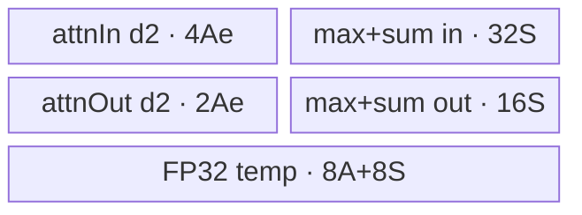
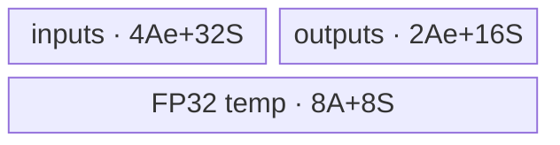
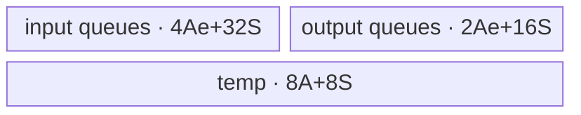

# RingAttentionUpdate A2/A3 ACLNN 算子知识

## 算子速览

| 项目 | 内容 |
|---|---|
| 实际入口 | 最新公开 `aclnnRingAttentionUpdateV2GetWorkspaceSize` / `aclnnRingAttentionUpdateV2` |
| 计算语义 | 稳定归并两组 softmax max/sum，并用归一化权重归并两份 attention |
| 输入输出 | attention：FP16/BF16/FP32；softmax：FP32；SBH 或 TND |
| 执行类型 | `AIV_VECTOR` |
| Kernel 路线 | R-001 SBH；R-002 TND+BNS8 softmax；R-003 TND+TND softmax/单头 |
| 核心资源 | GM、6 个 depth=2 `TQue`、1 个 FP32 `TBuf`；Tiling 预留 16 MiB system workspace |
| 来源闭包 | `source_closed`：V2 API→L0→Tiling/POD→key router→Vector body→CMake 闭合 |
| 验证状态 | 已完成源码闭包检查；本次知识提取未执行编译、真机、数值或性能测试。 |

## 接口与语义

### 计算语义

`m=max(mp,mc)`，`wp=sp*exp(mp-m)`，`wc=sc*exp(mc-m)`，`s=wp+wc`，`o=op*(wp/s)+oc*(wc/s)`。softmax 最后一维 8 个值语义相同，Kernel 仍逐 lane 计算、输出。

### 输入、输出与属性

| 参数 | shape/layout | dtype | 约束、默认值与语义 |
|---|---|---|---|
| prev/cur attention | SBH `[S,B,H]`；TND `[T,N,D]` | 同为 FP16/BF16/FP32 | 必选、非空、3D；TND：`N<=256,D<=768,D%64==0` |
| 四个 softmax 输入 | BNS8 `[B,N,S,8]` 或 TND `[T,N,8]` | FP32 | 必选、同 shape、尾维 8 |
| `actualSeqQlenOptional` | TND 累计长度 | INT64 | TND 必填；Device 用相邻值恢复 batch 边界 |
| `inputLayoutOptional` | 字符串 | SBH/TND | OpDef 默认 SBH |
| `inputSoftmaxLayoutOptional` | 字符串 | 空/SBH/TND | 仅 attention=TND 时有效；V2 新增 |
| 三个输出 | 分别同 prev attention/max/sum | 对应输入 dtype | InferShape 复制输入 0/1/2，最终 ViewCopy |

### 入口与版本

V2 比旧入口新增 softmax layout，能直接接收 TND softmax，故为同平台最新版本。公开 V2 产品表明确支持 Atlas A2/A3；OpDef 注册 `ascend910b`、`ascend910_93`。第二段接口只执行 `CommonOpExecutorRun(workspace,workspaceSize,executor,stream)`。

## Host/Launcher 执行流程

### 参数校验与前处理

第一段依序执行 `CheckUpdateParam`（六个必选输入、三输出、`workspaceSize`、`executor` 判空）→创建 executor→`InputDtypeCheck`→`AnalysisAxis`→六输入 `Contiguous`，TND 时再连续化 `actualSeqQlenOptional`→`InputFormatCheck` 排除 `FRACTAL_NZ`→L0 分配三输出、`INFER_SHAPE`、`ADD_TO_LAUNCHER_LIST_AICORE`→三次 `ViewCopy`。`AnalysisAxis` 拒绝六个数据输入的零维和错误 softmax rank/尾维，并对 TND 检查 N/D/UB 粗上界；但 attention rank 不为 3 的分支只记录日志，真正失败由后续 Tiling 决定。TND 调用方必须按公开契约提供非空 actualSeq；API 在 `Contiguous` 前没有独立判空。

### 参数、Workspace 与生命周期

Tiling 写 `currentWorkspace[0]=16*1024*1024`；Device 获取 `GetUserWorkspace` 但 body 不读写。ACLNN 返回整个 executor 的 workspace，还可能含 Contiguous/ViewCopy 临时量，不能等同 16 MiB。executor/workspace 必须存活至 stream 完成。

### 启动图与失败传播

单 Kernel launch graph：

```text
aclnnRingAttentionUpdateV2GetWorkspaceSize
  -> checks / Contiguous
  -> l0op::RingAttentionUpdate
    -> INFER_SHAPE
    -> ADD_TO_LAUNCHER_LIST_AICORE
      -> Tiling4RingAttentionUpdate
         produces {RingAttentionUpdateTilingData, blockDim=coreNum,
                   key in 0/1/2/10/11/12, system workspace=16 MiB}
      -> ring_attention_update(inputs[0..6], outputs[0..2], workspace, tiling)
         -> exactly one AIV_VECTOR body
  -> ViewCopy(output0) -> ViewCopy(output1) -> ViewCopy(output2)
aclnnRingAttentionUpdateV2
  -> CommonOpExecutorRun(workspace, workspaceSize, executor, stream)
```

没有 Kernel 间 workspace 边；AICore 节点与三次 `ViewCopy` 都由同一 executor 提交到调用 stream，框架保持 launcher list 的顺序，executor/workspace 由调用方持有到 stream 完成。前处理、InferShape、Tiling 或 ViewCopy 任一步失败即不形成可执行的完整链；Tiling 的 shape/dtype/属性/除零/UB guard 失败阻断 launch。entry 对未知 key 没有 `else`，Device 静默不写三个输出，固定仓没有 fallback。

## Route 与参数设计

### 分核与资源计算

SBH：`bn=B*N`，`g=gcd(bn,maxAiv)`，先得 `coreNumGroup=maxAiv/g`、`bnNumGroup=bn/g`；每组沿 S 分核，`seqEach=ceil(S/coreNumGroup)`，再以 `ceil(S/seqEach)` 收缩组内核数，尾核处理 `S-(coreNumGroup-1)*seqEach`。`headDim=H/N` 是整数除法，固定非 RegBase Host 没有 `H%N==0` guard。D tile 按 64 个元素向下/向上对齐；S tile 最小 8 行、是 8 的倍数，且源码显式把 `seqNumLoopMax` 设为 255（Device 的 `softmaxRepeatTimes` 类型也是 `uint8_t`，但固定仓未说明 255 上限的唯一设计原因）。TND：`dimTCoreEach=ceil(T/maxAiv)`、`coreNum=ceil(T/dimTCoreEach)`，尾核取余，`seqNumLoopEach=1`；设 `e=sizeof(T)`，`headNumAllCount=MAX_UB_SIZE-64*(6e+8)-64*56`，`headDimEach=D*(6e+8)+8*56`，`loopEachMax=floor(headNumAllCount/headDimEach)`，softmax=TND 或 N=1 时不 cap 到 N，否则取 `min(loopEachMax,N)`。

### Route 选择

| 顺序 | Route | Key/模板 | 精确选择条件与优先级 | 不适用去向 |
|---:|---|---|---|---|
| 1 | R-001 SBH | 0/1/2；`KernelRingAttentionUpdate<half/bfloat16_t/float>` | ACLNN公开值 `input_layout=="SBH"`；Tiling内部以`!="TND"`进入该分支；dtype 加 0/1/2 | 失败，无 fallback |
| 2 | R-002 TND+BNS8 | 10/11/12；`KernelRingAttentionUpdateTND<T>::ProcessTnd` | TND、softmax 空/SBH、`N>1` | N=1 转 R-003 |
| 3 | R-003 TND+TND/单头 | 同 key；`ProcessSoftmaxTnd` | TND 且 (`softmaxLayout==TND` 或 `N==1`) | 失败，无 fallback |

```text
input_layout==TND ? baseKey=10 : baseKey=0
dtype FP16/BF16/FP32 => +0/+1/+2
key 0..2 => R-001
key 10..12 => flag==1 || N==1 ? R-003 : R-002
```

### 模板/实现执行矩阵

| Route | key/selector | dtype/shape/platform 完整命中条件 | 实际模板/类 | body/helper | 内存与同步特征 | tail/fallback |
|---|---|---|---|---|---|---|
| R-001 | 0/1/2 | A2/A3、`input_layout!="TND"`、SBH shape/dtype guard | 单 Kernel：`ring_attention_update` | `KernelRingAttentionUpdate<half/bfloat16_t/float>::Process` | 6 个 depth=2 Queue、1 个分片 FP32 TBuf、Queue+`PIPE_V` | S/D tail；失败无 fallback |
| R-002 | 10/11/12+flag0 | TND、softmax空/SBH、N>1、actualSeq、N/D/UB guard | 单 Kernel：同 entry | `KernelRingAttentionUpdateTND<T>::ProcessTnd` | BNS8 stride DMA、同一 UB 家族 | T/N/batch tail；N=1走R-003 |
| R-003 | 10/11/12+flag1/单头 | TND 且（softmax TND 或 N=1） | 单 Kernel：同 entry | `KernelRingAttentionUpdateTND<T>::ProcessSoftmaxTnd` | TN连续DMA、同一 UB 家族 | 合轴 tail；失败无 fallback |

### 隐藏性能 Guard

| Guard | Host/Tiling 条件 | Device/资源原因 | 影响 Route | 不满足时去向 | 源码符号 |
|---|---|---|---|---|---|
| TND D | `D%64==0,D<=768` | 64 FP32 lane repeat与 UB | R-002/3 | 失败 | `RingAttentionUpdateTNDUbSizeCheck` |
| TND N/UB | `N<=256,headNumLoopEach>0` | `UB=A(6e+8)+56S` | R-002/3 | 失败 | `AnalysisAxis`、`Tiling4...TND` |
| SBH tile | D容量对齐64；S tile为8倍数且源码硬上限255 | 64-lane Vector 路径；`softmaxRepeatTimes`为uint8，255硬上限的唯一原因固定仓未说明 | R-001 | 缩 tile/失败 | `RingAttentionUpdateSplitLoop` |
| 空域 | 任一维 0 拒绝 | loop/除法依赖正维 | 全部 | 失败 | `CheckNullTensor` |
| BF16 guard | arch 3003/3113 不实例化 key1/11 | 编译 guard | 对应 key | 无 Device fallback | `ring_attention_update` |
| SBH H/N | 固定仓仅计算 `headDim=H/N`，未检查 `H%N==0` | Kernel 只覆盖 `N*floor(H/N)` 个 H 元素 | R-001 | 无 fallback，属于调用边界 | `RingAttentionUpdateInitShapeInfo` |

### POD/ABI

宏未展开 `sizeof/alignof/offsetof`，以下均按声明顺序；除最后 flag 外均 `int64_t/64`。

| 结构 | 字段 | 类型/位宽 | ABI 布局 | 单位 | Host/launcher producer | Device consumer | 边界 |
|---|---|---|---|---|---|---|---|
| RingAttentionUpdateTilingData | `batchSize` | int64/64 | 宏生成，offset不可见 | batch | SBH B；TND `len(actualSeq)-1` | Init/地址 | TND依赖actualSeq |
| 同上 | `headNum` | int64/64 | 同上 | head | SBH N；TND N | 地址/N loop | ≤256(TND) |
| 同上 | `seqNum` | int64/64 | 同上 | token | SBH S | SBH分核 | TND inactive |
| 同上 | `headDim` | int64/64 | 同上 | element | SBH H/N；TND D | D loop | TND约束 |
| 同上 | `softmaxTailSize` | int64/64 | 同上 | element | shape尾维 | softmax | =8 |
| 同上 | `coreNum` | int64/64 | 同上 | core | split core | TND尾核/blockDim | >0 |
| 同上 | `coreNumGroup` | int64/64 | 同上 | core/group | SBH gcd分组 | SBH | TND inactive |
| 同上 | `bnNumGroup` | int64/64 | 同上 | BN/group | SBH | SBH loop | TND inactive |
| 同上 | `seqNumCoreEach` | int64/64 | 同上 | S/core | SBH | SBH | TND inactive |
| 同上 | `seqNumCoreTail` | int64/64 | 同上 | S | SBH | SBH尾核 | TND inactive |
| 同上 | `seqNumLoopEach` | int64/64 | 同上 | S/tile | SBH UB；TND=1 | loops | >0 |
| 同上 | `headNumLoopEach` | int64/64 | 同上 | N/tile | TND UB | TND | SBH inactive |
| 同上 | `headDimLoopEach` | int64/64 | 同上 | D/tile | SBH UB | SBH | TND inactive |
| 同上 | `batchSizeCoreEach` | int64/64 | 同上 | batch | 初始化0 | 不读 | inactive |
| 同上 | `batchSizeCoreTail` | int64/64 | 同上 | batch | 初始化0 | 不读 | inactive |
| 同上 | `dimTCoreEach` | int64/64 | 同上 | T/core | TND | TND | SBH inactive |
| 同上 | `dimTCoreTail` | int64/64 | 同上 | T | TND | TND尾核 | SBH inactive |
| 同上 | `tndSoftmaxLayout` | uint8/8 | 末字段，padding不可见 | flag | 仅TND分支按attr写0/1；SBH未显式初始化 | TND `Process` 读取；SBH body不读 | TND仅0/1；SBH inactive值不得使用 |

### Route 源码闭包

| Route | Key/selector | Host/Tiling producer | POD/参数 | Kernel entry/router | Kernel body/直接依赖 | 构建接线 |
|---|---|---|---|---|---|---|
| R-001 | 0/1/2 | `ring_attention_update_tiling.cpp::Tiling4RingAttentionUpdate` | `RingAttentionUpdateTilingData` | `ring_attention_update.cpp` | `ring_attention_update.h` | `op_host/CMakeLists.txt` |
| R-002 | 10/11/12+0 | 同上/`Tiling4...TND` | 同上 | 同上 | `ring_attention_update_tnd.h::ProcessTnd` | 同上 |
| R-003 | 10/11/12+1/单头 | 同上 | 同上 | 同上 | `ring_attention_update_tnd.h::ProcessSoftmaxTnd` | 同上 |

## Kernel 实现

### 公共执行流程

entry 接收 7 输入、3 输出、workspace、tiling。prev/cur 共用 input Queue 的两个等长子区。先用 FP32 Max/Sub/Exp/Mul/Add/Div 得到合并 max/sum 及两权重，再加载 attention；FP16/BF16 升 FP32，加权后 FP16 `CAST_NONE`、BF16 `CAST_RINT`，FP32 用 Copy。workspace 不被 body 使用。

### Route R-001：SBH 分组分核

#### 适用条件

##### 选择证据

| 层级 | 文件 | 符号 | 源码谓词/参数 | 结果/下一跳 |
|---|---|---|---|---|
| Tiling | `op_host/ring_attention_update_tiling.cpp` | `Tiling4RingAttentionUpdate` | layout非TND，dtype加0/1/2 | key0/1/2 |
| Router | `op_kernel/ring_attention_update.cpp` | `ring_attention_update` | `TILING_KEY_IS(0/1/2)` | SBH模板 |

#### Device 数据流

##### 函数级调用链

```text
entry -> Init -> Process -> SoftmaxComputeLoop(CopyIn,Compute,CopyOut)
 -> for D tile: AttnInitInfo -> AttnDataMoveIn -> AttnCompute -> AttnDataMoveOut
```

##### 源码等价伪码

```text
for BN in group; for S tile owned by core:
  softOff=bn*S*8+s*8; compute/store max,sum; retain FP32 weights
  for D tile: attnOff=bn*D+s*(B*N*D)+d
    strided load S rows, cast/copy FP32, broadcast each 8-lane row's scale
    out=prev*wp+cur*wc; cast/copy; strided store valid S,D tail
```

#### 内存与数据搬运

##### 资源与搬运表

| 层级/缓冲区 | offset/地址公式 | extent/容量公式 | dtype/layout | producer | consumer | owner/lifetime | 对齐/复用 |
|---|---|---|---|---|---|---|---|
| softmax GM | `bn*S*8+s*8` | `sLoop*8` | FP32 | DMA | Vector | tile | 连续、尾缩短 |
| attn GM | `bn*D+s*(BN*D)+d` | S块×D块 | T | stride DMA | Vector | tile | GM stride `(BN*D-dLoop)e` |
| input Queues | prev/cur相隔A或S | depth2×每buffer2A/2S | T/FP32 | CopyIn | Compute | tile | 共flag非alias |
| output Queues | 0 | depth2×A/S | T/FP32 | Compute | CopyOut | tile | 有效域搬出 |
| FP32 TBuf | `0,S,2S,2S+A` | `(2A+2S)*4` | FP32 | softmax/attn | Vector | S tile | 四不重叠子区 |

##### 分层内存布局



##### 字节账与复用顺序

```text
A=seqNumLoopEach*headDimLoopEach; S=seqNumLoopEach*8
UB_total=A*(6e+8)+56S <= platform UB
dynamic_ub=N/A（AIV Queue/TBuf 静态分配）
workspace_total=16*1024*1024 system workspace（user workspace指针取得但body不读写）
```

| 复用子区 | 写入者 | 读取者/消费点 | 下一次覆盖 | 同步或释放依据 | 安全条件 |
|---|---|---|---|---|---|
| scale TBuf | Sub→Exp→Mul→Div原地 | 全部D tile | 下一S tile | PIPE_V barrier | D loop结束前不可覆盖 |
| Queue slot | DMA/Compute | DeQue | FreeTensor后 | EnQue/DeQue/FreeTensor | depth2计入字节账 |

#### 同步、精度与尾块

##### 同步与数值边界表

| 阶段 | primitive/机制 | producer | consumer/等待点 | 保护对象 | 精度/尾块 |
|---|---|---|---|---|---|
| DMA→Vector | Queue | MTE2 | DeQue | input slot | DataCopyPad |
| Vector链 | PIPE_V | 每个算子 | 下一算子 | temp | mask64，repeat=`ceil(S/64)` |
| 输出 | Queue | cast/copy | DMA | output slot | BF16 RINT；只搬有效尾 |

#### 关键实现

##### 符号证据表

| 阶段 | 文件 | 符号/模板实例 | 实现事实 |
|---|---|---|---|
| Host/Tiling producer | `op_host/ring_attention_update_tiling.cpp` | SplitCore/SplitLoop | 分核、tile、UB |
| Kernel entry/router | `op_kernel/ring_attention_update.cpp` | key0/1/2 | dtype模板 |
| Device body/helper | `op_kernel/ring_attention_update.h` | `KernelRingAttentionUpdate<T>` | 地址、DMA、Vector、tail |

### Route R-002：TND attention + BNS8 softmax

#### 适用条件

##### 选择证据

| 层级 | 文件 | 符号 | 源码谓词/参数 | 结果/下一跳 |
|---|---|---|---|---|
| Tiling | `op_host/ring_attention_update_tiling.cpp` | `Tiling4...TND` | attr空/SBH→flag0 | key10/11/12 |
| Device | `op_kernel/ring_attention_update_tnd.h` | `Process` | flag!=1且N!=1 | `ProcessTnd` |

#### Device 数据流

##### 函数级调用链

```text
entry -> KernelRingAttentionUpdateTND<T>::ProcessTnd
 -> common Softmax/Attn CopyIn -> Compute -> CopyOut
```

##### 源码等价伪码

```text
core owns T interval; scan actualSeq to locate batch
for token: advance batch boundary; for N tile:
  BNS8 softmax uses blockCount=nLoop, srcStride=(seqBatch-1)*8*4
  attention [t,nStart:nEnd,:] is contiguous
  compute common stable merge; N tail changes blockCount/byte len
```

#### 内存与数据搬运

##### 资源与搬运表

| 层级/缓冲区 | offset/地址公式 | extent/容量公式 | dtype/layout | producer | consumer | owner/lifetime | 对齐/复用 |
|---|---|---|---|---|---|---|---|
| softmax GM | batchStart + localT + `n*seqBatch*8` | N blocks×8 | FP32 BNS8 | strided DMA | Vector | N tile | stride skips S |
| attn GM | `t*N*D+n*D` | Ntile×D | T TND | DMA | Vector | N tile | D%64 |
| UB | same physical family | `A=align64(Ntile*D),S=align64(Ntile*8)` | mixed | pipeline | pipeline | tile | `A(6e+8)+56S` |

##### 分层内存布局



##### 字节账与复用顺序

```text
UB_total=A*(6e+8)+56S <= 196608
dynamic_ub=N/A（AIV Queue/TBuf 静态分配）
workspace_total=16*1024*1024 system workspace（body不读写）
```

| 复用子区 | 写入者 | 读取者/消费点 | 下一次覆盖 | 同步或释放依据 | 安全条件 |
|---|---|---|---|---|---|
| weights | SoftmaxCompute | following AttnCompute | next N tile | PIPE_V | attention先消费 |

#### 同步、精度与尾块

##### 同步与数值边界表

| 阶段 | primitive/机制 | producer | consumer/等待点 | 保护对象 | 精度/尾块 |
|---|---|---|---|---|---|
| actualSeq | scalar GM load | caller | address loop | batch | while跳过边界 |
| queue/vector | Queue+PIPE_V | DMA/Vector | next stage | UB | N/T tail有效搬出 |

#### 关键实现

##### 符号证据表

| 阶段 | 文件 | 符号/模板实例 | 实现事实 |
|---|---|---|---|
| Host/Tiling producer | `op_host/ring_attention_update_tiling.cpp` | TND Tiling | flag/T分核/Ntile |
| Kernel entry/router | `op_kernel/ring_attention_update.cpp` | key10/11/12 | TND模板 |
| Device body/helper | `op_kernel/ring_attention_update_tnd.h` | `ProcessTnd` | actualSeq/BNS8地址 |

### Route R-003：TND attention + TND softmax/单头

#### 适用条件

##### 选择证据

| 层级 | 文件 | 符号 | 源码谓词/参数 | 结果/下一跳 |
|---|---|---|---|---|
| Host/Device | Tiling + `ring_attention_update_tnd.h` | flag/`Process` | flag1或N=1 | `ProcessSoftmaxTnd` |

#### Device 数据流

##### 函数级调用链

```text
entry -> ProcessSoftmaxTnd -> common CopyIn/SoftmaxCompute/AttnCompute/CopyOut
```

##### 源码等价伪码

```text
flatten this core's T*N rows; each tile uses contiguous softmax `(t*N+n)*8`
and attention `(t*N+n)*D`; last tile replaces byte lengths with allLoopTail
```

#### 内存与数据搬运

##### 资源与搬运表

| 层级/缓冲区 | offset/地址公式 | extent/容量公式 | dtype/layout | producer | consumer | owner/lifetime | 对齐/复用 |
|---|---|---|---|---|---|---|---|
| softmax/attn GM | flattened TN offsets | rowTile×8/D | FP32/T | contiguous DMA | Vector | tile | no batch scan |
| UB | same R-002 | `A=align64(rows*D),S=align64(rows*8)` | mixed | pipeline | pipeline | tile | allLoopTail |

##### 分层内存布局



##### 字节账与复用顺序

```text
UB_total=A*(6e+8)+56S <= 196608
dynamic_ub=N/A（AIV Queue/TBuf 静态分配）
workspace_total=16*1024*1024 system workspace（body不读写）
```

| 复用子区 | 写入者 | 读取者/消费点 | 下一次覆盖 | 同步或释放依据 | 安全条件 |
|---|---|---|---|---|---|
| temp | softmax | attention | next TN tile | PIPE_V/Queue | valid row copy length |

#### 同步、精度与尾块

##### 同步与数值边界表

| 阶段 | primitive/机制 | producer | consumer/等待点 | 保护对象 | 精度/尾块 |
|---|---|---|---|---|---|
| TN pipeline | Queue+PIPE_V | DMA/Vector | next stage | UB | allLoopTail不搬出padding |

#### 关键实现

##### 符号证据表

| 阶段 | 文件 | 符号/模板实例 | 实现事实 |
|---|---|---|---|
| Host/Tiling producer | `op_host/ring_attention_update_tiling.cpp` | attr parser | flag1/单头 |
| Kernel entry/router | `op_kernel/ring_attention_update.cpp` | key10/11/12 | TND模板 |
| Device body/helper | `op_kernel/ring_attention_update_tnd.h` | `ProcessSoftmaxTnd` | TN合轴/tail |

## 算子特定优化

### Trick T-001：由真实 Queue/TBuf 字节账反推 N tile

#### 触发与源码依据

- 适用 Route：R-002、R-003
- 触发条件：TND 且 N/D/对齐 guard 通过
- Golden 来源：[`ring_attention_update_tiling.cpp:595-600`](../../../../../../../cann-ops-raw/ascendc/ops-transformer/be33d95bb755cedec3108f70805c1874d1792540/attention/ring_attention_update/op_host/ring_attention_update_tiling.cpp#L595-L600)

**官方源码（固定 Commit 连续逐字摘录）**：

```cpp
  int64_t headNumAllCount = MAX_UB_SIZE - REPEAT_NUM_B32 * (inputDataSize * 6 + 8) - REPEAT_NUM_B32 * 56;
  int64_t headDimEach = headDim * (inputDataSize * 6 + 8) + 8 * 56;
  OP_CHECK_IF(SafeDivisionCheck(headDimEach) != ge::GRAPH_SUCCESS,
            OP_LOGE(context->GetNodeName(), "Division by zero(headDimEach) is not supported"),
            return ge::GRAPH_FAILED);
  int64_t loopEachMax = headNumAllCount / headDimEach;
```

#### 机制与设计原因

`6e+8` 对应 attention 双缓冲输入/输出与两个 FP32 temp，`56` 对应 softmax 双缓冲输入输出及两个 scale temp；Host 与 `InitBuffer` 使用同一模型，避免运行时才发现 UB 不足。

#### 迁移边界

- 适用：相同 buffer 数、depth、dtype 与64元素对齐的在线归并。
- 前提：必须重算所有 Queue/TBuf 字节。
- 失效：tile 为0直接失败，无更小 fallback。
- 未验证：本次知识提取未执行编译、真机、数值或性能测试。

#### 错误做法

固定仓的真实错误终点是 `headNumLoopEach==0`；未提供其它可验证反例。

### Trick T-002：softmax 权重跨 D tile 复用

#### 触发与源码依据

- 适用 Route：R-001
- 触发条件：一个 S tile 有多个 D tile
- Golden 来源：[`ring_attention_update.h:67-73`](../../../../../../../cann-ops-raw/ascendc/ops-transformer/be33d95bb755cedec3108f70805c1874d1792540/attention/ring_attention_update/op_kernel/ring_attention_update.h#L67-L73)

**官方源码（固定 Commit 连续逐字摘录）**：

```cpp
        SoftmaxComputeLoop(seqNumLoopIndex);
        for (int64_t headDimLoopIndex = 0; headDimLoopIndex < headDimLoopTimes; headDimLoopIndex++) {
          AttnInitInfo(headDimLoopIndex);
          AttnDataMoveIn();
          AttnCompute();
          AttnDataMoveOut();
        }
```

#### 机制与设计原因

每个 S tile 的 Exp/Div 只做一次，两个 FP32 权重保留在 TBuf 并广播给全部 D tile，减少 softmax GM 搬运与重复计算。

#### 迁移边界

- 适用：权重沿 D 广播的融合更新。
- 前提：TBuf 生命周期覆盖完整 D 循环。
- 失效：权重随 D 变化时不可复用。
- 未验证：本次知识提取未执行编译、真机、数值或性能测试。

#### 错误做法

固定仓未提供可验证反例。

## 模板与实现对比

| 对比维度 | R-001 SBH | R-002 TND+BNS8 | R-003 TND+TND/单头 | 设计选择依据 |
|---|---|---|---|---|
| 命中条件/优先级 | 非TND | TND flag0,N>1 | TND flag1或N=1 | softmax排布 |
| 模板与 dtype | SBH类，0/1/2 | TND类，10/11/12 | 同左 | dtype key |
| 循环与分核 | BN组/S核/Dtile | T核/token/Ntile | T核/TN合轴 | 连续性 |
| Queue/TBuf/寄存器 | 6 Queue+1 TBuf | 同 | 同 | 统一资源族 |
| UB 总占用与复用 | `A(6e+8)+56S` | 同 | 同 | A/S定义不同 |
| 搬运/Vector API | attention stride | softmax stride | 全连续 | 布局 |
| 同步、精度与 tail | PIPE_V,S/D | T/N/batch | TN tail | 有效搬出 |
| fallback/失败边界 | 无 | N=1转R-003 | 无 | 未知key无输出 |

## 平台差异

| 项目 | A2 | A3 | 950 |
|---|---|---|---|
| 支持状态 | 公开支持 | 公开支持 | 见 `_950` 卡 |
| Host/Launcher | 非RegBase，910b | 非RegBase，910_93 | RegBase |
| Kernel/资源 | key0..2/10..12，Vector API | 同实现族 | key100/110/120，MicroAPI |

## 限制与失败边界

- API 的 attention rank 日志分支未立即 return，但 Tiling 严格拒绝；不得视为支持。
- API softmax dtype 布尔式是“任一为 FP32 即通过”，而 OpDef/Tiling/binary 要求全部 FP32；正式有效域按后者。
- 非 RegBase SBH Tiling 用整数除法 `D=H/N`，但没有 950 路线中的 `H%N==0` 检查；复用时必须由调用方保证整除，否则 Kernel 只覆盖截断后的 `N*D`。
- 非 RegBase TND Tiling 没有像 SBH 路线那样逐一核对六输入和三输出的完整 shape 相等关系；公开契约要求 shape 相容，不能把缺少 Host guard 解释为支持不相容 shape。
- actualSeq 的单调、首值0、末值T由公开契约要求，固定源码未完整校验。
- int64 shape 乘法未见完整溢出检查；未知 key/0 tile/非法 attr 无 fallback。
- 本次知识提取未执行编译、真机、数值或性能测试。

## 源码索引

### 链路索引

| 链路阶段 | 文件 | 关键符号 | 支撑内容 |
|---|---|---|---|
| 入口声明/约束 | `docs/aclnnRingAttentionUpdateV2.md` | V2原型/产品表 | 最新API与平台 |
| 入口实现 | `op_host/op_api/aclnn_ring_attention_update.cpp` | V2GetWorkspaceSize | 校验/executor/ViewCopy |
| L0 launcher | `op_host/op_api/ring_attention_update.cpp` | `l0op::RingAttentionUpdate` | InferShape/launch |
| 平台注册 | `op_host/ring_attention_update_def.cpp` | OpDef | dtype/layout/config |
| POD | `op_host/ring_attention_update_tiling.h` | TilingData | ABI字段 |
| Host/Tiling | `op_host/ring_attention_update_tiling.cpp` | Tiling4... | route/tile/key |
| Kernel router | `op_kernel/ring_attention_update.cpp` | entry | key→模板 |
| Kernel body | `op_kernel/ring_attention_update.h` | SBH class | R-001 |
| Kernel body | `op_kernel/ring_attention_update_tnd.h` | TND class | R-002/3 |
| 构建接线 | `op_host/CMakeLists.txt` | compiled list | 编译接线 |

### 实现复用检查

| 检查项 | 可复用事实 | 不得改变的约束 | 源码符号 |
|---|---|---|---|
| ABI/POD | 单POD覆盖SBH/TND | 字段顺序/位宽/flag/inactive语义 | TilingData |
| 调用顺序 | softmax先于attention | 权重跨D生命周期 | `Process` |
| workspace/内存 | depth2、prev/cur同Queue | depth×per-buffer全计入 | `InitBuffer` |
| 同步 | Queue+PIPE_V | 原地temp依赖边 | Compute |
| 精度与尾块 | softmax FP32，attention升FP32 | BF16 RINT/有效byte len | AttnCompute |
| 失败边界 | 无fallback | 不能放宽0tile/非法key/attr | API/Tiling/router |