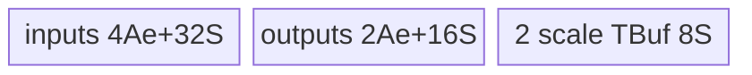
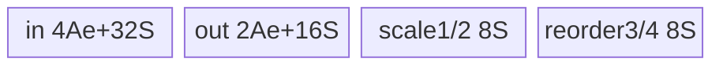

# RingAttentionUpdate 950 ACLNN 算子知识

## 算子速览

| 项目 | 内容 |
|---|---|
| 实际入口 | 最新公开 `aclnnRingAttentionUpdateV2GetWorkspaceSize` / `aclnnRingAttentionUpdateV2` |
| 计算语义 | FP32 RegBase MicroAPI 稳定归并 softmax 统计量并加权归并 attention |
| 输入输出 | attention FP16/BF16/FP32；softmax FP32；SBH/TND |
| 执行类型 | `AIV_VECTOR` |
| Kernel 路线 | R-001 SBH；R-002 Softmax-TND；R-003 TND单Seq；R-004 TND多Seq重排 |
| 核心资源 | GM、6个depth=2 Queue、2或4个FP32 TBuf、RegTensor；system workspace=`GetLibApiWorkSpaceSize()` |
| 来源闭包 | `source_closed`：V2 API→RegBase Tiling/POD→APT router→MicroAPI body→950 build config闭合 |
| 验证状态 | 已完成源码闭包检查；本次知识提取未执行编译、真机、数值或性能测试。 |

## 接口与语义

### 计算语义

`m=max(mp,mc)`，`wp=sp*exp(mp-m)`，`wc=sc*exp(mc-m)`，`s=wp+wc`，输出 `m,s,op*(wp/s)+oc*(wc/s)`。`SoftmaxCompute` 在寄存器中完成 Max/Sub/Exp/Mul/Add/Div，再将 max/sum/两权重写 UB。

### 输入、输出与属性

| 参数 | shape/layout | dtype | 约束、默认值与语义 |
|---|---|---|---|
| prev/cur attention | SBH `[S,B,H]`；TND `[T,N,D]` | 同为 FP16/BF16/FP32 | 必选3D、shape匹配 |
| 四个 softmax 输入 | 公开接口：BNS8 `[B,N,S,8]` 或 TND `[T,N,8]`；950 固定 RegBase TND guard：均须 3D `[T,N,8]` | FP32 | 六个 softmax/attention 输入各族 shape 相容、尾维8；key120 的空/SBH属性与3D实现边界见限制章节 |
| actualSeq | TND累计长度，固定实现取 shape dim0 减一为 batch 数 | INT64 | TND必填；key120 用相邻值恢复 batch 地址；值的单调性/首尾未完整校验 |
| layouts | SBH/TND；softmax空/SBH/TND | string | V2新增softmax layout；OpDef默认SBH/空 |
| 输出 | 同prev attention/max/sum | 对应dtype | L0 InferShape并ViewCopy |

### 入口与版本

V2 是公开最新版本，公开产品表明确支持 Ascend 950PR/950DT；OpDef 的 `ascend950` config 指定 `opFile.value=ring_attention_update_apt`。V2 ACLNN前处理与无后缀卡相同；950差异从 `IsRegbaseSocVersion` 转入 arch35 Tiling开始。

## Host/Launcher 执行流程

### 参数校验与前处理

ACLNN 公共前处理按 `CheckUpdateParam`→executor→`InputDtypeCheck`/`AnalysisAxis`→六输入 `Contiguous`，TND 再连续化 actualSeq→ND format→L0 `RingAttentionUpdate`→InferShape/AICore launcher→三次 ViewCopy 的顺序执行。950 进入 `Tiling4RingAttentionUpdateRegbase` 后重新要求两 attention 同 dtype、四个 softmax 输入全 FP32；SBH 检查 3D attention、4D softmax、B/N/S 关系和 `H%N==0`，TND 检查 3D attention、3D softmax、前两维和尾维 8。TND 调用方仍必须提供 actualSeq；ACLNN 前处理没有在解引用前独立判空。

### 参数、Workspace 与生命周期

每条950 route写各自POD、`blockDim=usedVectorCoreNum`，workspace为 `PlatformAscendC::GetLibApiWorkSpaceSize()`；Device body不访问workspace。ACLNN返回executor总workspace，生命周期持续至stream完成。

### 启动图与失败传播

单 Kernel launch graph：

```text
aclnnRingAttentionUpdateV2GetWorkspaceSize
  -> checks / Contiguous -> l0op::RingAttentionUpdate
    -> INFER_SHAPE -> ADD_TO_LAUNCHER_LIST_AICORE
      -> Tiling4RingAttentionUpdate
        -> IsRegbaseSocVersion
        -> Tiling4RingAttentionUpdateRegbase
           produces {route-specific POD, blockDim=usedVectorCoreNum,
                     key=100/110/120,
                     system workspace=GetLibApiWorkSpaceSize()}
      -> ring_attention_update_apt(inputs[0..6], outputs[0..2], workspace, tiling)
         -> exactly one RegBase AIV_VECTOR body
    -> ViewCopy(output0) -> ViewCopy(output1) -> ViewCopy(output2)
aclnnRingAttentionUpdateV2 -> CommonOpExecutorRun(..., stream)
```

没有 Device Kernel 间 workspace 边；AICore 节点与 ViewCopy 由同一 executor/stream 保序，调用方持有 executor/workspace 到 stream 完成。非法 dtype/shape/layout、raw tiling buffer 为空或分母为零均 `GRAPH_FAILED` 并阻断 launch；APT entry 对未知 key 无 `else`，不写输出且没有 fallback。

## Route 与参数设计

### 分核与资源计算

R-001：从 `maxCoreNum` 降到 1，保留第一次让 `gcd(B*N,core)` 取得更大值的 core 数，再按 BN 分组、组内沿 S 分核。R-002：TN 合轴，`tnCoreEach=ceil(T*N/maxAiv)`。R-003/4：沿 T 分核。设 `e=sizeof(T)`、`S` 为 softmax UB 元素数、`A` 为 attention UB 元素数：六个 depth=2 Queue 共 `6Ae+48S`，两个基础 FP32 TBuf 为 `8S`，所以基础 UB=`6Ae+56S`；R-004 条件增加两个重排 TBuf，UB=`6Ae+64S`。Host 以平台实际 UB 反推 N/S/D tile，并把 D 容量对齐 64 个元素；严格的 `64S+6eA<UB` 能全载 ND 时令 `seqNumLoopEach=floor(UB/(64S_per_seq+6eA_per_seq))>1`，否则固定 1 并沿 N/D 切片。

### Route 选择

| 顺序 | Route | Key/模板 | 精确选择条件与优先级 | 不适用去向 |
|---:|---|---|---|---|
| 1 | R-001 SBH | 100；`RegbaseSBH<DTYPE_PREV_ATTN_OUT>` | ACLNN公开值 layout=SBH；RegBase Tiling内部以layout非TND进入该分支 | 失败 |
| 2 | R-002 Softmax-TND | 110；`RegbaseSoftmaxTND<T>` | layout=TND且softmax layout=TND | 失败 |
| 3 | R-003 TND单Seq | 120；`RegbaseTND<T>` | layout=TND、softmax空/SBH、softmax仍通过3D shape guard，且UB不能全载ND→`seqNumLoopEach==1` | R-004若>1 |
| 4 | R-004 TND多Seq | 120；同模板 | 同上且严格式 `N*8*64 + N*align64(D)*(6e) < UB`，Host 随后计算的 `seqNumLoopEach>1` | 否则R-003 |

```text
layout != TND -> key100 R-001
layout == TND && softmaxLayout == TND -> key110 R-002
layout == TND && softmaxLayout in {empty,SBH} && softmax tensors pass 3D guard -> key120
  -> seqNumLoopEach>1 ? R-004 : R-003
```

### 模板/实现执行矩阵

| Route | key/selector | dtype/shape/platform 完整命中条件 | 实际模板/类 | body/helper | 内存与同步特征 | tail/fallback |
|---|---|---|---|---|---|---|
| R-001 | 100 | 950、layout非TND、合法SBH shape/dtype | 单 Kernel：`ring_attention_update_apt` | `KernelRingAttentionUpdateRegbaseSBH<DTYPE_PREV_ATTN_OUT>::Process` | 6Q+2TBuf+RegTensor | S/D tail；失败无 fallback |
| R-002 | 110 | 950、TND、softmax=TND、3D softmax shape guard | 单 Kernel：同 entry | `KernelRingAttentionUpdateRegbaseSoftmaxTND<T>::ProcessSoftmaxTND` | 6Q+2TBuf+RegTensor | TN/D tail；失败无 fallback |
| R-003 | 120,seq=1 | 950、TND、softmax空/SBH、RegBase仍要求3D softmax、ND不能全载 | 单 Kernel：同 entry | `KernelRingAttentionUpdateRegbaseTND<T>::ProcessTndOneSeq` | 6Q+2TBuf+RegTensor | T/N/D/batch tail；资源反条件走R-004 |
| R-004 | 120,seq>1 | 同 key120，且 ND 可全载 | 单 Kernel：同 entry | `KernelRingAttentionUpdateRegbaseTND<T>::ProcessTndMultiSeq` | 6Q+4TBuf+RegTensor | batch内Seq tile；资源反条件走R-003 |

### 隐藏性能 Guard

| Guard | Host/Tiling 条件 | Device/资源原因 | 影响 Route | 不满足时去向 | 源码符号 |
|---|---|---|---|---|---|
| RegBase平台 | `IsRegbaseSocVersion` | APT/MicroAPI body | 全950 | 非950旧body | outer Tiling |
| softmax layout | TND→110，空/SBH→120，其它-1 | 地址/分核不同 | R-002/3/4 | 失败 | `GetTndSoftmaxLayout` |
| 多Seq | 全载ND严格小于UB | 需额外2个重排TBuf | R-004 | R-003 | `RegbaseTNDSplitLoop` |
| D tile | align64且由剩余UB反推 | VReg FP32宽度/AddrReg | 全部 | 缩tile/失败 | SplitLoop三函数 |
| active core | `blockIdx<usedVectorCoreNum` | 防越界 | 全部 | 立即return | 各`Process` |
| key120 shape | `RingAttentionUpdateRegbaseTNDCheckInputShape` 要求四个 softmax 都是 3D、尾维8 | body按 actualSeq/BNS8 stride解释线性内存 | R-003/4 | 公开四维 BNS8 shape 会在 Tiling 失败 | `RingAttentionUpdateRegbaseTNDCheckShape` |

### POD/ABI

所有字段均`int64_t/64`、按宏声明顺序；宏展开后的精确offset/sizeof固定仓不可见。

| 结构 | 字段 | 类型/位宽 | ABI 布局 | 单位 | Host/launcher producer | Device consumer | 边界 |
|---|---|---|---|---|---|---|---|
| `RingAttentionUpdateRegbaseSBHTilingData` | `dimB` | int64/64 | 宏生成，offset不可见 | batch | `Tiling4RingAttentionUpdateRegbaseSBH`: softmax dim0 | `RegbaseSBH::InitComputeInfo` | 正维 |
| 同上 | `dimS` | int64/64 | 同上 | token | softmax dim2 | 同上，分核/地址 | 正维 |
| 同上 | `dimN` | int64/64 | 同上 | head | softmax dim1 | 同上，BN/D | `N>0` |
| 同上 | `dimD` | int64/64 | 同上 | element/head | `H/N` | 同上，D循环 | `H%N==0` |
| 同上 | `softmaxTailSize` | int64/64 | 同上 | element/row | softmax dim3 | 同上，scale步长 | =8 |
| 同上 | `usedVectorCoreNum` | int64/64 | 同上 | core | `SBHSplitCore`: `coreNumGroup*groupNum` | `Process` active-core guard | >0 |
| 同上 | `coreNumGroup` | int64/64 | 同上 | core/group | `SBHSplitCore` | group/core index | >0 |
| 同上 | `bnNumGroup` | int64/64 | 同上 | BN/group | `bnNum/groupNum` | BN loop | >0 |
| 同上 | `seqNumCoreEach` | int64/64 | 同上 | token/core | `ceil(S/coreNumGroup)` | core S起点/loop | >0 |
| 同上 | `seqNumCoreTail` | int64/64 | 同上 | token | `S-(coreNumGroup-1)*seqEach` | 组内尾核 | >0 |
| 同上 | `seqNumLoopEach` | int64/64 | 同上 | token/tile | `SBHSplitLoop` UB反推 | S tile loop | 至少8行 |
| 同上 | `headDimLoopEach` | int64/64 | 同上 | element/tile | `SBHSplitLoop`，64元素对齐 | D tile loop/UB stride | >0 |
| `RingAttentionUpdateRegbaseSoftmaxTNDTilingData` | `dimT` | int64/64 | 宏生成，offset不可见 | token | attention dim0 | `SoftmaxTND::InitComputeInfo` | 正维 |
| 同上 | `dimN` | int64/64 | 同上 | head | attention dim1 | TN展平 | 正维 |
| 同上 | `dimD` | int64/64 | 同上 | element/head | attention dim2 | D循环/地址 | 正维 |
| 同上 | `softmaxTailSize` | int64/64 | 同上 | element/row | softmax dim2 | softmax长度/广播步长 | =8 |
| 同上 | `batchSize` | int64/64 | 同上 | batch | `actualSeqShape.dim0-1` | Device字段未读取 | 必须>0 |
| 同上 | `usedVectorCoreNum` | int64/64 | 同上 | core | `ceil(T*N/tnNumCoreEach)` | active-core guard/尾核 | >0 |
| 同上 | `tnNumCoreEach` | int64/64 | 同上 | TN row/core | `ceil(T*N/maxAiv)` | core TN起点 | >0 |
| 同上 | `tnNumCoreTail` | int64/64 | 同上 | TN row | `T*N-each*(cores-1)` | 尾核TN长度 | >0 |
| 同上 | `tnNumLoopEach` | int64/64 | 同上 | TN row/tile | `SoftmaxTNDSplitLoop` UB反推 | TN循环/Queue容量 | >0 |
| 同上 | `headDimLoopEach` | int64/64 | 同上 | element/tile | 同函数，64元素对齐 | D循环/UB stride | >0 |
| `RingAttentionUpdateRegbaseTNDTilingData` | `dimT` | int64/64 | 宏生成，offset不可见 | token | attention dim0 | `RegbaseTND::InitComputeInfo` | 正维 |
| 同上 | `dimN` | int64/64 | 同上 | head | attention dim1 | N循环/地址 | 正维 |
| 同上 | `dimD` | int64/64 | 同上 | element/head | attention dim2 | D循环/地址 | 正维 |
| 同上 | `softmaxTailSize` | int64/64 | 同上 | element/row | softmax dim2 | BNS8 stride/scale | =8 |
| 同上 | `batchSize` | int64/64 | 同上 | batch | `actualSeqShape.dim0-1` | batch扫描上界 | >0 |
| 同上 | `usedVectorCoreNum` | int64/64 | 同上 | core | `ceil(T/dimTCoreEach)` | active-core guard/尾核 | >0 |
| 同上 | `dimTCoreEach` | int64/64 | 同上 | token/core | `ceil(T/maxAiv)` | core T起点 | >0 |
| 同上 | `dimTCoreTail` | int64/64 | 同上 | token | `T-each*(cores-1)` | 尾核T长度 | >0 |
| 同上 | `seqNumLoopEach` | int64/64 | 同上 | token/tile | `TNDSplitLoop`：全载ND时UB商，否则1 | `Process`选择R-003/4；Queue容量 | >1才分配temp3/4 |
| 同上 | `headNumLoopEach` | int64/64 | 同上 | head/tile | 全载ND时N，否则UB反推 | OneSeq N循环；MultiSeq=N | >0 |
| 同上 | `headDimLoopEach` | int64/64 | 同上 | element/tile | 全载ND时align64(D)，否则UB反推 | D循环/UB stride | >0 |

### Route 源码闭包

| Route | Key/selector | Host/Tiling producer | POD/参数 | Kernel entry/router | Kernel body/直接依赖 | 构建接线 |
|---|---|---|---|---|---|---|
| R-001 | 100 | `op_host/ring_attention_update_tiling_arch35.cpp::RingAttentionUpdateRegbaseSBHTiling` | `RingAttentionUpdateRegbaseSBHTilingData` | `op_kernel/ring_attention_update_apt.cpp::ring_attention_update` key100 | `ring_attention_update_regbase_sbh.h::Process` + `ring_attention_update_regbase_common.h` | `ring_attention_update_def.cpp` ascend950 apt config + `op_host/CMakeLists.txt` |
| R-002 | 110 | `op_host/ring_attention_update_tiling_arch35.cpp::RingAttentionUpdateRegbaseSoftmaxTNDTiling` | `RingAttentionUpdateRegbaseSoftmaxTNDTilingData` | 同 entry，key110 | `ring_attention_update_regbase_softmax_tnd.h::ProcessSoftmaxTND` + common | 同上 |
| R-003/4 | 120 + `seqNumLoopEach` guard | `op_host/ring_attention_update_tiling_arch35.cpp::RingAttentionUpdateRegbaseTNDTiling` | `RingAttentionUpdateRegbaseTNDTilingData` | 同 entry，key120 | `ring_attention_update_regbase_tnd.h::ProcessTndOneSeq/ProcessTndMultiSeq` + common | 同上 |

## Kernel 实现

### 公共执行流程

APT entry按100/110/120解不同POD并实例化`DTYPE_PREV_ATTN_OUT`。所有route将prev/cur放同一Queue buffer两半；`SoftmaxCompute`用动态`UpdateMask`处理尾lane，Div mode为ZEROING；attention半精度以UNPACK_B16加载、转FP32计算、`CAST_RINT`并PACK_B32输出，FP32直接RegTensor计算。Queue承担DMA同步，attention前另有`PipeBarrier<PIPE_V>`；寄存器生命周期仅在`__VEC_SCOPE__`内。

### Route R-001：RegBase SBH

#### 适用条件

##### 选择证据

| 层级 | 文件 | 符号 | 源码谓词/参数 | 结果/下一跳 |
|---|---|---|---|---|
| ACLNN | `op_host/op_api/aclnn_ring_attention_update.cpp` | `AnalysisAxis` | `inputLayoutOptional=="SBH"` 且 softmax rank=4/尾维8 | L0 launcher |
| Tiling | `op_host/ring_attention_update_tiling_arch35.cpp` | `Tiling4RingAttentionUpdateRegbase` | `inputLayoutStr!="TND"`，SBH shape/dtype检查成功 | key100 + SBH POD |
| Router | `op_kernel/ring_attention_update_apt.cpp` | `ring_attention_update` | `TILING_KEY_IS(100)` | `KernelRingAttentionUpdateRegbaseSBH<DTYPE_PREV_ATTN_OUT>` |

#### Device 数据流

##### 函数级调用链

```text
entry->SBH::Process->SoftmaxComputeLoop->common SoftmaxCompute
 -> D loop->AttnDataMoveIn->common AttnCompute{Fp32,Bf16Fp16}->CopyOut
```
##### 源码等价伪码

```text
group=blockIdx/coreNumGroup; coreInGroup=blockIdx%coreNumGroup
for bnLocal in [0,bnNumGroup):
  bn=group*bnNumGroup+bnLocal
  for sTile in this core's S interval:
    sLen = tail ? seqNumLoopTail : seqNumLoopEach
    softOff=bn*dimS*8+sTileStart*8
    load prev/cur max+sum -> SoftmaxCompute(calNum=sLen*8)
    store max/sum; keep two FP32 scale TBufs live
    for dTile in [0,ceil(dimD/headDimLoopEach)):
      dLen=tail ? headDimLoopTail : headDimLoopEach
      attnOff=bn*dimD+sTileStart*(B*N*dimD)+dTile*headDimLoopEach
      stride-load sLen rows; PipeBarrier<PIPE_V>
      broadcast each row's scale, compute FP32 prev*wp+cur*wc, cast/store only dLen
```
#### 内存与数据搬运

##### 资源与搬运表

| 层级/缓冲区 | offset/地址公式 | extent/容量公式 | dtype/layout | producer | consumer | owner/lifetime | 对齐/复用 |
|---|---|---|---|---|---|---|---|
| softmax GM | `bn*dimS*8+s*8` | `seqNumLoop*8` | FP32/BNS8 | `DataCopyPad` | `SoftmaxCompute` | 当前 S tile | 连续、尾 tile 缩短字节数 |
| attention GM | `bn*dimD+s*(B*N*dimD)+d` | `seqNumLoop × headDimLoop` | T/SBH | stride `DataCopyPad` | `AttnCompute*` | 当前 S/D tile | GM stride=`(B*N*D-headDimLoop)*e`，UB按`headDimLoopEach`补齐 |
| Q/TBuf | prev/cur两半 | `6Ae+56S`总计 | mixed | DMA/compute | compute/DMA | tile | d2；scale跨D复用 |
##### 分层内存布局


##### 字节账与复用顺序

```text
UB_total=6*A*e+56*S <= UB
dynamic_ub=N/A（AIV Queue/TBuf 静态分配）
workspace_total=GetLibApiWorkSpaceSize()（system workspace；body不读写）
```
| 复用子区 | 写入者 | 读取者/消费点 | 下一次覆盖 | 同步或释放依据 | 安全条件 |
|---|---|---|---|---|---|
| scales | SoftmaxCompute | all D tiles | next S tile | Queue+PIPE_V | D loop complete |
#### 同步、精度与尾块

##### 同步与数值边界表

| 阶段 | primitive/机制 | producer | consumer/等待点 | 保护对象 | 精度/尾块 |
|---|---|---|---|---|---|
| vector | MicroAPI mask | UB load | UB store | regs | FP32；dynamic tail |
| DMA | Queue | MTE2 | Vector/MTE3 | UB | valid byte len |
#### 关键实现

##### 符号证据表

| 阶段 | 文件 | 符号/模板实例 | 实现事实 |
|---|---|---|---|
| Host/Tiling producer | `op_host/ring_attention_update_tiling_arch35.cpp` | `RingAttentionUpdateRegbaseSBHSplitCore/SplitLoop` | BN分组、S/D tile、blockDim 与 key100 |
| Kernel entry/router | `op_kernel/ring_attention_update_apt.cpp` | `ring_attention_update`, key100 | POD解码与 SBH 模板实例 |
| Device body/helper | `op_kernel/arch35/ring_attention_update_regbase_sbh.h`、`ring_attention_update_regbase_common.h` | `Process/SoftmaxComputeLoop/AttnComputeLoop`、common helpers | 地址、DMA、MicroAPI、scale跨D生命周期与tail |

### Route R-002：RegBase Softmax-TND

#### 适用条件

##### 选择证据

| 层级 | 文件 | 符号 | 源码谓词/参数 | 结果/下一跳 |
|---|---|---|---|---|
| Tiling | `op_host/ring_attention_update_tiling_arch35.cpp` | `Tiling4RingAttentionUpdateRegbase` | layout=TND，`GetTndSoftmaxLayout()==1`，TND 3D shape检查成功 | key110 + SoftmaxTND POD |
| Router | `op_kernel/ring_attention_update_apt.cpp` | `ring_attention_update` | `TILING_KEY_IS(110)` | `KernelRingAttentionUpdateRegbaseSoftmaxTND<T>` |
#### Device 数据流

##### 函数级调用链

```text
entry->SoftmaxTND::Process->TN tile softmax->D tile attention->common helpers
```
##### 源码等价伪码

```text
tnCoreEach=ceil(T*N/usedCores); tn0=blockIdx*tnCoreEach
for tnTile in [tn0,tn0+tnNumCore):
  tnLen=tail ? tnNumLoopTail : tnNumLoopEach
  softOff=tnTile*8; copy tnLen*8 contiguous FP32 values
  SoftmaxCompute(calNum=tnLen*8); store max/sum and retain scales
  for dTile:
    dLen=tail ? headDimLoopTail : headDimLoopEach
    attnOff=tnTile*D+dTile*headDimLoopEach
    stride-load blockCount=tnLen, blockLen=dLen*e, srcStride=(D-dLen)*e
    common AttnCompute(loopNum=tnLen,calNum=dLen); store only valid TN/D bytes
```
#### 内存与数据搬运

##### 资源与搬运表

| 层级/缓冲区 | offset/地址公式 | extent/容量公式 | dtype/layout | producer | consumer | owner/lifetime | 对齐/复用 |
|---|---|---|---|---|---|---|---|
| softmax GM | `tn0*8` | `tnLoop*8` | FP32/TND | 单块`DataCopyPad` | common `SoftmaxCompute` | TN tile | 连续；尾 TN 缩短 `softmaxBlockLen` |
| attention GM | `tn0*D+d0` | `tnLoop × dLoop` | T/TND | stride `DataCopyPad` | common `AttnCompute*` | TN/D tile | `blockCount=tnLoop`，srcStride=`(D-dLoop)e`，UB补齐到dTile |
| 六个 Queue | 各自UB区；prev/cur相隔A或S | attention=`6Ae`，softmax=`48S` | T/FP32 | MTE2/MicroAPI | MicroAPI/MTE3 | tile内，depth=2 | prev/cur共享单slot的两半，不别名 |
| scale TBuf1/2 | 各自独立 | 每片`4S`，合计`8S` | FP32 | `SoftmaxCompute` | 全部D tile | 当前TN tile | 跨D复用 |
##### 分层内存布局


##### 字节账与复用顺序

```text
A=tnNumLoopEach*headDimLoopEach; S=tnNumLoopEach*8; UB=6Ae+56S
dynamic_ub=N/A（AIV Queue/TBuf 静态分配）
workspace_total=GetLibApiWorkSpaceSize()（system workspace；body不读写）
```
| 复用子区 | 写入者 | 读取者/消费点 | 下一次覆盖 | 同步或释放依据 | 安全条件 |
|---|---|---|---|---|---|
| scales | TN softmax | D loops | next TN tile | queue/barrier | D complete |
#### 同步、精度与尾块

##### 同步与数值边界表

| 阶段 | primitive/机制 | producer | consumer/等待点 | 保护对象 | 精度/尾块 |
|---|---|---|---|---|---|
| TN/D | UpdateMask+valid DMA | compute | copyout | tail | no padding output |
#### 关键实现

##### 符号证据表

| 阶段 | 文件 | 符号/模板实例 | 实现事实 |
|---|---|---|---|
| Host/Tiling producer | `op_host/ring_attention_update_tiling_arch35.cpp` | `RingAttentionUpdateRegbaseSoftmaxTNDSplitCore/SplitLoop` | TN分核、TN/D tile、blockDim 与 key110 |
| Kernel entry/router | `op_kernel/ring_attention_update_apt.cpp` | `ring_attention_update`, key110 | SoftmaxTND POD 与模板映射 |
| Device body/helper | `op_kernel/arch35/ring_attention_update_regbase_softmax_tnd.h`、`ring_attention_update_regbase_common.h` | `ProcessSoftmaxTND`、common helpers | TN连续softmax、D切片attention、动态mask与tail |

### Route R-003：RegBase TND 单 Seq

#### 适用条件

##### 选择证据

| 层级 | 文件 | 符号 | 源码谓词/参数 | 结果/下一跳 |
|---|---|---|---|---|
| Tiling | `op_host/ring_attention_update_tiling_arch35.cpp` | `Tiling4RingAttentionUpdateRegbase` / `TNDSplitLoop` | layout=TND、softmax layout空/SBH、3D shape guard；全载ND谓词为假 | key120，`seqNumLoopEach=1` |
| Router | `op_kernel/ring_attention_update_apt.cpp` | `ring_attention_update` | `TILING_KEY_IS(120)` | RegBaseTND模板 |
| Device | `op_kernel/arch35/ring_attention_update_regbase_tnd.h` | `Process` | `seqNumLoopEach<=1` | `ProcessTndOneSeq` |
#### Device 数据流

##### 函数级调用链

```text
entry->TND::Process->ProcessTndOneSeq->N tile softmax->D tile attention->common
```
##### 源码等价伪码

```text
t0=blockIdx*dimTCoreEach; scan actualSeq until t0<q[b+1]
for localT in [0,dimTCore):
  while consumed==q[b+1]-q[b]: advance over batch boundary (including zero-length batch)
  t=t0+localT
  for nTile:
    nLen=tail ? headNumLoopTail : headNumLoopEach
    softOff=q[b]*N*8+(t-q[b])*8+nTileStart*(q[b+1]-q[b])*8
    gather nLen blocks of 8 FP32 with srcStride=(seqBatch-1)*8*4
    SoftmaxCompute(calNum=nLen*8); store max/sum
    for dTile:
      attnOff=t*N*D+nTileStart*D+dTileStart
      stride-load nLen rows, compute with retained scales, store valid N/D tail
```
#### 内存与数据搬运

##### 资源与搬运表

| 层级/缓冲区 | offset/地址公式 | extent/容量公式 | dtype/layout | producer | consumer | owner/lifetime | 对齐/复用 |
|---|---|---|---|---|---|---|---|
| softmax GM | `q_b*N*8+(t-q_b)*8+n0*seqBatch*8` | `nLoop × 8` | FP32/BNS8线性化 | stride `DataCopyPad` | `SoftmaxComputeTND` | token/N tile | `blockCount=nLoop`，srcStride=`(seqBatch-1)*8*4`字节 |
| attention GM | `t*N*D+n0*D+d0` | `nLoop × dLoop` | T/TND | stride `DataCopyPad` | `AttnCompute*` | token/N/D tile | srcStride=`(D-dLoop)e`，UB补齐到dTile |
| 六个 Queue | prev/cur相隔A或S | `6Ae+48S` | T/FP32 | DMA/MicroAPI | MicroAPI/DMA | tile内，depth=2 | N/D tail只搬有效字节 |
| scale TBuf1/2 | 各自独立 | `8S` | FP32 | softmax | 随后全部D tile | 当前N tile | 不分配temp3/4 |
##### 分层内存布局


##### 字节账与复用顺序

```text
UB=6Ae+56S; A=headNumLoopEach*headDimLoopEach; S=headNumLoopEach*8
dynamic_ub=N/A（AIV Queue/TBuf 静态分配）
workspace_total=GetLibApiWorkSpaceSize()（system workspace；body不读写）
```
| 复用子区 | 写入者 | 读取者/消费点 | 下一次覆盖 | 同步或释放依据 | 安全条件 |
|---|---|---|---|---|---|
| scales | N softmax | D tile | next N tile | queue/barrier | D complete |
#### 同步、精度与尾块

##### 同步与数值边界表

| 阶段 | primitive/机制 | producer | consumer/等待点 | 保护对象 | 精度/尾块 |
|---|---|---|---|---|---|
| batch/N/D | scalar+mask+DMA | inputs | outputs | addresses/tail | FP32 compute |
#### 关键实现

##### 符号证据表

| 阶段 | 文件 | 符号/模板实例 | 实现事实 |
|---|---|---|---|
| Host/Tiling producer | `op_host/ring_attention_update_tiling_arch35.cpp` | `RingAttentionUpdateRegbaseTNDSplitCore/SplitLoop` | T分核、单Seq、N/D tile、key120 |
| Kernel entry/router | `op_kernel/ring_attention_update_apt.cpp` | `ring_attention_update`, key120 | TND POD 与模板映射 |
| Device body/helper | `op_kernel/arch35/ring_attention_update_regbase_tnd.h`、`ring_attention_update_regbase_common.h` | `ProcessTndOneSeq/SoftmaxComputeLoopOneSeq/AttnComputeLoopOneSeq` | actualSeq、BNS8线性地址、MicroAPI与tail |

### Route R-004：RegBase TND 多 Seq 重排

#### 适用条件

##### 选择证据

| 层级 | 文件 | 符号 | 源码谓词/参数 | 结果/下一跳 |
|---|---|---|---|---|
| Tiling | `op_host/ring_attention_update_tiling_arch35.cpp` | `RingAttentionUpdateRegbaseTNDSplitLoop` | `N*8*64 + N*align64(D)*6e < UB`，计算 `seqNumLoopEach>1` | key120，多Seq资源布局 |
| Router | `op_kernel/ring_attention_update_apt.cpp` | `ring_attention_update` | `TILING_KEY_IS(120)` | 与R-003相同模板 |
| Device | `op_kernel/arch35/ring_attention_update_regbase_tnd.h` | `Init/Process` | `seqNumLoopEach>1` | 条件分配temp3/4并调用`ProcessTndMultiSeq` |
#### Device 数据流

##### 函数级调用链

```text
entry->ProcessTndMultiSeq->SoftmaxComputeLoopMultiSeq->SoftmaxComputeTND
 -> DataCopy scales to temp3/4 transpose-like layout -> AttnComputeLoopMultiSeq
```
##### 源码等价伪码

```text
t0=blockIdx*dimTCoreEach; locate batch b with t0<q[b+1]
while localT<dimTCore:
  skip zero-length/exhausted batches
  seqLen=min(batchRemaining,seqNumLoopEach,dimTCore-localT)  # tile不跨batch
  softOff=q[b]*N*8+(t0-q[b]+localT)*8
  gather N blocks, each block seqLen*8, srcStride=(seqBatch-seqLen)*8*4
  SoftmaxCompute(calNum=seqLen*N*8); store max/sum
  for seq in [0,seqLen):
    DataCopy N 个32B block，把两路scale从N-major gather顺序写成(seq*N)*8顺序
  attnOff=(t0+localT)*N*D; contiguous load seqLen*N rows
  common AttnCompute(loopNum=seqLen*N,calNum=D) with temp3/4; contiguous store
```
#### 内存与数据搬运

##### 资源与搬运表

| 层级/缓冲区 | offset/地址公式 | extent/容量公式 | dtype/layout | producer | consumer | owner/lifetime | 对齐/复用 |
|---|---|---|---|---|---|---|---|
| softmax GM | `q_b*N*8+(t0-q_b)*8` | `N × seqLoop × 8` | FP32/BNS8线性化 | stride `DataCopyPad` | softmax helper | 当前batch内Seq tile | `blockCount=N`，blockLen=`seqLoop*8*4`，srcStride=`(seqBatch-seqLoop)*8*4` |
| attention GM | `t0*N*D` | `seqLoop*N*D` | T/TND | 连续 `DataCopyPad` | attention helper | 当前batch内Seq tile | `blockCount=seqLoop*N`，blockLen=`D*e`，stride=0 |
| 六个 Queue | prev/cur相隔A或S | `6Ae+48S` | T/FP32 | DMA/MicroAPI | MicroAPI/DMA | tile内，depth=2 | `A=seqTile*N*align64(D)`，`S=seqTile*N*8` |
| base scale TBuf1/2 | BNS8 gather顺序 | 每片`4S` | FP32 | `SoftmaxCompute` | UB重排 | 当前Seq tile | softmax计算输出权重 |
| reorder TBuf3/4 | `seq*N*8` | 每片`4S` | FP32/Seq-major | `DataCopyParams{blockCount=N,blockLen=1,srcStride=seqLoop-1,dstStride=0}` | attention helper | 当前Seq tile | 仅`seqNumLoopEach>1`条件分配 |
##### 分层内存布局


##### 字节账与复用顺序

```text
UB_total=6Ae+64S <= UB
dynamic_ub=N/A（AIV Queue/TBuf 静态分配）
workspace_total=GetLibApiWorkSpaceSize()（system workspace；body不读写）
```
| 复用子区 | 写入者 | 读取者/消费点 | 下一次覆盖 | 同步或释放依据 | 安全条件 |
|---|---|---|---|---|---|
| temp3/4 | scale reorder | attention helper | next Seq tile | 同一 Vector pipe 的源码顺序；该处无显式 event | tile不跨batch |
#### 同步、精度与尾块

##### 同步与数值边界表

| 阶段 | primitive/机制 | producer | consumer/等待点 | 保护对象 | 精度/尾块 |
|---|---|---|---|---|---|
| reorder | UB DataCopy | base scales | attention | layout | seqLoop=min三边界 |
#### 关键实现

##### 符号证据表

| 阶段 | 文件 | 符号/模板实例 | 实现事实 |
|---|---|---|---|
| Host/Tiling producer | `op_host/ring_attention_update_tiling_arch35.cpp` | `RingAttentionUpdateRegbaseTNDSplitLoop` | multiSeq严格资源谓词和tile商 |
| Kernel entry/router | `op_kernel/ring_attention_update_apt.cpp` | `ring_attention_update`, key120 | 与R-003共用POD/模板 |
| Device body/helper | `op_kernel/arch35/ring_attention_update_regbase_tnd.h`、`ring_attention_update_regbase_common.h` | `ProcessTndMultiSeq/SoftmaxComputeTND/AttnCompute*` | 条件buffer、scale重排、batch内tail |

## 算子特定优化

### Trick T-001：ND小时条件增加重排区并一次处理多Seq

#### 触发与源码依据

- 适用 Route：R-004
- 触发条件：`seqNumLoopEach>1`，即Host判定UB可全载ND并容纳额外scale重排区
- Golden 来源：[`ring_attention_update_regbase_tnd.h:66-72`](../../../../../../../cann-ops-raw/ascendc/ops-transformer/be33d95bb755cedec3108f70805c1874d1792540/attention/ring_attention_update/op_kernel/arch35/ring_attention_update_regbase_tnd.h#L66-L72)

**官方源码（固定 Commit 连续逐字摘录）**：

```cpp
    if (seqNumLoopEach > 1) { // 搬入多个Seq，需要有额外UB空间做重排
      tPipe->InitBuffer(tempFp32Buf3, softmaxEleNumLoop * floatDataSize);
      tPipe->InitBuffer(tempFp32Buf4, softmaxEleNumLoop * floatDataSize);

      tempFp32Buf3Local = tempFp32Buf3.Get<float>();
      tempFp32Buf4Local = tempFp32Buf4.Get<float>();
    }
```

#### 机制与设计原因

ND小时用额外8S字节将BNS8 gather后的权重重排为Seq*N顺序，使attention一次处理多Seq；ND大时不分配两片TBuf，退回单Seq，避免固定重排区挤占UB。

#### 迁移边界

- 适用：权重布局与数据布局不同、且完整内轴可驻UB的融合算子。
- 前提：Host字节账须包含temp3/4，tile不得跨actualSeq batch边界。
- 失效：资源谓词不成立转R-003。
- 未验证：本次知识提取未执行编译、真机、数值或性能测试。

#### 错误做法

无条件分配temp3/4会破坏Host在单Seq分支采用的56S字节模型；源码以条件分配给出真实反例。

### Trick T-002：RegBase动态mask融合稳定归并

#### 触发与源码依据

- 适用 Route：全部
- 触发条件：softmax tile任意`calNum`，含不足一个VReg的尾部
- Golden 来源：[`ring_attention_update_regbase_common.h:87-103`](../../../../../../../cann-ops-raw/ascendc/ops-transformer/be33d95bb755cedec3108f70805c1874d1792540/attention/ring_attention_update/op_kernel/arch35/ring_attention_update_regbase_common.h#L87-L103)

**官方源码（固定 Commit 连续逐字摘录）**：

```cpp
        for (uint16_t i = 0; i < repeatTimes; i++) {
            maskReg = AscendC::MicroAPI::UpdateMask<float>(count);
            // copyin prevSoftmaxMax curSoftmaxMax ub->regTensor
            AscendC::MicroAPI::DataCopy<float, MicroAPI::PostLiteral::POST_MODE_UPDATE>(vreg0, prevSoftmaxMaxUbAddr, VL_FP32);
            AscendC::MicroAPI::DataCopy<float, MicroAPI::PostLiteral::POST_MODE_UPDATE>(vreg1, curSoftmaxMaxUbAddr, VL_FP32);

            AscendC::MicroAPI::Max(outreg0, vreg0, vreg1, maskReg);

            // copyout softmaxMax regTensor->ub
            AscendC::MicroAPI::DataCopy<float, MicroAPI::PostLiteral::POST_MODE_UPDATE>(softmaxMaxUbAddr, outreg0, VL_FP32, maskReg);

            AscendC::MicroAPI::Sub(vreg2, vreg0, outreg0, maskReg);
            AscendC::MicroAPI::Sub(vreg3, vreg1, outreg0, maskReg);
            // prev_scale = torch.exp(prev_softmax_max - softmax_max)
            AscendC::MicroAPI::Exp(vreg4, vreg2, maskReg);
            // cur_scale = torch.exp(cur_softmax_max - softmax_max)
            AscendC::MicroAPI::Exp(vreg5, vreg3, maskReg);
```

#### 机制与设计原因

动态 mask 使同一寄存器循环覆盖整块和尾块；源码将初始化为 `calNum` 的 `count` 每轮传给 `UpdateMask<float>`，post-update DataCopy 的步长固定为一个 `VL_FP32`。`UpdateMask` 对 `count` 的参数更新语义属于 AscendC MicroAPI 边界，本仓未展开实现，不在卡中推测。max-shift 后 Exp 避免直接对原 max 求指数，后续 Mul/Add/Div 均在 FP32 寄存器完成，只有 max、sum、两路权重写回 UB；`DivSpecificMode{ZEROING,true}` 保证被 mask lane 清零而不与旧寄存器值合并。

#### 迁移边界

- 适用：FP32稳定在线归并。
- 前提：`count`、VL和UB post-update地址保持一致。
- 失效：不同归一化公式须重建寄存器依赖。
- 未验证：本次知识提取未执行编译、真机、数值或性能测试。

#### 错误做法

固定仓未提供可验证反例。

## 模板与实现对比

| 对比维度 | R-001 SBH | R-002 Softmax-TND | R-003 TND单Seq | R-004 TND多Seq | 设计选择依据 |
|---|---|---|---|---|---|
| 命中条件/优先级 | SBH | TND+TND | TND+3D BNS8线性化,seq=1 | TND+3D BNS8线性化,seq>1 | layout/UB |
| 模板与 dtype | SBH<T> | SoftmaxTND<T> | TND<T> | 同左 | binary dtype宏 |
| 循环与分核 | BN/S/D | TN/D | T/N/D | T/Seq全ND | 连续性 |
| Queue/TBuf/寄存器 | 6Q+2B+reg | 同 | 同 | 6Q+4B+reg | 重排需求 |
| UB 总占用与复用 | 6Ae+56S | 同 | 同 | 6Ae+64S | 条件buffer |
| 搬运/Vector API | SBH stride | TN连续 | 3D BNS8线性stride | gather+reorder | GM布局 |
| 同步、精度与 tail | dynamic mask | TN/D | T/N/D/batch | batch内Seq | FP32/RINT |
| fallback/失败边界 | 无 | 无 | R-004反条件 | R-003反条件 | key120内分流 |

## 平台差异

| 项目 | A2 | A3 | 950 |
|---|---|---|---|
| 支持状态 | 公开支持 | 公开支持 | 公开支持950PR/DT |
| Host/Launcher | 非RegBase | 非RegBase | RegBase、APT opFile |
| Kernel/资源 | Vector API、单POD | 同 | MicroAPI、3POD、条件TBuf |

## 限制与失败边界

- 950文档未列A2/A3的`N<=256,D<=768,D%64`限制；固定950 Tiling按UB动态切片，但仍要求合法rank/尾维8/shape关系。
- 950 key120 由 `input_softmax_layout` 为空或 `SBH` 选择，Device 按 actualSeq 和 BNS8 stride寻址；但 RegBase TND shape check 同时要求 softmax 输入为 3D 且前两维与 `[T,N,D]` attention 相同。公开文档中的四维 `[B,N,S,8]` BNS8 shape 在该固定实现上会被拒绝，因此卡中只陈述可达的 3D 线性化实现，不能把四维公开形态标成已闭合支持。
- actualSeq累计值的单调、首0、末T未被完整校验；调用者遵守公开契约。
- 多Seq route严格限制单tile不跨batch；零长度batch由while推进处理。
- key注册头含100..102/110..112/120..122，而950 Host写100/110/120、APT router也只判断三基key；dtype由binary的`DTYPE_PREV_ATTN_OUT`实例化，不应自行给Host追加低位。
- 未知key、非法attr、0除数无fallback；本次未执行编译、真机、数值或性能测试。

## 源码索引

### 链路索引

| 链路阶段 | 文件 | 关键符号 | 支撑内容 |
|---|---|---|---|
| 入口声明/约束 | `docs/aclnnRingAttentionUpdateV2.md` | 产品表/V2原型 | 950公开支持 |
| 入口实现 | `op_host/op_api/aclnn_ring_attention_update.cpp` | V2GetWorkspaceSize | API流程 |
| L0 launcher | `op_host/op_api/ring_attention_update.cpp` | L0函数 | launch |
| 平台注册 | `op_host/ring_attention_update_def.cpp` | ascend950 config | APT opFile |
| POD | `op_host/ring_attention_update_tiling.h` | 三RegBase POD | ABI |
| Host/Tiling | `op_host/ring_attention_update_tiling.cpp` | RegBase跳转 | 平台selector |
| Host/Tiling | `op_host/ring_attention_update_tiling_arch35.cpp` | RegBase Tiling | route/tile/key |
| Kernel router | `op_kernel/ring_attention_update_apt.cpp` | entry | key映射 |
| Kernel helper | `op_kernel/arch35/ring_attention_update_regbase_common.h` | common helpers | MicroAPI/精度 |
| Kernel body | `op_kernel/arch35/ring_attention_update_regbase_sbh.h` | SBH类 | R-001 |
| Kernel body | `op_kernel/arch35/ring_attention_update_regbase_softmax_tnd.h` | SoftmaxTND类 | R-002 |
| Kernel body | `op_kernel/arch35/ring_attention_update_regbase_tnd.h` | TND类 | R-003/4 |
| 构建接线 | `op_host/CMakeLists.txt` | ascend950 options | 950编译 |

### 实现复用检查

| 检查项 | 可复用事实 | 不得改变的约束 | 源码符号 |
|---|---|---|---|
| ABI/POD | 三route POD | key与结构一一对应、字段顺序/位宽 | tiling.h/APT |
| 调用顺序 | softmax→scale→attention | scale生命周期和重排时机 | Process/common |
| workspace/内存 | base56S、多Seq64S | depth2和条件TBuf | Init/SplitLoop |
| 同步 | Queue+PIPE_V+VEC_SCOPE | producer/consumer与slot释放 | bodies |
| 精度与尾块 | FP32稳定归并、B16升精度/RINT | UpdateMask/count/valid DMA | common helpers |
| 失败边界 | selector无fallback | 非法key/attr/资源不得默默放宽 | Tiling/APT |