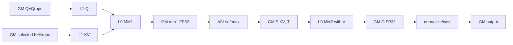
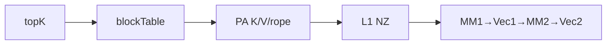
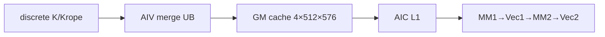

# SparseFlashAttention A2/A3 ACLNN 算子知识

## 算子速览

| 项目 | 内容 |
|---|---|
| 实际入口 | 公开两段式 `aclnnSparseFlashAttentionGetWorkspaceSize` / `aclnnSparseFlashAttention`；固定仓未出现同语义 V2 入口 |
| 计算语义 | 对 `sparseIndices` 选出的 K/V token 计算 `softmax(scaleValue·(Q,Qrope)·(K,Krope)^T)·V`；`sparseMode=3` 再施加右下因果有效域 |
| 输入输出 | Q/K/V、Q/K rope 为 FP16/BF16 ND；索引/actual lengths 为 INT32；attentionOut 同 Q dtype，softmax max/sum 为 FP32 |
| 执行类型 | 单 Kernel `MIX_CV`，1 AIC : 2 AIV；AIC 做两次 Cube MM，AIV 做可选 KV 聚合、在线 softmax、跨块更新、归一化和输出 |
| Kernel 路线 | R-001 C 连续 KV；R-002 C PageAttention；R-003 V 连续 KV；R-004 V PageAttention |
| 核心资源 | GM 与 user workspace；AIC L1/L0A/L0B/L0C；AIV UB；跨 AIC/AIV mode-2 flags |
| 来源闭包 | `source_closed`：公开 ACLNN→generated inner bridge→OpDef/InferShape→Tiling/POD→模板 key→arch22 MIX_CV body→CMake 已闭合；inner bridge 本身为框架边界 |
| 验证状态 | 已完成源码闭包检查；本次知识提取未执行编译、真机、数值或性能测试。 |

## 接口与语义

### 计算语义

令 `G=N1/N2`，固定实现要求 `N2=1`、Q/K/V 非 rope 维 `D=512`、rope 维 `Dr=64`。对每个 `(b,s1,n2,g)`，`sparseIndices` 给出最多 `sparseBlockCount` 个 sparse block；每块宽 `sparseBlockSize`，`-1` 终止有效索引。AIC 的 BMM1 将 Q-nope 与 Q-rope 拼成 K=576，与所选 K-nope/K-rope 做内积；AIV 乘 `scaleValue`，以 FP32 做跨 S2 基本块在线 softmax；AIC 的 BMM2 将概率与 V 相乘，AIV 用累计 sum 归一化并转回输出 dtype。`sparseMode=0` 使用完整有效 KV 阈值；`sparseMode=3` 使用 `actualS2-actualS1+s1+1` 的右下因果阈值。

### 输入、输出与属性

| 参数 | shape/layout | dtype | 约束、默认值与语义 |
|---|---|---|---|
| query | BSND:`[B,S1,N1,512]`；TND:`[T1,N1,512]` | FP16/BF16 | 必选、ND、AutoContiguous；N1 仅 1/2/4/8/16/32/64/128 |
| key/value | BSND:`[B,S2,1,512]`；TND:`[T2,1,512]`；PA:`[blockNum,blockSize,1,512]` | 与 query 相同 | `value==nullptr` 时包装层以 `key` 代替；文档仍将 value 列为必选 |
| sparseIndices | BSND:`[B,S1,1,K]`；TND:`[T1,1,K]` | INT32 | K=`sparseBlockCount>0`；有效值在前、`-1` 在后 |
| blockTable | `[B,maxBlockNumPerBatch]` | INT32 | 仅 PA 必须存在；其它 layout 必须为空 |
| actualSeqLengthsQuery/Kv | `[B]` | INT32 | TND 为必选前缀和；PA 要求 KV actual length；BSND 可空并使用静态 S |
| queryRope/keyRope | 对应 Q/K 存储轴，末轴 64 | 与 Q/K 相同 | 必须同时存在，`attentionMode=2` |
| scaleValue | 标量 | API double，tiling float | BMM1 结果进入 softmax 前缩放 |
| sparseBlockSize | 标量 | INT64 | `[1,128]` 的 2 次幂；PA 时整除 blockSize |
| layoutQuery/layoutKv | 字符串 | STRING | query 为 BSND/TND；非 PA 时 KV 与 query 相同；PA 可搭配两种 query layout |
| sparseMode | 标量 | INT64 | 仅 0 或 3 |
| preTokens/nextTokens | 标量 | INT64 | 均只允许 `INT64_MAX` |
| attentionMode | 标量 | INT64 | 仅 2（MLA absorb） |
| returnSoftmaxLse | 标量 | BOOL | true 时 max/sum 必须非空，且 PA 不允许 |
| attentionOut | query 的 B/T、S、N 轴，末轴 512 | 与 query 相同 | InferShape 直接复制 query shape |
| softmaxMax/softmaxSum | BSND:`[B,1,S1,G]`；TND:`[1,T1,G]` | FP32 | false 时 InferShape 设为 `[0]` |

### 入口与版本

README、API 文档、公开头和 API 列表只公开无版本后缀的 `aclnnSparseFlashAttention`；Grad 是独立反向语义。第一段公开函数处理 value 空指针替换及 softmax 输出条件，然后调用仓外生成的 `aclnnInnerSparseFlashAttentionGetWorkspaceSize`；第二段转发 `aclnnInnerSparseFlashAttention`。底层 OpDef、InferShape、Tiling 与 kernel 在固定仓闭合。

## Host/Launcher 执行流程

### 参数校验与前处理

包装层先令 `valueTensor=value?value:key`。`returnSoftmaxLse=true` 时任一 softmax 输出为空立即报错；false 且两个输出都为空时构造 shape `[0]` 的 FP32 ND 临时 tensor。其余检查由 generated inner bridge 创建底层节点后进入 `SFAInfoParser::Parse` 与 `SFATilingCheck::Process`。OpDef 对输入声明 `AutoContiguous`，算子源码没有手写 `Contiguous` 节点。

### 参数、Workspace 与生命周期

`SFAInfoParser` 读取平台、输入输出、属性、layout、B/N/G/S/D、actual length 和 PA block 信息。`SFAMlaTiling` 取 `aicNum/aivNum/libapiSize`。记 `M=min(G·S1,128)`、`M16=align(M,16)`、`S2a=align(s2BaseSize,32)`：

```text
mmRes = S2a*M16; bmm2 = 512*M16
workspace = libapiSize
 + 2*aicNum*mmRes*4 + 2*aicNum*mmRes*2 + 2*aicNum*bmm2*4
 + 2*aicNum*128*4 + 2*aicNum*128*4
 + 4*aicNum*512*576*2 + 4*(2*aicNum)*128*4
```

`qPreProcResElemSize=0`；`splitKVFlag_` 在固定实现未置 true，FD workspace/POD inactive。executor、框架临时 tensor 与调用者 workspace 须存活到 stream 执行完成；POD by-value 随 launch 复制。

### 启动图与失败传播

```text
aclnnSparseFlashAttentionGetWorkspaceSize
 -> aclnnInnerSparseFlashAttentionGetWorkspaceSize（generated boundary）
 -> SparseFlashAttention OpDef/InferShape
 -> TilingSparseFlashAttention
    -> Parse -> Check -> DoOpTiling
    -> CalcTschBlockDim(2*used,used,2*used), scheduleMode=1, key/workspace/POD
 -> sparse_flash_attention<<<KERNEL_TYPE_MIX_AIC_1_2>>>
    -> SparseFlashAttentionMla::Init -> ProcessBalance
```

只有一个 device 节点。任一 Parse/check、workspace/executor 或 launch 失败即返回，不存在后继 kernel。`TensorHolder` 的局部作用域在 inner 调用前结束，因此“false 且两个 softmax 输出均为 nullptr”路径存在源码可见的描述符生命周期风险；本卡不推断框架行为。

## Route 与参数设计

### 分核与资源计算

Host 以全部 AIC 生成 1:2 MIX blockDim；Device 再按所有 batch 的实际 Q token 数计算 `totalBaseNum` 和 `avgBaseNum=ceil(totalBaseNum/GetBlockNum())`，无任务核退出。每个基本任务处理最多 128 个 `(s1,g)` 行。S2 基本块通常 512；BMM1 固定 M/N 分块 128、K=576，BMM2 固定 N=512、K≤512。

### Route 选择

| 顺序 | Route | Key/模板 | 精确选择条件与优先级 | 不适用去向 |
|---:|---|---|---|---|
| 1 | R-001 C 连续 KV | `(0,0,BSND,BSND,C,sg)`；`(0,0,TND,TND,C,sg)` | `s2Size==0 \|\| sparseBlockSize>4`；`sg=(G>64)` | PA→R-002；小块→R-003 |
| 2 | R-002 C PA | `(0,1,BSND,PA_BSND,C,sg)`；`(0,1,TND,PA_BSND,C,sg)` | C 条件且 PA block/actual length 合法；`sg=(G>64)` | 小块→R-004；非法则 Host 失败 |
| 3 | R-003 V 连续 KV | `(0,0,BSND,BSND,V,sg)`；`(0,0,TND,TND,V,sg)` | `s2Size!=0 && sparseBlockSize<=4`；`sg=(G>64)` | PA→R-004；大块→R-001 |
| 4 | R-004 V PA | `(0,1,BSND,PA_BSND,V,sg)`；`(0,1,TND,PA_BSND,V,sg)` | V 条件且 PA 合法；`sg=(G>64)` | 非法则 Host 失败 |

```text
DAV_2201 -> perfMode=(s2!=0 && sparseBlock<=4)?V:C
 -> page=(layoutKv==PA_BSND) -> Q layout BSND/TND
 -> splitG=(G>64) -> GET_TPL_TILING_KEY(0,page,Q,KV,mode,splitG)
```

上述四项按实现族组织；每个 key 已在表内按 BSND/TND 展开，`sg=0/1` 仍生成不同 tiling key。arch22 的 `SFA_OP_IMPL` 不把第六维 `IS_SPLIT_G` 传入 `SFAType`，所以同一 layout/模板下两个 `sg` key 的 Device body 相同；BSND/TND 则分别实例化不同的地址计算分支。

### 模板/实现执行矩阵

| Route | key/selector | dtype/shape/platform 完整命中条件 | 执行族与 kernel 节点 | 实际模板/body | 内存与同步特征 | tail/fallback |
|---|---|---|---|---|---|---|
| R-001 | C/PA0/BSND或TND/sg0或1 | DAV_2201；FP16/BF16；N2=1,D512,Dr64；连续同 layout | 单 MIX_CV | `SparseFlashAttentionMla<SFAType<Q_T,KV_T,OUT_T,false,LAYOUT_T,KV_LAYOUT_T,C_TEMPLATE>>` | 原 K/V→L1；flags 7/8/9/4/5 | topK `-1`/threshold/tail |
| R-002 | C/PA1/BSND或TND/sg0或1 | R-001 + PA guard，KV layout=PA_BSND | 单 MIX_CV | C + `DataCopyPA` | blockTable→L1 | 页尾分段 |
| R-003 | V/PA0/BSND或TND/sg0或1 | `s2!=0 && block<=4`，连续同 layout | 单 MIX_CV | V + `MergeKv` | 4-buffer GM cache；另有 flag3/6 | stride fallback；补零/mask |
| R-004 | V/PA1/BSND或TND/sg0或1 | R-003 + PA guard，KV layout=PA_BSND | 单 MIX_CV | V + page translation | AIV page→cache→AIC | 同 R-003 |

### 隐藏性能 Guard

| Guard | Host/Tiling 条件 | Device/资源原因 | 影响 Route | 不满足时去向 | 源码符号 |
|---|---|---|---|---|---|
| C/V 阈值 | `s2!=0 && sparseBlockSize<=4` | 小块先由 AIV 聚合；大块 AIC 直接取数 | 全部 | C/V 互换 | `SFAMlaTiling::InitParams` |
| PA block | `0<blockSize<=1024`、16 对齐、被 sparseBlockSize 整除 | 合法 page 段搬运 | R-002/R-004 | Host 失败 | `CheckFeatureMlaNoquantPa` |
| stride 合并 | V route stride 在 `[0,INT32_MAX)` 且不越 S2 | `DataCopyPad(blockCount=2)` | R-003/R-004 | 两次 `CopyInSingleKv` | `CopyInKv` |
| L1/L0 | Q L1 4×72KiB；KV L1 3×72KiB；L0A/B 2×32KiB，L0C 2×64KiB | 固定 128 tile | 全部 | 无小 tile fallback | `InitBuffers` |
| splitG key | `G>64` | key 有该位，但 arch22 `SFA_OP_IMPL` 不传给 `SFAType` | 全部 | body 不变 | `GenTilingKey/SFA_OP_IMPL` |
| 实际 Q 尾 | `actualS1<static S1` | 未覆盖输出需预清零 | 全部 | `InitOutputSingleCore+SyncAll` | `InitCalcParamsEach` |

### POD/ABI

POD 由 tiling-data 宏生成；固定仓可见字段顺序与标量位宽，宏实现不在本仓，故整体 `sizeof/alignof` 和数值 `offsetof` 不可见。

| 结构 | 字段 | 类型/位宽 | ABI 布局 | 单位 | Host/launcher producer | Device consumer | 边界 |
|---|---|---|---|---|---|---|---|
| Base | batchSize | uint32/32 | 顺序字段；offset 不可见 | batch | bSize | batchSize | >0 |
| Base | seqSize | uint32/32 | 同上 | token | s2Size | kvSeqSize | A2/A3 zero 会改写 1024 |
| Base | qSeqSize | uint32/32 | 同上 | token | s1Size | qSeqSize | TND 为 T1 |
| Base | blockSize | int64/64 | 同上 | token/block | key dim1 | kvCacheBlockSize | 非 PA 为 0 |
| Base | maxBlockNumPerBatch | uint32/32 | 同上 | block | blockTable dim1 | page address | 非 PA 为 0 |
| Base | scaleValue | float/32 | 同上 | scalar | float attr | softmax | API double 窄化 |
| Base | nNumOfQInOneGroup | uint32/32 | 同上 | head | N1/N2 | gSize | N2=1 |
| Base | actualLenDimsQ | uint32/32 | 同上 | element | optional shape size | GM guard | 0 表示空 |
| Base | actualLenDimsKV | uint32/32 | 同上 | element | optional shape size | GM guard | 0 表示空 |
| Base | outputLayout | uint32/32 | 同上 | enum | outLayout | output offset | 0/1 |
| Base | sparseMode | uint32/32 | 同上 | enum | attr | threshold | 0/3 |
| Base | preTokens | int64/64 | 同上 | token | attr | ConstInfo | INT64_MAX |
| Base | nextTokens | int64/64 | 同上 | token | attr | ConstInfo | INT64_MAX |
| Base | attentionMode | uint32/32 | 同上 | enum | attr | metadata | 2 |
| Base | returnSoftmaxLse | uint32/32 | 同上 | flag | attr | LSE guard | 0/1 |
| Base | sparseBlockSize | int64/64 | 同上 | token | attr | topK address | 1..128 power-of-two |
| Base | sparseBlockCount | uint32/32 | 同上 | block | sparseIndices last dim | topK loop | >0 |
| Base | isActualLenDimsNull | uint32/32 | 同上 | flag | `actualQ?0:1` | actual Q path | 0/1 |
| Base | isActualLenDimsKVNull | uint32/32 | 同上 | flag | `actualKV?0:1` | actual KV path | 0/1 |
| SplitKV | s2 | uint32/32 | nested second | part | inactive→0 | splitKVNum | 可达 route 为 0 |
| SplitKV | accumOutSize | uint32/32 | 同上 | FP32 element | fixed formula | FD | inactive |
| SplitKV | logSumExpSize | uint32/32 | 同上 | FP32 element | fixed formula | FD | inactive |
| SingleCore | usedCoreNum | uint32/32 | nested third | AIC core | aicNum | active guard | Device 可缩减 |
| TensorSize | mmResUbSize | uint32/32 | nested fourth | element | S2a*M16 | workspace | 乘 4/2 得字节 |
| TensorSize | bmm2ResUbSize | uint32/32 | 同上 | element | 512*M16 | workspace | FP32 |
| InnerSplit | mBaseSize | uint32/32 | nested fifth | row | G | Device 每个 S1 基本任务的 G 行数 | `G<=128`，所以 256-row n-buffer 循环只走一轮 |
| InnerSplit | s2BaseSize | uint32/32 | 同上 | token | CalcInnerSize | S2 loop | 通常 512 |

### Route 源码闭包

| Route | Key/selector | Host/Tiling producer | POD/参数 | Kernel entry/router | Kernel body/直接依赖 | 构建接线 |
|---|---|---|---|---|---|---|
| R-001 | C/PA0 | tiling cpp `InitParams/DoOpTiling` | `SparseFlashAttentionTilingDataMla` | entry `sparse_flash_attention` | arch22 kernel/cube/vector | op_host CMake |
| R-002 | C/PA1 | 同上 + PA checks | 同上 | 同上 | `DataCopyPA/CalcTopKBlockInfo` | 同上 |
| R-003 | V/PA0 | 同上 | 同上 | 同上 | `MergeKv/ComputeMm1/2/Vec1/2` | 同上 |
| R-004 | V/PA1 | 同上 | 同上 | 同上 | page `GetKeyGmOffset` + V pipeline | 同上 |

## Kernel 实现

### 公共执行流程

entry 固定声明 `KERNEL_TYPE_MIX_AIC_1_2`。FP16/BF16 分别实例化，MM 与 softmax 累加均为 FP32。AIC `blockIdx=i` 与 AIV `blockIdx=2i/2i+1` 共享 `aiCoreIdx=i` 和 workspace slice。三拍 ring 执行“当前任务 BMM1/可选 MergeKV、滞后一拍的 Vec1+BMM2、滞后两拍的 Vec2”。主要跨核协议为 flag7(C1→V1)、8(V1→C2)、9(C2→V2)、4(C2→V1) 与 5(nUpdate→C2)；V route 另用 flag3/6 管理聚合 cache。

### Route R-001：C_TEMPLATE 连续 KV

#### 适用条件

##### 选择证据

| 层级 | 文件 | 符号 | 源码谓词/参数 | 结果/下一跳 |
|---|---|---|---|---|
| Tiling | op_host/sparse_flash_attention_tiling.cpp | `InitParams` | `s2==0 \|\| sparseBlockSize>4` | C_TEMPLATE |
| Layout | 同文件 | `GetKvLayout` | BSND/BSND 或 TND/TND | PA=0 |
| Router | op_kernel/sparse_flash_attention.cpp | `SFA_OP_IMPL` | arch22 FP16/BF16 | `SparseFlashAttentionMla<SFAType<Q_T,KV_T,OUT_T,false,LAYOUT_T,KV_LAYOUT_T,C_TEMPLATE>>` |

#### Device 数据流

##### 函数级调用链

```text
sparse_flash_attention -> SparseFlashAttentionMla::Init/ProcessBalance
 -> CalcSinnerTopKBegin -> SFAMatmulService::ComputeMm1
 -> SFAVectorService::ProcessVec1L -> SFAMatmulService::ComputeMm2
 -> SFAVectorService::ProcessVec2L
```

##### 源码等价伪码

```text
for assigned (b,s1,g-tile):
  threshold = actualS2 or actualS2-actualS1+s1+1
  while topK != -1 and selected tokens remain:
    AIC: Q/K ND->NZ L1->L0A/B->FP32 L0C->mm1Res workspace
    AIV: scale, online-softmax FP32, cast probability to KV_T workspace
    AIV: initialize/add exponent correction into mm2 workspace; signal AIC
    AIC: P/V -> L1/L0 -> atomic FP32 mm2 workspace
    last tile: AIV divide by sum, cast and copy valid 512-wide rows
```

#### 内存与数据搬运

##### 资源与搬运表

| 层级/缓冲区 | offset/地址公式 | extent/容量公式 | dtype/layout | producer | consumer | owner/lifetime | 对齐/复用 |
|---|---|---|---|---|---|---|---|
| GM inputs | B/T prefix + `(s1,g,s2,d)` | API tensors | ND | caller | Cube/scalar | caller/stream | ND→NZ M/N16 |
| mm1Res | `core*2*mmRes+(loop%2)*mmRes` | `2*mmRes*4` B/core | FP32 `[M,S2a]` | Fixpipe | Vec1 | workspace | double buffer |
| vec1Res | 对应 mm1 slice | `2*mmRes*2` B/core | FP16/BF16 P | Vec1 | MM2 | workspace | double buffer |
| mm2Res | `core*2*bmm2+slot*bmm2` | `2*bmm2*4` B/core | FP32 `[M,512]` | AIV bias+AIC atomic Fixpipe | Vec2 | workspace | double buffer |
| L1 | Q 4×72KiB；KV 3×72KiB | 504KiB | NZ KV_T | MTE2 | MTE1 | tile | 4/3 buffer events |
| L0A/B/C | ping/pong | 64/64/128KiB | fractal/FP32 | LoadData/Mmad | Mmad/Fixpipe | tile | event+unitFlag |
| AIV UB | input64+16, output32+4, tmp32, valid8，在线状态与默认值14 | `174080 B = 170 KiB`，按 `InitBuffers` | FP32/KV_T | MTE2/V | V/MTE3 | launch | pingpong/events |

##### 分层内存布局



##### 字节账、交接边与复用顺序

```text
workspace_total = Host 公式（含 C/V 共用预留）
L1_total=504KiB; L0A/L0B/L0C=64/64/128KiB; AIV_UB_total=170KiB
Host 仅读取 libapi workspace/AIC/AIV 数，固定仓未暴露可用于比较的 UB 容量上界
```

| 边/复用子区 | producer | offset/extent | dtype/layout | consumer | ordering/sync | owner/lifetime | 安全条件 |
|---|---|---|---|---|---|---|---|
| MM1→Vec1 | AIC Fixpipe | loop%2, `M*S2a` | FP32 ND | AIV | flag7 PIPE_FIX | workspace through Vec1 | 两拍后复用 |
| Vec1→MM2 | AIV MTE3 | 同 slot | KV_T ND | AIC | flag8 | through L1 load | Vec1 完成 |
| correction/MM2 | AIV int32 atomic + AIC FP32 atomic | slot `M*512` | 32-bit/FP32 | Vec2 | flag5 then flag9 | workspace | 首 tile 以 `2^-80` 初始化 |
| MM2→Vec2 | AIC Fixpipe | bn2 slot | FP32 ND | AIV | flag9 | through output | 最后 S2 tile 提交 |

#### 同步、精度与尾块

##### 同步与数值边界表

| 阶段 | primitive/机制 | producer | consumer/等待点 | 保护对象 | 精度/尾块 |
|---|---|---|---|---|---|
| L1/L0 | MTE2_MTE1、M_MTE1 | MTE2/MTE1 | MTE1/Mmad | 多缓冲 | M/N/K 16 对齐 |
| MM1/softmax | flag7 | AIC | AIV | mm1 slot | FP32 score/softmax |
| softmax/MM2 | flag8/5 | AIV | AIC | P/correction | P `CAST_ROUND`，状态 FP32 |
| MM2/output | flag9 | AIC | AIV | mm2 slot | `abs>1e10` 置0；FP16 round、BF16 RINT |
| sparse tail | `CalcTopKBlockInfo` | scalar | Cube copy | topK | `-1`、threshold、块内 offset |

#### 关键实现

##### 符号证据表

| 阶段 | 文件 | 符号/模板实例 | 实现事实 |
|---|---|---|---|
| Host/Tiling producer | op_host/sparse_flash_attention_tiling.cpp | `InitParams/CalcInnerSize/GetWorkspaceSize` | key/tile/workspace |
| Kernel entry/router | op_kernel/sparse_flash_attention.cpp | `sparse_flash_attention/SFA_OP_IMPL` | MIX 1:2/dtype |
| Device body/helper | arch22/sparse_flash_attention_kernel_mla.h | `PreloadPipeline` | 三拍 CV 流水 |
| Cube/Vector | arch22 service headers | `ComputeMm1/2`, `ProcessVec1L/2L` | 搬运、MM、softmax、输出 |

### Route R-002：C_TEMPLATE PageAttention

#### 适用条件

##### 选择证据

| 层级 | 文件 | 符号 | 源码谓词/参数 | 结果/下一跳 |
|---|---|---|---|---|
| Host | tiling cpp | `GetKvLayout/CheckFeatureMlaNoquantPa` | PA_BSND、block/actualKv 合法 | PA=1 |
| Device | cube service | `DataCopyPA` | `SFAType::pageAttention=true` | blockTable address |

#### Device 数据流

##### 函数级调用链

```text
R-001 chain -> CalcTopKBlockInfo
 -> DataCopyPA(blockTable[b,logical/blockSize],logical%blockSize)
 -> MM1/Vec1/MM2/Vec2
```

##### 源码等价伪码

```text
logical=sparseIndex*sparseBlockSize+intra
physical=blockTable[b,logical/blockSize]*blockSize+logical%blockSize
copy K/Krope/V fragments without crossing a physical page; execute R-001
```

#### 内存与数据搬运

##### 资源与搬运表

| 层级/缓冲区 | offset/地址公式 | extent/容量公式 | dtype/layout | producer | consumer | owner/lifetime | 对齐/复用 |
|---|---|---|---|---|---|---|---|
| blockTable | `b*maxBlocks+logical/blockSize` | B×maxBlocks×4 | INT32 | caller | DataCopyPA | caller | shape/dtype checked |
| PA tensors | `(physicalBlock*blockSize+row)*N2*D+...` | API tensor | ND | caller | Cube | caller | page-tail split |
| compute levels | 与 R-001 相同 | 同 | 同 | 同 | 同 | 同 | 同 |

##### 分层内存布局



##### 字节账、交接边与复用顺序

```text
workspace/L1/L0/UB = R-001；page translation 不新增 slice
```

| 边/复用子区 | producer | offset/extent | dtype/layout | consumer | ordering/sync | owner/lifetime | 安全条件 |
|---|---|---|---|---|---|---|---|
| page→L1 | DataCopyPA | 每段不跨 blockSize | KV_T ND→NZ | Mmad | MTE2/MTE1 | L1 tile | PA guards |
| CV | 同 R-001 | 同 | 同 | 同 | flags7/8/9/4/5 | workspace | 同 R-001 |

#### 同步、精度与尾块

##### 同步与数值边界表

| 阶段 | primitive/机制 | producer | consumer/等待点 | 保护对象 | 精度/尾块 |
|---|---|---|---|---|---|
| PA segment | `DataCopyPA` loop | GM | L1 | physical page | 页尾拆段 |
| 后续 | R-001 protocol | AIC/AIV | peer | CV slices | 同 R-001 |

#### 关键实现

##### 符号证据表

| 阶段 | 文件 | 符号/模板实例 | 实现事实 |
|---|---|---|---|
| Host/Tiling producer | tiling cpp | `GetS2SizeForPageAttention/CheckFeatureMlaNoquantPa` | S2/PA guards |
| Kernel entry/router | sparse_flash_attention.cpp | PA key | compile-time page route |
| Device body/helper | arch22 cube service | `DataCopyPA` | logical→physical 分段 ND→NZ |

### Route R-003：V_TEMPLATE 连续 KV

#### 适用条件

##### 选择证据

| 层级 | 文件 | 符号 | 源码谓词/参数 | 结果/下一跳 |
|---|---|---|---|---|
| Tiling | tiling cpp | `InitParams` | `s2!=0 && sparseBlockSize<=4` | V_TEMPLATE |
| Device | arch22 kernel | `PreloadPipeline` | `TEMPLATE_MODE==V_TEMPLATE` | AIV MergeKV before MM1 |

#### Device 数据流

##### 函数级调用链

```text
两枚 AIV 分段 MergeKv -> kvMergeGm_[loop%4]+kvValidSizeGm_
 -> flag3/6 -> AIC ComputeMm1 -> common Vec1/MM2/Vec2
```

##### 源码等价伪码

```text
split selected range between two AIVs
pair-copy K[512]+Krope[64] when stride is legal; otherwise single-copy twice
pack row576, zero missing rows, publish valid counts, signal AIC
```

#### 内存与数据搬运

##### 资源与搬运表

| 层级/缓冲区 | offset/地址公式 | extent/容量公式 | dtype/layout | producer | consumer | owner/lifetime | 对齐/复用 |
|---|---|---|---|---|---|---|---|
| merge cache | `core*4*512*576+(loop%4)*512*576` | `4*512*576*2` B/core | KV_T row576 | AIV | AIC | workspace | 4-buffer |
| valid cache | AIV/core/slot/subBlock | `4*128*4` B/AIV | INT32 | AIV | Vec1 | workspace | logical 512B slices |
| merge UB | ping/pong 32×512 + 32×64 | 64+8KiB | KV_T | MTE2 | MTE3 | iteration | events |
| rest | R-001 | R-001 | R-001 | R-001 | R-001 | R-001 | R-001 |

##### 分层内存布局



##### 字节账、交接边与复用顺序

```text
merge/core=4*512*576*sizeof(KV_T); valid/AIV=4*128*4 bytes
其余 = R-001；Host 对 C route 亦保留这两项
```

| 边/复用子区 | producer | offset/extent | dtype/layout | consumer | ordering/sync | owner/lifetime | 安全条件 |
|---|---|---|---|---|---|---|---|
| AIV→AIC cache | `MergeKv` | loop%4, 512×576 | KV_T | Cube | flag3/6 | workspace | AIC 返还 flag3 |
| valid→Vec1 | subBlock slices | 2×128 INT32 | INT32 | mask | MTE3_S/MTE2_S | workspace | padding置 -inf |

#### 同步、精度与尾块

##### 同步与数值边界表

| 阶段 | primitive/机制 | producer | consumer/等待点 | 保护对象 | 精度/尾块 |
|---|---|---|---|---|---|
| merge UB | MTE3_MTE2/MTE2_MTE3 | AIV | next copy | pingpong | 末尾单 token |
| cache | flag3/6 | AIV | AIC/Vec1 | cache/valid | 未填行 0，再 mask -inf |
| compute | R-001 | AIC/AIV | peer | common slices | FP32 common path |

#### 关键实现

##### 符号证据表

| 阶段 | 文件 | 符号/模板实例 | 实现事实 |
|---|---|---|---|
| Host/Tiling producer | tiling cpp | `InitParams/GetWorkspaceSize` | V selector/cache size |
| Kernel entry/router | sparse_flash_attention.cpp | V key | V instance |
| Device body/helper | arch22 vector service | `MergeKv/CopyInKv` | combined copy/fallback/padding |

### Route R-004：V_TEMPLATE PageAttention

#### 适用条件

##### 选择证据

| 层级 | 文件 | 符号 | 源码谓词/参数 | 结果/下一跳 |
|---|---|---|---|---|
| Host | tiling cpp | V selector + PA checks | block<=4、PA_BSND | R-004 |
| Device | vector service | `GetKeyGmOffset<PAGE_ATTENTION>` | blockTable | physical row |

#### Device 数据流

##### 函数级调用链

```text
R-003 MergeKv -> GetKeyGmOffset(PA) -> CopyInKv -> common packed-cache MIX pipeline
```

##### 源码等价伪码

```text
physical=blockTable[b,logical/blockSize]*blockSize+logical%blockSize
merge physical K/Krope into row576 cache; execute R-003
```

#### 内存与数据搬运

##### 资源与搬运表

| 层级/缓冲区 | offset/地址公式 | extent/容量公式 | dtype/layout | producer | consumer | owner/lifetime | 对齐/复用 |
|---|---|---|---|---|---|---|---|
| PA source | logical→physical row | API tensor | KV_T ND | caller | AIV merge | caller | blockSize guard |
| cache/compute | R-003 | R-003 | R-003 | R-003 | R-003 | workspace | four-buffer |

##### 分层内存布局


##### 字节账、交接边与复用顺序

```text
workspace/L1/L0/UB = R-003；page translation 不增加 slice
```

| 边/复用子区 | producer | offset/extent | dtype/layout | consumer | ordering/sync | owner/lifetime | 安全条件 |
|---|---|---|---|---|---|---|---|
| PA→cache | AIV | row576 | KV_T | AIC | R-003 flags | workspace | physical id 由调用方保证 |

#### 同步、精度与尾块

##### 同步与数值边界表

| 阶段 | primitive/机制 | producer | consumer/等待点 | 保护对象 | 精度/尾块 |
|---|---|---|---|---|---|
| page merge | R-003 events | AIV | AIC | cache slot | page address 后同一 mask |
| compute | R-001 flags | AIC/AIV | peer | workspace | FP32 MM/softmax |

#### 关键实现

##### 符号证据表

| 阶段 | 文件 | 符号/模板实例 | 实现事实 |
|---|---|---|---|
| Host/Tiling producer | tiling cpp | PA guards/V selector | selection |
| Kernel entry/router | sparse_flash_attention.cpp | PA/V key | instance |
| Device body/helper | arch22 vector service | `GetKeyGmOffset/CopyInKv` | page translation+merge |

## 算子特定优化

### Trick T-001：按 sparse block 宽度选择直接 Cube 取数或 AIV 聚合

#### 触发与源码依据

- 适用 Route：R-001~R-004
- 触发条件：`s2Size!=0 && sparseBlockSize<=4` 选择 V，否则 C
- Golden 来源：[`sparse_flash_attention_tiling.cpp:300-304`](../../../../../../../cann-ops-raw/ascendc/ops-transformer/be33d95bb755cedec3108f70805c1874d1792540/attention/sparse_flash_attention/op_host/sparse_flash_attention_tiling.cpp#L300-L304)

**官方源码（固定 Commit 连续逐字摘录）**：

```cpp
if (sfaInfo_->s2Size != 0 && sfaInfo_->sparseBlockSize <= 4) { // 4:当前支持范围
    perfMode_ = SFAPerfMode::V_TEMPLATE_MODE;
} else {
    perfMode_ = SFAPerfMode::C_TEMPLATE_MODE;
}
```

#### 机制与设计原因

V route 由两枚 AIV 将小块 K/Krope 聚合为连续 576-wide cache，AIC 再规律取数；C route 让 AIC 直接逐 sparse block 搬运。源码只证明网络差异，不给性能数值。

#### 迁移边界

- 适用：DAV_2201、D512+Dr64、1:2 MIX。
- 前提：V route 保留四 buffer cache、valid mask、flag3/6 与 workspace。
- 失效：950 使用另一套 arch35 CFA body。
- 未验证：本次知识提取未执行编译、真机、数值或性能测试。

#### 错误做法

只切换 key 而不分配/同步 V cache 会令 AIC 读取未聚合数据。

### Trick T-002：三拍 preload 与双缓冲交叠

#### 触发与源码依据

- 适用 Route：全部
- 触发条件：有效 S2 loop；最后任务额外推进两拍
- Golden 来源：[`sparse_flash_attention_kernel_mla.h:852-889`](../../../../../../../cann-ops-raw/ascendc/ops-transformer/be33d95bb755cedec3108f70805c1874d1792540/attention/sparse_flash_attention/op_kernel/arch22/sparse_flash_attention_kernel_mla.h#L852-L889)

**官方源码（固定 Commit 连续逐字摘录）**：

```cpp
RunInfo &extraInfo0 = extraInfo[loop % SFA_PRELOAD_TASK_CACHE_SIZE];         // 本轮任务
RunInfo &extraInfo2 = extraInfo[(loop + 2) % SFA_PRELOAD_TASK_CACHE_SIZE]; // 上一轮任务
RunInfo &extraInfo1 = extraInfo[(loop + 1) % SFA_PRELOAD_TASK_CACHE_SIZE]; // 上两轮任务

CalcParams(loop, s2Start, s2LoopIdx, extraInfo0);
CalcSinnerTopKBegin(extraInfo0, curTopKIdx, curOffsetInSparseBlock);

if (extraInfo0.isValid) {
    if ASCEND_IS_AIC {
        if constexpr (TEMPLATE_MODE == V_TEMPLATE) {
            CrossCoreWaitFlag(constInfo.syncV0C1);
        }
        ComputeMm1(extraInfo0);
    } else {
        if constexpr (TEMPLATE_MODE == V_TEMPLATE) {
            CrossCoreWaitFlag(3);
            vectorService.MergeKv(extraInfo0);
            CrossCoreSetFlag<ConstInfo::SFA_SYNC_MODE2, PIPE_MTE3>(constInfo.syncV0C1);
        }
    }
}
if (extraInfo2.isValid) {
    if ASCEND_IS_AIV {
        vectorService.ProcessVec1L(extraInfo2);
    }
    if ASCEND_IS_AIC {
        ComputeMm2(extraInfo2);
        if constexpr (TEMPLATE_MODE == V_TEMPLATE) {
            CrossCoreSetFlag<ConstInfo::SFA_SYNC_MODE2, PIPE_MTE2>(3);
        }
    }
}
if (extraInfo1.isValid) {
    if ASCEND_IS_AIV {
        vectorService.ProcessVec2L(extraInfo1);
    }
    extraInfo1.isValid = false;
}
```

#### 机制与设计原因

任务 ring 同时驻留当前 BMM1/merge、前一拍 Vec1+BMM2、前两拍 Vec2，并以 `loop%2` 选择 workspace。cross-core flags 防止提前覆盖。

#### 迁移边界

- 适用：单 MIX launch、AIC:AIV=1:2。
- 前提：保留两个 drain 空拍、flag ID 和 slot 公式。
- 失效：阶段数、CV 比例或 buffer depth 改变时需重排。
- 未验证：本次知识提取未执行编译、真机、数值或性能测试。

#### 错误做法

删除最后两个空拍会漏提交最后 Vec1/Vec2。

## 模板与实现对比

| 对比维度 | R-001 C连续 | R-002 C PA | R-003 V连续 | R-004 V PA | 设计选择依据 |
|---|---|---|---|---|---|
| 命中条件/优先级 | block>4或zero | C+PA | nonzero且block<=4 | V+PA | Host selector |
| 执行族/节点图 | MIX_CV | 同 | MIX_CV+Vec0 | 同 | 小块先聚合 |
| M/N/K、tile 与 scheduler | M128,S2≤512,K576/512 | 同 | 同 | 同 | MLA 固定维度 |
| workspace/L1/L0/UB | 共用预留 | 同 | 实用 merge cache | 同 | 统一公式 |
| AIC/AIV 交接 | flags7/8/9/4/5 | 同 | 再加3/6 | 同 | ring protocol |
| 同步、精度与 tail | FP32 MM/softmax | page tail | valid mask | page+mask | 两类 tail 独立 |
| fallback/失败边界 | 无 kernel fallback | Host fail | stride→single copies | 同 | 搬运 fallback |

## 平台差异

| 项目 | A2 | A3 | 950 |
|---|---|---|---|
| 支持状态 | README/API 明确支持 | README/API 明确支持 | 由 `_950` 卡描述 |
| Host/Launcher | 共用 DAV_2201 | 共用 DAV_2201 | 同 Host 的 DAV_3510 分支 |
| Kernel/资源 | arch22 MIX、workspace CV edges | 同 | arch35 L1/UB cross-core policy 与 triple GM cache |

## 限制与失败边界

- 仅 DAV_2201；N2=1、D512、Dr64、rope 成对、attentionMode=2、sparseMode=0/3。
- PA 要求 blockTable/actualKv，且与 returnSoftmaxLse 冲突；physical block id 值域由调用方保证。
- `splitKVFlag_` 无 producer，FlashDecode POD/body 非 Host 可达。
- `ZeroTensorProcess` 注释称 kernel 保留 zero，但代码把 `s2Size` 改为 1024 后填 POD；本卡保留冲突，不推测结果。
- softmax holder 生命周期风险见 Host 章节；未做运行验证。

## 源码索引

### 链路索引

| 链路阶段 | 文件 | 关键符号 | 支撑内容 |
|---|---|---|---|
| 公开语义 | attention/sparse_flash_attention/README.md | 产品表/公式/约束 | A2/A3 与接口域 |
| ACLNN 文档 | attention/sparse_flash_attention/docs/aclnnSparseFlashAttention.md | 两段式接口/约束说明 | 参数、输出、错误与平台支持 |
| 入口声明 | attention/sparse_flash_attention/op_host/op_api/aclnn_sparse_flash_attention.h | 两段 ACLNN | 参数 ABI |
| 入口实现 | attention/sparse_flash_attention/op_host/op_api/aclnn_sparse_flash_attention.cpp | `TensorHolder` | fallback/inner bridge |
| OpDef | attention/sparse_flash_attention/op_host/sparse_flash_attention_def.cpp | `SparseFlashAttention` | dtype/layout/platform |
| InferShape | attention/sparse_flash_attention/op_host/sparse_flash_attention_infershape.cpp | InferShape | output shapes |
| POD | attention/sparse_flash_attention/op_host/sparse_flash_attention_tiling.h | tiling-data structs | fields/classes |
| Host/Tiling | attention/sparse_flash_attention/op_host/sparse_flash_attention_tiling.cpp | parser/check/tiling | guards/key/workspace |
| Key | attention/sparse_flash_attention/op_kernel/sparse_flash_attention_template_tiling_key.h | TPL args/sel | compiled keys |
| Entry | attention/sparse_flash_attention/op_kernel/sparse_flash_attention.cpp | `sparse_flash_attention` | MIX/router |
| Common | attention/sparse_flash_attention/op_kernel/sparse_flash_attention_common.h | `SFAType/RunInfo/ConstInfo` | runtime state |
| Orchestrator | attention/sparse_flash_attention/op_kernel/arch22/sparse_flash_attention_kernel_mla.h | `SparseFlashAttentionMla` | workspace/flow/sync |
| Cube | attention/sparse_flash_attention/op_kernel/arch22/sparse_flash_attention_service_cube_mla.h | `SFAMatmulService` | L1/L0/MM/PA |
| Vector | attention/sparse_flash_attention/op_kernel/arch22/sparse_flash_attention_service_vector_mla.h | `SFAVectorService` | merge/softmax/output |
| Build | attention/sparse_flash_attention/op_host/CMakeLists.txt | compiled list/modules | build wiring |

每行文件均已列入 Frontmatter `sources`。

### 实现复用检查

| 检查项 | 可复用事实 | 不得改变的约束 | 源码符号 |
|---|---|---|---|
| ABI/POD | 五段嵌套 POD | 字段顺序/位宽/单位 | `SparseFlashAttentionTilingDataMla` |
| 调用顺序 | parse→check→tiling→MIX | 1:2、三拍 drain | `TilingSparseFlashAttention/PreloadPipeline` |
| workspace/内存 | 2-buffer MM + 4-buffer merge | core/slot/extent/owner | `GetWorkspaceSize/Init` |
| 同步 | flags3~9 与 L1/L0 events | set/wait/PIPE 类型 | `ProcessBalance/ProcessVec1L` |
| 精度与尾块 | FP32 MM/softmax，cast/mask/page tail | BF16 RINT、有效前缀 | `AmlaVecCompute/Bmm2CastAndCopyOut` |
| 失败边界 | Host fail closed；V stride fallback | 不启用 inactive FD/unknown key | `SFATilingCheck/CopyInKv` |