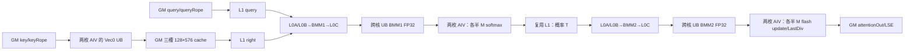
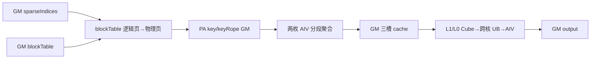
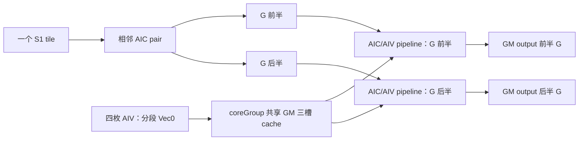
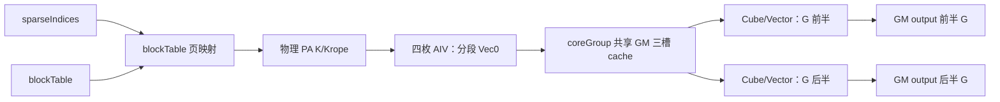

# SparseFlashAttention 950 ACLNN 算子知识

## 算子速览

| 项目 | 内容 |
|---|---|
| 实际入口 | 公开两段式 aclnnSparseFlashAttentionGetWorkspaceSize / aclnnSparseFlashAttention；固定仓未出现同语义 V2 入口 |
| 计算语义 | 按 sparseIndices 收集 K/K-rope，计算 softmax(scaleValue·QKᵀ) 后与收集数据的前 512 维相乘；sparseMode=3 再施加右下因果边界 |
| 输入输出 | Q/K/V、rope 为 FP16/BF16 ND；索引与 actual lengths 为 INT32；attentionOut 同 Q dtype，softmax max/sum 为 FP32 |
| 执行类型 | 单个 `MIX_CV` kernel；同一 AIC 对应的两枚 AIV 各自聚合一段 K+K-rope，并分别处理一半 M 行的 softmax、在线更新、归一化与输出；AIC 做 BMM1/BMM2 |
| Kernel 路线 | R-001 连续 KV、G≤64；R-002 PageAttention、G≤64；R-003 连续 KV、G>64 splitG；R-004 PageAttention、G>64 splitG |
| 核心资源 | 三份 GM K-cache、504 KiB 固定 L1 数据区、L0A/B/C、跨核 UB 以及 cross-core flags |
| 来源闭包 | source_closed：公开 ACLNN→generated inner bridge→OpDef/InferShape→Tiling/POD/key→arch35 MIX_CV body→公共 buffer/MM/VF 依赖→CMake 已闭合；inner bridge 为框架边界 |
| 验证状态 | 已完成源码闭包检查；本次知识提取未执行编译、真机、数值或性能测试。 |

## 接口与语义

### 计算语义

令 G=N1/N2。固定实现要求 N2=1、Q/K/V 非 rope 维 D=512、rope 维 Dr=64。sparseIndices 为每个 query token 给出 sparseBlockCount 个候选位置；950 固定 sparseBlockSize=1，-1 终止有效索引。两枚 AIV 以 `CalSparseCalSize` 划分同一 128-token 基本块，各自把命中的 K-nope 512 维与 K-rope 64 维拼入同一份 576 维 cache；AIC BMM1 对同样拼接的 query 做内积，两枚 AIV 再各处理一半 M 行，乘 scaleValue 并以 FP32 执行跨基本块在线 softmax；AIC BMM2 用概率乘 cache 的前 512 维，两枚 AIV 分别累计、归一化并写回各自的 M 行。sparseMode=0 使用实际 KV 长度，sparseMode=3 使用 actualS2-actualS1+s1+1 的右下因果阈值。

### 输入、输出与属性

| 参数 | shape/layout | dtype | 950 约束、默认值与语义 |
|---|---|---|---|
| query | BSND:[B,S1,N1,512]；TND:[T1,N1,512] | FP16/BF16 | 必选、ND、AutoContiguous；N1=G，范围 1..128 |
| key/value | BSND:[B,S2,1,512]；TND:[T2,1,512]；PA:[blockNum,blockSize,1,512] | 与 query 相同 | value 为空时 ACLNN wrapper 以 key 代替；设备 950 body 的实际读取边界见限制章节 |
| sparseIndices | BSND:[B,S1,1,K]；TND:[T1,1,K] | INT32 | K=sparseBlockCount>0；合法值在前、-1 在后 |
| blockTable | [B,maxBlockNumPerBatch] | INT32 | 仅 PA_BSND 必选；连续 KV 必须为空 |
| actualSeqLengthsQuery/Kv | [B] | INT32 | TND 要求前缀和；PA 要求 KV actual length；BSND 可空 |
| queryRope/keyRope | 对应 Q/K 存储轴，末轴 64 | 与 Q/K 相同 | 必须成对出现，attentionMode 固定 2 |
| scaleValue | 标量 | API double，tiling float | BMM1 输出进入 softmax 前缩放 |
| sparseBlockSize | 标量 | INT64 | 950 只允许 1 |
| layoutQuery/layoutKv | 字符串 | STRING | query 为 BSND/TND；连续 KV 必须同 layout；PA_BSND 可配两种 query layout |
| sparseMode | 标量 | INT64 | 仅 0 或 3 |
| preTokens/nextTokens | 标量 | INT64 | 均只允许 INT64_MAX |
| attentionMode | 标量 | INT64 | 仅 2 |
| returnSoftmaxLse | 标量 | BOOL | true 时 max/sum 均必选，且 PA 不支持 |
| attentionOut | 复制 query 的 B/T、S、N 轴，末轴 512 | 与 query 相同 | InferShape 直接复制 query shape |
| softmaxMax/softmaxSum | BSND:[B,1,S1,G]；TND:[1,T1,G] | FP32 | false 时 InferShape 为 [0] |

### 入口与版本

README、API 文档、公开头文件与 API 源码只公开无版本后缀的 aclnnSparseFlashAttention；SparseFlashAttentionGrad 是独立反向语义。GetWorkspaceSize 包装层处理 value 空指针与可选 LSE 输出，再调用仓外生成的 aclnnInnerSparseFlashAttentionGetWorkspaceSize；执行入口调用 aclnnInnerSparseFlashAttention。底层 SparseFlashAttention OpDef、InferShape、Tiling 与 kernel 在固定仓内闭合。OpDef 的 ascend950 配置是本卡 950 平台依据。

## Host/Launcher 执行流程

### 参数校验与前处理

包装层令 valueTensor=value?value:key。returnSoftmaxLse=true 时 softmaxMax 或 softmaxSum 为空立即返回参数错误；false 且两者均为空时构造 shape [0] 的 FP32 ND 临时 tensor。随后 generated inner bridge 建图并进入 SFAInfoParser::Parse 和 SFATilingCheck::Process。950 专有检查将 sparseBlockSize 限定为 1；共用检查固定 N2=1、D=512、Dr=64、attentionMode=2、sparseMode∈{0,3}、preTokens/nextTokens=INT64_MAX，并检查 layout、PA block、actual length、dtype 与输出。

### 参数、Workspace 与生命周期

`SFAMlaTiling` 读取 AIC/AIV 数、libapi workspace 与静态/actual shape。Host 仍按公共 tiling 流程把 `innerSplit.mBaseSize=G`、`innerSplit.s2BaseSize=min(S2,512)` 写入 POD；arch35 body 不读取这两个字段来定 tile，而是在 `SparseFlashAttentionKernelMla::Init` 及两侧 service 中固定 `s1BaseSize=64`、`s2BaseSize=128`。记 aicEff=aicNum/2 当 G>64，否则 aicEff=aicNum，则：

    cacheBytesPerGroup = 128 * 576 * 2 * 3
    workspaceBytes = libapiSize + aicEff * cacheBytesPerGroup

三份 128×576 FP16/BF16 cache 供 task pipeline 轮转。splitKVFlag_ 在固定源码未置 true，FD workspace 和多 kernel 合并路径不可达。executor、框架 tensor 与调用者 workspace 必须活到 stream 执行完成，tiling POD by-value 随 launch 复制。包装层两个 TensorHolder 定义在 inner 调用前结束的局部作用域内，故“returnSoftmaxLse=false 且两个输出均为空”存在源码可见的描述符生命周期风险；本卡不推断框架补偿。

### 启动图与失败传播

    aclnnSparseFlashAttentionGetWorkspaceSize
     -> aclnnInnerSparseFlashAttentionGetWorkspaceSize（generated boundary）
     -> SparseFlashAttention OpDef / InferShape
     -> TilingSparseFlashAttention
        -> Parse -> Check -> DoOpTiling
        -> GenTilingKey / workspace / blockDim / POD
     -> sparse_flash_attention MIX_CV
        -> SparseFlashAttentionKernelMla<CubeBlock,VecBlock>::Init
        -> Process

只有一个 device kernel。任一 ACLNN 参数检查、inner 建图、tiling、workspace/executor 或 launch 失败即终止，不存在后继 kernel。950 entry 的 AIV 分支从 GM tilingData 初始化共享参数；AIC 分支传空 tiling 指针并等待 AIV 将 SharedParams 写入 SSBUF 后读取。

## Route 与参数设计

### 分核与资源计算

Host 以公共 `CalcTschBlockDim(2*usedCoreNum,usedCoreNum,2*usedCoreNum)` 生成 1:2 MIX blockDim；arch35 Device 固定 `s1BaseSize=64`、`s2BaseSize=128`。G≤64 时每个 AIC 负责自己的最多 64 行 query tile；G>64 时相邻两个 AIC 映射同一 S1 tile，各处理 G 的一半，Host 仅在 workspace 公式中把有效 cache 组数减半。Device 根据 actual Q token 建 task 列表，无任务 core 退出。BMM1 的核心 tile 为 M64×N128×K576，底层 `MatmulK` 以 K=128 分段；BMM2 为 M64×N512×K≤128 的 `MatmulN`。

### Route 选择

| 顺序 | Route | Key/模板 | 精确条件 | 不适用去向 |
|---:|---|---|---|---|
| 1 | R-001 CFA 连续 KV | `(0,0,BSND,BSND,CFA,0)`；`(0,0,TND,TND,CFA,0)` | DAV_3510；连续 KV；G≤64 | PA→R-002；G>64→R-003 |
| 2 | R-002 CFA PA | `(0,1,BSND,PA_BSND,CFA,0)`；`(0,1,TND,PA_BSND,CFA,0)` | DAV_3510；合法 PA；G≤64 | 连续→R-001；G>64→R-004 |
| 3 | R-003 CFA 连续 splitG | `(0,0,BSND,BSND,CFA,1)`；`(0,0,TND,TND,CFA,1)` | 连续 KV；G>64 | PA→R-004 |
| 4 | R-004 CFA PA splitG | `(0,1,BSND,PA_BSND,CFA,1)`；`(0,1,TND,PA_BSND,CFA,1)` | 合法 PA；G>64 | 非法 PA→Host 失败 |

950 检查令 S2 正数且 sparseBlockSize=1，因此 Host 的 perfMode 条件 s2Size!=0 && sparseBlockSize<=4 恒成立；arch35 枚举值 1 对应 CFA_TEMPLATE_MODE。最终 key 为 GET_TPL_TILING_KEY(0,page,Qlayout,KVlayout,CFA,G>64)。

### 模板/实现执行矩阵

| Route | key/selector | 完整命中条件 | 执行族与节点 | 实际模板/body | 内存与同步 | tail/fallback |
|---|---|---|---|---|---|---|
| R-001 | CFA/PA0/split0 | 950；FP16/BF16；G≤64；连续 KV | 单 MIX_CV | SparseFlashAttentionKernelMla，普通 core 映射 | 三 GM cache；L1/UB manager；SSBUF | topK -1、S2 tail、Q tail |
| R-002 | CFA/PA1/split0 | R-001 + PA guards | 单 MIX_CV | 同 body + page 翻译 | blockTable→物理 block→cache | 页边界分段 |
| R-003 | CFA/PA0/split1 | 950；连续 KV；G>64 | 单 MIX_CV | SPLIT_G=true | 相邻 AIC 共享 S1，分半 G，workspace core 组减半 | 奇偶 core 协调 flag15 |
| R-004 | CFA/PA1/split1 | R-003 + PA guards | 单 MIX_CV | splitG + page 翻译 | 两类同步叠加 | 页尾与 G 尾 |

### 隐藏性能 Guard

| Guard | Host/Tiling 条件 | Device/资源原因 | 影响 Route | 不满足时 | 源码符号 |
|---|---|---|---|---|---|
| CFA 锁定 | S2!=0 且 sparseBlockSize≤4 | 两枚 AIV 分段聚合 576 维右矩阵 | 全部 | 950 合法输入恒满足 | SFAMlaTiling::InitParams |
| splitG | G>64 | 两个 AIC 分担 G，并共享同一 S1 tile | R-003/R-004 | G≤64 用 R-001/R-002 | GenTilingKey / SplitG |
| PA block | 0<blockSize≤1024、16 对齐且被 sparseBlockSize 整除 | page 地址和连续段搬运 | R-002/R-004 | Host 失败 | CheckFeatureMlaNoquantPa |
| pair copy | 两命中位置可编码为合法 INT32 stride 且不越实际 S2 | 一次 DataCopyPad 搬两段 | 全部 | 两次单段 CopyIn | CopyInKv |
| 固定 L1 | 3×144 KiB 右矩阵 + 72 KiB Q = 504 KiB | 三拍右矩阵与一拍 Q 常驻 | 全部 | 无更小 tile fallback | InitL1Buffer |
| 实际 Q 尾 | actualS1<static S1 或 S1>S2 | 未调度位置需先清零 | 全部 | InitOutputSingleCore + SyncAll | needInit |

### POD/ABI

tiling-data 宏生成 SparseFlashAttentionTilingDataMla。固定仓可见字段顺序和整数/浮点位宽；宏定义实现不在该仓，故整体 sizeof、alignof 和数值 offsetof 均为缺失。

| 结构 | 字段 | 类型/位宽 | ABI 布局 | 单位 | Host producer | Device consumer | 边界 |
|---|---|---|---|---|---|---|---|
| Base | batchSize | uint32/32 | 顺序字段，offset 缺失 | batch | bSize | batchSize | >0 |
| Base | seqSize | uint32/32 | 同上 | token | s2Size | kvSeqSize | >0 |
| Base | qSeqSize | uint32/32 | 同上 | token | s1Size | qSeqSize | TND 为 T1 |
| Base | blockSize | int64/64 | 同上 | token/block | key dim1 | page address | 非 PA 为 0 |
| Base | maxBlockNumPerBatch | uint32/32 | 同上 | block | blockTable dim1 | page address | 非 PA 为 0 |
| Base | scaleValue | float/32 | 同上 | scalar | double attr 窄化 | softmax | 有限值检查未见 |
| Base | nNumOfQInOneGroup | uint32/32 | 同上 | head | N1/N2 | gSize | 1..128 |
| Base | actualLenDimsQ | uint32/32 | 同上 | element | optional shape size | actual Q GM | 0 表示空 |
| Base | actualLenDimsKV | uint32/32 | 同上 | element | optional shape size | actual KV GM | 0 表示空 |
| Base | outputLayout | uint32/32 | 同上 | enum | outLayout | output offset | 0/1 |
| Base | sparseMode | uint32/32 | 同上 | enum | attr | threshold | 0/3 |
| Base | preTokens | int64/64 | 同上 | token | attr | ConstInfo | INT64_MAX |
| Base | nextTokens | int64/64 | 同上 | token | attr | ConstInfo | INT64_MAX |
| Base | attentionMode | uint32/32 | 同上 | enum | attr | metadata | 2 |
| Base | returnSoftmaxLse | uint32/32 | 同上 | flag | attr | LSE copy guard | 0/1 |
| Base | sparseBlockSize | int64/64 | 同上 | token | attr | topK address | 950=1 |
| Base | sparseBlockCount | uint32/32 | 同上 | block | indices last dim | sparse loop | >0 |
| Base | isActualLenDimsNull | uint32/32 | 同上 | flag | actualQ?0:1 | actual Q path | 0/1 |
| Base | isActualLenDimsKVNull | uint32/32 | 同上 | flag | actualKV?0:1 | actual KV path | 0/1 |
| SplitKV | s2 | uint32/32 | nested second | part | inactive→0 | splitKVNum | 可达 route 为 0 |
| SplitKV | accumOutSize | uint32/32 | 同上 | FP32 element | formula | FD path | inactive |
| SplitKV | logSumExpSize | uint32/32 | 同上 | FP32 element | formula | FD path | inactive |
| SingleCore | usedCoreNum | uint32/32 | nested third | AIC core | aicNum | core guard | splitG 另分组 |
| TensorSize | mmResUbSize | uint32/32 | nested fourth | element | Host formula | compatibility field | arch35 主体不据此分配 |
| TensorSize | bmm2ResUbSize | uint32/32 | 同上 | element | Host formula | compatibility field | 同上 |
| InnerSplit | mBaseSize | uint32/32 | nested fifth | row | `SplitBalanced: G` | arch35 compatibility field | 950 body 另固定 M tile=64 |
| InnerSplit | s2BaseSize | uint32/32 | 同上 | token | `CalcInnerSize: min(S2,512)` | arch35 compatibility field | 950 body 另固定 S2 tile=128 |

### Route 源码闭包

| Route | Key/selector | Host/Tiling producer | POD/参数 | Kernel entry/router | Kernel body/直接依赖 | 构建接线 |
|---|---|---|---|---|---|---|
| R-001 | CFA/PA0/split0 | tiling cpp InitParams/DoOpTiling | SparseFlashAttentionTilingDataMla | sparse_flash_attention arch35 branch | arch35 kernel/cube/vector/kvcache + common buffer/MM/VF | op_host CMake |
| R-002 | CFA/PA1/split0 | 同上 + PA checks | 同上 | 同上 | R-001 + blockTable page translation | 同上 |
| R-003 | CFA/PA0/split1 | GenTilingKey(G>64) | 同上 | SFA_OP_IMPL SPLIT_G=true | R-001 + SplitG/flag15 | 同上 |
| R-004 | CFA/PA1/split1 | PA + splitG | 同上 | 同上 | page translation + SplitG | 同上 |

## Kernel 实现

### 公共执行流程

entry 在 __CCE_AICORE__==310 分支实例化 SparseFlashAttentionKernelMla<CubeBlock,VecBlock>。AIV 先根据 GM tiling data 构造 SharedParams、写入 SSBUF 并以 flag15 通知 AIC；AIC 等待后从 SSBUF 读取同一参数。每个有效 task 走三拍流水：本拍 AIV ProcessVec0 打包稀疏 K+K-rope，同时 AIC IterateBmm1；滞后一拍 AIV ProcessVec1 做 softmax/概率转换，同时 AIC IterateBmm2；滞后两拍 AIV ProcessVec2 做跨块 flash update、最终除法和写回。FP16/BF16 输入都以 FP32 MM/softmax/累计，最后按输出类型转换。

### Route R-001：CFA 连续 KV，G≤64

#### 适用条件

##### 选择证据

| 层级 | 文件 | 符号 | 源码谓词/参数 | 结果/下一跳 |
|---|---|---|---|---|
| Host | attention/sparse_flash_attention/op_host/sparse_flash_attention_tiling.cpp | SFAMlaTiling::InitParams | isA5，s2Size!=0，sparseBlockSize<=4 | Host `perfMode=V_TEMPLATE_MODE`；key 数值 1 在 arch35 解释为 `CFA_TEMPLATE_MODE` |
| Tiling | 同文件 | GenTilingKey | page=0，G≤64 | splitG=0 的 CFA key |
| Router | attention/sparse_flash_attention/op_kernel/sparse_flash_attention.cpp | SFA_OP_IMPL | DAV_C310，CFA，PA=false，SPLIT_G=false | arch35 kernel body |

#### Device 数据流

##### 函数级调用链

    sparse_flash_attention
      -> SparseFlashAttentionKernelMla::Init
      -> Process -> ProcessEachCore
        -> VecBlock::ProcessVec0 / CubeBlock::IterateBmm1
        -> VecBlock::ProcessVec1 / CubeBlock::IterateBmm2
        -> VecBlock::ProcessVec2

##### 源码等价伪码

    for each assigned (batch, s1Base, gBase):
      derive actual Q/KV and sparse valid range
      for each 128-token sparse S2 tile:
        slot = taskId % 3
        two AIV subblocks: gather disjoint sparse-S2 ranges of K512+Krope64 into workspace[slot]
        AIC : consume packed 576 columns and run BMM1
        if taskId > 0: both AIV subblocks softmax their half-M rows; AIC run BMM2
        if taskId > 1: both AIV subblocks flash-update their half-M rows and commit the last tile
      flush the two delayed pipeline stages

#### 内存与数据搬运

##### 资源与搬运表

| 层级/缓冲区 | offset/地址公式 | extent/容量公式 | dtype/layout | producer | consumer | owner/lifetime | 对齐/复用 |
|---|---|---|---|---|---|---|---|
| GM workspace v0Res | libapi + coreGroup·3·128·576·2 + slot·128·576·2 | 3×144 KiB/coreGroup | input T，576-wide | ProcessVec0 | IterateBmm1/Bmm2 | kernel invocation | triple-buffer |
| L1 right | slot·128·576·2 | 3×144 KiB | NZ/Matmul right packing | cache→L1 | BMM1；前 512 列供 BMM2 | core group | slot reuse |
| L1 query | 固定独立区 | 64×576×2=72 KiB | input T | CopyQToL1 | BMM1 | task | 与 right 合计 504 KiB |
| L0A | policy 双缓冲 | 每份 16 KiB，manager 64 KiB | Cube A | Matmul load | Mmad | MM tile | double buffer |
| L0B | policy 双缓冲 | 每份 32 KiB，合计 64 KiB | Cube B | Matmul load | Mmad | MM tile | double buffer |
| L0C | policy 双缓冲 | 每份 128 KiB，合计 256 KiB | FP32 | Mmad | FixpipeOut | MM tile | double buffer |
| 跨核 UB | buffer manager | BMM1 2×16 KiB；BMM2 64 KiB | FP32/NZ | AIC Fixpipe | AIV ProcessVec1/2 | task stage | manager flag |
| AIV 私有 UB | 各 TQue/TBuf | softmax 6×256 B + common/sinks/LSE 3×512 B + Vec0 2×18 KiB + Vec1 2×8448 B + Vec2 64 KiB = 122368 B | T/FP32 | DataCopy/VF | next vector stage | AIV task | queue event |

##### 分层内存布局



##### 字节账、交接边与复用顺序

    workspace_total = libapiSize + aicNum * 3 * 128 * 576 * 2
    L1_data = 3 * 128 * 576 * 2 + 64 * 576 * 2 = 504 KiB
    L0_policy = A:2*16 KiB, B:2*32 KiB, C:2*128 KiB
    cross_core_UB = 2*16 KiB + 64 KiB = 96 KiB
    AIV_private_UB = 122368 B
    AIV_UB_total = 96 KiB + 122368 B = 220672 B
    Host 未读取 UB 上界；固定仓不能形成 AIV_UB_total 与平台可用 UB 的数值比较

| 边/复用子区 | producer | offset/extent | dtype/layout | consumer | ordering/sync | owner/lifetime | 安全条件 |
|---|---|---|---|---|---|---|---|
| cache slot | ProcessVec0 | slot·144 KiB | T,128×576 | BMM1/BMM2 L1 copy | buffer manager + pipeline distance | coreGroup，三拍 | taskId%3 不覆盖在途 slot |
| bmm1 UB | IterateBmm1/Fixpipe | ping/pong 16 KiB | FP32 | ProcessVec1 | WaitCrossCore/SetCrossCore | 一个 stage | M/S2 tail 参数一致 |
| probability L1 | ProcessVec1 | reused L1 region | T/NZ | IterateBmm2 | cross-core protocol | 一个 stage | softmax 完成后复用 |
| bmm2 UB | IterateBmm2/Fixpipe | 64 KiB | FP32 | ProcessVec2 | WaitCrossCore/SetCrossCore | 一个 stage | flash update 前不可覆盖 |

#### 同步、精度与尾块

##### 同步与数值边界表

| 阶段 | primitive/机制 | producer | consumer/等待点 | 保护对象 | 精度/尾块 |
|---|---|---|---|---|---|
| 参数发布 | CrossCoreSetFlag/WaitFlag 15，PIPE_S | AIV subblock0 | AIC Init | SSBUF SharedParams | 字段按 POD 转换 |
| BMM1→Vec1 | BufferManager cross-core | AIC FixpipeOut | AIV ProcessVec1 | bmm1 UB ping/pong | FP32；M/S2 tail |
| Vec1→BMM2 | BufferManager cross-core | AIV softmax/cast | AIC IterateBmm2 | probability L1 | FP32 softmax，T 概率 |
| BMM2→Vec2 | BufferManager cross-core | AIC FixpipeOut | AIV ProcessVec2 | bmm2 UB | FP32 accumulate |
| 最终写回 | local queue/event | ProcessVec2 | GM output | output/LSE | LastDiv 后 Round cast；LSE FP32 |

#### 关键实现

##### 符号证据表

| 阶段 | 文件 | 符号/模板实例 | 实现事实 |
|---|---|---|---|
| Host/Tiling producer | attention/sparse_flash_attention/op_host/sparse_flash_attention_tiling.cpp | SFAMlaTiling::InitParams/GetWorkspaceSize | key 数值 1 与三 cache workspace；128 S2 tile 来自 arch35 Device 常量 |
| Kernel entry/router | attention/sparse_flash_attention/op_kernel/sparse_flash_attention.cpp | sparse_flash_attention / SFA_OP_IMPL | arch35 key 实例化 splitG=false body |
| Device body/helper | attention/sparse_flash_attention/op_kernel/arch35/sparse_flash_attention_kernel_mla.h | ProcessEachCore | 三拍 task pipeline |
| Device body/helper | attention/sparse_flash_attention/op_kernel/arch35/sparse_flash_attention_service_cube_mla.h | IterateBmm1/IterateBmm2 | MatmulK/MatmulN 与 Fixpipe |
| Device body/helper | attention/sparse_flash_attention/op_kernel/arch35/sparse_flash_attention_service_vector_mla.h | ProcessVec0/1/2 | 聚合、softmax、flash update、输出 |

### Route R-002：CFA PageAttention，G≤64

#### 适用条件

##### 选择证据

| 层级 | 文件 | 符号 | 源码谓词/参数 | 结果/下一跳 |
|---|---|---|---|---|
| Host | attention/sparse_flash_attention/op_host/sparse_flash_attention_tiling.cpp | CheckFeatureMlaNoquantPa | layoutKv=PA_BSND；blockTable/actualKV 非空；blockSize 合法 | page=1 |
| Tiling | 同文件 | GenTilingKey | page=1，G≤64 | CFA/PA/split0 key |
| Router | attention/sparse_flash_attention/op_kernel/sparse_flash_attention.cpp | SFA_OP_IMPL | IS_PA=true，IS_SPLIT_G=false | arch35 PA body |

#### Device 数据流

##### 函数级调用链

    sparse_flash_attention
      -> KernelMla::ProcessEachCore
      -> VecBlock::ProcessVec0
        -> sparse index -> blockTable -> physical block/offset
        -> CopyInKv / CopyInSingleKv
      -> common BMM1 -> Vec1 -> BMM2 -> Vec2

##### 源码等价伪码

    for sparse logical token:
      logicalBlock = token / blockSize
      inBlock = token % blockSize
      physicalBlock = blockTable[batch, logicalBlock]
      source = keyBase + (physicalBlock*blockSize + inBlock)*512
      sourceRope = keyRopeBase + corresponding 64-wide offset
      pack 576-wide cache
    execute the same three-stage CFA pipeline as R-001

#### 内存与数据搬运

##### 资源与搬运表

| 层级/缓冲区 | offset/地址公式 | extent/容量公式 | dtype/layout | producer | consumer | owner/lifetime | 对齐/复用 |
|---|---|---|---|---|---|---|---|
| blockTable GM | batch·maxBlocks+logicalBlock | 1 INT32/lookup | INT32 | caller | address mapper | invocation | logical index 受 actual KV/shape 限制；physical id 值域由调用方保证 |
| PA K/Krope GM | physicalBlock·blockSize+inBlock | 512+64 elements/token | T/ND | caller | ProcessVec0 | invocation | blockSize 16-aligned |
| GM/L1/L0/UB | 与 R-001 相同 | 与 R-001 相同 | 同上 | 同上 | 同上 | 同上 | 同上 |

##### 分层内存布局



##### 字节账、交接边与复用顺序

    workspace_total = libapiSize + aicNum * 3 * 128 * 576 * 2
    on-chip capacities = R-001
    page mapping changes source offsets, not cache extent

| 边/复用子区 | producer | offset/extent | dtype/layout | consumer | ordering/sync | owner/lifetime | 安全条件 |
|---|---|---|---|---|---|---|---|
| page address | blockTable lookup | one logical token | INT32→byte offset | CopyInKv | program order | current token | 调用方保证 physical id/actual KV；Device 未见 physical id 边界检查 |
| cache/MM edges | 同 R-001 | 同 R-001 | 同 R-001 | 同 R-001 | 同 R-001 | 同 R-001 | 同 R-001 |

#### 同步、精度与尾块

##### 同步与数值边界表

| 阶段 | primitive/机制 | producer | consumer/等待点 | 保护对象 | 精度/尾块 |
|---|---|---|---|---|---|
| PA 收集 | DataCopyPad 或单段 copy | address mapper | cache writer | 稀疏 token | 页尾/非连续位置分段 |
| CFA stages | 与 R-001 相同 | 同上 | 同上 | 同上 | FP32 MM/softmax/累计 |
| LSE | returnSoftmaxLse guard | ProcessVec2 | GM | max/sum | PA 在 Host 禁止 return=true |

#### 关键实现

##### 符号证据表

| 阶段 | 文件 | 符号/模板实例 | 实现事实 |
|---|---|---|---|
| Host/Tiling producer | attention/sparse_flash_attention/op_host/sparse_flash_attention_tiling.cpp | CheckFeatureMlaNoquantPa | PA block、layout 和 actual length 约束 |
| Kernel entry/router | attention/sparse_flash_attention/op_kernel/sparse_flash_attention.cpp | SFA_OP_IMPL<IS_PA=true> | key 映射 PA specialization |
| Device body/helper | attention/sparse_flash_attention/op_kernel/arch35/sparse_flash_attention_kvcache.h | CopyInKv/CopyInSingleKv | page 翻译与稀疏 K/Krope 搬运 |

### Route R-003：CFA 连续 KV，G>64 splitG

#### 适用条件

##### 选择证据

| 层级 | 文件 | 符号 | 源码谓词/参数 | 结果/下一跳 |
|---|---|---|---|---|
| Host | attention/sparse_flash_attention/op_host/sparse_flash_attention_tiling.cpp | GenTilingKey | gSize>64 | splitG=1 |
| Host | 同文件 | GetWorkspaceSize | gSize>64 | aicNum 右移一位后计 cache |
| Router | attention/sparse_flash_attention/op_kernel/sparse_flash_attention.cpp | SFA_OP_IMPL | SPLIT_G=true，PA=false | arch35 splitG body |

#### Device 数据流

##### 函数级调用链

    sparse_flash_attention
      -> KernelMla<IS_SPLIT_G=true>::Init
      -> SplitG / ProcessEachCore
      -> paired-core ProcessVec0/BMM1/Vec1/BMM2/Vec2
      -> splitG balance flags

##### 源码等价伪码

    coreGroup = aicIdx / 2
    half = aicIdx % 2
    both adjacent AICs map to the same S1 tile
    each core handles one half of G and shares coreGroup cache workspace
    run the normal three-stage CFA pipeline
    if one half has fewer S2 loops:
      exchange flag15 until paired schedules are balanced

#### 内存与数据搬运

##### 资源与搬运表

| 层级/缓冲区 | offset/地址公式 | extent/容量公式 | dtype/layout | producer | consumer | owner/lifetime | 对齐/复用 |
|---|---|---|---|---|---|---|---|
| GM workspace | libapi+(aicIdx/2)·3·144 KiB | 3×144 KiB/core pair | T/576-wide | 配对 AIC 所属四枚 AIV 的分段 `ProcessVec0` | paired AIC | core pair | triple slot |
| L1/L0/UB | 每物理 core 与 R-001 同容量 | 同 R-001 | 同上 | paired pipeline | paired pipeline | physical core | cross-core manager |

##### 分层内存布局



##### 字节账、交接边与复用顺序

    aicEff = aicNum / 2
    workspace_total = libapiSize + aicEff * 3 * 128 * 576 * 2
    per-physical-core L1/L0/UB policy = R-001

| 边/复用子区 | producer | offset/extent | dtype/layout | consumer | ordering/sync | owner/lifetime | 安全条件 |
|---|---|---|---|---|---|---|---|
| shared cache group | paired ProcessVec0 | (aicIdx/2), three slots | T | paired MM | buffer protocol | core pair | halves use matching task slot |
| split balance | faster half | flag15, mode0 PIPE_MTE3 | signal | slower half | Set then Wait | tail flush | exactly matched residual loop count |

#### 同步、精度与尾块

##### 同步与数值边界表

| 阶段 | primitive/机制 | producer | consumer/等待点 | 保护对象 | 精度/尾块 |
|---|---|---|---|---|---|
| 常规 pipeline | BufferManager | AIC/AIV stages | next stage | L1/UB/cache | 与 R-001 相同 |
| splitG 平衡 | CrossCoreSetFlag/WaitFlag 15，PIPE_MTE3，mode0 | 相邻 AIV | 配对 AIV | loop progress | 补齐不等长 S2 loop |
| 输出 | disjoint G offset | each half | GM | attention/LSE slice | FP32→Round cast |

#### 关键实现

##### 符号证据表

| 阶段 | 文件 | 符号/模板实例 | 实现事实 |
|---|---|---|---|
| Host/Tiling producer | attention/sparse_flash_attention/op_host/sparse_flash_attention_tiling.cpp | GetWorkspaceSize | G>64 将 workspace AIC 组数减半 |
| Kernel entry/router | attention/sparse_flash_attention/op_kernel/sparse_flash_attention.cpp | SFA_OP_IMPL<SPLIT_G=true> | key 位传入实际 body |
| Device body/helper | attention/sparse_flash_attention/op_kernel/arch35/sparse_flash_attention_kernel_mla.h | SplitG/ProcessEachCore | 邻核共享 S1、G 分半及 flag15 balance |

### Route R-004：CFA PageAttention，G>64 splitG

#### 适用条件

##### 选择证据

| 层级 | 文件 | 符号 | 源码谓词/参数 | 结果/下一跳 |
|---|---|---|---|---|
| Host | attention/sparse_flash_attention/op_host/sparse_flash_attention_tiling.cpp | CheckFeatureMlaNoquantPa/GenTilingKey | PA guards 成立且 G>64 | page=1，splitG=1 |
| Router | attention/sparse_flash_attention/op_kernel/sparse_flash_attention.cpp | SFA_OP_IMPL | IS_PA=true，SPLIT_G=true | combined specialization |

#### Device 数据流

##### 函数级调用链

    sparse_flash_attention
      -> KernelMla<PA=true,SPLIT_G=true>
      -> SplitG
      -> Kvcache page mapping / ProcessVec0
      -> common BMM1 / Vec1 / BMM2 / Vec2

##### 源码等价伪码

    pair adjacent cores and split G as R-003
    for each sparse token:
      translate logical token by blockTable as R-002
      pack K+Krope into the core-pair triple cache
    run CFA stages and paired-loop balance
    write each G half to its disjoint output slice

#### 内存与数据搬运

##### 资源与搬运表

| 层级/缓冲区 | offset/地址公式 | extent/容量公式 | dtype/layout | producer | consumer | owner/lifetime | 对齐/复用 |
|---|---|---|---|---|---|---|---|
| PA inputs | R-002 page formula | 512+64 elements/token | T | caller | paired ProcessVec0 | invocation | block guard |
| GM workspace | R-003 coreGroup formula | 3×144 KiB/core pair | T | 配对 AIC 所属四枚 AIV 的分段 `ProcessVec0` | paired AIC | core pair | triple slot |
| L1/L0/UB | R-003 | R-001 per-core capacity | mixed | pipeline | pipeline | physical core | manager |

##### 分层内存布局



##### 字节账、交接边与复用顺序

    workspace_total = libapiSize + (aicNum/2) * 3 * 128 * 576 * 2
    page metadata does not add Host workspace
    per-core on-chip allocation equals R-001

| 边/复用子区 | producer | offset/extent | dtype/layout | consumer | ordering/sync | owner/lifetime | 安全条件 |
|---|---|---|---|---|---|---|---|
| page→cache | Kvcache mapper | logical token→576 elements | T | ProcessVec0 | program order | current task | PA guards and actual KV |
| pair cache | four AIV subblocks | three 144 KiB slots | T | paired MM | manager + taskId%3 | core pair | split-G 四段合成同一 S2 tile，task slot 一致 |
| balance | paired AIV | flag15 | signal | peer | mode0 PIPE_MTE3 | flush | matched exchanges |

#### 同步、精度与尾块

##### 同步与数值边界表

| 阶段 | primitive/机制 | producer | consumer/等待点 | 保护对象 | 精度/尾块 |
|---|---|---|---|---|---|
| PA gather | DataCopyPad/single fallback | mapped GM | cache | sparse block | 页尾/stride tail |
| splitG | flag15 mode0 | paired AIV | peer | loop balance | G halves |
| CFA pipeline | manager flags/events | Cube/Vector | next stage | cache/L1/UB | FP32 MM/softmax/update |
| output | LastDiv + Cast | Vec2 | GM | output slice | Round；LSE route被 Host 禁止 |

#### 关键实现

##### 符号证据表

| 阶段 | 文件 | 符号/模板实例 | 实现事实 |
|---|---|---|---|
| Host/Tiling producer | attention/sparse_flash_attention/op_host/sparse_flash_attention_tiling.cpp | CheckFeatureMlaNoquantPa/GetWorkspaceSize | PA 检查与 splitG workspace |
| Kernel entry/router | attention/sparse_flash_attention/op_kernel/sparse_flash_attention.cpp | SFA_OP_IMPL<PA=true,SPLIT_G=true> | 联合模板实例 |
| Device body/helper | attention/sparse_flash_attention/op_kernel/arch35/sparse_flash_attention_kvcache.h | CopyInKv | PA 地址与搬运 |
| Device body/helper | attention/sparse_flash_attention/op_kernel/arch35/sparse_flash_attention_kernel_mla.h | SplitG/ProcessEachCore | G 分半和三拍 pipeline |

## 算子特定优化

### Trick T-001：以三槽 task ring 重叠聚合、两次 MM 与 Vector

#### 触发与源码依据

- 适用 Route：R-001 至 R-004。
- 触发条件：DAV_3510 的 CFA_TEMPLATE_MODE，所有合法 dtype/layout。
- Golden 来源：[`sparse_flash_attention_kernel_mla.h:575-612`](../../../../../../../cann-ops-raw/ascendc/ops-transformer/be33d95bb755cedec3108f70805c1874d1792540/attention/sparse_flash_attention/op_kernel/arch35/sparse_flash_attention_kernel_mla.h#L575-L612)

**官方源码（固定 Commit 连续逐字摘录）**：

```cpp
if (notLastTwoLoop) {
    RunInfo &runInfo1 = runInfo[taskId % 3];
    this->SetRunInfo(runInfo1, runParam, taskId, s2LoopCount, s2LoopLimit, multiCoreInnerIdx);
    if ASCEND_IS_AIC {
        this->cubeBlock.IterateBmm1(this->bmm1Buffers.Get(),
            this->l1RightBuffers.Get(), v0ResGmBuffers.Get(), runInfo1, this->constInfo);
    } else {
        this->vecBlock.ProcessVec0(this->l1RightBuffers.Get(), v0ResGmBuffers.Get(),
            runInfo1, this->constInfo, 0);
    }
} else {
    if ASCEND_IS_AIV {
        if constexpr (IS_SPLIT_G) {
            if (maxS2LoopCnt > 0) {
                maxS2LoopCnt--;
                CrossCoreSetFlag<0, PIPE_MTE3>(15);
                CrossCoreWaitFlag<0, PIPE_MTE3>(15);
            }
        }
    }
}
if (taskId > 0 && notLast) {
    auto &runInfo2 = runInfo[(taskId + 2) % 3];
    if ASCEND_IS_AIV {
        this->vecBlock.ProcessVec1(this->l1RightBuffers.GetReused(),
            this->bmm1Buffers.Get(), runInfo2, this->constInfo);
    } else {
        RunInfo &runInfo2 = runInfo[(taskId + 2) % 3];
        this->cubeBlock.IterateBmm2(this->bmm2Buffers.Get(), this->l1RightBuffers,
            this->l1RightBuffers.GetReused(), runInfo2, this->constInfo);
    }
}
if (taskId > 1) {
    if ASCEND_IS_AIV {
        RunInfo &sfaRunInfo3 = runInfo[(taskId + 1) % 3];
        this->vecBlock.ProcessVec2(this->bmm2Buffers.Get(), sfaRunInfo3, this->constInfo);
    }
}
```

#### 机制与设计原因

runInfo 和 GM K-cache 都按 taskId%3 轮转。当前 task 的 K 聚合/BMM1、上一 task 的 softmax/BMM2、上上 task 的 flash update 可同时推进；三槽使最晚消费者完成前 producer 不覆盖其 cache。循环尾显式 flush 延迟阶段。

#### 迁移边界

- 适用：单 kernel 内存在 Cube/Vector 三段 producer-consumer 且可提供三份独立 cache 的场景。
- 前提：保留 taskId 到 slot 的一致映射、跨核 manager 协议、L1/UB 容量和两拍 flush。
- 失效：缩为双槽或改变阶段延迟时必须重做活跃区间与同步证明。
- 未验证：本次知识提取未执行编译、真机、数值或性能测试。

#### 错误做法

在 ProcessVec2 消费 taskId-2 前复用同一 slot 会覆盖在途 K-cache；固定实现以三槽和条件 taskId>0、taskId>1 避免该覆盖。

### Trick T-002：G>64 时邻核分 G 并减半 workspace 组数

#### 触发与源码依据

- 适用 Route：R-003、R-004。
- 触发条件：gSize>64。
- Golden 来源：[`sparse_flash_attention_tiling.cpp:453-462`](../../../../../../../cann-ops-raw/ascendc/ops-transformer/be33d95bb755cedec3108f70805c1874d1792540/attention/sparse_flash_attention/op_host/sparse_flash_attention_tiling.cpp#L453-L462)

**官方源码（固定 Commit 连续逐字摘录）**：

```cpp
constexpr uint32_t TRIPLE_BUFFER_NUM = 3;
constexpr uint32_t S2_BASE_SIZE = 128;            // S2轴基本块大小
constexpr uint32_t D_SIZE = 576;
auto ascendcPlatform = platform_ascendc::PlatformAscendC(sfaInfo_->platformInfo);
uint32_t aicNum = ascendcPlatform.GetCoreNumAic();
if (sfaInfo_->gSize > 64) { // N1大于64时切G，相邻两个cube核处理同一个s2Base
    aicNum = aicNum >> 1;
}
workspaceSize_ += (S2_BASE_SIZE * D_SIZE * GetTypeSize(sfaInfo_->inputQType) \
    * TRIPLE_BUFFER_NUM * aicNum);
```

#### 机制与设计原因

相邻 AIC 映射同一 S1 tile 并分别承担一半 G；cache 归属从物理 AIC 改为 core pair，所以 Host 只为一半 AIC 组分配三槽 workspace。Device 用额外 flag15 交换补齐不同 S2 循环数，避免一半提前结束破坏配对协议。

#### 迁移边界

- 适用：G>64 且相邻核可共享 task/cache 所有权的 arch35 CFA 实现。
- 前提：Host workspace 的 aicIdx/2 映射、Device G offset 和 balance 次数同时迁移。
- 失效：G≤64 必须使用非 splitG route，不能减半 workspace。
- 未验证：本次知识提取未执行编译、真机、数值或性能测试。

#### 错误做法

只修改 tiling key 而不同时修改 workspace coreGroup 公式，会让 Device 的共享 slot 与 Host 分配不一致。

## 模板与实现对比

| 对比维度 | R-001 连续/G≤64 | R-002 PA/G≤64 | R-003 连续/G>64 | R-004 PA/G>64 | 设计选择依据 |
|---|---|---|---|---|---|
| 命中条件/优先级 | page0,split0 | page1,split0 | page0,split1 | page1,split1 | page 来自 KV layout，split 来自 G>64 |
| 执行族/节点图 | 单 arch35 CFA MIX_CV | 同左 + page mapping | 同左 + paired core | page + paired core | 950 合法输入 perfMode 恒为 CFA |
| M/N/K、tile | M64,N128,K576；BMM2 N512 | 同左 | 每核 G half，其余同左 | 同左 | 固定 arch35 policy |
| workspace/L1/L0/UB | aicNum×3×144 KiB | 同左 | aicNum/2×3×144 KiB | 同左 | splitG 共享 coreGroup cache |
| AIC/AIV 交接 | 三拍 manager | page 仅改 Vec0 来源 | 三拍 + pair balance | 两者结合 | 不增加 device 节点 |
| 同步、精度与 tail | SSBUF+manager，FP32 | 同左 + page tail | 同左 + flag15 | 全部机制 | 最终 Round cast |
| fallback/失败边界 | 非法连续 layout 失败 | PA guard 失败 | G≤64 换 R-001 | G≤64 换 R-002；PA 非法失败 | 无 FD/C-template fallback |

## 平台差异

| 项目 | A2 | A3 | 950 |
|---|---|---|---|
| 支持状态 | README/OpDef 支持 | README/OpDef 支持 | README ascend950 与 OpDef ascend950 支持 |
| Host/Launcher | DAV_2201；C/V 可切；sparseBlock 1..128 幂 | 与 A2 同 arch22 路径 | DAV_3510；sparseBlock=1；CFA 恒命中；G>64 splitG |
| Kernel/资源 | arch22 MIX_CV，S2 base 通常 512，V route 4-cache | 同左 | arch35 三槽 128×576 cache、固定 504 KiB L1 数据区、SSBUF/buffer manager |

## 限制与失败边界

- 固定公开入口仅 aclnnSparseFlashAttention，无 V2；Grad、量化或原地语义不属于本卡。
- 950 仅 FP16/BF16，N2=1，D=512，Dr=64，G=1..128，sparseBlockSize=1，attentionMode=2，sparseMode 仅 0/3。
- query 仅 BSND/TND；连续 KV 必须与 query layout 相同；PA_BSND 需要 blockTable 和 actualSeqLengthsKv，blockSize≤1024、16 对齐；PA 禁止返回 LSE。
- PA 的 `blockTable` shape/dtype 与 blockSize 会在 Host 检查，但固定 Device body 直接读取 physical block id，未见对表中每个 id 的值域校验；该值域由调用方保证。
- returnSoftmaxLse=false 且两个 LSE 输出指针都为空时，wrapper 的临时 TensorHolder 在 inner GetWorkspaceSize 调用前离开作用域，存在源码可见的描述符生命周期风险。
- 950 Kernel InitGlobalBuffer 接收 value 形参但固定 arch35 body 未将其绑定为 GlobalTensor；ProcessVec0 从 key/keyRope 打包 576 维 cache，BMM2 使用该 cache 的前 512 维。因此公开 value 与 key 不同的输入在设备侧如何体现，固定源码没有其它闭合路径；不得推定为独立 V 读取。
- splitKVFlag_ 未被置 true，FD key、FD workspace 与多 kernel 合并不可达。
- tiling-data 宏实现不在固定仓，POD 数值 sizeof/alignof/offsetof 缺失；generated inner ACLNN bridge 也为框架边界。
- 本次知识提取未执行编译、真机、数值或性能测试。

## 源码索引

### 链路索引

| 链路阶段 | 文件 | 关键符号 | 支撑内容 |
|---|---|---|---|
| 公开语义 | attention/sparse_flash_attention/README.md | 产品表/公式/约束 | Ascend 950 支持与 950 参数域 |
| ACLNN 文档 | attention/sparse_flash_attention/docs/aclnnSparseFlashAttention.md | 两段式接口/约束说明 | 参数、输出、错误与平台支持 |
| 入口声明/约束 | attention/sparse_flash_attention/op_host/op_api/aclnn_sparse_flash_attention.h | aclnnSparseFlashAttentionGetWorkspaceSize/aclnnSparseFlashAttention | 公开签名 |
| 入口实现 | attention/sparse_flash_attention/op_host/op_api/aclnn_sparse_flash_attention.cpp | aclnnSparseFlashAttentionGetWorkspaceSize | value/LSE wrapper 与 inner bridge |
| OpDef | attention/sparse_flash_attention/op_host/sparse_flash_attention_def.cpp | SparseFlashAttention | dtype、format、ascend950 配置 |
| InferShape | attention/sparse_flash_attention/op_host/sparse_flash_attention_infershape.cpp | InferShapeSparseFlashAttention | output/LSE shape |
| Host/Tiling | attention/sparse_flash_attention/op_host/sparse_flash_attention_tiling.cpp | SFAInfoParser/SFATilingCheck/SFAMlaTiling | 检查、key、workspace、POD、blockDim |
| POD | attention/sparse_flash_attention/op_host/sparse_flash_attention_tiling.h | SparseFlashAttentionTilingDataMla | 字段顺序与位宽 |
| Key | attention/sparse_flash_attention/op_kernel/sparse_flash_attention_template_tiling_key.h | GET_TPL_TILING_KEY | 六维模板 key |
| Kernel entry | attention/sparse_flash_attention/op_kernel/sparse_flash_attention.cpp | sparse_flash_attention/SFA_OP_IMPL | arch35 实例化 |
| Kernel scheduler | attention/sparse_flash_attention/op_kernel/arch35/sparse_flash_attention_kernel_mla.h | SparseFlashAttentionKernelMla | Init、splitG、三拍 pipeline |
| K-cache | attention/sparse_flash_attention/op_kernel/arch35/sparse_flash_attention_kvcache.h | CopyInKv | 连续/PA 稀疏聚合 |
| Cube | attention/sparse_flash_attention/op_kernel/arch35/sparse_flash_attention_service_cube_mla.h | IterateBmm1/IterateBmm2 | 两次 MM 与 Fixpipe |
| Vector | attention/sparse_flash_attention/op_kernel/arch35/sparse_flash_attention_service_vector_mla.h | ProcessVec0/1/2 | 聚合、softmax、flash update、输出 |
| Buffer allocator | attention/common/op_kernel/buffer_manager.h | BufferManager | L1/UB/GM 顺序切片分配 |
| Buffer policy | attention/common/op_kernel/buffers_policy.h | Buffer/BuffersPolicyDB/BuffersPolicy3buff | 多槽复用与 cross-core 前向/后向同步 |
| Matmul | attention/common/op_kernel/matmul.h | MatmulK/MatmulN | arch35 Cube 分块 |
| VF softmax | attention/common/op_kernel/arch35/vf/vf_mul_sel_softmaxflashv2_cast_nz_sfa.h | ProcessVec1Vf | softmax/update/cast |
| VF update | attention/common/op_kernel/arch35/vf/vf_flashupdate_new.h | FlashUpdateNew/LastDiv | 跨块累积与归一化 |
| 构建接线 | attention/sparse_flash_attention/op_host/CMakeLists.txt | add_ops_compile_options | Host 编译接线 |

### 实现复用检查

| 检查项 | 可复用事实 | 不得改变的约束 | 源码符号 |
|---|---|---|---|
| ABI/POD | Base/SplitKV/SingleCore/TensorSize/InnerSplit 字段集合 | 字段顺序、32/64 位宽、单位；FD 字段仍须保留 | SparseFlashAttentionTilingDataMla |
| 调用顺序 | Vec0+BMM1 → Vec1+BMM2 → Vec2 的三拍 overlap | taskId%3、taskId>0/>1 与尾部 flush | ProcessEachCore |
| workspace/内存 | 三份 128×576×2 cache/coreGroup | splitG 用 aicIdx/2 且 Host aicNum/2；L1 504 KiB | GetWorkspaceSize/InitL1Buffer |
| 同步 | SSBUF 参数发布、Buffer policy stage 交接、splitG flag15 | producer/consumer、pipe、flag 编号和交换次数 | InitCubeVecSharedParams/BuffersPolicy3buff/ProcessMainLoop |
| 精度与尾块 | FP32 MM/softmax/flash update，最终 Round cast | S2/M mask、actual length、-1 termination、LastDiv 顺序 | ProcessVec1Vf/ProcessVec2 |
| 失败边界 | PA、layout、dtype、shape 在 Host 拒绝；pair copy 有单段 fallback | 不得把 value 独立读取或 FD route 推测补齐 | SFATilingCheck/CopyInKv/InitGlobalBuffer |