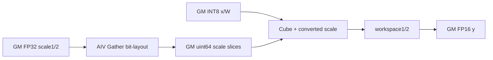
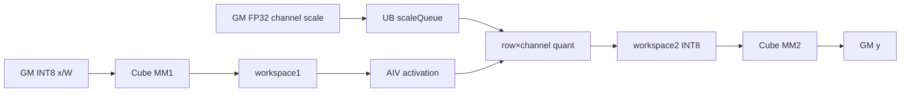
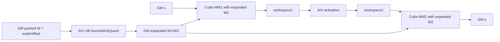
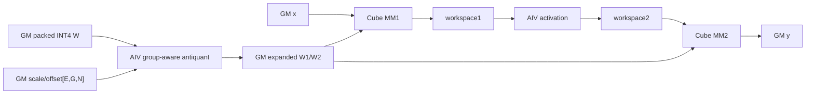
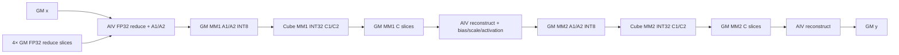

# FFN A2 ACLNN 算子知识

## 算子速览

| 项目 | 内容 |
|---|---|
| 实际入口 | CANN 9.1.0 最新公开接口 `aclnnFFNV3GetWorkspaceSize` / `aclnnFFNV3`；V3 将 `expertTokens` 从 Host `aclIntArray` 改为 Device `aclTensor` |
| 计算语义 | 普通激活为 `y = activation(x·W1+b1)·W2+b2`；GLU 为 `z=(x·W1+b1)` 左右等分后 `activation(left,right)·W2+b2` |
| 输入输出 | `x` 为 2～8 维 ND，折叠前导维为 token 数 `M`；有专家时权重为 `[E,K,N]`，否则 `[K,N]`；`y.shape=x.shape` |
| 执行类型 | `MIX_CV`：同一 Kernel launch 内 AIC Matmul 与 AIV 激活、量化/反量化或权重预处理协作 |
| Kernel 路线 | R-001 FP16 高性能；R-002 FP16/BF16 高精度；R-003 GLU；R-004 标准 INT8 量化；R-005 BF16 输出量化；R-006 FP32 deqScale 量化；R-007 smooth quant；R-008 per-channel 伪量化；R-009 per-group 伪量化；R-010 MSD 伪量化 |
| 核心资源 | 两段中间 workspace、按 route 增加的反量化权重/INT32/scale 转换区、非 GLU route 每 AIC 两个 32 B 同步槽、16 MiB system workspace，以及 Matmul 管理的 L1/L0A/L0B/L0C 和 AIV UB |
| 来源闭包 | `source_closed`：V3 声明/实现、L0 launcher、OpDef、Tiling/POD、10 个可达 Kernel 实现族、直接 helper 与 CMake 接线均闭合；通用 Matmul 库的内部 ABI 属于仓外编译依赖边界 |
| 验证状态 | 已完成源码闭包检查；本次知识提取未执行编译、真机、数值或性能测试。 |

## 接口与语义

### 计算语义

令 `M=prod(x.shape[0:-1])`、`K1=x.shape[-1]`。无专家时 `W1:[K1,N1]`、`W2:[K2,N2]`；MoE 时为 `W1:[E,K1,N1]`、`W2:[E,K2,N2]`，`expertTokens[e]` 将连续 token 行分配给专家。非 GLU 必须 `K2=N1`，源码还校验 `N2=K1`；GLU 必须 `N1` 为偶数且 `K2=N1/2`。普通路径按 `MM1(+bias1) → activation → MM2(+bias2)` 执行。`geglu/swiglu/reglu` 把 MM1 的前后半列分别作为门值与被门控值，再写入 `M×(N1/2)` 中间区。

量化路径要求 `x/W1/W2=int8`：Cube 的 INT32 累加先由 `deqScale1` 反量化，执行激活，再用 `scale/offset` 量化为 MM2 的 INT8 A 矩阵；MM2 结果由 `deqScale2` 产生 FP16 或 BF16。伪量化路径要求 `x` 为 FP16/BF16、权重为 INT8/INT4，先按 `(weight+offset)×scale` 转成 `x` dtype 后再执行两个 Matmul。MSD 路线不完整展开权重，而把 A 矩阵拆为两个 INT8 分量，两次 INT8 Matmul 后在 FP32 中重构。

### 输入、输出与属性

| 参数 | shape/layout | dtype | 约束、默认值与语义 |
|---|---|---|---|
| `x` | ND，2～8 维，末维 `K1` | FP16/BF16/INT8 | 必选；A2 禁止 private format；含 BF16 的公开场景仅支持 Atlas 800I A2 推理产品；空 tensor 在 ACLNN 层直接返回空执行图 |
| `weight1` | 无专家 `[K1,N1]`；有专家 `[E,K1,N1]`，ND | FP16/BF16/INT8/INT4 | 必选；与 `weight2` dtype 相同；`K1<=65535`；INT4 的 `N1` 必须为偶数 |
| `weight2` | 无专家 `[K2,N2]`；有专家 `[E,K2,N2]`，ND | 与 `weight1` 相同 | 必选；普通路线 `K2=N1,N2=K1`，GLU `K2=N1/2`；`K2<=65535` |
| `expertTokensOptional` | `[E]`，ND，最多 256 项 | INT64 | V3 为 Device tensor；空一维 tensor 被当作无专家；`tokensIndexFlag=true` 时 Device 将累计索引差分成计数 |
| `bias1Optional` | `[N1]` 或 `[E,N1]` | FP16/FP32/INT32 | dtype 随 route：普通 FP16/GLU 为 FP16，BF16/其伪量化为 FP32，量化为 INT32 |
| `bias2Optional` | `[N2]` 或 `[E,N2]` | FP16/FP32/INT32 | 与对应 route 的 `bias1` 规则相同；`N1=0` 时可直接广播 `bias2` 到每个有效 token |
| `scaleOptional` | per-tensor `[1]`/`[E]`；smooth 为 `[N1]`/`[E,N1]` | FP32 | 仅 INT8 量化；与 `offset`、两段 `deqScale` 必须同时存在 |
| `offsetOptional` | `[1]` 或 `[E]` | FP32 | 仅 INT8 量化，量化偏移；专家维与 `E` 一致 |
| `deqScale1Optional` | `[N1]` 或 `[E,N1]` | UINT64/INT64/FP32/BF16 | FP16 输出可用 UINT64/INT64/FP32，BF16 输出要求 BF16；INT64 在 ACLNN 元数据中改标 UINT64 |
| `deqScale2Optional` | `[N2]` 或 `[E,N2]` | 与 `deqScale1` 相同 | 与第一段 dtype 完全一致 |
| `antiquantScale1/Offset1` | per-channel `[N1]`/`[E,N1]`；per-group `[G,N1]`/`[E,G,N1]` | FP16/BF16 | 四个伪量化参数必须同时存在、shape 成对一致；per-group 仅允许 INT4 权重，`G` 整除 `K1` |
| `antiquantScale2/Offset2` | per-channel `[N2]`/`[E,N2]`；per-group `[G,N2]`/`[E,G,N2]` | FP16/BF16 | per-group 的 `G` 整除 `K2`；dtype 必须与 `x` route 匹配 |
| `activation` | Host 字符串 | `fastgelu/gelu/relu/silu/geglu/swiglu/reglu` | 大小写不敏感；GLU 仅 FP16、无专家、`innerPrecise=1` |
| `innerPrecise` | Host 标量 | INT64 | `0` 高精度，`1` 高性能；纯 BF16 非量化路线只允许 0，量化/伪量化路线接受 0/1 但该属性不生效；GLU 只允许 1 |
| `tokensIndexFlag` | Host 标量 | bool | 默认 false 表示各专家 token 数；true 表示单调非降累计结束索引 |
| `y` | shape 与 `x` 相同、ND | FP16/BF16 | 必选；INT8 输入由 `y` dtype 选择量化输出路线，否则与 `x` dtype 一致；含 BF16 的公开场景仅支持 Atlas 800I A2 推理产品 |

### 入口与版本

版本族含 `aclnnFFN`、`aclnnFFNV2`、`aclnnFFNV3`；固定 Commit 的 `docs/`、`op_host/op_api/` 没有 V3 之后的公开符号，因此 A2 的最新公开入口是 V3。V1/V2 接收 Host `aclIntArray expertTokens`，V2 增加 `tokensIndexFlag`；V3 接收 Device `aclTensor expertTokensOptional` 并复用同一个 `GetFFNResultByL0Api`、L0 `l0op::FFN`、Host Tiling 与 Device Kernel。V3 的 Device tokens 不经过 `CheckExpertTokens` 的值域/总和校验，这是接口版本差异，不可沿用 V2 的 Host 校验结论。公开 V3 文档对 A3 明确标记不支持；即使 `ffn_def.cpp` 存在 `ascend910_93` 实现注册，本卡也不将其发布为 A3 ACLNN route。

## Host/Launcher 执行流程

### 参数校验与前处理

`aclnnFFNV3GetWorkspaceSize` 先解析激活并检查 `x/weight1/weight2/y` 非空，构造 `FFNParams`，把 FP16 输出下 INT64 `deqScale` 的 tensor 元数据改标为 UINT64。`GetFFNResultByL0Api` 创建 executor，经 `ConvertExpertTokensAndCheckParams` 执行 format、输出 rank、权重/偏置 shape、dtype 组合和量化参数一致性校验。`x` 空时返回 `workspaceSize=0` 且不加入 FFN launch。

非空时，`x/W1/W2` 与全部存在的可选 tensor 依次走 `InputsContiguousAndTransFormat`；A2 只做 `Contiguous`，不做 310P 专属 NZ `TransData`。L0 输出按 `x` 的 storage/view shape 分配，`OutputransFormat` 转为用户 `y` 的 storage format，最后 `ViewCopy` 写入用户输出。

### 参数、Workspace 与生命周期

L0 `FFN` 通过 `ADD_TO_LAUNCHER_LIST_AICORE` 把 14 个 tensor、`activation/innerPrecise/-1/tokensIndexFlag` 和输出加入 executor。非 GLU Tiling 的公共 workspace 为 `workspace1Size + workspace2Size + syncWorkspaceSize + 16 MiB`：`workspace1Size` 保存 MM1 结果，`workspace2Size` 保存激活后的 MM2 输入，`syncWorkspaceSize=2*aicNum*32 B`。高精度/BF16 路线的 workspace1 元素为 FP32；普通路线为 2 B；量化 BF16、FP32 deqScale和伪量化再按 Route 增加切片。GLU 独立分配 `4*aivNum*mm1.baseM*mm1.baseN*sizeof(FP16) + M*K2*sizeof(FP16) + 16 MiB`，不增加同步 slice。用户 workspace、executor 内部连续化临时 tensor 与输出中间 tensor 的 owner 均为 executor，需存活到同一 stream 上 `CommonOpExecutorRun` 完成。

### 启动图与失败传播

启动图为 `aclnnFFNV3GetWorkspaceSize → GetFFNResultByL0Api → l0op::FFN → TilingFFN → ffn<<<blockDim, stream>>> → OutputransFormat/ViewCopy`。`TilingPrepareForFFN` 从平台取得 AIC/AIV 核数及 UB/L1/L0 容量，`SetBlockDim(CalcTschBlockDim(...))` 并使用 batch schedule mode 1。Kernel 默认 task type 是 `KERNEL_TYPE_MIX_AIC_1_2`；key 0/2000 与 key 15 在 router 中分别覆盖为 `KERNEL_TYPE_MIX_AIC_1_1`。`bs==0 || k1==0 || n2==0` 时 Tiling 把 `blockDim=0`，不执行 Kernel。校验、Contiguous、TransData 或 launcher 加图失败会在第一段返回；第二段把 `CommonOpExecutorRun` 的任意非成功结果统一映射为 `ACLNN_ERR_INNER`，没有算子级 recovery/fallback。executor 内部是否已向 stream 提交部分节点属于固定仓外边界，不能从本文件推断。

## Route 与参数设计

### 分核与资源计算

Host 将 `M=prod(x[0:-1])` 写成 `totalTokens`，无运行期 token 值时 `maxTokens=M`；多专家用于优化判断的 `maxTokensCheckOpt=ceil(M/E)`。`TilingPrepareForFFN` 提供 AIC/AIV 数、UB/L1/L0A/L0B/L0C。普通路线先尝试基于 `baseM/baseN/baseK` 的性能 tiling，不成功则用 `MatmulApiTiling`；Device 仍用 `KernelTiling` 按每个专家实际 token 数动态拆 `blockDimM×blockDimN`，小专家最多 10 个并行。

UB 先扣除 `align32(E*sizeof(int64_t))` 的 token 缓冲，再按 route 的块数分配：高性能 8 块/IO 4 块，高精度 18/8，FP16 伪量化 13/9 且 8 KiB 对齐，BF16 伪量化 23/13，FP16 量化 9/3，BF16 输出量化 22/6。`ubCalSize=floor((usableUB/divideBlkNum)/blockAlign)*blockAlign`，`ubRestBytes=floor((usableUB-ubCalSize*ioBlkNum)/32)*32`；Cube `baseM` 还受 `L0C/(baseN*4)`、`maxTokens` 和 16 对齐约束。

### Route 选择

| 顺序 | Route | Key/模板 | 精确选择条件与优先级 | 不适用去向 |
|---:|---|---|---|---|
| 1 | R-001 FP16 高性能 | 0、2000；`FFNHighPerformence<half>` | 非 GLU，`x/W=FP16` 且 `innerPrecise=1`；若两段 Matmul 的 `baseM/baseN/baseK` 全相同则加 2000 复用一个 Matmul 对象 | `innerPrecise=0` 到 R-002；dtype 变体继续下判 |
| 2 | R-002 FP16/BF16 高精度 | 3、7；`FFNHighPrecision` | FP16 且 `innerPrecise=0` 选 3；BF16 输入/权重/输出且 `innerPrecise=0` 选 7 | GLU 到 R-003；量化/伪量化继续下判 |
| 3 | R-003 GLU | 2；`FFNGlu<half>` | `activation>=GEGLU`，FP16、无专家、`innerPrecise=1`、`N1` 偶数且 `K2=N1/2` | 参数不满足直接 Host/Tiling 失败 |
| 4 | R-004 标准 INT8 量化 | 1、2001、2002；`FFNQuant<...,half,...,uint64_t>` | `x/W=int8,y=FP16`，非 smooth，`deqScale!=FP32`；同 tile 加 2000，且平均 token≤64、两段 `stepN=2` 再加 1 | BF16 输出到 R-005；FP32 scale 到 R-006；smooth 到 R-007 |
| 5 | R-005 BF16 输出量化 | 11；`FFNQuant<...,int32_t,bfloat16_t,...>` | `x/W=int8,y=BF16`，`deqScale=BF16`，非 smooth | smooth 优先到 R-007；不匹配返回失败 |
| 6 | R-006 FP32 deqScale 量化 | 13；`FFNQuant<...,half,...,float>` | `x/W=int8,y=FP16,deqScale=FP32`，非 smooth | smooth 优先到 R-007；不匹配返回失败 |
| 7 | R-007 smooth quant | 14；`FFNQuant<...,isSmooth=true>` | `x/W=int8` 且 scale 为无专家 `[N1]` 或有专家 `[E,N1]`；在量化 selector 中优先级最高 | scale 非 channel shape 回 R-004/R-005/R-006 |
| 8 | R-008 per-channel 伪量化 | 6；`FFNAntiQuant<...,false>` | `x=FP16/BF16,W=INT8/INT4`，scale/offset 无 G 维，且不满足 MSD | 有 G 维到 R-009；满足 MSD 到 R-010 |
| 9 | R-009 per-group 伪量化 | 12；`FFNAntiQuant<...,true>` | `x=FP16/BF16,W=INT4`，scale/offset 为 `[G,N]` 或 `[E,G,N]` 且 `G` 整除 K | 非 group 到 R-008；约束失败终止 |
| 10 | R-010 MSD 伪量化 | 15；`FFNAntiQuantMSD` | `N1%512=0,N1>1024,K1%512=0,K1>2048,W=INT8,x=FP16/BF16,M≤512,ceil(M/E)≤(N1/2560)*16`；在普通伪量化前选择 | 谓词不满足到 R-008 |

```text
空域(M==0 或 K1==0 或 N2==0) -> blockDim=0
否则若 GLU -> R-003
否则若 x/W=int8 -> smooth ? R-007 : y=BF16 ? R-005 : deqScale=FP32 ? R-006 : R-004
否则若 x=BF16 且 W=BF16 -> R-002(key 7)
否则若 N1==0 -> x=BF16 ? R-002(key 7) : R-001(key 0)
否则若 MSD 谓词 -> R-010
否则若 W=int8/int4 -> 有 G 维 ? R-009 : R-008
否则若 innerPrecise==0 -> R-002(key 3)
否则 -> R-001(key 0/2000)
```

### 模板/实现执行矩阵

| Route | key/selector | dtype/shape/platform 完整命中条件 | 执行族与 kernel 节点 | 实际模板/body | 内存与同步特征 | tail/fallback |
|---|---|---|---|---|---|---|
| R-001 FP16 高性能 | 0/2000 | A2，非 GLU，`x/W/y=FP16`，`innerPrecise=1`，非量化/伪量化 | 单 launch `MIX_AIC_1_1`；MM1→AIV activation→MM2 | `FFNHighPerformence<half, mmType<half,ND,ND>>`；2000 将两段绑到一个 Matmul 对象 | FP16 workspace1/2；`EVENT7`后 `SyncAll<true>` | M/N/K 尾块由 `TCubeTiling` 与 `curBase*`；不满足转后续 selector |
| R-002 FP16/BF16 高精度 | 3/7 | FP16 `innerPrecise=0`，或 BF16 同 dtype 且 `innerPrecise=0`；BF16 公开范围限 800I A2 | 单 launch `MIX_AIC_1_2`；FP32 MM1/activation 子段→低精度 MM2 | `FFNHighPrecision<half\|bfloat16_t,...>` | workspace1 FP32，workspace2 FP16/BF16；Vector cast 前 `PIPE_V` barrier | 不支持 GLU；BF16 实例受 arch22 编译 guard |
| R-003 GLU | 2 | FP16，无 expert，`activeType>=GEGLU`，`innerPrecise=1`，`N1%2=0`，`K2=N1/2` | 单 launch `MIX_AIC_1_2`；MM1 left/right→AIV GLU→MM2 | `FFNGlu<half>` | 每核 left/right×ping/pong 四片 GM workspace；最后 `SyncAll<true>` | M/N 双尾块；谓词失败直接 Host/Tiling 失败 |
| R-004 标准 INT8 量化 | 1/2001/2002 | `x/W=INT8,y=FP16`，非 smooth，`deqScale!=FP32` | 单 launch `MIX_AIC_1_2`；INT8 Cube→AIV activation/quant→INT8 Cube | `FFNQuant<...,half,...,uint64_t>`；2001 单 Matmul，2002 加 `MM_CFG_STEPN` | FP16 workspace1 + INT8 workspace2；两段 `SetQuantVector` | 2002 需平均 token≤64 且两段 `stepN=2`；否则 2001/1 |
| R-005 BF16 输出量化 | 11 | `x/W=INT8,y=BF16,deqScale=BF16`，非 smooth；公开范围限 800I A2 | 单 launch `MIX_AIC_1_2`；两次 INT32 Cube 结果都由 AIV 处理 | `FFNQuant<...,int32_t,bfloat16_t,...>` | FP32-sized workspace1、INT8 workspace2、`M*N2*4` MM2 输出片 | 按 dtype 粒度对齐；其他量化组合转 R-004/R-006/R-007 |
| R-006 FP32 deqScale | 13 | `x/W=INT8,y=FP16,deqScale=FP32`，非 smooth | 单 launch `MIX_AIC_1_2`；AIV 先重排 scale，Cube 再运行 | `FFNQuant<...,half,...,float>` | workspace1/2 64 B 对齐；附加 `E*N1*8 + E*N2*8` scale 片 | scale N 尾块按32元素处理；非 FP32 转 R-004 |
| R-007 smooth quant | 14 | INT8 量化且 scale 是 `[N1]` 或 `[E,N1]`；BF16 输出公开范围限 800I A2 | 单 launch `MIX_AIC_1_2`；AIV 逐 channel 应用 scale | `FFNQuant<...,isSmooth=true>` | FP32 scale queue + route 对应 workspace；key14 优先于其他 quant key | scale shape 不命中则转 R-004/R-005/R-006 |
| R-008 per-channel 伪量化 | 6 | `x=FP16/BF16,W=INT8/INT4`，scale/offset 无 G 维，MSD 不命中；BF16 公开范围限 800I A2 | 单 launch `MIX_AIC_1_2`；AIV 展开 W1/W2→Cube MM1/MM2 | `FFNAntiQuant<...,false>` | 两个展开权重 GM workspace；权重 producer 后 `SyncAll` | INT4 按 pack=2 处理；G 维转 R-009 |
| R-009 per-group 伪量化 | 12 | `x=FP16/BF16,W=INT4`，scale/offset 含 G 维，`K%G=0`；BF16 公开范围限 800I A2 | 单 launch `MIX_AIC_1_2`；AIV 按 group 展开权重→Cube | `FFNAntiQuant<...,true>` | 展开权重片与 R-008 同形；K tile 不跨 group | group/K/N 尾块；约束不满足失败 |
| R-010 MSD 伪量化 | 15 | per-channel INT8 权重；`N1%512=0,N1>1024,K1%512=0,K1>2048,M<=512`，并满足平均 token 阈值；BF16 公开范围限 800I A2 | 单 launch `MIX_AIC_1_1`；Vector reduce/拆 A1A2→两次 INT8 Cube→Vector 重构 | `FFNAntiQuantMSD<...>` | A1/A2、C1/C2、四个 FP32 reduce 片；atomic + 多轮 `SyncAll` | 不命中时回 R-008；M/K/N tail 由 MSD 专用分核限定 |

### 隐藏性能 Guard

| Guard | Host/Tiling 条件 | Device/资源原因 | 影响 Route | 不满足时去向 | 源码符号 |
|---|---|---|---|---|---|
| 平台资源非零 | `aivCoreNum/UB/L1/L0A/L0B/L0C != 0` | Tiling 与 Matmul 无法构造 tile | 全部 | `GRAPH_FAILED` | `ffn_tiling.cpp:CheckAndGetBasicInfo` |
| M 窄化 | `M <= floor(INT_MAX/numInOneBlk)*numInOneBlk` | POD 与 Device 地址算术使用 32 位边界 | 全部 | `GRAPH_FAILED` | `ffn_tiling.cpp:GetBs` |
| UB token 预留 | `usableUB=UB-align32(E*8)`，之后 `FFNCalUbSize` 成功 | 每核需同时容纳 expert tokens 和 route queues | 全部非 GLU | 性能 tiling 失败时尝试 `FFNApiTiling`，仍失败则终止 | `CheckAndGetBasicInfo/FFNCalUbSize/TilingWithDifferentKN` |
| L0C baseM | `baseM <= L0C/(baseN*4)` 并受16对齐与 `maxTokens` 约束 | FP16/BF16/INT8 Matmul 都以 4 B C tile 占用 L0C | R-001–R-010 | 降低 baseM 或 tiling 失败 | `ffn_tiling.cpp:FFNCalUbSize/CalMM*Tiling*` |
| 单 Matmul 对象 | `isTilingDataValid && mm1.baseM/N/K == mm2.baseM/N/K` | 同一 Matmul 对象只能在两段 tile 完全同构时复用 | R-001/R-004 | 使用两个 Matmul 对象 key 0/1 | `ffn_tiling.cpp:FFNSetTilingKey` |
| quant stepN=2 | 上述复用成立，`maxTokensCheckOpt<=64`，两段 `stepN==2` | key2002 实例使用 `MM_CFG_STEPN` | R-004 | key2001 或 1 | `FFNSetTilingKey`、`ffn.cpp:MM_CFG_STEPN` |
| smooth 优先 | 无 expert 时 `scale.dim0==N1`；有 expert 时 `scale.rank==2` | AIV 需逐 channel scale queue，不能用 per-tensor quant body | R-007 | 继续 BF16/FP32/标准 quant selector | `FFNGetQuantScale/SelectQuantTilingKey` |
| per-group 边界 | scale rank 为 2/3，`G>=1`，`K1%G==0 && K2%G==0`，权重 INT4 | 每个 K tile 不得跨越 scale/offset group | R-009 | ACLNN 参数失败，不回退到 per-channel | `aclnn_ffn.cpp:CheckAntiQuantPergroup`、`FFNAntiQuant::CastWeightPerGroup` |
| MSD 阈值 | `CheckMSD` 的 N1/K1/M/平均 token 布尔式全为真 | 只有大 K/N、小 M 时才启用两分量重构 body | R-010 | R-008 | `ffn_tiling.cpp:CheckMSD/SelectTilingKey` |
| 空域 | `M==0 \|\| K1==0 \|\| N2==0` | 无有效输出或 Matmul 域 | 全部 | `blockDim=0`，不 launch | `FFNTiling::RunFusionKernelTiling` |

### POD/ABI

`TILING_DATA_FIELD_DEF` 生成的确切 `sizeof/alignof/offsetof` 与外部 `TCubeTiling` 定义不在固定仓；下表保留源码声明顺序、固定宽度和逐字段 producer/consumer。不得根据常规 C++ padding 推断二进制 offset。

| 结构 | 字段 | 类型/位宽 | ABI 布局 | 单位 | Host/launcher producer | Device consumer | 边界 |
|---|---|---|---|---|---|---|---|
| `FFNBaseParams` | `totalTokens` | uint32_t/32 | `sizeof/alignof/offsetof` 固定仓不可见；声明序号 0 | 元素/行 | `SetTilingBaseParams: bs` | `FFNBase::InitTilingData`、MSD/GLU `InitTilingData` | `M` 的 32 B 对齐上界需不超过 INT32_MAX |
| `FFNBaseParams` | `k1` | uint32_t/32 | 固定仓不可见；序号 1 | 元素 | `SetTilingBaseParams: k1` | 两段 route 的 MM1 地址/K | API 要求 `<=65535` |
| `FFNBaseParams` | `n1` | uint32_t/32 | 固定仓不可见；序号 2 | 元素 | `SetTilingBaseParams: n1` | MM1 输出、激活区和 MM2 K | 可为 0；GLU 必须偶数 |
| `FFNBaseParams` | `n2` | uint32_t/32 | 固定仓不可见；序号 3 | 元素 | `SetTilingBaseParams: n2` | MM2 输出跨度 | 0 触发空 launch |
| `FFNBaseParams` | `expertNum` | uint32_t/32 | 固定仓不可见；序号 4 | 专家数 | `GetInputShape` | `GetUbTokens`、专家循环 | 1～256；无 tokens 时为 1 |
| `FFNBaseParams` | `maxTokens` | uint32_t/32 | 固定仓不可见；序号 5 | token 行 | 非 GLU 的 `FFNSetTilingData` 前由 `UpdateMaxTokens` 计算 | 非 GLU 分核、workspace、无 experts token | 非 GLU 固定写 `M`，非真实最大专家 token；R-003 不写也不读该字段 |
| `FFNBaseParams` | `coreNum` | uint32_t/32 | 固定仓不可见；序号 6 | AIC 核 | `SetTilingBaseParams: aicNum` | expert 并行与 `coreIdx` | 平台值必须非 0 |
| `FFNBaseParams` | `activeType` | uint32_t/32 | 固定仓不可见；序号 7 | enum | `FFNParamsCheck` | `ApplyActivation`/GLU 映射 | 0～6 |
| `FFNBaseParams` | `workspace1Size` | uint64_t/64 | 固定仓不可见；序号 8 | 字节 | `FFNSetTilingData` 或 `FFNGlu` | 第一/第二中间区边界 | 乘法使用 uint64_t 后进入 workspace 总和 |
| `FFNBaseParams` | `workspace2Size` | uint64_t/64 | 固定仓不可见；序号 9 | 字节 | `FFNSetTilingData` 或 `FFNGlu` | 额外 route 切片起点 | 与 workspace1 连续 |
| `FFNBaseParams` | `syncWorkspaceSize` | uint32_t/32 | 固定仓不可见；序号 10 | 字节 | 非 GLU 的 `FFNSetTilingData: 2*aicNum*32` | 公共同步库 | R-003 不调用 setter，body 也不读取该字段；不可推断其 inactive 存储值 |
| `FFNBaseParams` | `dataTypeSize` | uint32_t/32 | 固定仓不可见；序号 11 | 字节/元素 | `SetTilingBaseParams: xDataTypeSize` | 地址/容量换算 | 1(INT8) 或 2(FP16/BF16) |
| `FFNBaseParams` | `scale1GroupNum` | uint32_t/32 | 固定仓不可见；序号 12 | group 数 | `FFNGetScaleGroupNum` | `FFNAntiQuant::InitTilingData` | 非 group 为 1 |
| `FFNBaseParams` | `scale2GroupNum` | uint32_t/32 | 固定仓不可见；序号 13 | group 数 | `FFNGetScaleGroupNum` | `FFNAntiQuant::InitTilingData` | 非 group 为 1 |
| `FFNBaseParams` | `tokensIndexFlag` | uint32_t/32 | 固定仓不可见；序号 14 | bool 编码 | `GetInputShape` | `GetUbTokens/TokensIndicesToValues` | 只读取 0/非 0 |
| `FFNSingleCoreParams` | `baseM1` | uint32_t/32 | `sizeof/alignof/offsetof` 固定仓不可见；序号 0 | 行 | `FFNSingleCoreTiling/FFNCalMM1*` | AIV tile、Matmul baseM | 16 对齐 |
| `FFNSingleCoreParams` | `baseN1` | uint32_t/32 | 固定仓不可见；序号 1 | 列 | Host MM1 tiling | 激活、scale/weight tile | 最小 16，INT8 最小 32 |
| `FFNSingleCoreParams` | `baseN2` | uint32_t/32 | 固定仓不可见；序号 2 | 列 | Host MM2/零 N1 tiling | bias/量化尾块 | 16 对齐 |
| `FFNSingleCoreParams` | `ubCalSize` | uint32_t/32 | 固定仓不可见；序号 3 | 元素或 route 约定容量 | `FFNCalUbSize` | `InitBuffer`、AIV tile | route 按对应 dtype 解释 |
| `FFNSingleCoreParams` | `ubRestBytes` | uint32_t/32 | 固定仓不可见；序号 4 | 字节 | `FFNCalUbSize` | activation/quant/MSD 临时 UB | 32 B 对齐；MSD 写整块可用 UB |
| `FFNSingleCoreParams` | `mm1ResUbSize` | uint32_t/32 | 固定仓不可见；序号 5 | 元素 | Host MM1/GLU tiling | Matmul buffer space/GLU | `baseM1*baseN1` |
| `FFNTilingData` | `ffnSingleCoreParams` | struct/宽度固定仓不可见 | `sizeof/alignof/offsetof` 固定仓不可见；外层序号 0 | ABI 子结构 | `FFNTiling` setters | 全部 route | 必须保持第一项 |
| `FFNTilingData` | `mm1TilingData` | `TCubeTiling`/宽度固定仓不可见 | 外部 tiling API 定义固定仓不可见；外层序号 1 | Matmul 参数 | `MatmulApiTiling/GetTiling` 或手工 setters | `REGIST_MATMUL_OBJ`、Device getters | 当前仓可见消费者字段含 base/single/step/usedCore/bias/share |
| `FFNTilingData` | `mm2TilingData` | `TCubeTiling`/宽度固定仓不可见 | 外部 tiling API 定义固定仓不可见；外层序号 2 | Matmul 参数 | Host MM2 tiling | `REGIST_MATMUL_OBJ`、Device getters | 不能与 mm1 交换 |
| `FFNTilingData` | `ffnBaseParams` | struct/宽度固定仓不可见 | `sizeof/alignof/offsetof` 固定仓不可见；外层序号 3 | ABI 子结构 | `SetTilingBaseParams/FFNSetTilingData` | 全部 route | 必须保持最后一项 |

### Route 源码闭包

| Route | Key/selector | Host/Tiling producer | POD/参数 | Kernel entry/router | Kernel body/直接依赖 | 构建接线 |
|---|---|---|---|---|---|---|
| R-001 FP16 高性能 | 0/2000 | `ffn_tiling.cpp:SelectTilingKey/FFNSetTilingKey` | `FFNTilingData`、两份 `TCubeTiling` | `op_kernel/ffn.cpp:ffn` | `FFNHighPerformence::Process`、`FFNBase::ProcessNormal/MM1Compute/Elewise1/MM2Compute` | `op_host/CMakeLists.txt:add_modules_sources`，上层 `ffn` CMake 接入 |
| R-002 FP16/BF16 高精度 | 3/7 | `ffn_tiling.cpp:SelectTilingKey/FFNCalUbSize` | workspace1 为 FP32 | `op_kernel/ffn.cpp:ffn` | `FFNHighPrecision::Process`、`FFNBase::Elewise1HighPrecision/Elewise1ComputeHighPrecision` | 同 R-001 |
| R-003 GLU | 2 | `ffn_tiling.cpp:FFNGlu` | GLU 专用 workspace1/2、MM1/MM2 tiling | `op_kernel/ffn.cpp:ffn` | `FFNGlu::MM1GluSplit/GluSplit/MM2Split` | 同 R-001 |
| R-004 标准 INT8 量化 | 1/2001/2002 | `SelectQuantTilingKey/FFNSetTilingKey` | uint64 deqScale、FP16 workspace | `op_kernel/ffn.cpp:ffn` | `FFNQuant::MM1Process/Elewise1/QuantCompute/MM2Compute` | 同 R-001 |
| R-005 BF16 输出量化 | 11 | `SelectQuantTilingKey/FFNSetUbDivideBlk` | INT32 MM1/MM2 输出附加区 | `op_kernel/ffn.cpp:ffn` | `FFNQuant::Elewise1/CastCompute/Elewise2` | 同 R-001 |
| R-006 FP32 deqScale 量化 | 13 | `SelectQuantTilingKey/FFNSetTilingData` | 64 B 对齐 workspace1/2、两段 uint64 scale 区 | `op_kernel/ffn.cpp:ffn` | `FFNQuant::CastDeqScale/MM1Compute/MM2Compute` | 同 R-001 |
| R-007 smooth quant | 14 | `FFNGetQuantScale/SelectQuantTilingKey` | channel scale、smooth 模板参数 | `op_kernel/ffn.cpp:ffn` | `FFNQuant<...,true>::ScaleDataCopy/Elewise1/QuantCompute` | 同 R-001 |
| R-008 per-channel 伪量化 | 6 | `FFNGetScaleGroupNum/SelectTilingKey` | groupNum=1、展开权重 workspace | `op_kernel/ffn.cpp:ffn` | `FFNAntiQuant<...,false>::CastWeightNormal/SplitMM1/SplitMM2` | 同 R-001 |
| R-009 per-group 伪量化 | 12 | `FFNGetScaleGroupNum/SelectTilingKey` | `scale1/2GroupNum>1`、展开权重 workspace | `op_kernel/ffn.cpp:ffn` | `FFNAntiQuant<...,true>::CastWeightPerGroup/DataCopyScaleAndOffset` | 同 R-001 |
| R-010 MSD 伪量化 | 15 | `CheckMSD/SelectTilingKey` | MSD 多切片 workspace、FP32 reduce 区 | `op_kernel/ffn.cpp:ffn` | `FFNAntiQuantMSD::PreProcessMM1/ComputeExpertMM1/ComputeExpertMM2` | 同 R-001 |

## Kernel 实现

### 公共执行流程

统一入口 `ffn` 建立 `TPipe`、打开溢出状态、反序列化 `FFNTilingData`，取得 user workspace，并以 TilingKey 实例化 Matmul 类型和 route 类。A2 的 arch22 编译分支使用 MIX AIC:AIV 任务：router 默认 `KERNEL_TYPE_MIX_AIC_1_2`，R-001 的 key 0/2000 和 R-010 的 key 15 覆盖为 `KERNEL_TYPE_MIX_AIC_1_1`；`GetTaskRation`、`GetSubBlockIdx` 把 Cube 与 Vector 子任务映射到同一次 launch。普通 expert route 先把 INT64 tokens 搬入 UB，必要时把累计索引差分成计数；每个 route 都按专家连续行 offset 处理，不重新排列 token。Matmul 内部的 GM→L1→L0A/L0B→Mmad→L0C→输出层级由仓外 `lib/matmul_intf.h` 实现，本仓闭合当前 specialization、输入输出位置、tiling 与同步边界。

### Route R-001：FP16 高性能

#### 适用条件

##### 选择证据

| 层级 | 文件 | 符号 | 源码谓词/参数 | 结果/下一跳 |
|---|---|---|---|---|
| API | ffn/ffn/op_host/op_api/aclnn_ffn.cpp | `CheckOptionalParams/CheckHighPerformance` | 非 GLU，`x=FP16,W1=W2=FP16,y=FP16,innerPrecise=1`，量化参数全空 | 进入 FFN L0 |
| Tiling | ffn/ffn/op_host/ffn_tiling.cpp | `SelectTilingKey/FFNSetTilingKey` | 高精度、量化、伪量化均未命中；两份 tile 相同则 `featureKey=2000` | key 0 或 2000 |
| Router | ffn/ffn/op_kernel/ffn.cpp | `ffn` | `TILING_KEY_IS(0/2000)` | `FFNHighPerformence<half>`；2000 复用同一 Matmul 对象 |

#### Device 数据流

##### 函数级调用链

```text
ffn -> FFNHighPerformence::Init -> FFNBase::InitTilingData/GetUbTokens
    -> FFNHighPerformence::Process -> FFNBase::ProcessNormal
    -> FFNBase::MM1Process/MM1Compute -> Elewise1或Elewise2 -> Elewise1Compute
    -> FFNBase::MM2Process/MM2Compute -> yGm
```

##### 源码等价伪码

```text
for expertI while MM1/MM2 expert buffers nonempty:
  tokensOffset += previousTokens; 若当前 tokens==0 则继续
  以 baseM/baseN 和 coreNum 计算 expertParallelism、blockDimM/N
  MM1 offsetA=(globalTokenOffset+mIdx*singleM)*K1
  MM1 offsetB=expert*K1*N1+nIdx*singleN；写 workspace1[outRow*N1+nTail]
  for offsetM,offsetN 按 UB tile 搬 workspace1->UB，执行 activation，写 workspace2[workspace1Size+同一逻辑offset]
  MTE3_S EVENT7 后 SyncAll
  MM2 offsetA=localTokenOffset*N1，offsetB=expert*N1*N2+nTail；写 y[(globalTokenOffset+mIdx*singleM)*N2+nTail]
```

#### 内存与数据搬运

##### 资源与搬运表

| 层级/缓冲区 | offset/地址公式 | extent/容量公式 | dtype/layout | producer | consumer | owner/lifetime | 对齐/复用 |
|---|---|---|---|---|---|---|---|
| GM `x/W1/W2/y` | `x=(tokenOff+m)*K1`; `W1=e*K1*N1+n`; `W2=e*N1*N2+n`; `y=(tokenOff+m)*N2+n` | 输入/输出逻辑 shape | FP16/ND | ACLNN | Matmul | 调用者/整次 launch | Matmul tile 处理 16 对齐 tail |
| workspace1 | `0 + localRow*N1+n` | `maxTokens*N1*2 B` | FP16/ND_ALIGN | MM1 | AIV activation | executor/本 route | 多 expert 批次局部复用 |
| workspace2 | `workspace1Size + localRow*N1+n` | `maxTokens*N1*2 B` | FP16/ND | AIV | MM2 | executor/本 route | 与 workspace1 不重叠 |
| L1 | `N/A（Matmul 内部地址固定仓不可见）` | `shareL1Size=platform L1` | Matmul tile | Matmul copy-in | L0A/L0B | Matmul 对象/一次迭代 | key 2000 复用对象不改变 tiling |
| L0A | `N/A（Matmul 管理）` | 由 `TCubeTiling baseM*baseK` 决定 | FP16 fractal | L1 load | Mmad | Matmul/迭代 | K tail 由 `SetTail`/tiling 管理 |
| L0B | `N/A（Matmul 管理）` | 由 `baseK*baseN` 决定 | FP16 fractal | L1 load | Mmad | Matmul/迭代 | 同上 |
| L0C | `N/A（Matmul 管理）` | `<=platformL0C`，Host 用 `baseM*baseN*4` 约束 | FP32 accumulate | Mmad | Matmul copy-out | Matmul/迭代 | 不与 UB 激活区别名 |
| UB/寄存器 | queue offset 由 TPipe 管理 | in/out 各 `ubCalSize*2 B`，tmp=`ubRestBytes` | FP16 | `DataCopyPad` | activation/`DataCopyPad` | AIV tile | N 按 32 B 元素块补齐，写回只提交 `curBaseN` |

##### 分层内存布局


##### 字节账、交接边与复用顺序

```text
workspace_total = 2*maxTokens*N1 + 2*maxTokens*N1 + 64*aicNum + 16 MiB
L0C_tile <= baseM*baseN*4 B <= platformL0C
UB_total = ubCalSize*2 B + ubCalSize*2 B + ubRestBytes + align32(E*8 B)
```

| 边/复用子区 | producer | offset/extent | dtype/layout | consumer | ordering/sync | owner/lifetime | 安全条件 |
|---|---|---|---|---|---|---|---|
| MM1→AIV | `MM1Compute` | `0 / 2*maxTokens*N1 B` | FP16/ND_ALIGN | `Elewise1Compute` | Matmul iterate 完成后读 | executor/当前 expert batch | `curSingleM/N` 不超过写入 tile |
| AIV→MM2 | `Elewise1Compute` | `workspace1Size / 2*maxTokens*N1 B` | FP16/ND | `MM2Compute` | `MTE3_S EVENT7`→`SyncAll<true>` | executor/直到 MM2 完成 | 下一 expert 复写前等待 Matmul 结束 |

#### 同步、精度与尾块

##### 同步与数值边界表

| 阶段 | primitive/机制 | producer | consumer/等待点 | 保护对象 | 精度/尾块 |
|---|---|---|---|---|---|
| tokens 搬运 | `MTE2_S EVENT0` | GM→UB `DataCopy` | 标量专家循环 | `ubTokens` | 搬运 `align32(E*8)`，仅消费 E 项 |
| MM1→AIV→MM2 | `MTE3_S EVENT7` + `SyncAll<true>` | activation 写 workspace2 | MM2 及下一专家 MM1 | 中间矩阵 | FP16 激活；尾 M/N 由 `curSingle*` 与 `DataCopyPad` 限定 |
| MM2 重用 | `WaitIterateAll/End` | 前一 MM2 | 下一次 MM1 或 MM2 | Matmul 对象/L1/L0 | 非同步 tail 可回移最后 N tile 以均衡，但输出仍覆盖有效 N |

#### 关键实现

##### 符号证据表

| 阶段 | 文件 | 符号/模板实例 | 实现事实 |
|---|---|---|---|
| Host/Tiling producer | ffn/ffn/op_host/ffn_tiling.cpp | `SelectTilingKey/FFNSetTilingData` | 选择 0/2000，计算两段 workspace 与同步区 |
| Kernel entry/router | ffn/ffn/op_kernel/ffn.cpp | `ffn`、`FFNHighPerformence<half,mt>` | key 到单/双 Matmul 对象实例映射 |
| Device body/helper | ffn/ffn/op_kernel/ffn_base.h | `ProcessNormal/MM1Compute/Elewise1/MM2Compute` | 专家流水、地址公式、激活搬运、同步和 tail |
| Device body/helper | ffn/ffn/op_kernel/ffn_high_performence.h | `FFNHighPerformence::Process` | `N1=0` 快路径或公共正常路径 |

### Route R-002：FP16/BF16 高精度

#### 适用条件

##### 选择证据

| 层级 | 文件 | 符号 | 源码谓词/参数 | 结果/下一跳 |
|---|---|---|---|---|
| API | ffn/ffn/op_host/op_api/aclnn_ffn.cpp | `CheckHighPrecisionFP16/CheckHighPrecisionBF16` | FP16 `innerPrecise=0` 或 BF16 同 dtype，量化参数为空；GLU 禁止 | 进入高精度 route |
| Tiling | ffn/ffn/op_host/ffn_tiling.cpp | `SelectTilingKey/FFNSetUbDivideBlk` | BF16同权重先选 7；否则 `innerPrecise==0` 选 3；UB 18 块、IO 8 块 | key 3/7 |
| Router | ffn/ffn/op_kernel/ffn.cpp | `ffn` | key3: `half→float→half`；key7: `bf16→float→bf16` | `FFNHighPrecision` |

#### Device 数据流

##### 函数级调用链

```text
ffn -> FFNHighPrecision::Init -> FFNBase::Init
    -> FFNHighPrecision::Process -> FFNBase::ProcessNormal
    -> MM1Compute<c1T=float> -> Elewise1HighPrecision -> Elewise1ComputeHighPrecision
    -> MM2Compute -> yGm
```

##### 源码等价伪码

```text
for 每个非空 expert 与其 core tile:
  MM1 以 FP32 C 类型写 workspace1[offset=(localRow*N1+n)]
  for offsetM step ubBaseM/2, offsetN step ubBaseN:
    以 align16(curBaseN) 搬 FP32 tile 到 UB
    在 FP32 执行 activation；PipeBarrier(V) 后 CAST_ROUND 到 FP16/BF16
    写 workspace2[workspace1Size + localRow*N1+n]
  SyncAll 后 MM2 读取低精度 activation 与原 dtype W2，输出对应 y offset
```

#### 内存与数据搬运

##### 资源与搬运表

| 层级/缓冲区 | offset/地址公式 | extent/容量公式 | dtype/layout | producer | consumer | owner/lifetime | 对齐/复用 |
|---|---|---|---|---|---|---|---|
| GM 输入输出 | 与 R-001 相同 | 逻辑 shape | FP16 或 BF16/ND | ACLNN | Matmul | 调用者 | BF16 bias 为 FP32 |
| workspace1 | `localRow*N1+n` | `maxTokens*N1*4 B` | FP32 | MM1 | AIV | executor/当前 expert batch | 4 B 元素 |
| workspace2 | `workspace1Size + localRow*N1+n` | `maxTokens*N1*2 B` | FP16/BF16 | AIV cast | MM2 | executor | 与 workspace1 分离 |
| L1 | `N/A（Matmul 管理）` | platform L1 | route dtype | GM copy | L0 | Matmul iteration | Host 写 share size |
| L0A/L0B | `N/A（Matmul 管理）` | `baseM*baseK` / `baseK*baseN` | route dtype fractal | L1 | Mmad | Matmul iteration | tail 由 TCubeTiling |
| L0C | `N/A（Matmul 管理）` | `baseM*baseN*4 <= L0C` | FP32 | Mmad | workspace1/GM | Matmul iteration | 高精度 C1 明确为 FP32 |
| UB | TPipe queue | in `ubCalSize*4 B`，out `ubCalSize*2 B`，tmp `ubRestBytes` | FP32→FP16/BF16 | workspace1 | activation/cast | tile | `curBaseN` align16，写回有效列 |
| 寄存器 | intrinsic 内部 | `computeSize=curBaseM*align16(curBaseN)` | FP32 | UB | activation/Cast | 指令 | `CAST_ROUND` |

##### 分层内存布局


##### 字节账、交接边与复用顺序

```text
workspace_total = 4*maxTokens*N1 + 2*maxTokens*N1 + 64*aicNum + 16 MiB
L0C_tile <= baseM*baseN*4 B
UB_total = 4*ubCalSize + 2*ubCalSize + ubRestBytes + align32(E*8) B
```

| 边/复用子区 | producer | offset/extent | dtype/layout | consumer | ordering/sync | owner/lifetime | 安全条件 |
|---|---|---|---|---|---|---|---|
| MM1→AIV | `MM1Compute<c1T=float>` | `0 / 4*maxTokens*N1 B` | FP32/ND_ALIGN | `Elewise1ComputeHighPrecision` | Matmul 完成后 queue copy-in | executor/expert batch | UB 以 `align16(curBaseN)` 读取 |
| AIV→MM2 | `Elewise1ComputeHighPrecision` | `workspace1Size / 2*maxTokens*N1 B` | FP16/BF16/ND | `MM2Compute` | `PIPE_V` cast barrier，写 GM 后 `SyncAll` | executor/MM2 完成前 | 只提交有效 `curBaseN` |

#### 同步、精度与尾块

##### 同步与数值边界表

| 阶段 | primitive/机制 | producer | consumer/等待点 | 保护对象 | 精度/尾块 |
|---|---|---|---|---|---|
| MM1/激活/MM2 | `MTE3_S EVENT7`、`SyncAll` | FP32 activation cast 写 GM workspace | MM2 | workspace2 | FP32 激活后 `CAST_ROUND`；只写 `curBaseN` |
| Vector 内部 | `PipeBarrier<PIPE_V>` | FP32 activation | Cast | UB FP32 结果 | BF16/FP16 使用相同顺序，不把 cast 前移 |
| N1=0 | AIV core 分片，无 Cube | bias2/zero producer | y 写回 | 输出行 | bias 为 FP32 时 `CAST_ROUND`，否则零填 |

#### 关键实现

##### 符号证据表

| 阶段 | 文件 | 符号/模板实例 | 实现事实 |
|---|---|---|---|
| Host/Tiling producer | ffn/ffn/op_host/ffn_tiling.cpp | `SelectTilingKey/FFNSetUbDivideBlk/FFNSetTilingData` | key 3/7 与 FP32 workspace1 |
| Kernel entry/router | ffn/ffn/op_kernel/ffn.cpp | `FFNHighPrecision<half,...>`、`FFNHighPrecision<bfloat16_t,...>` | 具体 C1/C2/Bias 类型实例 |
| Device body/helper | ffn/ffn/op_kernel/ffn_base.h | `Elewise1HighPrecision/Elewise1ComputeHighPrecision` | FP32 activation、round cast 与搬运 |
| Device body/helper | ffn/ffn/op_kernel/ffn_high_precision.h | `FFNHighPrecision::Process` | N1=0 条件和公共专家流程 |

### Route R-003：GLU

#### 适用条件

##### 选择证据

| 层级 | 文件 | 符号 | 源码谓词/参数 | 结果/下一跳 |
|---|---|---|---|---|
| API | ffn/ffn/op_host/op_api/aclnn_ffn.cpp | `CheckGlu/GluShapeCheck` | 激活 GEGLU/SWIGLU/REGLU，FP16、无 expert、`innerPrecise=1`、N1偶数、K2=N1/2 | GLU |
| Tiling | ffn/ffn/op_host/ffn_tiling.cpp | `RunFusionKernelTiling/FFNGlu` | `n1!=0 && activeType>=GEGLU` 在普通 selector 前返回 | key 2 |
| Router | ffn/ffn/op_kernel/ffn.cpp | `ffn` | `TILING_KEY_IS(2)` | `FFNGlu<half>` |

#### Device 数据流

##### 函数级调用链

```text
ffn -> FFNGlu::Init/initTilingData/InitActivationFunction
    -> FFNGlu::Process -> MM1GluSplit -> MM1Compute
    -> GluSplit -> GluCompute -> SyncAll
    -> MM2Split -> yGm
```

##### 源码等价伪码

```text
for 每个 MM1 core 的 mInner,nInner tile:
  计算 left: W1[offsetN]，计算 right: W1[K2+offsetN]，分别写每核 ping/pong workspace
  从第二个 task 起，让 AIV 对上一 task 的 left/right 做 DataCopyPad 和 GEGLU/SWIGLU/REGLU
  activeOffset=mCore*singleM*K2+nCore*singleN+tileOffset；只写有效 curBaseM*curBaseN 到 MM2 workspace
等待最后一次 MM1 并处理最后 AIV tile；SyncAll
若 subBlockIdx==0 且 blockIdx<m2Loops*n2Loops：MM2 读 `m2Idx*singleM2*K2`，写 y offset
```

#### 内存与数据搬运

##### 资源与搬运表

| 层级/缓冲区 | offset/地址公式 | extent/容量公式 | dtype/layout | producer | consumer | owner/lifetime | 对齐/复用 |
|---|---|---|---|---|---|---|---|
| GM input/output | `x=m*K1`; `W1 left=n,right=K2+n`; `W2=n`; `y=m*N2+n` | 原 shape | FP16/ND | ACLNN | MM1/MM2 | 调用者 | N1 偶数 |
| per-core MM1 workspace | `core*singleCoreOffset + pingPong*2*singleOffset + side*singleOffset`，其中 `singleOffset=mm1.baseM*mm1.baseN*2 B` | Host 上界 `4*aivNum*mm1.baseM*mm1.baseN*2 B`；实际前缀为 `4*m1Loops*n1Loops*mm1.baseM*mm1.baseN*2 B` | FP16/ND | MM1 left/right | AIV GLU | route/迭代 | left/right×ping/pong 四片；未用 AIV 上界不物化数据 |
| MM2 workspace | `m1Loops*n1Loops*singleCoreOffset + row*K2+n` | `maxTokens*K2*2 B` | FP16/ND | AIV GLU | MM2 | route | Device 紧接实际 MM1 前缀；Host 的第二项容量仍为 `workspace2Size=maxTokens*N1/2*2` |
| L1 | `N/A（Matmul 管理）` | platform L1 | FP16 | GM | L0A/L0B | Matmul | MM1/MM2 share size |
| L0A/L0B | `N/A（Matmul 管理）` | base tile | FP16 fractal | L1 | Mmad | Matmul | MM1左右复用同一对象 |
| L0C | `N/A（Matmul 管理）` | `baseM*baseN*4<=L0C` | FP32 accumulate→FP16 | Mmad | GM workspace/y | Matmul | tail 传 `SetTail` |
| UB | 三个深度1 queue | 每个 `vecBaseM*vecBaseN*2 B`；`vecBase*=ffnSingleCoreParams.base*` | FP16 | left/right GM workspace | GLU | AIV tile | DataCopyPad 32 B padding；与 `mm1TilingData.base*` 的 Cube tile 不混用 |
| 寄存器 | intrinsic 内部 | `curBaseM*align32B(curBaseN)` | FP16 | UB | GLU API | 指令 | 写回只用 `curBaseN` |

##### 分层内存布局


##### 字节账、交接边与复用顺序

```text
workspace_alloc = 4*aivNum*mm1.baseM*mm1.baseN*2 B + maxTokens*K2*2 B + 16 MiB
device_MM2_offset = 4*m1Loops*n1Loops*mm1.baseM*mm1.baseN*2 B
L0C_tile <= baseM*baseN*4 B
UB_total = 3*vecBaseM*vecBaseN*2 B
```

| 边/复用子区 | producer | offset/extent | dtype/layout | consumer | ordering/sync | owner/lifetime | 安全条件 |
|---|---|---|---|---|---|---|---|
| MM1→GLU | `MM1Compute` | `core*singleCoreOffset + (taskId&1)*2*singleOffset + side*singleOffset`；每片 `mm1.baseM*mm1.baseN*2 B` | FP16/ND | `GluCompute` | 处理前一 task；同 ping/pong 覆盖前 `WaitIterateAll` | route/两个 task 窗口 | left/right 与 ping/pong 四片不重叠 |
| GLU→MM2 | `GluCompute` | `m1Loops*n1Loops*singleCoreOffset / maxTokens*K2*2 B` | FP16/ND | `MM2Split` | 最后 tile 处理完后 `SyncAll<true>` | route/MM2 完成前 | `m1Loops*n1Loops<=aivNum`、N1 偶数、K2=N1/2 |

#### 同步、精度与尾块

##### 同步与数值边界表

| 阶段 | primitive/机制 | producer | consumer/等待点 | 保护对象 | 精度/尾块 |
|---|---|---|---|---|---|
| MM1 ping-pong | `WaitIterateAll` | 当前 Cube task | 下一次覆盖同一 ping/pong，AIV处理前一 task | 四片 per-core buffer | `taskId&1`，最后一次单独处理 |
| GLU→MM2 | `SyncAll<true>` | 所有 AIV 写 MM2 workspace | MM2Split | `M×K2` 中间矩阵 | FP16 GLU；M/N 双重尾块 |
| MM2 | Matmul `IterateAll<true>/End` | MM2 | y 可见 | y tile | `curSingleM2/curSingleN2` 限定有效域 |

#### 关键实现

##### 符号证据表

| 阶段 | 文件 | 符号/模板实例 | 实现事实 |
|---|---|---|---|
| Host/Tiling producer | ffn/ffn/op_host/ffn_tiling.cpp | `FFNGlu/FFNGluCalMM1Tiling/FFNGluSetMM2Tiling` | key、专用 workspace、MM1/MM2 tile |
| Kernel entry/router | ffn/ffn/op_kernel/ffn.cpp | `FFNGlu<half>` | key2 实例与 Matmul 注册 |
| Device body/helper | ffn/ffn/op_kernel/ffn_glu.cpp | `MM1GluSplit/MM1Compute/GluSplit/GluCompute/MM2Split` | 左右分支、ping-pong、搬运和输出 |
| Device body/helper | ffn/ffn/op_kernel/ffn_glu.h | `FFNGlu` | queue、四片 workspace 与 Matmul 类型定义 |

### Route R-004：标准 INT8 量化

#### 适用条件

##### 选择证据

| 层级 | 文件 | 符号 | 源码谓词/参数 | 结果/下一跳 |
|---|---|---|---|---|
| API | ffn/ffn/op_host/op_api/aclnn_ffn.cpp | `CheckQuant` | `x/W=int8,y=FP16`，scale/offset/deqScale 齐全，bias INT32，非 smooth，deqScale UINT64/INT64 | 量化 |
| Tiling | ffn/ffn/op_host/ffn_tiling.cpp | `SelectQuantTilingKey/FFNSetTilingKey` | 默认 key1；相同 tile 加 2000；平均 token≤64 且两段 stepN=2 再加1 | 1/2001/2002 |
| Router | ffn/ffn/op_kernel/ffn.cpp | `ffn` | 三个 key 仅 Matmul 对象复用/`MM_CFG_STEPN` 不同 | `FFNQuant<...,half,...,uint64_t>` |

#### Device 数据流

##### 函数级调用链

```text
ffn -> FFNQuant::Init/InitQueue/GetUbTokens -> FFNQuant::Process
    -> MM1Process/MM1Compute -> Elewise1 -> ActivationFunction -> QuantCompute
    -> CopyToWorksapceMM2 -> MM2Process/MM2Compute -> yGm
```

##### 源码等价伪码

```text
for expert buffer:
  MM1: int8×int8 + int32 bias，Matmul 用 deqScale1 向量直接生成 FP16 workspace1
  for offsetM/baseM1, offsetN/baseN1:
    搬 FP16 MM1 tile；执行 activation
    quantScale=scale[e or 0]，quantOffset=offset[e or 0]；Quant 写 INT8 workspace2 at workspace1Size+offset
  EVENT7 + SyncAll
  MM2 读 INT8 workspace2/W2，设置 deqScale2 向量，直接写 FP16 y offset
  若相同 Matmul 对象仍在飞行，下一次覆盖前 WaitIterateAll/End
```

#### 内存与数据搬运

##### 资源与搬运表

| 层级/缓冲区 | offset/地址公式 | extent/容量公式 | dtype/layout | producer | consumer | owner/lifetime | 对齐/复用 |
|---|---|---|---|---|---|---|---|
| GM x/W/bias/scale/y | 专家 offset `e*K*N`、scale `e` | 输入 shape | INT8/INT32/FP32/FP16 | caller | Cube/AIV | launch | scale per-tensor |
| workspace1 | `localRow*N1+n` | `maxTokens*N1*2 B` | FP16 | MM1 dequant | AIV | executor | tile 1/2001/2002 共用布局 |
| workspace2 | `workspace1Size + localRow*N1+n` | `maxTokens*N1*1 B` | INT8 | QuantCompute | MM2 | executor | 32 B copy padding |
| L1 | `N/A（Matmul 管理）` | platform L1 | INT8 | GM | L0 | Matmul | `stepN` 可为2 |
| L0A/L0B | `N/A（Matmul 管理）` | base tile | INT8 fractal | L1 | Mmad | Matmul | quant baseN 最小32 |
| L0C | `N/A（Matmul 管理）` | baseM*baseN*4 | INT32 | Mmad | dequant/fixpipe | Matmul | deqScale 不可晚于激活 |
| UB | queues+tmp | in/out `ubCalSize*2/1 B`，route 总分块9、IO3 | FP16→INT8 | workspace1 | activation/Quant | AIV tile | `computeBaseN=align32B(curBaseN)` |
| 寄存器 | intrinsic | `computeSize=curBaseM*computeBaseN` | FP16/FP32 scale | UB/标量 scale | Quant | 指令 | tail mask 限制有效元素 |

##### 分层内存布局


##### 字节账、交接边与复用顺序

```text
workspace_total = 2*maxTokens*N1 + maxTokens*N1 + 64*aicNum + 16 MiB
L0C_tile = baseM*baseN*4 B
UB_total = 2*ubCalSize + ubCalSize + ubRestBytes + align32(E*8) B
```

| 边/复用子区 | producer | offset/extent | dtype/layout | consumer | ordering/sync | owner/lifetime | 安全条件 |
|---|---|---|---|---|---|---|---|
| MM1→AIV | `MM1Compute` + deqScale1 | `0 / 2*maxTokens*N1 B` | FP16/ND_ALIGN | `Elewise1` | Matmul iterate 完成 | executor/expert batch | deqScale1 向量与 N1 tile 对应 |
| AIV→MM2 | `QuantCompute` | `workspace1Size / maxTokens*N1 B` | INT8/ND | `MM2Compute` | `EVENT7`→`SyncAll` | executor/MM2 结束前 | 激活后量化顺序不可交换 |

#### 同步、精度与尾块

##### 同步与数值边界表

| 阶段 | primitive/机制 | producer | consumer/等待点 | 保护对象 | 精度/尾块 |
|---|---|---|---|---|---|
| MM1→Quant→MM2 | EVENT7 + `SyncAll` | INT8 workspace2 写回 | MM2 | 激活后量化矩阵 | INT32→FP16→activation→INT8 顺序固定 |
| Matmul overlap | `whetherSyncBeforeMM1`、`WaitIterateAll` | MM2 | 下一 MM1 | Matmul/L1/L0 | N1≤256 保守同步；尾 N 动态计算 |
| 空 N1 | AIV 分片 | bias2/deqScale2 | y | 输出 | 无 bias 零填；有 bias 用 `AscendDequant` 后广播 |

#### 关键实现

##### 符号证据表

| 阶段 | 文件 | 符号/模板实例 | 实现事实 |
|---|---|---|---|
| Host/Tiling producer | ffn/ffn/op_host/ffn_tiling.cpp | `SelectQuantTilingKey/FFNSetTilingKey/FFNSetTilingData` | 1/2001/2002 谓词及 workspace |
| Kernel entry/router | ffn/ffn/op_kernel/ffn.cpp | `FFNQuant<...,half,half,int32_t,half,uint64_t>` | 标准量化 specialization |
| Device body/helper | ffn/ffn/op_kernel/ffn_quant.h | `MM1Compute/Elewise1/QuantCompute/MM2Compute` | 反量化、激活、再量化与地址 |
| Device body/helper | ffn/ffn/op_kernel/ffn.h | `KernelTiling/GetUbTokens` | 动态专家分核与 token ABI |

### Route R-005：BF16 输出量化

#### 适用条件

##### 选择证据

| 层级 | 文件 | 符号 | 源码谓词/参数 | 结果/下一跳 |
|---|---|---|---|---|
| API | ffn/ffn/op_host/op_api/aclnn_ffn.cpp | `CheckQuant` | `x/W=int8,y=BF16,deqScale=BF16`，bias INT32 | BF16 quant |
| Tiling | ffn/ffn/op_host/ffn_tiling.cpp | `SelectQuantTilingKey/FFNSetUbDivideBlk` | 非 smooth 且 output BF16；设置 `isQuantBf16`，UB 22/6 块 | key11，增加 `M*N2*4` workspace |
| Router | ffn/ffn/op_kernel/ffn.cpp | `ffn` | key11 | `FFNQuant<...,int32_t,bfloat16_t,int32_t,float,bfloat16_t>` |

#### Device 数据流

##### 函数级调用链

```text
ffn -> FFNQuant::Init/InitQueue -> Process -> MM1Compute
    -> Elewise1 -> DequantDataCopy/CastCompute(true) -> ActivationFunction -> QuantCompute
    -> MM2Compute -> Elewise2 -> CastCompute(false) -> yGm
```

##### 源码等价伪码

```text
for MM1 tile:
  Cube 写 INT32 workspace1；AIV 搬 deqScale1(BF16)，AscendDequant 到 FP32
  FP32 activation 后 Quant 到 INT8 workspace2
SyncAll
for MM2 tile:
  Cube 写 INT32 at workspace1Size+workspace2Size+outOffset*4
  for offsetM,offsetN 搬 INT32 与 deqScale2(BF16)，AscendDequant 直接得到 BF16
  写 y[(globalRow)*N2+offsetN] 的有效 curBaseN2
```

#### 内存与数据搬运

##### 资源与搬运表

| 层级/缓冲区 | offset/地址公式 | extent/容量公式 | dtype/layout | producer | consumer | owner/lifetime | 对齐/复用 |
|---|---|---|---|---|---|---|---|
| GM inputs/y | `x=tokenPrefix*K`、`W=expert*K*N`、`y=tokenPrefix*N2` | `x:M*K`、`W:E*K*N`、`y:M*N2` elements | INT8/BF16 scale/BF16 y | caller | route | launch | deqScale shape `[E,N]`/`[N]` |
| workspace1 | `localRow*N1` | `maxTokens*N1*4 B` | INT32 | MM1 | AIV | executor | FP32-sized |
| workspace2 | `workspace1Size + localRow*N1` | `maxTokens*N1*1 B` | INT8 | AIV Quant | MM2 | executor | 输入 MM2 |
| MM2 out workspace | `workspace1Size+workspace2Size+outOffset*4` | `M*N2*4 B` | INT32 | MM2 | AIV Elewise2 | executor | 额外切片 |
| L1 | `N/A（Matmul 管理）` | platform L1 | INT8 | GM | L0 | Matmul | share size |
| L0A/L0B/L0C | `N/A（Matmul 管理）` | base tile；L0C 4 B/元素 | INT8/INT32 | Matmul | workspace | iteration | tail by TCubeTiling |
| UB | queue offsets TPipe 管理 | route 22块、IO6块 | INT32/FP32/BF16/INT8 | workspace/scale | dequant/activation/quant | tile | N 按相应 dtype 的32B元素数对齐 |
| 寄存器 | intrinsic | `dequantCountNum=Mtile*alignedN` | FP32 | AscendDequant | activation/quant | instruction | BF16 输出只提交有效域 |

##### 分层内存布局


##### 字节账、交接边与复用顺序

```text
workspace_total = 4*maxTokens*N1 + maxTokens*N1 + 4*M*N2 + 64*aicNum + 16 MiB
L0C_tile = baseM*baseN*4 B
UB_total = Σ FFNQuant::InitBuffer 实际 queue/TBuf 容量 + align32(E*8) B <= platformUB
Host: ubCalSize=floor((usableUB/22)/ubBlockAlign)*ubBlockAlign,
      ubRestBytes=floor((usableUB-6*ubCalSize)/32)*32
```

| 边/复用子区 | producer | offset/extent | dtype/layout | consumer | ordering/sync | owner/lifetime | 安全条件 |
|---|---|---|---|---|---|---|---|
| AIV→MM2 | `QuantCompute` | `workspace1Size / maxTokens*N1 B` | INT8/ND | `MM2Compute` | `EVENT7`→`SyncAll` | executor/MM2 结束前 | deq→activation→quant |
| MM2→AIV | `MM2Compute` | `workspace1Size+workspace2Size / 4*M*N2 B` | INT32/ND_ALIGN | `Elewise2/CastCompute(false)` | `IterateAll<true>` 后 queue 读 | executor/输出写完 | BF16 deqScale2 与 N2 tile 一致 |

#### 同步、精度与尾块

##### 同步与数值边界表

| 阶段 | primitive/机制 | producer | consumer/等待点 | 保护对象 | 精度/尾块 |
|---|---|---|---|---|---|
| 两段交接 | EVENT7 + SyncAll | INT8 workspace2 | MM2 | 中间矩阵 | INT32→FP32→activation→INT8 |
| MM2 后处理 | `IterateAll<true>` 后 queue | INT32 workspace | `CastCompute(false)` | MM2 output slice | `AscendDequant` 直接 BF16，tail DataCopyPad |
| queue | TQue EnQue/DeQue | MTE | Vector/MTE | UB buffers | 深度1，容量必须覆盖 aligned tail |

#### 关键实现

##### 符号证据表

| 阶段 | 文件 | 符号/模板实例 | 实现事实 |
|---|---|---|---|
| Host/Tiling producer | ffn/ffn/op_host/ffn_tiling.cpp | `SelectQuantTilingKey/FFNSetUbDivideBlk/FFNSetTilingData` | key11、UB 与额外 INT32 区 |
| Kernel entry/router | ffn/ffn/op_kernel/ffn.cpp | key11 `FFNQuant` specialization | INT32 C1/C2 与 BF16 y |
| Device body/helper | ffn/ffn/op_kernel/ffn_quant.h | `CastCompute/Elewise1/Elewise2/MM2Compute` | 两段 AIV dequant 和尾块写回 |

### Route R-006：FP32 deqScale 量化

#### 适用条件

##### 选择证据

| 层级 | 文件 | 符号 | 源码谓词/参数 | 结果/下一跳 |
|---|---|---|---|---|
| API | ffn/ffn/op_host/op_api/aclnn_ffn.cpp | `CheckQuant/TransDataTypeDeqscale` | `x/W=int8,y=FP16,deqScale1/2=FP32` | FP32 deq |
| Tiling | ffn/ffn/op_host/ffn_tiling.cpp | `SelectQuantTilingKey/FFNSetTilingData` | 非 smooth、非 BF16 输出、deqScale dtype FLOAT | key13；workspace1/2 64 B 对齐并加两段 uint64 区 |
| Router | ffn/ffn/op_kernel/ffn.cpp | `ffn` | key13 | `FFNQuant<...,dequantT=float>` |

#### Device 数据流

##### 函数级调用链

```text
ffn -> FFNQuant::Init -> InitDequantScale -> Process
    -> MM1Compute -> CastDeqScale(true) -> Elewise1/QuantCompute
    -> MM2Compute -> CastDeqScale(false) -> yGm
```

##### 源码等价伪码

```text
for 每个 MM1 N tile:
  for offsetN step baseNAlign=alignDown(ubCalSize/8,32):
    把 FP32 deqScale gather 到 uint64 的偶数32位槽，写 workspace1+workspace2 后的 scale1 区
  Matmul SetQuantVector(convertedScale1)；输出 FP16 workspace1
  激活并量化写 workspace2
SyncAll
MM2 前以同样规则转换 deqScale2 到 scale2 区，SetQuantVector 后直接写 FP16 y
```

#### 内存与数据搬运

##### 资源与搬运表

| 层级/缓冲区 | offset/地址公式 | extent/容量公式 | dtype/layout | producer | consumer | owner/lifetime | 对齐/复用 |
|---|---|---|---|---|---|---|---|
| GM deqScale | `e*N+n` | `E*N*4 B` | FP32 | caller | CastDeqScale | launch | 两段 dtype相同 |
| workspace1/2 | `0` / `align64(workspace1Size)` | 各自公式且 64 B 对齐 | FP16/INT8 | MM1/AIV | AIV/MM2 | executor | padding 不可删除 |
| converted scale1 | `workspace1Size+workspace2Size+(e*N1+n)*8` | `E*N1*8 B` | uint64 bit layout | Gather | MM1 Fixpipe | executor | 偶数32位写 FP32 bits，另一半置0 |
| converted scale2 | `workspace1Size+workspace2Size+E*N1*8+(e*N2+n)*8` | `E*N2*8 B` | uint64 bit layout | Gather | MM2 Fixpipe | executor | 同上 |
| L1 | `N/A（Matmul 管理）` | platform L1 | INT8 | GM | L0 | Matmul | scale vector旁路 |
| L0A/L0B/L0C | `N/A（Matmul 管理）` | base tile/INT32 C | INT8/INT32 | Matmul | Fixpipe | iteration | K/N tail由tiling |
| UB | queue + gatherIndex | `baseNAlign<=ubCalSize/8` | uint32/uint64视图 | GM scale | Gather/DataCopy | tile | 32元素对齐，mask `0x5555...` |
| 寄存器 | vector index | `2*baseNAlign` | uint32 | CreateVecIndex | Gather | instruction | 每个 FP32 插入 64-bit lane |

##### 分层内存布局



##### 字节账、交接边与复用顺序

```text
workspace_total = align64(2*maxTokens*N1) + align64(maxTokens*N1)
                + 8*E*N1 + 8*E*N2 + 64*aicNum + 16 MiB
L0C_tile = baseM*baseN*4 B
UB_scale = baseNAlign*8 B + index/mask temporary, baseNAlign=alignDown(ubCalSize/8,32)
```

| 边/复用子区 | producer | offset/extent | dtype/layout | consumer | ordering/sync | owner/lifetime | 安全条件 |
|---|---|---|---|---|---|---|---|
| FP32 scale→MM1 | `CastDeqScale(true)` | `workspace1Size+workspace2Size / 8*E*N1 B` | uint64 dequant bit-layout | `SetQuantVector(mm1)` | `PIPE_V/ALL` barrier 后 GM copy，同 kernel 调用顺序 | executor/MM1 结束前 | 每个 FP32 bit 写 64-bit lane 的低32位 |
| FP32 scale→MM2 | `CastDeqScale(false)` | 前片尾 `/ 8*E*N2 B` | uint64 dequant bit-layout | `SetQuantVector(mm2)` | 同上 | executor/MM2 结束前 | N2 tail 不越界 |

#### 同步、精度与尾块

##### 同步与数值边界表

| 阶段 | primitive/机制 | producer | consumer/等待点 | 保护对象 | 精度/尾块 |
|---|---|---|---|---|---|
| scale gather | 多次 `PipeBarrier<PIPE_V/ALL>` | Duplicate/index/Gather | GM scale copy | UB转换区 | 不做数值转换，只重排 FP32 bit 到 64-bit dequant 格式 |
| scale 可见性 | Matmul 调用顺序 | CastDeqScale 写 GM | `SetQuantVector/IterateAll` | converted scale slice | 单 stream/同 kernel，N tail按 baseN |
| 两段交接 | EVENT7+SyncAll | 量化 workspace2 | MM2 | 中间矩阵 | 激活和量化次序同 R-004 |

#### 关键实现

##### 符号证据表

| 阶段 | 文件 | 符号/模板实例 | 实现事实 |
|---|---|---|---|
| Host/Tiling producer | ffn/ffn/op_host/ffn_tiling.cpp | `SelectQuantTilingKey/FFNSetTilingData` | key13、64B 对齐和 scale 切片 |
| Kernel entry/router | ffn/ffn/op_kernel/ffn.cpp | key13 `FFNQuant<...,float>` | FP32 deq specialization |
| Device body/helper | ffn/ffn/op_kernel/ffn_quant.h | `InitDequantScale/CastDeqScale/MM1Compute/MM2Compute` | bit gather、offset 与 Matmul scale consumer |

### Route R-007：smooth quant

#### 适用条件

##### 选择证据

| 层级 | 文件 | 符号 | 源码谓词/参数 | 结果/下一跳 |
|---|---|---|---|---|
| API | ffn/ffn/op_host/op_api/aclnn_ffn.cpp | `CheckQuantScaleAndOffset` | scale 为 `[N1]` 或 `[E,N1]`，并满足 deqScale dtype规则 | smooth候选 |
| Tiling | ffn/ffn/op_host/ffn_tiling.cpp | `FFNGetQuantScale/SelectQuantTilingKey` | 无 expert 时 `scaleShape0==N1`；有 expert 时 rank2；在 quant selector 首先返回14 | key14 |
| Router | ffn/ffn/op_kernel/ffn.cpp | `ffn` | key14 | `FFNQuant<...,isSmooth=true>` |

#### Device 数据流

##### 函数级调用链

```text
ffn -> FFNQuant<...,true>::Init -> InitQueue -> Process
    -> MM1Compute -> Elewise1 -> ScaleDataCopy -> ActivationFunction
    -> QuantCompute<isSmooth=true> -> CopyToWorksapceMM2 -> MM2Compute
```

##### 源码等价伪码

```text
for expert, MM1 tile:
  得到 dequant 后 activation tile
  for offsetN step baseN1:
    scaleOffset=expert*N1+offsetN（无专家为 offsetN）；搬 FP32 channel scale 到 scaleQueue
    QuantCompute 对每行逐 channel 应用 scale，并结合 per-expert offset，写 INT8 workspace2
  SyncAll
  MM2 使用 deqScale2 输出 FP16/BF16 y；若 BF16 则走 INT32 workspace 后处理
```

#### 内存与数据搬运

##### 资源与搬运表

| 层级/缓冲区 | offset/地址公式 | extent/容量公式 | dtype/layout | producer | consumer | owner/lifetime | 对齐/复用 |
|---|---|---|---|---|---|---|---|
| GM smooth scale | `expert*N1+offsetN` | `E*N1*4 B` 或 `N1*4 B` | FP32/ND | caller | ScaleDataCopy | launch | 与 per-expert offset分开 |
| workspace1 | `localRow*N1+n` | FP16或INT32路线公式 | FP16/INT32 | MM1 | AIV | executor | 依 y/deq dtype specialization |
| workspace2 | `workspace1Size+localRow*N1+n` | `maxTokens*N1 B` | INT8 | smooth Quant | MM2 | executor | channel scale已消费 |
| L1 | `N/A（Matmul 管理）` | platform L1 | INT8 | GM | L0 | Matmul | 同量化路线 |
| L0A/L0B/L0C | `N/A（Matmul 管理）` | base tile | INT8/INT32 | Matmul | AIV/Fixpipe | iteration | tail by tiling |
| UB scaleQueue | TPipe offset | `align32(baseN1*4)` | FP32 | ScaleDataCopy | QuantCompute | N tile | 深度1，每N tile刷新 |
| UB data queues | TPipe offset | 每 queue `ubCalSize*sizeof(route dtype)` | FP16/FP32/INT8 | workspace | activation/Quant | tile | alignedN 计算，写有效N |
| 寄存器 | intrinsic | `Mtile*alignedN` | activation dtype+FP32 scale | UB | Quant | instruction | channel scale广播到行 |

##### 分层内存布局



##### 字节账、交接边与复用顺序

```text
workspace_total = workspace1Size + maxTokens*N1 + optional(4*M*N2) + 64*aicNum + 16 MiB
scaleQueue = align32(baseN1*4) B
UB_total = route queues + scaleQueue + ubRestBytes + align32(E*8) B
```

| 边/复用子区 | producer | offset/extent | dtype/layout | consumer | ordering/sync | owner/lifetime | 安全条件 |
|---|---|---|---|---|---|---|---|
| channel scale→Quant | `ScaleDataCopy` | `(expert*N1+offsetN)*4 / align32(curBaseN*4) B` | FP32/ND | `QuantCompute<true>` | TQue `EnQue/DeQue` | AIV N tile | smooth shape 必须与 expert/N1 匹配 |
| Quant→MM2 | `QuantCompute<true>` | `workspace1Size / maxTokens*N1 B` | INT8/ND | `MM2Compute` | `EVENT7`→`SyncAll` | executor/MM2 完成前 | 每行逐 channel scale 已消费 |

#### 同步、精度与尾块

##### 同步与数值边界表

| 阶段 | primitive/机制 | producer | consumer/等待点 | 保护对象 | 精度/尾块 |
|---|---|---|---|---|---|
| scale queue | TQue EnQue/DeQue | GM scale搬运 | QuantCompute | 当前N tile scale | tail只搬 `curBaseN1`，UB padding不写回 |
| MM1→MM2 | EVENT7+SyncAll | smooth量化结果 | MM2 | INT8 workspace2 | 顺序固定为 dequant→activation→channel quant |
| BF16变体 | `CastCompute`/queue | INT32 Cube结果 | BF16输出 | 额外 workspace | 同 R-005 tail规则 |

#### 关键实现

##### 符号证据表

| 阶段 | 文件 | 符号/模板实例 | 实现事实 |
|---|---|---|---|
| Host/Tiling producer | ffn/ffn/op_host/ffn_tiling.cpp | `FFNGetQuantScale/SelectQuantTilingKey` | smooth shape谓词优先选14 |
| Kernel entry/router | ffn/ffn/op_kernel/ffn.cpp | `FFNQuant<...,true>` | y dtype决定 c1T/actT/deqT specialization |
| Device body/helper | ffn/ffn/op_kernel/ffn_quant.h | `ScaleDataCopy/Elewise1/QuantCompute` | channel scale offset、搬运与量化 |

### Route R-008：per-channel 伪量化

#### 适用条件

##### 选择证据

| 层级 | 文件 | 符号 | 源码谓词/参数 | 结果/下一跳 |
|---|---|---|---|---|
| API | ffn/ffn/op_host/op_api/aclnn_ffn.cpp | `CheckAntiQuant/CheckAntiQuantDimNum` | `x=FP16/BF16,W=INT8/INT4`，四个 scale/offset 齐全且无 G 维 | antiquant |
| Tiling | ffn/ffn/op_host/ffn_tiling.cpp | `FFNGetScaleGroupNum/SelectTilingKey` | `isPerGroup=false` 且 MSD未命中 | key6 |
| Router | ffn/ffn/op_kernel/ffn.cpp | `ffn` | key6 | `FFNAntiQuant<...,false>` |

#### Device 数据流

##### 函数级调用链

```text
ffn -> FFNAntiQuant::Init/InitLocalBuff/GetUbTokens -> Process
    -> ComputeExpertSplitMN -> SplitMM1 -> CalcOffsetAndCastWeight
    -> CastWeightNormal -> DataCopyAndComputeW/AscendAntiQuant
    -> MM1Compute -> Elewise1 -> SplitMM2 -> MM2Compute
```

##### 源码等价伪码

```text
for currentExpert:
  动态计算 MM1 M/N 核切分与 W1 的 K 分片
  for weight N tile, K tile 分配两个 subBlock:
    scaleOffset=expert*N+offsetN；搬 scale/offset
    搬 INT8/INT4 权重，执行 AscendAntiQuant，写展开 W1 workspace[offsetK*N+offsetN]
  SyncAll 后 MM1(x, expandedW1) 写 workspace1；搬入UB激活并写 workspace2
  同时展开 W2 到紧随 W1 的 workspace；等待 MM1 后 SyncAll
  MM2(workspace2,expandedW2) 写 y；进入下一 expert 前 WaitIterateAll/End
```

#### 内存与数据搬运

##### 资源与搬运表

| 层级/缓冲区 | offset/地址公式 | extent/容量公式 | dtype/layout | producer | consumer | owner/lifetime | 对齐/复用 |
|---|---|---|---|---|---|---|---|
| packed W1/W2 GM | `(expert*K*N+Koff*N+Noff)/pack` | INT8=`K*N B`，INT4=`K*N/2 B` | INT8/INT4 ND | caller | weight cast | launch | INT4 N必须偶数 |
| workspace1/2 | `0` / `workspace1Size` | `maxTokens*N1*(4或2)` / `maxTokens*N1*2` | FP32/FP16/BF16 | MM1/AIV | AIV/MM2 | executor | BF16 workspace1为FP32 |
| expanded W1 | `workspace1Size+workspace2Size + Koff*N1+Noff` | `K1*N1*xDataTypeSize*2 B` | FP16/BF16 | AscendAntiQuant | MM1 | 每 expert复写 | Host按两倍保守分配，Device使用T元素地址 |
| expanded W2 | `expandedW1_base + K1*N1*xDataTypeSize*2` | `N1*N2*xDataTypeSize*2 B` | FP16/BF16 | AscendAntiQuant | MM2 | 每 expert复写 | 与W1不重叠 |
| L1 | `N/A（Matmul 管理）` | platform L1 | x dtype | x/expanded W | L0 | Matmul | W先完整可见 |
| L0A/L0B/L0C | `N/A（Matmul 管理）` | base tiles，C为FP16/FP32 | route dtype | Matmul | workspace/y | iteration | K/N tail由tiling |
| UB cast queues | queue offset | scale/offset各2×bestCopySize×2B；data queues各2×ubCalSize | packedW+scale/offset→T | GM | AscendAntiQuant | tile | INT4 pack因子2，N按32B×pack对齐 |
| 寄存器 | intrinsic | `curBaseK*alignBaseN` | x dtype | UB | AntiQuant/activation | instruction | FP32 activation后 `CAST_ROUND` 到BF16 |

##### 分层内存布局



##### 字节账、交接边与复用顺序

```text
workspace_total = workspace1Size + workspace2Size
                + 2*xDataTypeSize*(K1*N1 + N1*N2) + 64*aicNum + 16 MiB
expanded_W1 = 2*xDataTypeSize*K1*N1 B; expanded_W2 = 2*xDataTypeSize*N1*N2 B
UB queues = 2*bestCopySize*sizeof(T)*2 + 2*ubCalSize*sizeof(c1T) + 2*ubCalSize*sizeof(T) + ubRestBytes
```

| 边/复用子区 | producer | offset/extent | dtype/layout | consumer | ordering/sync | owner/lifetime | 安全条件 |
|---|---|---|---|---|---|---|---|
| packed W→expanded W | `CastWeightNormal` | `workspace1Size+workspace2Size + {0,2*xDataTypeSize*K1*N1}` / 上述两片 | FP16/BF16/ND | `MM1Compute/MM2Compute` | `MTE3_S EVENT7`后 `SyncAll<true>` | executor/当前 expert | Cube 完成前不得覆写 |
| activation→MM2 | `Elewise1` | `workspace1Size / workspace2Size` | x dtype/ND | `MM2Compute` | 全核同步 | executor/MM2 完成前 | BF16 先 FP32 activation 再 round cast |

#### 同步、精度与尾块

##### 同步与数值边界表

| 阶段 | primitive/机制 | producer | consumer/等待点 | 保护对象 | 精度/尾块 |
|---|---|---|---|---|---|
| weight tile | MTE3_S EVENT7 | expanded weight写回 | 本轮全局 SyncAll前 | W tile | 最后K/N由 `curSingle*Tail` 限定 |
| W→MM1/MM2 | `SyncBeforeMM1` + `SyncAll` | 全核展开权重 | Cube | expanded W1/W2 | `(w+offset)*scale` 后转 x dtype |
| MM1→MM2 | EVENT7+SyncAll | activation写workspace2 | MM2 | 中间矩阵 | BF16 activation在FP32执行再round cast |

#### 关键实现

##### 符号证据表

| 阶段 | 文件 | 符号/模板实例 | 实现事实 |
|---|---|---|---|
| Host/Tiling producer | ffn/ffn/op_host/ffn_tiling.cpp | `FFNGetScaleGroupNum/SelectTilingKey/FFNSetTilingData` | key6、groupNum=1和展开权重容量 |
| Kernel entry/router | ffn/ffn/op_kernel/ffn.cpp | `FFNAntiQuant<...,false>` | FP16/BF16与INT8/INT4实例化 |
| Device body/helper | ffn/ffn/op_kernel/ffn_antiquant.h | `CastWeightNormal/DataCopyAndComputeW/SplitMM1/SplitMM2` | per-channel权重展开、地址和同步 |
| Device body/helper | ffn/ffn/op_kernel/ffn.h | `ApplyActivation/GetUbTokens` | 激活与expert token公共依赖 |

### Route R-009：per-group 伪量化

#### 适用条件

##### 选择证据

| 层级 | 文件 | 符号 | 源码谓词/参数 | 结果/下一跳 |
|---|---|---|---|---|
| API | ffn/ffn/op_host/op_api/aclnn_ffn.cpp | `CheckAntiQuantPergroup` | scale rank为无专家2/有专家3，G≥1、K%G=0，W1/W2均INT4 | group antiquant |
| Tiling | ffn/ffn/op_host/ffn_tiling.cpp | `FFNGetScaleGroupNum/SelectTilingKey` | `scale1/2GroupNum` 来自 G 维，`isPerGroup=true` | key12 |
| Router | ffn/ffn/op_kernel/ffn.cpp | `ffn` | key12 | `FFNAntiQuant<...,true>` |

#### Device 数据流

##### 函数级调用链

```text
ffn -> FFNAntiQuant<...,true>::Init -> Process -> ComputeExpertSplitMN
    -> SplitMM1 -> CalcOffsetAndCastWeight -> SelectCastWeight
    -> CastWeightPerGroup -> DataCopyScaleAndOffset/DataCopyAndComputeW
    -> MM1Compute/Elewise1 -> SplitMM2/MM2Compute
```

##### 源码等价伪码

```text
for expert, for N tile:
  groupSize=K/groupNum；newBaseK=min(ubCalSize/bestCopySize,groupSize)
  for K tile:
    若 tile 到组边界则截为 curUsedGroupSize-offsetK-kInOffset
    realScaleOffset=expert*N*groupNum + (offsetK/groupSize)*N + offsetN
    两个 subBlock交错处理 packed INT4；(w+offset[group,n])*scale[group,n] 写 expanded W
  EVENT7 后全核 SyncAll；依次执行 MM1、activation、MM2，地址布局与 R-008 相同
```

#### 内存与数据搬运

##### 资源与搬运表

| 层级/缓冲区 | offset/地址公式 | extent/容量公式 | dtype/layout | producer | consumer | owner/lifetime | 对齐/复用 |
|---|---|---|---|---|---|---|---|
| GM scale/offset | `expert*N*G + group*N + n` | `E*G*N*2 B` 或 `G*N*2 B` | FP16/BF16 | caller | cast | launch | 四tensor shape对应 |
| packed INT4 W | `(expert*K*N+k*N+n)/2` | `K*N/2 B` | INT4 ND | caller | cast | launch | N偶数 |
| workspace1/2 | `0` / `workspace1Size` | 同 R-008 | route dtype | MM1/AIV | AIV/MM2 | executor | 按expert batch复用 |
| expanded W1/W2 | `workspace1+workspace2 + {0,K1*N1*typeSize*2}` | Host反量化权重公式 | x dtype/ND | group cast | MM1/MM2 | 每expert | 组边界不可跨 tile |
| L1 | `N/A（Matmul 管理）` | platform L1 | x dtype | expanded W/x | L0 | Matmul | 同 R-008 |
| L0A/L0B/L0C | `N/A（Matmul 管理）` | base tile | x dtype/FP32 C | Matmul | workspace/y | iteration | tail by tiling |
| UB | queue offset | `curBaseK*alignBaseN` + scale/offset | INT4/FP16/BF16 | GM | AscendAntiQuant | tile | `alignBaseN=alignUp(curBaseN,64)` 对INT4 pack |
| 寄存器 | intrinsic | `newBaseK*alignBaseN` elements（当前 group 子 tile） | x dtype | UB | AntiQuant | instruction | group scale/offset不得跨组复用 |

##### 分层内存布局



##### 字节账、交接边与复用顺序

```text
workspace_total = workspace1Size + workspace2Size
                + 2*xDataTypeSize*(K1*N1 + N1*N2) + 64*aicNum + 16 MiB
groupSize1=K1/G1; groupSize2=K2/G2
UB queues 与 R-008 同型，但 K tile 容量限制在单个 group 内
```

| 边/复用子区 | producer | offset/extent | dtype/layout | consumer | ordering/sync | owner/lifetime | 安全条件 |
|---|---|---|---|---|---|---|---|
| group W→expanded W | `CastWeightPerGroup` | 展开权重两片；scale offset=`e*N*G+g*N+n` | FP16/BF16/ND | `MM1Compute/MM2Compute` | `EVENT7` + `SyncAll` | executor/当前 expert | `K%G==0`，tile 在 group 边界截断 |
| expanded W 复用 | 当前 expert AIV | 同 R-008 | x dtype/ND | 当前 expert Cube | 下一 expert 前 `WaitIterateAll/End` | route/expert | MM2 未结束不得覆写 |

#### 同步、精度与尾块

##### 同步与数值边界表

| 阶段 | primitive/机制 | producer | consumer/等待点 | 保护对象 | 精度/尾块 |
|---|---|---|---|---|---|
| group weight cast | EVENT7 + subBlock交错 | 各K/group子tile | SyncAll后的Cube | expanded W | K tile在组边界截断，N tail按pack对齐 |
| MM1→MM2 | SyncAll | activation | MM2 | workspace2 | FP16/BF16精度同 R-008 |
| expert复用 | `WaitIterateAll/End` | 前expert MM2 | 下一expert W/MM1 | shared workspace/Matmul | 不得在MM2完成前覆盖 |

#### 关键实现

##### 符号证据表

| 阶段 | 文件 | 符号/模板实例 | 实现事实 |
|---|---|---|---|
| Host/Tiling producer | ffn/ffn/op_host/ffn_tiling.cpp | `FFNGetScaleGroupNum/SelectTilingKey` | G维producer与key12 |
| Kernel entry/router | ffn/ffn/op_kernel/ffn.cpp | `FFNAntiQuant<...,true>` | per-group编译期分支 |
| Device body/helper | ffn/ffn/op_kernel/ffn_antiquant.h | `CastWeightPerGroup/DataCopyScaleAndOffset/CalcOffsetAndCastWeight` | group边界、scale offset与INT4展开 |

### Route R-010：MSD 伪量化

#### 适用条件

##### 选择证据

| 层级 | 文件 | 符号 | 源码谓词/参数 | 结果/下一跳 |
|---|---|---|---|---|
| API | ffn/ffn/op_host/op_api/aclnn_ffn.cpp | `CheckAntiQuant` | FP16/BF16 x、INT8 W、per-channel antiquant参数 | antiquant候选 |
| Tiling | ffn/ffn/op_host/ffn_tiling.cpp | `CheckMSD/SelectTilingKey` | N1/K1的512整除和阈值、平均token阈值、`M<=512`；先于普通antiq | key15 |
| Router | ffn/ffn/op_kernel/ffn.cpp | `ffn` | key15，MIX 1:1 | `FFNAntiQuantMSD<...,int8_t,...>` |

#### Device 数据流

##### 函数级调用链

```text
ffn -> FFNAntiQuantMSD::Init -> GetMaxToken/InitWorkspace/AllocLocalTensor
    -> Process -> ComputeExpert -> ComputeExpertMM1
    -> PreProcessMM1/CalcReduceMax/CalcReduceSum/CalcA1A2 -> MM1Compute
    -> ProcessC1C2/AddOffsetAndMulScale/Elewise1 -> PreProcessMM2
    -> ComputeExpertMM2/MM2Compute -> CubeResultPostProcess -> CopyOutFinalResult
```

##### 源码等价伪码

```text
初始化四个 reduce workspace 为0并 SyncAll
for expert parallel group:
  for M/K vector tile: 搬 x→FP32，AtomicMax(abs(x)) 与 AtomicAdd(sum(x)) 到每行8-float槽
  SyncAll；以 amax 把 A 拆为 A1=round(A/amax*128) 与 A2=floor((A/amax-A1/128)*128^2)，写两个INT8矩阵
  MM1 对 [A1;A2]×W1 写两个INT32 C；逐tile重构 C、加 offset/scale/bias、执行 activation
  同步地把激活结果再次拆成 MM2 的 [A1;A2]
  MM2 写两个INT32 C；逐tile重构、加 offset/scale/bias，按 yOffset=(globalToken+offsetM)*N2+offsetN 写有效输出
```

#### 内存与数据搬运

##### 资源与搬运表

| 层级/缓冲区 | offset/地址公式 | extent/容量公式 | dtype/layout | producer | consumer | owner/lifetime | 对齐/复用 |
|---|---|---|---|---|---|---|---|
| MM1 A workspace | `0 + (2*localRow+part)*K1+k` | `2*maxTokens*K1*maxParallel1 B` | INT8/ND | CalcA1A2 | MM1 | expert group | part0=A1, part1=A2 |
| MM1 C workspace | 前片尾 + `(2*localRow+part)*N1+n` | `2*maxTokens*N1*maxParallel1*4 B` | INT32 | MM1 | postprocess | expert group | 两分量连续 |
| MM2 A workspace | MM1 C尾 + `(2*localRow+part)*N1+k` | `2*maxTokens*N1*maxParallel1 B` | INT8 | PreProcessMM2 | MM2 | expert group | 由激活结果再次MSD |
| MM2 C workspace | MM2 A尾 + `(2*localRow+part)*N2+n` | `2*maxTokens*N2*maxParallel2*4 B` | INT32 | MM2 | output postprocess | expert group | 最终写y后可复用 |
| reduce max/sum ×4 | 前述切片尾 + `which*8*M*4 + row*8` | 每片 `8*M*4 B` | FP32 | AtomicMax/AtomicAdd | CalcAMax/重构 | 整次route | 8 float保证32B对齐，启动时清零 |
| L1 | `N/A（Matmul 管理）` | platform L1 | INT8 | MSD A/W | L0 | Matmul | 两分量沿M拼接 |
| L0A/L0B/L0C | `N/A（Matmul 管理）` | A `2*M×K`、C INT32 | INT8/INT32 | Matmul | C workspace | iteration | Cube M对齐16 |
| UB/寄存器 | TPipe offsets | `ubCalcShape*(4+2)+8*maxTokens*4+tmp` | FP32/FP16/INT8 | GM/reduce | MSD vector stages | tile | K/N 16/32对齐，输出只提交有效列 |

##### 分层内存布局



##### 字节账、交接边与复用顺序

```text
MM1_A = 2*maxTokens*K1*maxParallel1 B
MM1_C = 2*maxTokens*N1*maxParallel1*4 B
MM2_A = 2*maxTokens*N1*maxParallel1 B
MM2_C = 2*maxTokens*N2*maxParallel2*4 B
reduce = 4*(8*M*4 B)
workspace_total = MM1_A+MM1_C+MM2_A+MM2_C+reduce+64*aicNum+16 MiB
```

| 边/复用子区 | producer | offset/extent | dtype/layout | consumer | ordering/sync | owner/lifetime | 安全条件 |
|---|---|---|---|---|---|---|---|
| reduce→A1/A2 | `AtomicMax/AtomicAdd` | 每片 `8*M*4 B`，共四片 | FP32，每行32 B | `CalcAMax/CalcA1A2` | 初始清零后 `SyncAll`，atomic 后再 `SyncAll` | route/整次 launch | 清零、atomic 和同步顺序不可删 |
| A1/A2→MM1/MM2 | `CalcA1A2/PreProcessMM2` | 上述 `MM1_A/MM2_A` | INT8/ND | `MM1Compute/MM2Compute` | `MTE3_MTE2` event + `SyncAllByCount` | expert parallel group | A1=round，A2=floor 的顺序固定 |
| C1/C2→重构 | Cube MM1/MM2 | 上述 `MM1_C/MM2_C` | INT32/ND | `ProcessC1C2/CubeResultPostProcess` | Matmul 完成 + 跨核同步 | expert parallel group | 两分量都写完后才可重构 |

#### 同步、精度与尾块

##### 同步与数值边界表

| 阶段 | primitive/机制 | producer | consumer/等待点 | 保护对象 | 精度/尾块 |
|---|---|---|---|---|---|
| reduce初始化/归约 | `SyncAll` + `SetAtomicMax/SetAtomicAdd` | 各K分片 | CalcAMax/CalcA1A2 | 四个FP32 reduce区 | 每行8-float槽；K tail按curBaseK |
| 标量/Vector | 动态 `S_V/V_S` event | `GetValue`或Vector结果 | Vector/标量下一步 | amax/scale标量 | A1 round，A2 floor，顺序不可交换 |
| Cube↔Vector | `MTE3_MTE2` event + 多次 `SyncAllByCount` | A矩阵/C后处理 | Matmul或后继A预处理 | ping式全局workspace | M/N tail由 `curV2Base*`、`cubeSingleNTail` |
| 输出 | DataCopyPad2D | 重构FP32/route cast | y | 有效 `M×N2` | bias/offset/scale后 cast 到 y dtype |

#### 关键实现

##### 符号证据表

| 阶段 | 文件 | 符号/模板实例 | 实现事实 |
|---|---|---|---|
| Host/Tiling producer | ffn/ffn/op_host/ffn_tiling.cpp | `CheckMSD/SelectTilingKey/FFNSetTilingData` | 精确阈值、key15与workspace上界 |
| Kernel entry/router | ffn/ffn/op_kernel/ffn.cpp | `FFNAntiQuantMSD<...>` | key15与MIX 1:1实例 |
| Device body/helper | ffn/ffn/op_kernel/ffn_antiquant_msd.h | `InitWorkspace/PreProcessMM1/CalcA1A2/ComputeExpertMM1` | 多切片地址、atomic reduce、A1/A2和MM1重构 |
| Device body/helper | ffn/ffn/op_kernel/ffn_antiquant_msd.h | `PreProcessMM2/ComputeExpertMM2/CubeResultPostProcess` | 第二次MSD、MM2重构、同步和输出tail |

## 算子特定优化

### Trick T-001：两段 tile 同构时复用单个 Matmul 对象

#### 触发与源码依据

- 适用 Route：R-001、R-004。
- 触发条件：非 310P，基础 key 是高性能 0 或标准量化 1，且 `isTilingDataValid`、MM1/MM2 的 `baseM/baseN/baseK` 全相等；量化中若再满足平均 token≤64 与两段 `stepN=2`，选 key2002。
- Golden 来源：[`ffn/ffn/op_host/ffn_tiling.cpp:1919-1932`](../../../../../../../cann-ops-raw/ascendc/ops-transformer/be33d95bb755cedec3108f70805c1874d1792540/ffn/ffn/op_host/ffn_tiling.cpp#L1919-L1932)

**官方源码（固定 Commit 连续逐字摘录）**：

```cpp
if (key == HIGH_PERFORMANCE_KEY || key == QUANT_KEY) {
    uint64_t featureKey = 0;
    if (isTilingDataValid && tilingData.mm1TilingData.get_baseM() == tilingData.mm2TilingData.get_baseM() &&
        tilingData.mm1TilingData.get_baseN() == tilingData.mm2TilingData.get_baseN() &&
        tilingData.mm1TilingData.get_baseK() == tilingData.mm2TilingData.get_baseK()) {
        featureKey += ONE_MATMUL; // Enable 1 mm
        if (maxTokensCheckOpt <= SMALL_TOKEN_BOUND && key == QUANT_KEY &&
            tilingData.mm1TilingData.get_stepN() == CONSTANT_TWO &&
            tilingData.mm2TilingData.get_stepN() == CONSTANT_TWO) {
            featureKey += 1; // enable stepN=2
        }
    }
    key = featureKey + key;
}
```

#### 机制与设计原因

key2000/2001 在 router 中只注册一个 `Matmul` 对象，并把同一引用同时传给 MM1/MM2 route 类；它们仍在每次切换前执行 `WaitIterateAll/End`，所以复用是对象/L1-L0 调度状态的互斥复用，不是两段 Matmul 并行。key2002 又将 `MM_CFG_STEPN` 绑到该单对象实例。

#### 迁移边界

- 适用：两段 Matmul 的 base tile 完全同构、中间 AIV 段有明确等待的串行 FFN。
- 前提：A2 arch22；FP16 高性能或标准 INT8 量化；保留两份 `TCubeTiling` 中与 bias 相关的选择。
- 失效：任一 `baseM/N/K` 不同时回 key0/1 两对象；BF16、FP32 deqScale、smooth、GLU、antiquant/MSD 不使用该特化。
- 未验证：本次知识提取未执行编译、真机、数值或性能测试。

#### 错误做法

不检查两段 base tile 相等便强行共用 Matmul 对象，会使单对象的 tiling 不能同时描述 MM1/MM2；官方 fallback 是 key0/1 的两对象实例。

### Trick T-002：按精度与 route 切片 workspace

#### 触发与源码依据

- 适用 Route：R-001–R-010。
- 触发条件：公共两片之外，高精度/BF16 把 workspace1 扩为 FP32；R-006 使两片 64 B 对齐并附加两段 uint64 scale；R-005 附加 `M*N2*4`；R-008–R-010 附加两个展开权重上界。
- Golden 来源：[`ffn/ffn/op_host/ffn_tiling.cpp:1950-1981`](../../../../../../../cann-ops-raw/ascendc/ops-transformer/be33d95bb755cedec3108f70805c1874d1792540/ffn/ffn/op_host/ffn_tiling.cpp#L1950-L1981)

**官方源码（固定 Commit 连续逐字摘录）**：

```cpp
uint64_t workspace1Tokens = static_cast<uint64_t>(maxTokens);
uint64_t workspace1Size = 0;
if (is310P) {
    workspace1Size = 0;
} else if (key == HIGH_PRECISION_KEY || key == HIGH_PRECISION_BF16_KEY || isQuantBf16 ||
           (xDataType == ge::DT_BF16 &&
            (key == ANTI_QUANT_KEY || key == ANTI_QUANT_PERGROUP_KEY || key == ANTI_QUANT_MSD_KEY))) {
    workspace1Size = uint64_t(workspace1Tokens) * n1 * sizeof(float);
} else {
    workspace1Size = uint64_t(workspace1Tokens) * n1 * HALF_DATA_SIZE;
}
uint64_t workspace2Size = uint64_t(workspace1Tokens) * n1 * xDataTypeSize;
```

#### 机制与设计原因

Host 先固定 MM1 结果和 MM2 输入的 dtype/容量；非 GLU Device route 再以 `workspace1Size/workspace2Size` 为后续片的 ABI 边界，使高精度 FP32 activation、INT8 量化中间矩阵、重排 scale 和展开权重不会发生别名。非 GLU 的 `syncWorkspaceSize=2*aicNum*32` 与 16 MiB system workspace 属公共尾部；GLU 改用专用上界，并让 MM2 紧接 `m1Loops*n1Loops` 个实际 MM1 四片前缀。

#### 迁移边界

- 适用：单 launch MIX 中以 GM workspace 交接 Cube/Vector 的两段算法。
- 前提：逐片保留 dtype、字节容量、对齐、producer/consumer 和 lifetime。
- 失效：不同 route 的附加片不能交换；GLU 使用独立的四片 ping-pong 公式；MSD body 在公共反量化上界内重新切片。
- 未验证：本次知识提取未执行编译、真机、数值或性能测试。

#### 错误做法

用逻辑 tensor 长度代替物理分配，或删除 R-006 的 64 B padding，会改变后续 scale slice 的 GM 起点；源码的对齐分支是可验证反例。

### Trick T-003：GLU 用同 launch ping-pong 交叠 Cube 与 Vector

#### 触发与源码依据

- 适用 Route：R-003。
- 触发条件：`activeType` 为 GEGLU/SWIGLU/REGLU，FP16、无 expert、`innerPrecise=1`、`N1` 为偶数、`K2=N1/2`。
- Golden 来源：[`ffn/ffn/op_kernel/ffn_glu.cpp:136-143`](../../../../../../../cann-ops-raw/ascendc/ops-transformer/be33d95bb755cedec3108f70805c1874d1792540/ffn/ffn/op_kernel/ffn_glu.cpp#L136-L143)

**官方源码（固定 Commit 连续逐字摘录）**：

```cpp
template <typename T>
__aicore__ inline void FFNGlu<T>::Process()
{
    // mm1 glu: parallel calc
    MM1GluSplit();
    // glu write first, then mm2 read
    SyncAll<true>();
    MM2Split();
}
```

#### 机制与设计原因

`MM1GluSplit` 在每核 GM workspace 中将 left/right 与 ping/pong 组成四片；Cube 计算当前 task 时，AIV 处理前一 task，最后 task 显式 drain。所有 AIV 写入 `M×K2` workspace 后使用 `SyncAll<true>`，MM2 才读取；因此交叠不改变 GLU→MM2 的全局可见性。

#### 迁移边界

- 适用：同一 MIX launch 中 Cube 产生双分支 tile、AIV 逐 tile 融合、再由 Cube 消费的固定 pipeline。
- 前提：四片 offset、`taskId&1`、最后 tile drain、`WaitIterateAll`和最终 `SyncAll` 完整保留。
- 失效：有 expert、BF16、量化/伪量化或高精度时 ACLNN/Tiling 直接拒绝，不回退到普通 activation。
- 未验证：本次知识提取未执行编译、真机、数值或性能测试。

#### 错误做法

只保留 Host launch 顺序而删除 `SyncAll<true>`，不能保证 MM2 看到所有 AIV 写入；上述源码注释与同步语句是明确反例。

### Trick T-004：MSD 仅在大 K/N、小 M 路线分解 A 矩阵

#### 触发与源码依据

- 适用 Route：R-010。
- 触发条件：`N1%512=0,N1>1024,K1%512=0,K1>2048`，`x=FP16/BF16,W1=INT8`，`M<=512`，并且 `ceil(M/E)` 不超过由 `N1/2560*16` 得到的阈值。
- Golden 来源：[`ffn/ffn/op_host/ffn_tiling.cpp:433-440`](../../../../../../../cann-ops-raw/ascendc/ops-transformer/be33d95bb755cedec3108f70805c1874d1792540/ffn/ffn/op_host/ffn_tiling.cpp#L433-L440)

**官方源码（固定 Commit 连续逐字摘录）**：

```cpp
void FFNTiling::CheckMSD()
{
    uint64_t bestMaxTokenMsd =
        static_cast<uint64_t>(static_cast<float>(n1) / static_cast<float>(TYPICAL1_N1) * TINY_TOKEN_BOUND);
    bool isMsdN1K1 =
        (n1 % BEST_BASEN_MSD == 0) && n1 > MSD_N_THRESHOLD && (k1 % BEST_BASEN_MSD == 0) && k1 > MSD_K_THRESHOLD;
    isMsdCase = isMsdN1K1 && (xDataType == ge::DT_BF16 || xDataType == ge::DT_FLOAT16) && weight1Dtype == ge::DT_INT8 &&
                maxTokensCheckOpt <= bestMaxTokenMsd && bs <= 512; // 512: max M value in msd-scenario
}
```

#### 机制与设计原因

Device 不展开 INT8 权重，而是对 A 做 FP32 max/sum reduce，按 A1=round、A2=floor 分成两个 INT8 分量，让 MM1/MM2 各执行两分量的 INT8 Cube 累加，再在 AIV 中用 scale/offset/bias 重构。阈值使该多轮 atomic/全核同步路线不会无条件取代展开权重 route。

#### 迁移边界

- 适用：与 R-010 相同的 per-channel INT8 权重、大 K/N、小 token 区域。
- 前提：四个 reduce 片先清零；atomic 目标为每行 8-float/32 B 槽；A1/A2 舍入顺序、两次 Matmul 与 `SyncAllByCount` 协议完整保留。
- 失效：任一阈值不成立时 selector 转 R-008；INT4 或 per-group 转 R-008/R-009。
- 未验证：本次知识提取未执行编译、真机、数值或性能测试。

#### 错误做法

只复用“两次 INT8 Matmul”而省略 reduce 清零、A1/A2 舍入和全核同步，会改变重构数值协议；官方 fallback 是完整的 R-008 展开权重实现。

## 模板与实现对比

| 对比维度 | R-001 高性能 | R-002 高精度 | R-003 GLU | R-004–R-007 量化 | R-008/R-009 伪量化 | R-010 MSD | 设计选择依据 |
|---|---|---|---|---|---|---|---|
| 命中条件/优先级 | FP16、`innerPrecise=1`，最终 fallback | FP16/BF16 高精度 | GLU 在普通 selector 前返回 | INT8 分支先 smooth，再 BF16/FP32/标准 | MSD 不命中后 per-group/per-channel | 在普通 antiquant 前 | `RunFusionKernelTiling`、`SelectQuantTilingKey`、`SelectTilingKey` 的顺序 |
| 执行族/节点图 | 单 MIX，Cube→AIV→Cube | 同左 | 单 MIX ping-pong | 单 MIX，量化前后处理因 key 变化 | 单 MIX，AIV 权重展开在 Cube 前 | 单 MIX，AIV↔Cube 多轮 | 固定仓只有一个 `ffn` kernel entry，执行族由 task type 与 body 决定 |
| M/N/K、tile 与 scheduler | 动态 expert `blockDimM/N` | 同左，AIV M tile 因 FP32 缩小 | 独立 MM1/MM2 loop | key2002 可 `stepN=2` | W 另有 K/N tile，per-group 不跨 G | 2×M 分量与专用 parallelism | Host 先做 `TCubeTiling`，Device `KernelTiling` 再按真实 expert token 数分核 |
| workspace/L1/L0/UB | 两片 FP16 | FP32+low precision | 四片 ping-pong + GLU 输出 | FP16/INT32/scale 附加片 | 两个展开 W 片 | A1/A2+C1/C2+reduce | L1/L0 由当前 Matmul specialization 管理，GM/UB 由 route body 闭合 |
| AIC/AIV 交接 | workspace1/2 | workspace1 FP32、workspace2 low precision | left/right ping-pong 与 M×K2 | deq/act/quant；BF16 还有 MM2 INT32 片 | expanded W 与 activation 片 | reduce、A1/A2、C1/C2 | 每条边均依赖 GM workspace，非隐式 L0C 共享 |
| 同步、精度与 tail | EVENT7+SyncAll，FP16 activation | FP32 activation 后 round | ping-pong drain + SyncAll | deq→act→quant 顺序固定 | 展开 W 可见后才 Cube | atomic + 多轮 SyncAll；A1 round/A2 floor | `DataCopyPad`、`curBase*`、`SetTail` 共同约束有效域 |
| fallback/失败边界 | tile 异构用 key0 | BF16 不能转高性能 | 参数不满足直接失败 | 只在 quant 子树内切 key | per-group 约束失败；否则 channel/group 分流 | 不命中转 R-008 | unknown key 没有 Device fallback；必须由 Host 产生已知 key |

## 平台差异

| 项目 | A2 | A3 | 950 |
|---|---|---|---|
| 支持状态 | 支持：公开 `aclnnFFNV3.md` 产品表为 √，`FFN` OpDef 注册 `ascend910b`；含 BF16 的公开场景进一步限 Atlas 800I A2 推理产品 | 不发布：公开 V3 文档明确为 ×，与 OpDef 的 `ascend910_93` 实现注册冲突 | 不支持：公开 V3 文档为 ×，OpDef 也未注册 `ascend950` |
| Host/Launcher | V3 ACLNN→L0→`TilingFFN`；平台对象提供实际 AIC/AIV/内存容量 | 实现文件可见共用 launcher，但公开 API 支持证据被文档否定，不建立 route | 固定仓无可达的 950 ACLNN Host route |
| Kernel/资源 | 编译进入 `__CCE_AICORE__==220` 的 MIX route；容量由平台查询 | `ascend910_93` 同属 arch22 是冲突的实现接线证据，不能覆盖公开文档 | `arch35`/顶层 SoC 列表不能单独证明 FFN 公开支持 |

## 限制与失败边界

- V3 的 Device `expertTokens` 值不会被 ACLNN Host 读取；固定源码只校验 `[E]` shape、`E<=256`，Device 对 `tokensIndexFlag` 做差分。负数、非单调累计索引或 token 总和不等于 M 的显式 V3 值域失败路径在固定仓不可见，调用方必须保证契约。
- A2 仅支持非 private storage format；ACLNN 会先 `Contiguous`。权重 format 必须一致，x/y format 必须一致；固定仓不会把 A2 ND route 转为 310P 的 NZ route。
- 公开 V3 文档把所有含 BF16 的场景进一步限制为 Atlas 800I A2 推理产品；其它 A2 产品不能仅凭 arch22 Kernel 实例存在而扩大为公开支持。
- `M` 的 32 B 对齐值必须可由 int32 表示；API 只对 `K1/K2<=65535` 显式检查，workspace 乘法在 Tiling 使用 uint64_t，但 executor/设备可用内存上限没有静态保证。
- GLU 不支持专家、BF16、INT8/INT4 或高精度；GEGLU 也被 Tiling 再次限制为 `innerPrecise=1`。普通 API shape 检查在 GLU 分支返回前没有执行专家 E 一致性，但 GLU 已禁止 experts。
- `N1=0` 是显式 route 内边界：有 `bias2` 时按 token 行广播并按输出 dtype 转换，无 bias 时清零；`M==0/K1==0/N2==0` 则 `blockDim=0`。这些终点不能替换为常规两 Matmul。
- MSD 仅在严格阈值命中时使用；其 AtomicMax/AtomicAdd、A1 round/A2 floor、四个已清零 reduce 区和多轮全核同步构成同一数值协议，不得只复用其中的两次 INT8 Matmul。
- Matmul 的 L1/L0A/L0B/L0C 内部 copy、Fixpipe 和 `TCubeTiling` 二进制布局来自 CANN 公共头/库，固定仓不可见；本卡只声明当前仓可证明的 specialization、Host producer、入口注册、GM/VECCALC位置和同步边界。
- A3 存在公开 V3 文档“不支持”与 `ffn_def.cpp` 注册 `ascend910_93` 的冲突；按公开文档优先级，本卡不发布 A3 正式 route。
- 本次知识提取未执行编译、真机、数值或性能测试。公开文档所述确定性开关未在本次 Kernel 源码中形成独立 route，不能当作已验证结果。

## 源码索引

### 链路索引

| 链路阶段 | 文件 | 关键符号 | 支撑内容 |
|---|---|---|---|
| 公开文档/平台 | ffn/ffn/docs/aclnnFFNV3.md | `aclnnFFNV3GetWorkspaceSize/aclnnFFNV3` 产品表 | V3 是扫描范围内最新公开版本；A2 支持、A3/950 不支持 |
| 入口声明/约束 | ffn/ffn/op_host/op_api/aclnn_ffn_v3.h | `aclnnFFNV3GetWorkspaceSize/aclnnFFNV3` | V3 参数、dtype、shape与两段式接口 |
| 入口实现 | ffn/ffn/op_host/op_api/aclnn_ffn.cpp | `GetFFNResultByL0Api/aclnnFFNV3GetWorkspaceSize/aclnnFFNV3` | 校验、连续化、executor、workspace和运行失败传播 |
| L0 Launcher | ffn/ffn/op_host/op_api/ffn.cpp | `l0op::FFN` | 输出分配与 `ADD_TO_LAUNCHER_LIST_AICORE` 参数顺序 |
| OpDef/平台 | ffn/ffn/op_host/ffn_def.cpp | `ops::FFN/OP_ADD` | dtype组合、属性、`ascend910b/ascend910_93` 实现注册；后者与公开 A3 产品表冲突 |
| shape/dtype | ffn/ffn/op_host/ffn_infershape.cpp | `InferShapeFFN/InferDataTypeFFN` | y shape复制x及INT8输出dtype |
| POD | ffn/ffn/op_host/ffn_tiling.h | `FFNBaseParams/FFNSingleCoreParams/FFNTilingData` | 字段顺序与固定宽度 |
| Host/Tiling | ffn/ffn/op_host/ffn_tiling.cpp | `FFNTiling::RunFusionKernelTiling/SelectTilingKey/FFNSetTilingData` | 资源推导、10 route选择、workspace与launch参数 |
| Kernel entry/body | ffn/ffn/op_kernel/ffn.cpp | `ffn` | 全部 TilingKey router与模板实例 |
| Kernel公共依赖 | ffn/ffn/op_kernel/ffn.h | `GetUbTokens/KernelTiling/ApplyActivation` | token读取、动态分核和激活 |
| Kernel body | ffn/ffn/op_kernel/ffn_base.h | `FFNBase` | 普通/高精度专家流水、workspace和同步 |
| Kernel body | ffn/ffn/op_kernel/ffn_high_performence.h | `FFNHighPerformence` | 高性能入口与N1=0边界 |
| Kernel body | ffn/ffn/op_kernel/ffn_high_precision.h | `FFNHighPrecision` | 高精度入口 |
| Kernel body | ffn/ffn/op_kernel/ffn_glu.h | `FFNGlu` | GLU资源对象和Matmul类型 |
| Kernel body | ffn/ffn/op_kernel/ffn_glu.cpp | `FFNGlu::Process/MM1GluSplit/GluSplit/MM2Split` | GLU流水和同步 |
| Kernel body | ffn/ffn/op_kernel/ffn_quant.h | `FFNQuant` | 四类量化资源、搬运、精度和tail |
| Kernel body | ffn/ffn/op_kernel/ffn_antiquant.h | `FFNAntiQuant` | per-channel/per-group权重展开 |
| Kernel body | ffn/ffn/op_kernel/ffn_antiquant_msd.h | `FFNAntiQuantMSD` | MSD预处理、双Matmul、重构和atomic |
| 构建接线 | ffn/ffn/op_host/CMakeLists.txt | `add_modules_sources/add_ops_compile_options` | Host模块与Kernel编译选项接入 |
| 构建接线 | ffn/ffn/CMakeLists.txt | `add_subdirectory`循环 | FFN子模块遍历 |
| 构建接线 | ffn/CMakeLists.txt | `add_subdirectory(ffn)` | 一级类别接入 |
| 构建接线 | CMakeLists.txt | `ASCEND_ALL_COMPUTE_UNIT/SOC_VERSION_LIST/add_subdirectory(ffn)` | 顶层 SoC→arch 映射和 ffn 目录进入总构建；不单独作为公开支持证据 |

### 实现复用检查

| 检查项 | 可复用事实 | 不得改变的约束 | 源码符号 |
|---|---|---|---|
| ABI/POD | A2 arch22 route 共用 `FFNTilingData` 字段顺序和固定宽度 | 不得改变四个外层子结构顺序、uint32/uint64 位宽、字节/元素单位；外部 `TCubeTiling` 不能自行重排 | `ffn_tiling.h:FFNTilingData`、`ffn.cpp:GET_TILING_DATA` |
| 调用顺序 | V3 与旧版共用 `GetFFNResultByL0Api→l0op::FFN` | 必须先连续化全部存在输入，再 launcher，再输出 TransData/ViewCopy；第二段只能使用第一段 executor/workspace | `aclnn_ffn.cpp:GetFFNResultByL0Api` |
| workspace/内存 | 普通/高精度共享两段中间区模型 | route 附加区、64 B/32 B 对齐、GLU四片ping-pong、antiquant展开W和MSD多切片不能互换或重叠 | `FFNSetTilingData`、各 `Init/InitWorkspace` |
| 同步 | 普通 route 可复用 expert buffer 和 EVENT7/SyncAll 协议 | producer 写 GM workspace 后 consumer 才可读；MSD atomic清零/全核同步、GLU最后tile处理和Matmul `WaitIterateAll` 不得删除 | `FFNBase::ProcessNormal`、`FFNGlu::Process`、`FFNAntiQuantMSD::ComputeExpertMM1` |
| 精度与尾块 | 激活 helper 与 `KernelTiling` 可跨普通route复用 | 高精度 FP32 activation 后 round cast、quant deq→act→quant、MSD A1 round/A2 floor、DataCopyPad有效N提交顺序不可变 | `ApplyActivation`、`Elewise1ComputeHighPrecision`、`CastCompute`、`CalcA1A2` |
| 失败边界 | 统一复用 ACLNN校验和Tiling `GRAPH_FAILED` 传播 | Device tokens值域缺口不得臆造校验；GLU/per-group/MSD谓词、`blockDim=0`空域和950不支持不得转成隐式fallback | `CheckParam`、`RunFusionKernelTiling`、`FFNGluParamsCheck`、`CheckMSD` |
