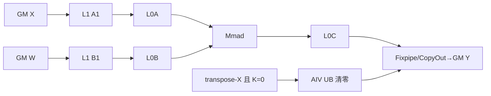
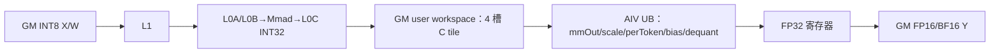
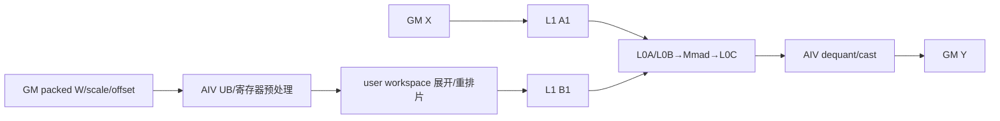

# GroupedMatmul A2/A3 ACLNN 算子知识

## 算子速览

| 项目 | 内容 |
|---|---|
| 实际入口 | `aclnnGroupedMatmulV5GetWorkspaceSize` / `aclnnGroupedMatmulV5`，公开 ACLNN V5 |
| 计算语义 | 对专家组逐组计算 `Y_i=X_i×W_i+bias_i`，并按量化模式执行 scale、per-token scale、反量化或激活 |
| 输入输出 | `aclTensorList` 形式的 X/W/Y，ND 或受支持的 NZ 权重；groupList 描述 M/K 分组 |
| 执行类型 | AIC_CUBE、MIX_CV |
| Kernel 路线 | R-001 基础 Cube 与 transpose-X 空域辅助；R-002 A8W8 O16 MIX/固定轴特化；R-003 低比特量化/伪量化 CV 子实现族 |
| 核心资源 | GM、system/user workspace、L1、L0A/L0B/L0C、UB、寄存器 |
| 来源闭包 | source_closed：V5 声明、参数检查、L0 launcher、Tiling/POD、模板 entry/body、`gmm/common` 命中的共享实现与构建接线均在固定仓闭合 |
| 验证状态 | 已完成源码闭包检查；本次知识提取未执行编译、真机、数值或性能测试。 |

## 接口与语义

### 计算语义

令组数为 `g`。M 分组时各组共享 K/N、M 可变；K 分组时 M/N 相同、K 可变。非量化为 `Y_i=X_iW_i+bias_i`。A8W8 路线先以 int32 在 Cube 累加，再乘 `scale_i`，per-token 模式再乘 `perTokenScale[m]`，随后按输出 dtype cast；伪量化路线先按 per-channel/per-group scale（以及可选 offset）恢复权重，再做矩阵乘。`actType` 的应用由 `GMMQuantMixCoreCompute::ActivationCompute` 控制，顺序位于反量化之后、输出 cast 之前。

### 输入、输出与属性

| 参数 | shape/layout | dtype | 约束、默认值与语义 |
|---|---|---|---|
| x | 单/多 Tensor，逻辑 `[...,M,K]`，ND | FP16/BF16/FP32、INT8/INT4（按模式） | V5 检查维数、转置 stride、TensorList 数量及量化组合 |
| weight | 单/多 Tensor，`[...,K,N]` 或转置视图；ND/NZ | 与路线匹配的浮点、INT8、INT4 | 各组 N 与转置状态满足当前 groupType；NZ 由格式检查约束 |
| biasOptional | N 或 `[g,N]` | 与模式匹配 | 可空；Cube bias 或 Vector 后处理读取 |
| scaleOptional / offsetOptional | per-tensor/per-channel/per-group | scale 为 UINT64/BF16/FP32，offset 为 FP32 | 只在全量化路线有效；INT64 scale 元数据在 ACLNN 层改标 UINT64，非法组合直接失败 |
| antiquantScaleOptional / antiquantOffsetOptional | `[g,N]` 或 `[g,G,N]` | FP16/BF16 | 伪量化权重恢复参数；offset 可空，per-group 的 G 必须整除 K |
| perTokenScaleOptional | 与总 M 或量化 block 对应 | FP32 | A2/A3 不支持 FLOAT8_E8M0；动态 A8W8/A4W4 在 scale 之后逐行相乘 |
| groupListOptional | `[g]` 或 sparse `[g,2]` | INT64 | `groupListType` 选择累计值、count 或 sparse-M 解释 |
| activationInputOptional / activationQuantScaleOptional / activationQuantOffsetOptional | TensorList | 固定仓当前只允许空 | 预留参数，不进入当前 L0/Device ABI |
| splitItem/groupType | 标量 | INT64 | `groupType=-1/0/2` 对应不分组/M/K 分组；组合由 V5 校验 |
| tuningConfigOptional | 一维数组 | INT64 | V5 新增；前三项分别影响期望 token、A8W4 预处理选择和可用附加 workspace 上限 |
| out | 与 X 前缀及 N 对应 | 路线目标 dtype | executor 中由 L0 `GroupedMatmul` 原位绑定最终输出 |

### 入口与版本

固定仓同时保留 V1–V5，旧版 workspace 接口均提示迁移到 V5；本卡采用目标平台实际公开的最新 `aclnnGroupedMatmulV5`。第一段构造 `GroupedMatmulParams`，执行完整校验、连续化及必要的 weight-NZ 处理，然后调用 `GetGMMResultByL0Api`；第二段统一由 `CommonOpExecutorRun` 在调用方 stream 上提交 executor。

## Host/Launcher 执行流程

### 参数校验与前处理

`aclnnGroupedMatmulV5GetWorkspaceSize` 进入 common 路径，按 groupType 检查 TensorList 组合、M/K/N、dtype/format、groupList、scale/offset、激活和 tuningConfig。`ParamsDataContiguous` 将各动态输入绑定为连续 TensorList；需要时 `TransWeightToNz` 生成转换节点。空 tensor 由 `CheckZeroShape`/`ResetEmptyTensor` 保持合法空输出，不进入未定义 Device 访问。

### 参数、Workspace 与生命周期

`l0op::GroupedMatmul` 先 `INFER_SHAPE`，再以同一组输入、输出和属性调用 `ADD_TO_LAUNCHER_LIST_AICORE`。executor 拥有连续化临时量、launcher 列表和 workspace 需求；Device entry 通过 `GetUserWorkspace(workspace)` 越过系统 workspace。Tiling 的 `DivideUbAndSetWorkspace` 按量化模式放置 per-token 中间区、低比特预处理区或 system workspace；这些区保持到 stream 完成。

### 启动图与失败传播

成功图为一个 `GroupedMatmul` AICore 节点；Tiling 设置 `blockDim`、必要时 `scheduleMode=1`，序列化 `GMMTilingData`，运行模板化 `grouped_matmul` entry。ACLNN 校验、连续化、InferShape、launcher 追加、tiling 或 launch 任一步失败均返回非成功状态，后继不提交。

## Route 与参数设计

### 分核与资源计算

Host 先从输入得到逐组 M/K/N 与最大值，再由平台 L0A/L0B/L0C/L1/UB 容量求 `baseM/baseN/baseK`、`stepM/N/Ka/Kb`、`depthA1/B1` 与 `dbL0C`。`CalUsedCoreNum` 按所有组的 `ceil(M/baseM)×ceil(N/singleN)` tile 数限制 AIC 核数；尾组/尾 tile 由 Device 重新计算 `curSingleM/N`。量化 Vector 路线另由 `ubBaseK/ubBaseN/ubCalSize/ubRestBytes` 约束 UB，并将 user workspace 按 AIC 核或全局矩阵切片。

### Route 选择

| 顺序 | Route | Key/模板 | 精确选择条件与优先级 | 不适用去向 |
|---:|---|---|---|---|
| 1 | R-001 基础 Cube 与 transpose-X 空域辅助 | `CUBE_ONLY` 或 transpose-X ratio 1；dynamic/static | X/W/Y 同 dtype FP16/BF16/FP32，或 A8W8 输出 INT8/INT32；非转置 X 为 AIC-only，transpose-X 仅额外在 AIV 执行 `EmptyTensorCompute` 处理 K=0 输出；sparse-M 改用 `GMMGroupMSparseProcess` | A8W8 O16 到 R-002；低比特到 R-003 |
| 2 | R-002 A8W8 O16 MIX/特化 | `GMMQuantMixCoreCompute` ratio 1:1/1:2；static；`isEnableFixedAxis=1` | X/W=INT8 且 Y=FP16/BF16；普通/静态 key 走四槽 workspace MIX，满足固定 K/N、group=8、tuning、NZ、无 bias、FP16 输出等完整谓词时优先走 `grouped_matmul_fixaxismove` | 低比特到 R-003；checker 或编译 key 不匹配即失败 |
| 3 | R-003 低比特量化/伪量化 CV | A4W4；A8W4 per-channel/per-group/MSD/autotiling；A16W8 normal/performance/MSD；A16W4 MSD | `GMMSetTplTilingKey` 依 dtype、quant/antiquant 参数、transposeW、groupListType、MSD、NZ、ratio 与优化谓词选择；每个 selector 只进入其编译宏 body | 无已编译 specialization 时 tiling/API 失败 |

```text
V5 校验成功
  -> 同 dtype浮点，或A8W8直接输出INT8/INT32 ? R-001（transpose-X附带AIV空域辅助）
  -> A8W8且输出FP16/BF16 ? fixed-axis完整谓词命中则专用body，否则普通/静态R-002
  -> A4W4/A8W4/A16W8/A16W4 selector有编译body ? R-003对应子实现
  -> 返回不支持/参数错误
```

### 模板/实现执行矩阵

| Route | key/selector | dtype/shape/platform 完整命中条件 | 执行族与 kernel 节点 | 实际模板/body | 内存与同步特征 | tail/fallback |
|---|---|---|---|---|---|---|
| R-001 基础 Cube | `GMM_FLOAT` / `GMM_QUANT_INT8` / `GMM_QUANT_INT32` | A2/A3；非低比特量化；浮点同 dtype 或 A8W8 直接输出 INT8/INT32；transpose-X 仅增加空 K 辅助 | AIC Cube；transpose-X 空 K 时同 launch 有 AIV `EmptyTensorCompute` | `GMMProcess` / `GMMGroupMSparseProcess` + `GMMCompute` | GM→L1→L0A/B→L0C→GM；辅助 AIV 与 Cube 输出域互斥 | `curSingleM/N` 裁剪；无 key 则 tiling 失败 |
| R-002 A8W8 O16 | `GMM_CV_SPLIT_IMP` / static / `IS_ENABLE_FIXED_AXIS` | X/W=INT8，Y=FP16/BF16；fixed-axis 还要求固定 K/N、8 组、tuning 范围、NZ W、无 bias 和无激活 | 普通路线为单 Kernel MIX_CV；fixed-axis 为专用 MIX body | `GMMQuantMixCoreCompute` 或 `Catlass::grouped_matmul_fixaxismove` | 普通路线以 4 槽 GM workspace 交接 INT32 C tile；cross-core flag 防覆盖 | M/N 有效域写回；fixed-axis 谓词不满足回到普通 MIX |
| R-003 低比特 CV | A4W4/A8W4/A16W8/A16W4 的 MSD、per-group、NZ、autotiling key | API 量化参数合法，且 dtype、transposeW、groupListType、quantGroupSize、MSD/NZ 谓词与编译 specialization 同时命中 | MIX_CV；部分 key 为 AIV 预处理→AIC Cube→AIV epilogue | `GMMA4W4Compute`、`GMMA8W4*`、`GMMAntiquant*`、`GMMWeightQuantA16W4MsdController` | packed W / user workspace / L1/L0/UB；`SyncAll` 或 controller flag | 量化组和 M/N/K tail 分别保护；无 specialization 则失败 |

### 隐藏性能 Guard

| Guard | Host/Tiling 条件 | Device/资源原因 | 影响 Route | 不满足时去向 | 源码符号 |
|---|---|---|---|---|---|
| fixed-axis 形状与布局 | `(maxK,maxN)` 为两组固定对之一，`groupNum==8`，tuning 在固定范围，`splitItem∈{2,3}`，X 不转置，W 不转置且 NZ，M 分组且 `groupListType=0`（cumsum），无 bias/activation，workspace 不超过用户上限 | 专用 layout-transform 与固定轴调度只为该形状实例化 | R-002 | 普通 A8W8 MIX | `GMMTiling::IsFixedAxisMoveCondition` |
| A4W4 优化 | K/N/group/tuning 各在宏定义范围，per-group 且 `quantGroupSize` 固定，Y=BF16，scale=UINT64，W=NZ，ratio=1:2 | 该 body 只适配 1:2 CV 比和固定量化组容量 | R-003 | 其他 A4W4 key 或失败 | `GMMTiling::IsA4W4OptimizeCondition` |
| UB 和 workspace 容量 | `ubBaseK/ubBaseN/ubCalSize/ubRestBytes` 不超过平台 UB；各 user-workspace slice 累加后不溢出 | MIX 双缓冲和低比特预处理需要物理容量，逻辑 tensor 长度不能替代分配字节 | R-002/R-003 | 重算 tile/ratio；仍不可行则 tiling 失败 | `GMMSetUbDivideBlk*` / `DivideUbAndSetWorkspace` |
| 编译 key 闭包 | Host 产生的 dtype/transpose/groupList/static/MSD/NZ 组合必须有 `grouped_matmul.cpp` 的 constexpr/宏分支 | entry 不含通用 runtime fallback | 全部 | 返回不支持/失败 | `GMMSetTplTilingKey` / `grouped_matmul` |

### POD/ABI

`GMMTilingData` 使用生成式 tiling-data ABI，外层顺序固定为 `GMMBaseParams`、`GMMArray`、`TCubeTiling`、`A8W4HPTiling`。固定仓给出字段顺序与固定宽度，但生成头中的完整外层 `sizeof/offsetof` 固定仓不可见。

| 结构 | 字段 | 类型/位宽 | ABI 布局 | 单位 | Host/launcher producer | Device consumer | 边界 |
|---|---|---|---|---|---|---|---|
| GMMBaseParams | groupNum | uint32/32 | `offsetof=0, sizeof=4, alignof=4` | 组 | `PrepareTilingData:set_groupNum` | `GMMProcess::Init` | 最大 TensorList 数由接口检查 |
| GMMBaseParams | coreNum | uint32/32 | `offsetof=4, sizeof=4, alignof=4` | AIC 核 | `CalUsedCoreNum:set_coreNum` | `GMMProcess::Process` 核循环步长 | 非零且不超过平台 AIC 数 |
| GMMBaseParams | activeType | uint32/32 | `offsetof=8, sizeof=4, alignof=4` | 枚举 | `GMMGetAttrs`/tiling route | `ActivationCompute` | 仅支持接口声明值 |
| GMMBaseParams | ubBaseK | uint32/32 | `offsetof=12, sizeof=4, alignof=4` | 元素 | `GMMSetUbDivideBlk*` | Vector 搬运循环 | 受 UB 容量约束 |
| GMMBaseParams | ubBaseN | uint32/32 | `offsetof=16, sizeof=4, alignof=4` | 元素 | `GMMSetUbDivideBlk*` | `VectorTilingCalc` | N 尾块裁剪 |
| GMMBaseParams | ubCalSize | uint32/32 | `offsetof=20, sizeof=4, alignof=4` | 字节/实现区容量 | `GMMCalUbSize` | Vector queue 初始化 | 不得超过可用 UB |
| GMMBaseParams | groupType | int32/32 | `offsetof=40, sizeof=4, alignof=4` | 枚举 | `GMMGetAttrs` | `GMMProcess::SetMKN` | -1/0/2 |
| GMMBaseParams | quantParam | uint32/32 | `offsetof=48, sizeof=4, alignof=4` | 模式/组长 | `PrepareTilingData` | `GMMQuantMixCoreCompute::Init` | quant 为 per-token 标志；antiquant 为 group size |
| GMMBaseParams | workspaceSize | uint64/64 | `offsetof=64, sizeof=8, alignof=8` | 字节 | `DivideUbAndSetWorkspace` | 低比特预处理/body | 加法与乘法溢出前由 Host 约束 |
| GMMBaseParams | k | uint64/64 | `offsetof=80, sizeof=8, alignof=8` | 元素 | `PrepareTilingData/A16W4MsdTiling` | MSD 地址公式 | K 必须满足 specialization 对齐 |
| GMMBaseParams | n | uint64/64 | `offsetof=88, sizeof=8, alignof=8` | 元素 | 同上 | MSD 输出/scale offset | N 尾块由有效长度保护 |
| GMMBaseParams | isA8W4MSDPreNZ | uint64/64 | `offsetof=152, sizeof=8, alignof=8; sizeof(GMMBaseParams)=160` | 布尔 | A8W4 tiling | entry 选择 ND/NZ 预处理 | 仅 0/1 |
| GMMArray | mList | int32[128] | `offsetof=0, sizeof=512, alignof=4` | 元素 | shape 枚举 | `GMMProcess::SetMKN` | 未用槽保持 0 |
| GMMArray | kList | int32[128] | `offsetof=512, sizeof=512, alignof=4` | 元素 | shape 枚举 | `GMMProcess::SetMKN` | 单组/多组索引一致 |
| GMMArray | nList | int32[128] | `offsetof=1024, sizeof=512, alignof=4; sizeof=1536` | 元素 | shape 枚举 | `GMMProcess::SetMKN` | 最大 128 组的该 ABI 路线 |
| TCubeTiling | baseM | uint32/32 | `sizeof/alignof/offsetof` 固定仓不可见（外部公共结构） | 元素 | `GMMSetMMTiling` | Matmul 与 `GMMProcess::SetMNConfig` | 16 对齐 |

### Route 源码闭包

| Route | Key/selector | Host/Tiling producer | POD/参数 | Kernel entry/router | Kernel body/直接依赖 | 构建接线 |
|---|---|---|---|---|---|---|
| R-001 基础 Cube 与 transpose-X 空域辅助 | float/int direct，transA/transB、sparse、static | `grouped_matmul_tiling.cpp::GMMSetTplTilingKey/StaticTilingProcess` | `GMMTilingData` | `grouped_matmul.cpp::grouped_matmul` | `grouped_matmul.h::GMMProcess/GMMGroupMSparseProcess/GMMCompute`；transpose-X 的 `EmptyTensorCompute` | `op_host/CMakeLists.txt::add_ops_compile_options` |
| R-002 A8W8 O16 MIX/特化 | ratio 1/2、static、fixed-axis | `grouped_matmul_tiling.cpp::GMMSetTplTilingKey/IsFixedAxisMoveCondition` | `GMMBaseParams+TCubeTiling` | `grouped_matmul.cpp::grouped_matmul` | 普通 `grouped_matmul_quant_mixcore.h::GMMQuantMixCoreCompute`；特化 `grouped_matmul_fixaxismove_interface.cpp::grouped_matmul_fixaxismove` | `op_host/CMakeLists.txt::GroupedMatmul` |
| R-003 低比特量化/伪量化 CV | A4W4、A8W4 per-channel/per-group/MSD/autotiling | `grouped_matmul_tiling.cpp::A8W4Tiling/GMMSetTplTilingKey` | `GMMTilingData+A8W4HPTiling` | `grouped_matmul.cpp::grouped_matmul` | `GMMA4W4Compute`、`GMMA8W4Compute`、`GMMA8W4MSDCompute/New`、`GMMA4W8AutotilingCompute` | `op_host/CMakeLists.txt::GroupedMatmul` |
| R-003 低比特量化/伪量化 CV | A16W8 normal/performance/MSD、A16W4 MSD | `grouped_matmul_tiling.cpp::GMMSetTplTilingKey/A16W4MsdTiling` | `GMMBaseParams+TCubeTiling` | `grouped_matmul.cpp::grouped_matmul` | `grouped_matmul_antiquant.h::GMMAntiquantComputeNorm/Performance`、`grouped_matmul_antiquant_a16w8_msd.h::GMMA16W8MSDCompute`、`GMMWeightQuantA16W4MsdController::Process` | `op_host/CMakeLists.txt::GroupedMatmul` |

## Kernel 实现

### 公共执行流程

模板 entry 创建 `TPipe`、设置 overflow 行为并取得 user workspace。Host key 的 dtype、transpose、groupListType、静态 tiling、低比特 template、AIC:AIV 比例共同唯一实例化 body。`GMMProcess` 将 block 映射到 `(group,mTile,nTile)`，每个 tile 由当前 Matmul specialization 完成；MIX 路线在同一 launch 内用 AIC/AIV 分支和跨核 flag 交接。

### Route R-001：基础 Cube 与 transpose-X 空域辅助

#### 适用条件

##### 选择证据

| 层级 | 文件 | 符号 | 源码谓词/参数 | 结果/下一跳 |
|---|---|---|---|---|
| API | gmm/grouped_matmul/op_api/aclnn_grouped_matmul.cpp | CheckCommonParam/CheckParam | V5 的 dtype、transpose、groupType/groupListType 与输出组合通过；A2/A3 禁止 FP8/HIF8/FLOAT8_E8M0 | 进入 L0；否则参数错误 |
| Host/Tiling | gmm/grouped_matmul/op_host/op_tiling/grouped_matmul_tiling.cpp | GMMTiling::GMMSetTplTilingKey | 非转置 X、同 dtype FP16/BF16/FP32，或 A8W8 输出 INT8/INT32时设置 `CUBE_ONLY`；transpose-X 保持 ratio 1 | 生成 float/int direct key |
| Router | gmm/grouped_matmul/op_kernel/grouped_matmul.cpp | grouped_matmul | `GMM_FLOAT` 或 `GMM_QUANT_INT8/INT32`；sparse-M 改 process；transpose-X 在 AIV 调 `EmptyTensorCompute`、AIC 调 Cube body | `GMM_CUBE_IMP`/静态实例，或 transpose-X 辅助拓扑 |

#### Device 数据流

##### 函数级调用链

```text
grouped_matmul(args, tiling)
  -> GMM_CUBE_IMP
    -> GMMProcess::Init/Process
      -> GMMCompute::MMCompute
        -> Matmul::IterateAll/WaitIterateAll -> GM Y
```

##### 源码等价伪码

```text
伪码：coreIdx = GetBlockIdx()/GetTaskRation()
for groupIdx in [0, groupNum):
  split = groupList ? decode(groupList[groupIdx], groupListType) : mList[groupIdx]
  M,K,N = SetMKN(split, groupIdx); dimM=ceil(M/baseM); dimN=ceil(N/baseN)
  if transposeX && ASCEND_IS_AIV && K==0: EmptyTensorCompute按core切M并写零/合法空输出域
  for curBlock = mapped(coreIdx,count); curBlock < count+dimM*dimN; curBlock += coreNum:
    mIdx,nIdx = MNBlockIdxCompute(curBlock)
    xOffset = transposeX ? xBase+mIdx*baseM : xBase+mIdx*baseM*K
    wOffset=wBase+(transW ? nIdx*baseN*K : nIdx*baseN)
    yOffset=yBase+mIdx*baseM*N+nIdx*baseN
    Matmul(GM X[xOffset] -> L1 -> L0A, GM W[wOffset] -> L1 -> L0B,
           Mmad accumulate L0C); CopyOut valid curM×curN -> GM Y[yOffset]
```

#### 内存与数据搬运

##### 资源与搬运表

| 层级/缓冲区 | offset/地址公式 | extent/容量公式 | dtype/layout | producer | consumer | owner/lifetime | 对齐/复用 |
|---|---|---|---|---|---|---|---|
| GM X/W/Y | `xBase+mIdx*baseM*K`; `wBase+tailN` 或 `+tailN*K`; `yBase+mIdx*baseM*N+tailN` | X `curM*K`，W `K*curN`，Y `curM*curN` | 路线 dtype，ND/NZ | 调用方 | Matmul/CopyOut | 调用方，stream 完成前 | M/N/K tile 按 Cube 16/32 对齐，tail 用有效长 |
| L1 | Matmul 内部 A1/B1 ping-pong offset | `depthA1*baseM*baseK*sizeof(A)`；`depthB1*baseN*baseK*sizeof(B)` | A1/B1 | GM copy | L0A/L0B loader | 单核 Matmul 生命周期 | depth/step 由 Host tiling |
| L0A/L0B | 当前 K tile | `baseM*baseK*sizeof(A)` / `baseN*baseK*sizeof(B)` | fractal Cube | L1 LoadData | Mmad | 单次 K 循环 | 双缓冲由 TCubeTiling |
| L0C | tile 0 offset | `baseM*baseN*sizeof(acc)` | FP32/INT32 | Mmad | Fixpipe/CopyOut | 当前输出 tile | `dbL0C` 控制复用 |
| UB/寄存器 | 非转置/Cube-only 为 N/A；transpose-X 的 AIV `EmptyTensorCompute` 仅为 K=0 输出清零使用局部块 | 清零块容量由 helper 的 UB 分核决定，正常 K>0 Matmul 不经 UB epilogue | Y dtype/ND | AIV Duplicate/搬运 | GM Y 空域 | 单次空域 helper | 与 Cube 正常输出域互斥 |

##### 分层内存布局



##### 字节账、交接边与复用顺序

```text
workspace_total = SYS_WORKSPACE_SIZE；user-workspace suffix = 0（基础 Cube 正常 tile 无 user-workspace 交接）
L1_total = depthA1*baseM*baseK*sizeof(A) + depthB1*baseN*baseK*sizeof(B)
L0_total = baseM*baseK*sizeof(A) + baseN*baseK*sizeof(B) + dbL0C*baseM*baseN*sizeof(acc)
UB_total = N/A；仅 transpose-X 空 K helper 按其分核块临时使用 UB
```

| 边/复用子区 | producer | offset/extent | dtype/layout | consumer | ordering/sync | owner/lifetime | 安全条件 |
|---|---|---|---|---|---|---|---|
| A1/B1 ping-pong | GM copy | 当前 K tile；容量如上 | A/B Cube layout | L0 loader/Mmad | Matmul 内部 event | 单核 Matmul | `depthA1/depthB1` 与 `stepK*` 一致 |
| L0C 复用 | Mmad | `baseM*baseN*sizeof(acc)` × `dbL0C` | FP32/INT32 | Fixpipe/CopyOut | `WaitIterateAll` | 当前输出 tile | 写回完成后才复用 |
| 空 K 输出 | AIV helper | 仅 K=0 对应的 Y 行 | Y dtype/ND | GM Y | 同 launch 任务分工 | 调用方至 stream 完成 | 与 AIC 正常 tile 输出域互斥 |

#### 同步、精度与尾块

##### 同步与数值边界表

| 阶段 | primitive/机制 | producer | consumer/等待点 | 保护对象 | 精度/尾块 |
|---|---|---|---|---|---|
| Cube 流水 | Matmul 内部 event/queue | GM→L1/L0 copy | Mmad/CopyOut | A/B/C tile | FP16/BF16 通常 FP32 累加，INT8 为 INT32；curM/curN 保护尾块 |
| 输出提交 | `WaitIterateAll` | Mmad | Fixpipe/GM writer | L0C tile | 仅写有效 `curM×curN`，空组跳过 |
| transpose-X 空域 | 同一 launch 的 AIC/AIV 任务划分；无跨侧共享数据 | AIV `EmptyTensorCompute` | GM Y 空域写入 | K=0 对应行 | 仅处理空 K，AIC 正常 tile 与其输出域互斥 |

#### 关键实现

##### 符号证据表

| 阶段 | 文件 | 符号/模板实例 | 实现事实 |
|---|---|---|---|
| Host/Tiling producer | gmm/grouped_matmul/op_host/op_tiling/grouped_matmul_tiling.cpp | GMMTiling::GMMSetMMTiling/GMMSetTplTilingKey | 生产 Cube tile、core 数与 key |
| Kernel entry/router | gmm/grouped_matmul/op_kernel/grouped_matmul.cpp | grouped_matmul / GMM_CUBE_IMP | dtype/key 映射到 Cube body |
| Device body/helper | gmm/grouped_matmul/op_kernel/grouped_matmul.h | GMMProcess::Process/SetMNConfig | 逐组、逐 tile 地址与 tail 调度 |

### Route R-002：A8W8 O16 MIX/固定轴特化

#### 适用条件

##### 选择证据

| 层级 | 文件 | 符号 | 源码谓词/参数 | 结果/下一跳 |
|---|---|---|---|---|
| API | gmm/grouped_matmul/op_api/aclnn_grouped_matmul.cpp | CheckQuantParams/CheckCommonParam | X/W=INT8、Y=FP16/BF16，scale、perToken、bias、actType 的 shape/dtype 组合合法 | 进入量化 Tiling；否则参数错误 |
| Host/Tiling | gmm/grouped_matmul/op_host/op_tiling/grouped_matmul_tiling.cpp | GMMTiling::GMMSetTplTilingKey | `isA8W8_`，输出 FP16/BF16；fixed-axis 或 ratio 1:1/1:2 | MIX key |
| Router | gmm/grouped_matmul/op_kernel/grouped_matmul.cpp | grouped_matmul | `D_T_A/B=INT8`、Y FP16/BF16、template none；`IS_ENABLE_FIXED_AXIS` 单独分支 | `GMMQuantMixCoreCompute`、静态实例或 `Catlass::grouped_matmul_fixaxismove` |

#### Device 数据流

##### 函数级调用链

```text
grouped_matmul(args, tiling)
  -> IS_ENABLE_FIXED_AXIS ? Catlass::grouped_matmul_fixaxismove
  -> else GMM_CV_SPLIT_IMP/static
       -> GMMProcess::Process
         -> GMMQuantMixCoreCompute::MMCompute
         -> GMMQuantMixCoreCompute::VectorCompute/Dequant/ActivationCompute/DataCopyOut
```

##### 源码等价伪码

```text
伪码：若fixed-axis key命中，销毁TPipe、开启MMLayoutTransform，按固定M/K/N/group调用专用body后恢复布局；否则：
for 每个映射到本核的 group/tile:
  outOffset = yBase + mIdx*singleM*N + nIdx*singleN
  if ASCEND_IS_AIC: GM int8 A/B -> L1 -> L0A/L0B; Mmad -> L0C int32 -> workspace[workSpaceOffset]
  CrossCoreSetFlag(SYNC_AIC_AIV_FLAG)
  if ASCEND_IS_AIV:
    CrossCoreWaitFlag(SYNC_AIC_AIV_FLAG); for vecM/vecN tile:
      GM/workspace int32 -> UB; load scale[n]、可选 bias[n]、perTokenScale[m]
      fp32 = int32*scale*(perTokenScale if enabled)+bias; if activeType then ActivationCompute(fp32)
      cast fp32 -> FP16/BF16; DataCopyPad valid tail -> GM Y[outOffset]
  PostCompute 等待未回收流水 flag，防止 workspace 被提前覆盖
```

#### 内存与数据搬运

##### 资源与搬运表

| 层级/缓冲区 | offset/地址公式 | extent/容量公式 | dtype/layout | producer | consumer | owner/lifetime | 对齐/复用 |
|---|---|---|---|---|---|---|---|
| GM/workspace 交接 | sequential-write 时元素偏移 `baseM*baseN*(coreIdx+(cubeNum%4)*coreNum)` | 每核每槽 `baseM*baseN*4` B，共 `4*baseM*baseN*usedCoreNum*4` B | INT32 ND | AIC Mmad/Fixpipe | AIV `Dequant` | executor user workspace，单 launch lifetime | 槽回收受 flag 3/5 保护；非 sequential-write 分支按输出逻辑 offset 放置 |
| L1/L0A/L0B/L0C | 当前 M/N/K tile offset | A/B `baseM/baseN*baseK`；C `baseM*baseN*4` | INT8/INT32 | GM copy/Mmad | Mmad/Fixpipe | AIC tile | Cube 对齐，K tail 由 Matmul |
| UB queues | scale/bias/perToken/mmOut 独立 queue | scale `2*baseN*sizeof(scale)`；perToken `2*baseM*4`；vecIn `2*ubCalSize*sizeof(INT32)`；vecOut `2*ubCalSize*sizeof(Y)`；其余为 `ubRestBytes` TBuf | FP32/BF16/INT32 | GM/workspace copy | Vector dequant/activation | AIV tile | `InitBuffer(...,2,...)` 真双缓冲；TBuf 按 isPerToken/activeType 条件复用 |
| 寄存器 | Vector API 内部 | 当前 mask/repeat | FP32 | UB load | mul/add/cast | 单次 repeat | 尾块 mask |

##### 分层内存布局



##### 字节账、交接边与复用顺序

```text
workspace_total = SYS_WORKSPACE_SIZE + 4 * baseM * baseN * usedCoreNum * sizeof(int32), PIPELINE_NUM=4
L0_total = baseM*baseK*sizeof(int8) + baseN*baseK*sizeof(int8) + dbL0C*baseM*baseN*sizeof(int32)
UB_total = 2*baseN*sizeof(scale) + 2*baseM*sizeof(float) [per-token] + 2*ubCalSize*sizeof(int32)
         + 2*ubCalSize*sizeof(Y) + conditional(bias/activation scratch from ubRestBytes)
```

| 边/复用子区 | producer | offset/extent | dtype/layout | consumer | ordering/sync | owner/lifetime | 安全条件 |
|---|---|---|---|---|---|---|---|
| C tile 槽 | AIC `MMCompute`/Fixpipe | 元素偏移 `baseM*baseN*(coreIdx+(cubeNum%4)*coreNum)`；每槽 `baseM*baseN*4` B | INT32/ND | AIV `Dequant` | AIC 以 `PIPE_FIX` set flag 5、AIV wait flag 5；AIV 以 `PIPE_MTE2` set flag 3、AIC wait flag 3 | executor user workspace/单 launch | `cubeNum>=4` 才回收同核同槽；`PostCompute` 再消费最多四个末轮 flag 3 |
| UB ping-pong | MTE2 | `slot × ubCalSize` | INT32/FP32/Y | Vector/MTE3 | TQue event | AIV tile | `InitBuffer(...,2,...)` 与循环索引同步 |
| fixed-axis 专用 workspace | 专用 body | `FixedAxisMoveWorkspace_`，不超过 `tuningConfigWorkspace_` 或上限=-1 | 实例定义 layout | 专用 body | 专用 launch 内部顺序 | executor | `IsFixedAxisMoveCondition` 全谓词同时成立 |

#### 同步、精度与尾块

##### 同步与数值边界表

| 阶段 | primitive/机制 | producer | consumer/等待点 | 保护对象 | 精度/尾块 |
|---|---|---|---|---|---|
| AIC→AIV | `CrossCoreSetFlag<SYNC_MODE2, PIPE_FIX>(5)` / `CrossCoreWaitFlag(5)` | `MMCompute` | `Dequant` | INT32 workspace tile | AIC INT32 累加；AIV FP32 dequant |
| AIV→AIC 槽回收 | `CrossCoreSetFlag<SYNC_MODE2, PIPE_MTE2>(3)` / `CrossCoreWaitFlag(3)` | `VectorCompute` | 下一轮 `MMCompute` / `PostCompute` | 四槽 workspace | 防止同一 `coreIdx,slot` 在消费完成前被覆盖 |
| UB 搬运 | TQue EnQue/DeQue 与 pipe event | MTE2 | Vector/MTE3 | UB queue slot | baseN 对齐，curM/curN mask |
| 输出 | cast + `DataCopyPad2D` | Vector | GM Y | 有效输出 | dequant scale→可选 perToken→BF16 bias epilogue→activation；BF16 `CAST_RINT`、FP16 `CAST_NONE`，尾块只提交有效元素 |

#### 关键实现

##### 符号证据表

| 阶段 | 文件 | 符号/模板实例 | 实现事实 |
|---|---|---|---|
| Host/Tiling producer | gmm/grouped_matmul/op_host/op_tiling/grouped_matmul_tiling.cpp | GMMTiling::GMMSetTplTilingKey/GMMSetUbDivideBlkQuant | 产生 MIX ratio、UB 和 key |
| Kernel entry/router | gmm/grouped_matmul/op_kernel/grouped_matmul.cpp | grouped_matmul / GMM_CV_SPLIT_IMP | 构造 Matmul 与 MIX compute |
| Device body/helper | gmm/grouped_matmul/op_kernel/grouped_matmul_quant_mixcore.h | GMMQuantMixCoreCompute::MMCompute/Dequant/DataCopyOut | 交接、反量化、激活与尾写 |
| Device body/helper | gmm/grouped_matmul/op_kernel/grouped_matmul_fixaxismove_interface.cpp | Catlass::grouped_matmul_fixaxismove | 固定轴谓词命中时绕过普通 MIX body，使用专用 workspace/layout-transform 实现 |

### Route R-003：低比特量化/伪量化 CV 子实现族

#### 适用条件

##### 选择证据

| 层级 | 文件 | 符号 | 源码谓词/参数 | 结果/下一跳 |
|---|---|---|---|---|
| API | gmm/grouped_matmul/op_api/aclnn_grouped_matmul.cpp | CheckParam/CheckCommonParam | A4W4、A8W4、A16W8/A16W4 的 scale/antiquant/perToken/bias、单多 Tensor 与 group 组合合法 | 进入低比特 Tiling；否则参数错误 |
| Host/Tiling | gmm/grouped_matmul/op_host/op_tiling/grouped_matmul_tiling.cpp | GMMTiling::A8W4Tiling/A16W4MsdTiling | dtype、per-group、MSD、transpose、NZ 与资源谓词 | A8W4/A4W4/A16W8 template key |
| Router | gmm/grouped_matmul/op_kernel/grouped_matmul.cpp | grouped_matmul | `GMM_A4W4`、`GMM_ANTI_QUANT_A8W4_MSD`、`GMM_ANTI_QUANT` 编译宏与 template selector 同时匹配 | 对应 `GMMA4W4*`、`GMMA8W4*`、`GMMAntiquant*`、MSD/controller；否则无 body |

#### Device 数据流

##### 函数级调用链

```text
grouped_matmul(args, tiling)
  -> A4W4: GMM_A4W4_IMP -> GMMA4W4Compute::Process
  -> A8W4: GMMA8W4PreProcess/PreProcessNZ/FakeQuantPreProcess::Process
              -> GMMA8W4Compute 或 GMMA8W4MSDCompute/New::Process
  -> A16W8: GMMAntiquantProcess -> GMMAntiquantComputeNorm/Performance
  -> A16W8 MSD: GMMA16W8MSDProcess::Process -> GMMA16W8MSDCompute::{PreProcess,MMCompute,PostProcess}
  -> A16W4 MSD: GMMWeightQuantA16W4MsdController(/MSparse)::Process
```

##### 源码等价伪码

```text
伪码：if AIV 预处理被 key 启用:
  for group/K/N 分片: 读取 packed INT4/scale/offset，展开或重排到 userWorkspace[preOffset]
  SyncAll 或 route flag，pipe reset 后复用 UB
for 每个 group 和 M/N tile:
  A = 原 X 或 workspace 展开 A；B = packed/recovered weight
  for qGroup/Ktile: GM -> L1 -> L0A/L0B; Mmad 累加 L0C
  if AIV epilogue: 等待 AIC；按 scale/offset/perTokenScale 恢复 FP32，处理 curM/curN tail
  cast 到目标 dtype，写 GM Y[yBase + mOffset*N + nOffset]
```

#### 内存与数据搬运

##### 资源与搬运表

| 层级/缓冲区 | offset/地址公式 | extent/容量公式 | dtype/layout | producer | consumer | owner/lifetime | 对齐/复用 |
|---|---|---|---|---|---|---|---|
| packed GM W | `group*K*N/2 + qGroup*groupSize*N + nOffset` | INT4 两元素/字节；逻辑 `K*N` | INT4 ND/NZ | 调用方 | preprocess/Matmul | 调用方 | K/N 满足低比特 specialization 对齐 |
| user workspace | `preprocessedA + AlignUp(M,8)*K` 等 route 公式 | A 展开 `2*M*K`、scale/临时 C 由 Host 累加 | INT8/FP16/FP32 | AIV preprocess/AIC | AIC/AIV consumer | executor launch | 512B cache-line 对齐的 route 明确对齐 |
| L1/L0A/L0B/L0C | 当前低比特 tile | `baseM*baseK`、`baseN*baseK`、`baseM*baseN*accSize` | specialization dtype/layout | GM/workspace | Mmad/Fixpipe | AIC tile | depth/db 按 TCubeTiling |
| UB/寄存器 | scale、offset、dequant tile | `ubBaseN/ubCalSize` 派生 | FP32 与 packed dtype | GM/workspace | Vector recover/cast | AIV tile | tail mask 与量化组边界 |

##### 分层内存布局



##### 字节账、交接边与复用顺序

```text
workspace_total = Align(route_preprocess_bytes, 512) + Align(route_C_or_scale_slices, 512)
L1_total = depthA1*baseM*baseK*sizeof(A) + depthB1*baseN*baseK*sizeof(recovered_W)
L0_total = baseM*baseK*sizeof(A) + baseN*baseK*sizeof(recovered_W) + dbL0C*baseM*baseN*sizeof(acc)
UB_total = route-specific packed-input + scale + offset + dequant/output ping-pong；上限由 `ubBaseN/ubCalSize/ubRestBytes` 生产
```

| 边/复用子区 | producer | offset/extent | dtype/layout | consumer | ordering/sync | owner/lifetime | 安全条件 |
|---|---|---|---|---|---|---|---|
| packed W→recovered W | AIV preprocess | route 的 512 B 对齐 slice；extent 由 M/K/N 和 packing 比例生产 | INT4/INT8→INT8/FP16，ND/NZ | AIC Cube | `SyncAll<false>` 或 controller flag | executor user workspace | 只有当前 key 指定的 producer/consumer 才可复用 |
| L0C→AIV epilogue | AIC Mmad/Fixpipe | `baseM*baseN*sizeof(acc)` 或路线 C slice | INT32/FP32 | AIV dequant/cast | cross-core flag/批调度 | 单 tile/launch | per-group 尾部不得跨越量化组 |
| UB scratch 复用 | Vector stage | `ubRestBytes` 内条件子区 | FP32/输出 dtype | 后续 Vector stage | pipe event | AIV tile | inactive route 不读取未初始化子区 |

#### 同步、精度与尾块

##### 同步与数值边界表

| 阶段 | primitive/机制 | producer | consumer/等待点 | 保护对象 | 精度/尾块 |
|---|---|---|---|---|---|
| 预处理→Cube | `SyncAll<false>` 或 route controller flag | AIV 低比特展开 | AIC Matmul | user workspace 分片 | packed INT4 恢复精度由 scale/offset 顺序限定 |
| Cube→Vector | cross-core flag/批调度 | AIC L0C/Fixpipe | AIV 后处理 | C workspace | INT32/FP32 累加；per-group tail 不跨组误读 |
| 输出 | pipe event + masked copy | Vector cast | GM Y | curM×curN | FP32 中间，目标 dtype cast；空组不提交 |

#### 关键实现

##### 符号证据表

| 阶段 | 文件 | 符号/模板实例 | 实现事实 |
|---|---|---|---|
| Host/Tiling producer | gmm/grouped_matmul/op_host/op_tiling/grouped_matmul_tiling.cpp | A8W4Tiling/A16W4MsdTiling | 生产低比特 selector、workspace、schedule mode |
| Kernel entry/router | gmm/grouped_matmul/op_kernel/grouped_matmul.cpp | grouped_matmul / GMM_CV_SPLIT_IMP_A8W4_MSD | 选择预处理和计算实例 |
| Device body/helper | gmm/grouped_matmul/op_kernel/grouped_matmul_antiquant_a8w4_msd_pre.h | GMMA8W4PreProcess::Init/Process | A8W4 MSD 的 A 输入预处理与 workspace 写入 |
| Device body/helper | gmm/grouped_matmul/op_kernel/grouped_matmul_antiquant_a8w4_msd_pre_nz.h | GMMA8W4PreProcessNZ::copyIn/compute/copyOut/Process | 可选 ND→NZ 预处理及 M/K tail |
| Device body/helper | gmm/grouped_matmul/op_kernel/grouped_matmul_antiquant_a8w4_pre.h | GMMA8W4FakeQuantPreProcess::Process/ScaleProcess | A8W4 fake-A8W8 的 packed W/scale 预处理 |
| Device body/helper | gmm/grouped_matmul/op_kernel/grouped_matmul_a4w4.h | GMMA4W4Compute::Process/GmmaCompute | A4W4 per-group 解量化、Cube 累加与输出 |
| Device body/helper | gmm/grouped_matmul/op_kernel/grouped_matmul_antiquant_a8w4_msd.h | GMMA8W4MSDCompute::Process | MSD API-dequant 版本 |
| Device body/helper | gmm/grouped_matmul/op_kernel/grouped_matmul_antiquant_a8w4_msd_new.h | GMMA8W4MSDComputeNew::Process | MSD Vector-dequant/partial-output 版本 |
| Device body/helper | gmm/grouped_matmul/op_kernel/grouped_matmul_autotiling_a8w4.h | GMMA4W8AutotilingCompute::Init/Process | autotiling selector 的 pattern/kernel_index/splitRecord 消费者 |
| Device body/helper | gmm/grouped_matmul/op_kernel/grouped_matmul_antiquant.h | GMMAntiquantProcess::Process/GMMAntiquantCompute::MMCompute | A16W8/A16W4 normal/performance 伪量化 |
| Device body/helper | gmm/grouped_matmul/op_kernel/grouped_matmul_antiquant_a16w8_msd.h | GMMA16W8MSDCompute::PreProcess/MMCompute/PostProcess/CopyOutFinalResult | A16W8 MSD 的 Amax/reduce、双分量 Matmul 与重构 |
| Device body/helper | gmm/grouped_matmul/op_kernel/a16w4_msd/grouped_matmul_weight_quant_a16w4_msd_controller.h | GMMWeightQuantA16W4MsdController::Process | A16W4 MSD 普通/sparse-M controller |

## 算子特定优化

### Trick T-001：fixed-axis 全谓词特化

#### 触发与源码依据

- 适用 Route：R-002
- 触发条件：固定 K/N 对、固定组数、tuning 范围、A8W8、Y=FP16、scale/per-token scale=FP32、`splitItem∈{2,3}`、X/W 不转置、M 分组且 `groupListType=0`（cumsum）、无激活、无 bias、W=NZ，且 workspace 不超过用户上限或上限为 -1。
- Golden 来源：[`gmm/grouped_matmul/op_host/op_tiling/grouped_matmul_tiling.cpp:1095-1111`](../../../../../../../cann-ops-raw/ascendc/ops-transformer/be33d95bb755cedec3108f70805c1874d1792540/gmm/grouped_matmul/op_host/op_tiling/grouped_matmul_tiling.cpp#L1095-L1111)

**官方源码（固定 Commit 连续逐字摘录）**：

```cpp
bool GMMTiling::IsFixedAxisMoveCondition() {
    bool isCorrectShape = (maxK_ == FIXAXISMOVE_K1 && maxN_ == FIXAXISMOVE_N1) ||
                          (maxK_ == FIXAXISMOVE_K2 && maxN_ == FIXAXISMOVE_N2);
    bool isGroupCorrect = (groupNum_ == FIXAXISMOVE_GROUP_NUM);
    bool isTuningInRange = (tuningConfig_ >= FIXAXISMOVE_PERM_LOWER) &&
                          (tuningConfig_ <= FIXAXISMOVE_PERM_UPPER);
    bool isDataTypeCorrect = yDtype_ == ge::DT_FLOAT16 && scaleDtype_ == ge::DT_FLOAT && perTokenScaleDtype_ == ge::DT_FLOAT;
    bool isConfigCorrect = !transposeX_ && (splitItem_ == FIXAXISMOVE_SPLIT_ITEM2 || splitItem_ == FIXAXISMOVE_SPLIT_ITEM3)
                          && (groupListType_ == FIXAXISMOVE_GROUP_LIST_TYPE)
                          && (groupType_ == FIXAXISMOVE_GROUP_TYPE) && (actType_ == 0)
                          && !transposeWeight_;
    bool isWorkspaceValid = (static_cast<int64_t>(FixedAxisMoveWorkspace_) <= tuningConfigWorkspace_) ||
                            (tuningConfigWorkspace_ == -1);
    bool isFormatValid = (wFormat_ == matmul_tiling::CubeFormat::NZ);

    return isCorrectShape && isTuningInRange && isGroupCorrect && isA8W8_ &&
           isDataTypeCorrect && isConfigCorrect && isWorkspaceValid && !hasBias_ && isFormatValid;
}
```

#### 机制与设计原因

Host 用一个并取全部布尔条件的 selector 把专用 `grouped_matmul_fixaxismove` 限制在它已实例化的轴、shape、layout 和 workspace 容量内。命中时 entry 转向专用 MMLayoutTransform/body；任一条件不成立都保留普通 A8W8 MIX 的 POD、槽和同步协议，避免将固定轴假设外推。

#### 迁移边界

- 适用：与上述 selector 完全同构的 A8W8 O16 分组矩阵乘。
- 前提：A2/A3、V5、W=NZ、无 bias/activation，且专用 workspace 容量可用。
- 失效：任一 shape/dtype/layout/attr/resource 条件改变时回到 R-002 普通 MIX；其他量化语义转 R-003。
- 未验证：本次知识提取未执行编译、真机、数值或性能测试。

#### 错误做法

把 `isA8W8_` 或单一 K/N 形状当成充分条件。固定仓的返回式同时要求 tuning、组数、dtype、attr、workspace、无 bias 和 NZ layout；忽略其中任一项都会使专用 body 读取不匹配的布局或容量。

## 模板与实现对比

| 对比维度 | R-001 基础 Cube | R-002 A8W8 O16 | R-003 低比特 CV | 设计选择依据 |
|---|---|---|---|---|
| 命中条件/优先级 | 同 dtype 浮点或 A8W8→INT8/INT32 | A8W8→FP16/BF16；fixed-axis 全谓词优先 | A4W4/A8W4/A16W8/A16W4 key | dtype/量化语义先分族，族内再按布局与资源特化 |
| 执行族/节点图 | AIC Cube；可有互斥空域 AIV | 单 Kernel MIX_CV/专用 MIX | 预处理、Cube、Vector epilogue 的 CV 子族 | 需要 Vector 反量化/激活时才引入跨族交接 |
| M/N/K、tile 与 scheduler | `baseM/N/K` + 逐组 tile | 普通 tile 或 fixed-axis 固定实例 | 加入 quant-group/MSD/NZ 分片 | Host producer 与 Device key 一一对应 |
| workspace/L1/L0/UB | 无 C-workspace，Cube 层级 | 4 槽 C-workspace + AIV 双缓冲 | 展开/重排 workspace + Cube/UB | 工作区只在需跨族物化中间结果时分配 |
| AIC/AIV 或 kernel 交接 | N/A（空域互斥） | INT32 C tile + cross-core flag | recovered W/C slice + `SyncAll`/controller flag | 每条边的 dtype/layout/lifetime 不同，不能合并 POD |
| 同步、精度与 tail | Matmul event，FP32/INT32 acc | INT32→FP32 dequant→cast，slot 回收 | scale/offset/MSD 顺序，量化组 tail | 数值语义决定 epilogue 位置 |
| fallback/失败边界 | unknown key 失败 | fixed-axis 回普通 MIX；无 MIX key 失败 | 无 specialization 失败 | entry 无通用 runtime body |

## 平台差异

| 项目 | A2 | A3 | 950 |
|---|---|---|---|
| 支持状态 | V5 支持 | V5 支持 | V5 支持，但使用 arch35 独立实现，见 `_950` 卡 |
| Host/Launcher | 共用 V5 ACLNN 与非 arch35 `GMMTiling` | 共用 | arch35 tiling template family |
| Kernel/资源 | `__CCE_AICORE__==220` 路线 | `__NPU_ARCH__==3003/3113` 复用对应模板分支 | `grouped_matmul_apt.cpp`，POD/body 不可与本卡替换 |

## 限制与失败边界

- dtype、TensorList 组合、groupType/splitItem、转置、量化参数、groupListType、激活和 tuningConfig 必须同时命中公开接口校验与已编译 specialization；不存在通用 Device fallback。
- `GMMArray` 的本路线容量为 128；更大专家数只可走固定源码中另有明确支持和独立 ABI 的实现，不能扩大数组。
- 完整 `TCubeTiling` 的 `sizeof/offsetof` 定义位于外部公共依赖，固定仓不可见；本卡只复用字段语义，不把其二进制布局写死。
- 本次知识提取未执行编译、真机、数值或性能测试；所有性能型谓词仅按源码记录，不外推收益。

## 源码索引

### 链路索引

| 链路阶段 | 文件 | 关键符号 | 支撑内容 |
|---|---|---|---|
| 公开支持/版本 | gmm/grouped_matmul/docs/aclnnGroupedMatmulV5.md | 产品支持情况/版本演进 | A2/A3 公开支持、V5 为最新入口且新增 tuningConfigOptional |
| 入口声明/约束 | gmm/grouped_matmul/op_api/aclnn_grouped_matmul_v5.h | aclnnGroupedMatmulV5GetWorkspaceSize/aclnnGroupedMatmulV5 | V5 ABI 与参数顺序 |
| 入口实现 | gmm/grouped_matmul/op_api/aclnn_grouped_matmul.cpp | aclnnGroupedMatmulGetWorkspaceSizeCommon/GetGMMResultByL0Api | 校验、连续化、executor 与 L0 调用 |
| Host/Launcher | gmm/grouped_matmul/op_api/grouped_matmul.cpp | l0op::GroupedMatmul | InferShape 与 launcher 节点 |
| Host/Tiling/Launcher | gmm/grouped_matmul/op_host/op_tiling/grouped_matmul_tiling.cpp | TilingGMM/GMMSetTplTilingKey | 资源、POD、key 与 workspace |
| Kernel entry/body | gmm/grouped_matmul/op_kernel/grouped_matmul.cpp | grouped_matmul | 模板 router 与各执行族实例 |
| Kernel body | gmm/grouped_matmul/op_kernel/grouped_matmul.h | GMMProcess/GMMCompute | 基础 grouped tile 调度、GM offset、Matmul 提交 |
| Kernel body | gmm/grouped_matmul/op_kernel/grouped_matmul_quant_mixcore.h | GMMQuantMixCoreCompute | A8W8 四槽 AIC→AIV 交接、UB 双缓冲与数值后处理 |
| Kernel helper | gmm/grouped_matmul/op_kernel/grouped_matmul_utils.h | SYNC_AIV_AIC_FLAG/SYNC_AIC_AIV_FLAG | mode-2 双向同步 flag 3/5 |
| Kernel body | gmm/grouped_matmul/op_kernel/grouped_matmul_antiquant.h | GMMAntiquantProcess/GMMAntiquantCompute | A16W8/A16W4 normal/performance 伪量化 |
| Kernel body | gmm/grouped_matmul/op_kernel/grouped_matmul_antiquant_a16w8_msd.h | GMMA16W8MSDCompute | MSD 预处理、双分量 Matmul 与重构 |
| Kernel body | gmm/grouped_matmul/op_kernel/grouped_matmul_antiquant_a8w4.h | GMMA8W4Compute | A8W4 per-group 计算 |
| Kernel body | gmm/grouped_matmul/op_kernel/grouped_matmul_a4w4.h | GMMA4W4Compute | A4W4 量化 body |
| Kernel body | gmm/grouped_matmul/op_kernel/a16w4_msd/grouped_matmul_weight_quant_a16w4_msd_controller.h | GMMWeightQuantA16W4MsdController | A16W4 MSD controller |
| 构建接线 | gmm/grouped_matmul/op_host/CMakeLists.txt | GroupedMatmul compile options | Host/Kernel 构建接线 |

### 实现复用检查

| 检查项 | 可复用事实 | 不得改变的约束 | 源码符号 |
|---|---|---|---|
| ABI/POD | `GMMBaseParams/GMMArray` 字段语义与顺序 | 位宽、数组 128、外层结构顺序和 inactive 字段初始化 | `GMMTilingData` |
| 调用顺序 | V5 校验→连续化→L0→Tiling→entry | 不得绕过 InferShape/launcher 或在 executor 生命周期外引用临时量 | `aclnnGroupedMatmulGetWorkspaceSizeCommon` |
| workspace/内存 | system workspace 后接 user workspace，tile offset 可复用 | Host extent、对齐、slot 数必须与 body 读取一致 | `DivideUbAndSetWorkspace` / `GetUserWorkspace` |
| 同步 | Cube 内部 event、MIX cross-core flag 协议 | producer 写完前 consumer 不得读取；slot 回收不得提前 | `GMMQuantMixCoreCompute::PostCompute` |
| 精度与尾块 | INT8×INT8→INT32→FP32 scale→目标 cast | scale/bias/per-token/activation 顺序及 curM/curN mask | `Dequant/ActivationCompute/DataCopyOut` |
| 失败边界 | API/tiling 无 specialization 时失败 | 不得猜测 fallback、扩大 group 数或忽略空组 | `CheckFunctionParams/GMMSetTplTilingKey` |