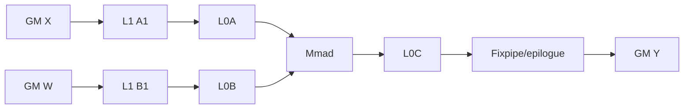
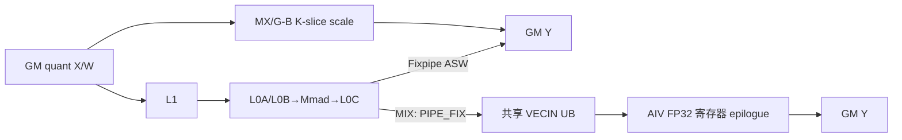
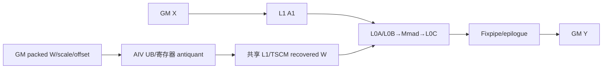

# GroupedMatmul 950 ACLNN 算子知识

## 算子速览

| 项目 | 内容 |
|---|---|
| 实际入口 | aclnnGroupedMatmulV5GetWorkspaceSize / aclnnGroupedMatmulV5，公开 ACLNN V5 |
| 计算语义 | 分组矩阵乘，按场景融合 bias、全量化反量化、伪量化权重恢复及激活 |
| 输入输出 | X/W/Y 为 TensorList；ND/NZ 与 transpose 组合受各 arch35 specialization 限制 |
| 执行类型 | AIC_CUBE、MIX_CV |
| Kernel 路线 | R-001 非量化 ASWT；R-002 全量化 ASW/CV/CGMCT；R-003 weight-quant basic/resplit CV |
| 核心资源 | GM、system/user workspace、L1、L0A/L0B/L0C、UB、寄存器 |
| 来源闭包 | source_closed：V5 ACLNN、L0、arch35 tiling/POD、entry/body、`gmm/common/cgmct` 命中的共享实现和构建接线闭合 |
| 验证状态 | 已完成源码闭包检查；本次知识提取未执行编译、真机、数值或性能测试。 |

## 接口与语义

### 计算语义

每组计算 Y_i=X_i×W_i+bias_i。全量化路线以 Cube 累加后按 T-C、K-C、MX 或 G-B 的 scale 规则恢复到目标 dtype；伪量化路线由 Vector 将低比特 W 按 antiquantScale/offset 恢复，再交给 Cube。actType 只在公开接口与当前 kernel 支持矩阵共同允许时生效。

### 输入、输出与属性

| 参数 | shape/layout | dtype | 约束、默认值与语义 |
|---|---|---|---|
| x | [M,K] 或分组 TensorList，ND，可受控转置 | FP16/BF16、INT8、FP8/HIF8 | 950 不支持公开表中带脚注 1 的 FLOAT/INT4/INT16；V5 校验 rank 2～6、stride 与列表长度 |
| weight | [K,N]/[N,K]，ND/NZ | FP16/BF16、INT8/INT4/FP4/FP8/HIF8 | layout、转置和量化类型共同决定 specialization |
| biasOptional | N 或 `[E,N]` | FP16/BF16/FP32/INT32（按 route） | Cube bias 或量化 epilogue；可选性由 950 checker 约束 |
| scaleOptional / offsetOptional | per-tensor/per-channel/MX/G-B block | UINT64/INT64/BF16/FP32/E8M0；offset FP32 | 全量化参数；INT64 scale 元数据在 common ACLNN 中改标 UINT64 |
| antiquantScaleOptional / antiquantOffsetOptional | per-channel/per-group | FP16/BF16 | weight-quant Vector producer 参数；offset 可空，shape/dtype 由 weight-quant checker 约束 |
| perTokenScaleOptional | 总 M 或 MX/G-B block 布局 | FP32/E8M0 | 与 scale 共同选择 K-C/K-T/MX/G-B epilogue |
| groupList | [E] 或 [E,2] | INT64 | 累计、count、sparse-M 解释 |
| activationInputOptional / activationQuantScaleOptional / activationQuantOffsetOptional | TensorList | 固定仓当前只允许空 | 预留参数，不进入 L0/Device ABI |
| tuningConfig | 一维 | INT64 | V5 公开 950 约束明确不支持，必须为 nullptr |
| out | [M,N] 或 TensorList | 路线目标 dtype | 只写各 tile 有效 M/N 域 |

### 入口与版本

V5 是固定仓中目标平台最新公开入口。第一段复用 common 参数对象完成 DAV3510 checker、连续化与 L0 调用；第二段由 CommonOpExecutorRun 提交。950 Host 根据非量化、全量化、伪量化注册不同 tiling template，但共享同一 L0 op 名与 Device entry 名。

## Host/Launcher 执行流程

### 参数校验与前处理

ACLNN 先检查 TensorList 组合、dtype/format、M/N/K、groupType、groupListType、transpose、scale/offset、actType 与空 tensor；公开 950 约束要求 `tuningConfigOptional=nullptr`。固定仓 common `CheckTuningConfig` 只检查数组首元素范围，arch35 tiler 又不消费该参数，因此不能把“实现未显式报错”写成公开支持。950 另由 950 checker 区分 no-quant、quant 与 weight-quant 支持集；必要的 contiguous/NZ 转换在 executor 内建立依赖。

### 参数、Workspace 与生命周期

`l0op::GroupedMatmul` 依次 InferShape 和 `ADD_TO_LAUNCHER_LIST_AICORE`。950 no-quant `SetCustomParam` 请求 32 B，`GroupedQmmTiling::GetWorkspaceSize` 请求 `SYS_WORKSPACE_SIZE`，weight-quant `SetCustomParam` 请求固定 16 MiB。量化 MIX 的 AIC→AIV 数据经 L0C/共享 VECIN UB 与硬同步交接；weight-quant 的 AIV→AIC 恢复权重直接写共享 L1/TSCM。二者都不以 user workspace 物化交接数据。workspace 由 executor 持有到同 stream 完成；entry 虽统一计算 `GetUserWorkspace(workspace)`，但 weight-quant controller 的 `Init` 参数中没有 workspace，固定仓未见其消费这 16 MiB 的语义路径。

### 启动图与失败传播

图为单个 GroupedMatmul AICore launch；Host 写 blockDim、必要的 batch schedule、tiling key 与 POD。ACLNN、checker、InferShape、tiling template、POD memcpy 或 launch 任一步失败均终止，不提交猜测 fallback。

## Route 与参数设计

### 分核与资源计算

非量化先以 16 对齐的 baseM/baseN 和 L0A 容量求 baseK，再由 L1 平分计算 depthA1/depthB1，并按全部专家 tile 量限制 usedCoreNum。全量化根据 quant mode 选择 basic-api Fixpipe、ASW Cube、MIX Vector、MX 或 per-tile kernel。weight-quant 以 N-first basic/resplit、main/tail N block 和 vec inner size 构造 controller 配置。

### Route 选择

| 顺序 | Route | Key/模板 | 精确选择条件与优先级 | 不适用去向 |
|---:|---|---|---|---|
| 1 | R-001 非量化 ASWT | `NO_QUANT_B_TRANS/NO_QUANT_A_TRANS` | 无量化参数，X/W/Y 为 950 checker 接受的同 dtype FP16/BF16；ND/NZ 与转置组合进入 `GmmNoQuantAswt` | 全量化到 R-002；weight-quant 到 R-003 |
| 2 | R-002 全量化 ASW/CV/CGMCT | `QUANT_B_TRANS/QUANT_A_TRANS/KERNEL_TYPE` | 量化 template registry 先尝试 basic-api(priority 0)，再 ASW(priority 1)；kernelType 区分 Fixpipe、Vector、MX、per-group/per-block，布局/transpose 必须有对应 constexpr body | X/W dtype 不同则 R-003；两 tiling template 都拒绝时失败 |
| 3 | R-003 weight-quant basic/resplit CV | W type、offset/bias、C/W quant type、transpose、VecAntiQuantConfig、algorithm key | X 为 FP16/BF16/INT8/FP8，W 为 checker 接受的 INT8/INT4/FP4/FP8 组合；`ALGORITHM_SUB_CATEGORY` 选择 N-first basic 或 tail-resplit，`ALGORITHM_CATEGORY=VECTOR_ANTIQUANT` | 无 constexpr specialization 或资源计算失败则 tiling 失败 |

```text
no quant checker accepted ? R-001
: full quant checker accepted ? basic-api(priority 0) capable -> Fixpipe/MX；否则 ASW(priority 1) -> Cube/MIX/G-B -> R-002
: weight quant checker accepted ? composite key -> basic/resplit/VCV/MX specialization -> R-003
: error
```

### 模板/实现执行矩阵

| Route | key/selector | dtype/shape/platform 完整命中条件 | 执行族与 kernel 节点 | 实际模板/body | 内存与同步特征 | tail/fallback |
|---|---|---|---|---|---|---|
| R-001 非量化 ASWT | `NO_QUANT_A_TRANS/NO_QUANT_B_TRANS` | 950 checker 接受的 FP16/BF16 同 dtype，量化参数为空，layout/transpose 有对应实例 | transA=0 为 AIC_CUBE；transA=1 的同一 `grouped_matmul` launch 同时含 AIC Cube 与 AIV `EmptyTensor` 空 K 节点 | `GmmNoQuantAswt` + `KernelGroupedMatmul` + `GroupedMatmulAswtScheduler`；transA=1 追加 `EmptyTensor` | 正常 GM→L1→L0A/B→L0C→Fixpipe/GM；AIV 只对 split-K 且 K=0 的互斥输出域调用 `InitOutput(...,0)` | `singleShape` 保护 M/N/K tail；checker 拒绝则失败 |
| R-002 Fixpipe/ASW | `GMM_DEQUANT_FIXP`、T-T/T-C | full-quant checker 通过；非 MX 时 basic-api `IsCapable=false`，由通用 `GroupedQmmTiling` 接收 | AIC_CUBE，单节点 | `GmmASWKernel` | Cube C 在 Fixpipe/epilogue 应用 scale/bias | 有效 M/N/K 写回；无 key 则失败 |
| R-002 MIX Vector | `GMM_DEQUANT_VECTOR` | full-quant checker 通过，quant mode 需 Vector dequant，constexpr key 存在 | 单 Kernel MIX_CV，AIC Mmad 与 AIV RegBase epilogue | `GQmmMixRegbaseKernel::Process` | L0C 经 PIPE_FIX 到共享 VECIN UB；双向 CrossCore flag 回收槽 | register mask 处理 N tail；最后一轮 Cube 额外 wait |
| R-002 MX / G-B | MX 的 basic-api key；`GMM_PERGROUP_PERBLOCK` | MX 要求 scale=E8M0 且 X 为 FP8/FP4；G-B 要求 block-shape/checker 合法 | AIC_CUBE 或 MIX/CGMCT 当前实例 | `GmmCgmctMxKernel` / `GmmCgmctPerTileKernel` | 量化 K-slice 逐段缩放累加，不复用普通 T-C POD | K 最后一段与 M/N tile 均裁剪；拒绝后失败 |
| R-003 weight-quant | `N_FIRST_BASIC_BLOCK` / `N_FIRST_TAIL_RESPLIT` / VCV / MX | weight-quant checker 通过；dtype/layout/offset/bias/quant type/VecAntiQuantConfig 组成的 key 有实例 | 单 Kernel MIX_CV，AIV 反量化 W 后 AIC Cube 消费 | `GMMWeightQuantBasicController` / `GMMWeightQuantResplitController` | workspace/L1/UB 分片，controller flag 保护 Vector→Cube | main/first-tail/second-tail N block；无 constexpr key 则失败 |

### 隐藏性能 Guard

| Guard | Host/Tiling 条件 | Device/资源原因 | 影响 Route | 不满足时去向 | 源码符号 |
|---|---|---|---|---|---|
| MX basic-api 能力 | `IsMicroScaling()` 且 X 为 `FLOAT8_E4M3FN/FLOAT8_E5M2/FLOAT4_E2M1/FLOAT4_E1M2` | MX 专用 tile/epilogue 需 E8M0 scale 和 FP8/FP4 数据路径 | R-002 MX | priority 后继的通用 quant tiling | `GroupedQmmBasicApiTiling::IsCapable` |
| quant template 终结能力 | `GroupedQmmTiling::IsCapable()` 返回 true，但后续 shape/resource/key 仍必须成功 | 它是 registry 的通用终结模板，不代表任意 key 有 Device body | R-002 | `DoOpTiling/DoLibApiTiling/GetTilingKey` 任一失败即终止 | `GroupedQmmTiling::IsCapable` |
| weight-quant tail resplit | `EnableTailResplit()` 为 true | N 尾块需 main/first/second tail 分拆以与 controller 容量和核分配一致 | R-003 | `N_FIRST_BASIC_BLOCK` | `GroupedWeightQuantBatchMatmulTiling::SetTilingKey` |
| A8W4/MX Vector 配置 | INT8×INT4 使用 512 内层，groupSize=192 改为 384/3-buffer；MXA8W4 使用 dynamic/4-buffer | UB MTE2 片与 Cube `baseK/stepK` 必须一致 | R-003 | 选其他 constexpr 配置；无配置则失败 | `GroupedWeightQuantBatchMatmulTiling::SetMatMulTiling/SetTilingKey` |
| 固定 workspace 请求 | weight-quant `workspaces[0]=16777216` | 属于 Host/executor 资源契约；固定仓 Device controller 未接收 workspace 参数，不能把该请求外推为恢复权重 GM slice | R-003 | workspace 获取/分配失败 | `GroupedWeightQuantBatchMatmulTiling::SetCustomParam` / `INVOKE_GMM_WEIGHT_QUANT_*` |
| 编译 key 闭包 | Host composite key 需与 `grouped_matmul_apt.cpp` constexpr 条件完全一致 | 950 entry 没有跨 key 的通用 runtime fallback | 全部 | 失败 | `grouped_matmul` |

### POD/ABI

arch35 使用 pack(8) 的显式结构。TCubeTiling 来自公共依赖，其完整 sizeof/offsetof 固定仓不可见。

| 结构 | 字段 | 类型/位宽 | ABI 布局 | 单位 | Host/launcher producer | Device consumer | 边界 |
|---|---|---|---|---|---|---|---|
| GMMNoQuantBaseParams | groupNum | uint32/32 | offsetof=0, sizeof=4, alignof=4 | 组 | SetGMMTiling | GmmNoQuantAswt scheduler | 公开接口支持上限内 |
| GMMNoQuantBaseParams | coreNum | uint32/32 | offsetof=4, sizeof=4, alignof=4 | 核 | SetCustomParam | scheduler | <=AIC 数 |
| GMMNoQuantBaseParams | groupType | int32/32 | offsetof=20, sizeof=4, alignof=4 | 枚举 | Init | scheduler | -1/0/2 |
| GMMNoQuantBaseParams | mTailCnt | uint32/32 | offsetof=32, sizeof=4, alignof=4 | tile | CalcTailBasicBlock | ASWT tail scheduler | 不超过 group tile 数 |
| GMMQuantParams | groupNum | uint32/32 | offsetof=0, sizeof=4, alignof=4 | 组 | GroupedQmmTiling | quant kernels | 非零或合法空域 |
| GMMQuantParams | aQuantMode | uint32/32 | offsetof=8, sizeof=4, alignof=4 | 模式 | GetShapeAttrsInfo | quant body | 受 checker 枚举限制 |
| GMMQuantParams | groupListType | uint8/8 | offsetof=20, sizeof=1, alignof=1 | 枚举 | tiling | group decoder | 0/1/2 |
| GMMQuantParams | reserved | uint16/16 | offsetof=22, sizeof=2, alignof=2; sizeof=24 | N/A | 默认清零 | 不读取 | 必须保持 0 |
| GMMWeightQuantParam | groupNum | uint32/32 | offsetof=0, sizeof=4, alignof=4 | 组 | weight quant tiling | controller | 上限由 API |
| GMMWeightQuantParam | kSize | uint64/64 | offsetof=8, sizeof=8, alignof=8 | 元素 | shape parser | Cube/Vector address | 乘法防溢出 |
| GMMWeightQuantParam | mainBlockCount | uint64/64 | offsetof=40, sizeof=8, alignof=8 | block | N-tail resplit | controller scheduler | main+tail 覆盖 N |
| GMMWeightQuantParam | secondTailBlockCount | uint16/16 | offsetof=54, sizeof=2, alignof=2; sizeof=56 | block | resplit tiling | controller | 尾块可为 0 |
| TCubeTiling | baseM | uint32/32 | sizeof/alignof/offsetof 固定仓不可见 | 元素 | 各 tiling template | Cube body | 16 对齐 |

### Route 源码闭包

| Route | Key/selector | Host/Tiling producer | POD/参数 | Kernel entry/router | Kernel body/直接依赖 | 构建接线 |
|---|---|---|---|---|---|---|
| R-001 非量化 ASWT | transA/transB | grouped_no_quant_matmul_tiling.cpp::SetTilingKey | GMMNoQuantTilingData | grouped_matmul_apt.cpp::grouped_matmul | grouped_matmul_basic_kernel.h::GmmNoQuantAswt | op_host/CMakeLists.txt::GroupedMatmul |
| R-002 全量化 ASW/CV/CGMCT | Fixpipe `GMM_DEQUANT_FIXP` | grouped_quant_basic_api_matmul_tiling.cpp 与 grouped_quant_matmul_tiling.cpp::GetTilingKey | GMMQuantBasicApiTilingData 或 GMMQuantTilingData | grouped_matmul_apt.cpp::grouped_matmul | gqmm_cube_on_the_fly.h::GmmASWKernel；MX basic-api 为 gqmm_cgmct_mx_kernel.h::GmmCgmctMxKernel | op_host/CMakeLists.txt::GroupedMatmul |
| R-002 全量化 ASW/CV/CGMCT | Vector `GMM_DEQUANT_VECTOR` | grouped_quant_matmul_tiling.cpp::SetKernelType/GetTilingKey | GMMQuantTilingData | grouped_matmul_apt.cpp::GMM_QUANT_MIX_IMPL_CLASS | gqmm_mix_online_dynamic.h::GQmmMixRegbaseKernel::Process | op_host/CMakeLists.txt::GroupedMatmul |
| R-002 全量化 ASW/CV/CGMCT | `GMM_PERGROUP_PERBLOCK` | grouped_quant_matmul_tiling.cpp::SetPerGroupQuantMode/GetTilingKey | GMMQuantTilingData | grouped_matmul_apt.cpp::GMM_QUANT_GB_IMPL_CLASS | gqmm_cgmct_pertile_kernel.h::GmmCgmctPerTileKernel | op_host/CMakeLists.txt::GroupedMatmul |
| R-003 weight-quant basic/resplit CV | `N_FIRST_BASIC_BLOCK` | grouped_weight_quant_batch_matmul_tiling.cpp::SetTilingKey | GMMWeightQuantTilingData | grouped_matmul_apt.cpp::INVOKE_GMM_WEIGHT_QUANT_BASIC_CONTROLLER_OP_IMPL | grouped_matmul_weight_quant_basic_controller.h::Process | op_host/CMakeLists.txt::GroupedMatmul |
| R-003 weight-quant basic/resplit CV | `N_FIRST_TAIL_RESPLIT`/VCV/MX | grouped_weight_quant_batch_matmul_tiling.cpp::SetTilingKey/SetCustomParam | GMMWeightQuantTilingData | grouped_matmul_apt.cpp::INVOKE_GMM_WEIGHT_QUANT_*RESPLIT* | grouped_matmul_weight_quant_resplit_controller.h::Process | op_host/CMakeLists.txt::GroupedMatmul |

## Kernel 实现

### 公共执行流程

entry 创建 TPipe、设置 overflow、取得 user workspace，并按编译宏解释同名模板 key。每个 body 都从匹配的 pack(8) POD 读取参数；不同 POD 不能互换。Cube 数据层级为 GM→L1→L0A/L0B→Mmad→L0C→Fixpipe/GM；全量化 MIX 在共享 VECIN UB 交接 C tile，weight-quant MIX 在共享 L1/TSCM 交接恢复后的 W tile，均非 GM workspace 数据边。

### Route R-001：非量化 ASWT

#### 适用条件

##### 选择证据

| 层级 | 文件 | 符号 | 源码谓词/参数 | 结果/下一跳 |
|---|---|---|---|---|
| API | gmm/grouped_matmul/op_api/grouped_matmul_no_quant_950_checker.cpp | AclnnGroupedMatmulNoQuantDAV3510Checker | V5、X/W/Y 同 dtype FP16/BF16，量化可选项为空，shape/layout/transpose 组合通过 | 进入 no-quant Tiling；否则参数错误 |
| Host/Tiling | gmm/grouped_matmul/op_host/op_tiling/arch35/grouped_no_quant_matmul_tiling.cpp | GroupedNoQuantMatmulTiling::SetTilingKey | no-quant checker 成功，编码 transA/transB | no-quant key |
| Router | gmm/grouped_matmul/op_kernel/grouped_matmul_apt.cpp | grouped_matmul | V310 非 quant 编译分支，匹配 transpose/layout | GmmNoQuantAswt |

#### Device 数据流

##### 函数级调用链

```text
grouped_matmul
  -> GmmNoQuantAswt
    -> Cgmct::Gemm::Kernel::KernelGroupedMatmul::operator()
      -> IterateOneGroup -> GroupedMatmulAswtScheduler::GetTileNum/GetTileIdx
      -> BlockMmad::SetTensorA/SetTensorB/IterateAll -> GM Y
```

##### 源码等价伪码

```text
伪码：for tile = scheduler(blockIdx); tile.valid; tile = scheduler.next():
  group,mTile,nTile = tile.coord
  aOffset = groupXBase + mTile*baseM*K; bOffset = groupWBase + nTile*baseN
  GM A/B -> L1 ping-pong -> L0A/L0B
  for kTile in [0,ceil(K/baseK)): Mmad(L0A,L0B,L0C, validK)
  Fixpipe/epilogue 将 validM*validN 写到 GM Y[groupBase+mOffset*N+nOffset]
```

#### 内存与数据搬运

##### 资源与搬运表

| 层级/缓冲区 | offset/地址公式 | extent/容量公式 | dtype/layout | producer | consumer | owner/lifetime | 对齐/复用 |
|---|---|---|---|---|---|---|---|
| GM X/W/Y | groupBase+mOffset*K；groupBase+nOffset；groupBase+mOffset*N+nOffset | curM*K、K*curN、curM*curN | FP16/BF16，ND/NZ | caller | ASWT | caller/stream | 16 对齐，tail 有效长 |
| L1/L0A/L0B/L0C | 当前 tile offset | depthA1*baseM*baseK、depthB1*baseN*baseK、baseM*baseN*accSize | Cube fractal | copy/Mmad | Mmad/Fixpipe | 单 tile | db/depth 控制复用 |
| UB/寄存器 | 正常 ASWT 为 N/A；transA=1 时 AIV `EmptyTensor` 直接调用框架 `InitOutput` 清零 | 空 K 组每核 `cursingleM*n` 个 Y 元素，`singleM=AlignUp(ceil(M/coreNum),16)` | Y dtype/ND | AIV helper | GM Y 空 K 行 | 当前 launch | 与 AIC 的 K>0 输出域互斥；`InitOutput` 内部是固定仓外框架边界 |

##### 分层内存布局



##### 字节账、交接边与复用顺序

```text
workspace_total = 32 bytes（`GroupedNoQuantMatmulTiling::SetCustomParam`；body 未使用独立 user C-tile slice）
L1_total = depthA1*baseM*baseK*sizeof(X) + depthB1*baseN*baseK*sizeof(W)
L0_total = baseM*baseK*sizeof(X) + baseN*baseK*sizeof(W) + dbL0C*baseM*baseN*sizeof(acc)
UB_total = N/A（ASWT 无 AIV epilogue；transA=1 空 K helper 的 `InitOutput` 内部临时资源固定仓不可见）
```

| 边/复用子区 | producer | offset/extent | dtype/layout | consumer | ordering/sync | owner/lifetime | 安全条件 |
|---|---|---|---|---|---|---|---|
| A1/B1 双缓冲 | GM copy | `depthA1*baseM*baseK*sizeof(X)` / `depthB1*baseN*baseK*sizeof(W)` | Cube A1/B1 | L0 loader | CGMCT/Matmul event | 单核 tile | scheduler 不在前一 stage 消费结束前覆盖 |
| L0C 输出 | Mmad | `dbL0C*baseM*baseN*sizeof(acc)` | FP32 | Fixpipe | Cube pipeline ordering | 单 tile | `singleShape` 只提交 valid M/N |

#### 同步、精度与尾块

##### 同步与数值边界表

| 阶段 | primitive/机制 | producer | consumer/等待点 | 保护对象 | 精度/尾块 |
|---|---|---|---|---|---|
| Cube pipeline | ASWT/Matmul 内部 event | MTE copy | Mmad/Fixpipe | A/B/C tile | FP32 累加，validM/N/K 保护 tail |
| transpose-X 空域 | AIV `EmptyTensor`：`singleM=AlignUp(ceil(M/coreNum),16)` 后 `InitOutput(Y+coreIdx*singleM*N,cursingleM*N,0)` | groupList/shape desc | GM output | split-K 且 K=0 的组 | 与 AIC K>0 tile 无共享 producer-consumer 边 |

#### 关键实现

##### 符号证据表

| 阶段 | 文件 | 符号/模板实例 | 实现事实 |
|---|---|---|---|
| Host/Tiling producer | gmm/grouped_matmul/op_host/op_tiling/arch35/grouped_no_quant_matmul_tiling.cpp | CalMatMulTiling/SetTilingKey | base/depth/core/key |
| Kernel entry/router | gmm/grouped_matmul/op_kernel/grouped_matmul_apt.cpp | grouped_matmul | layout 实例分派 |
| Device body/helper | gmm/grouped_matmul/op_kernel/arch35/non_quant/grouped_matmul_basic_kernel.h | GmmNoQuantAswt | 实例化 RowMajor/ColumnMajor/NZ/ZN、ASWT scheduler 和空 K helper |
| Device body/helper | gmm/common/cgmct/kernel/kernel_grouped_matmul.h | KernelGroupedMatmul::operator()/IterateOneGroup | 逐组 M/N/K、a/b/c offset、singleShape、bias 与 `IterateAll` |
| Device body/helper | gmm/common/cgmct/block/block_scheduler_grouped_matmul_aswt.h | GroupedMatmulAswtScheduler::GetTileNum/GetTileIdx | block→(mTile,nTile) 与 tail 分组 |

### Route R-002：全量化 ASW/CV/CGMCT

#### 适用条件

##### 选择证据

| 层级 | 文件 | 符号 | 源码谓词/参数 | 结果/下一跳 |
|---|---|---|---|---|
| API | gmm/grouped_matmul/op_api/grouped_matmul_950_checker.cpp | AclnnGroupedMatmulDAV3510Checker | INT8/FP8/FP4 全量化的 X/W/Y、scale/perToken/bias、量化 block shape 与 activation 组合通过 | 进入量化 template registry；否则参数错误 |
| Host/Tiling | gmm/grouped_matmul/op_host/op_tiling/arch35/grouped_quant_matmul_tiling.cpp | GroupedQmmTiling::GetTilingKey | transA/transB 与 quant mode 决定 kernelType | quant key |
| Router | gmm/grouped_matmul/op_kernel/grouped_matmul_apt.cpp | grouped_matmul | `V310_GMM_QUANT_{CUBE,PERTENSOR_CUBE,MIX,MX,PERTILE}` 子宏与 constexpr key 同时匹配 | `GmmASWKernel`、`GQmmMixRegbaseKernel`、`GmmCgmctMxKernel` 或 `GmmCgmctPerTileKernel` |

#### Device 数据流

##### 函数级调用链

```text
grouped_matmul
  -> Fixpipe: GMM_QUANT_IMPL_CLASS -> GmmASWKernel::Process
  -> Vector: GMM_QUANT_MIX_IMPL_CLASS -> GQmmMixRegbaseKernel::Process
  -> MX: GMM_QUANT_MX_BASIC_API_IMPL_CLASS -> GmmCgmctMxKernel
  -> G-B: GMM_QUANT_GB_IMPL_CLASS -> GmmCgmctPerTileKernel
```

##### 源码等价伪码

```text
伪码：按KERNEL_TYPE选且只选一个body；for group/tile:
  地址 = groupBase + mTile*baseM*K / nTile*baseN
  if AIC: GM quant A/B -> L1 -> L0A/L0B; Mmad -> L0C
  if Fixpipe/ASW: 在Cube epilogue应用T-T/T-C scale与bias并写valid tile
  else if Vector: Cube将L0C经PIPE_FIX写共享VECIN UB并signal AIV；AIV wait后载入scale/perToken/bias，FP32 dequant/cast后MTE3写GM
  else if MX/G-B: 按gsM/gsN/gsK或per-group/per-block scale tile在K循环内累加缩放后的partial，再由CGMCT epilogue写valid tile
```

#### 内存与数据搬运

##### 资源与搬运表

| 层级/缓冲区 | offset/地址公式 | extent/容量公式 | dtype/layout | producer | consumer | owner/lifetime | 对齐/复用 |
|---|---|---|---|---|---|---|---|
| Cube hierarchy | tile coordinates from scheduler | L1/L0 extents from TCubeTiling | quant A/B, INT32/FP32 C | GM copy/Mmad | Fixpipe/AIV | AIC tile | K/M/N tail protected |
| 共享 VECIN/UB | UB offset 0 为 `l0cOutUb`；随后依次 scale、可选 perToken、可选 bias、dequant ping/pong、临时区 | `mForSingleVec*baseN*4 + baseN*sizeof(scale) + align(mForSingleVec*sizeof(ptScale),32) + baseN*sizeof(bias) + 2*ceil(mForSingleVec/FP32_OUTPUT_TIMES)*baseN*sizeof(Y) + tmp` | L0C dtype、scale/ptScale/bias、Y | AIC PIPE_FIX 与 GM MTE2 | AIV VF/MTE3 | 单 tile，ping/pong复用 | CrossCore mode 4：AIC→AIV flag 4/20，AIV→AIC flag 6/22；不是 GM workspace 交接 |
| register | vector offset=vRow*alignedN+vCol | mask=min(vectorWidth,validN-vCol) | FP32 | UB load | scale/cast/store | repeat | masked tail |

##### 分层内存布局



##### 字节账、交接边与复用顺序

```text
workspace_total = SYS_WORKSPACE_SIZE（GroupedQmmTiling::GetWorkspaceSize）
L0_total = baseM*baseK*sizeof(A) + baseN*baseK*sizeof(B) + dbL0C*baseM*baseN*sizeof(acc)
UB_mix = mForSingleVec*baseN*4 + baseN*sizeof(scale)
       + Align(mForSingleVec*sizeof(ptScale),32) [conditional] + baseN*sizeof(bias) [conditional]
       + 2*CeilDiv(mForSingleVec,FP32_OUTPUT_TIMES)*baseN*sizeof(Y) + tmp
```

| 边/复用子区 | producer | offset/extent | dtype/layout | consumer | ordering/sync | owner/lifetime | 安全条件 |
|---|---|---|---|---|---|---|---|
| L0C→VECIN UB | AIC `MMCompute` + PIPE_FIX | UB offset 0；`mForSingleVec*baseN*sizeof(l0cType)` | INT32/FP32 tile | AIV `DequantCompute` | mode 4；AIC set 4/20，AIV wait 4 | 单 MIX tile | AIV set 6 后 AIC wait 6/22，末轮 `End` 消费额外通知后才重用 |
| dequant ping/pong | AIV VF | 两个 `ceil(mForSingleVec/FP32_OUTPUT_TIMES)*baseN*sizeof(Y)` 子区 | Y dtype/ND | MTE3 store | `V_MTE3/MTE3_V` event | AIV tile | store 结束前不覆盖 |
| MX/G-B partial | Cube/CGMCT K-slice | K-loop 当前 gsK 片和 scale tile | acc/scale 布局由该 key 决定 | 后续 K-slice/epilogue | 当前 kernel pipeline | 单 tile | 最后 K-slice 使用实际 validK |

#### 同步、精度与尾块

##### 同步与数值边界表

| 阶段 | primitive/机制 | producer | consumer/等待点 | 保护对象 | 精度/尾块 |
|---|---|---|---|---|---|
| AIC→AIV | mode 4，`NotifyVector` set flag 4/20；`WaitForCube` wait flag 4，PIPE_FIX→PIPE_V | Cube C producer | Vector consumer | 共享 L0C→VECIN UB tile | INT32/FP32 C→FP32 dequant；scale/perToken/bias 后 cast |
| AIV→AIC/槽回收 | mode 4，`NotifyCube` set flag 6；`WaitForVector` wait flag 6/22，末轮 `End` 消费额外通知 | Vector UB consumer | 下一 Cube tile | 共享 UB 与两子块通知 | 防止 Cube 覆盖尚未消费的共享 tile |
| output | Fixpipe 或 Vector masked store | epilogue | GM Y | valid tile | quant mode 决定 rounding；尾 N 不越界 |

#### 关键实现

##### 符号证据表

| 阶段 | 文件 | 符号/模板实例 | 实现事实 |
|---|---|---|---|
| Host/Tiling producer | gmm/grouped_matmul/op_host/op_tiling/arch35/grouped_quant_matmul_tiling.cpp | GroupedQmmTiling::GetTilingKey/DoLibApiTiling | quant mode 与 Cube tile |
| Kernel entry/router | gmm/grouped_matmul/op_kernel/grouped_matmul_apt.cpp | GMM_QUANT_MIX_IMPL_CLASS | POD 到 body |
| Device body/helper | gmm/grouped_matmul/op_kernel/arch35/quant_adaptive_sliding_window_templates/gqmm_mix_online_dynamic.h | GQmmMixRegbaseKernel::Process | AIC/AIV 交接与 dequant |
| Device body/helper | gmm/grouped_matmul/op_kernel/arch35/quant_adaptive_sliding_window_templates/gqmm_cube_on_the_fly.h | GmmASWKernel::Init/Process | Fixpipe ASW 的 block scheduler、Cube 累加、scale/bias 输出 |
| Device body/helper | gmm/grouped_matmul/op_kernel/arch35/quant_adaptive_sliding_window_templates/gqmm_cgmct_mx_kernel.h | GmmCgmctMxKernel | MX basic-api 的 CGMCT specialization |
| Device body/helper | gmm/grouped_matmul/op_kernel/arch35/quant_adaptive_sliding_window_templates/gqmm_cgmct_pertile_kernel.h | GmmCgmctPerTileKernel | G-B per-group/per-block K-slice scale 与 aligned output |

### Route R-003：weight-quant basic/resplit CV

#### 适用条件

##### 选择证据

| 层级 | 文件 | 符号 | 源码谓词/参数 | 结果/下一跳 |
|---|---|---|---|---|
| API | gmm/grouped_matmul/op_api/grouped_matmul_weight_quant_950_checker.cpp | AclnnGroupedMatmulWeightQuantDAV3510Checker | V5 的 X/W dtype、antiquant scale/offset、bias、layout/transpose 和 group 组合通过 | 进入 weight-quant Tiling；否则参数错误 |
| Host/Tiling | gmm/grouped_matmul/op_host/op_tiling/arch35/grouped_weight_quant_batch_matmul_tiling.cpp | SetTilingKey/TilingKeyConfigure::GenTilingKey | W layout/type、offset/bias、quant type、tail 算法 | composite key |
| Router | gmm/grouped_matmul/op_kernel/grouped_matmul_apt.cpp | grouped_matmul | key 匹配 basic/resplit/VCV/MXA8W4 controller 及 `VEC_ANTIQUANT_CONFIG_0..5/DYNAMIC` | 对应 controller `Process`；无 constexpr 分支则无 body |

#### Device 数据流

##### 函数级调用链

```text
grouped_matmul
  -> INVOKE_GMM_WEIGHT_QUANT_*_CONTROLLER_OP_IMPL
    -> GMMWeightQuantBasicController::Process 或 GMMWeightQuantResplitController::Init/Process
      -> InitOffsetParam/PrefetchA/SplitNByMultiCore
      -> WeightQuantMatmulBasicBlock 或 WeightQuantVcvMatmulBasicBlock::ComputeBasicBlock/End
      -> BasicBlockLibVectorAntiQuantCompute + WeightQuantBatchMatmulV2CubeCompute -> epilogue
```

##### 源码等价伪码

```text
伪码：for nBlock in mainBlocks + firstTail + secondTail:
  nOffset = prefix block count*blockSize
  if AIV: for kSlice load packed W/scale/offset to UB; recover vector tile into workspace[offset]
  signal AIC; if AIC wait then GM X and recovered W -> L1 -> L0A/L0B
  for kTile: Mmad accumulate L0C; epilogue scale/cast
  write only min(blockSize,N-nOffset) columns to GM Y
```

#### 内存与数据搬运

##### 资源与搬运表

| 层级/缓冲区 | offset/地址公式 | extent/容量公式 | dtype/layout | producer | consumer | owner/lifetime | 对齐/复用 |
|---|---|---|---|---|---|---|---|
| packed W/scale GM | group*K*N/packing + nOffset | groupSize*curN | FP4/INT4/FP8, ND/NZ | caller | Vector antiquant | caller | group/format alignment |
| user workspace | entry 计算 `user1=GetUserWorkspace(workspace)`，但 controller `Init` 不接收该指针 | Host 请求固定 16 MiB；固定仓无 Device 读写 extent | N/A | N/A | N/A | executor/stream | 不得解释为恢复权重中间区 |
| 共享 L1/TSCM | `weightL1_[(cvLoopIdx&1)*weightL1DbOffset_]`；普通实例以 `weightL1Space=baseN*stepKb*baseK` 划分 | 双缓冲恢复权重；MX 另保留 bias/scale L1 子区 | recovered FP16/INT8，Cube NZ | AIV `WeightAntiQuantCompute*` | AIC `LaunchMatmul` | 单 launch，共享 L1 | flag 8/9（及 `+16` 轮次）保护 producer/consumer 与覆盖 |
| UB/register | local n/k tile | bufNum*innerSize | FP32 scale/recovered dtype | GM MTE | vector recover | AIV stage | main/tail mask |

##### 分层内存布局



##### 字节账、交接边与复用顺序

```text
workspace_total = 16777216 bytes（Host 固定请求；固定仓 Device controller 未消费 user1）
UB_vector_stage = vecConfig.ubMte2BufferNum * 每片 low-bit/scale/offset 容量 + recovered-W UB 输出容量
L1_total = A-tile bytes + 2 * weightL1Space * sizeof(recovered_W) + conditional(MX bias/scale L1 slices)
L0_total = baseM*baseK*sizeof(A) + baseN*baseK*sizeof(recovered_W) + baseM*baseN*sizeof(acc)
```

| 边/复用子区 | producer | offset/extent | dtype/layout | consumer | ordering/sync | owner/lifetime | 安全条件 |
|---|---|---|---|---|---|---|---|
| recovered W L1 slice | `BasicBlockLibVectorAntiQuantCompute::WeightAntiQuantCompute*` | `weightL1_[(cvLoopIdx&1)*weightL1DbOffset_]`；普通 `weightL1Space=baseN*stepKb*baseK` 元素 | packed FP4/INT4/FP8→FP16/INT8，Cube NZ | `WeightQuantBatchMatmulV2CubeCompute::LaunchMatmul` | mode 4：AIC→AIV flag 9（及 25），AIV→AIC flag 8（及 24）；VCV 另用 3/4 | 共享 L1/TSCM，单 launch | Cube 消费完成通知后 Vector 才覆盖同一 ping-pong L1 槽 |
| main/tail N 子区 | controller scheduler | main/first-tail/second-tail block prefix | 路线 W/Y layout | Vector/Cube basic block | processId 与 flag 协议 | 单 launch | `mainBlockCount` 与两个 tail count 完整覆盖 N 且不重叠 |
| L0C→GM | Cube Mmad | 当前 `curM*curN` 有效 tile | acc→Y dtype | Fixpipe/GM writer | Matmul event | 单 tile | N tail 取 `min(blockSize,N-nOffset)` |

#### 同步、精度与尾块

##### 同步与数值边界表

| 阶段 | primitive/机制 | producer | consumer/等待点 | 保护对象 | 精度/尾块 |
|---|---|---|---|---|---|
| Vector→Cube | mode 4 cross-core flag 8/24；VCV 路线另用 flag 4/3 连接 MTE3/FIX/VF | antiquant Vector | Cube MTE1/FIX wait | recovered W 的共享 L1/TSCM 槽 | scale/offset 顺序固定；tail block extent explicit |
| Cube output | Matmul event/Fixpipe | Mmad | GM writer | L0C tile | accumulate type由实例决定，N tail 使用 first/second tail |

#### 关键实现

##### 符号证据表

| 阶段 | 文件 | 符号/模板实例 | 实现事实 |
|---|---|---|---|
| Host/Tiling producer | gmm/grouped_matmul/op_host/op_tiling/arch35/grouped_weight_quant_batch_matmul_tiling.cpp | SetTilingKey/SetCustomParam | composite key 与 main/tail N block |
| Kernel entry/router | gmm/grouped_matmul/op_kernel/grouped_matmul_apt.cpp | INVOKE_GMM_WEIGHT_QUANT_RESPLIT_CONTROLLER_OP_IMPL | 构造 specialization |
| Device body/helper | gmm/grouped_matmul/op_kernel/arch35/weight_quant_basic_block/grouped_matmul_weight_quant_basic_controller.h | GMMWeightQuantBasicController::Process | N-first basic-block 的逐组/逐 M/N 块控制 |
| Device body/helper | gmm/grouped_matmul/op_kernel/arch35/weight_quant_basic_block/grouped_matmul_weight_quant_resplit_controller.h | GMMWeightQuantResplitController::Process/SplitNByMultiCore | main/first-tail/second-tail N 块、双 processId 与 basicBlock 回收 |
| Device body/helper | gmm/grouped_matmul/op_kernel/arch35/weight_quant_basic_block/weight_quant_basic_block.h | WeightQuantMatmulBasicBlock::UpdateGlobalAddr/ComputeBasicBlock/PrefetchA | 普通 Vector antiquant→Cube 基本块交接 |
| Device body/helper | gmm/grouped_matmul/op_kernel/arch35/weight_quant_basic_block/weight_quant_vcv_basic_block.h | WeightQuantVcvMatmulBasicBlock::UpdateGlobalAddr/ComputeBasicBlock | S8S4/MX VCV specialization 的地址与交接 |
| Device body/helper | gmm/grouped_matmul/op_kernel/arch35/weight_quant_basic_block/weight_quant_vec_compute.h | BasicBlockLibVectorAntiQuantCompute | packed W、scale/offset 的 UB/寄存器恢复与 tail mask |
| Device body/helper | gmm/grouped_matmul/op_kernel/arch35/weight_quant_basic_block/weight_quant_cube_compute.h | WeightQuantBatchMatmulV2CubeCompute | 恢复权重 slice 的 L1/L0 Mmad、Fixpipe/GM 输出 |

## 算子特定优化

### Trick T-001：MIX 的双向 CrossCore 槽回收

#### 触发与源码依据

- 适用 Route：R-002 的 `GMM_DEQUANT_VECTOR` 子路线。
- 触发条件：950 full-quant checker 和 `GroupedQmmTiling` 产生 Vector-dequant key，`grouped_matmul_apt.cpp` 实例化 `GQmmMixRegbaseKernel`。
- Golden 来源：[`gmm/grouped_matmul/op_kernel/arch35/quant_adaptive_sliding_window_templates/gqmm_mix_online_dynamic.h:87-106`](../../../../../../../cann-ops-raw/ascendc/ops-transformer/be33d95bb755cedec3108f70805c1874d1792540/gmm/grouped_matmul/op_kernel/arch35/quant_adaptive_sliding_window_templates/gqmm_mix_online_dynamic.h#L87-L106)

**官方源码（固定 Commit 连续逐字摘录）**：

```cpp
__aicore__ inline void NotifyCube()
{
    CrossCoreSetFlag<QuantUtils::SYNC_AIC_AIV_MODE, PIPE_V>(QuantUtils::AIV_SYNC_AIC_FLAG);
}
__aicore__ inline void WaitForVector()
{
    CrossCoreWaitFlag<QuantUtils::SYNC_AIC_AIV_MODE, PIPE_FIX>(QuantUtils::AIV_SYNC_AIC_FLAG);
    CrossCoreWaitFlag<QuantUtils::SYNC_AIC_AIV_MODE, PIPE_FIX>(QuantUtils::AIV_SYNC_AIC_FLAG +
                                                               QuantUtils::FLAG_ID_MAX);
}
__aicore__ inline void NotifyVector()
{
    CrossCoreSetFlag<QuantUtils::SYNC_AIC_AIV_MODE, PIPE_FIX>(QuantUtils::AIC_SYNC_AIV_FLAG);
    CrossCoreSetFlag<QuantUtils::SYNC_AIC_AIV_MODE, PIPE_FIX>(QuantUtils::AIC_SYNC_AIV_FLAG +
                                                              QuantUtils::FLAG_ID_MAX);
}
__aicore__ inline void WaitForCube()
{
    CrossCoreWaitFlag<QuantUtils::SYNC_AIC_AIV_MODE, PIPE_V>(QuantUtils::AIC_SYNC_AIV_FLAG);
}
```

#### 机制与设计原因

AIC 用 PIPE_FIX 将 L0C tile 放到共享 VECIN UB 后向 AIV 发两个间隔 `FLAG_ID_MAX` 的信号；AIV 完成 FP32 dequant/cast 和输出搬运后反向通知 AIC。AIC 在下一次复用共享 tile 前等待两个 Vector 信号，这一协议同时建立数据可见性和槽防覆盖；`End` 还消耗 Vector 末轮多发的通知。

#### 迁移边界

- 适用：同一 launch 内 AIC 生产 C tile、AIV 执行反量化 epilogue 的 950 MIX 路线。
- 前提：保持 flag ID、PIPE_FIX/PIPE_V 方向、每轮 wait/set 次数与共享 UB 槽完全一致。
- 失效：Fixpipe-only ASW、MX/G-B 专用 body 或 weight-quant controller 各使用自己的同步与 POD，不可直接复用本协议。
- 未验证：本次知识提取未执行编译、真机、数值或性能测试。

#### 错误做法

只保留 AIC→AIV 的 `NotifyVector/WaitForCube`，却删除 AIV→AIC 的回收信号或末轮额外 wait。固定源码显式实现了双向协议，缺失回程会允许 Cube 在 Vector 消费完成前覆盖共享 tile。

## 模板与实现对比

| 对比维度 | R-001 非量化 ASWT | R-002 全量化 | R-003 weight-quant | 设计选择依据 |
|---|---|---|---|---|
| 命中条件/优先级 | no-quant checker | quant registry：MX basic-api 先，通用 quant 后 | weight-quant checker + composite key | 公开语义 checker 先分族，族内再做 `IsCapable`/key |
| 执行族/节点图 | AIC_CUBE 单节点 | AIC_CUBE 或单 Kernel MIX_CV | 单 Kernel MIX_CV controller | 是否需要 Vector dequant/antiquant 决定 AIV 任务图 |
| M/N/K、tile 与 scheduler | ASWT 逐组 tile | ASW/MX/G-B quant tile | N-first main/tail resplit | 量化 block 和尾 N 需不同 scheduler |
| workspace/L1/L0/UB | 32 B 请求 + Cube 层级 | system workspace；MIX 用共享 VECIN UB | 固定 16 MiB 请求；恢复 W 实际位于共享 L1/TSCM | 两类 MIX 都不把交接数据物化到 user workspace |
| AIC/AIV 或 kernel 交接 | N/A（transpose-X 空域 helper 与 Cube 输出域互斥） | PIPE_FIX + mode-4 flag 4/20、6/22 | 共享 L1 + mode-4 flag 8/24、9/25；VCV 另用 3/4 | producer 物理位置决定同步协议 |
| 同步、精度与 tail | Matmul event，FP32 acc | INT32/FP32 C→scale/per-token/bias→cast | packed W→scale/offset→recovered W，main/tail N | 精度顺序与 tail 字段都是 key/POD 的一部分 |
| fallback/失败边界 | checker/key 拒绝即失败 | basic-api 不 capable 下沉通用 quant；后者失败则终止 | basic/resplit 二选一；无 constexpr body 失败 | 950 entry 不跨 POD 猜测 fallback |

## 平台差异

| 项目 | A2 | A3 | 950 |
|---|---|---|---|
| 支持状态 | V5 支持，非 arch35 body | V5 支持，非 arch35 body | 本卡支持 |
| Host/Launcher | common ACLNN/L0 | common ACLNN/L0 | common ACLNN/L0 加 arch35 checker/tiling |
| Kernel/资源 | grouped_matmul.cpp 与生成式 POD | 同左 | grouped_matmul_apt.cpp 与 pack(8) POD、ASWT/controller |

## 限制与失败边界

- 每个 quant mode 必须同时命中 ACLNN checker、Host tiling template 和已编译 key；entry 无通用 else fallback。
- pack(8) POD 与非 950 GMMTilingData 不兼容；reserved 字段必须为零，外部 TCubeTiling 布局不得猜测。
- weight-quant main/tail block、workspace extent 与 VecAntiQuantConfig 是一体化协议，不得独立修改。
- 固定仓未提供本卡编译、真机、数值与性能结论。

## 源码索引

### 链路索引

| 链路阶段 | 文件 | 关键符号 | 支撑内容 |
|---|---|---|---|
| 公开支持/版本 | gmm/grouped_matmul/docs/aclnnGroupedMatmulV5.md | 产品支持情况/950 约束 | Ascend 950PR/950DT 公开支持、V5 为最新入口，且 950 不支持 tuningConfigOptional |
| 入口声明/约束 | gmm/grouped_matmul/op_api/aclnn_grouped_matmul_v5.h | aclnnGroupedMatmulV5* | 公开 ABI |
| 入口实现 | gmm/grouped_matmul/op_api/aclnn_grouped_matmul.cpp | aclnnGroupedMatmulGetWorkspaceSizeCommon | checker/executor |
| API checker | gmm/grouped_matmul/op_api/grouped_matmul_950_checker.cpp | AclnnGroupedMatmulDAV3510Checker | 950 全量化支持矩阵 |
| API checker | gmm/grouped_matmul/op_api/grouped_matmul_no_quant_950_checker.cpp | AclnnGroupedMatmulNoQuantDAV3510Checker | 950 非量化支持矩阵 |
| API checker | gmm/grouped_matmul/op_api/grouped_matmul_weight_quant_950_checker.cpp | AclnnGroupedMatmulWeightQuantDAV3510Checker | 950 weight-quant 支持矩阵 |
| Host/Launcher | gmm/grouped_matmul/op_api/grouped_matmul.cpp | l0op::GroupedMatmul | launcher 节点 |
| Host/Tiling/Launcher | gmm/grouped_matmul/op_host/op_tiling/arch35/grouped_no_quant_matmul_tiling.cpp | GroupedNoQuantMatmulTiling | ASWT tile/core/key 与 32 B workspace 请求 |
| Host/Tiling/Launcher | gmm/grouped_matmul/op_host/op_tiling/arch35/grouped_quant_basic_api_matmul_tiling.cpp | GroupedQmmBasicApiTiling | priority-0 MX/basic-api selector |
| Host/Tiling/Launcher | gmm/grouped_matmul/op_host/op_tiling/arch35/grouped_quant_matmul_tiling.cpp | GroupedQmmTiling | 950 key/POD/workspace |
| Host/Tiling/Launcher | gmm/grouped_matmul/op_host/op_tiling/arch35/grouped_weight_quant_batch_matmul_tiling.cpp | GroupedWeightQuantBatchMatmulTiling | composite key、N-tail resplit 与固定 workspace 请求 |
| POD/ABI | gmm/grouped_matmul/op_kernel/arch35/grouped_matmul_tiling_data_apt.h | GMMNoQuantTilingData/GMMQuantTilingData/GMMWeightQuantTilingData | pack(8) 字段与结构顺序 |
| Kernel entry/body | gmm/grouped_matmul/op_kernel/grouped_matmul_apt.cpp | grouped_matmul | 950 router |
| Kernel body | gmm/grouped_matmul/op_kernel/arch35/non_quant/grouped_matmul_basic_kernel.h | GmmNoQuantAswt/EmptyTensor | 非量化 Cube 与 transpose-X 空 K helper |
| Kernel body | gmm/grouped_matmul/op_kernel/arch35/quant_adaptive_sliding_window_templates/gqmm_cube_on_the_fly.h | GmmASWKernel | 全量化 Fixpipe/ASW body |
| Kernel body | gmm/grouped_matmul/op_kernel/arch35/quant_adaptive_sliding_window_templates/gqmm_mix_online_dynamic.h | GQmmMixRegbaseKernel | 共享 VECIN UB epilogue与双向同步 |
| Kernel body | gmm/grouped_matmul/op_kernel/arch35/weight_quant_basic_block/grouped_matmul_weight_quant_basic_controller.h | GMMWeightQuantBasicController | N-first basic controller |
| Kernel body | gmm/grouped_matmul/op_kernel/arch35/weight_quant_basic_block/grouped_matmul_weight_quant_resplit_controller.h | GMMWeightQuantResplitController | main/first-tail/second-tail controller |
| Kernel body | gmm/grouped_matmul/op_kernel/arch35/weight_quant_basic_block/weight_quant_basic_block.h | WeightQuantMatmulBasicBlock | AIV→L1→AIC 交接 |
| Kernel helper | gmm/grouped_matmul/op_kernel/arch35/quant_adaptive_sliding_window_templates/quant_utils.h | AIC_SYNC_AIV_FLAG/AIV_SYNC_AIC_FLAG/FLAG_ID_MAX | 全量化 MIX 的 mode-4 flag 4/20、6/22 |
| Kernel helper | gmm/common/op_kernel/weight_quant_tool.h | SYNC_AIV_AIC_FLAG/SYNC_AIC_AIV_FLAG | weight-quant 的 mode-4 flag 8/24、9/25 与 VCV flag 3/4 |
| 构建接线 | gmm/grouped_matmul/op_host/CMakeLists.txt | GroupedMatmul | arch35 构建选项 |

### 实现复用检查

| 检查项 | 可复用事实 | 不得改变的约束 | 源码符号 |
|---|---|---|---|
| ABI/POD | 三个 pack(8) POD 的字段语义 | 不同 route 的 POD 不可互换；reserved=0 | grouped_matmul_tiling_data_apt.h |
| 调用顺序 | ACLNN→L0→tiling template→entry→body | checker/template 优先级不得重排 | aclnnGroupedMatmulGetWorkspaceSizeCommon |
| workspace/内存 | no-quant 32 B、quant system workspace、weight-quant 固定 16 MiB 是 Host 请求事实；恢复 W 走共享 L1 | 不得把未传给 controller 的 user workspace 写成数据边；L1 offset/depth/owner 不得改变 | SetCustomParam/GetUserWorkspace/WeightQuantMatmulBasicBlock::Init |
| 同步 | ASWT Cube event、MIX/controller flag | producer/consumer/slot 回收顺序 | GQmmMixRegbaseKernel::Process |
| 精度与尾块 | Cube accumulate→scale/dequant→cast | quant mode、round、main/tail block 不可混用 | GMMWeightQuantResplitController::Process |
| 失败边界 | checker 或 key 无 body即失败 | 不得臆造 fallback 或跨平台复用 POD | SetTilingKey/grouped_matmul |