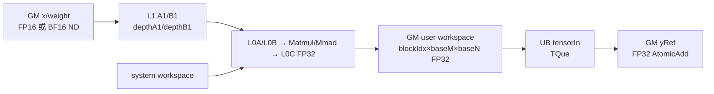

# grouped_matmul_add A2/A3 ACLNN 算子知识

## 算子速览

| 项目 | 内容 |
|---|---|
| 实际入口 | 公开两段式 `aclnnGroupedMatmulAddV2GetWorkspaceSize` / `aclnnGroupedMatmulAddV2`；V2 新增 `groupListType` |
| 计算语义 | 对每组独立原位累加：`yRef_i[M,N] = yRef_i[M,N] + X_i[K_i,M]^T * W_i[K_i,N]`，不是跨组求和 |
| 输入输出 | `x:[K_sum,M]`、`weight:[K_sum,N]` 为同 dtype FP16/BF16 ND；`groupList:[g]` INT64；规范输出 `yRef:[g,M,N]` FP32 |
| 执行类型 | `MIX_CV`：entry 声明 `KERNEL_TYPE_MIX_AIC_1_2`；Cube Matmul 产出 FP32 workspace tile，MTE/UB 路径原子累加到 GM |
| Kernel 路线 | R-001 `classic Matmul -> workspace -> UB -> AtomicAdd`；key 0/1 仅区分 FP16/BF16 模板实例 |
| 核心资源 | GM 输入/原位输出、system workspace、`2*aicNum` 个 `baseM*baseN` FP32 user-workspace tile、L1/L0A/L0B/L0C、单深度 UB queue |
| 来源闭包 | `source_closed`：V2 声明/实现、L0 launcher、经典 Tiling/POD、MIX entry、实际 Process/Compute helpers、OpDef/CMake/双平台 CI 均闭合 |
| 验证状态 | 已完成源码闭包检查；本次知识提取未执行编译、真机、数值或性能测试。 |

## 接口与语义

### 计算语义

设 `g=groupList.shape[0]`，公共 `M=x.shape[1]`、`N=weight.shape[1]`，`K_sum=x.shape[0]=weight.shape[0]`。`transposeX=true` 将物理 `[K_sum,M]` 的每组切片视为 `[M,K_i]`；`transposeWeight=false` 将权重切片视为 `[K_i,N]`。当 `groupListType=0` 时，`K_i=groupList[i]-(i==0?0:groupList[i-1])`；当其为 1 时，`K_i=groupList[i]`。Device 为每组维护 `xBase += M*K_i`、`wBase += K_i*N`、`yBase += M*N`，所以计算是逐组 `yRef_i += X_i^T W_i`，组间输出地址不重叠。

`X/W` 由 Matmul 以 FP32 目的类型累加到临时 tile；该 tile 经 `DataCopyPad` 搬入 FP32 UB，再在 `SetAtomicAdd<float>()` 作用域写入既有 `yRef_i`。源码没有 activation、scale、量化、bias 或输出 cast。

### 输入、输出与属性

| 参数 | shape/layout | dtype | 约束、默认值与语义 |
|---|---|---|---|
| `x` | 物理 `[K_sum,M]`，ND，API 支持非连续 view | FP16 或 BF16 | 必须非空；公开契约要求 `transposeX=true`；第一段将其 `Contiguous` |
| `weight` | `[K_sum,N]`，ND，API 支持非连续 view | 与 `x` 相同 | 必须非空；公开契约要求 `transposeWeight=false`；第一段将其 `Contiguous` |
| `groupList` | `[g]`，ND | INT64 | 第一段要求 rank 1 并 `Contiguous`；type 0 表示累计 K，type 1 表示逐组 K |
| `yRef` | 规范 `[g,M,N]`，ND；API 还接受 storage format NCL | FP32 | 同一 tensor 作为输入和输出，调用前内容参与累加；经典路径只强制总元素数 `g*M*N`，rank 非 3 仅告警 |
| `transposeX` | Host 标量 | BOOL | 公开接口只允许 true；经典 Tiling/Kernel 固定转置 A，但 ACLNN common 未显式拒绝 false |
| `transposeWeight` | Host 标量 | BOOL | 公开接口只允许 false；经典 Tiling/Kernel 固定不转置 B，但 ACLNN common 未显式拒绝 true |
| `groupType` | Host 标量 | INT64 | 公开接口只允许 2；经典 Tiling 写死 2，ACLNN common 未显式校验调用值 |
| `groupListType` | Host 标量 | INT64 | V2 允许且 ACLNN 显式检查 0/1；缺省结构值为 0 |
| `workspaceSize` | Host 输出 | UINT64 | executor 汇总连续化/ViewCopy、system workspace 与算子 user workspace；空输入短路时为 0 |
| `executor` / `stream` | Host 对象 | opaque | executor 保存第一段生成的图；第二段在指定 stream 运行，调用方维持 tensor/workspace 生命周期 |

### 入口与版本

V1 与 V2 共用 `aclnnGroupedMatmulAddGetWorkspaceSizeCommon` 和第二段 `CommonOpExecutorRun`，但 V1 的参数结构沿用 `groupListType=0`，V2 公开 0/1 两种编码，因此 V2 是 A2/A3 上该逻辑算子的最新公开版本。V2 第一段创建 executor，执行检查；当 `x` 或 `weight` 为空时返回 `workspaceSize=0` 且不追加 launcher；否则连续化 `x/weight/groupList`，调用 `l0op::GroupedMatmulAdd`，最后 `ViewCopy(result,yRef)` 保持输出 view 语义。第二段只运行 executor，不重新解释属性。

## Host/Launcher 执行流程

### 参数校验与前处理

顺序是 `CREATE_EXECUTOR -> CheckParams -> CheckZeroShape -> ParamsDataContiguous -> l0op::GroupedMatmulAdd -> ViewCopy -> GetWorkspaceSize`。`CheckParams` 要求指针非空，`x/weight/groupList` storage format 为 ND，`yRef` 为 ND 或 NCL；`x/weight` rank 2、`groupList` rank 1、`x.K==weight.K`、`M>=0`，并要求 `yRef` 总元素数等于 `g*M*N`。`x/weight` 只能是相同的 FP16 或 BF16，`groupList` 为 INT64，`yRef` 为 FP32。经典平台对 `yRef.rank!=3` 只告警；公开文档仍以 `[g,M,N]` 为规范。

`l0op::GroupedMatmulAdd` 用 `OP_INPUT(x1,x2,groupList,yRef)` 和 `OP_OUTPUT(yRef)` 做 shape infer，再把相同输入/输出与属性加入 AICore launcher。任一 infer、launcher、Contiguous、ViewCopy 或 executor 操作失败，第一段返回错误；第二段 runtime 失败映射为 `ACLNN_ERR_INNER`。

### 参数、Workspace 与生命周期

经典 Tiling 从 origin shape 取 `M=x[1]`、`K=x[0]`、`N=weight[1]`、`g=groupList[0]`，从平台取 `aicNum` 和 L1/L0/UB 容量。workspace 连续分配：前部 `sysWorkspaceSize=GetLibApiWorkSpaceSize()` 供 Matmul 库，算子 user 部分为 `2*aicNum*baseM*baseN*4` 字节。Kernel 通过传入的 `workspace` 访问 user 区，通过 `GetSysWorkSpacePtr()` 访问 system 区；每个逻辑 `blockIdx` 使用元素偏移 `blockIdx*baseM*baseN` 的 FP32 tile。源码只显式索引一个 tile，不存在第二个 ping/pong 地址；系数 2 与 `coreNum=aicNum*2`、MIX 1:2 任务域一致，具体 AIC/AIV block 编码由固定仓外 runtime 定义。

Matmul 完成当前 tile、workspace→UB 搬运以及 UB→GM 原子提交后，该 tile 才可复用。executor 不拥有调用方 tensor；workspace、输入和 `yRef` 必须保持到 stream 执行完成。空输入短路 executor 不含算子节点，输出保持调用前内容。

### 启动图与失败传播

非空路径是单节点图：`aclnnGroupedMatmulAddV2 -> l0op::GroupedMatmulAdd -> Tiling4GroupedMatmulAdd -> grouped_matmul_add`。Tiling 为 FP16 写 key 0、BF16 写 key 1，设置 `blockDim=aicNum`；entry 默认 task type 为 `KERNEL_TYPE_MIX_AIC_1_2`，POD 调度步长 `coreNum=aicNum*2`。key 不命中时 entry 无 body，Host 不提供 fallback。A2 由 OpDef `ascend910b` 与 CI list 接线，A3 由 `ascend910_93` 与对应 CI list 接线；二者共用经典实现。

## Route 与参数设计

### 分核与资源计算

Tiling 固定候选 `baseN=256`。`baseK=floor16((L0B/2)/(baseN*2))`，其中 `/2` 为 L0B 双缓冲、末尾 `2` 为输入字节；`baseM` 同时受 `(L0A/2)/(baseK*2)`、`L0C/(baseN*4)`、实际 M 和上限 256 约束，并向 16 对齐。`MultiCoreMatmulTiling` 设置 A/B/C 为 GM ND、C 为 FP32、无 bias，写入原始 `(M,N,K)`、计算 shape `(M,baseN,K)` 和固定 split `(baseM,baseN,baseK)`。

L1 预算以 A 128 KiB、B 256 KiB 各取一半计算 `stepKa/stepKb`，再使较大者为较小者整数倍；`depthA1=2*stepKa`、`depthB1=2*stepKb`，`stepM=stepN=1`。每组 Device 计算 `dimM=ceil(M/baseM)`、`dimN=ceil(N/baseN)`；tile 序号跨组串联，`curBlock` 以 `coreNum` 递增。`blockDimM<=5` 时直接行主映射，否则用 8×8 阈值窗口和最小公倍数打散 M/N tile。

### Route 选择

| 顺序 | Route | Key/模板 | 精确选择条件与优先级 | 不适用去向 |
|---:|---|---|---|---|
| 1 | R-001 classic workspace-AtomicAdd | key 0：`half`；key 1：`bfloat16_t`；均 `xType<true>`、`weightType<false>`、`yType=float` | 非 DAV3510；通过 ACLNN dtype/shape/format；Tiling 按 x dtype 选 0/1；公开契约为 transX=true、transW=false、groupType=2、groupListType 0/1 | dtype 非 FP16/BF16 失败；未知 key 无 body；其他检查失败返回 |

```text
x/weight empty -> Host 成功短路：workspaceSize=0，无 Kernel
否则 IsAdvancedNpuArch=false
  -> FP16 -> key 0 -> R-001<half>
  -> BF16 -> key 1 -> R-001<bfloat16_t>
  -> 其他 dtype -> ACLNN/Tiling 失败
DAV3510 -> 转 A5 advanced route
```

### 模板/实现执行矩阵

| Route | key/selector | dtype/shape/platform 完整命中条件 | 执行族与 kernel 节点 | 实际模板/body | 内存与同步特征 | tail/fallback |
|---|---|---|---|---|---|---|
| R-001 classic workspace-AtomicAdd | 非 DAV3510；key 0 | `x/weight` 同为 FP16，`x/weight` rank 2、`groupList` rank 1、K 相等、`yRef.numel=g*M*N`；公开属性为 `(true,false,2,0/1)` | 单节点 `grouped_matmul_add`，`KERNEL_TYPE_MIX_AIC_1_2`；Matmul 阶段→workspace→MTE2/UB→MTE3 AtomicAdd | `MmImplType<xType<true,half>,weightType<false,half>,yType>`；`GmmAddProcess` + `GmmAddCompute` | system workspace 供 Matmul；每任务 FP32 tile；`WaitIterateAll` 与 `MTE2_MTE3` event | M/N 用 `curSingleM/N`；K_i=0 跳过；未知 key 无 body |
| R-001 classic workspace-AtomicAdd | 非 DAV3510；key 1 | 与 key 0 相同，但 `x/weight` 同为 BF16 | 与 key 0 相同 | `MmImplType<xType<true,bfloat16_t>,weightType<false,bfloat16_t>,yType>`；其余 body 相同 | 与 key 0 相同 | 与 key 0 相同 |

### 隐藏性能 Guard

| Guard | Host/Tiling 条件 | Device/资源原因 | 影响 Route | 不满足时去向 | 源码符号 |
|---|---|---|---|---|---|
| 平台分流 | `!IsAdvancedNpuArch(context)`，即当前架构不在 `{DAV_3510}` | classic POD、MIX task 与 workspace 提交只用于非 advanced 路线 | R-001 | DAV3510 进入 950 advanced Tiling | `Tiling4GroupedMatmulAdd`、`IsAdvancedNpuArch` |
| dtype key | FP16→0，BF16→1 | entry 仅实例化两种 A/B 元素类型，C 固定 FP32 | R-001 | ACLNN dtype 检查失败；异常 key 无 body | `CheckDtype`、`CalMmTiling`、`grouped_matmul_add` |
| `baseK` 容量 | `floor16((L0B/2)/(256*2))` | B 的 L0 双缓冲必须容纳 `baseN*baseK` 输入元素 | R-001 | Tiling/Matmul `GetTiling` 失败，无备用 route | `CalMmTiling` |
| `baseM` 容量 | `min((L0A/2)/(baseK*2), L0C/(256*4), ceil16(M), 256)` | 同时满足 L0A 双缓冲与 FP32 L0C tile | R-001 | Tiling 失败，无 fallback | `CalMmTiling` |
| L1 step | A/B 预算分别按 `BEST_L1_PARTA>>1`、`BEST_L1_PARTB>>1`，并把较大 step 调成较小 step 的倍数 | `depthA1/B1=2*stepKa/Kb` 形成可整除的双缓冲 K 深度 | R-001 | `GetTiling` 或乘积上界检查失败 | `CalTCubeTiling` |
| tile 线性化 | `blockDimM<=5` 直接映射，否则进入 8×8 窗口映射 | 大 M tile 域用阈值窗口改变 M/N 访问次序 | R-001 | 同 route 的另一映射分支 | `MnBlockIdxCompute` |
| 输出有效域 | `curSingleM/N` 由尾 tile 余数产生 | workspace 行宽为 `baseN`，GM 行宽为 N，必须分别设置 stride | R-001 | 无 fallback；有效矩形外不读写 | `GmmAddCompute::MmCompute` |

### POD/ABI

`GroupedMatmulAddTilingData` 依次嵌入 `GmmBaseParams` 与公共 `TCubeTiling`。四个本地字段均为 int64，逻辑布局连续；生成宏与 `TCubeTiling` 完整定义位于固定仓外，因此 outer `sizeof/alignof/offsetof` 及 `TCubeTiling` 精确偏移固定仓不可见，不能与 950 手写 `pack(8)` POD 互换。

| 结构 | 字段 | 类型/位宽 | ABI 布局 | 单位 | Host/launcher producer | Device consumer | 边界 |
|---|---|---|---|---|---|---|---|
| `GmmBaseParams` | `groupNum` | int64/64 | 本地逻辑 offset 0、sizeof 8、alignof 8；最终 offsetof 固定仓不可见 | 组 | `Tiling4GroupedMatmulAdd: groupListShape[0]` | `GmmAddProcess::Init/Process` | API rank 1；经典源码未校验上限 |
| `GmmBaseParams` | `coreNum` | int64/64 | 本地逻辑 offset 8、sizeof 8、alignof 8；最终 offsetof 固定仓不可见 | MIX 任务 | `aicNum*2` | `Process: curBlock+=coreNum` | 必须正 |
| `GmmBaseParams` | `groupType` | int64/64 | 本地逻辑 offset 16、sizeof 8、alignof 8；最终 offsetof 固定仓不可见 | 枚举 | 固定写 2 | `Process` | 公开契约仅 2 |
| `GmmBaseParams` | `groupListType` | int64/64 | 本地逻辑 offset 24、sizeof 8、alignof 8；本地总长 32；最终 offsetof 固定仓不可见 | 枚举 | attr[3]，空则 0 | `GetSplitValueFromGroupList` | V2 限 0/1 |
| `TCubeTiling` | `M` | 固定宽度由公共头定义，固定仓不可见 | sizeof/alignof/offsetof 固定仓不可见 | 元素 | `GetTiling`，源 x[1] | `SetMKN` | 非空路径 >0 |
| `TCubeTiling` | `N` | 固定仓不可见 | sizeof/alignof/offsetof 固定仓不可见 | 元素 | `GetTiling`，源 weight[1] | `SetMKN`、GM stride | 非空路径 >0 |
| `TCubeTiling` | `Ka` | 固定仓不可见 | sizeof/alignof/offsetof 固定仓不可见 | 元素 | `GetTiling`，原始 K | Matmul 内部 | 每组 K 由 single shape 覆盖 |
| `TCubeTiling` | `Kb` | 固定仓不可见 | sizeof/alignof/offsetof 固定仓不可见 | 元素 | `GetTiling`，原始 K | Matmul 内部 | 同 `Ka` |
| `TCubeTiling` | `singleCoreM` | 固定仓不可见 | sizeof/alignof/offsetof 固定仓不可见 | 元素 | `GetTiling` | Matmul | wrapper 另传 curM |
| `TCubeTiling` | `singleCoreN` | 固定仓不可见 | sizeof/alignof/offsetof 固定仓不可见 | 元素 | `GetTiling` | Matmul | wrapper 另传 curN |
| `TCubeTiling` | `singleCoreK` | 固定仓不可见 | sizeof/alignof/offsetof 固定仓不可见 | 元素 | `GetTiling` | Matmul | wrapper 另传 K_i |
| `TCubeTiling` | `baseM` | 固定仓不可见 | sizeof/alignof/offsetof 固定仓不可见 | 元素 | `CalMmTiling` | Process、UB/workspace、Matmul | 16 对齐且 <=256 |
| `TCubeTiling` | `baseN` | 固定仓不可见 | sizeof/alignof/offsetof 固定仓不可见 | 元素 | `CalMmTiling` | Process、CopyPad、Matmul | 候选 256 |
| `TCubeTiling` | `baseK` | 固定仓不可见 | sizeof/alignof/offsetof 固定仓不可见 | 元素 | `CalMmTiling` | Matmul K tile | L0B 推导并 16 向下对齐 |
| `TCubeTiling` | `stepM` | 固定仓不可见 | sizeof/alignof/offsetof 固定仓不可见 | tile | 固定 1 | Matmul | 固定 1 |
| `TCubeTiling` | `stepN` | 固定仓不可见 | sizeof/alignof/offsetof 固定仓不可见 | tile | 固定 1 | Matmul | 固定 1 |
| `TCubeTiling` | `stepKa` | 固定仓不可见 | sizeof/alignof/offsetof 固定仓不可见 | K tile | 128 KiB A 预算 | Matmul | 与 depthA1 配套 |
| `TCubeTiling` | `stepKb` | 固定仓不可见 | sizeof/alignof/offsetof 固定仓不可见 | K tile | 256 KiB B 预算 | Matmul | 与 depthB1 配套 |
| `TCubeTiling` | `depthA1` | 固定仓不可见 | sizeof/alignof/offsetof 固定仓不可见 | K tile | `2*stepKa` | A1 buffer | 双缓冲深度 |
| `TCubeTiling` | `depthB1` | 固定仓不可见 | sizeof/alignof/offsetof 固定仓不可见 | K tile | `2*stepKb` | B1 buffer | 双缓冲深度 |
| `TCubeTiling` | `shareMode` | 固定仓不可见 | sizeof/alignof/offsetof 固定仓不可见 | 模式 | 固定 0 | Matmul | 不得改为共享模式 |
| `TCubeTiling` | `usedCoreNum` | 固定仓不可见 | sizeof/alignof/offsetof 固定仓不可见 | core | `GetTiling` | Matmul | 外层 blockDim 另取 aicNum |
| `TCubeTiling` | `isBias` | 固定仓不可见 | sizeof/alignof/offsetof 固定仓不可见 | bool | `SetBias(false)` | Matmul | 固定无 bias |
| `TCubeTiling` | `iterateOrder` | 固定仓不可见 | sizeof/alignof/offsetof 固定仓不可见 | 枚举 | `GetTiling` | Matmul | 枚举值固定仓不可见 |
| `TCubeTiling` | `dbL0A` | 固定仓不可见 | sizeof/alignof/offsetof 固定仓不可见 | buffer | `GetTiling` | L0A | 由公共 tiling 决定 |
| `TCubeTiling` | `dbL0B` | 固定仓不可见 | sizeof/alignof/offsetof 固定仓不可见 | buffer | `GetTiling` | L0B | 由公共 tiling 决定 |
| `TCubeTiling` | `dbL0C` | 固定仓不可见 | sizeof/alignof/offsetof 固定仓不可见 | buffer | `GetTiling` | L0C | 由公共 tiling 决定 |

### Route 源码闭包

| Route | Key/selector | Host/Tiling producer | POD/参数 | Kernel entry/router | Kernel body/直接依赖 | 构建接线 |
|---|---|---|---|---|---|---|
| R-001 classic workspace-AtomicAdd | key 0 FP16 / key 1 BF16；非 DAV3510 | `grouped_matmul_add_tiling.cpp::Tiling4GroupedMatmulAdd/CalMmTiling/CalTCubeTiling` | `GroupedMatmulAddTilingData{GmmBaseParams,TCubeTiling}`；system + user workspace | `grouped_matmul_add.cpp::grouped_matmul_add` | `GmmAddProcess::{Process,MnBlockIdxCompute,UpdateMnConfig}`；`GmmAddCompute::{MmComputePrepare,MmCompute,SetGlobalBufferW}`；`GetSplitValueFromGroupList` | OpDef 配置 910B/910_93；CMake；两份 CI operator list |

## Kernel 实现

### 公共执行流程

两个 dtype key 共享调度、地址、workspace 和同步图，仅元素类型不同。entry 注册 Matmul 时把 system workspace 交给库；`GmmAddCompute::Init` 把 user `workspace` 保存为临时 FP32 输出，把 entry 输出 `yRef` 保存为原位 GM，并分配 `baseM*baseN*4` 字节单深度 `VECIN` queue。`GmmAddProcess` 采用“先提交上一 tile、再准备当前 tile”的流水：首次 `MmCompute` 只递增 `cubeNum`，循环后显式 flush 最后一 tile。

### Route R-001：classic workspace-AtomicAdd

#### 适用条件

##### 选择证据

| 层级 | 文件 | 符号 | 源码谓词/参数 | 结果/下一跳 |
|---|---|---|---|---|
| ACLNN | gmm/grouped_matmul_add/op_api/aclnn_grouped_matmul_add.cpp | `CheckParams/CheckZeroShape` | 非空且 dtype/format/rank/总输出元素数合法；`groupListType==0\|\|1` | 空输入成功短路；非空进入 L0；失败返回 |
| Tiling | gmm/grouped_matmul_add/op_host/op_tiling/grouped_matmul_add_tiling.cpp | `Tiling4GroupedMatmulAdd/CalMmTiling` | `IsAdvancedNpuArch==false`；x dtype FP16/BF16 | key 0/1、blockDim、workspace 与 POD |
| Router | gmm/grouped_matmul_add/op_kernel/grouped_matmul_add.cpp | `grouped_matmul_add` | `TILING_KEY_IS(0)` 或 `TILING_KEY_IS(1)` | half 或 bfloat16_t 的同一 body |

#### Device 数据流

##### 函数级调用链

```text
grouped_matmul_add
  -> GET_TILING_DATA_MEMBER + REGIST_MATMUL_OBJ
  -> GmmAddCompute::Init
  -> GmmAddProcess::Init/Process
    -> GetSplitValueFromGroupList -> SetMNConfig -> MnBlockIdxCompute
    -> GmmAddCompute::MmCompute(previous)
      -> Matmul::IterateAll(workspaceTile) -> Matmul::WaitIterateAll
      -> DataCopyPad(workspaceTile,tensorIn) -> SetFlag/WaitFlag<MTE2_MTE3>
      -> SetAtomicAdd<float> -> DataCopyPad(yRefTile,tensorIn) -> SetAtomicNone
    -> GmmAddCompute::MmComputePrepare(current)
      -> SetGlobalBufferW -> Matmul::SetSingleShape/SetTensorA/SetTensorB
    -> UpdateMnConfig
  -> GmmAddCompute::MmCompute(last flush)
```

##### 源码等价伪码

```text
伪码：preOffset=0; count=0; cubeNum=0
for groupIdx in [0,groupNum):
  Ki = type0 ? groupList[groupIdx]-preOffset : groupList[groupIdx]
  if type0: preOffset=groupList[groupIdx]
  M=tiling.M; N=tiling.N; dimM=ceil(M/baseM); dimN=ceil(N/baseN)
  if Ki==0: xBase+=M*Ki; wBase+=Ki*N; yBase+=M*N; continue
  curCount=count+dimM*dimN
  for curBlock=mapped(coreIdx,count); curBlock<curCount; curBlock+=coreNum:
    (mIdx,nIdx)=thresholded_MN_mapping(curBlock-count)
    compute_previous_tile_if_prepared()
    curM=min(baseM,M-mIdx*baseM); curN=min(baseN,N-nIdx*baseN)
    A=x+xBase+mIdx*baseM; B=weight+wBase+nIdx*baseN
    Matmul.SetSingleShape(curM,curN,Ki); SetTensorA(A,true); SetTensorB(B,false)
    remember_current_as_previous
  xBase+=M*Ki; wBase+=Ki*N; yBase+=M*N; count=curCount%coreNum
flush_last_prepared_tile():
  Ctmp=workspace+blockIdx*baseM*baseN
  Matmul.IterateAll(Ctmp); Matmul.WaitIterateAll()
  copy curM rows * curN FP32 from Ctmp to UB with row width baseN; wait MTE2_MTE3
  enable FP32 atomic; add UB valid rectangle to yRef[yBase+mIdx*baseM*N+nIdx*baseN]; disable atomic
```

#### 内存与数据搬运

##### 资源与搬运表

| 层级/缓冲区 | offset/地址公式 | extent/容量公式 | dtype/layout | producer | consumer | owner/lifetime | 对齐/复用 |
|---|---|---|---|---|---|---|---|
| GM `x` | `xBase+mIdx*baseM`；组后 `xBase+=M*K_i` | 当前逻辑域 `K_i*curM`；物理 stride M | FP16/BF16 ND `[K_sum,M]`，transA=true | caller/Contiguous | Matmul GM→A1 | caller/stream | M tail=curM；K_i=0 跳组 |
| GM `weight` | `wBase+nIdx*baseN`；组后 `wBase+=K_i*N` | `K_i*curN`，stride N | 同 x dtype ND，transB=false | caller/Contiguous | Matmul GM→B1 | caller/stream | N tail=curN |
| GM `groupList` | `groupIdx*8` 字节 | `g*8` | INT64 ND | caller/Contiguous | group decoder | caller/group loop | 每读前 DCCI；type0 保存 preOffset |
| GM `yRef` | `yBase+(mIdx*baseM)*N+nIdx*baseN`；组后 `yBase+=M*N` | 每组 `M*N*4`，总 `g*M*N*4` | FP32 ND 原位 | caller 初值 + UB atomic | caller 后继 | caller/stream | 只提交 curM×curN；组地址互斥 |
| system workspace | `GetSysWorkSpacePtr()`，内部 offset 固定仓不可见 | `GetLibApiWorkSpaceSize()` | Matmul 私有 | runtime | `REGIST_MATMUL_OBJ` | executor launch | 内部布局固定仓不可见 |
| user workspace | `(blockIdx*baseM*baseN)*4` | `2*aicNum*baseM*baseN*4` | FP32，行宽 baseN | Matmul | MTE2 DataCopyPad | executor；写到搬完 | block 私有；不读行尾 padding |
| L1 A1 | 内部 offset 固定仓不可见 | `depthA1*baseM*baseK*2` | 输入 dtype/Cube A1 | GM copy | L0A loader | Matmul/tile | `depthA1=2*stepKa` |
| L1 B1 | 内部 offset 固定仓不可见 | `depthB1*baseN*baseK*2` | 输入 dtype/Cube B1 | GM copy | L0B loader | Matmul/tile | `depthB1=2*stepKb` |
| L0A | 内部 offset 固定仓不可见 | `dbL0A*baseM*baseK*2` 上界语义 | 输入 dtype/fractal | L1 | Mmad | K tile | 16 对齐；实际布局由 Matmul |
| L0B | 内部 offset 固定仓不可见 | `dbL0B*baseN*baseK*2` 上界语义 | 输入 dtype/fractal | L1 | Mmad | K tile | 16 对齐 |
| L0C | 内部 offset 固定仓不可见 | `dbL0C*baseM*baseN*4` 上界语义 | FP32 | Mmad | workspace copy-out | output tile | curM/curN 由 SetSingleShape |
| UB `tensorIn` | local offset 0 | `baseM*baseN*4`，queue depth 1 | FP32，行宽 baseN | workspace MTE2 | GM MTE3 atomic | Compute lifetime | 有效行 curN，padding 不提交 |
| 寄存器/标量 | `MNConfig` 与 indices | O(1) | uint32/uint64/int32 | helpers | 地址/循环 | 单 task | base offset 用 uint64；K_i 收窄 int32 |

##### 分层内存布局



##### 字节账、交接边与复用顺序

```text
system_workspace = GetLibApiWorkSpaceSize()
user_workspace = 2 * aicNum * baseM * baseN * sizeof(float)
workspace_total = system_workspace + user_workspace
L1_A = depthA1 * baseM * baseK * sizeof(input)
L1_B = depthB1 * baseN * baseK * sizeof(input)
L0A <= dbL0A * baseM * baseK * sizeof(input)
L0B <= dbL0B * baseN * baseK * sizeof(input)
L0C <= dbL0C * baseM * baseN * sizeof(float)
UB_total = baseM * baseN * sizeof(float), queue_depth = 1
```

| 边/复用子区 | producer | offset/extent | dtype/layout | consumer | ordering/sync | owner/lifetime | 安全条件 |
|---|---|---|---|---|---|---|---|
| Matmul→workspace | `mm.IterateAll` | 元素 offset `blockIdx*baseM*baseN`；容量 `baseM*baseN*4` B | FP32，物理行宽 `baseN` | `DataCopyPad` MTE2 | `mm.WaitIterateAll()` 后读取 | executor user workspace；当前 tile 搬完前不可覆盖 | 每逻辑 task 独占 tile；只搬 `curM*curN` 有效域 |
| workspace→UB | MTE2 `DataCopyPad` | `curM` 行，每行 `curN*4` B；dst stride `(baseN-curN)*4/32` blocks | FP32 | MTE3 原子写 | `SetFlag/WaitFlag<MTE2_MTE3>` | `tensorIn`，单深度 queue，Compute 对象析构释放 | MTE3 只在 event 后消费 |
| UB→`yRef` | MTE3 `DataCopyPad` | GM offset `(yBase+mIdx*baseM*N+nIdx*baseN)*4`；`curM*curN` | FP32 row-major | 调用方/后继 | `SetAtomicAdd<float>` 到 `SetAtomicNone` | caller 持有 `yRef` 至 stream 完成 | dst stride `(N-curN)*4` B；尾块不越界 |
| tile pipeline 复用 | `MmCompute(previous)` | 同一 block workspace 与同一 UB | FP32 | `MmComputePrepare(current)` 后续提交 | 先完成 previous 的 Matmul、搬运、原子写，再重用 | block/task 私有，逐 tile 循环 | 首次调用仅预热，循环末显式 flush |

#### 同步、精度与尾块

##### 同步与数值边界表

| 阶段 | primitive/机制 | producer | consumer/等待点 | 保护对象 | 精度/尾块 |
|---|---|---|---|---|---|
| Matmul 提交 | `IterateAll<false>` + `WaitIterateAll` | GM→L1→L0A/B→Mmad→L0C→workspace | workspace reader | 当前 FP32 tile | FP16/BF16 输入、FP32 累加；K_i/curM/curN 传给 single shape |
| MIX 交接 | workspace GM + Matmul wait；无显式 `ASCEND_IS_AIC/AIV` 或 cross-core flag | Cube/Matmul 写 workspace | 随后 MTE2 reader | block 私有 tile | task type 1 AIC:2 AIV；更细核映射固定仓不可见 |
| workspace→UB | `DataCopyPad` + `SetFlag/WaitFlag<MTE2_MTE3>` | MTE2 | MTE3 | `tensorIn` | blockCount=curM、blockLen=curN*4；UB 行尾到 baseN |
| 原位提交 | `SetAtomicAdd<float>` / `DataCopyPad` / `SetAtomicNone` | UB/MTE3 | GM yRef | 既有 FP32 tile | 仅 curM×curN；无 cast/round/scale |
| K 解码 | DCCI + scalar `GetValue` | GM groupList | Process | K_i/preOffset | type0 差分，type1 直取；负值无防护 |
| 空组/空域 | `if k==0 continue`；API 空 tensor 短路 | Host/decoder | 下一组/调用方 | 不产生 tile | K_i=0 保持该组 y；整体空输入不 launch |
| M/N tail | ceil + curSingleM/N + DataCopyPad | scheduler | Matmul/GM | 尾 tile | 不读 UB padding、不写越界；无 fallback |

#### 关键实现

##### 符号证据表

| 阶段 | 文件 | 符号/模板实例 | 实现事实 |
|---|---|---|---|
| Host/Tiling producer | gmm/grouped_matmul_add/op_host/op_tiling/grouped_matmul_add_tiling.cpp | `Tiling4GroupedMatmulAdd/CalMmTiling/CalTCubeTiling` | selector、key、base/step/depth、blockDim、workspace |
| Kernel entry/router | gmm/grouped_matmul_add/op_kernel/grouped_matmul_add.cpp | `grouped_matmul_add`；`MmImplType<xType<true>,weightType<false>,yType>` | MIX task、key0/key1、system/user workspace 映射 |
| Device body/helper | gmm/grouped_matmul_add/op_kernel/grouped_matmul_add.cpp | `GmmAddProcess::Process/MnBlockIdxCompute/UpdateMnConfig` | 跨组调度、K_i、x/w/y offset、last flush |
| Device body/helper | gmm/grouped_matmul_add/op_kernel/grouped_matmul_add.cpp | `GmmAddCompute::MmComputePrepare/MmCompute/SetGlobalBufferW` | Matmul 绑定、workspace、UB、event、AtomicAdd 与 tail |
| Device body/helper | gmm/grouped_matmul_add/op_kernel/grouped_matmul_add.h | `GetSplitValueFromGroupList` | cumsum 差分/直接长度、DCCI 与 int64→int32 边界 |

## 算子特定优化

### Trick T-001：上一 tile 提交与当前 tile 准备交错

#### 触发与源码依据

- 适用 Route：R-001。
- 触发条件：非 DAV3510、非空输入、key 0/1，且当前 task 获得至少一个非空 K 组 tile。
- Golden 来源：[`gmm/grouped_matmul_add/op_kernel/grouped_matmul_add.cpp:229-246`](../../../../../../../cann-ops-raw/ascendc/ops-transformer/be33d95bb755cedec3108f70805c1874d1792540/gmm/grouped_matmul_add/op_kernel/grouped_matmul_add.cpp#L229-L246)

**官方源码（固定 Commit 连续逐字摘录）**：

```cpp
while (curBlock < curCount) {
    MnBlockIdxCompute(mnConfig, curBlock, count, thresholdM_dimN);
    /*先准备数据再计算有助于优化流水*/
    computeOp.MmCompute(lastMnConfig, blockIdx);
    computeOp.MmComputePrepare(groupIdx, mnConfig);
    lastGroupIdx = groupIdx;
    lastMnConfig = mnConfig;
    curBlock += gmmBaseParams->coreNum;
    mnPreConfig = mnConfig;
}
UpdateMnConfig(mnConfig);
count = curCount % gmmBaseParams->coreNum;
...
computeOp.MmCompute(lastMnConfig, blockIdx);
```

#### 机制与设计原因

`MmCompute` 第一次只把 `cubeNum` 从 0 置为 1，随后每轮先完成上一 tile 的 Matmul→workspace→UB→AtomicAdd，再为当前 tile调用 `SetSingleShape/SetTensorA/SetTensorB`；循环外的最终调用负责 flush。该顺序把“当前地址/shape 准备”和“上一 tile 提交”交错，同时避免最后一块遗漏。

#### 迁移边界

- 适用：同样以一个 task 私有 workspace tile 和单深度 UB 暂存完成原位累加的 Matmul 流水。
- 前提：previous tile 的 `MNConfig` 生命周期、`WaitIterateAll`、workspace offset 与最终 flush 均保持一致。
- 失效：若改成多深度 workspace/UB、异步跨 task 消费或 950 直接原子写 C，必须重建同步与 flush 协议。
- 未验证：本次知识提取未执行编译、真机、数值或性能测试。

#### 错误做法

删除循环后的 `MmCompute(lastMnConfig, blockIdx)` 会使最后一个已 prepare 的 tile 不提交；把 prepare 移到第一次有效 compute 之前而不保留 `cubeNum` 预热语义会读取未初始化的 previous config。

### Trick T-002：FP32 临时 tile 经有效矩形搬运后原子累加

#### 触发与源码依据

- 适用 Route：R-001。
- 触发条件：key 0/1 的每个有效 M/N tile。
- Golden 来源：[`gmm/grouped_matmul_add/op_kernel/grouped_matmul_add.cpp:339-355`](../../../../../../../cann-ops-raw/ascendc/ops-transformer/be33d95bb755cedec3108f70805c1874d1792540/gmm/grouped_matmul_add/op_kernel/grouped_matmul_add.cpp#L339-L355)

**官方源码（固定 Commit 连续逐字摘录）**：

```cpp
mm.template IterateAll<sync>(yRefGm, 0, true, true);
mm.WaitIterateAll();

AscendC::DataCopyPadExtParams<CT> copyPadParams{false, 0, 0, 0};
AscendC::DataCopyExtParams copyParams{
    static_cast<uint16_t>(curSingleM), static_cast<uint32_t>(curSingleN * sizeof(CT)), 0,
    static_cast<uint32_t>((mnConfig.baseN - curSingleN) * sizeof(CT) / UB_BLOCK_UNIT_SIZE), 0};
AscendC::DataCopyPad<CT>(tensorIn, yRefGm, copyParams, copyPadParams);
AscendC::SetFlag<AscendC::HardEvent::MTE2_MTE3>(eventIDMTE2ToMTE3);
AscendC::WaitFlag<AscendC::HardEvent::MTE2_MTE3>(eventIDMTE2ToMTE3);
AscendC::SetAtomicAdd<CT>();
```

#### 机制与设计原因

Matmul 先把 FP32 tile 写到 block 私有 workspace；MTE2 只取 `curSingleM×curSingleN` 有效矩形并按 `baseN` 跳过临时行尾，再由 MTE3 在 FP32 atomic 作用域写入原位 `yRef`。该机制同时解决 Matmul 临时 C 行宽与真实 N stride 不同、以及原位“旧 y + 新乘积”的语义。

#### 迁移边界

- 适用：输出为 FP32、需要保留旧值、且 Matmul C 先物化为固定行宽临时 tile 的路线。
- 前提：workspace/UB 容量至少 `baseM*baseN*4` B，event 次序与两个 stride 单位不变。
- 失效：非 FP32 输出、非原位覆盖、或 950 `IterateAll(...,1)` 直接原子提交不使用此路径。
- 未验证：本次知识提取未执行编译、真机、数值或性能测试。

#### 错误做法

固定源码的反例边界是把 workspace 行宽 `baseN` 与 GM 行宽 N 混用：这会使尾 N tile 的跨行地址错误；源码分别设置 dst stride 与 GM stride避免该问题。

## 模板与实现对比

| 对比维度 | R-001 key 0 FP16 | R-001 key 1 BF16 | 设计选择依据 |
|---|---|---|---|
| 命中条件/优先级 | 非 DAV3510、x/w FP16 | 非 DAV3510、x/w BF16 | `CalMmTiling` 按 x dtype 唯一选 key |
| 执行族/节点图 | MIX_CV 单 entry：Matmul→workspace→UB→AtomicAdd | 相同 | 仅 A/B 元素类型不同，任务图与 body 共用 |
| M/N/K、tile 与 scheduler | `baseN=256`，M/K 由 L0 容量；5/8 阈值映射 | 相同 | shape/resource 与 dtype size（两者均 2 B）一致 |
| workspace/L1/L0/UB | FP32 user tile；输入层级为 FP16 | FP32 user tile；输入层级为 BF16 | C/UB/yRef 固定 FP32，A/B 模板类型随 key |
| AIC/AIV 或 kernel 交接 | `WaitIterateAll` 后 workspace→UB，MTE2_MTE3 event | 相同 | operator source 无 dtype 专属同步 |
| 同步、精度与 tail | FP16×FP16→FP32；curM/N | BF16×BF16→FP32；curM/N | `yType=float` 与同一 CopyPad/AtomicAdd body |
| fallback/失败边界 | 非 FP16 进入 dtype 失败 | 非 BF16 进入 dtype 失败 | 未知 key 无 body，不存在设备 fallback |

## 平台差异

| 项目 | A2 | A3 | 950 |
|---|---|---|---|
| 支持状态 | OpDef `ascend910b`、README 与 CI 支持 V2 | OpDef `ascend910_93`、README 与 CI 支持 V2 | OpDef `ascend950` 与 CI 支持；见 `_950` 卡 |
| Host/Launcher | 与 A3 共用 classic Tiling；`yRef.rank!=3` 只告警 | 与 A2 相同 | advanced Tiling 强制 y rank 3、y[0]==g、固定属性、groupNum 1..1024 |
| Kernel/资源 | key 0/1，MIX 1:2，大块 FP32 workspace→UB→AtomicAdd | 同 A2 | key 10000900009000090001，AIC-only CGMCT，32B workspace，占位后 Matmul 原子直写 y |

## 限制与失败边界

- 公开契约限定 `transposeX=true`、`transposeWeight=false`、`groupType=2`、`groupListType∈{0,1}`；A2/A3 ACLNN common 只显式检查最后一项，经典实现固定采用前三项语义，越契约调用不是受支持 fallback。
- 规范 `yRef` 是 `[g,M,N]`。经典源码只检查总元素数并对非 3D 告警；NCL 仅在 API storage-format 检查接受，Kernel 仍按连续 row-major `g*M*N` 访问，不能推广任意 rank/layout。
- Host 不核验 groupList 单调、非负或总和等于 `K_sum`。Device 将值收窄为 int32，负值随后进入 uint32 shape；这些输入属于未保护边界。
- 文档要求每组维度 32B 对齐后小于 INT32_MAX、物理最后维小于 65536。workspace 公式使用 uint32 中间量，固定源码没有额外溢出检查。
- 文档声明默认确定性，但 Device 使用 FP32 AtomicAdd；固定仓无跨 task 原子提交顺序证明或真机测试，本卡不外推 bitwise 确定性。
- `TCubeTiling` 完整 ABI、Matmul 内部 L1→L0A/L0B→Mmad→L0C 的 event/flag 编号固定仓不可见；已闭合本算子命名字段、实例参数和显式 workspace/UB/GM 边。

## 源码索引

### 链路索引

| 链路阶段 | 文件 | 关键符号 | 支撑内容 |
|---|---|---|---|
| 入口声明/约束 | gmm/grouped_matmul_add/op_api/aclnn_grouped_matmul_add_v2.h | `aclnnGroupedMatmulAddV2*` | V2 ABI、dtype、属性与 groupListType |
| 公开文档 | gmm/grouped_matmul_add/docs/aclnnGroupedMatmulAddV2.md | `aclnnGroupedMatmulAddV2` | 平台、规范 shape、确定性声明与维度限制 |
| 入口实现 | gmm/grouped_matmul_add/op_api/aclnn_grouped_matmul_add.cpp | `CheckParams/GetWorkspaceSizeCommon` | 检查、空输入、Contiguous、ViewCopy、executor |
| Host/Launcher | gmm/grouped_matmul_add/op_api/grouped_matmul_add.cpp | `l0op::GroupedMatmulAdd` | yRef 输入输出绑定、infer 与 launcher |
| OpDef/平台 | gmm/grouped_matmul_add/op_host/grouped_matmul_add_def.cpp | `GroupedMatmulAdd` | schema 与 910B/910_93/950 配置 |
| POD 声明 | gmm/grouped_matmul_add/op_host/op_tiling/grouped_matmul_add_tiling.h | `GmmBaseParams/GroupedMatmulAddTilingData` | classic POD 与嵌套次序 |
| Host/Tiling/Launcher | gmm/grouped_matmul_add/op_host/op_tiling/grouped_matmul_add_tiling.cpp | `Tiling4GroupedMatmulAdd` | selector、tile、POD、blockDim、workspace |
| Kernel entry/body | gmm/grouped_matmul_add/op_kernel/grouped_matmul_add.cpp | `grouped_matmul_add/GmmAddProcess/GmmAddCompute` | router、调度、Matmul、workspace/UB/AtomicAdd |
| Kernel helper | gmm/grouped_matmul_add/op_kernel/grouped_matmul_add.h | `MmImplType/GetSplitValueFromGroupList` | 实例与 groupList 解码 |
| 构建接线 | gmm/grouped_matmul_add/op_host/CMakeLists.txt | `add_ops_compile_options/add_modules_sources` | OpDef/API 与 Kernel 编译选项 |
| A2 CI 接线 | scripts/ci/ascend910b/ops_transformer_operator_list.yaml | `grouped_matmul_add` | A2 build/CI 纳入 |
| A3 CI 接线 | scripts/ci/ascend910_93/ops_transformer_operator_list.yaml | `grouped_matmul_add` | A3 build/CI 纳入 |

### 实现复用检查

| 检查项 | 可复用事实 | 不得改变的约束 | 源码符号 |
|---|---|---|---|
| ABI/POD | `GmmBaseParams` 四字段与嵌套 TCube 的 producer/consumer | 字段顺序/位宽、单位、外部 TCube ABI；不得套用 950 POD | `GroupedMatmulAddTilingData`、`GET_TILING_DATA_MEMBER` |
| 调用顺序 | Check→empty→Contiguous→L0→Tiling→Kernel→ViewCopy 图 | first compute 预热、loop 后 last flush、组 offset 推进 | `GetWorkspaceSizeCommon`、`GmmAddProcess::Process` |
| workspace/内存 | system 区 + `2*aicNum` FP32 tiles、blockIdx 地址、单深度 UB | 总字节、row stride、lifetime 与 `yBase+=M*N` | `Tiling4GroupedMatmulAdd`、`GmmAddCompute::Init/MmCompute` |
| 同步 | Matmul wait→MTE2_MTE3 event→AtomicAdd | reader 不得越过 wait；必须恢复 AtomicNone | `GmmAddCompute::MmCompute` |
| 精度与尾块 | FP16/BF16 输入、FP32 Matmul/UB/yRef；curM/curN 有效域 | 不得添加 cast/scale/bias；CopyPad stride 与 tail 不变 | `MmImplType`、`MmComputePrepare/MmCompute` |
| 失败边界 | 空输入无 launch；非法 dtype/format/rank/size 失败；未知 key 无 body | 不得把未校验属性/groupList 描述为安全支持，不得发明 fallback | `CheckParams/CheckZeroShape/CalMmTiling/grouped_matmul_add` |