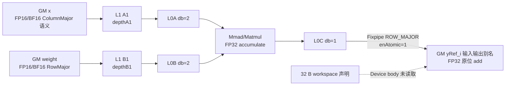

# grouped_matmul_add 950 ACLNN 算子知识

## 算子速览

| 项目 | 内容 |
|---|---|
| 实际入口 | aclnnGroupedMatmulAddV2GetWorkspaceSize / aclnnGroupedMatmulAddV2 |
| 计算语义 | 每组独立原位累加：`yRef_i[M,N] += X_i[K_i,M]^T * W_i[K_i,N]` |
| 输入输出 | `x/weight:[K_sum,M/N]` FP16 或 BF16 ND，`groupList:[g]` INT64，`yRef:[g,M,N]` FP32 ND |
| 执行类型 | AIC_CUBE |
| Kernel 路线 | R-001 arch35 CGMCT multi-block-bias |
| 核心资源 | GM、32 B workspace 声明、L1、L0A/L0B/L0C；UB N/A |
| 来源闭包 | source_closed：公开入口至 CGMCT scheduler/Mmad body 和构建闭合 |
| 验证状态 | 已完成源码闭包检查；本次知识提取未执行编译、真机、数值或性能测试。 |

## 接口与语义

### 计算语义

设 `g=groupList.shape[0]`、公共 `M=x.shape[1]`、`N=weight.shape[1]`，`K_sum=x.shape[0]=weight.shape[0]`。公开契约固定 `transposeX=true`、`transposeWeight=false`、`groupType=2`；当 `groupListType=0` 时 `K_i=groupList[i]-(i==0?0:groupList[i-1])`，当其为 1 时 `K_i=groupList[i]`。Device 每组推进 `A += M*K_i`、`B += N*K_i`、`C += M*N`，所以 `yRef_i += X_i^T W_i`，不是把多个组求和到同一个输出。

950 的 `MatmulMultiBlockBias<>` 是实际 dispatch policy 名称，但 `TCubeTiling.isBias=0` 且 params 中 bias 地址为 `nullptr`；原位加法由 `BlockMmadOp::IterateAll(cGlobal, 1)` 的 atomic 模式经 DAV3510 `Fixpipe` 直接提交到对应 `yRef_i`，不是读取 bias tensor，也不经过 A2/A3 的 workspace→UB 路线。950 entry 的七个 GM 参数中，CGMCT 实例实际把第 4 个输入 `y` 作为 C 地址，第 5 个输出 `yRef` 和第 6 个 `workspace` 均未传入 body；这一点依赖 L0 对同一个 ACLNN `yRef` 建立输入/输出别名，不能改成两个独立缓冲区。

### 输入、输出与属性

| 参数 | shape/layout | dtype | 约束、默认值与语义 |
|---|---|---|---|
| `x` | `[K_sum,M]` ND；API 支持非连续 view | FP16/BF16 | 仅一个 tensor，必须逻辑转置；第一段 `Contiguous` |
| `weight` | `[K_sum,N]` ND；API 支持非连续 view | 与 x 相同 | 仅一个 tensor，不转置；第一段 `Contiguous` |
| `groupList` | `[g]` ND | INT64 | 0 为累计 K，1 为逐组 K；第一段 `Contiguous` |
| `yRef` | `[g,M,N]` ND | FP32 | 原位输入输出；950 ACLNN 明确要求 rank 3 且首维等于 g |
| `transposeX` | Host 标量 | BOOL | 当前仅支持 true；advanced Tiling 显式检查 |
| `transposeWeight` | Host 标量 | BOOL | 当前仅支持 false；advanced Tiling 显式检查 |
| `groupType` | Host 标量 | INT64 | 当前仅支持 2；advanced Tiling 显式检查 |
| `groupListType` | Host 标量 | INT64 | V2 仅 0/1；ACLNN 显式检查 |
| `workspaceSize` | Host 输出 | UINT64 | executor 总 workspace；950 核心算子节点声明 32 B，但 Device body 不读取该参数；Contiguous/ViewCopy 的框架 workspace 另计 |
| `executor/stream` | Host 对象 | opaque | 两段式执行图与执行 stream；调用方保持 tensor/workspace 生命周期 |

### 入口与版本

公开 V1 只表达累计 groupList；V2 新增 `groupListType` 并支持 0/1，因此 `aclnnGroupedMatmulAddV2GetWorkspaceSize/aclnnGroupedMatmulAddV2` 是 950 上该逻辑算子的最新公开入口。README、V2 文档、OpDef `ascend950` 与 Ascend950 CI list 均给出公开平台接线。ACLNN common 路径调用同一个 `l0op::GroupedMatmulAdd`；`IsAdvancedNpuArch` 在 DAV3510 上进入 `GroupedMatmulAddNoQuantTiling` 与 arch35 entry 分支。

## Host/Launcher 执行流程

### 参数校验与前处理

第一段顺序为 `CREATE_EXECUTOR→CheckParams→CheckZeroShape→Contiguous(x/weight/groupList)→l0op::GroupedMatmulAdd→ViewCopy→GetWorkspaceSize`。common 检查非空指针、`groupListType∈{0,1}`、x/weight/groupList storage ND、yRef storage ND/NCL、x/weight rank 2、groupList rank 1、K 维一致、dtype 组合和 `yRef.numel=g*M*N`；DAV3510 额外强制 yRef rank 3 且 `yRef.shape[0]==g`。advanced Tiling 再检查 2D 单 Tensor、x/weight ND、`groupType=2 && transposeX && !transposeWeight`，并在把 group 维转为 `uint32_t` 后检查 `groupNum∈[1,1024]`。实现对整体 x 或 weight 为空的情况成功返回 0 workspace 且不追加算子节点，这与公开 V2 文档“x/weight 不支持空 Tensor”的有效域约束不同；调用方不应把该短路推广为公开支持。L0 把同一个 yRef 同时放入输入与输出槽并追加单 AICore 节点。

### 参数、Workspace 与生命周期

advanced Tiling 的 `SetCustomParam` 固定让该算子节点声明 32 B workspace；`GmmAddCgmct` 不接收 entry 的 workspace 参数，`BlockEpilogueEmpty::GetWorkspaceSize` 返回 0，C 地址来自输入槽 `y`，因此固定源码未见这 32 B 被 Device body 读取。POD 由 Host `memcpy_s` 按值复制到 raw tiling buffer，executor 保存 launch 图；x/weight/groupList、作为输入输出别名的 yRef、执行器总 workspace 均须保持至 stream 完成。Contiguous/ViewCopy 可能额外贡献 executor workspace，其切片和释放属于 ACLNN 框架边界；固定仓未展开 generated launcher 对这些框架节点的具体 offset。

### 启动图与失败传播

非空核心启动链为 `aclnnGroupedMatmulAddV2→l0op::GroupedMatmulAdd→Tiling4GroupedMatmulAdd→GroupedMatmulAddNoQuantTiling::SetTiling→grouped_matmul_add→GmmAddCgmct→KernelGroupedMatmulAdd::operator()`；Contiguous/ViewCopy 是否物化为额外框架节点取决于张量连续性，固定仓未展开其 generated launch 图。`SetTilingKey` 写 `10000900009000090000 + gmmTrans`，固定属性使 `gmmTrans=1`；`blockDim=usedCoreNum`。arch3510 entry 把 task type 覆盖为 `KERNEL_TYPE_AIC_ONLY`，注册 `GmmAddTilingDataParams` 并只接受该 key；未知 key 没有 body 分支，正常 Host route 不会产生。任一参数、shape、POD `memcpy_s`、launcher 或第二段运行失败即返回错误，不提交设备 fallback；第二段由 `CommonOpExecutorRun(..., stream)` 保持同一 executor 的提交顺序。

## Route 与参数设计

### 分核与资源计算

Host 以 `baseM=256, baseN=256, baseK=64` 和 `usedCoreNum=aicNum` 为默认值，并计算 `remainCoreNum=max(1,aicNum/groupNum)`。若默认 tile 数 `ceil(M/256)*ceil(N/256)` 已不少于 `remainCoreNum`，`FormulateBasicBlock` 立即返回：base 与 `usedCoreNum=aicNum` 都保持不变；只有默认 tile 数不足时才平衡 M/N tile 数，重算 `baseK=min(ceil16(K),floor16(L0A/2/inputBytes/max(baseM,baseN)))`，并写 `usedCoreNum=min(mCnt*nCnt*groupNum,aicNum)`。仅单组调用 `CalcTailBasicBlock` 与 `CalAswtL1Tiling`：末轮 tile 可用 `mTailCnt×nTailCnt` 细分，L1 先各取一半容量推导 depth，再校正总量和 step 整倍数；多组保留默认 `stepKa/Kb=4`、`depthA1/B1=8`。固定 950 公式只显式使用 `L0_A` 和 `L1` 容量；`L0_B/L0_C` 虽由 compile info 采集，却没有在此 route 再做显式容量 guard，`baseK==0` 也没有单独拒绝分支。

### Route 选择

| 顺序 | Route | Key/模板 | 精确选择条件与优先级 | 不适用去向 |
|---:|---|---|---|---|
| 1 | R-001 arch35 CGMCT multi-block-bias | 10000900009000090001 | advanced arch、transX=true、transW=false、groupType=2、ND、支持 dtype | 任一不符 tiling/API 失败 |

```text
advanced arch35 and fixed attributes
  -> calculate ASWT tile/tail -> key 10000900009000090001 -> R-001
otherwise -> no A5 fallback
```

### 模板/实现执行矩阵

| Route | key/selector | dtype/shape/platform 完整命中条件 | 执行族与 kernel 节点 | 实际模板/body | 内存与同步特征 | tail/fallback |
|---|---|---|---|---|---|---|
| R-001 arch35 CGMCT atomic in-place add | DAV3510；`10000900009000090001` | V2 common 检查通过；单 x/weight，rank 2、ND；yRef `[g,M,N]`；`groupType=2 && transposeX && !transposeWeight`；FP16/FP16 或 BF16/BF16；`1<=g<=1024` | 单 `AIC_ONLY` entry；`GmmAddCgmct→KernelGroupedMatmulAdd→BlockMmad` | `A=ColumnMajor`、`B/C/Bias=RowMajor`；`GroupedMatmulAswtScheduler`；`MatmulMultiBlockBias<>`；`BlockEpilogueEmpty` | GM→L1→L0A/B→L0C→Fixpipe→GM C；`IterateAll(C,1)` atomic；无 UB epilogue | 0 K 跳组；负 K 无安全保证；M/N tail 与末轮剩余 tile 可拆分；任一 guard 不满足即失败 |

### 隐藏性能 Guard

| Guard | Host/Tiling 条件 | Device/资源原因 | 影响 Route | 不满足时去向 | 源码符号 |
|---|---|---|---|---|---|
| advanced 平台 | `IsAdvancedNpuArch(context)` 命中 `DAV_3510` | arch35 POD、CGMCT specialization 与 AIC-only entry 仅在该架构编译 | R-001 | 非 DAV3510 进入 A2/A3 classic route | `AdvancedNpuArch`、`Tiling4GroupedMatmulAdd` |
| 固定属性 | `groupType==2 && transposeX && !transposeWeight` | specialization 固定 A ColumnMajor、B RowMajor，且只实现 K 轴分组 | R-001 | `GetAttrs` 返回 false，无 950 fallback | `GroupedMatmulAddNoQuantTiling::GetAttrs` |
| 单 tensor/ND | x、weight 各仅 index 0，rank 2，primary format ND | 当前 `Params` 只持单 A/B 指针；coordinate 按二维连续布局寻址 | R-001 | `Init`/`GetAttrs` 失败 | `GroupedMatmulAddNoQuantTiling::Init/GetAttrs` |
| group 数 | `1<=groupNum<=1024` | POD 为 uint32；循环与官方 MAX_TENSOR 约束只覆盖此范围 | R-001 | `CalMatMulTiling` 失败 | `CalMatMulTiling` |
| 核/基础块 | 初始 `baseM=N=256, baseK=64, usedCoreNum=aicNum`；仅默认 tile 数小于 `remainCoreNum=max(1,aicNum/g)` 时平衡 M/N 并缩减 usedCore | 让 tile 不足的形状细分；默认 tile 已够时允许部分 block 在 scheduler 中无任务 | R-001 | 同 route 调整或保持默认；无备用 route | `SetTiling/FormulateBasicBlock` |
| L0/baseK | 仅默认 tile 数小于 `remainCoreNum` 时重算 `baseK=min(ceil16(K),floor16(L0A/2/inputBytes/max(baseM,baseN)))`；否则保留 64 | 公式以 `L0_A`、较大 M/N base 和 DB=2 给出对称 K 上界；固定代码未另查 L0B/L0C，也未拒绝 `baseK=0` | R-001 | 同 route 保留默认或重算；资源异常可能在 Matmul 外部边界失败 | `FormulateBasicBlock` |
| L1 depth/step | 仅 `groupNum==1` 调 `CalAswtL1Tiling`；A/B 各先取半 L1，再校正和与倍数关系 | 形成 `depthA1=2*stepKa`、`depthB1=2*stepKb` 的双缓冲深度 | R-001 | 多组保留默认 step=4、depth=8；无 route 切换 | `CalMatMulTiling/CalAswtL1Tiling` |
| 末轮 tail split | 仅 `groupNum==1 && mnCnt>aicNum && mnCnt%aicNum!=0` 递增 `mTailCnt/nTailCnt` | 把最后不足一轮的 M/N tile 再拆给空闲核 | R-001 | 条件不满足保持 1×1 | `CalcTailBasicBlock` |
| c0 对齐与越界 | B offset 使用 `32/sizeof(BType)`；拆分后 offset 超出 block shape 返回零 shape | 保障 B/GM 地址与尾 split 的有效域 | R-001 | 当前 split `continue`，无 fallback | `GetBlockShape`、`KernelGroupedMatmulAdd::operator()` |
| group 长度有效域 | API/Host 不读取 groupList 值；Device 仅以 `splitValue<=0` 跳过当前组 | 零 K 可安全保持 0 步进；负 K 会保留到 `problemShape_.K`，下一组 `UpdateOffset` 将按负数推进 A/B 基址 | R-001 | 无错误返回或 fallback；负值属于不可安全复用的无效输入 | `GetSplitValueFromGroupList/Init/UpdateOffset` |

### POD/ABI

GmmAddTilingDataParams 采用 pack(8)，先 GmmAddParams 再 TCubeTiling。

| 结构 | 字段 | 类型/位宽 | ABI 布局 | 单位 | Host/launcher producer | Device consumer | 边界 |
|---|---|---|---|---|---|---|---|
| GmmAddParams | groupNum | uint32/32 | offsetof=0, sizeof=4, alignof=4 | 组 | SetGMMTiling | GmmAddCgmct/KernelGroupedMatmulAdd | 1..1024 |
| GmmAddParams | groupListType | uint32/32 | offsetof=4, sizeof=4, alignof=4 | 枚举 | GetAttrs | GetSplitValueFromGroupList | 0/1 |
| GmmAddParams | mTailCnt | uint32/32 | offsetof=8, sizeof=4, alignof=4 | 分片 | CalcTailBasicBlock | ASWT GetBlockShape | >=1 |
| GmmAddParams | nTailCnt | uint32/32 | offsetof=12, sizeof=4, alignof=4; sizeof=16 | 分片 | CalcTailBasicBlock | ASWT GetBlockShape | >=1 |
| `TCubeTiling` | `M/N/Ka/Kb` | 固定宽度在外部 `kernel_tiling.h` 定义，固定仓不可见 | sizeof/alignof/offsetof 固定仓不可见 | 元素 | `SetMatMulTiling: m_/n_/k_` | kernel shape、coordinate、BlockMmad | K_i 运行时由 groupList 覆盖 |
| `TCubeTiling` | `singleCoreM/N/K` | 固定仓不可见 | sizeof/alignof/offsetof 固定仓不可见 | 元素 | 分别写 `m_/baseN_/k_` | BlockMmad 当前 shape | wrapper 每 tile 再传 curM/N/K_i |
| `TCubeTiling` | `baseM` | 固定仓不可见 | sizeof/alignof/offsetof 固定仓不可见 | 元素 | `FormulateBasicBlock/SetMatMulTiling` | scheduler/BlockMmad | 16 对齐 |
| `TCubeTiling` | `baseN` | 固定仓不可见 | sizeof/alignof/offsetof 固定仓不可见 | 元素 | `FormulateBasicBlock/SetMatMulTiling` | scheduler/BlockMmad | 16 对齐 |
| `TCubeTiling` | `baseK` | 固定仓不可见 | sizeof/alignof/offsetof 固定仓不可见 | 元素 | L0A 上界推导 | coordinate/BlockMmad | 16 对齐、双缓冲容量 |
| `TCubeTiling` | `stepKa/stepKb` | 固定仓不可见 | sizeof/alignof/offsetof 固定仓不可见 | K tile | 默认 4 或 `CalAswtL1Tiling` | Matmul L1 scheduler | 较大者为较小者整数倍 |
| `TCubeTiling` | `depthA1/depthB1` | 固定仓不可见 | sizeof/alignof/offsetof 固定仓不可见 | K tile | 默认 8 或 `2*stepK*` | L1 A/B buffer | 与 step、DB=2 一致 |
| `TCubeTiling` | `stepM/stepN` | 固定仓不可见 | sizeof/alignof/offsetof 固定仓不可见 | tile | 固定 1 | Matmul scheduler | 固定 1 |
| `TCubeTiling` | `dbL0A/dbL0B/dbL0C` | 固定仓不可见 | sizeof/alignof/offsetof 固定仓不可见 | buffer depth | 固定 2/2/1 | L0 pipeline | L0C 单缓冲 |
| `TCubeTiling` | `usedCoreNum` | 固定仓不可见 | sizeof/alignof/offsetof 固定仓不可见 | AIC core | 初值 `aicNum`；仅 tile 不足分支改写 | Host `blockDim`，Device 通过 `GetBlockNum()` 读取 | `<=aicNum`；可大于实际 tile 数，空闲 block 自然退出 |
| `TCubeTiling` | `isBias` | 固定仓不可见 | sizeof/alignof/offsetof 固定仓不可见 | bool | 固定 0 | Matmul | bias 地址为 nullptr；policy 名不代表使用 bias |

### Route 源码闭包

| Route | Key/selector | Host/Tiling producer | POD/参数 | Kernel entry/router | Kernel body/直接依赖 | 构建接线 |
|---|---|---|---|---|---|---|
| R-001 arch35 CGMCT multi-block-bias | 10000900009000090001 | grouped_matmul_add_tiling.cpp::Tiling4GroupedMatmulAdd → grouped_matmul_add_no_quant_tiling.cpp::SetTiling | GmmAddTilingDataParams | grouped_matmul_add.cpp::grouped_matmul_add | kernel_grouped_matmul_add.h::operator()；copy_in_with_params.h::CopyND2NZ；copy_out_to_gm_with_params_v310.h::Fixpipe | op_host/CMakeLists.txt::grouped_matmul_add_depends/add_ops_compile_options |

## Kernel 实现

### 公共执行流程

AIC-only entry 构造 ColumnMajor A、RowMajor B、RowMajor C 的 CGMCT 实例，scheduler 按组和 ASWT 窗口映射 tile；`TileCopy<DAV3510, CopyWithParams>` 把 GM ND 输入经 ND2NZ 搬入 A1/B1，并用 ROW_MAJOR Fixpipe 把 L0C 结果以 atomic 模式提交到输入输出别名 yRef。A1→L0A、B1→L0B、Mmad 和 event 编号由仓外 `lib/matmul` 当前实例实现，是本卡明确保留的外部库边界。

### Route R-001：arch35 CGMCT multi-block-bias

#### 适用条件

##### 选择证据

| 层级 | 文件 | 符号 | 源码谓词/参数 | 结果/下一跳 |
|---|---|---|---|---|
| ACLNN | gmm/grouped_matmul_add/op_api/aclnn_grouped_matmul_add.cpp | `CheckParams/CheckShape/CheckZeroShape` | dtype/format/rank/总元素合法，DAV3510 上 `y.rank==3 && y[0]==g`；整体空 tensor 单独短路 | 非空进入 L0；失败返回；空输入成功无 launch |
| Tiling selector | gmm/grouped_matmul_add/op_host/op_tiling/grouped_matmul_add_tiling.cpp | `Tiling4GroupedMatmulAdd` | `IsAdvancedNpuArch(context)`，其中集合仅含 `DAV_3510` | 进入 950 `GroupedMatmulAddNoQuantTiling`；否则走 classic 路线 |
| Host/Tiling | gmm/grouped_matmul_add/op_host/op_tiling/arch35/grouped_matmul_add_no_quant_tiling.cpp | GetAttrs/SetTilingKey | groupType=2 && transX && !transW，gmmTrans=1 | 固定 key |
| Router | gmm/grouped_matmul_add/op_kernel/grouped_matmul_add.cpp | grouped_matmul_add | arch3510 && TILING_KEY_IS(10000900009000090001) | GmmAddCgmct |

#### Device 数据流

##### 函数级调用链

```text
grouped_matmul_add
  -> GmmAddCgmct
    -> KernelGroupedMatmulAdd::operator()
      -> GroupedMatmulAswtScheduler::GetTileIdx/GetBlockShape
      -> BlockMmadOp::SetTensorA/SetTensorB
      -> MatmulMultiBlockBias::IterateAll(cGlobal, enAtomic=1)
        -> TileCopy<DAV3510, CopyWithParams>::CopyND2NZ / Fixpipe ROW_MAJOR
```

##### 源码等价伪码

```text
伪码：curBlock=GetBlockIdx(); for groupIdx in [0,groupNum):
  Ki = type0 ? groupList[i]-preOffset : groupList[i]
  if Ki<=0: continue
  baseA/baseB/baseC += prior M*K, N*K, M*N
  scheduler = ASWT(M,N,Ki,baseM,baseN,baseK,curBlock,blockNum,mTailCnt,nTailCnt)
  for logicalBlock=remap(curBlock,count); logicalBlock<count+tileNum; logicalBlock+=blockNum:
    mTile,nTile=scheduler.GetTileIdx(logicalBlock,count)
    curM,curN,mSplit,nSplit=scheduler.GetBlockShape(...)
    if curM<=0 or curN<=0: continue
    aOffset=coord.GetAOffset(mTile,mSplit); bOffset=coord.GetBOffset(nTile,nSplit)
    cOffset=coord.GetCOffset(mTile,nTile,mSplit,nSplit)
    CopyND2NZ(A[aOffset],B[bOffset]) -> A1/B1
    MatmulMultiBlockBias(A1/B1,K=Ki) -> L0A/L0B -> L0C(FP32)
    IterateAll(C_input_alias[cOffset], enAtomic=1)
      -> Fixpipe ROW_MAJOR(mSize=l0CTileHeight,nSize=l0CTileWidth,
                           srcStride=ceil16(l0CTileHeight),dstStride=orgN)
```

#### 内存与数据搬运

##### 资源与搬运表

| 层级/缓冲区 | offset/地址公式 | extent/容量公式 | dtype/layout | producer | consumer | owner/lifetime | 对齐/复用 |
|---|---|---|---|---|---|---|---|
| GM `x` | 组基址 `Σ_{j<i}M*K_j`；tile offset 由 `CoordClass::GetAOffset(mTile,0,0,mSplit)` | 当前 tile 逻辑 `curM*K_i` | FP16/BF16，物理 `[K_sum,M]`，模板 A ColumnMajor/transA=true | caller/Contiguous | `CopyND2NZ`→A1 | caller 至 stream 完成 | M split 进入 A offset；0 K 跳过；负 K 不属于安全有效域 |
| GM `weight` | 组基址 `Σ_{j<i}N*K_j`；tile offset由 `GetBOffset(nTile,0,0,c0,nSplit)` | `K_i*curN` | 与 x 同 dtype，物理 `[K_sum,N]`，B RowMajor | caller/Contiguous | `CopyND2NZ`→B1 | caller 至 stream 完成 | `c0=32/sizeof(BType)=16`；N split 对齐 |
| GM `groupList` | `groupIdx*8` B | `g*8` B | INT64 ND | caller/Contiguous | scalar `GetValue` | caller/group loop | type0 用 `preOffset_` 差分，type1 直取 |
| GM `yRef` 输入输出别名 | 组基址 `Σ_{j<i}M*N`；tile offset由 `GetCOffset(mTile,nTile,0,mSplit,nSplit)` | 每组 `M*N*4` B；当前有效 `curM*curN*4` B | FP32 RowMajor | caller 初值 + L0C atomic Fixpipe | caller 后继 | caller 至 stream 完成 | 950 body 使用 entry 第 4 个 `y` 指针；第 5 个 `yRef` 参数未读；每组 C 地址关闭 L2 cache hint |
| L1 A1 | `CopyND2NZ` 以 `srcOffset=row*gCol+col` 读取；Matmul 内部分配 offset 固定仓不可见 | Tiling 预算 `depthA1*baseM*baseK*inputBytes` | 输入 dtype，ND→NZ/A1 | `DataCopy(Nd2NzParams)` | 外部 Matmul L0A loader | 当前 AIC/tile | `dstNzC0Stride=ceil16(height)*16`；`depthA1=2*stepKa` |
| L1 B1 | 同上，按 B tile 的 row/col 与 org width 取数 | Tiling 预算 `depthB1*baseN*baseK*inputBytes` | 输入 dtype，ND→NZ/B1 | `DataCopy(Nd2NzParams)` | 外部 Matmul L0B loader | 当前 AIC/tile | `dstNzC0Stride=ceil16(height)*16`；`depthB1=2*stepKb` |
| L0A | 内部 offset/真实分配位于仓外 `lib/matmul` | Tiling 上界 `dbL0A*baseM*baseK*inputBytes` | 输入 dtype/fractal | 外部 Matmul A1 loader | Mmad | K tile | `dbL0A=2`；不得把上界冒充可见 allocation |
| L0B | 内部 offset/真实分配位于仓外 `lib/matmul` | Tiling 上界 `dbL0B*baseN*baseK*inputBytes` | 输入 dtype/fractal | 外部 Matmul B1 loader | Mmad | K tile | `dbL0B=2`；不得把上界冒充可见 allocation |
| L0C | 内部 offset/真实分配位于仓外 `lib/matmul` | Tiling 上界 `dbL0C*baseM*baseN*4` B | FP32/CO1 | Mmad | DAV3510 ROW_MAJOR Fixpipe→GM | 当前 output tile | `dbL0C=1`；`mSize/nSize=curM/curN` 控制有效域 |
| workspace | entry 参数存在但 `GmmAddCgmct` 未传入；Host 节点固定 32 B | 算子 Device 可见使用量 0 B | N/A | Host allocation | 无 Device consumer | executor 生命周期 | 32 B 是声明值；不可当中间 C |
| UB/寄存器 | UB N/A；标量 shape/offset/scheduler 状态在寄存器/局部状态 | UB 0 B；标量 O(1) | int32/int64/uint64 | scheduler/helpers | address/loop | AIC task | 950 无 Vector epilogue |

##### 分层内存布局



##### 字节账、交接边与复用顺序

```text
operator_declared_workspace = 32 B
device_consumed_user_workspace = 0 B
L1_A_tiling_budget = depthA1 * baseM * baseK * sizeof(input)
L1_B_tiling_budget = depthB1 * baseN * baseK * sizeof(input)
L0A_tiling_upper_bound = dbL0A(2) * baseM * baseK * sizeof(input)
L0B_tiling_upper_bound = dbL0B(2) * baseN * baseK * sizeof(input)
L0C_tiling_upper_bound = dbL0C(1) * baseM * baseN * sizeof(float)
UB_total = 0 B
```

上式是 Host POD 对当前 Matmul 实例给出的容量预算/上界；实际 `lib/matmul` 内部 buffer offset、alias 和 event 编号不在固定仓中，因此不能据此声称观察到了同等字节数的物理 allocation。

| 边/复用子区 | producer | offset/extent | dtype/layout | consumer | ordering/sync | owner/lifetime | 安全条件 |
|---|---|---|---|---|---|---|---|
| GM A/B→L1→L0 | `CopyND2NZ` + 外部 Matmul loader | 当前 group/tile offset；ND2NZ 的 `nValue/dValue=tileHeight/tileWidth`、`srcDValue=orgWidth`；后续 extent 由 curM/curN/K_i 与 baseK 循环决定 | FP16/BF16，A trans、B non-trans | Mmad | DataCopy→Matmul 内部 pipe/event；L1→L0 具体编号为外部库边界 | 当前 AIC/tile | baseK 16 对齐；ND2NZ 目的高度 16 对齐 |
| L0C→GM `yRef_i` | `BlockMmadOp::IterateAll` / DAV3510 `Fixpipe` | `baseC+cOffset`；copy specialization 写 `mSize=l0CTileHeight,nSize=l0CTileWidth,srcStride=ceil16(l0CTileHeight),dstStride=orgN` | FP32 RowMajor | 调用方/后继 | `enAtomic=1`；单 Kernel 内由 Matmul/Fixpipe 管线保证，无后续 operator kernel | caller 持有至 stream 完成 | 有效 shape 防止 tail 越界；atomic 保留既有 y 值 |
| group 复用 | 上一 group/tile 完成 | 下一组开始前按“上一组” `M*K/N*K/M*N` 更新 A/B/C 基址；L1/L0 复用 | 输入 dtype/FP32 | 下一 group | 同一 AIC entry 的程序顺序 | kernel task | 零 K 的步进为 0；负 K 会使下一组 A/B 基址后退，属于无效域 |

#### 同步、精度与尾块

##### 同步与数值边界表

| 阶段 | primitive/机制 | producer | consumer/等待点 | 保护对象 | 精度/尾块 |
|---|---|---|---|---|---|
| GM→L1 | `DataCopy(Nd2NzParams)` | GM x/weight | A1/B1 | 当前 A/B tile | FP16/BF16 原样搬运；height 按 16 元素形成 NZ stride |
| Cube pipeline | 仓外 `lib/matmul` event | A1/B1 loaders | L0A/L0B→Mmad→IterateAll | A/B/C tile | FP32 累加；具体 LoadData 参数和 event ID 固定仓不可见 |
| 原位提交 | `IterateAll(cGlobal,1)` + ROW_MAJOR Fixpipe | L0C | GM `yRef_i` 输入别名 | 当前组当前 tile | `enAtomic=1` 把 FP32 乘积加到既有 yRef；0 K 组跳过，负 K 不保证地址安全 |
| 尾 tile | ASWT tail split | scheduler | BlockMmad | 分裂 M/N 域 | 越界 split 返回 0 shape 并跳过 |

#### 关键实现

##### 符号证据表

| 阶段 | 文件 | 符号/模板实例 | 实现事实 |
|---|---|---|---|
| Host/Tiling producer | gmm/grouped_matmul_add/op_host/op_tiling/arch35/grouped_matmul_add_no_quant_tiling.cpp | FormulateBasicBlock/CalcTailBasicBlock/SetMatMulTiling | base、tail、POD |
| Kernel entry/router | gmm/grouped_matmul_add/op_kernel/grouped_matmul_add.cpp | grouped_matmul_add | key 到 CGMCT |
| Device body/helper | gmm/common/cgmct/kernel/kernel_grouped_matmul_add.h | KernelGroupedMatmulAdd::operator()/UpdateOffset | 组循环、地址、Mmad add |
| Device body/helper | gmm/common/cgmct/block/block_scheduler_grouped_matmul_aswt.h | GetTileIdx/GetBlockShape | 窗口映射与 tail split |
| Device specialization | gmm/common/cgmct/block/block_grouped_matmul_builder.h | `BlockGroupedMatmulBuilder<...,MatmulMultiBlockBias<>>` | DAV3510 TileCopy、A/B/C layouts 与 trans 推导 |
| Device specialization | gmm/common/cgmct/block/block_mmad_multi_block_bias.h | `BlockMmad<MatmulMultiBlockBias<>>` | `IterateAll(C,enAtomic)` 封装与 FP16/BF16→FP32 支持 |
| Matmul traits | gmm/common/cgmct/block/matmul_impl_traits.h | `MatmulImplTraits<...,TileCopy,...>` | 用 DAV3510 TileCopy 替换 GM→A1/B1 与 CO1→GM copy specialization |
| GM→L1 copy | gmm/common/cgmct/tile/copy_in/copy_in_with_params.h | `Copy<...,CopyWithParams,...>::CopyND2NZ` | ND source offset、Nd2NzParams、16 元素目的 stride 与 DataCopy |
| L0C→GM copy | gmm/common/cgmct/tile/copy_out/copy_out_to_gm_with_params_v310.h | `Copy<DAV3510,CopyWithParams,...>::operator()` | ROW_MAJOR Fixpipe 的 m/n/src/dst stride 与无量化 FP32 输出 |
| Device epilogue | gmm/common/cgmct/epilogue/block_epilogue_empty.h | `BlockEpilogueEmpty` | workspace 需求 0，Run 为空 |

## 算子特定优化

### Trick T-001：ASWT 窗口蛇形映射与末轮 tail 再拆分

#### 触发与源码依据

- 适用 Route：R-001。
- 触发条件：所有 950 tile 使用 4 行窗口映射；当单组、`mnCnt>aicNum` 且 `mnCnt%aicNum!=0` 时，Host 还生成 `mTailCnt/nTailCnt>1` 对末轮 tile 再拆分。
- Golden 来源：[`gmm/common/cgmct/block/block_scheduler_grouped_matmul_aswt.h:93-111`](../../../../../../../cann-ops-raw/ascendc/ops-transformer/be33d95bb755cedec3108f70805c1874d1792540/gmm/common/cgmct/block/block_scheduler_grouped_matmul_aswt.h#L93-L111)

**官方源码（固定 Commit 连续逐字摘录）**：

```cpp
uint64_t index = curBlock - count;
uint64_t mTileIdx = 0;
uint64_t nTileIdx = 0;
if (index / blockNum_ == (perCoreBlockNum_ - 1) && tailCnt_ > 1) {
    index = (perCoreBlockNum_ - 1) * blockNum_ + blockIdx_ / tailCnt_;
}
uint64_t rowIdx = index / nTileNum_ / mainWindow_;
if (rowIdx < mainRow_) {
    mTileIdx = rowIdx * mainWindow_ + index % mainWindow_;
    nTileIdx = (index / mainWindow_) % nTileNum_;
} else {
    rowIdx = mainRow_;
    uint64_t tailIndex = index - mainRow_ * mainWindow_ * nTileNum_;
    mTileIdx = mainRow_ * mainWindow_ + tailIndex % tailWindow_;
    nTileIdx = (tailIndex / tailWindow_) % nTileNum_;
}
if (rowIdx % EVEN_ROWS != 0) { // Reverse computation for even-numbered rows
    nTileIdx = nTileNum_ - 1 - nTileIdx;
}
```

#### 机制与设计原因

ASWT 以最多 4 个 M tile 组成窗口，奇偶窗口反转 N 遍历，改变相邻 block 的 tile 访问顺序；最后一轮若 Host 提供 `mTailCnt*nTailCnt`，多个 block 先映射回同一个末轮 base tile，再由 `GetBlockShape` 分割 M/N 子矩形和地址偏移。源码可证明该机制重排和细分 tile，以使用最后一轮剩余 core；固定仓未提供性能测量。

#### 迁移边界

- 适用：二维 M/N tile 网格、按固定 blockNum 循环且 C 可按 split offset 独立提交的 AIC Matmul。
- 前提：Host `CalcTailBasicBlock` 与 Device `tailCnt/mSplitIdx/nSplitIdx` 完全一致，B split 保留 c0 对齐。
- 失效：多组路线 Host 不计算 tail 再拆分；非 ASWT scheduler 或改变 blockNum 后必须重算映射。
- 未验证：本次知识提取未执行编译、真机、数值或性能测试。

#### 错误做法

只增大 `mTailCnt/nTailCnt` 而不增加 `totalTileNum_`、或不把末轮 block 映射回 base tile，会造成遗漏或重复地址；固定实现同时修改逻辑 tile 总数、索引和 split shape。

### Trick T-002：L0C 经 ROW_MAJOR Fixpipe 以 atomic 模式提交原位输出

#### 触发与源码依据

- 适用 Route：R-001。
- 触发条件：DAV3510 key `10000900009000090001` 的每个有效 M/N tile。
- Golden 来源：[`gmm/common/cgmct/kernel/kernel_grouped_matmul_add.h:299-305`](../../../../../../../cann-ops-raw/ascendc/ops-transformer/be33d95bb755cedec3108f70805c1874d1792540/gmm/common/cgmct/kernel/kernel_grouped_matmul_add.h#L299-L305)；当前输出 specialization 见 [`copy_out_to_gm_with_params_v310.h:56-84`](../../../../../../../cann-ops-raw/ascendc/ops-transformer/be33d95bb755cedec3108f70805c1874d1792540/gmm/common/cgmct/tile/copy_out/copy_out_to_gm_with_params_v310.h#L56-L84)。

**官方源码（固定 Commit 连续逐字摘录）**：

```cpp
if (Get<NUM_ZERO>(singleShape) <= 0 || Get<NUM_ONE>(singleShape) <= 0) {
    continue;
}
blockMmadOp.SetSingleShape(Get<NUM_ZERO>(singleShape), Get<NUM_ONE>(singleShape), k);
blockMmadOp.SetTensorA(aGlobal_[aOffset], transA);
blockMmadOp.SetTensorB(bGlobal_[bOffset], transB);
blockMmadOp.IterateAll(cGlobal_[cOffset], 1);
```

#### 机制与设计原因

有效 tile 的 FP32 累加结果通过 `IterateAll(...,1)` 选择 atomic 提交；当前 `TileCopy<DAV3510, CopyWithParams>` 的无量化 ND 输出 specialization 使用 `Fixpipe<...,CFG_ROW_MAJOR>`，代码参数为 `mSize=l0CTileHeight`、`nSize=l0CTileWidth`、`srcStride=ceil16(l0CTileHeight)`、`dstStride=orgN`。`BlockEpilogueEmpty` 不生成 workspace 或 UB 后处理。这保持原位加法语义，同时省去 classic 路线的 FP32 GM 临时 tile 和一次 workspace→UB→GM 往返；这里描述的是源码数据流差异，不推测性能收益。

#### 迁移边界

- 适用：C 为 FP32 RowMajor、既有输出需要累加、tile split 可能并发提交的 DAV3510 Matmul。
- 前提：`enAtomic=1`、DAV3510 ROW_MAJOR Fixpipe specialization、输入输出别名、C offset、有效 shape 和 AIC-only 执行保持不变。
- 失效：覆盖式输出应改为非 add 模式；需要 activation/cast/quant 的输出必须增加真实 epilogue；A2/A3 使用 workspace+UB 路线。
- 未验证：本次知识提取未执行编译、真机、数值或性能测试。

#### 错误做法

把参数 1 改为 0 会丢失调用前 `yRef_i`；把 `BlockEpilogueEmpty` 替换成需要 workspace 的 epilogue 却仍只声明 32 B 会破坏内存账。

## 模板与实现对比

| 对比维度 | R-001 FP16 | R-001 BF16 | 设计选择依据 |
|---|---|---|---|
| 命中条件/优先级 | 950 固定属性，x/w FP16 | 950 固定属性，x/w BF16 | 同一 key；`DTYPE_X` 随 build dtype specialization 变化 |
| 执行族/节点图 | AIC-only 单 Kernel，CGMCT direct add | 相同 | entry key 和 body 共用 |
| M/N/K、tile 与 scheduler | baseM/N/K 按 core/L0 推导，ASWT 4 行窗口 | 相同，inputBytes 同为 2 | 两种输入均 2 B，Host 算式一致 |
| workspace/L1/L0/UB | 32 B 声明但 body 不读；L1/L0 预算；UB N/A | 相同 | C 固定 FP32，BlockEpilogueEmpty；真实 Matmul allocation 是仓外边界 |
| AIC/AIV 或 kernel 交接 | 无 AIV、无跨 Kernel 边；L0C→Fixpipe→GM atomic add | 相同 | `KERNEL_TYPE_AIC_ONLY` |
| 同步、精度与 tail | FP16×FP16→FP32；ASWT tail split | BF16×BF16→FP32；同 tail | builder static_assert 支持两种 A/B/C 组合 |
| fallback/失败边界 | 非 FP16/BF16 或属性不符失败 | 同 | 950 无设备 fallback |

## 平台差异

| 项目 | A2 | A3 | 950 |
|---|---|---|---|
| 支持状态 | README/V2 文档与 OpDef `ascend910b` 支持 | README/V2 文档与 OpDef `ascend910_93` 支持 | README/V2 文档、OpDef `ascend950`、Ascend950 CI 支持 |
| Host/Launcher | classic Tiling；common ACLNN 对 y rank 非 3 仅告警 | 与 A2 相同 | DAV3510 advanced Tiling；强制 y rank 3、y[0]==g、固定属性、group 1..1024 |
| Kernel/资源 | MIX_CV，system+FP32 user workspace、单深度 UB、MTE3 AtomicAdd | 与 A2 相同 | AIC-only CGMCT；32 B 节点 workspace 声明但 body 不读；L0C direct add |

## 限制与失败边界

- 固定属性、x/weight ND、2D 单 Tensor、`yRef:[g,M,N]`、groupNum（转成 uint32 后）1..1024 是 950 route 前置条件；无 fallback。API common 检查虽接受 yRef storage NCL，公开 V2 契约与 OpDef 都是 ND，Kernel 按连续 RowMajor C specialization 使用，不能推广为 NCL 或任意 layout。
- 公开 V2 文档不支持空 x/weight，但 ACLNN 实现会对这两者任一为空时成功返回 0 workspace 且不 launch；本卡按公开有效域仍视为空 Tensor 不支持。
- Host 不检查 groupList 单调、非负或总 K 等于 `K_sum`。Device 的 `splitValue<=0` 只跳过当前 Mmad：零长度组步进为 0；负长度会留在 `problemShape_.K`，下一组 `UpdateOffset` 让 A/B 基址后退，因此不能把“跳组”理解成对负值安全。
- 文档要求每组维度 32 B 对齐后小于 INT32_MAX、x/weight 最后一维小于 65536；Host 内部 M/N/K 为 uint64，但 Device `TCubeTiling` 与 BlockMmad shape 具有更窄边界，固定源码未提供超限 fallback。
- ASWT `mTailCnt/nTailCnt`、`usedCoreNum`、`totalTileNum` 与 split offset 共同定义地址域，不得单独调整；多 split 通过 `IterateAll(...,1)` 提交。
- `TCubeTiling` 完整 ABI、Matmul 内部实际 L1/L0 allocation、A1→L0A/B1→L0B 参数和 event 编号位于外部公共头/`lib/matmul` 边界；本卡只把 Host 字段形成的字节式标成预算/上界。已闭合的 `GmmAddParams` 可复用但不能替换 A2/A3 的宏生成 POD。
- 950 entry 使用第 4 个 `y` 输入地址作为 C，未读取第 5 个 `yRef` output 参数；复用 launcher 时必须保留 L0 建立的输入输出别名，不得把两个 Kernel 参数绑定到独立 storage。
- 文档声明默认确定性，但设备使用 add/atomic 模式；固定仓没有跨 block 提交顺序或运行证据，本卡不外推 bitwise 确定性。

## 源码索引

### 链路索引

| 链路阶段 | 文件 | 关键符号 | 支撑内容 |
|---|---|---|---|
| 入口声明/约束 | gmm/grouped_matmul_add/op_api/aclnn_grouped_matmul_add_v2.h | `aclnnGroupedMatmulAddV2*` | V2 ABI、属性、dtype 与 groupListType |
| 公开文档 | gmm/grouped_matmul_add/docs/aclnnGroupedMatmulAddV2.md | `aclnnGroupedMatmulAddV2` | 950 产品支持、规范 shape、维度与确定性声明 |
| 入口实现 | gmm/grouped_matmul_add/op_api/aclnn_grouped_matmul_add.cpp | `CheckParams/GetWorkspaceSizeCommon` | 校验、DAV3510 y shape、Contiguous/ViewCopy、executor |
| Host/Launcher | gmm/grouped_matmul_add/op_api/grouped_matmul_add.cpp | `l0op::GroupedMatmulAdd` | infer 与 AICore launcher、yRef 输入输出绑定 |
| OpDef/平台 | gmm/grouped_matmul_add/op_host/grouped_matmul_add_def.cpp | `GroupedMatmulAdd` | schema 与 `ascend950` 配置 |
| Host route selector | gmm/grouped_matmul_add/op_host/op_tiling/grouped_matmul_add_tiling.cpp | `Tiling4GroupedMatmulAdd/TilingPrepare4GroupedMatmulAdd` | DAV3510 选择 advanced Tiling；否则选择 classic Tiling |
| 平台 selector | gmm/grouped_matmul_add/op_host/op_tiling/arch35/grouped_matmul_add_platform_common.h | `AdvancedNpuArch/IsAdvancedNpuArch` | advanced 集合仅含 DAV3510 |
| 平台资源 producer | gmm/grouped_matmul_add/op_host/op_tiling/arch35/grouped_matmul_add_compile_info.h | `InitCompileInfo` | AIC/AIV 数量与 UB/L1/L0/L2 容量 producer |
| Host/Tiling/Launcher | gmm/grouped_matmul_add/op_host/op_tiling/arch35/grouped_matmul_add_no_quant_tiling.cpp | `SetTiling/FormulateBasicBlock/CalcTailBasicBlock` | 950 guard、tile、key、POD、blockDim 与 32 B workspace |
| POD 声明 | gmm/grouped_matmul_add/op_kernel/arch35/grouped_matmul_add_tiling_data.h | `GmmAddParams/GmmAddTilingDataParams` | pack(8) 950 POD 字段次序 |
| Kernel entry/router | gmm/grouped_matmul_add/op_kernel/grouped_matmul_add.cpp | `grouped_matmul_add` | arch3510 AIC-only task 与 key router |
| Kernel 实例 | gmm/grouped_matmul_add/op_kernel/arch35/grouped_matmul_add_basic_cgmct.h | `GmmAddCgmct` | layout、scheduler、builder、epilogue 与 Params |
| Kernel body | gmm/common/cgmct/kernel/kernel_grouped_matmul_add.h | `KernelGroupedMatmulAdd::operator()` | group loop、offset、shape、Mmad direct add |
| Scheduler | gmm/common/cgmct/block/block_scheduler_grouped_matmul_aswt.h | `GetTileIdx/GetBlockShape` | 窗口蛇形映射与 tail split |
| Matmul builder | gmm/common/cgmct/block/block_grouped_matmul_builder.h | `BlockGroupedMatmulBuilder` | DAV3510 TileCopy 与 A/B/C layout/type specialization |
| Matmul body wrapper | gmm/common/cgmct/block/block_mmad_multi_block_bias.h | `BlockMmad<MatmulMultiBlockBias<>>` | SetTensor、IterateAll add 参数与 dtype guard |
| Matmul traits | gmm/common/cgmct/block/matmul_impl_traits.h | `MatmulImplTraits` | 把 DAV3510 copy-in/copy-out specialization 注入 Matmul policy |
| GM→L1 copy | gmm/common/cgmct/tile/copy_in/copy_in_with_params.h | `CopyND2NZ` | ND source offset、Nd2NzParams 和 DataCopy |
| L0C→GM copy | gmm/common/cgmct/tile/copy_out/copy_out_to_gm_with_params_v310.h | `Copy<DAV3510,CopyWithParams>::operator()` | ROW_MAJOR Fixpipe 参数与 FP32 非量化输出 |
| Epilogue | gmm/common/cgmct/epilogue/block_epilogue_empty.h | `BlockEpilogueEmpty` | 空 epilogue 与 0 workspace |
| 构建接线 | gmm/grouped_matmul_add/op_host/CMakeLists.txt | `grouped_matmul_add_depends/add_ops_compile_options` | 950 依赖 common CGMCT 与 Kernel 编译选项 |
| 950 CI 接线 | scripts/ci/ascend950/ops_transformer_operator_list.yaml | `grouped_matmul_add` | Ascend950 build/CI 纳入 |

### 实现复用检查

| 检查项 | 可复用事实 | 不得改变的约束 | 源码符号 |
|---|---|---|---|
| ABI/POD | GmmAddParams 四字段 | pack(8)、字段顺序、TCubeTiling 后接 | GmmAddTilingDataParams |
| 调用顺序 | ACLNN→advanced tiling→entry→CGMCT | key 与 layout specialization | SetTiling/grouped_matmul_add |
| workspace/内存 | 32 B 节点声明但 body 不读；ND2NZ→L1→L0→Fixpipe C 直写 | 不得引入 A2/A3 workspace offset；L1/L0 字节式仅是 Tiling 预算/上界 | SetCustomParam/InitParams/CopyND2NZ/Fixpipe |
| 同步 | Cube pipeline 与 `enAtomic=1` Fixpipe 写回 | 仓外 Matmul event 协议与输入输出别名 | BlockMmadOp::IterateAll |
| 精度与尾块 | FP32 C 累加、ASWT tail split | split offset/shape/c0 对齐 | GetBlockShape |
| 失败边界 | 空 K 组跳过、非法属性失败 | 不得猜测 Vector fallback | Init/GetAttrs |