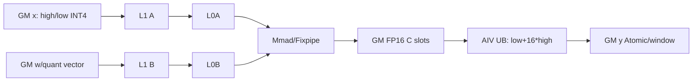
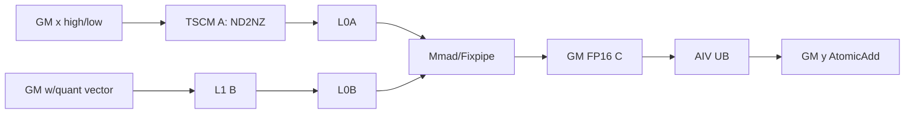

# grouped_matmul_finalize_routing A2/A3 ACLNN 算子知识

## 算子速览

| 项目 | 内容 |
|---|---|
| 实际入口 | aclnnGroupedMatmulFinalizeRoutingV3GetWorkspaceSize / aclnnGroupedMatmulFinalizeRoutingV3 |
| 计算语义 | A8W4 MSD GMM：INT8 X 拆成高/低 INT4 两路，量化组累加后恢复为 FP32，乘 per-tokenScale×logit 并按 rowIndex scatter-add；可融合 sharedInput×sharedInputWeight |
| 输入输出 | ACLNN x1=INT8 ND；x2 外部 storage=INT32 packed INT4、内部 view=INT4 ND/NZ；scale=INT64、perTokenScale/logit=FP32、rowIndex/groupList=INT64，y=FP32 |
| 执行类型 | MIX_CV |
| Kernel 路线 | R-001 A8W4 MSD GM-A（4 个 key）；R-002 A8W4 MSD TSCM-A（4 个 key） |
| 核心资源 | GM、确定性/Matmul workspace、L1、L0A/B/C、UB、cross-core flag、Atomic |
| 来源闭包 | source_closed：V3 ACLNN→L0→A8W4 Host tiling/POD→两条 key 族→全部可达 MIX body/helper→arch22 构建配置闭合 |
| 验证状态 | 已完成源码闭包检查；本次知识提取未执行编译、真机、数值或性能测试。 |

## 接口与语义

### 计算语义

令专家 `e` 的输入行区间为 `I_e`，`groupListType=0` 时 `groupList` 给出累计边界，`groupListType=1` 时给出各专家 count。V3 的 A2/A3 路径把每个 `x[r,k]∈INT8` 原地拆成 high=`floor(x/16)` 与 low=`(x&0x0f)-8` 两路 INT4；Cube 分别与 `w[e,k,n]∈INT4` 计算并由 INT64 quant vector 恢复成 FP16 C，Vector 以 `lowC+16×highC` 合并、加公开契约要求的 FP32 bias，并在非对称场景加 `offset×rowSum(x)`，最后乘 `perTokenScale[r]×logit[r]` 并执行 `y[rowIndex[r],n] += value`。`sharedInput` 非空时先把连续区间写成 `float(BF16 sharedInput)×sharedInputWeight`，其余输出域清零；为空时整张 y 清零。

实现上，主计算、路由合并和共享专家合并并不是三个独立启动节点，而是在同一个混合核中按严格顺序完成。矩阵乘侧只负责产生当前分块的整数累加结果，向量侧负责缩放、偏置、逐 token 缩放、路由权重乘法和最终散射累加。每一个工作区槽都必须在计算侧写完并发出完成标志后才能由向量侧读取；向量侧消费完毕后再发出可复用标志。这样既保护中间结果，又避免下一轮矩阵分块覆盖仍在使用的数据。尾行、尾列和空专家都由有效长度或显式跳过条件处理，不能依赖对齐填充自然为零。

### 输入、输出与属性

| 参数 | shape/layout | dtype | 约束、默认值与语义 |
|---|---|---|---|
| x1 | [M,K] ND | INT8 | 必选；Kernel 预处理把原 buffer 的每行改写为连续 high-INT4、low-INT4 两半；固定源码确有写入，调用方可观察性由外部运行时契约决定 |
| x2 | 外部 view 最后一维按 8 个 INT4/INT32 打包；内部 [E,K,N] ND 或 NZ | ACLNN 传 INT32，PreMatmulCalc 前改 view/dtype 为 INT4 | 必选；V3 非 DAV_3510 不接受其他外部 dtype；transposeX1/transposeX2 均为 false |
| scale/pertokenScale | V3 公开 shape scale `[E,1,N]`；pertoken `[M]` | INT64 / FP32 | 两者必选；公开 V3 因而 `quantGroupNum=1`；Host/body 的通用 Q 循环不扩展公开范围 |
| bias/offset | bias `[E,N]`；offset `[E,1,N]` | FP32 | V3 两个公开 dtype 组合都要求 bias；offset 可空，非空时触发 `rowSum(x)` 修正 |
| groupList | [E] | INT64 | 累计或 count |
| sharedInput | `[sharedLen,N]` | BF16 | 可空；先 cast FP32 再乘 residualScale |
| logit | [M] | FP32 | 专家行权重 |
| rowIndex | [M] | INT64 | V3 A2/A3 W4 checker 固定 INT64，scatter-add 目标行 |
| sharedInputWeight/Offset | 标量 | FP32/INT64 | shared 区缩放和输出起点 |
| out | [batch,N] ND | FP32 | combine 结果 |

### 入口与版本

V3 是 A2/A3 最新公开入口，相比 V2 新增 `tuningConfigOptional`。公开文档把 A2/A3 范围固定为 A8W4 伪量化、K=2048、N=7168、E≤256；`CheckSupportSceneforV3` 还要求 x1/x2/scale/perTokenScale/groupList/logit/rowIndex 非空、两项 antiquant 为空、`dtype=0`、两项 transpose=false。入口把外部 INT32 packed weight 的末维乘 8 并将临时 view 改为 INT4，再进入公共 checker/L0；旧入口的 A8W8 key 与 tiler中 K>2048 的实现容量边界都不扩展 V3 公开契约。

## Host/Launcher 执行流程

### 参数校验与前处理

`V3GetWorkspaceSize` 先做上述必选/空指针、dtype、维数和 transpose 检查；`PreMatmulCalcProcess` 对 x1 做 transpose/contiguous 处理、对 x2 做 ND/NZ 与 contiguous 处理，再把所有可选输入转 contiguous/ND，最后执行非 DAV_3510 的 W4 dtype/shape/format、空 tensor 与 `tuningConfig[0]∈[0,M]` 校验。L0 `INFER_SHAPE` 分配 FP32 ND `[outputBS,N]` 中间输出，末端 `ViewCopy` 处理用户 out 的非连续 view。

### 参数、Workspace 与生命周期

GM-A 路线 workspace 为 `4×coreNum×256×128×4×8 + M×4 + 20MiB`；TSCM-A 路线为 `coreNum×1024×128×4×8 + M×4 + 20MiB`。若 deterministic 打开，再按 L2 容量选择 96MiB 或 64MiB 的 `deterWorkspaceSize`。首 `M×4` 仅在 offset 非空时存 rowSum；其后是半精度 Matmul 中间槽，确定性片位于 `M×4 + parallNum×coreNum×MM_BASE_BLOCK_OFFSET×4×8`。executor 持有 launch graph 与 workspace 需求，实际 tensor/workspace backing 必须保持到 stream 完成。

### 启动图与失败传播

单 `KERNEL_TYPE_MIX_AIC_1_2` launch，`blockDim=AIC coreNum`、`scheduleMode=1`。V3 仅能写 8 个 A8W4 key 实例：GM-A/TSCM-A × groupList 累计/count × sharedInput 有/无；Kernel router 的 A8W8 分支属于其他公开入口而非本卡。校验、infershape、ADD_TO_LAUNCHER、tiling/POD/workspace 或 launch 任一步失败均结束，没有后继 kernel/fallback。

## Route 与参数设计

### 分核与资源计算

Host 从 `M/K/N/E/outputBS` 与 AIC/UB/L1/L0C 容量出发。两 route 均固定 `ubCalSize=4096`、`ubRestBytes=9×32×256`；GM-A 令 `baseM=64/128`、`baseN=512/256`、`baseK=256`，TSCM-A 令 `baseM=96/128`、`baseN=128`、`baseK=512`，分界为 `avgM<128`。GM-A 设置 `dbL0C=1,stepKa=stepKb=4,depthA1=depthB1=8`；TSCM-A 设置 `dbL0C=2,stepKa=1,stepKb=4,depthA1=1,depthB1=8`。V3 公开 K 固定 2048；非确定性且 `tuningConfig.size>1` 选 TSCM-A，否则选 GM-A。源码中的 GM-A `K<=18432` 是实现 guard，不是 V3 的额外公开 shape。

### Route 选择

| 顺序 | Route | Key/模板 | 精确选择条件与优先级 | 不适用去向 |
|---:|---|---|---|---|
| 1 | R-002 A8W4 MSD TSCM-A | base `11000000000000000111`，加 cumsum `1000`、share-null `10000` | V3公开K=2048，deterministic=0 且 `tuningConfig.size>1`；优先 | 不成立回 R-001 |
| 2 | R-001 A8W4 MSD GM-A | base `11000000000000000011`，同两 key 位 | deterministic≠0 或 `tuningConfig.size<=1`；源码另守卫 K≤18432 | 不支持/超界失败 |

```text
V3(non-DAV_3510) -> x2 storage dtype must be INT32 -> temporary INT4 view
public V3 requires K==2048
if deterministic==0 && tuningConfig.size>1: R-002
else: R-001
then add 1000 when groupListType==0; add 10000 when sharedInput is null
unsupported dtype/shape/key -> error
```

### 模板/实现执行矩阵

| Route | key/selector | dtype/shape/platform 完整命中条件 | 执行族与 kernel 节点 | 实际模板/body | 内存与同步特征 | tail/fallback |
|---|---|---|---|---|---|---|
| R-001 GM-A | `...00011/...01011/...10011/...11011` | V3 A2/A3 A8W4；非L1-opt谓词；四 key 分别为 count/cumsum×shared/none | 单 MIX | `GMMFR_A8W4_IMPL<groupListType,sharedNone>`→`GMMA8W4MSDCompute` | GM A；4-way GM C slots；flag 5/3；可选确定性窗口 | M/N 显式 tail；无 device fallback |
| R-002 TSCM-A | `...00111/...01111/...10111/...11111` | 同公开域；deterministic=0 且 tuningConfig.size>1 | 单 MIX | `GMMFR_A8W4_L1_OPT_IMPL<...>`→`GMMA8W4MSDL1OptCompute` | A先ND2NZ到TSCM；GM C；flag 5/3；AtomicAdd | M/N tail；不适用回R-001 |

四个 key 的 compile-time 布尔会改变 groupList 解码和 shared prologue，故不得互换；正文按实现族并列展示共同数据流，同时在表中保留全部不可互换 key。

### 隐藏性能 Guard

| Guard | Host/Tiling 条件 | Device/资源原因 | 影响 Route | 不满足时去向 | 源码符号 |
|---|---|---|---|---|---|
| 公开 K | V3 A2/A3 K=2048 | API 文档支持边界 | 两 Route | ACLNN 不承诺 | V3 docs |
| L1-opt selector | deterministic=0、tuningConfig.size>1、K≤2048 | TSCM A 全 tile与专用生命周期 | R-002 | R-001 | `ParseAttr` |
| GM preprocess容量 | K≤18432 | 单行 x 的预处理 UB 上界 | R-001 | tiling失败 | `MAX_K_A8W4_MSD/W4A8BaseTilingProcess` |
| N非零/对齐 | `baseN=ceilAlign(N,32)>0`；API N=7168 | Vector/Cube搬运和 `vBaseM=4096/baseN` | 两 Route | tiling/API失败 | `W4A8*Process` |
| slot reuse | GM-A `parallNum=4`；TSCM按singleN轮次 | 防AIC覆盖AIV未消费C | 两 Route | flag wait，无 fallback | `MMCompute/VectorCompute` |
| deterministic | 仅 GM-A；64/96MiB window | 碰撞行先写无冲突区再归并 | R-001 | R-002禁用 | `DeterministicTilingProcess/FinalizeRoutingDeterministic` |

### POD/ABI

`GroupMatmulFRTilingData` 按 8 字节对齐保存，首成员为外部 `TCubeTiling`；该类型定义不在允许源码范围内，所以总体 `sizeof/alignof` 及后续绝对 `offsetof` 固定仓不可见。其余成员均为连续声明的 32-bit 标量；表中 `offsetof=TCubeEnd+4*i` 表示相对 `matmulTiling` 尾部的源码顺序，不冒充绝对 ABI 数值。

| 结构 | 字段 | 类型/位宽 | ABI 布局 | 单位 | Host/launcher producer | Device consumer | 边界 |
|---|---|---|---|---|---|---|---|
| GroupMatmulFRTilingData | matmulTiling | TCubeTiling | sizeof/alignof/offsetof 固定仓不可见 | tile | CalMatmulTiling | mm.Init/route body | base/depth 自洽 |
| GroupMatmulFRTilingData | coreNum | uint32/32 | offsetof=TCubeEnd+0, sizeof=4, alignof=4 | AIC 核 | `FillTilingData:blockDim_` | `Process:coreIdx`、workspace slot | 平台 AIC 核数 |
| GroupMatmulFRTilingData | groupNum | uint32/32 | offsetof=TCubeEnd+4, sizeof=4, alignof=4 | 专家数 | weight storage dim0 | `ComputeTotalGroup`/group loop | 与 groupList 长度一致 |
| GroupMatmulFRTilingData | totalInGroup | uint32/32 | offsetof=TCubeEnd+8, sizeof=4, alignof=4 | 行 | x storage M | preprocess 行数、rowSum 偏移 | 非 DAV_3510 空 x 已拒绝 |
| GroupMatmulFRTilingData | batch | uint32/32 | offsetof=TCubeEnd+12, sizeof=4, alignof=4 | 输出行 | L0 `outputBS` attr | `PreProcessInit` 清零边界 | 0 至 M |
| GroupMatmulFRTilingData | k | uint32/32 | offsetof=TCubeEnd+16, sizeof=4, alignof=4 | 元素 | x dim1 | preprocessor `vK`、quantGroupSize、地址 | V3公开=2048；实现R-001≤18432、R-002≤2048 |
| GroupMatmulFRTilingData | n | uint32/32 | offsetof=TCubeEnd+20, sizeof=4, alignof=4 | 元素 | weight N | y/weight/scale 地址与 tail | W4 checker 的 N 对齐/下界 |
| GroupMatmulFRTilingData | vBaseM | uint32/32 | offsetof=TCubeEnd+24, sizeof=4, alignof=4 | 行 | `4096/baseN` | Vector M tile | 至少 1 |
| GroupMatmulFRTilingData | ubCalSize | uint32/32 | offsetof=TCubeEnd+28, sizeof=4, alignof=4 | 元素 | 固定 4096 | queue/tmp 及 vector tile | UB capacity |
| GroupMatmulFRTilingData | ubRestBytes | uint32/32 | offsetof=TCubeEnd+32, sizeof=4, alignof=4 | 字节 | 固定 `9*32*256` | `InitUbBuffer(tmpBuff)` | 与各 GetWithOffset 片一致 |
| GroupMatmulFRTilingData | parallNum | uint32/32 | offsetof=TCubeEnd+36, sizeof=4, alignof=4 | slot 数 | 固定 4 | GM-A workspace、确定性偏移 | TSCM-A workspace 公式不乘 4 |
| GroupMatmulFRTilingData | sharedInputOffset | uint32/32 | offsetof=TCubeEnd+40, sizeof=4, alignof=4 | 行 | attr | y 初始化/共享段地址 | offset+len 不超过 batch |
| GroupMatmulFRTilingData | sharedInputLen | uint32/32 | offsetof=TCubeEnd+44, sizeof=4, alignof=4 | 行 | sharedInput dim0 或 0 | sharedInput 循环/清零尾段 | 不超过 batch-offset |
| GroupMatmulFRTilingData | residualScale | float/32 | offsetof=TCubeEnd+48, sizeof=4, alignof=4 | 标量 | `sharedInputWeight` attr | `PreProcess:Muls` | FP32 |
| GroupMatmulFRTilingData | quantGroupNum | uint32/32 | offsetof=TCubeEnd+52, sizeof=4, alignof=4 | 组 | scale storage dim1 | `K/quantGroupNum` 与 K loop | V3公开=1；body通用值须非零且整除 |
| GroupMatmulFRTilingData | withOffset | uint32/32 | offsetof=TCubeEnd+56, sizeof=4, alignof=4 | 布尔 | offset desc 是否存在 | rowSum buffer/修正分支 | 0/1 |
| GroupMatmulFRTilingData | hasPertokenScale | uint32/32 | offsetof=TCubeEnd+60, sizeof=4, alignof=4 | 布尔 | optional desc | 固定 body 字段；V3 必为 1 | 0/1，V3=1 |
| GroupMatmulFRTilingData | hasBias | uint32/32 | offsetof=TCubeEnd+64, sizeof=4, alignof=4 | 布尔 | bias desc | 固定 body 字段 | 0/1 |
| GroupMatmulFRTilingData | deterministicFlag | uint32/32 | offsetof=TCubeEnd+68, sizeof=4, alignof=4 | 布尔 | `context->GetDeterministic()` | GM-A `VectorAtomicProcess/VectorDeterSync` | 0/1；R-002 要求 0 |
| GroupMatmulFRTilingData | deterWorkspaceSize | uint32/32 | offsetof=TCubeEnd+72, sizeof=4, alignof=4 | 字节 | 64MiB/96MiB | GM-A `windowSize=size/(N*4)` | deterministic 时 N 必须非零 |

### Route 源码闭包

| Route | Key/selector | Host/Tiling producer | POD/参数 | Kernel entry/router | Kernel body/直接依赖 | 构建接线 |
|---|---|---|---|---|---|---|
| R-001 A8W4 MSD GM-A | `...0011`，加 1000/10000 bits | `ParseAttr→W4A8BaseTilingProcess→FillTilingData→PostTiling` | `GroupMatmulFRTilingData`，GM-A tile/workspace | `grouped_matmul_finalize_routing→GMMFR_A8W4_IMPL` | `GMMA8W4PreProcess::{ComputeTotalGroup,ProcessPerToken}`；`GMMA8W4MSDCompute::{MMCompute,VectorCompute,FinalizeRoutingDeterministic}` | `op_host/CMakeLists.txt` + `config/ascend910{b,_93}/*` |
| R-002 A8W4 MSD TSCM-A | `...0111`，加 1000/10000 bits | `ParseAttr→W4A8L1OptTilingProcess→FillTilingDataL1Opt→PostTiling` | 同结构，TSCM tile/workspace；deterministic=0 | `grouped_matmul_finalize_routing→GMMFR_A8W4_L1_OPT_IMPL` | `GMMA8W4PreProcess::{ComputeTotalGroup,ProcessPerToken}`；`GMMA8W4MSDL1OptCompute::{CopyInA1,MMComputeSingleN,VectorCompute}` | `op_host/CMakeLists.txt` + `config/ascend910{b,_93}/*` |

## Kernel 实现

### 公共执行流程

entry 读取同一 POD 并设置 MIX 1:2。AIV 先用 `GMMA8W4PreProcess` 把每个 INT8 行原地改写为 high/low INT4 两半；offset 非空还把原始 INT8 行和写入 workspace。pipe 重建后，AIV 初始化 y 的 shared/非-shared 区，AIC/AIV `SyncAll` 后开始 GMM。AIC 把两倍 M 的 INT4 行送入 Matmul，AIV 读取相邻 high/low C 行，恢复原 INT8 语义并缩放、乘 logit、按 rowIndex 提交。R-001 支持确定性滑窗；R-002 只有 AtomicAdd。

### Route R-001：A8W4 MSD GM-A

#### 适用条件

##### 选择证据

| 层级 | 文件 | 符号 | 源码谓词/参数 | 结果/下一跳 |
|---|---|---|---|---|
| API | gmm/grouped_matmul_finalize_routing/op_api/aclnn_grouped_matmul_finalize_routing.cpp | `V3GetWorkspaceSize` | 非 DAV_3510：x2 必须 INT32 packed，转 INT4 view；transpose=false/false | A8W4 Host |
| Host/Tiling | gmm/grouped_matmul_finalize_routing/op_host/grouped_matmul_finalize_routing_base_tiling.cpp | `ParseAttr/W4A8BaseTilingProcess/OtherSettingTilingProcess` | 非 L1-opt 谓词；K 不大于 18432；base key `...0011` | R-001 key 或失败 |
| Router | gmm/grouped_matmul_finalize_routing/op_kernel/grouped_matmul_finalize_routing.cpp | `grouped_matmul_finalize_routing/GMMFR_A8W4_IMPL` | 四个 `...0011` key 对应 groupListType/sharedInput bits | `GMMA8W4PreProcess` + GM `aT` + `GMMA8W4MSDCompute` |

#### Device 数据流

##### 函数级调用链

```text
grouped_matmul_finalize_routing -> GMMFR_A8W4_IMPL
  -> GMMA8W4PreProcess::Init/ComputeTotalGroup/ProcessLoop/ProcessPerToken
  -> GMMA8W4MSDCompute::Init/InitUbBuffer/Process
    -> PreProcess/SyncAll
    -> MMCompute -> MatmulImpl::{SetTensorA,SetTensorB,SetQuantVector,Iterate,GetTensorC}
    -> VectorCompute/CopyMMOutLocal/ComputeDequantAndActivate/VectorAtomicProcess
    -> VectorDeterSync/FinalizeRoutingDeterministic (deterministic only)
```

##### 源码等价伪码

```text
伪码：
totalRows = cumulative ? groupList[E-1] : reduce_sum(groupList)
for r = AIV_global_id; r < totalRows; r += AIV_count:
  x8 = GM_x[r*K : (r+1)*K]
  if offset: rowSumWs[r] = reduce_sum(float(x8))
  GM_x[r*K : r*K+K/2] = int4(floor(float(x8)/16))
  GM_x[r*K+K/2 : (r+1)*K] = int4((x8 & 0x0f)-8)
SyncAll
AIV: clear y outside shared range; shared range = float(BF16 shared)*residualScale; SyncAll
for expert e and scheduled (mTile,nTile):
  effectiveM = 2*expertRows; wsOffset = slot(core,mTile,nTile)
  AIC: for q in [0,Q):
    A = GM_x[(2*rowOffset)*K + q*K/Q] -> L1 -> L0A
    B = GM_w[e,q,nTile] -> L1 -> L0B
    Mmad/Fixpipe half C -> mmOut[wsOffset], accumulate when q>0
  CrossCoreSetFlag<2,PIPE_FIX>(5)
  AIV: CrossCoreWaitFlag(5); copy high/low C rows into UB
       acc = float(lowC) + 16*float(highC)
       acc += float(bias[e,nTile])
       if offset: acc += float(offset[e,nTile]) * rowSumWs[row]
       acc *= perTokenScale[row] * logit[row]
       if deterministic: write collision-free window; else AtomicAdd y[rowIndex[row],nTile]
       CrossCoreSetFlag<2,PIPE_MTE2>(3)
AIC waits flag 3 before reusing a previous workspace slot
```

#### 内存与数据搬运

##### 资源与搬运表

| 层级/缓冲区 | offset/地址公式 | extent/容量公式 | dtype/layout | producer | consumer | owner/lifetime | 对齐/复用 |
|---|---|---|---|---|---|---|---|
| GM x（原地 high/low） | `r*K`、`r*K+K/2` | 每行 K 个 INT4（两半各 K/2 byte） | INT4 ND | `ProcessPerToken` | Matmul GM-A | 调用方 buffer/整次 launch | K 的 W4 约束；预处理末尾 `SyncAll<false>` |
| rowSum workspace | byte 0，element `r` | `M*sizeof(float)`，仅 withOffset | FP32 | `ReduceSum(x8)` | `DataCopyAndBrcbOfRowSum` | executor workspace/launch | 32B DataCopyPad；不用时 mmOut 从 byte 0 开始 |
| GM mmOut slots | byte `M*4` 后；element `workSpaceOffset`，确定性基址仍按源码含 M*4 | Host 为 `4*core*256*128*4*8`（加 rowSum）；Device 每槽 `MM_BASE_BLOCK_OFFSET` | FP16 ND（high/low 两行） | Fixpipe `GetTensorC` | `CopyMMOutLocal` | executor/直到 AIV flag 3 | 4-way parall slot；flag 5/3 防覆盖 |
| GM weight/scale | ND: `e*K*N+nOff+q*(K/Q)*N`；NZ: `e*K*N+nOff*K+q*(K/Q)*64`；scale `e*N*Q+q*N+nOff` | `K/Q*curN` 与 curN scale | INT4 ND/NZ、uint64 quant vector | caller/MTE | Matmul | caller/tile | N tail `curBaseN`；K 按 Q 精确切分 |
| L1/L0A/L0B | 当前 `baseM/baseN/baseK`，由 matmul tiling 的 step/depth 推导 | A1/B1 depth=8；L0 tile 容量来自外部 Matmul，绝对字节固定仓不可见 | INT4 Cube layout | GM/MTE/LoadData | Mmad | AIC tile | stepKa/stepKb=4，双缓冲 |
| L0C | 当前 baseM×baseN | `dbL0C=1`，精确字节由外部 Matmul 类型固定仓不可见 | 累加/Fixpipe 到 FP16 | Mmad | GetTensorC | AIC tile | quant group 首轮 clear、后续 accumulate |
| UB queues/tmp | scale=`baseN*4`；perToken+logit=`align32(vBaseM*8)`；vecIn=`4096*2*2`；vecOut=`4096*4`；tmp=`73728` | 如左 | FP16/FP32 | MTE2/Vector | Vector/MTE3 | AIV tile | N 对齐 8/16；mask 64 + last；单 buffer |
| deterministic workspace | `M*4 + 4*core*MM_BASE_BLOCK_OFFSET*4*8` bytes | 64MiB 或 96MiB | FP32 [window,N] | `VectorAtomicProcess` | `FinalizeRoutingDeterministic` | executor/window | window=`size/(N*4)`；窗口前后 `SyncAll` |
| 寄存器 | rowIndex/group boundary/counters | 标量 | u32/u64/f32 | GM scalar/load | 地址与控制 | 调用周期 | N/A：未形成独立寄存器 tile |

##### 分层内存布局



##### 字节账、交接边与复用顺序

```text
workspace_total = M*4 + 4*coreNum*256*128*4*8 + 20MiB + deterministic?(64MiB或96MiB):0
L1 logical capacity = depthA1*baseM*baseK/2 + depthB1*baseN*baseK/2 bytes
L0C logical capacity = dbL0C*baseM*baseN*sizeof(accumulator)；accumulator物理类型由外部Matmul不可见
UB queues = baseN*4 + align32(vBaseM*8) + 4096*2*2 + 4096*4 + 73728 bytes
```

| 边/复用子区 | producer | offset/extent | dtype/layout | consumer | ordering/sync | owner/lifetime | 安全条件 |
|---|---|---|---|---|---|---|---|
| C slot | AIC GetTensorC | `32768*(core+(cubeCount%4)*coreNum)` elements | FP16 ND | AIV CopyMMOutLocal | set/wait flag5 | workspace/至AIV结束 | 第5次起AIC先wait flag3 |
| slot release | AIV | 同slot | N/A | AIC | set flag3 PIPE_MTE2 | 4轮周期 | high/low均已搬入UB |
| deterministic window | AIV | 专用基址，`window*N` FP32 | FP32 ND | window reducer | SyncAll前后 | executor/window | `window=size/(N*4)` |

#### 同步、精度与尾块

##### 同步与数值边界表

| 阶段 | primitive/机制 | producer | consumer/等待点 | 保护对象 | 精度/尾块 |
|---|---|---|---|---|---|
| INT8 拆分 | event 0/1/2 + PIPE_V barrier；末尾 `SyncAll<false>` | MTE2/Vector/MTE3 | 后续所有 AIC/AIV | 原地 GM x、rowSum | `CAST_FLOOR` 得 high；low=`(x&0x0f)-8`；K 全行处理 |
| 输出预置 | `SyncAll` | AIV `PreProcess` | AIC/AIV GMM | y 初值/shared 段 | BF16→FP32 CAST_NONE，再乘 FP32 residualScale；按 ubCalSize 尾块 |
| Cube→Vector | `CrossCoreSetFlag<2,PIPE_FIX>(5)` | AIC GetTensorC | AIV `CrossCoreWaitFlag(5)` | mmOut slot | FP16 high/low C；M/N/Q tail 显式限制 |
| Vector→Cube reuse | `CrossCoreSetFlag<2,PIPE_MTE2>(3)` | AIV 完成 slot 读取 | AIC 复用前 `CrossCoreWaitFlag(3)` | mmOut slot | 不改变数值；parallNum 周期防覆盖 |
| combine | `SetAtomicAdd<float>` 或确定性窗口两次 `SyncAll` | AIV | GM y / window reducer | rowIndex 冲突域 | `low+16*high`→scale/offset修正→perToken×logit；N tail DataCopyPad |

#### 关键实现

##### 符号证据表

| 阶段 | 文件 | 符号/模板实例 | 实现事实 |
|---|---|---|---|
| Host/Tiling producer | gmm/grouped_matmul_finalize_routing/op_host/grouped_matmul_finalize_routing_base_tiling.cpp | `W4A8BaseTilingProcess/FillTilingData/PostTiling` | key `...0011`、GM tile、20MiB system + user/deterministic workspace |
| Kernel entry/router | gmm/grouped_matmul_finalize_routing/op_kernel/grouped_matmul_finalize_routing.cpp | GMMFR_A8W4_IMPL | GM A specialization |
| Device body/helper | gmm/grouped_matmul_finalize_routing/op_kernel/grouped_matmul_finalize_routing_antiquant_a8w4_msd_pre.h | `ComputeTotalGroup/ProcessPerToken/ProcessLoop` | group count、INT8→两路 INT4、rowSum 与全核同步 |
| Device body/helper | gmm/grouped_matmul_finalize_routing/op_kernel/grouped_matmul_finalize_routing_antiquant_a8w4_msd.h | `MMCompute/VectorCompute/ComputeDequantAndActivate/FinalizeRoutingDeterministic` | GM→L1/L0→Fixpipe/GM workspace→UB→Atomic/窗口归并 |

### Route R-002：A8W4 MSD TSCM-A

#### 适用条件

##### 选择证据

| 层级 | 文件 | 符号 | 源码谓词/参数 | 结果/下一跳 |
|---|---|---|---|---|
| API | gmm/grouped_matmul_finalize_routing/op_api/aclnn_grouped_matmul_finalize_routing.cpp | `V3GetWorkspaceSize` | 与 R-001 同一 V3 A8W4 前置条件 | A8W4 Host |
| Host/Tiling | gmm/grouped_matmul_finalize_routing/op_host/grouped_matmul_finalize_routing_base_tiling.cpp | `ParseAttr/W4A8L1OptTilingProcess/FillTilingDataL1Opt` | deterministic 为零、tuningConfig 长度大于 1 且 K 不大于 2048；base key `...0111` | R-002 key；不成立回 R-001 |
| Router | gmm/grouped_matmul_finalize_routing/op_kernel/grouped_matmul_finalize_routing.cpp | `GMMFR_A8W4_L1_OPT_IMPL` | 四个 `...0111` key；`aT=TSCM,NZ,int4` | `GMMA8W4MSDL1OptCompute` |

#### Device 数据流

##### 函数级调用链

```text
grouped_matmul_finalize_routing -> GMMFR_A8W4_L1_OPT_IMPL
  -> GMMA8W4PreProcess::{ComputeTotalGroup,ProcessPerToken,ProcessLoop}
  -> GMMA8W4MSDL1OptCompute::Init/InitMMBuffer/InitUbBuffer/Process
    -> PreProcess/SyncAll
    -> MMCompute/MMComputeSingleN/CopyInA1
    -> MatmulImpl::{SetTensorA(TSCM),SetTensorB,SetQuantVector,Iterate,GetTensorC}
    -> VectorCompute/CopyMMOutLocal/ComputeDequantAndActivate/VectorAtomicProcess
```

##### 源码等价伪码

```text
伪码：先执行与 R-001 完全相同的 INT8→high/low INT4 原地预处理和 y 初始化
for expert e and scheduled (mTile,singleNTile):
  effectiveM = 2*expertRows
  AIC CopyInA1:
    xOffset=(2*groupRowBase+mTile*baseM)*K
    DataCopy ND→NZ from GM_x[xOffset] into one TSCM buffer of baseM*K/2 bytes
  for nBase in singleNTile:
    if prior round: WaitFlag(3)
    for q in [0,Q):
      SetTensorA(TSCM[q*K/Q]); SetTensorB(GM_w[e,q,nBase]); SetQuantVector(scale[e,q,nBase])
      Iterate; GetTensorC(mmOut[core*baseM*singleN + nBase*baseM*baseN], q?accumulate:clear)
    SetFlag<2,PIPE_FIX>(5)
  AIV WaitFlag(5); for valid vector M/N:
    read high/low C, restore low+16*high, apply offset/scale/perToken/logit
    AtomicAdd y[rowIndex[row], n]
    SetFlag<2,PIPE_MTE2>(3)
```

#### 内存与数据搬运

##### 资源与搬运表

| 层级/缓冲区 | offset/地址公式 | extent/容量公式 | dtype/layout | producer | consumer | owner/lifetime | 对齐/复用 |
|---|---|---|---|---|---|---|---|
| GM x（原地 high/low） | 与 R-001 相同 | 每行 K 个 INT4 | INT4 ND | `ProcessPerToken` | `CopyInA1` | caller/launch | preprocess `SyncAll<false>` 后读取 |
| rowSum workspace | byte 0，element r | `M*4`，仅 withOffset | FP32 | preprocessor | offset correction | executor/launch | 与 mmOut 前缀一致 |
| TSCM A | 每 tile 从 `xOffset=(offsetM+mIdx*baseM)*K`；q 子片 `q*K/Q` | `(baseM*K)/2` bytes，buffer depth=1 | INT4 NZ | `CopyInA1` ND2NZ | Matmul L0A loader | AIC current M tile | `nValue=curSingleM,dValue=K/2,dstC0Stride=align16(M)` |
| GM weight | ND/NZ 公式同 R-001，n 增加 `singleNOffset+baseNIdx*baseN` | `(K/Q)*curBaseN` | INT4 ND/NZ | caller | Matmul | caller/tile | curSingleN/curBaseN tail |
| GM mmOut | element `baseM*singleN*core + baseNIdx*baseM*baseN`；rowSum 前缀按 Init 分支加入 | Host `core*1024*128*4*8 + M*4` bytes | FP16 ND high/low | GetTensorC | AIV | executor/flag 3 前 | 没有 parallNum=4 的槽池；每轮显式等待 |
| L0A/L0B/L0C | TSCM/GM 当前 q tile | 外部 Matmul 决定；POD 为 depthA1=1/depthB1=8/dbL0C=2 | INT4/acc/F16 | LoadData/Mmad | Mmad/Fixpipe | AIC tile | A 单 buffer、B 与 L0C 双缓冲 |
| UB queues/tmp | 与 R-001 同类同容量 | ubCalSize=4096,tmp=73728 | FP16/FP32 | MTE/Vector | Atomic GM | AIV tile | N align 8/16、mask/尾长 |
| 寄存器 | group/m/n/q indices、rowIndex | scalar | u32/u64/f32 | GM/loop | address/control | invocation | N/A：无独立寄存器 tile |

##### 分层内存布局



##### 字节账、交接边与复用顺序

```text
workspace_total = M*4 + coreNum*1024*128*4*8 + 20MiB
TSCM_A = baseM*K/2 bytes；depthA1=1
L1_B logical = depthB1*baseN*baseK/2 bytes；depthB1=8
UB queues = baseN*4 + align32(vBaseM*8) + 4096*2*2 + 4096*4 + 73728 bytes
```

| 边/复用子区 | producer | offset/extent | dtype/layout | consumer | ordering/sync | owner/lifetime | 安全条件 |
|---|---|---|---|---|---|---|---|
| TSCM A | CopyInA1 | per-core baseM*K/2 | INT4 NZ | Matmul | TQue enqueue/dequeue | current M tile | curSingleM/K valid |
| C baseN tile | GetTensorC | `core*baseM*singleN+baseNIdx*baseM*baseN` | FP16 ND | AIV | flag5 | workspace | prior round wait flag3 |
| tile release | AIV | same | N/A | AIC | flag3 | reuse boundary | vector copy complete |

#### 同步、精度与尾块

##### 同步与数值边界表

| 阶段 | primitive/机制 | producer | consumer/等待点 | 保护对象 | 精度/尾块 |
|---|---|---|---|---|---|
| INT8 拆分与输出预置 | events + `SyncAll<false>`；随后 `SyncAll` | AIV | AIC/AIV | GM x、y | 与 R-001 同序；route 条件限定 K 不大于 2048 |
| GM→TSCM→L0A | TQue enqueue/dequeue + Matmul 内部 event | MTE2/CopyInA1 | SetTensorA/LoadData | 当前 A tile | INT4 ND→NZ；M tail 用 curSingleM |
| AIC→AIV | flag 5 PIPE_FIX | GetTensorC | `CrossCoreWaitFlag(5)` | mmOut | high/low FP16；N/M tail显式 |
| AIV→AIC | flag 3 PIPE_MTE2 | VectorCompute | 下一轮 AIC wait | mmOut/TSCM 复用序 | 不改变精度 |
| combine | `SetAtomicAdd<float>` | Vector | y | rowIndex 冲突域 | `low+16*high`→scale/offset→perToken×logit；本 route 无确定性窗口 |

#### 关键实现

##### 符号证据表

| 阶段 | 文件 | 符号/模板实例 | 实现事实 |
|---|---|---|---|
| Host/Tiling producer | gmm/grouped_matmul_finalize_routing/op_host/grouped_matmul_finalize_routing_base_tiling.cpp | `ParseAttr/W4A8L1OptTilingProcess/FillTilingDataL1Opt` | 精确选择谓词、key `...0111`、TSCM tile 与 workspace |
| Kernel entry/router | gmm/grouped_matmul_finalize_routing/op_kernel/grouped_matmul_finalize_routing.cpp | GMMFR_A8W4_L1_OPT_IMPL | TSCM aT specialization |
| Device body/helper | gmm/grouped_matmul_finalize_routing/op_kernel/grouped_matmul_finalize_routing_antiquant_a8w4_msd_pre.h | `ProcessPerToken/ProcessLoop` | high/low INT4 原地生成及同步 |
| Device body/helper | gmm/grouped_matmul_finalize_routing/op_kernel/grouped_matmul_finalize_routing_antiquant_a8w4_msd_l1_opt.h | `CopyInA1/MMComputeSingleN/VectorCompute/VectorAtomicProcess` | GM→TSCM→L0A、量化组累加、双向 flag 与 tail |

## 算子特定优化

### Trick T-001：原地 MSD 拆分复用输入容量

#### 触发与源码依据

V3 A2/A3 的 x1 是 INT8，而 Cube 路径消费 INT4。预处理不另分配一份完整 A：它把每行拆为 high=`floor(x/16)` 与 low=`(x&0x0f)-8` 两个有符号 INT4 半行，恰好仍占原 INT8 行的 K 字节。源码见 [`GMMA8W4PreProcess::ProcessPerToken`](../../../../../../../cann-ops-raw/ascendc/ops-transformer/be33d95bb755cedec3108f70805c1874d1792540/gmm/grouped_matmul_finalize_routing/op_kernel/grouped_matmul_finalize_routing_antiquant_a8w4_msd_pre.h#L152-L180)。

```cpp
Muls(xHighHalfTensor, xSrcFp32Local, oneEight_, curSize);
Cast(xHighTensor, xHighHalfTensor, RoundMode::CAST_FLOOR, curSize);
And(xLowTensor, xSrcLocal, xLowMaskTensor, curSize);
Adds(xLowTensor, xLowTensor, MINUS_EIGHT, curSize);
```

#### 机制与设计原因

两个 INT4 Matmul 结果以 FP32 恢复 `low+16*high`，规避额外 A staging 的 GM 容量；offset 存在时，覆盖前先从原 INT8 计算 rowSum。收益伴随可观察副作用：API 的 const x1 backing 在 launch 内被改写。

#### 迁移边界

- 仅适用于可用两次有符号 INT4 乘法精确重建 INT8 贡献的 MSD 方案。
- 预处理完成后的全核同步不可删除；offset 的 rowSum 必须在覆盖前计算。
- 复用者必须接受输入 backing 被修改，不能把 const 接口等同于 device 只读。

#### 错误做法

- 把 high 写成截断除法，负数将与 `CAST_FLOOR` 不同。
- 忘记 low 减 8，或在覆盖 x1 后再计算原始 INT8 rowSum。

### Trick T-002：以隐藏 tuningConfig 位切换 TSCM-A

#### 触发与源码依据

固定源码只在 `deterministic==0 && tuningConfig.size()>1 && K<=2048` 时选择 TSCM-A；否则稳定回到 GM-A。见 [`W4A8BaseTilingProcess`](../../../../../../../cann-ops-raw/ascendc/ops-transformer/be33d95bb755cedec3108f70805c1874d1792540/gmm/grouped_matmul_finalize_routing/op_host/grouped_matmul_finalize_routing_base_tiling.cpp#L161-L168)。

```cpp
useL1OptKernel_ = false;
if (context_->GetDeterministic() == 0 && tuningConfigPtr != nullptr &&
    tuningConfigPtr->GetStorageShape().GetShapeSize() > 1) {
  useL1OptKernel_ = (k_ <= A8W4_L1OPT_MAX_K);
}
```

#### 机制与设计原因

TSCM-A 先做 ND→NZ，把 A 驻留在 TSCM，采用 `baseK=512/baseN=128/depthA1=1/dbL0C=2`；GM-A 采用 `baseK=256/baseN=512或256/depthA1=8/dbL0C=1` 并保留确定性窗口。该 bit 是容量/调度选择，不改变公开计算语义。

#### 迁移边界

- TSCM 路线要求 K≤2048 且 deterministic 关闭；V3 公开 K 本身固定为 2048。
- 必须一起迁移 TSCM layout、tile 参数、workspace 公式和 TSCM body，不能只替换 key。
- `tuningConfig[1]` 的公开业务语义在固定仓不可见，不应自行命名或推测。

#### 错误做法

- 仅按 K≤2048 强制走 TSCM，忽略 deterministic 与数组长度 guard。
- 把 GM-A 的四槽 workspace 或确定性归并套到 TSCM-A。

## 模板与实现对比

| 维度 | R-001 GM-A | R-002 TSCM-A | 影响 |
|---|---|---|---|
| 选择条件 | 默认；deterministic 开启也固定走此路线 | deterministic=0、`tuningConfig.size()>1`、K≤2048 | 不满足隐藏 guard 稳定回 R-001 |
| A 路径 | GM ND→L1→L0A | GM ND→TSCM NZ→L0A | TSCM 用一次 layout 转换换取 A 复用 |
| tile | baseK=256；baseN=512/256；depthA/B=8；dbL0C=1 | baseK=512；baseN=128；depthA=1/depthB=8；dbL0C=2 | 容量、流水深度与 N 分块不同 |
| C staging | 4-way GM FP16 slot | 单套 TSCM 公式下的 GM FP16 slot | workspace 公式不可互换 |
| combine | AtomicAdd 或 deterministic window | 仅 AtomicAdd | 确定性是实现分界，不是 device fallback |
| key 变体 | count/cumsum × shared/none 共四 key | 同维度共四 key | 每个编译 key 保留独立布尔模板实例 |

## 平台差异

| 项目 | A2 | A3 | 950 |
|---|---|---|---|
| 支持状态 | V3 支持 | V3 支持 | V3 支持，见 _950 卡 |
| Host/Launcher | base tiling/POD | 共用相关模板 | arch35 MX quant tiling；POD 不兼容 |
| Kernel/资源 | V3 仅 A8W4，arch22 MIX GM-A/TSCM-A | 与 A2 共用 `__CCE_AICORE__==220` body 与两套二进制 config | V3 仅 MX 全量化，arch35 apt + CGMCT MX body；不发布同 TU 中 V3 不可达的 per-token/WQ 路线 |

## 限制与失败边界

- V3 A2/A3 要求 x1=INT8、外部 x2=INT32 packed INT4、scale=INT64、perTokenScale/logit=FP32、rowIndex/groupList=INT64；x2 ND/NZ、K/N 对齐、`K/Q` 整除、offset+sharedLen 不超过 batch 与 key 必须同时合法；无通用 fallback。
- 非确定性 route 使用 AtomicAdd，碰撞行的物理累加顺序不可作为复用保证；确定性路线按 L2 容量选择固定 96MiB/64MiB 窗口，窗口与二阶段归并协议不可擅改。
- R-002 不可用于 deterministic；tuningConfig 长度大于 1 是固定源码中的隐藏 route bit，而公开文档只解释第一个元素的含义，第二元素语义固定仓不可见。
- preprocessor 把 const API 输入 x1 的 backing 原地改写为 high/low INT4 两半；固定仓没有给出调用者是否允许在执行后继续观察 x1 的契约，复用时不能假设 x1 保持不变。
- TCubeTiling 导致后续绝对 offsetof 固定仓不可见；字段 producer/consumer 闭合但不可硬编码外层字节偏移。

## 源码索引

### 链路索引

| 链路阶段 | 文件 | 关键符号 | 支撑内容 |
|---|---|---|---|
| 入口声明/约束 | gmm/grouped_matmul_finalize_routing/op_api/aclnn_grouped_matmul_finalize_routing_v3.h | aclnnGroupedMatmulFinalizeRoutingV3* | V3 ABI |
| 入口实现 | gmm/grouped_matmul_finalize_routing/op_api/aclnn_grouped_matmul_finalize_routing.cpp | V3GetWorkspaceSize/Common | 校验/executor |
| Host/Launcher | gmm/grouped_matmul_finalize_routing/op_api/grouped_matmul_finalize_routing.cpp | l0op::GroupedMatmulFinalizeRouting | output/launcher |
| Host/Tiling/Launcher | gmm/grouped_matmul_finalize_routing/op_host/grouped_matmul_finalize_routing_tiling.h | GroupMatmulFRTilingData | 完整 POD 字段顺序 |
| Host/Tiling/Launcher | gmm/grouped_matmul_finalize_routing/op_host/grouped_matmul_finalize_routing_base_tiling.cpp | ParseAttr/W4A8*Process/FillTilingData/PostTiling | selector、tile、POD/workspace/blockDim |
| Kernel entry/body | gmm/grouped_matmul_finalize_routing/op_kernel/grouped_matmul_finalize_routing.cpp | grouped_matmul_finalize_routing | key router |
| Kernel entry/body | gmm/grouped_matmul_finalize_routing/op_kernel/grouped_matmul_finalize_routing_antiquant_a8w4_msd_pre.h | GMMA8W4PreProcess | INT8 拆分、rowSum、preprocess sync |
| Kernel entry/body | gmm/grouped_matmul_finalize_routing/op_kernel/grouped_matmul_finalize_routing_antiquant_a8w4_msd.h | GMMA8W4MSDCompute | GM-A、双向 flag、确定性归并 |
| Kernel entry/body | gmm/grouped_matmul_finalize_routing/op_kernel/grouped_matmul_finalize_routing_antiquant_a8w4_msd_l1_opt.h | GMMA8W4MSDL1OptCompute | TSCM-A、Atomic combine |
| 构建接线 | gmm/grouped_matmul_finalize_routing/op_host/CMakeLists.txt | GroupedMatmulFinalizeRouting | 编译接线 |
| 构建配置 | gmm/grouped_matmul_finalize_routing/op_host/config/ascend910b/grouped_matmul_finalize_routing_binary.json | A2 binary 配置 | arch22 key/二进制接线 |
| 构建配置 | gmm/grouped_matmul_finalize_routing/op_host/config/ascend910_93/grouped_matmul_finalize_routing_binary.json | A3 binary 配置 | arch22 key/二进制接线 |

### 实现复用检查

| 检查项 | 可复用事实 | 不得改变的约束 | 源码符号 |
|---|---|---|---|
| ABI/POD | GroupMatmulFRTilingData 字段语义 | TCube 前缀、字段顺序/位宽 | tiling.h |
| 调用顺序 | INT8 原地拆分→preprocess SyncAll→y 初始化→SyncAll→GMM→combine | x 改写完成和 y 初始化都必须先于 Matmul/Atomic | `GMMA8W4PreProcess::ProcessLoop`；两个 body `Process` |
| workspace/内存 | rowSum 前缀、FP16 C slots、GM-A deterministic window | GM-A/TSCM-A host 公式、offset、dtype 与 owner 不得混用 | `W4A8*Process`；两个 `Init` |
| 同步 | events、SyncAll、flag 5/3 与 Atomic scope | flag producer/consumer、PIPE_FIX/PIPE_MTE2 和 slot 复用周期 | `MMCompute/VectorCompute` |
| 精度与尾块 | INT8→high/low INT4；FP16 C→FP32 `low+16*high`→offset/scale→perToken×logit→scatter | CAST_FLOOR、low 减 8、量化组累加、M/N mask 与 rowIndex 地址 | `ProcessPerToken/ComputeDequantAndActivate` |
| 失败边界 | 不满足 L1 谓词可回 GM-A；API/tiling/body 无任意 dtype fallback | K 大于 18432、缺必选输入、未知 key 均失败；不得混用 GM-A 与 TSCM-A | `V3GetWorkspaceSize/W4A8TilingProcess/router` |