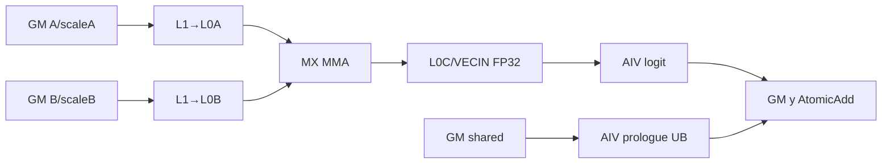
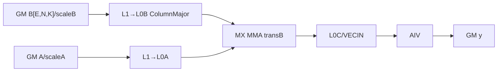
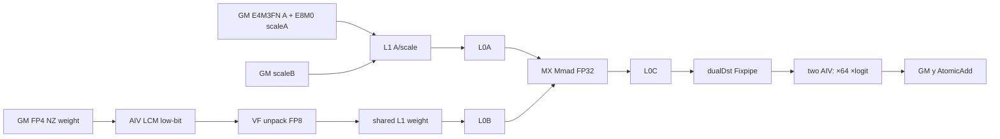
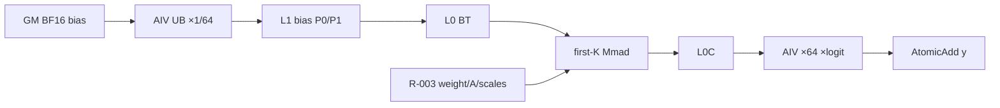

# GroupedMatmulFinalizeRouting 950 ACLNN 算子知识

## 算子速览

| 项目 | 内容 |
|---|---|
| 实际入口 | `aclnnGroupedMatmulFinalizeRoutingV3GetWorkspaceSize` / `aclnnGroupedMatmulFinalizeRoutingV3`，公开 ACLNN V3 |
| 计算语义 | 同位宽 MXFP8/MXFP4 直接进 Cube；混合 MX-A8W4 先由 AIV 将 NZ FP4 weight 解包成 FP8，再进 Cube；两者均在 AIV 乘 logit 后按 rowIndex scatter-add，并融合 shared input |
| 输入输出 | `x:[M,K]`；同位宽 `w:[E,K,N]`/`[E,N,K]` ND，混合路线 `w:[E,N,K]` view + NZ/C0_32 storage；A/W scales 为 E8M0；`y:[batch,N]` FP32 |
| 执行类型 | `MIX_CV`，单 Kernel、AIC:AIV=1:2；同位宽路线 L0C→VECIN，混合路线 AIV UB→L1 weight 与 L0C→双 AIV UB 两类交接 |
| Kernel 路线 | R-001/R-002 同位宽 MX 非转置/转置；R-003/R-004 混合 MX-A8W4 无/有 bias |
| 核心资源 | GM、16 MiB system workspace、L1、L0A/B/C、AIV LCM/寄存器、cross-core flag、FP32 AtomicAdd |
| 来源闭包 | `source_closed`：V3 ACLNN→L0→950 位宽 selector→两套 tiling/POD/key→apt entry→CGMCT 或 weight-resplit body→构建接线闭合 |
| 验证状态 | 已完成源码闭包检查；本次知识提取未执行编译、真机、数值或性能测试。 |

## 接口与语义

### 计算语义

对专家 `e` 的行区间 `I_e`，950 V3 的公开文档定义 MX 全量化。固定源码将其分为两种可达实现：同位宽 MXFP8×MXFP8 或 MXFP4×MXFP4 由 MX Matmul 直接消费 `x/w` 及 E8M0 scale；`x=FLOAT8_E4M3FN,w=FLOAT4_E2M1` 时，V3 公共 Host 的 `IsMxA8W4` 明确改走混合 weight-quant 路线，AIV 先把 NZ FP4 nibble 解包成 FP8 写入 L1，Cube 再用 E8M0 A/B scale 做 MX MMA。两种实现均生成 FP32 tile；AIV 对有效行 `r` 计算 `tile[r,n]*logit[r]`，随后 `AtomicAdd(y[rowIndex[r],n], value)`。`groupListType=0` 为累计边界，`groupListType=1` 为各专家 count；空专家跳过。

输出初始化先于 GMM：无 shared input 时清零 `[batch,N]`；否则清零共享区前后，并把共享区写成 `float(sharedInput)*sharedInputWeight`。V3 950 不支持确定性模式，多个专家命中同一输出行时物理累加顺序不固定。

### 输入、输出与属性

| 参数 | shape/layout | dtype | 约束、默认值与语义 |
|---|---|---|---|
| x1 | `[M,K]` ND | FLOAT8_E4M3FN/E5M2 或 FLOAT4_E2M1 | 必选；`transposeX1=false`；K>0；同位宽 FP4 时 K 偶数且 K≠2；混合路线仅 E4M3FN 且 K≥32、K%32=0 |
| x2 | 同位宽为 `[E,K,N]` 或 `[E,N,K]` ND；混合为 `[E,N,K]` view、5-D NZ/C0_32 storage | MXFP8/MXFP4 | 必选；E≤1024；混合路线固定 FP4、`transposeX2=true`、N≥32 且 N%32=0 |
| scale | 同位宽为 `[E,ceil(K/64),N,2]` 或 `[E,N,ceil(K/64),2]`；混合为后者 | FLOAT8_E8M0 ND | 必选；同位宽随 x2 转置；混合固定转置 shape |
| pertokenScale | `[M,ceil(K/64),2]` ND | FLOAT8_E8M0 | 必选，A 侧 MX scale |
| bias | `[E,N]` ND | BF16 | 可空；同位宽由 runtime `hasBias` 控制，混合路线用 `HASBIAS` 编译期 key 分裂为两 Route |
| groupList/logit/rowIndex | `[E]`/`[M]`/`[M]` ND | INT64/FP32/INT64 | 必选；分组、路由权重、scatter 行 |
| sharedInput | `[sharedLen,N]` ND | BF16 | 可空；写输出连续区间 |
| offset/antiquantScale/antiquantOffset | N/A | N/A | 950 V3 MX 必须为空 |
| dtype/sharedInputWeight/sharedInputOffset | 标量 | INT64/FP32/INT64 | `dtype=0`；offset≥0 且 ≤batch |
| groupListType/tuningConfig | 标量/数组 | INT64 | type∈{0,1}；950 MX 不用 tuningConfig 选算法 |
| out | `[batch,N]` ND | FP32 | FP4 非转置时 N 为偶数 |

### 入口与版本

固定 Commit 同时公开旧版、WeightNzV2 和 V3；同平台最新版本是 V3，产品表明确支持 Ascend 950PR/950DT。V3 文档声明 950 “仅支持 MX 全量化”，因此共享 entry TU 的 per-token body不是 V3 Route。文档量化表只列同位宽 MXFP8 和 MXFP4；但 V3 实现的 `IsMxA8W4`、DAV3510 专用 checker、OpDef dtype/format 组合、位宽 selector 和 apt 编译分支共同证明混合 E4M3FN×FP4 路线从该公开入口可达，本卡据固定源码保留并明确这一文档粒度差异。

## Host/Launcher 执行流程

### 参数校验与前处理

V3 第一段要求 x1/x2/scale/perTokenScale/groupList/logit/rowIndex 非空、两项 antiquant 为空、`dtype=0`、`transposeX1=false`。950 允许 x2 转置。`PreMatmulCalcProcess` 识别已有转置 view，否则 Contiguous；MX weight scale 用专门的业务维转换并要求转置状态与 x2 一致，但 `IsMxA8W4` 跳过此一致性复查。`CheckParams` 再以 `(x1,x2)=(E4M3FN,FP4)` 选择专用 checker：该分支要求 `transposeX2=true`、weight storage 为 5-D NZ/C0_32、K/N 为不小于 32 的 32 倍数；其它 MX 进入同位宽 checker。M=0 或 N=0 时 common process 直接返回，不添加算子 kernel。

### 参数、Workspace 与生命周期

L0 分配 FP32 ND 输出，InferShape 写 `[batch,N]`，只添加一个 AICore 节点，末端 ViewCopy 处理非连续 out。两套 950 tiling 都请求 16 MiB workspace，四条 body 均不读 `workspaceGM`：同位宽路线用 L0C/VECIN 交接，混合路线将 AIV 解包后的 FP8 weight 从 UB 写入 L1，并把 L0C 结果以 dual-destination Fixpipe 送到两个 AIV 的 UB。executor、输入、输出和 workspace backing 保持到 stream 完成。

### 启动图与失败传播

```text
V3GetWorkspaceSize -> checker/Contiguous -> l0op::GroupedMatmulFinalizeRouting
  -> TilingFunc(DAV_3510)
     -> sizeof(x)==sizeof(w): QuantTiling(priority 1)
        -> grouped_matmul_finalize_routing<0,BTRANS,0,0>
     -> sizeof(x)!=sizeof(w): WeightQuantTiling(priority 2)
        -> grouped_matmul_finalize_routing<0,1,HASBIAS>
     [均为 MIX_AIC_1_2，blockDim=aicNum；同位宽 scheduleMode=1]
  -> ViewCopy
```

任一步失败即终止；无后继 kernel/fallback。kernel 内 AIV 先初始化 y，`SyncAll` 后才进入 GMM。同位宽路线用 flag 4/20 与 6/22 交接 tile；混合路线以 flag 8/24、9/25 在 AIV 解包与 AIC 取 weight 之间握手，并以 flag 4/20、3 在 L0C Fixpipe 与 AIV 后处理之间交接。

## Route 与参数设计

### 分核与资源计算

同位宽 R-001/R-002：`baseM=align16(min(M,256))`；`baseN=min(N,256)` 后按布局/位宽对齐；`baseK` 由 128B 基块换算并按 Cube reduce 粒度、MX 64 元素组对齐，FP4 非转置另把 baseN 对齐 64。L1 预算为 `depthA1*(baseA+scaleA)+depthB1*(baseB+scaleB)`，其中 `scaleA=baseM*align2(ceil(baseK/64))`、`scaleB=baseN*align2(ceil(baseK/64))` 字节。L0A/B 固定双缓冲；仅当 `baseM*baseN*4*2<=l0cSize` 时 L0C 双缓冲。

混合 R-003/R-004 不使用 `TCubeTiling`：Host 只写 M/K/N/E、core 和 shared 初始化参数，Device 以 `M_L1=N_L1=256` 分块；`mL1Size=ceil(m_e/ceil(m_e/256))`，`nL1Size=min(256,N-nOffset)`。当 `mL1Size<=256(无 bias)/240(有 bias)` 且 `nL1Size<=128` 时 `kbL1Size=512`，否则为 256；`kaDepth=min(ceil(nL1Size/(align16(mL1Size)*2)), A_L1_bytes/(align16(mL1Size)*kbL1Size))`，`kaL1Size=kaDepth*kbL1Size`。block 按连续 N basic block 以 `coreNum` 步长轮转，两个 AIV sub-block 再各取当前 M tile 的一半。

### Route 选择

| 顺序 | Route | Key/模板 | 精确选择条件与优先级 | 不适用去向 |
|---:|---|---|---|---|
| 1 | R-001 MX 非转置 | `(ATRANS,BTRANS,SCALETYPE,ROWINDEXTYPE)=(0,0,0,0)`；B RowMajor | 950 V3同位宽 MX checker 通过且 `transposeX2=false` | `transposeX2=true` 进入 R-002；其余失败 |
| 2 | R-002 MX 转置 | `(0,1,0,0)`；B ColumnMajor | 同位宽 MX 且 `transposeX2=true`、scale 同步转置 | 失败 |
| 3 | R-003 MX-A8W4 无 bias | `(ATRANS,BTRANS,HASBIAS)=(0,1,0)`；`MXA8W4_NZNK` | `x=E4M3FN,w=FP4`、weight NZ/C0_32、`bias=null`、K/N≥32 且 K/N%32=0 | bias非空进入 R-004；其余失败 |
| 4 | R-004 MX-A8W4 有 bias | `(0,1,1)`；`MXA8W4_NZNK` | 同 R-003 且 `bias:[E,N]` BF16 | 失败 |

```text
if platform != DAV_3510 or scale != E8M0: failure
if transposeX1: failure
if x=E4M3FN && w=FP4:
  require transposeX2 && weightStorage in {NZ,NZ_C0_32} && K,N aligned32
  if bias==null: R-003 else R-004
else:
  require sizeof(x)==sizeof(w) and x/w both MXFP8-family or both FP4
  if !transposeX2: R-001 else R-002
```

### 模板/实现执行矩阵

| Route | key/selector | dtype/shape/platform 完整命中条件 | 执行族与 kernel 节点 | 实际模板/body | 内存与同步特征 | tail/fallback |
|---|---|---|---|---|---|---|
| R-001 | `(0,0,0,0)` | 950 V3 MX；B `[E,K,N]`; FP4 K/N偶数且K≠2 | 单 MIX | `grouped_matmul_finalize_routing_mx<RowMajor,RowMajor>`→`KernelGmmFinalizeRouting` | GM→L1/L0→L0C/VECIN；4/20、6/22；AtomicAdd | scheduler M/N tail；空专家跳过；无 fallback |
| R-002 | `(0,1,0,0)` | 950 V3 MX；B `[E,N,K]`; scale 同转置 | 单 MIX | `grouped_matmul_finalize_routing_mx<RowMajor,ColumnMajor>`→同 body | 同上，B 地址/layout 不同 | 同上 |
| R-003 | `(0,1,0)` | E4M3FN×FP4；B `[E,N,K]` view + NZ storage；K/N≥32 且 aligned32；bias空 | 单 MIX | `GMMFRWeightQuantResplitController<DTYPE_X,DTYPE_W,DTYPE_SCALE,DTYPE_SCALE,DTYPE_PERTOKEN_SCALE,DTYPE_BIAS,DTYPE_Y,bfloat16_t,float,int64_t,false,MXA8W4_NZNK,VEC_ANTIQUANT_CONFIG_DYNAMIC>` | AIV GM FP4→UB FP8→L1；AIC L1/L0/MMA；Fixpipe dualDst→AIV；8/24、9/25、4/20、3 | M/N/K 动态 tail；负 rowIndex 跳过；无 fallback |
| R-004 | `(0,1,1)` | 同 R-003，bias BF16 `[E,N]` | 单 MIX | 同 controller，`hasBias=true` | 同 R-003，另有 UB bias×1/64→L1/BT | `m` threshold 240；bias tail；无 fallback |

### 隐藏性能 Guard

| Guard | Host/Tiling 条件 | Device/资源原因 | 影响 Route | 不满足时去向 | 源码符号 |
|---|---|---|---|---|---|
| 同位宽 MX K 组 | `baseK=align64(baseKCandidate)` | MMA 每 64 K 元素消费两项 scale | R-001/002 | tiling失败 | `CalBasicBlock` |
| 同位宽 FP4 packing | K 偶数、K≠2；R-001 N偶数 | 两 FP4/字节 | R-001/002 | ACLNN错误 | `CheckInputOutShapeForMXFP4` |
| 专家数 | E≤1024 | 公开/checker 上界 | 四 Route | ACLNN错误 | `AclnnGroupedMatmulFinalizeRoutingDAV3510Checker::CheckInputOutShapeConsistency` / `GroupedMatmulFinalizeRoutingWeightQuant950Checker::CheckInputOutShapeConsistency` |
| 同位宽 L1 | `leftL1>=baseA+baseB+scaleA+scaleB` | 当前 depth 必须容纳四类 stage | R-001/002 | tiling失败 | `CalL1Depth` |
| 同位宽 L0C DB | `baseM*baseN*4*2<=l0cSize` | FP32 C 容量 | R-001/002 | `dbL0C=1` | `InitCommonL1TilingFields` |
| 同位宽确定性 | MX 令 flag=0 | 只有 AtomicAdd combine | R-001/002 | 仍非确定性 | `DeterministicTilingProcess` |
| 位宽 selector | `GetSizeByDataType(x)!=GetSizeByDataType(w)` | 混合 FP8×FP4 需要 AIV 解包，不能进入直接 MX Matmul | R-003/004 | priority-2 tiling失败 | `GroupedMatmulFinalizeRoutingTilingFunc` |
| 混合 layout | `transposeX2=true` 且 storage NZ/C0_32 5-D | AIV 地址按 `(K/C0,N/16,16,C0)` 取 packed FP4 | R-003/004 | ACLNN错误 | `GroupedMatmulFinalizeRoutingWeightQuant950Checker::CheckTranspose/CheckXAndWeightFormat` |
| 混合 K/N | `K,N>=32 && K%32==0 && N%32==0` | basic block、C0 与 NZ 搬运要求 | R-003/004 | ACLNN/tiling错误 | `CheckInputOutShape` / `CheckMxA8W4InputShape` |
| AIC:AIV | `aivNum==2*aicNum` | 单 MIX kernel 每 AIC 配两个 sub-block AIV | R-003/004 | tiling失败 | `GMMFRWeightQuantTiling::CheckCoreNum` |
| K tile | `(m<=threshold && n<=128)?512:256`，threshold 无 bias=256/有 bias=240 | bias 占 8 KiB L1，A tile 可用量分别 256/248 KiB | R-003/004 | 改用 256；无其它 Route | `SplitNByMultiCore` |

### POD/ABI

`GMMFinalizeRoutingDataParams` 由 `#pragma pack(8)` 约束，成员最大自然对齐 4，故源码布局为 `sizeof=40,alignof=4`；后接外部 `TCubeTiling`，其总体 size/align 固定仓不可见。

| 结构 | 字段 | 类型/位宽 | ABI 布局 | 单位 | Host/launcher producer | Device consumer | 边界 |
|---|---|---|---|---|---|---|---|
| GMMFinalizeRoutingDataParams | groupNum | uint32/32 | off 0,size 4 | 专家 | `DoOpTiling` | group loop | ≤1024 |
| 同上 | batch | uint32/32 | off 4 | 行 | outputBs | prologue | 0..M |
| 同上 | sharedInputOffset | uint32/32 | off 8 | 行 | attr | prologue | ≤batch |
| 同上 | sharedInputLen | uint32/32 | off 12 | 行 | shared shape | prologue | offset+len≤batch |
| 同上 | residualScale | float/32 | off 16 | 标量 | attr | shared cast/mul | FP32 |
| 同上 | aQuantMode | uint32/32 | off 20 | 枚举 | MX_PERGROUP | 当前实例参数 | 固定 MX |
| 同上 | bQuantMode | uint32/32 | off 24 | 枚举 | MX_PERGROUP | 当前实例参数 | 固定 MX |
| 同上 | biasDtype | uint32/32 | off 28 | dtype枚举 | BF16 | 实例类型 | BF16 |
| 同上 | groupListType | uint8/8 | off 32 | 枚举 | attr | group decoder | 0/1 |
| 同上 | hasBias | uint8/8 | off 33 | 布尔 | bias shape | Mmad overload | 0/1 |
| 同上 | deterministicFlag | uint16/16 | off 34 | 布尔 | deterministic tiling | MX body不读 | V3 950=0 |
| 同上 | deterWorkspaceSize | uint32/32 | off 36；struct size40 | 字节 | tiling | MX body不读 | V3 950=0 |
| GMMFinalizeRoutingTilingData | matmulTiling | TCubeTiling | off 40；总size不可见 | tile | `DoLibApiTiling` | MX builder | M/N/K/base/depth/step |
| GMMFinalizeRoutingWeightQuantTilingData | groupListType | uint8/8 | off 0 | 枚举 | `DoOpTiling` | group decoder | 0/1 |
| 同上 | hasBias | uint8/8 | off 1 | 布尔 | `DoOpTiling` | 仅 key/body一致性；body为编译期参数 | 0/1 |
| 同上 | reserve1 | uint16/16 | off 2 | N/A | 零初始化 | 不读取 | inactive |
| 同上 | groupNum | uint32/32 | off 4 | 专家 | weight dim0 | group loop | ≤1024 |
| 同上 | coreNum | uint32/32 | off 8 | AIC核 | compileInfo.aicNum | scheduler stride | >0且AIV=2倍 |
| 同上 | outputBs | uint32/32 | off 12 | 输出行 | out dim0 | 仅初始化范围由派生字段表示 | ≥0 |
| 同上 | sharedInputOffset | uint32/32 | off 16 | 行 | attr | shared GM offset | offset+len≤outputBs |
| 同上 | sharedInputLen | uint32/32 | off 20 | 行 | shared dim0 | shared初始化 | 可为0 |
| 同上 | sharedInputWeight | float/32 | off 24 | 标量 | attr | BF16→FP32 后乘法 | FP32 |
| 同上 | groupSize | uint32/32 | off 28 | scale项/逻辑组 | 固定32 | scale地址；每64 K元素含2项 | 32 |
| 同上 | kSize | uint64/64 | off 32 | 元素 | x dim1 | K切分/地址 | ≥32且aligned32 |
| 同上 | nSize | uint64/64 | off 40 | 元素 | weight origin dim1 | N切分/输出stride | ≥32且aligned32 |
| 同上 | initSize | uint64/64 | off 48；struct size56,align8 | FP32元素 | `(outputBs-sharedLen)*nSize` | y清零循环 | 不含shared区 |

### Route 源码闭包

| Route | Key/selector | Host/Tiling producer | POD/参数 | Kernel entry/router | Kernel body/直接依赖 | 构建接线 |
|---|---|---|---|---|---|---|
| R-001 | `(0,0,0,0)` | QuantTiling `DoOpTiling/DoLibApiTiling/GetTilingKey` | `GMMFinalizeRoutingTilingData` | apt entry MX branch | `mx<RowMajor,RowMajor>`→CGMCT kernel/prologue/epilogue | `op_host/CMakeLists.txt` `_apt_depends` |
| R-002 | `(0,1,0,0)` | 同上，transB=1 | 同 POD | apt entry BTRANS=1 | `mx<RowMajor,ColumnMajor>`→同 body | 同上 |
| R-003 | `(0,1,0)` | WeightQuantTiling `DoOpTiling/GetTilingKey` | 56B `GMMFinalizeRoutingWeightQuantTilingData` | apt `V310_GMM_FR_ANTI_QUANT` | resplit controller→VCV basic block→vec/cube helpers | OpDef mixed dtype/NZ + `_apt_depends` |
| R-004 | `(0,1,1)` | 同上，hasBias=1 | 同 POD | 同 entry，HASBIAS=1 | 同上，含 bias rescale/BT | 同上 |

## Kernel 实现

### 公共执行流程

entry 对四条 Route 都设置 MIX 1:2。AIV 先融合 shared input并清零其余 y，`SyncAll` 后按专家 M 与 N tile 分核。同位宽路线由 CGMCT scheduler 驱动，AIC 直接消费原始 A/B MX 数据并将 L0C 作为 `VECIN` 交给两个 AIV。混合路线由 resplit controller 驱动：两个 AIV 先各解包一半 K 的 NZ FP4 weight 到共享 L1，AIC 等待后加载 L0B、与 A/L1 scale 做 MMA；上一 basic block 的 L0C 同时由 Fixpipe 送到两个 AIV，各处理一半 M，乘 logit 并 AtomicAdd。

### Route R-001：MX 非转置权重

#### 适用条件

##### 选择证据

| 层级 | 文件 | 符号 | 源码谓词/参数 | 结果/下一跳 |
|---|---|---|---|---|
| API | `docs/aclnnGroupedMatmulFinalizeRoutingV3.md` | 950 约束 | 仅 MX full quant，x2/scale 非转置 shape | MX checker |
| Tiling | `gmm/grouped_matmul_finalize_routing/op_host/op_tiling/arch35/grouped_matmul_finalize_routing_quant_tiling.cpp` | `GetTilingKey` | `(transA,transB,scaleType,rowIndexType)=(0,0,0,0)` | R-001 |
| Router | `gmm/grouped_matmul_finalize_routing/op_kernel/grouped_matmul_finalize_routing_apt.cpp` | constexpr MX branch | `(0,0,0,0)` | `mx<RowMajor,RowMajor>` |

#### Device 数据流

##### 函数级调用链

```text
grouped_matmul_finalize_routing<0,0,0,0>
  -> grouped_matmul_finalize_routing_mx<RowMajor,RowMajor>
    -> KernelGmmFinalizeRouting::operator()
      -> BlockPrologueFinalizeRouting::operator()
      -> ProcessSingleGroup -> BlockMmad(MX,bias) -> BlockEpilogue(logit,rowIndex)
```

##### 源码等价伪码

```text
伪码：
AIV: initialize y with zero/sharedInput*residualScale
SyncAll; AIV signals prologue done; AIC waits
for e: m_e = cumsum ? groupList[e]-prev : groupList[e]; if m_e==0 continue
  for tile in scheduler(m_e,N,K):
    AIC waits previous AIV release
    C_ub = MXMatmul(RowMajor A, RowMajor B, A_scale, B_scale, optional BF16 bias)
    AIC sets flags 4/20
    AIV waits 4; C_ub *= logit; AtomicAdd y[rowIndex]
    AIV sets 6; AIC waits 6/22 before reuse
```

#### 内存与数据搬运

##### 资源与搬运表

| 层级/缓冲区 | offset/地址公式 | extent/容量公式 | dtype/layout | producer | consumer | owner/lifetime | 对齐/复用 |
|---|---|---|---|---|---|---|---|
| GM A | `mBase*K+tileM*K` | validM×K | MXFP8/packed FP4 RowMajor | caller | AIC | caller/stream | FP4 packing；K group tail |
| GM B | `e*K*N+tileN` | K×validN | RowMajor | caller | AIC | caller/stream | FP4 N偶数；N tail |
| GM scales/bias | A `mBase*ceil(K/64)*2`；B `e*ceil(K/64)*N*2` | 每K组2项；bias validN | E8M0/BF16 | caller | MX Mmad | caller/tile | group=64 |
| L1 | 当前 A/B/scales | `depthA1*(baseA+scaleA)+depthB1*(baseB+scaleB)` | Cube internal | MTE | L0 | AIC tile | depth/step容量推导 |
| L0A/B | current base tile | `2*baseM*baseK*sizeof(A)` / `2*baseN*baseK*sizeof(B)` | Cube internal | LoadData | MMA | tile | db=2 |
| L0C→VECIN | current tile | `dbL0C*baseM*baseN*4` | FP32 RowMajorAlign | AIC | AIV | tile | 双向 flag 防覆盖 |
| AIV UB | logit ping/pong 2×256B；out 2×32×256×4B；prologue BF16/FP32 ping/pong | 源码常量 | BF16/FP32 | MTE/Vector | Vector/MTE3 | AIV stage | 256B、M≤32 分段 |
| workspace | byte 0 | 16MiB system | opaque | runtime | MX body不读 | executor | 无 C slice |

##### 分层内存布局



##### 字节账、交接边与复用顺序

```text
workspace_total = 16 MiB system；MX body data slices = 0
L1_total = depthA1*(baseM*baseK*sizeof(A)+baseM*align2(ceil(baseK/64)))
         + depthB1*(baseN*baseK*sizeof(B)+baseN*align2(ceil(baseK/64)))
L0_total = 2*baseM*baseK*sizeof(A)+2*baseN*baseK*sizeof(B)+dbL0C*baseM*baseN*4
```

| 边/复用子区 | producer | offset/extent | dtype/layout | consumer | ordering/sync | owner/lifetime | 安全条件 |
|---|---|---|---|---|---|---|---|
| L0C/VECIN tile | AIC Mmad | validM×validN | FP32 | AIV | set 4/20；wait 4 | tile | scheduler valid M/N |
| tile release | AIV epilogue | same tile | N/A | next AIC tile | set 6；wait 6/22 | reuse boundary | 两AIV均结束 |
| y collision | AIV out UB | `rowIndex[r]*N+nOffset` | FP32 ND | GM y | AtomicAdd | output | rowIndex有效 |

#### 同步、精度与尾块

##### 同步与数值边界表

| 阶段 | primitive/机制 | producer | consumer/等待点 | 保护对象 | 精度/尾块 |
|---|---|---|---|---|---|
| 初始化 | ping-pong events + SyncAll | AIV | GMM | y 初值 | BF16→FP32，shared真实长度 |
| AIC→AIV | flags 4/20 | MX Mmad | AIV wait 4 | C tile | MX scales在MMA中，valid M/N/K |
| AIV→AIC | flags 6/22 | epilogue | AIC | tile reuse | 两AIV完成 |
| combine | FP32 AtomicAdd | AIV | y | rowIndex冲突 | FP32 logit；非确定顺序 |

#### 关键实现

##### 符号证据表

| 阶段 | 文件 | 符号/模板实例 | 实现事实 |
|---|---|---|---|
| Host/Tiling producer | `gmm/grouped_matmul_finalize_routing/op_host/op_tiling/arch35/grouped_matmul_finalize_routing_quant_tiling.cpp` | `DoLibApiTiling/GetTilingKey/PostTiling` | MX tile/key/blockDim |
| Kernel entry/router | `gmm/grouped_matmul_finalize_routing/op_kernel/grouped_matmul_finalize_routing_apt.cpp` | `(0,0,0,0)` | RowMajor/RowMajor |
| Device body/helper | `gmm/grouped_matmul_finalize_routing/op_kernel/arch35/grouped_matmul_finalize_routing.h`、`gmm/common/cgmct/kernel/kernel_gmm_finalize_routing.h` | `mx` / `ProcessSingleGroup` | builder、group/tile、flag |
| Device epilogue | `gmm/common/cgmct/epilogue/block_epilogue_finalize_routing.h` | `VFDoLogitMuls/VectorAtomicProcess` | logit/AtomicAdd |

### Route R-002：MX 转置权重

#### 适用条件

##### 选择证据

| 层级 | 文件 | 符号 | 源码谓词/参数 | 结果/下一跳 |
|---|---|---|---|---|
| API | `aclnn_grouped_matmul_finalize_routing.cpp` | V3 transpose guard / MX scale process | 950允许 false/true，scale与weight同步转置 | checker |
| Tiling | `gmm/grouped_matmul_finalize_routing/op_host/op_tiling/arch35/grouped_matmul_finalize_routing_quant_tiling.cpp` | `GetTilingKey` | `(0,1,0,0)` | R-002 |
| Router | `gmm/grouped_matmul_finalize_routing/op_kernel/grouped_matmul_finalize_routing_apt.cpp` | MX branch | BTRANS=1 | `mx<RowMajor,ColumnMajor>` |

#### Device 数据流

##### 函数级调用链

```text
grouped_matmul_finalize_routing<0,1,0,0>
  -> grouped_matmul_finalize_routing_mx<RowMajor,ColumnMajor>
    -> KernelGmmFinalizeRouting -> prologue -> MX Mmad(transB) -> epilogue
```

##### 源码等价伪码

```text
伪码：与 R-001 顺序一致；B=[E,N,K]，Bscale=[E,N,ceil(K/64),2]；
Coord::GetQuantOffset 与 builder 以 ColumnMajor/transB=true 计算 B/scaleB 地址。
```

#### 内存与数据搬运

##### 资源与搬运表

| 层级/缓冲区 | offset/地址公式 | extent/容量公式 | dtype/layout | producer | consumer | owner/lifetime | 对齐/复用 |
|---|---|---|---|---|---|---|---|
| GM B/scaleB | `e*N*K+nTile*K+kTile`；`e*N*ceil(K/64)*2+nTile*ceil(K/64)*2` | validN×K 与 validN×ceil(K/64)×2 | ColumnMajor/transposed view | caller | AIC | caller | K内轴/group64 |
| L1/L0/C | current transB tile | 与R-001同容量 | Cube internal/FP32 | MTE/MMA | AIV | tile | baseN按transB对齐 |
| AIV UB/y | 同R-001 | 同R-001 | FP32 | AIC/AIV | y | tile/output | 同flags/Atomic |
| workspace | byte0 | 16MiB system | opaque | runtime | body不读 | executor | 无中间slice |

##### 分层内存布局



##### 字节账、交接边与复用顺序

```text
workspace_total = 16 MiB system；data slice = 0
L1/L0/UB = R-001 同式；B 仅地址/layout specialization 改变
```

| 边/复用子区 | producer | offset/extent | dtype/layout | consumer | ordering/sync | owner/lifetime | 安全条件 |
|---|---|---|---|---|---|---|---|
| L0C tile | AIC transB Mmad | validM×validN | FP32 | AIV | 4/20→6/22 | tile | scaleB转置一致 |
| y | AIV | rowIndex*N+nOffset | FP32 | GM | AtomicAdd | output | valid tail |

#### 同步、精度与尾块

##### 同步与数值边界表

| 阶段 | primitive/机制 | producer | consumer/等待点 | 保护对象 | 精度/尾块 |
|---|---|---|---|---|---|
| B load | transB traits | GM/MTE | MX MMA | B/scaleB tile | K内轴与MX组对齐 |
| AIC↔AIV | 4/20、6/22 | 双方 | 对侧 | C tile | scheduler valid M/N |
| combine | AtomicAdd | AIV | y | row冲突 | FP32 |

#### 关键实现

##### 符号证据表

| 阶段 | 文件 | 符号/模板实例 | 实现事实 |
|---|---|---|---|
| Host/Tiling producer | `gmm/grouped_matmul_finalize_routing/op_host/op_tiling/arch35/grouped_matmul_finalize_routing_quant_tiling.cpp` | `GetTilingKey` | transB key |
| Kernel entry/router | `gmm/grouped_matmul_finalize_routing/op_kernel/grouped_matmul_finalize_routing_apt.cpp` | `(0,1,0,0)` | ColumnMajor实例 |
| Device body/helper | `gmm/grouped_matmul_finalize_routing/op_kernel/arch35/grouped_matmul_finalize_routing.h` / `gmm/common/cgmct/kernel/kernel_gmm_finalize_routing.h` | builder `LayoutB=ColumnMajor` | transB地址与公共握手 |

### Route R-003：混合 MX-A8W4 无 bias

#### 适用条件

##### 选择证据

| 层级 | 文件 | 符号 | 源码谓词/参数 | 结果/下一跳 |
|---|---|---|---|---|
| API | `op_api/aclnn_grouped_matmul_finalize_routing.cpp` | `IsMxA8W4/CheckParams` | `x1==E4M3FN && x2==FP4` | 专用 950 checker |
| Host | `op_host/grouped_matmul_finalize_routing_tiling.cpp` | `GroupedMatmulFinalizeRoutingTilingFunc` | `sizeof(x)!=sizeof(w)` | priority-2 weight-quant tiling |
| Tiling | `gmm/grouped_matmul_finalize_routing/op_host/op_tiling/arch35/grouped_matmul_finalize_routing_weight_quant_tiling.cpp` | `InferScenario/GetTilingKey` | NZ/C0_32、E8M0 scales、`hasBias=0` | key `(0,1,0)` |
| Router | `gmm/grouped_matmul_finalize_routing/op_kernel/grouped_matmul_finalize_routing_apt.cpp` | `V310_GMM_FR_ANTI_QUANT` | 编译 dtype E4M3FN×FP4 | `GMMFRWeightQuantResplitController<DTYPE_X,DTYPE_W,DTYPE_SCALE,DTYPE_SCALE,DTYPE_PERTOKEN_SCALE,DTYPE_BIAS,DTYPE_Y,bfloat16_t,float,int64_t,false,MXA8W4_NZNK,VEC_ANTIQUANT_CONFIG_DYNAMIC>` |

#### Device 数据流

##### 函数级调用链

```text
grouped_matmul_finalize_routing<0,1,0>
  -> GMMFRWeightQuantResplitController::Init/Process
    -> SplitNByMultiCore
      -> GMMFRWeightQuantVcvBasicBlock::ComputeBasicBlock
        AIV: CopyGmToUb -> WeightAntiQuantComputeNzNk -> UB FP8 -> L1
        AIC: CopyA/scale -> LoadA/BAndScaleL1ToL0 -> Mmad -> Fixpipe dualDst
        AIV: MulLogits -> RoutingYToGm(AtomicAdd)
```

##### 源码等价伪码

```text
伪码：
AIV: y[shared区外]=0; y[shared区]=float(shared)*sharedInputWeight
SyncAll
for e in [0,E):
  m_e = groupListType==0 ? groupList[e]-previous : groupList[e]
  for mTile<=256, nTile<=256 assigned to this AIC:
    kb = (mTile<=256 && nTile<=128) ? 512 : 256
    for kTile by kb:
      two AIV sub-blocks each load half-k packed FP4 NZ weight
      unpack each nibble to FP8 bit pattern in 4-way interleaved UB
      MTE3 UB->shared L1; set flag 8; AIC waits flags 24 and 8
      AIC moves A/A-scale/B-scale to L1, loads A and unpacked B to L0A/L0B
      AIC MX Mmad accumulates FP32 L0C; set flags 25 and 9 for next weight tile
    previous L0C: AIC waits both AIV flag 4/20, Fixpipe dualDst to two AIV UB, set flag 3
    AIV waits 3, multiplies FP32 tile by 64 then logit, skips negative rowIndex,
        AtomicAdd to y[rowIndex,nTile]
```

#### 内存与数据搬运

##### 资源与搬运表

| 层级/缓冲区 | offset/地址公式 | extent/容量公式 | dtype/layout | producer | consumer | owner/lifetime | 对齐/复用 |
|---|---|---|---|---|---|---|---|
| GM x/A-scale | expert base + `mOffset*K`; scale `mOffset*ceil(align64(K)/32)` | `mL1Size×kaL1Size`；每32 K一项 E8M0 | E4M3FN ND/E8M0 | caller | AIC MTE1 | caller/stream | A ND→NZ；K tail补0 |
| GM w | `(kOffset+kSub)*align16(N)+nOffset*32`（FP4物理字节由 helper 折半） | `ceil(kSub/32)×align16(nTile)×32` logical FP4 | FP4 NZ/C0_32 | caller | AIV MTE2 | caller/stream | K/N均32对齐 |
| AIV UB/LCM | byte 0..80KiB low-bit；80..240KiB high-bit | low-bit 4×20KiB；high-bit 4×40KiB | packed FP4→E4M3FN，4-way interleave | MTE2/VF | VF/MTE3/Fixpipe alias | AIV stage | 4缓冲；bank-conflict跳写 |
| L1 weight | 0 与 448KiB | 2×64KiB | E4M3FN NZ | AIV MTE3 | AIC L0B load | basic block | flags 8/24→9/25 防覆盖 |
| L1 scales | 双缓冲 A 2×32KiB + B 2×32KiB | 128KiB | E8M0 NZ | AIC MTE1 | L0 scale load | K stage | 每4096 K刷新 |
| L1 A | scales之后剩余区域 | 2×128KiB | E4M3FN NZ | AIC ND2NZ | L0A | K stage | DB；kaL1Size按容量裁剪 |
| L0A/L0B | offset 0/32KiB | 各2×32KiB | MX L0 type | LoadData | Mmad | K loop | 双缓冲，K L0=128或256 |
| L0C | 环形 `l0cOffset` | 256KiB FP32 | FP32 CO1 | Mmad | dualDst Fixpipe | basic block | 超过256×256回绕 |
| UB row/logit | high-bit区之后 | rowIndex 2KiB、logit 1KiB | INT64/FP32 | MTE2 | scalar/VF | 2-buffer | MTE2↔S/V events |
| GM workspace | byte 0 | 16MiB | opaque | runtime | body不读 | executor | 无数据 slice |

##### 分层内存布局



##### 字节账、交接边与复用顺序

```text
workspace_total = 16 MiB；body data slice = 0
L1_total = 2*64KiB(weight) + 2*32KiB(scaleA) + 2*32KiB(scaleB) + 2*128KiB(A) = 512KiB
L0_total = 2*32KiB(L0A) + 2*32KiB(L0B) + 256KiB(L0C) + 4KiB(BT address space)
UB/LCM named buffers = 80KiB(low-bit) + 160KiB(high-bit/Fixpipe alias) + 1KiB(bias) + 1KiB(biasRescale) + 2KiB(rowIndex) + 1KiB(logit) = 245KiB
```

| 边/复用子区 | producer | offset/extent | dtype/layout | consumer | ordering/sync | owner/lifetime | 安全条件 |
|---|---|---|---|---|---|---|---|
| unpacked weight | AIV VF/MTE3 | L1 P0/P1，各64KiB上界 | E4M3FN NZ | AIC LoadB | AIV set8；AIC wait24+8；AIC set25+9 | basic block K tile | 两AIV各完成半K才读；下一轮覆盖前AIC释放 |
| C tile | AIC Fixpipe | high-bit UB alias；`mTile×align16(nTile)` FP32，dstStride=256 | FP32 row-major | two AIV | AIV set4；AIC wait20+4；AIC set3 | previous basic block | dualDst；AIV分半M |
| y collision | AIV | `rowIndex*N+nOffset` | FP32 ND | GM y | AtomicAdd | output | `rowIndex<0`跳过；其余有效性由调用方保证 |

#### 同步、精度与尾块

##### 同步与数值边界表

| 阶段 | primitive/机制 | producer | consumer/等待点 | 保护对象 | 精度/尾块 |
|---|---|---|---|---|---|
| 初始化 | UB events + `SyncAll` | AIV | all AIC/AIV | y 初值 | shared BF16→FP32；尾部单独 DataCopyPad |
| weight解包 | MTE2_V、V_MTE3、MTE3_V | GM/VF/MTE3 | 下一 pipeline | 4-way UB | FP4 nibble按位变换为E4M3FN；K/N空片跳过 |
| AIV→AIC weight | cross-core 8/24 | 两 AIV | AIC PIPE_MTE1 | L1 P0/P1 | 两个半K完成后消费 |
| AIC→AIV release | cross-core 9/25 | AIC | AIV PIPE_MTE3 | L1 P0/P1 | 双 token 预置并循环复用 |
| AIC→AIV C | cross-core 4/20→3 | AIV先声明可覆写；AIC Fixpipe | AIV PIPE_V | Fixpipe双目的UB | `m`切两半；N对齐16，写出只用valid N |
| combine | FP32 AtomicAdd | AIV | GM y | row冲突 | C先乘64，再乘FP32 logit；负rowIndex跳过 |

#### 关键实现

##### 符号证据表

| 阶段 | 文件 | 符号/模板实例 | 实现事实 |
|---|---|---|---|
| Host/Tiling producer | `gmm/grouped_matmul_finalize_routing/op_host/op_tiling/arch35/grouped_matmul_finalize_routing_weight_quant_tiling.cpp` | `InferScenario/DoOpTiling/GetTilingKey` | mixed dtype/NZ、56B POD、key `(0,1,0)` |
| Kernel entry/router | `gmm/grouped_matmul_finalize_routing/op_kernel/grouped_matmul_finalize_routing_apt.cpp` | `V310_GMM_FR_ANTI_QUANT` | `HASBIAS=0` controller 实例 |
| Device scheduler | `gmm/grouped_matmul_finalize_routing/op_kernel/arch35/weight_quant_basic_block/gmm_fr_weight_quant_resplit_controller.h` | `Process/SplitNByMultiCore` | M/N/K 动态 basic block 与 core 轮转 |
| Device body/helper | `gmm/grouped_matmul_finalize_routing/op_kernel/arch35/weight_quant_basic_block/gmm_fr_weight_quant_vcv_basic_block.h` | `IterateNzNkWithAiv/KAic` | AIV解包、AIC MMA、前一块后处理流水 |
| Device vector | `gmm/grouped_matmul_finalize_routing/op_kernel/arch35/weight_quant_basic_block/gmm_fr_weight_quant_vec_compute.h` / `gmm/grouped_matmul_finalize_routing/op_kernel/arch35/weight_quant_basic_block/gmm_fr_mx_a8w4_vf.h` | `AntiQuantProcessNzMxA8W4/FrMulLogitsVf/RoutingYToGm` | nibble解包、×64×logit、AtomicAdd |
| Device cube | `gmm/grouped_matmul_finalize_routing/op_kernel/arch35/weight_quant_basic_block/gmm_fr_weight_quant_cube_compute.h` / `gmm/grouped_matmul_finalize_routing/op_kernel/arch35/weight_quant_basic_block/gmm_fr_weight_quant_cube_compute_tools.h` | `LaunchMatmul/MmadCompute/FixL0CToDst` | L1/L0、MX scale、Mmad、dualDst Fixpipe |

### Route R-004：混合 MX-A8W4 有 bias

#### 适用条件

##### 选择证据

| 层级 | 文件 | 符号 | 源码谓词/参数 | 结果/下一跳 |
|---|---|---|---|---|
| API | `gmm/grouped_matmul_finalize_routing/op_api/grouped_matmul_finalize_routing_weight_quant_950_checker.h` | `CheckDtypeValid/CheckOptionalShapes` | bias非空、BF16 `[E,N]` | 保留 bias |
| Tiling | `gmm/grouped_matmul_finalize_routing/op_host/op_tiling/arch35/grouped_matmul_finalize_routing_weight_quant_tiling.cpp` | `GetTilingKey` | `hasBias=1` | key `(0,1,1)` |
| Router | `gmm/grouped_matmul_finalize_routing/op_kernel/grouped_matmul_finalize_routing_apt.cpp` | controller 实例 | `HASBIAS=1` | 编译期 bias 路线 |

#### Device 数据流

##### 函数级调用链

```text
grouped_matmul_finalize_routing<0,1,1>
  -> GMMFRWeightQuantResplitController<DTYPE_X,DTYPE_W,DTYPE_SCALE,DTYPE_SCALE,DTYPE_PERTOKEN_SCALE,
       DTYPE_BIAS,DTYPE_Y,bfloat16_t,float,int64_t,true,MXA8W4_NZNK,VEC_ANTIQUANT_CONFIG_DYNAMIC>::Process
    -> AIV FrAntiQuantMxA8W4NzNkVf<DTYPE_X,DTYPE_W,DTYPE_BIAS,true> (weight unpack + bias*1/64)
      -> MTE3 weight/bias to L1
        -> AIC LoadBiasToBt + Mmad
          -> Fixpipe -> AIV ×64 ×logit -> AtomicAdd
```

##### 源码等价伪码

```text
伪码：沿 R-003 执行；每个 N tile 的首个 K stage 额外：
AIV load BF16 bias[nOffset:nOffset+validN]
AIV biasScaled = bias * 0.015625
AIV MTE3 biasScaled -> double-buffered L1 bias
AIC LoadBiasToBt; first-K Mmad uses bias table and cmatrixInitVal=false
final AIV multiplies whole C tile by 64 then by logit，故 bias 随同矩阵结果恢复到输出尺度
```

#### 内存与数据搬运

##### 资源与搬运表

| 层级/缓冲区 | offset/地址公式 | extent/容量公式 | dtype/layout | producer | consumer | owner/lifetime | 对齐/复用 |
|---|---|---|---|---|---|---|---|
| GM/L1/UB/L0 common | 同 R-003 | 同 R-003，A L1改为2×124KiB | 同 R-003 | 同 R-003 | 同 R-003 | basic block | threshold 240 |
| UB bias/biasRescale | high-bit区之后 | 各1KiB，4-way logical slice | BF16 | MTE2/VF | MTE3 | first K stage | validN≤256；每AIV最多128 |
| L1 bias | weight P0后与P1前 | 2×4KiB | BF16 | AIV MTE3 | AIC BT load | K/basic block | 与 weight 同 cvLoop parity |
| L0 BT | offset 0/512 FP32项 | 4KiB address space | scaled BF16→BT | LoadBiasToBt | first-K Mmad | L0 loop | 双缓冲偏移512 |

##### 分层内存布局



##### 字节账、交接边与复用顺序

```text
workspace_total = 16 MiB；body data slice = 0
L1_total = 2*64KiB(weight) + 2*4KiB(bias) + 2*32KiB(scaleA) + 2*32KiB(scaleB) + 2*124KiB(A) = 512KiB
L0/UB = R-003 + named 4KiB BT address space；bias/biasRescale各1KiB已位于约245KiB UB总量中
```

| 边/复用子区 | producer | offset/extent | dtype/layout | consumer | ordering/sync | owner/lifetime | 安全条件 |
|---|---|---|---|---|---|---|---|
| biasScaled | AIV VF/MTE3 | L1 bias P0/P1；validN BF16 | BF16 | AIC `LoadBiasToBt` | 随 weight 的8/24→9/25协议 | first K stage | 仅`kGmOffset==0`且validN>0 |
| C/y | 同 R-003 | 同 R-003 | FP32 | AIV/GM | 4/20→3 + AtomicAdd | basic block/output | final×64与前置bias×1/64成对 |

#### 同步、精度与尾块

##### 同步与数值边界表

| 阶段 | primitive/机制 | producer | consumer/等待点 | 保护对象 | 精度/尾块 |
|---|---|---|---|---|---|
| bias rescale | VF + V_MTE3/MTE3_V | AIV | MTE3 | UB bias | BF16乘0.015625；validN tail |
| bias handoff | cross-core 8/24 | 两AIV | AIC MTE1/BT | L1 bias | 仅首K装载；与weight同轮次 |
| MMA/restore | BT Mmad + final VF | AIC/AIV | AIV/GM | C tile | first-K bias；最终C统一乘64再乘logit |
| combine | AtomicAdd | AIV | y | row冲突 | 负rowIndex跳过；非确定顺序 |

#### 关键实现

##### 符号证据表

| 阶段 | 文件 | 符号/模板实例 | 实现事实 |
|---|---|---|---|
| Host/Tiling producer | `gmm/grouped_matmul_finalize_routing/op_host/op_tiling/arch35/grouped_matmul_finalize_routing_weight_quant_tiling.cpp` | `DoOpTiling/GetTilingKey` | `hasBias=1`、key `(0,1,1)` |
| Kernel entry/router | `gmm/grouped_matmul_finalize_routing/op_kernel/grouped_matmul_finalize_routing_apt.cpp` | controller `HASBIAS=1` | 编译期启用 bias |
| Device vector | `gmm/grouped_matmul_finalize_routing/op_kernel/arch35/weight_quant_basic_block/gmm_fr_mx_a8w4_vf.h` | `FrMxA8W4BiasCompute` | BF16 bias×1/64 |
| Device cube | `gmm/grouped_matmul_finalize_routing/op_kernel/arch35/weight_quant_basic_block/gmm_fr_weight_quant_cube_compute.h` | `LoadBiasToBt/DoMmadCompute` | 首K bias table Mmad |

## 算子特定优化

### Trick T-001：L0C 直接交接给双 AIV 后处理

#### 触发与源码依据

- 适用 Route：R-001、R-002
- 触发条件：950 V3 MX full-quant，single MIX kernel，CGMCT `KernelGmmFinalizeRouting`
- Golden 来源：[`gmm/common/cgmct/kernel/kernel_gmm_finalize_routing.h:289`](../../../../../../../cann-ops-raw/ascendc/ops-transformer/be33d95bb755cedec3108f70805c1874d1792540/gmm/common/cgmct/kernel/kernel_gmm_finalize_routing.h#L289-L320)

**官方源码（固定 Commit 连续逐字摘录）**：

```cpp
if ASCEND_IS_AIC {
    if (isVecSetSyncCom_)
    {
        WaitForVector();
    }
    AscendC::Std::tuple<int32_t, int32_t, int32_t> mmSingleShape{Get<MNK_M>(singleShape),
                                                                 Get<MNK_N>(singleShape), k};
    if (params.gmmParams.hasBias == 1)
    {
        mmadOp_(aGlobal_[Get<IDX_A_OFFSET>(blockOffset_)], bGlobal_[Get<IDX_B_OFFSET>(blockOffset_)],
                x1ScaleGlobal_[Get<IDX_X1SCALE_OFFSET>(blockOffset_)], x2ScaleGlobal_[Get<IDX_X2SCALE_OFFSET>(blockOffset_)],
                biasGlobal_[Get<IDX_BIAS_OFFSET>(blockOffset_)], l0cOutUb_, mmSingleShape, transA, transB);
    } else {
        mmadOp_(aGlobal_[Get<IDX_A_OFFSET>(blockOffset_)], bGlobal_[Get<IDX_B_OFFSET>(blockOffset_)],
                x1ScaleGlobal_[Get<IDX_X1SCALE_OFFSET>(blockOffset_)], x2ScaleGlobal_[Get<IDX_X2SCALE_OFFSET>(blockOffset_)],
                l0cOutUb_, mmSingleShape, transA, transB);
    }
    NotifyVector();
}
isVecSetSyncCom_ = true;
if ASCEND_IS_AIV {
    AscendC::Std::tuple<int64_t, int64_t, int64_t, int64_t> epilogueShape{Get<MNK_M>(singleShape),
                                                                          Get<MNK_N>(singleShape), 0, 0};
    int64_t y = Get<IDX_C_OFFSET>(blockOffset_);
    int64_t mOffset = y / n;
    int64_t nOffset = y - mOffset * n;
    AscendC::Std::tuple<int64_t, int64_t, int64_t, int64_t, int64_t, int64_t> epilogueOffset{
        nOffset, 0, 0, 0, mOffset, mOffset};
    WaitForCube();
    epilogueOp_(epilogueShape, epilogueOffset);
    NotifyCube();
}
```

#### 机制与设计原因

当前 `CMatmulType` 的目的位置是 `VECIN`，AIC 结果不写 GM C workspace。双向 flag 将“结果可读”与“tile 可覆盖”分开，并等待两个 AIV sub-block 完成。

#### 迁移边界

- 适用：同一 MIX launch 内 Cube 后紧接 Vector epilogue。
- 前提：AIC:AIV=1:2、相同 scheduler/tile、`CMatmulType<TPosition::VECIN>` 与 flag ID。
- 失效：跨 kernel 或需持久化 C 时必须改用 GM/workspace 与 stream 可见性协议。
- 未验证：本次知识提取未执行编译、真机、数值或性能测试。

#### 错误做法

省略 `WaitForVector` 会覆盖未消费 tile；省略 `WaitForCube` 会读取未完成结果。

### Trick T-002：shared 初始化融合进同一 MIX launch

#### 触发与源码依据

- 适用 Route：R-001、R-002
- 触发条件：始终执行；`sharedInputLen=0` 全清零，否则区间清零并缩放 shared input
- Golden 来源：[`gmm/common/cgmct/prologue/block_prologue_finalize_routing.h:266`](../../../../../../../cann-ops-raw/ascendc/ops-transformer/be33d95bb755cedec3108f70805c1874d1792540/gmm/common/cgmct/prologue/block_prologue_finalize_routing.h#L266-L294)

**官方源码（固定 Commit 连续逐字摘录）**：

```cpp
if (sharedInputLen == 0) {
    InitOutputWithZeros(0, params_->n * params_->batch);
    return;
}
InitOutputWithZeros(0, firstZeroSize);
uint64_t tail = sharedInputOffset + sharedInputLen;
InitOutputWithZeros(tail * params_->n, params_->n * (params_->batch - tail));
```

#### 机制与设计原因

AIV prologue 建立 y 初值，后续 expert 只做 AtomicAdd；shared 区用 ping-pong UB 完成 BF16→FP32 与 residualScale，无独立初始化 kernel。

#### 迁移边界

- 适用：scatter-add 输出且 shared 区连续。
- 前提：`offset+len<=batch`、GMM 前全核同步、输出 FP32。
- 失效：shared 区不连续或输出 owner 不同需重建初始化图。
- 未验证：本次知识提取未执行编译、真机、数值或性能测试。

#### 错误做法

省略 GMM 前 `SyncAll` 会使散射写与清零/shared 写竞态。

### Trick T-003：AIV 在线解包 FP4 weight 并与上一 basic block 后处理重叠

#### 触发与源码依据

- 适用 Route：R-003、R-004
- 触发条件：V3 950 `x=E4M3FN,w=FP4`、weight 为 NZ/C0_32、K/N aligned32
- Golden 来源：[`gmm/grouped_matmul_finalize_routing/op_kernel/arch35/weight_quant_basic_block/gmm_fr_weight_quant_vcv_basic_block.h:246`](../../../../../../../cann-ops-raw/ascendc/ops-transformer/be33d95bb755cedec3108f70805c1874d1792540/gmm/grouped_matmul_finalize_routing/op_kernel/arch35/weight_quant_basic_block/gmm_fr_weight_quant_vcv_basic_block.h#L246-L272)

**官方源码（固定 Commit 连续逐字摘录）**：

```cpp
VecComputeNzNkWithStartLimit(kMte2Offset, Min(curOffsetParam.kSize, DOUBLE_BUFFER_NUM * curOffsetParam.kbL1Size),
                             curOffsetParam);

vecCompute_.WaitSToMTE2(rlLoopIdx_);
vecCompute_.WaitFrVToMTE2(rlLoopIdx_);
uint64_t mSingleVec = CeilDivide(curOffsetParam.mL1Size, 2UL);
vecCompute_.CopyRowIndexLogitsGmToUb(curOffsetParam.mOffset + GetSubBlockIdx() * mSingleVec,
                                     GetSubBlockIdx() == 0 ? mSingleVec : curOffsetParam.mL1Size - mSingleVec,
                                     rlLoopIdx_);
vecCompute_.SetMte2ToS(rlLoopIdx_);
rlLoopIdx_++;
if (curCvLoopIdx > 0) {
    // y反量化在vec上两core切m
    uint64_t lastBasicBlockMSize = lastOffsetParam.mL1Size - (lastOffsetParam.mL1Size >> 1);
    lastBasicBlockMSize = GetSubBlockIdx() == 0 ? lastBasicBlockMSize : (lastOffsetParam.mL1Size >> 1);

    SetAivToAic<PIPE_MTE3>(SYNC_AIV_MTE3_AIC_FIX_FLAG);
    WaitAicToAiv<PIPE_V>(SYNC_AIC_FIX_AIV_VF_FLAG);

    vecCompute_.MulLogits(ubOutputF32Buffer_, lastBasicBlockMSize, lastOffsetParam, rlLoopIdx_);
    vecCompute_.SetFrToMTE2(rlLoopIdx_);
    vecCompute_.WaitMte2ToS(rlLoopIdx_);
    vecCompute_.RoutingYToGm(lastBasicBlockMSize, ubOutputF32Buffer_, lastOffsetParam, rlLoopIdx_);
    vecCompute_.SetSToMTE2(rlLoopIdx_);
}
// 当前暂不预取 MTE2，源码注释说明收益有限
VecComputeNzNkWithStartLimit(kMte2Offset, curOffsetParam.kSize, curOffsetParam);
```

#### 机制与设计原因

当前 basic block 先预取并解包最多两个 `kbL1Size` 的 weight，再装载本块 rowIndex/logit；若已有上一块结果，则在继续余下 K 解包前消费上一块 Fixpipe 输出。两 AIV 分半 K 生产共享 L1 weight，又分半 M 消费 FP32 C，配合双缓冲 L1 与四缓冲 UB 避免将解包后的 FP8 weight 或 C tile 物化到 GM。

#### 迁移边界

- 适用：packed 4-bit weight 可在 Vector 解包成 Cube 输入，且平台提供 1:2 MIX core 与 dual-destination Fixpipe。
- 前提：NZ/C0_32 地址规则、K/N aligned32、L1 固定 512KiB 布局、flag 8/24、9/25、4/20、3 的轮次一致。
- 失效：ND FP4、非 1:2 core 比例、K/N 不满足对齐或跨 kernel 时不能复用该交接协议。
- 未验证：本次知识提取未执行编译、真机、数值或性能测试。

#### 错误做法

把两个 AIV 的 weight 分片当作单 producer 会使 AIC 在一半 L1 尚未完成时读取；把 high-bit UB 与 Fixpipe 输出当作独立容量会重复计算实际 alias 区。

## 模板与实现对比

| 对比维度 | R-001 非转置 | R-002 转置 | R-003/004 混合 MX-A8W4 | 设计选择依据 |
|---|---|---|---|---|
| 命中条件/优先级 | 同位宽、transB=0、priority 1 | 同位宽、transB=1、priority 1 | E4M3FN×FP4、transB=1、priority 2；bias key分裂 | Host 位宽 selector + checker |
| 执行族/节点图 | 单 MIX | 单 MIX | 单 MIX，AIV同时是weight producer和C consumer | 同一公开入口，实际body不同 |
| M/N/K、tile 与 scheduler | Host TCubeTiling；RowMajor B | Host TCubeTiling；ColumnMajor B | Device M/N 256，K 256/512，core轮转 | CGMCT vs resplit controller |
| workspace/L1/L0/UB | 16MiB；L0C/VECIN | 同 | 16MiB；512KiB固定L1；245KiB named UB | 两类body均不读workspace |
| AIC/AIV 或 kernel 交接 | 4/20、6/22 | 同 | weight 8/24→9/25；C 4/20→3 | CGMCT flags vs weight-resplit flags |
| 同步、精度与 tail | MX→FP32 logit→Atomic | 同，B/scale转置 | FP4 bit-unpack→E4M3FN MX MMA→FP32×64×logit→Atomic；bias先×1/64 | 当前 specialization |
| fallback/失败边界 | 不支持即失败 | 不支持即失败 | layout/K/N/core ratio不满足即失败 | 无 device fallback |

## 平台差异

| 项目 | A2 | A3 | 950 |
|---|---|---|---|
| 支持状态 | V3公开支持；本卡不展开 | 同A2 | 本卡：V3 MXFP8/MXFP4及源码可达混合 MX-A8W4 |
| Host/Launcher | base tiling、packed W→INT4 | 同A2 | DAV3510 checker + priority-1/2 两套 tiling |
| Kernel/资源 | arch220 GM/TSCM-A、GM C workspace | 同族 | arch310 CGMCT 或 resplit MIX；L0C/UB直接交接；16MiB workspace |

## 限制与失败边界

- 950 V3 不纳入共享 TU 中的 per-token body；混合 E4M3FN×FP4 只保留 V3 实际可达的 NZ/C0_32、transB=true controller，不外推其它 WeightNzV2 路线。
- 公开文档量化组合表只列同位宽 MXFP8 与 MXFP4，而固定 API/OpDef/Tiling/Kernel 又闭合了混合 E4M3FN×FP4；本卡明确记录此文档粒度差异，不把混合路线推广到其它 dtype 组合。
- 公开文档声明 950 V3 不支持确定性；同位宽 MX tiling 写 `deterministicFlag=0`，混合 POD无确定性字段，最终同样使用 FP32 AtomicAdd。
- offset 与两项 antiquant 必须为空；同位宽路线要求同属 MXFP8 family 或同为 FP4；混合仅允许 x1=E4M3FN、x2=FP4。
- 同位宽 MXFP4 要求 K 偶数且 K≠2，非转置另要求 N 偶数；混合要求 K/N≥32且均为32倍数、weight storage为5-D NZ/C0_32；E≤1024。
- `TCubeTiling` 和 CGMCT primitive 的最终内部物理排布不在本算子固定源码内；混合路线不依赖 `TCubeTiling`，其低阶 L1/L0/UB 实现已在固定仓闭合。

## 源码索引

### 链路索引

| 链路阶段 | 文件 | 关键符号 | 支撑内容 |
|---|---|---|---|
| 入口约束 | `gmm/grouped_matmul_finalize_routing/docs/aclnnGroupedMatmulFinalizeRoutingV3.md` | V3 产品/量化表 | 950仅MX、dtype/shape/确定性 |
| 入口声明 | `gmm/grouped_matmul_finalize_routing/op_api/aclnn_grouped_matmul_finalize_routing_v3.h` | `aclnnGroupedMatmulFinalizeRoutingV3GetWorkspaceSize/aclnnGroupedMatmulFinalizeRoutingV3` | ABI |
| 入口实现 | `gmm/grouped_matmul_finalize_routing/op_api/aclnn_grouped_matmul_finalize_routing.cpp` | `V3GetWorkspaceSize/CommonProcess` | checker、contiguous、L0 |
| 入口约束 | `gmm/grouped_matmul_finalize_routing/op_api/grouped_matmul_finalize_routing_950_checker.h` | DAV3510 checker | MX dtype/shape/format |
| 入口约束 | `gmm/grouped_matmul_finalize_routing/op_api/grouped_matmul_finalize_routing_weight_quant_950_checker.h` | mixed checker | E4M3FN×FP4、NZ、transB、K/N约束 |
| Launcher | `gmm/grouped_matmul_finalize_routing/op_api/grouped_matmul_finalize_routing.cpp` | L0 op | InferShape、单节点 |
| Host selector | `gmm/grouped_matmul_finalize_routing/op_host/grouped_matmul_finalize_routing_tiling.cpp` | TilingFunc | 950 quant template |
| Host/Tiling | `gmm/grouped_matmul_finalize_routing/op_host/op_tiling/arch35/grouped_matmul_finalize_routing_quant_tiling.cpp` | `DoOpTiling/DoLibApiTiling/GetTilingKey` | POD/key/blockDim |
| Host/Tiling | `gmm/grouped_matmul_finalize_routing/op_host/op_tiling/arch35/grouped_matmul_finalize_routing_weight_quant_tiling.cpp` | `InferScenario/DoOpTiling/GetTilingKey` | mixed POD/key/blockDim/workspace |
| Host/Infer | `gmm/grouped_matmul_finalize_routing/op_host/grouped_matmul_finalize_routing_infershape.cpp` | `InferDataTypeGroupedMatmulFinalizeRouting/InferShapeGroupedMatmulFinalizeRouting` | mixed MX dtype 接受与 `[outputBS,N]` 输出 |
| Tiling helper | `gmm/grouped_matmul/op_host/op_tiling/arch35/grouped_quant_matmul_tiling.cpp` | `CalBasicBlock/CalL1Tiling/GetWorkspaceSize` | tile/L1/workspace |
| POD/key | `gmm/grouped_matmul_finalize_routing/op_kernel/arch35/grouped_matmul_finalize_routing_tiling_data.h` | POD structs | ABI |
| POD/key | `gmm/grouped_matmul_finalize_routing/op_kernel/arch35/grouped_matmul_finalize_routing_tiling_key.h` | template args | key域 |
| POD/key | `gmm/grouped_matmul_finalize_routing/op_kernel/arch35/weight_quant_basic_block/gmm_fr_weight_quant_tiling_data.h` | 56B POD | mixed ABI |
| POD/key | `gmm/grouped_matmul_finalize_routing/op_kernel/arch35/weight_quant_basic_block/gmm_fr_weight_quant_tiling_key.h` | `(0,1,HASBIAS)` | mixed key域 |
| Kernel entry | `gmm/grouped_matmul_finalize_routing/op_kernel/grouped_matmul_finalize_routing_apt.cpp` | `grouped_matmul_finalize_routing` | 同位宽两个 key shape + mixed bias 两个 key |
| Kernel body | `gmm/grouped_matmul_finalize_routing/op_kernel/arch35/grouped_matmul_finalize_routing.h` | `grouped_matmul_finalize_routing_mx` | CGMCT specialization |
| Kernel helper | `gmm/common/cgmct/kernel/kernel_gmm_finalize_routing.h` | `KernelGmmFinalizeRouting` | group/tile/flags |
| Kernel helper | `gmm/common/cgmct/prologue/block_prologue_finalize_routing.h` | prologue | y/shared初始化 |
| Kernel helper | `gmm/common/cgmct/epilogue/block_epilogue_finalize_routing.h` | epilogue | logit/AtomicAdd |
| Kernel helper | `gmm/grouped_matmul_finalize_routing/op_kernel/arch35/weight_quant_basic_block/gmm_fr_weight_quant_resplit_controller.h` | resplit controller | mixed group/core/M/N/K调度 |
| Kernel helper | `gmm/grouped_matmul_finalize_routing/op_kernel/arch35/weight_quant_basic_block/gmm_fr_weight_quant_vcv_basic_block.h` | VCV basic block | mixed AIC/AIV任务图与flags |
| Kernel helper | `gmm/grouped_matmul_finalize_routing/op_kernel/arch35/weight_quant_basic_block/gmm_fr_weight_quant_vec_compute.h` | VecCompute | UB、解包、logit、AtomicAdd |
| Kernel helper | `gmm/grouped_matmul_finalize_routing/op_kernel/arch35/weight_quant_basic_block/gmm_fr_weight_quant_cube_compute.h` | CubeCompute | L1/L0/Mmad/Fixpipe |
| Kernel helper | `gmm/grouped_matmul_finalize_routing/op_kernel/arch35/weight_quant_basic_block/gmm_fr_weight_quant_cube_compute_tools.h` | load/Mmad/Fixpipe helpers | MX scale、L0参数、dualDst |
| Kernel helper | `gmm/grouped_matmul_finalize_routing/op_kernel/arch35/weight_quant_basic_block/gmm_fr_mx_a8w4_vf.h` | VF bodies | FP4 bit解包、bias缩放、logit |
| Kernel helper | `gmm/grouped_matmul_finalize_routing/op_kernel/arch35/common/basic_block_config.h` | `MXA8W4_NZNK`/buffer config | mixed specialization与UB配置 |
| Kernel helper | `gmm/common/op_kernel/weight_quant_tool.h` | constants/flags | L1容量、group、cross-core ID |
| 构建接线 | `gmm/grouped_matmul_finalize_routing/op_host/grouped_matmul_finalize_routing_def.cpp` | `config91095` | 950 mixed dtype/NZ组合、apt文件 |
| 构建接线 | `gmm/grouped_matmul_finalize_routing/op_host/CMakeLists.txt` | `_apt_depends` | grouped_matmul依赖、auto-sync |

### 实现复用检查

| 检查项 | 可复用事实 | 不得改变的约束 | 源码符号 |
|---|---|---|---|
| ABI/POD | 同位宽40B params+TCubeTiling；mixed固定56B | 两套POD不可互解，字段顺序/位宽/单位不可变 | 两个 tiling_data struct |
| 调用顺序 | init→SyncAll→group/tile→epilogue | 初始化先于AtomicAdd；mixed上一块C与当前weight的流水依赖不可调换 | 两个 kernel body |
| workspace/内存 | 16MiB runtime workspace，四Route body均不读 | 不把workspace误作C/weight handoff；mixed UB high-bit与C输出alias | workspace/LCM layout |
| 同步 | 同位宽4/20、6/22；mixed 8/24、9/25、4/20、3 | 两AIV完成、pipe类型和轮次不可省略 | Notify/Wait / VCV flags |
| 精度与尾块 | 同位宽MX；mixed FP4→FP8、bias×1/64、C×64、FP32 atomic | group32/物理64、K/N对齐、valid M/N、负rowIndex语义 | builder/VF/epilogue |
| 失败边界 | 四Route；mixed按bias分key | 不纳入per-token或其它WeightNzV2 body，不外推未列dtype/layout | V3/API checker/Tiling/entry |