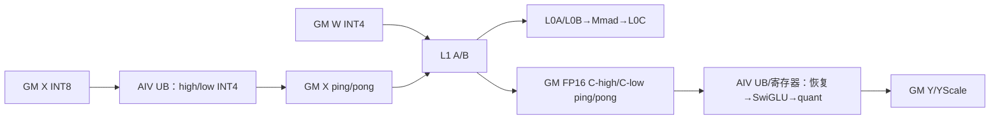
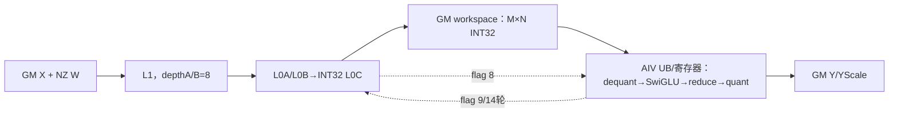
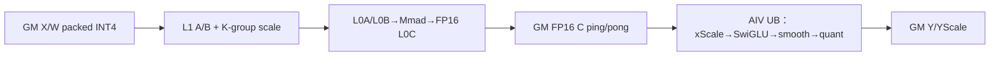

# grouped_matmul_swiglu_quant A2/A3 ACLNN 算子知识

## 算子速览

| 项目 | 内容 |
|---|---|
| 实际入口 | aclnnGroupedMatmulSwigluQuantV2 与 aclnnGroupedMatmulSwigluQuantWeightNzV2 |
| 计算语义 | GMM→反量化→SwiGLU→动态 INT8 量化，同时输出 per-token scale |
| 输入输出 | `x:[M,K]` ND；单 Tensor `weight:[E,K,N]` 或列表元素 `[K,N]`，A8W8 必须 NZ；`y:[M,N/2]` INT8，`yScale:[M]` FP32 |
| 执行类型 | MIX_CV |
| Kernel 路线 | R-001 A8W4 MSD；R-002 A8W8 fusion；R-003 A4W4 pipeline |
| 核心资源 | GM、分片 workspace、L1/L0、UB、reduce scratch、MIX 同步 |
| 来源闭包 | source_closed：两个公开 V2 入口到三条 body 与构建闭合 |
| 验证状态 | 已完成源码闭包检查；本次知识提取未执行编译、真机、数值或性能测试。 |

## 接口与语义

### 计算语义

对专家 `e`，令 `m_e=groupList[e]-(e=0?0:groupList[e-1])`（cumsum）或 `m_e=groupList[e]`（count），`X_e` 是对应的连续 token 段。A8W8/A4W4 的逻辑主序为 `C_e=(X_e W_e) * xScale_e * weightScale_e`；A8W4 MSD 先把 `X` 分解为 high/low INT4，两次 GMM 结果与离线 `weightAssistMatrix` 合并后再乘 `xScale`。随后把 `C_e[:,0:N/2]` 作为第一分支、`C_e[:,N/2:N]` 作为第二分支，源码调用 `SwiGLU(src0=后半, src1=前半, beta=1)`；A4W4 再乘逐专家或逐通道 `smoothScale`。每个有效行计算 `s=max(abs(S))/127`，保存 `yScale=s`，再执行 `S/s` 的 RINT/中间 cast/截断到 INT8。因而逻辑输出尾维为 `N/2`。WeightNzV2 仅强制 weight storage/view format 为 FRACTAL_NZ，不改变算术次序。

设备实现把矩阵分块、低比特预处理、激活和动态量化绑定为同一工作区协议。计算侧只有在对应工作区槽空闲时才能写 C，向量侧等待完成信号后读取，并在写完 Y 与 YScale 后释放该槽。尾行、尾列、空专家和最后不足完整向量宽度的元素都必须显式裁剪，不能依赖 padding。

### 输入、输出与属性

| 参数 | shape/layout | dtype | 约束、默认值与语义 |
|---|---|---|---|
| x | `[M,K]`/ND | INT8、INT4；INT32 载体按 8 个 INT4 重解释 | `K>0`（非空 M）；A8W8 `K<=65536`，A8W4 `K<=20000` |
| weight | 单 Tensor `[E,K,N]` 或列表元素 `[K,N]`；NZ 物理块 A8W8 C0=32、INT4 C0=64 | INT8、INT4；INT32 可重解释 INT4 | A8W8 只接受 NZ 且 `K%16=0,N%32=0`；A8W4 不支持转置；A4W4 仅 NZ 可转置；`N<=10240` 且偶数 |
| weightScale | A8W8 `[E,N]`/`[N]`；INT4 per-channel 或 per-group | FP32/FP16/BF16（A8W8），UINT64（INT4） | `dequantMode=0/1` 决定 `quantGroupNum=1/K-group-count` |
| weightAssistMatrix | A8W4 单 Tensor `[E,N]` 或列表元素 `[N]` | FP32 | A8W4 必选、A4W4 必须为空；由调用者离线生成 |
| xScale | `[M]`/ND | FP32 | 逐 token 反量化尺度 |
| smoothScale | `[E]` 或 `[E,N/2]`/ND | FP32 | 仅 A4W4 可选；SwiGLU 之后、动态量化之前应用 |
| groupList | `[E]`/ND | INT64 | `groupListType=0` 表示 cumsum，`1` 表示 count；未覆盖的尾行不更新 |
| y/yScale | [M,N/2] / [M] | INT8/FP32 | 动态量化结果和逐行尺度 |
| dequant/quant attrs | scalar | INT64 | 选择 A8W8/A8W4/A4W4 及输出量化 |

### 入口与版本

固定提交同时保留 V1 与 V2；V2 是后续公开 ABI，产品表继续覆盖 A2/A3，并公开 A8W8、A8W4、A4W4 的 V2 参数域，因此本卡只提取 V2 与 WeightNzV2 这组最新入口。两者共用 ACLNN 实现和 L0 op，区别在 weight format checker/传递。第一段构造 executor 和 workspace，第二段在同一 stream 提交。

## Host/Launcher 执行流程

### 参数校验与前处理

`aclnnGroupedMatmulSwigluQuantGetWorkspaceSizeCommon` 按当前架构选择 DAV_2201 handler。`GroupedMatmulSwigluQuantHandler::Process` 创建 executor，依次执行非空、维数、shape、dtype、format 检查；INT32 载体通过 `UnpackInt32ToInt4` 原位修正 view shape/dtype。WeightNz 第一段先验证单 Tensor storage 5 维或列表元素 4 维，再强制 storage format 为 NZ，并按 view 维数保留 ND/NZ 逻辑视图。可选列表被规范为空 Tensor，普通 Tensor/List 走 `Contiguous`，私有格式 weight 保持原 storage。L0 根据 `xScale[0]` 与 weightScale 推出 `[M,N/2]`、`[M]`，执行 `INFER_SHAPE` 后以 `ADD_TO_LAUNCHER_LIST_AICORE` 加入一个节点；空 output/groupList/outputScale 直接返回 workspace 0。

### 参数、Workspace 与生命周期

Base tiling 固定 `baseM=128,baseN=256,baseK=256`，从 64 MiB user workspace 上限推导 `mLimit`。A8W4：`mLimit=floor((64MiB/2)/(K+4N))`，`workSpaceOffset1=2*mLimit*K`、`workSpaceOffset2=8*mLimit*N`，总 workspace=`16MiB+2*mLimit*K+8*mLimit*N`；A4W4：`mLimit=floor((64MiB/2)/(2N))`，`workSpaceOffset1=2*mLimit*N`，总 workspace=`16MiB+4*mLimit*N`。A8W8 fusion 为 `4*M*N+20MiB`。这些大小由 executor 第一段汇总并由调用者持有到 stream 完成。

### 启动图与失败传播

单 MIX kernel，key 2/3/4/5 决定 body 和 task type；Host 写 blockDim 及 scheduleMode。参数、tiling、workspace 或 launch 任一步失败即返回。

## Route 与参数设计

### 分核与资源计算

Cube base 由 L0/L1 资源计算，Vector 的 maxProcessRowNum/tokenLen 由 UB 可用量与 N 决定。mLimit 决定 workspace 分片循环；singleN 与 quantGroupNum 决定 N tile。fusion route 分别写 cubeBlockDim/vectorBlockDim 和 UB 因子。

### Route 选择

| 顺序 | Route | Key/模板 | 精确选择条件与优先级 | 不适用去向 |
|---:|---|---|---|---|
| 1 | R-001 A8W4 MSD | key 2 | 在 registry 中 fusion 先因 `weight!=INT8` 拒绝；base tiling 接受 INT4，且 `x=INT8,weight=INT4`，不允许转置 | 非此 dtype 进入 A4W4 判定或失败 |
| 2 | R-002 A8W8 fusion | key 3 | registry 实际先尝试此模板；`weight=INT8` 且首个 weight storage rank 为 5（单 Tensor）或 4（列表元素）；ACLNN 还要求 storage NZ | fusion 失败后 base 也拒绝 INT8，最终失败 |
| 3 | R-003 A4W4 pipeline | key 4 非转置；key 5 转置 | fusion 拒绝 INT4；base tiling 接受 INT4，且 `x=INT4,weight=INT4`；`transposeWeight` 决定 4/5 | 其余组合失败；key 0/1 在本 entry 无对应可达 body |

```text
supportL12BtBf16=false
  -> fusion.IsCapable(weight==INT8 && storageRank in {4,5}) -> key3/R-002
  -> base.IsCapable(weight==INT4 && storageRank in {2,3,4,5})
       -> x==INT8 -> key2/R-001
       -> x==INT4 -> (transW ? key5 : key4)/R-003
       -> error
```

### 模板/实现执行矩阵

| Route | key/selector | dtype/shape/platform 完整命中条件 | 执行族与 kernel 节点 | 实际模板/body | 内存与同步特征 | tail/fallback |
|---|---|---|---|---|---|---|
| R-001 A8W4 MSD | key 2 | 非 950；`x=INT8`、`weight=INT4`；weight storage rank 2/3/4/5；`dequantMode=0/1` | 单节点 `MIX_AIC_1_2` | `MMImplTypeCustom<ND INT4,NZ/ND INT4,ND FP16>`；`GMMA8W4Pre/Mid/PostProcess` | 两槽 X 拆分区 + 两槽 high/low C 区；`SyncAll<false/true>` | M/N/K 和 workspace split 尾块；不满足返回 tiling 失败 |
| R-002 A8W8 fusion | key 3（registry priority 0） | 非 950；`weight=INT8`，storage rank 4/5；ACLNN 要求 NZ、K 16 对齐、N 32 对齐 | 单节点 `MIX_AIC_1_2` | `Matmul<INT8,NZ,INT32>` + `GroupedMatmulDequantSwigluQuantFusion` | GM workspace `M*N*sizeof(int32_t)`；flag 8/9 协议 | `realM/realN` 裁剪；fusion 拒绝后 base 也拒绝 INT8 |
| R-003 A4W4 pipeline | key 4/5 | 非 950；`x=INT4`、`weight=INT4`；key 5 仅 `transposeWeight=true` | 单节点 `MIX_AIC_1_2` | `MMImplTypeCustom<ND INT4,NZ/ZN INT4,ND FP16>`；`GMMA4W4Mid/PostProcess` | 两槽 FP16 C workspace；片间全核同步 | M/N/K-group tail；其它 key 无可达 body |

### 隐藏性能 Guard

| Guard | Host/Tiling 条件 | Device/资源原因 | 影响 Route | 不满足时去向 | 源码符号 |
|---|---|---|---|---|---|
| 平台 selector | `supportL12BtBf16 == false` | A2/A3 使用 classic INT tiling 和非 APT entry | 全部 | 为 true 时转 950 template，不落入本卡 | `GroupedMatmulSwigluQuantV2TilingFunc` |
| UB 行容量 | A8W4/A4W4：`weightFactor*row*N + 4*align8(row)+6N+64 <= ubSize`；A8W8 使用剩余 UB 公式 | Post 需同时容纳两半、scale、reduce 与双缓冲 | R-001/R-003；R-002 有独立 `ubFactorDimx` | `maxProcessRowNum<1` 报错 | `CalMaxRowInUbA8W4`、`CalMaxRowInUb` |
| user workspace | `mLimit=floor((64MiB/2)/perRowBytes)>0` | ping/pong 每槽必须容纳完整 split | R-001/R-003 | tiling 失败 | `DoOpTiling` |
| Fusion UB 因子 | `N<4600 -> 4`；`4600<=N<8192 -> 2`；否则 1 | N 增大时减少一次 AIV 处理行数 | R-002 | 同一路线更小行 tile | `GroupedMatmulSwigluQuantV2FusionTiling::ParseInputAndAttr` |
| A4W4 动态 N tile | `N>=256 && tuningConfig>0 && quantGroupNum==1 && isNz_`，有效任务率需 `>=0.95` | 尝试改善 AIC 任务均衡，并在 L1 容量允许时 full-load A | R-003 | `singleN=0/256`，保持默认 tile | `FindBestSingleN`、`DynamicTilingSingleN`、`TryFullLoadA` |
| Matmul L1/L0 | base 128×256×256，`stepKa=stepKb=4`、`depthA1=depthB1=8`、B/L0 double buffer | 当前 specialization 的 L1/L0 容量和流水要求 | R-001/R-003 | `MatmulApiTiling` 失败即 tiling 失败 | `DoOpTiling` |

### POD/ABI

| 结构 | 字段 | 类型/位宽 | ABI 布局 | 单位 | Host/launcher producer | Device consumer | 边界 |
|---|---|---|---|---|---|---|---|
| GMMSwigluQuantV2BaseParams | groupNum | int64/64 | offsetof=0，sizeof=8，alignof=8 | 组 | `FillTilingData(groupNum_)` | pipeline 的专家范围循环 | `groupList[0]` 长度 |
| GMMSwigluQuantV2BaseParams | coreNum | int64/64 | offsetof=8，sizeof=8，alignof=8 | AIC 核 | `blockDim_=aicNum` | Mid 分核 | 正平台核数 |
| GMMSwigluQuantV2BaseParams | K | int64/64 | offsetof=16，sizeof=8，alignof=8 | 元素 | `x.shape[1]` | Pre/Mid GM 地址与 K 循环 | A8W4 `<=20000` |
| GMMSwigluQuantV2BaseParams | N | int64/64 | offsetof=24，sizeof=8，alignof=8 | 元素 | weight storage/view 推导 | Mid tile、Post `tokenLen` | 偶数，`<=10240` |
| GMMSwigluQuantV2BaseParams | M | int64/64 | offsetof=32，sizeof=8，alignof=8 | 行 | `x.shape[0]` | workspace/scheduler | 有效 M 仍由 groupList 决定 |
| GMMSwigluQuantV2BaseParams | baseM | int64/64 | offsetof=40，sizeof=8，alignof=8 | 行 | 常量 128 | Mid `SetSingleShape` | 尾 M 裁剪 |
| GMMSwigluQuantV2BaseParams | baseN | int64/64 | offsetof=48，sizeof=8，alignof=8 | 列 | 常量 256 | Mid N 分块 | 尾 N 裁剪 |
| GMMSwigluQuantV2BaseParams | mLimit | int64/64 | offsetof=56，sizeof=8，alignof=8 | 行/片 | 64 MiB user 上限公式 | split pipeline | 必须 `>0` |
| GMMSwigluQuantV2BaseParams | workSpaceOffset1 | int64/64 | offsetof=64，sizeof=8，alignof=8 | 字节 | A8W4/A4W4 公式 | Pipeline `Init` 的 ping/pong 边界 | 非负且在 user workspace 内 |
| GMMSwigluQuantV2BaseParams | workSpaceOffset2 | int64/64 | offsetof=72，sizeof=8，alignof=8 | 字节 | A8W4 第二中间区；A4W4=0 | A8W4 Pipeline `Init` | route 专属 |
| GMMSwigluQuantV2BaseParams | quantGroupNum | int64/64 | offsetof=80，sizeof=8，alignof=8 | K group | `dequantMode` 与 weightScale rank | A4W4/A8W4 Mid | per-channel 为 1 |
| GMMSwigluQuantV2BaseParams | isSingleTensor | int64/64 | offsetof=88，sizeof=8，alignof=8 | 0/1 | weight rank | `GetTensorAddr`/expert base | 0 或 1 |
| GMMSwigluQuantV2BaseParams | groupListType | int64/64 | offsetof=96，sizeof=8，alignof=8 | 枚举 | attr[5] | split config | 0/1 |
| GMMSwigluQuantV2BaseParams | smoothScaleDimNum | int64/64 | offsetof=104，sizeof=8，alignof=8 | rank | A4W4 optional tensor | `ApplySmoothScale` | 0/1/2 |
| GMMSwigluQuantV2BaseParams | singleN | int64/64 | offsetof=112，sizeof=8，alignof=8；结构 sizeof=120/alignof=8 | 元素 | `DynamicTilingSingleN` | A4W4 N scheduler | 0 表示默认 baseN |
| GMMSwigluQuantV2 | maxProcessRowNum | int64/64 | offsetof=0，sizeof=8，alignof=8 | 行/UB | `CalMaxRowInUb*` | Post UB 循环 | 至少 1，否则 tiling 报错 |
| GMMSwigluQuantV2 | groupListLen | int64/64 | offsetof=8，sizeof=8，alignof=8 | 组 | `groupNum_` | pipeline 读取 groupList | 与 groupNum 一致 |
| GMMSwigluQuantV2 | tokenLen | int64/64 | offsetof=16，sizeof=8，alignof=8；结构 sizeof=24/alignof=8 | 元素 | `N` | SwiGLU/quant | 偶数 |
| GMMSwigluQuantV2TilingData | 三个子结构 | aggregate | Base offsetof=0；`GMMSwigluQuantV2` offsetof=120；`TCubeTiling` 后续精确 offsetof/总 sizeof 固定仓宏展开不可见 | POD | `SaveToBuffer` by value | key 2/4/5 entry | 不得与 fusion POD 混用 |
| GMMSwigluQuantV2TilingFusionData | cubeBlockDim | int64/64 | offsetof=0，sizeof=8，alignof=8 | AIC 核 | `aicCoreNum_` | Cube 分核/同步次数 | 平台范围 |
| GMMSwigluQuantV2TilingFusionData | vectorBlockDim | int64/64 | offsetof=8，sizeof=8，alignof=8 | AIV 核 | `aivCoreNum_` | `ProcessDSQ` 行分核 | 正值 |
| GMMSwigluQuantV2TilingFusionData | groupNum | int64/64 | offsetof=16，sizeof=8，alignof=8 | 组 | groupList shape | group traversal | 非负 |
| GMMSwigluQuantV2TilingFusionData | K | int64/64 | offsetof=24，sizeof=8，alignof=8 | 元素 | x shape | Matmul/address | `K%16=0`（ACLNN A8W8 NZ） |
| GMMSwigluQuantV2TilingFusionData | N | int64/64 | offsetof=32，sizeof=8，alignof=8 | 元素 | NZ storage | Matmul/SwiGLU | `N%32=0` |
| GMMSwigluQuantV2TilingFusionData | M | int64/64 | offsetof=40，sizeof=8，alignof=8 | 行 | x shape | workspace base | 非负 |
| GMMSwigluQuantV2TilingFusionData | ubFactorDimx | int64/64 | offsetof=48，sizeof=8，alignof=8 | 行/UB | N 阈值选择 4/2/1 | AIV UB loop | N 相关 |
| GMMSwigluQuantV2TilingFusionData | ubFactorDimy | int64/64 | offsetof=56，sizeof=8，alignof=8 | 列 | `N/2` | AIV 半宽 | 偶数 |
| GMMSwigluQuantV2TilingFusionData | actRight | int64/64 | offsetof=64，sizeof=8，alignof=8 | 布尔/偏移选择 | 本 tiling 未显式赋值，zero-init | `ProcessDSQ` split offset | inactive 默认 0 不得改写 |
| GMMSwigluQuantV2TilingFusionData | groupListType | int64/64 | offsetof=72，sizeof=8，alignof=8 | 枚举 | attr | group decoder | 0/1 |
| GMMSwigluQuantV2TilingFusionData | isSingleTensor | int8/8 | offsetof=80，sizeof=1，alignof=1；其后 padding/aggregate 总 size 固定仓宏展开不可见 | 0/1 | weight rank | pointer-list addressing | 0/1 |
| GMMSwigluQuantV2TilingFusionData | matmulTiling | TCubeTiling | 紧随前述字段；精确 offsetof/sizeof/alignof 固定仓宏展开不可见 | 分块 | `MatmulApiTiling` 后覆写 base/depth/step | fusion Cube | 本 route 固定 base 128/256/128，depth 8 |

### Route 源码闭包

| Route | Key/selector | Host/Tiling producer | POD/参数 | Kernel entry/router | Kernel body/直接依赖 | 构建接线 |
|---|---|---|---|---|---|---|
| R-001 A8W4 MSD | 2 | grouped_matmul_swiglu_quant_v2_base_tiling.cpp::DoOpTiling/SetTilingKeyAndScheMode | GMMSwigluQuantV2TilingData | grouped_matmul_swiglu_quant_v2.cpp::grouped_matmul_swiglu_quant_v2 | grouped_matmul_swiglu_quant_v2_a8w4_msd_pipeline.h::Process；pre/mid/post helpers | op_host/CMakeLists.txt::GroupedMatmulSwigluQuantV2 |
| R-002 A8W8 fusion | 3 | grouped_matmul_swiglu_quant_v2_fusion_tiling.cpp::DoOpTiling/PostTiling | GMMSwigluQuantV2TilingFusionData | grouped_matmul_swiglu_quant_v2.cpp::grouped_matmul_swiglu_quant_v2 | grouped_matmul_swiglu_quant_spilit_fusion.h::CubeProcess/ProcessDSQ | op_host/CMakeLists.txt::GroupedMatmulSwigluQuantV2 |
| R-003 A4W4 pipeline | 4/5 | grouped_matmul_swiglu_quant_v2_base_tiling.cpp::SetTilingKeyAndScheMode | GMMSwigluQuantV2TilingData | grouped_matmul_swiglu_quant_v2.cpp::grouped_matmul_swiglu_quant_v2 | grouped_matmul_swiglu_quant_v2_a4w4_pipeline.h::Process | op_host/CMakeLists.txt::GroupedMatmulSwigluQuantV2 |

## Kernel 实现

### 公共执行流程

所有路线把 Cube 输出交给 Vector Post：反量化为 FP32，按 N/2 切 gate/value，SwiGLU 后按行 ReduceMax，计算 scale 并量化到 INT8。不同路线的低比特 Mid、workspace 和同步图不同。

### Route R-001：A8W4 MSD

#### 适用条件

##### 选择证据

| 层级 | 文件 | 符号 | 源码谓词/参数 | 结果/下一跳 |
|---|---|---|---|---|
| Host/Tiling | gmm/grouped_matmul_swiglu_quant_v2/op_host/op_tiling/grouped_matmul_swiglu_quant_v2_base_tiling.cpp | SetTilingKeyAndScheMode | A8W4 MSD 条件且 key=2 | A8W4 MSD |
| Router | gmm/grouped_matmul_swiglu_quant_v2/op_kernel/grouped_matmul_swiglu_quant_v2.cpp | grouped_matmul_swiglu_quant_v2 | TILING_KEY_IS 匹配 | GMMSwigluQuantPipelineSchedule |

#### Device 数据流

##### 函数级调用链

```text
grouped_matmul_swiglu_quant_v2
  -> GMMSwigluQuantPipelineSchedule::Init/Process
    -> GMMA8W4PreProcess::Process
    -> GMMA8W4MidProcess::Process/MMCompute
    -> GMMA8W4PostProcess::Process/VectorCompute
      -> MergeAuxiliaryMatrix -> MulPertokenScale -> Swiglu -> Quant -> customDataCopyOut
```

##### 源码等价伪码

```text
伪码：
validM = groupListType==0 ? groupList[E-1] : sum(groupList)
loopCount = ceil(validM/mLimit)
Pre(split=0): 对每个有效行从 x[(split*mLimit+row)*K] 搬入 UB；
  xHigh=floor(cast_fp16(x)/16)，xLow=(x & 0x0f)-8；cast 为 INT4 后写 ping workspace
for split in [0,loopCount):
  更新 leftMatrixStartIndex 与本片覆盖的 expert 起止；SyncAll(false)
  Mid: 对 expert、M/N tile 和 high/low 两路设置 A/B，沿 K tile Mmad，
       分别写 workspace[workSpaceOffset2/3 + (split&1)*片容量 + row*N+n]
  Pre(split+1) 与 Mid(split) 重叠；AIV Reset 后 SyncAll(true)
  Post(split-1): load FP16 high/low C；恢复 16*C_high+C_low+assist；乘 xScale；
       SwiGLU(后半,前半)；maxAbs/127 -> yScale；乘倒数，RINT→FP16→TRUNC INT8；
       y[(leftStart+row)*(N/2):有效半宽] = quant
末尾 SyncAll(false) 后提交最后一片；split 越界和空 expert 不搬运/不写输出
```

#### 内存与数据搬运

##### 资源与搬运表

| 层级/缓冲区 | offset/地址公式 | extent/容量公式 | dtype/layout | producer | consumer | owner/lifetime | 对齐/复用 |
|---|---|---|---|---|---|---|---|
| GM X/W/Y | xBase+mOffset*K；wBase+kOffset*N+nOffset；yOffset=mOffset*(N/2)+nOffset/2 | curM*K、K*curN、curM*(N/2) | route dtype，ND/NZ | caller | pipeline | caller/stream | validM/N/K |
| workspace X-high/low | `user + 0` 与 `user + workSpaceOffset1/2`（Pipeline 将 offset1 除 2 后形成两个 ping/pong 起点） | 每槽 `mLimit*K` 字节，双槽总 `2*mLimit*K` | INT4 packed/GM | `GMMA8W4PreProcess::Process` | Mid `SetTensorA` | 当前/下一 split | split 奇偶复用；`SyncAll` 防覆盖 |
| workspace C-high/low | `user+workSpaceOffset1` 与 `user+workSpaceOffset1+workSpaceOffset2/2` | 每槽 `2*mLimit*N*sizeof(half)`，双槽总 `8*mLimit*N` 字节 | FP16/ND | `GMMA8W4MidProcess::MMCompute` | Post `customDataCopyIn` | Mid→Post | high/low 均须完成后消费 |
| L1/L0A/L0B/L0C | current tile | baseM*baseK、baseN*baseK、baseM*baseN*accSize | Cube | GM/MTE/Mmad | Mmad/Post | AIC tile | depth/db |
| UB/register | row*tokenLen+column | maxProcessRowNum*tokenLen 与 reduce scratch | FP32/INT8 | workspace/GM | SwiGLU/quant | AIV loop | 32B、mask tail |

##### 分层内存布局



##### 字节账、交接边与复用顺序

```text
workspace_total = 16MiB + 2*mLimit*K + 8*mLimit*N
L1 = depthA1*baseM*baseK*0.5 + depthB1*baseN*baseK*0.5
L0C tile = baseM*baseN*sizeof(half)；UB 上界由 CalMaxRowInUbA8W4 逐行求解
```

| 边/复用子区 | producer | offset/extent | dtype/layout | consumer | ordering/sync | owner/lifetime | 安全条件 |
|---|---|---|---|---|---|---|---|
| X split slot 0/1 | `GMMA8W4PreProcess::Process` | `(split&1)*mLimit*K`；每槽 `mLimit*K` B | packed INT4/GM | `GMMA8W4MidProcess` | 片前后 `SyncAll` | 当前与下一 split | consumer 完成后才覆盖同奇偶槽 |
| C high/low slot | `MMCompute` | `workSpaceOffset1 + slot*(4*mLimit*N)`；每槽 high+low 共 `4*mLimit*N` B | FP16/ND | `GMMA8W4PostProcess` | `SyncAll<true>` 后读取 | 当前 C split | high/low 两路均完成，Post 完成后释放 |

#### 同步、精度与尾块

##### 同步与数值边界表

| 阶段 | primitive/机制 | producer | consumer/等待点 | 保护对象 | 精度/尾块 |
|---|---|---|---|---|---|
| Pre/Mid/Post 片间 | `SyncAll<false/true>` + AIV `TPipe::Reset` | Pre/Mid 当前片 | 下一阶段/下一复用轮 | X 与两路 C ping/pong | high/low INT4 分解的 `CAST_FLOOR` 与 `&0x0f-8` 顺序固定；末片 drain |
| 标量↔Vector | `HardEvent::S_V`、`V_S`、`PipeBarrier<PIPE_V>` | xScale/ReduceMax 标量与 Vector | `Muls`/取 scale | 行 FP32 | `C_high*16+C_low+assist` 后乘 xScale；SwiGLU 后 `maxAbs/127`；零 max 的除零行为源码未单独保护 |
| Vector output | TQue enqueue/dequeue + `DataCopyPad` | `CastFp32ToInt8Template`、scale queue | GM Y/YScale | valid rows、`N/2` | helper 使用 RINT→ROUND→TRUNC 链；`tailLoopNum`、`curOffset` 与 blockLen 裁剪 |

#### 关键实现

##### 符号证据表

| 阶段 | 文件 | 符号/模板实例 | 实现事实 |
|---|---|---|---|
| Host/Tiling producer | gmm/grouped_matmul_swiglu_quant_v2/op_host/op_tiling/grouped_matmul_swiglu_quant_v2_base_tiling.cpp | SetTilingKeyAndScheMode | key、workspace、POD |
| Kernel entry/router | gmm/grouped_matmul_swiglu_quant_v2/op_kernel/grouped_matmul_swiglu_quant_v2.cpp | grouped_matmul_swiglu_quant_v2 | key 到 body |
| Device body/helper | gmm/grouped_matmul_swiglu_quant_v2/op_kernel/grouped_matmul_swiglu_quant_v2_a8w4_msd_pipeline.h | GMMSwigluQuantPipelineSchedule::Process | 循环、地址、同步、量化、tail |
| Device body/helper | gmm/grouped_matmul_swiglu_quant_v2/op_kernel/grouped_matmul_swiglu_quant_v2_a8w4_msd_pre.h | GMMA8W4PreProcess::Process | INT8 拆 high/low INT4、分核和 ping/pong 地址 |
| Device body/helper | gmm/grouped_matmul_swiglu_quant_v2/op_kernel/grouped_matmul_swiglu_quant_v2_a8w4_msd_mid.h | GMMA8W4MidProcess::Process/MMCompute | expert、M/N/K tile 与两路 Matmul workspace |
| Device body/helper | gmm/grouped_matmul_swiglu_quant_v2/op_kernel/grouped_matmul_swiglu_quant_v2_a8w4_msd_post.h | GMMA8W4PostProcess::VectorCompute/Quant/customDataCopyOut | assist→xScale→SwiGLU→ReduceMax→cast→双输出 |


### Route R-002：A8W8 fusion

#### 适用条件

##### 选择证据

| 层级 | 文件 | 符号 | 源码谓词/参数 | 结果/下一跳 |
|---|---|---|---|---|
| Host/Tiling | gmm/grouped_matmul_swiglu_quant_v2/op_host/op_tiling/grouped_matmul_swiglu_quant_v2_fusion_tiling.cpp | IsCapable/DoOpTiling/PostTiling | `weight=INT8` 且 storage rank 4/5；key=3；workspace `4MN+20MiB` | A8W8 fusion |
| Router | gmm/grouped_matmul_swiglu_quant_v2/op_kernel/grouped_matmul_swiglu_quant_v2.cpp | grouped_matmul_swiglu_quant_v2 | TILING_KEY_IS 匹配 | GroupedMatmulDequantSwigluQuantFusion |

#### Device 数据流

##### 函数级调用链

```text
grouped_matmul_swiglu_quant_v2
  -> GroupedMatmulDequantSwigluQuantFusion::Init/Process
    -> CubeProcess -> ProcessCubeBlock -> mm.IterateAll<false>(workspace[offset])
    -> VectorProcess -> ProcessVectorBlock/ProcessGroupRange -> ProcessDSQ
      -> Cast/Mul/SwiGLU/WholeReduceMax/Cast/CopyOut
```

##### 源码等价伪码

```text
伪码：
枚举 expert；tokens 由 cumsum 差或 count 得到；跳过零 token；
totalBlocks += ceil(tokens/128)*ceil(N/256)
AIC core b: for block=b; block<totalBlocks; block+=cubeBlockDim:
  解码 expert,mTile,nTile；realM=min(128,tailM)，realN=min(256,tailN)
  A=x[(groupM+mTile*128)*K]；B_NZ=weight[expert,nTile]；
  workspaceOffset=(groupM+mTile*128)*N+nTile*256；mm.IterateAll -> workspace[workspaceOffset]
  每批 `CrossCoreSetFlag<2,PIPE_FIX>(8)`；每 14 轮等待 AIV flag 9 防 flag 覆盖
AIV: 等 flag 8 后，按 `calcCount` 和 `vectorBlockDim` 分行；每次最多 ubFactorDimx 行
  INT32 C -> FP32；乘 weightScale[expert,:]，再乘 xScale[row]
  split 前/后 N/2，计算 `front/(1+exp(-front))*back`
  rowScale=maxAbs/127；除 scale；RINT→INT32，ROUND→FP16，TRUNC→INT8
  DataCopyPad 到 y[row*N/2] 与 yScale[row]；每 14 轮 `SetFlag(9)` 回应
```

#### 内存与数据搬运

##### 资源与搬运表

| 层级/缓冲区 | offset/地址公式 | extent/容量公式 | dtype/layout | producer | consumer | owner/lifetime | 对齐/复用 |
|---|---|---|---|---|---|---|---|
| GM X/W/Y | xBase+mOffset*K；wBase+kOffset*N+nOffset；yOffset=mOffset*(N/2)+nOffset/2 | curM*K、K*curN、curM*(N/2) | route dtype，ND/NZ | caller | pipeline | caller/stream | validM/N/K |
| workspace C | `user + row*N + nTile` | `M*N*sizeof(int32_t)`；另加 20MiB 扩展区 | INT32/ND | AIC `mm.IterateAll` | AIV `ProcessDSQ` | executor/单 launch | flag 8 发布后读；flag 9 后方可推进复用轮次 |
| L1/L0A/L0B/L0C | current tile | baseM*baseK、baseN*baseK、baseM*baseN*accSize | Cube | GM/MTE/Mmad | Mmad/Post | AIC tile | depth/db |
| UB/register | row*tokenLen+column | maxProcessRowNum*tokenLen 与 reduce scratch | FP32/INT8 | workspace/GM | SwiGLU/quant | AIV loop | 32B、mask tail |

##### 分层内存布局



##### 字节账、交接边与复用顺序

```text
workspace_total = M*N*4 + 20MiB
L1_A = 8*128*128 B；L1_B = 8*256*128 B（INT8）
L0C = 128*256*4 B，dbL0C=1；UB 行数 = ubFactorDimx∈{4,2,1}
```

| 边/复用子区 | producer | offset/extent | dtype/layout | consumer | ordering/sync | owner/lifetime | 安全条件 |
|---|---|---|---|---|---|---|---|
| C tile | `ProcessCubeBlock` | `(globalM+mTile*128)*N+nTile*256`；`realM*realN*4` B | INT32/ND | `ProcessDSQ` | AIC flag 8，AIV wait 8 | workspace，直到该批 AIV 回应 | realM/realN 裁剪；每 14 轮 flag 9 防复用溢出 |

#### 同步、精度与尾块

##### 同步与数值边界表

| 阶段 | primitive/机制 | producer | consumer/等待点 | 保护对象 | 精度/尾块 |
|---|---|---|---|---|---|
| Cube→Vector | `CrossCoreSetFlag<0x2,PIPE_FIX>(0x8)` / `CrossCoreWaitFlag(0x8)` | `CubeProcess` | `ProcessDSQ` 首次读 workspace 前 | `workspace[row*N+n]` 的 INT32 tile | M/N tail 由 `CalculateBlockSizes`；只在等待后转 FP32 |
| 防 flag 覆盖 | 每 14 轮 AIV `SetFlag<0x2,PIPE_MTE2>(0x9)`，AIC `WaitFlag(0x9)` | AIV | AIC | flag 8/9 轮次 | totalSyncTimes 尾轮由 `FinalizeCubeSync` 补齐 |
| Vector output | queue event + masked DataCopy | SwiGLU/ReduceMax/quant | GM Y/YScale | valid rows and N/2 | tailLoopNum 和 mask 限制尾块 |

#### 关键实现

##### 符号证据表

| 阶段 | 文件 | 符号/模板实例 | 实现事实 |
|---|---|---|---|
| Host/Tiling producer | gmm/grouped_matmul_swiglu_quant_v2/op_host/op_tiling/grouped_matmul_swiglu_quant_v2_base_tiling.cpp | PostTiling | key、workspace、POD |
| Kernel entry/router | gmm/grouped_matmul_swiglu_quant_v2/op_kernel/grouped_matmul_swiglu_quant_v2.cpp | grouped_matmul_swiglu_quant_v2 | key 到 body |
| Device body/helper | gmm/grouped_matmul_swiglu_quant_v2/op_kernel/grouped_matmul_swiglu_quant_spilit_fusion.h | GroupedMatmulDequantSwigluQuantFusion::Process | 循环、地址、同步、量化、tail |
| Device body/helper | gmm/grouped_matmul_swiglu_quant_v2/op_kernel/grouped_matmul_swiglu_quant_spilit_fusion.h | ProcessCubeBlock/ProcessDSQ/ComputeReduceMax | workspace offset、8/9 flag、SwiGLU 与三级 cast |


### Route R-003：A4W4 pipeline

#### 适用条件

##### 选择证据

| 层级 | 文件 | 符号 | 源码谓词/参数 | 结果/下一跳 |
|---|---|---|---|---|
| Host/Tiling | gmm/grouped_matmul_swiglu_quant_v2/op_host/op_tiling/grouped_matmul_swiglu_quant_v2_base_tiling.cpp | SetTilingKeyAndScheMode | A4W4，transW 编码 key4/5 | A4W4 pipeline |
| Router | gmm/grouped_matmul_swiglu_quant_v2/op_kernel/grouped_matmul_swiglu_quant_v2.cpp | grouped_matmul_swiglu_quant_v2 | TILING_KEY_IS 匹配 | GMMSwigluQuantPipelineSchedule |

#### Device 数据流

##### 函数级调用链

```text
grouped_matmul_swiglu_quant_v2
  -> GMMSwigluQuantPipelineSchedule::Init/Process
    -> GMMA4W4MidProcess::Process/MMCompute
    -> GMMA4W4PostProcess::Process/VectorCompute
      -> MulPertokenScale -> Swiglu -> ApplySmoothScale -> Quant -> customDataCopyOut
```

##### 源码等价伪码

```text
伪码：
validM = cumsum ? groupList[E-1] : sum(groupList)
for split in ceil(validM/mLimit):
  定位 leftStart=split*mLimit 与交叠 expert 范围；SyncAll(false)
  Mid: for expert, mTile, nTile:
    设置 X INT4 与 W INT4（key4 不转置、key5 转置 NZ specialization）
    for quantGroup/K tile: Mmad 累加并应用 weightScale；Fixpipe FP16 C 到
      workspace[(split&1)*mLimit*N + localRow*N+n]
  AIV Reset/SyncAll(true) 后处理前一片：FP16 C cast FP32；乘 xScale；
    SwiGLU(后半,前半)；若 smooth rank=2 逐 channel 乘 `smooth[e*N/2+j]`，
    rank=1 则乘 `smooth[e]`；maxAbs/127；RINT/ROUND/TRUNC 到 INT8；写 Y/YScale
drain 最后一片；所有地址使用本片 realM、realN，未被 groupList 覆盖的行不写
```

#### 内存与数据搬运

##### 资源与搬运表

| 层级/缓冲区 | offset/地址公式 | extent/容量公式 | dtype/layout | producer | consumer | owner/lifetime | 对齐/复用 |
|---|---|---|---|---|---|---|---|
| GM X/W/Y | xBase+mOffset*K；wBase+kOffset*N+nOffset；yOffset=mOffset*(N/2)+nOffset/2 | curM*K、K*curN、curM*(N/2) | route dtype，ND/NZ | caller | pipeline | caller/stream | validM/N/K |
| workspace C ping/pong | `user + (split&1)*workSpaceOffset1` | 每槽 `mLimit*N*sizeof(half)`，两槽 `4*mLimit*N` 字节 | FP16/ND | `GMMA4W4MidProcess::MMCompute` | `GMMA4W4PostProcess::customDataCopyIn` | 相邻 split | `SyncAll` 后复用 |
| L1/L0A/L0B/L0C | current tile | baseM*baseK、baseN*baseK、baseM*baseN*accSize | Cube | GM/MTE/Mmad | Mmad/Post | AIC tile | depth/db |
| UB/register | row*tokenLen+column | maxProcessRowNum*tokenLen 与 reduce scratch | FP32/INT8 | workspace/GM | SwiGLU/quant | AIV loop | 32B、mask tail |

##### 分层内存布局



##### 字节账、交接边与复用顺序

```text
workspace_total = 16MiB + 4*mLimit*N
每个 C 槽 = mLimit*N*sizeof(half)，槽数=2
L1 = depthA1*baseM*baseK*0.5 + depthB1*baseN*baseK*0.5 + scale buffers
```

| 边/复用子区 | producer | offset/extent | dtype/layout | consumer | ordering/sync | owner/lifetime | 安全条件 |
|---|---|---|---|---|---|---|---|
| C slot 0/1 | `GMMA4W4MidProcess::MMCompute` | `(split&1)*mLimit*N*sizeof(half)`；有效 `realM*N*2` B | FP16/ND | `GMMA4W4PostProcess` | `SyncAll<false/true>` | 相邻 split | Post 完成并 drain 后才能复用 |

#### 同步、精度与尾块

##### 同步与数值边界表

| 阶段 | primitive/机制 | producer | consumer/等待点 | 保护对象 | 精度/尾块 |
|---|---|---|---|---|---|
| Cube↔Vector | `SyncAll<false/true>`、AIV `TPipe::Reset` | Mid 写 FP16 ping/pong C | Post 读前一片 | C workspace slot | INT4×INT4，per-group K 累加；最后一片显式 drain |
| Vector 数值链 | `PipeBarrier<PIPE_V>`、TQue | FP16→FP32/xScale/SwiGLU/smooth | ReduceMax/quant | 当前有效行 | smooth 明确在 SwiGLU 后；`scale=maxAbs/127`，RINT→ROUND→TRUNC |
| Vector output | `DataCopyPad` | quant/scale queues | GM Y/YScale | valid rows和半宽 | `outLoopNum/innerLoopNum/tailLoopNum` 限制 tail；空 expert 不提交 |

#### 关键实现

##### 符号证据表

| 阶段 | 文件 | 符号/模板实例 | 实现事实 |
|---|---|---|---|
| Host/Tiling producer | gmm/grouped_matmul_swiglu_quant_v2/op_host/op_tiling/grouped_matmul_swiglu_quant_v2_base_tiling.cpp | SetTilingKeyAndScheMode | key、workspace、POD |
| Kernel entry/router | gmm/grouped_matmul_swiglu_quant_v2/op_kernel/grouped_matmul_swiglu_quant_v2.cpp | grouped_matmul_swiglu_quant_v2 | key 到 body |
| Device body/helper | gmm/grouped_matmul_swiglu_quant_v2/op_kernel/grouped_matmul_swiglu_quant_v2_a4w4_pipeline.h | GMMSwigluQuantPipelineSchedule::Process | 循环、地址、同步、量化、tail |
| Device body/helper | gmm/grouped_matmul_swiglu_quant_v2/op_kernel/grouped_matmul_swiglu_quant_v2_a4w4_mid.h | GMMA4W4MidProcess::Process/MMCompute | key4/5 Matmul、K-group 累加与 ping/pong C |
| Device body/helper | gmm/grouped_matmul_swiglu_quant_v2/op_kernel/grouped_matmul_swiglu_quant_v2_a4w4_post.h | GMMA4W4PostProcess::VectorCompute/ApplySmoothScale/Quant | xScale→SwiGLU→smooth→动态量化与尾块 |

## 算子特定优化

### Trick T-001：按 dtype 与平台能力一次冻结 specialization

#### 触发与源码依据

- 适用 Route：R-001、R-002、R-003；950 另见 `_950` 卡。
- 触发条件：`supportL12BtBf16=false`，先尝试 fusion，再尝试 base；INT8 weight 命中 key 3，INT4 按 X dtype/transpose 命中 key 2/4/5。
- Golden 来源：[`gmm/grouped_matmul_swiglu_quant_v2/op_host/op_tiling/grouped_matmul_swiglu_quant_v2_tiling.cpp:76-80`](../../../../../../../cann-ops-raw/ascendc/ops-transformer/be33d95bb755cedec3108f70805c1874d1792540/gmm/grouped_matmul_swiglu_quant_v2/op_host/op_tiling/grouped_matmul_swiglu_quant_v2_tiling.cpp#L76-L80)

**官方源码（固定 Commit 连续逐字摘录）**：

```cpp
}else {
    std::vector<int32_t> registerList = {GMMSQ_FUSING_TILING_TEMPLATE, GMMSQ_BASE_TILING_TEMPLATE};
    OP_LOGD("GroupedMatmulSwigluQuantV2TilingFunc", "Using the tiling strategy in the int8");
    return TilingRegistry::GetInstance().DoTilingImpl(context, registerList);
}
```

#### 机制与设计原因

平台能力先隔离 APT 与 classic ABI；classic 内部再以 template priority 和 `IsCapable` 固化唯一 POD、workspace 与 body，避免同一 key 混用不同结构。

#### 迁移边界

- 适用：复用 A2/A3 V2 公开入口的 selector。
- 前提：平台能力位、dtype、weight storage rank 与编译宏接线一致。
- 失效：950 或未实例化 key 必须进入对应平台实现或返回失败。
- 未验证：本次知识提取未执行编译、真机、数值或性能测试。

#### 错误做法

绕过 selector 直接把 key 3 的 fusion POD 传给 key 2/4/5，会使字段布局和 workspace 解释不一致。

### Trick T-002：A8W8 用 flag 8/9 形成有界 Cube→Vector 流水

#### 触发与源码依据

- 适用 Route：R-002。
- 触发条件：key 3；AIC 写完 INT32 tile 后发布 flag 8，每 14 轮等待 AIV 的 flag 9。
- Golden 来源：[`gmm/grouped_matmul_swiglu_quant_v2/op_kernel/grouped_matmul_swiglu_quant_spilit_fusion.h:194-203`](../../../../../../../cann-ops-raw/ascendc/ops-transformer/be33d95bb755cedec3108f70805c1874d1792540/gmm/grouped_matmul_swiglu_quant_v2/op_kernel/grouped_matmul_swiglu_quant_spilit_fusion.h#L194-L203)

**官方源码（固定 Commit 连续逐字摘录）**：

```cpp
                    ProcessCubeBlock(basicBlockIdxInGlobal, currentGroupId, globalMOffset, processedBasicBlock);
                    currentBlockId += tilingData_->cubeBlockDim;
                    syncId += 1;
                }
                AscendC::CrossCoreSetFlag<0x2, PIPE_FIX>(0x8);

                realSyncId += 1;
                if (realSyncId > 0 && realSyncId % VC_SYNC_MAX_TIMES == 0) {
                    AscendC::CrossCoreWaitFlag(0x9);
                }
```

#### 机制与设计原因

Cube 将 tile 物化到精确 GM offset 后才发布完成信号；Vector 等待后消费。反向 flag 限制未确认轮次，避免有限 flag 编号和 workspace 生产节拍被覆盖。

#### 迁移边界

- 适用：单 Kernel `MIX_AIC_1_2` 且保持同一 workspace row-major 布局的 INT32 中间结果。
- 前提：`cubeBlockDim/vectorBlockDim`、flag 8/9、14 轮周期和 `totalSyncTimes` 同步修改。
- 失效：不同 AIC:AIV 比例或不同 C dtype/layout 需重做 offset 与同步协议。
- 未验证：本次知识提取未执行编译、真机、数值或性能测试。

#### 错误做法

只保留 Host launch 顺序而删除 flag 8/9，会让 AIV 读取尚未完成的 C tile，或让 AIC 覆盖未消费轮次。

## 模板与实现对比

| 对比维度 | R-001 A8W4 MSD | R-002 A8W8 fusion | R-003 A4W4 pipeline | 设计选择依据 |
|---|---|---|---|---|
| 命中条件/优先级 | INT8×INT4，key 2 | INT8×INT8 NZ，priority 最高，key 3 | INT4×INT4，key 4/5 | weight dtype 先分 fusion/base，X dtype与 transpose 再分 key |
| 执行族/节点图 | Pre(AIV)→双 Cube→Post(AIV)，单 MIX kernel | Cube→GM C→AIV，单 MIX kernel | Cube K-group 累加→AIV Post，单 MIX kernel | 三者中间表示与同步图不同 |
| M/N/K、tile 与 scheduler | 128×256×256；workspace split | 128×256×128；全局 basic-block scheduler | 128×256×256，可动态 `singleN` | L1/L0/UB 与量化模式约束 |
| workspace/L1/L0/UB | `16MiB+2mK+8mN` | `4MN+20MiB` | `16MiB+4mN` | 中间 X/C dtype 与是否融合决定容量 |
| AIC/AIV 交接 | `SyncAll` + ping/pong | flag 8/9 + INT32 C | `SyncAll` + FP16 C ping/pong | consumer 可见性和防覆盖 |
| 同步、精度与 tail | high/low FP16 恢复→FP32 | INT32→FP32 dequant | FP16→FP32，smooth 在 SwiGLU 后 | 算术语义保持但中间精度不同 |
| fallback/失败边界 | mLimit/UB/shape 失败 | fusion 不满足后 INT8 无 base fallback | 非 key4/5 无 body | unknown key 不执行输出 |

## 平台差异

| 项目 | A2 | A3 | 950 |
|---|---|---|---|
| 支持状态 | 两个 V2 入口支持 | 支持 | 支持，见 _950 |
| Host/Launcher | classic key2/3/4/5 | 共用族 | arch35 POD/body |
| Kernel/资源 | A8W8/A8W4/A4W4 MIX | 同族 | MX/per-token/weight-quant controller |

## 限制与失败边界

- N 必须满足 SwiGLU 对半与 route 对齐；groupList、scale、辅助矩阵和 transpose 必须命中相同 key。
- workspace offset、mLimit、quantGroupNum 与 Post 读取必须同时复用；不得混用三类 POD。
- 固定仓未提供编译、真机、数值和性能结果。

三条路线虽然都完成“分组矩阵乘、反量化、门控激活、动态量化”这一逻辑序列，但中间表示并不相同。A8W4 路线先恢复四比特权重并把矩阵乘结果写入分片工作区；A8W8 路线直接形成整数累加结果，再由向量核按组读取反量化尺度；A4W4 路线还要沿 K 方向累计各量化组并应用平滑尺度。因而复用实现时只能复用外层语义，不能互换工作区偏移、分组尺度的步长或同步标志。

每个专家的行区间由 groupList 决定。累计模式使用当前累计值减去前一累计值求本组行数，计数模式直接读取本组行数并维护前缀和；空专家必须推进组索引，但不得发起越界搬运。矩阵核按有效 M、N、K 裁剪尾块，向量核只处理有效行和输出半宽，最后一个向量重复通过掩码限制读写。这里的半宽来自 SwiGLU 把 N 列拆为门分支和值分支，不能把输入 N 直接当作输出行跨度。

工作区是两类核之间的显式所有权边界。矩阵核取得空闲槽后写入当前 C 分块，完成写回才发布就绪信号；向量核等待该信号，完成反量化、激活、归约和两个输出写回后才释放槽。若只等待矩阵乘而在 YScale 写回前提前释放，下一分块可能覆盖归约输入。Host 生成的分片数量、每槽容量和两个工作区基址必须与设备侧完全一致，否则即使数值类型相同也不能安全复用。

逐行动态量化先以浮点计算门控结果的绝对值最大值，再由该最大值生成尺度。固定 Device body 未见全零行的单独分支：A8W4/A4W4 都沿普通路径生成 `max/127` 尺度并取倒数或计算 `127/max`，fusion 也直接执行除法；因此不得臆造零值修正，全零行的实际数值行为需要运行验证。非零行执行舍入和饱和后写入有符号八比特结果，尺度与量化输出属于同一行的联合结果。低比特输入的解包、符号扩展、分组反量化和可选平滑均发生在此之前，因此精度审查应沿“整数累加、浮点恢复、激活、归约、量化”逐阶段核对，而不能只检查最终输出类型。

## 源码索引

### 链路索引

| 链路阶段 | 文件 | 关键符号 | 支撑内容 |
|---|---|---|---|
| 版本对比 | gmm/grouped_matmul_swiglu_quant/README.md | GroupedMatmulSwigluQuant | 固定提交仍有 V1，用于确认 V2 是后续公开 ABI 而非同名 body |
| 平台与版本约束 | gmm/grouped_matmul_swiglu_quant_v2/README.md | 产品支持情况/功能说明 | V2 对 A2/A3/950 的公开支持与语义 |
| 公开接口约束 | gmm/grouped_matmul_swiglu_quant_v2/docs/aclnnGroupedMatmulSwigluQuantV2.md；gmm/grouped_matmul_swiglu_quant_v2/docs/aclnnGroupedMatmulSwigluQuantWeightNzV2.md | 产品支持/约束说明/参数表 | A2/A3 的 A8W8、A8W4、A4W4 类型、shape、格式与两个公开入口边界 |
| 入口声明/约束 | gmm/grouped_matmul_swiglu_quant_v2/op_api/aclnn_grouped_matmul_swiglu_quant_v2.h | aclnnGroupedMatmulSwigluQuantV2* | V2 ABI |
| 入口实现 | gmm/grouped_matmul_swiglu_quant_v2/op_api/aclnn_grouped_matmul_swiglu_quant_v2.cpp | GetWorkspaceSizeCommon | checker/executor |
| Host/Launcher | gmm/grouped_matmul_swiglu_quant_v2/op_api/grouped_matmul_swiglu_quant_v2.cpp | l0op function | launcher |
| Host/Tiling/Launcher | gmm/grouped_matmul_swiglu_quant_v2/op_host/op_tiling/grouped_matmul_swiglu_quant_v2_base_tiling.cpp | SetTilingKeyAndScheMode | POD/key/workspace |
| Kernel entry/body | gmm/grouped_matmul_swiglu_quant_v2/op_kernel/grouped_matmul_swiglu_quant_v2.cpp | grouped_matmul_swiglu_quant_v2 | router |
| OpDef/平台接线 | gmm/grouped_matmul_swiglu_quant_v2/op_host/grouped_matmul_swiglu_quant_v2_def.cpp | GroupedMatmulSwigluQuantV2 | ascend910b/910_93/950 config |
| 构建接线 | gmm/grouped_matmul_swiglu_quant_v2/op_host/CMakeLists.txt | GroupedMatmulSwigluQuantV2 | 构建接线 |

### 实现复用检查

| 检查项 | 可复用事实 | 不得改变的约束 | 源码符号 |
|---|---|---|---|
| ABI/POD | base/Post/fusion 字段语义 | key 对应结构和字段顺序 | tiling.h |
| 调用顺序 | GMM→dequant→SwiGLU→reduce→quant | 激活两半顺序 | pipeline Process |
| workspace/内存 | offset1/2 与 C tile | mLimit、extent、owner | base tiling |
| 同步 | MIX producer/consumer slot | 写完、等待、释放顺序 | pipeline/fusion |
| 精度与尾块 | FP32 SwiGLU 和逐行 scale | N/2、round/clamp、tail mask | Post Process |
| 失败边界 | 无 key/资源不足失败 | 不得跨路线 fallback | SetTilingKey/router |

- [SwiGLU](../../../../apis/simd_api/adv_api/activation_functions/swi_glu_interface/swi_glu.md)
