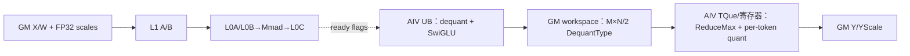
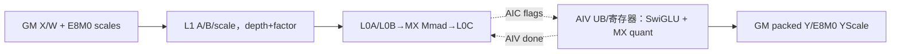
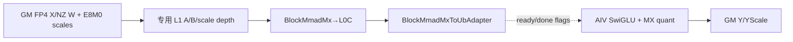
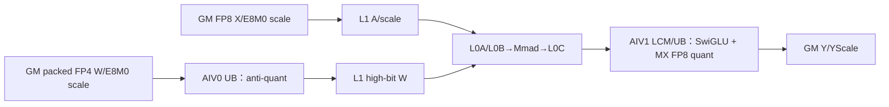

# grouped_matmul_swiglu_quant 950 ACLNN 算子知识

## 算子速览

| 项目 | 内容 |
|---|---|
| 实际入口 | aclnnGroupedMatmulSwigluQuantV2；aclnnGroupedMatmulSwigluQuantWeightNzV2 |
| 计算语义 | 分组矩阵乘→per-token/MX 尺度恢复→SwiGLU→per-token 或 MX 输出量化；Y 支持 INT8/FP8/FP4/HIFLOAT8 子集 |
| 输入输出 | X `[M,K]`、专家 W 与相应尺度；Y `[M,N/2]`；per-token YScale `[M]`，MX YScale `[M,ceil((N/2)/64),2]` |
| 执行类型 | MIX_CV；R-004 显式 `MIX_AIC_1_2` |
| Kernel 路线 | R-001 per-token ASWT；R-002 MX ASWT；R-003 MX FP4 WeightNZ；R-004 MXA8W4 weight-quant controller |
| 核心资源 | GM、L1、L0A/L0B/L0C、UB、寄存器、MIX flag 与 system workspace |
| 来源闭包 | source_closed：公开 V2 入口、950 两类 tiling、APT 全分发、四个不同 body/依赖和构建均闭合 |
| 验证状态 | 已完成源码闭包检查；本次知识提取未执行编译、真机、数值或性能测试。 |

## 接口与语义

### 计算语义

输入 X 和专家权重 W 依据 groupList 划分为若干分组。`groupListType=0` 时当前 `m_e=g[e]-g[e-1]`，`1` 时 `m_e=g[e]`；空专家只推进地址。每组矩阵乘宽度 N，设备端按 FP32 per-token scale 或 64 元素 MX group 的 E8M0 scale 恢复为中间浮点，按源码的后半/前半实参计算 `S=SwiGLU(C[:,N/2:N],C[:,0:N/2],beta=1)`。per-token route 对每行做 `scale=max(abs(S))/maxValue(dtype)` 后以目标 dtype 的 round/saturation 输出；MX route 每 64 个输出值求共享指数并生成 E8M0 scale，再 cast 到 FP8/FP4。故 Y 的逻辑宽度为 N/2，但 YScale 在 per-token route 是 `[M]`，MX route 是 `[M,ceil((N/2)/64),2]`。

两个公开入口共享 ACLNN 与 L0 启动链，但 950 的公开输入域不同：普通 V2 只接受 ND weight，可进入 per-token 或 MX；WeightNzV2 强制按 FRACTAL_NZ 解释 weight，且只接受 MX。950 APT 不是按一个统一 body 执行：浮点 xScale 进入逐 token ASWT，E8M0 xScale 的 ND MX 或 NZ MXFP8 输入进入 MX ASWT，NZ MXFP4 进入专用低层矩阵乘，而 WeightNzV2 的 FP8 E4M3FN 激活配 FP4 E2M1 权重进入重切分 controller。四者资源布局和同步图不同，必须独立复用。

### 输入、输出与属性

| 参数 | shape/layout | dtype | 约束与语义 |
|---|---|---|---|
| x | [M,K]，ND | INT8、HIFLOAT8、FP8、FP4 支持子集 | ACLNN 拒绝转置 x（MX 同时拒绝转置 xScale），故公开路径 transA=0；按 groupList 切行 |
| weight | 专家 [E,K,N] 或等价转置 | INT8、HIFLOAT8、FP8、FP4 | 950 普通 V2 仅 ND；WeightNzV2 强制 NZ 且仅 MX；N 必须可对半 |
| xScale | token 或 MX group | FP32 或 FLOAT8_E8M0 | 编译 dtype 直接选择 per-token 或 MX 分支 |
| weightScale | channel 或 MX group | FP16/BF16/FP32/E8M0 支持子集 | 与输入量化模式成对 |
| weightAssistanceMatrix/smoothScale/bias | 空指针或空列表 | - | 950 handler 明确不支持：weightAssistanceMatrix 传空指针/空列表，smoothScale 与 bias 传空指针 |
| tuningConfig | 空指针或长度 0 | INT64 | 950 不支持非空配置；长度 0 在 ACLNN handler 中归一化为空 |
| groupList | [E] | INT64 | 累计值或 count，由 groupListType 指定 |
| y/yScale | `[M,N/2]`；per-token `[M]`，MX `[M,ceil((N/2)/64),2]` | Y 为 INT8/FP8/FP4/HIFLOAT8 子集；scale 为 FP32 或 E8M0 | route 决定 maxValue、round mode、packed FP4 地址和 scale 形状 |

### 入口与版本

固定提交的 V1 产品表未列出 Ascend 950，V2 产品表明确支持 950 且公开新增 MXFP8、MXFP4、per-token 场景，所以 950 只存在两个 V2 最新公开入口。GetWorkspaceSize 完成类型、格式、shape、属性和可选输入一致性检查，连续化必要输入，推导两个输出并建立 executor；执行阶段复用 workspace、tiling 与同一 stream 启动 950 kernel。任一校验、内存准备或 launch 失败都会原样返回。

## Host/Launcher 执行流程

### 参数校验与前处理

ACLNN 的 DAV_3510 handler 校验 `quantMode in {0,2}`、groupList 长度 `<=1024`、K 一致、N 偶数、尺度 shape/dtype、WeightNz storage/view rank 与转置。M=0 或 N=0 时第一段直接返回 workspace 0。`TilingPrepareForGMMSwigluQuantV2` 读取 AIC/AIV/UB，并用 `Intrinsic_data_move_l12bt` 是否含 bf16 识别 950。dispatcher 默认选择 basic 950 template；仅 `x=FP8_E4M3FN && weight=FP4_E2M1` 改选 weight-quant template。basic tiling 再按 xScale shape/dtype区分 per-token 与 MX，生产 base/depth/step/scaleFactor；WeightNz FP4 走专用 L1 计算。

### 参数、Workspace 与生命周期

普通三条路线使用 `GMMSwigluQuantTilingDataParams`。MX route 只需 system workspace；per-token route 额外申请 `(M*N/2)*workSize`，其中 dequant FP16/BF16 用 2 字节、FP32 用 4 字节，AIC/AIV 先在该区形成反量化 SwiGLU 中间，再由全局 per-token quant 尾阶段消费。weight-quant route 使用 32 字节 pack8 POD且仅申请 system workspace，其 VCV 中间位于 L1/UB/L0C 固定硬件缓冲。所有 backing 由 executor 持有至 stream 完成。

### 启动图与失败传播

basic tiling 的通用 key 由 transB、transA 编码，但 ACLNN 公开路径已校验 transA=0，故实际只变化 transB；blockDim 设为 AIC 数并设置 scheduleMode=1。weight-quant key 同样由 wTrans 与固定 transA=0 编码，blockDim 取 coreNum。APT 在编译期先看 xScale dtype 和 X/W dtype，再看 wFormat 与转置模板参数；任何未实例化组合都没有隐式回退。

## Route 与参数设计

### 分核与资源计算

R-001 通过 TCubeTiling 分配矩阵分块，并以 rowLen 和 ubAvail 划分逐 token 向量处理行数。R-002 的 L1 同时容纳 A、B、MX 两侧尺度以及基类保留的 bias 容量项（公开 950 输入必须为空，故该项为 0），depthA1/depthB1 与 scaleFactor 共同受剩余 L1 限制；R-003 进一步使用 WeightNZ 专用 depth 与块地址。R-004 不复用 TCubeTiling，而由 controller 按 groupNum、K、N、groupSize=32 和 coreNum 动态重切分。

### Route 选择

| 顺序 | Route | Key/模板 | 精确选择条件与优先级 | 不适用去向 |
|---:|---|---|---|---|
| 1 | R-001 per-token ASWT | transB,0 | 普通 V2；weight=ND；xScale=FP32；支持的 8 位 X/W 与 weightScale | WeightNzV2 不公开 per-token；不支持类型/转置失败 |
| 2 | R-002 MX ASWT | transB,0 | 普通 V2 的 ND MXFP8/MXFP4，或 WeightNzV2 的 NZ MXFP8（X/W 均为 FP8_E4M3FN）；xScale=E8M0，且不满足 R-003/R-004 | NZ MXFP4 进入 R-003；MXA8W4 进入 R-004 |
| 3 | R-003 MX FP4 WeightNZ | transB,0 | WeightNzV2；xScale=E8M0；X/W 均为 FP4 E2M1/E1M2（允许交叉）；wFormat=NZ | 非 FP4×FP4 不进入本路线 |
| 4 | R-004 MXA8W4 controller | wTrans,0 | WeightNzV2；xScale=E8M0；X=FP8_E4M3FN；W=FP4_E2M1；weight=NZ | 专用宏优先；其他组合不匹配则失败 |

```text
if WeightNzV2 and xScale E8M0 and X=FP8_E4M3FN and W=FP4_E2M1 -> R-004  # Host dispatcher 先选 weight-quant template
else if normal V2 and weight ND and xScale FP32 -> R-001
else if WeightNzV2 and xScale E8M0 and X/W 均为 FP4 and weight NZ -> R-003
else if xScale E8M0 -> R-002  # 普通 V2 的 ND MX，或 WeightNzV2 的 NZ MXFP8
else -> error
```

### 模板/实现执行矩阵

| Route | key/selector | dtype/shape/platform 完整命中条件 | 执行族与 kernel 节点 | 实际模板/body | 内存与同步特征 | tail/fallback |
|---|---|---|---|---|---|---|
| R-001 per-token ASWT | `GET_TPL_TILING_KEY(transB,0)`（公开路径） | 950 普通 V2；weight ND；xScale FP32；X/W 为受支持 8 位类型；weightScale 为 FP32/BF16，或 INT8 X 时 FP16；Y 为 8 位类型 | 单节点 `MIX_CV`，AIC 双 half-GEMM→AIV dequant/SwiGLU→全核 barrier→AIV per-token quant | `KernelGmmSwiGluPertokenQuant<BlockMmadBuilder,BlockEpilogueDequantSwiglu,BlockEpiloguePertokenQuant>` | AIC↔AIV flag；GM workspace 保存 `M*N/2` 个 DequantType 中间值 | 空专家跳过；scheduler 裁 M/N/K；未实例化 transpose 失败 |
| R-002 MX ASWT | 同上 | 950；普通 V2 的 ND MXFP8/MXFP4，或 WeightNzV2 的 NZ MXFP8（X/W 均为 FP8_E4M3FN）；xScale/weightScale=E8M0；排除 NZ 双 FP4 与 FP8×FP4 | 单节点 `MIX_CV` | `BlockMxMmAicToAivBuilder` + `KernelGmmSwiGluMixOnlineDynamic` | L0C→AIV UB 直接交接；ready/done flags | FP4 packed offset 与 K/64 scale tail；无跨 route fallback |
| R-003 MX FP4 WeightNZ | 同上 | 950 WeightNzV2；X/W 均为 FP4 E2M1/E1M2（允许交叉）；weight NZ；origin 最后两维不为 1 | 单节点 `MIX_CV` | `BlockMxLowLevelMmAicToAivBuilder` + `BlockMmadMxToUbAdapter` | NZ 专用 L1 depth/scaleFactor；AIC↔AIV flags | K 不能为 2；FP4 内轴偶数；N half tail |
| R-004 MXA8W4 controller | `GET_TPL_TILING_KEY(wTrans,0)` | 950 WeightNzV2；X=FP8_E4M3FN、W=FP4_E2M1、E8M0 scales；weight NZ；`transposeWeight=true`；M≥1,K≥32,N≥128 | 单节点 `MIX_AIC_1_2` | `GMMSQWeightQuantResplitController<DTYPE_X,DTYPE_WEIGHT,DTYPE_WEIGHT_SCALE,DTYPE_X_SCALE,DTYPE_Y,DTYPE_Y_SCALE,MXA8W4_NZNK,VEC_ANTIQUANT_CONFIG_DYNAMIC>` | AIV0 解包/反量化权重→L1，AIC Mmad→L0C/LCM，AIV1 SwiGLU/MX quant；多级 flag | M/N/K 动态重切分；条件不满足直接失败 |

### 隐藏性能 Guard

| Guard | Host/Tiling 条件 | Device/资源原因 | 影响 Route | 不满足时去向 | 源码符号 |
|---|---|---|---|---|---|
| 950 能力位 | `supportL12BtBf16=true` | 选择 arch35/Apt POD 与 kernel entry | 全部 | false 转 classic A2/A3 卡路线 | `GroupedMatmulSwigluQuantV2TilingFunc` |
| 1:2 core 比例 | `aivNum == 2*aicNum` 且均非 0 | 单 launch 中每个 AIC 与两个 AIV 的 flag/slot 拓扑 | 全部；R-004 显式强校验 | tiling 失败 | `CheckCoreNum`、WQ `CheckCoreNum` |
| Per-token UB | `ubAvail=floor((UB-RESERVED)/(align(N/2)*DB_REQUIRED_BYTES_SIZE))` | 最终量化需同时持有输入、Y 与 scale 队列 | R-001 | `ubAvail=0` 时固定仓未见安全 body | `DoOpTilingPertoken` |
| L1 capacity | `depthA1*A + depthB1*B + max(depth)*scaleAB + bias <= L1` | A/B 与 MX scale 同时驻留并双缓冲 | R-002/R-003 | 重新缩 depth；仍不足则 tiling 失败 | `CalL1Tiling`、`CalWeightNzL1Depth` |
| MX scaleFactor | A/B factor 必须在 `[SCALER_FACTOR_MIN,SCALER_FACTOR_MAX]` 且 base scale size非零 | `mxTypePara` 仅能编码有限范围，且要覆盖 K step | R-002/R-003 | tiling 失败或写默认 factor | `CalWeightNzScaleFactors`、`DoLibApiTiling` |
| R-004 形状/格式 | `K%32=0`、`N%128=0`、weight NZ、`transposeWeight=true`、group≤1024 | controller 以 256 K、256 N 与 packed FP4 cacheline 调度 | R-004 | 无 fallback | `CheckInputs`、`CheckAttrs` |
| R-004 动态 K tile | `mL1<=256 && nL1<=128 -> kbL1=512`，否则 256；`kaL1` 受 128KiB A-L1 上限约束 | 小块增大 K 驻留，减少加载轮次 | R-004 | 回到 256 K tile并按容量截 kaDepth | `SplitNByMultiCore` |

### POD/ABI

| 结构 | 字段 | 类型/位宽 | ABI 布局 | 单位 | Host/launcher producer | Device consumer | 边界 |
|---|---|---|---|---|---|---|---|
| GMMSwigluQuantParams | groupNum | uint32/32 | offsetof=0, sizeof=4, alignof=4 | 组 | basic tiling | 三个 ASWT group loop | groupList 长度 |
| GMMSwigluQuantParams | groupListType | uint8/8 | offsetof=4, sizeof=1, alignof=1 | 枚举 | attr parser | group decoder | 支持值 |
| GMMSwigluQuantParams | quantDtype | uint8/8 | offsetof=5, sizeof=1, alignof=1 | 枚举 | attr parser | vector quantizer | 支持输出 |
| GMMSwigluQuantParams | reserved1 | uint8/8 | offsetof=6, sizeof=1, alignof=1 | 保留 | zero init | 不消费 | 必须保留 |
| GMMSwigluQuantParams | dequantDtype | uint8/8 | offsetof=7, sizeof=1, alignof=1 | 枚举 | per-token tiling | per-token epilogue | 路线限定 |
| GMMSwigluQuantParams | rowLen | uint32/32 | offsetof=8, sizeof=4, alignof=4 | 元素 | shape parser | vector row loop | N/2 关系 |
| GMMSwigluQuantParams | ubAvail | uint32/32 | offsetof=12, sizeof=4, alignof=4; sizeof=16, alignof=4 | 行/一次 UB 批 | `floor((UB-RESERVED)/(align(N/2)*DB_REQUIRED_BYTES_SIZE))` | vector row loop | 至少一行且不超 UB |
| GMMSwigluQuantTilingDataParams | mmTilingData | TCubeTiling | offsetof=16；内部 sizeof/alignof/offsetof 固定仓不可见 | 分块 | basic tiling | R-001/R-002/R-003 | 不跨 POD 复用 |
| GMMSQWeightQuantTilingData | groupListType | uint8/8 | offsetof=0, sizeof=1, alignof=1 | 枚举 | WQ tiling | controller | 支持值 |
| GMMSQWeightQuantTilingData | reserve0 | uint8[3]/24 | offsetof=1, sizeof=3, alignof=1 | 保留 | zero init | 不消费 | 不得挪用 |
| GMMSQWeightQuantTilingData | groupNum | uint32/32 | offsetof=4, sizeof=4, alignof=4 | 组 | WQ tiling | controller | 正数或空域受控 |
| GMMSQWeightQuantTilingData | coreNum | uint32/32 | offsetof=8, sizeof=4, alignof=4 | 核 | compile info | resplit scheduler | 平台范围 |
| GMMSQWeightQuantTilingData | groupSize | uint32/32 | offsetof=12, sizeof=4, alignof=4 | K 元素 | WQ tiling | MX scale addressing | 固定 32 |
| GMMSQWeightQuantTilingData | kSize | uint64/64 | offsetof=16, sizeof=8, alignof=8 | 元素 | shape parser | controller offsets | 防溢出 |
| GMMSQWeightQuantTilingData | nSize | uint64/64 | offsetof=24, sizeof=8, alignof=8; sizeof=32, alignof=8 | 元素 | shape parser | controller N split | N 偶数 |

### Route 源码闭包

| Route | Key/selector | Host/Tiling producer | POD/参数 | Kernel entry/router | Kernel body/直接依赖 | 构建接线 |
|---|---|---|---|---|---|---|
| R-001 per-token ASWT | transB,0；xScale FP32 | grouped_matmul_swiglu_quant_v2_basic_tiling.cpp::DoOpTilingPertoken/GetTilingKey | GMMSwigluQuantTilingDataParams | grouped_matmul_swiglu_quant_v2_apt.cpp::grouped_matmul_swiglu_quant_v2 | grouped_matmul_swiglu_quant_v2_pertoken_quant.h::GmmSwigluAswtPertoken | op_host/CMakeLists.txt::GroupedMatmulSwigluQuantV2 |
| R-002 MX ASWT | transB,0；E8M0；非 FP4-NZ | grouped_matmul_swiglu_quant_v2_basic_tiling.cpp::DoLibApiTiling/GetTilingKey | GMMSwigluQuantTilingDataParams | grouped_matmul_swiglu_quant_v2_apt.cpp::grouped_matmul_swiglu_quant_v2 | grouped_matmul_swiglu_quant_v2_mxquant.h::GmmSwigluAswt | op_host/CMakeLists.txt::GroupedMatmulSwigluQuantV2 |
| R-003 MX FP4 WeightNZ | transB,0；E8M0；isMxFp4Input；NZ | grouped_matmul_swiglu_quant_v2_basic_tiling.cpp::CalWeightNzL1Tiling/GetTilingKey | GMMSwigluQuantTilingDataParams | grouped_matmul_swiglu_quant_v2_apt.cpp::grouped_matmul_swiglu_quant_v2 | grouped_matmul_swiglu_quant_v2_mxfp4_weight_nz.h::GmmSwigluMxFp4WeightNz/BlockMxLowLevelMmAicToAivBuilder | op_host/CMakeLists.txt::GroupedMatmulSwigluQuantV2 |
| R-004 MXA8W4 controller | wTrans,0；X FP8_E4M3FN；W FP4_E2M1 | grouped_matmul_swiglu_quant_v2_weight_quant_tiling.cpp::DoOpTiling/GetTilingKey | GMMSQWeightQuantTilingData | grouped_matmul_swiglu_quant_v2_apt.cpp::grouped_matmul_swiglu_quant_v2 | gmmsq_weight_quant_resplit_controller.h::GMMSQWeightQuantResplitController；gmmsq_weight_quant_cube_compute.h；gmmsq_weight_quant_vcv_basic_block.h；gmmsq_weight_quant_vec_compute.h | op_host/CMakeLists.txt::GroupedMatmulSwigluQuantV2 |

## Kernel 实现

### 公共执行流程

APT 保存浮点溢出控制寄存器 60，计算前把模式设为零，route 完成后恢复原值。普通三条路线构造 TPipe 并取得 user workspace；R-004 初始化 SoC 状态并声明 MIX_AIC_1_2。所有路线都以分组前缀确定 X 行基址，以 K/N 分块确定权重与输出地址，完成矩阵乘后将 N 拆成两个半宽分支，最后按有效行输出 Y 和 YScale。

四条路线不能因为外部语义相同而合并。R-001 的尺度是逐 token 浮点；R-002 的 A/B 尺度都是 MX group；R-003 使用 NZ 权重的专用低层 AIC-to-AIV 构造器；R-004 由重切分控制器协调一个 AIC 和两个 AIV，并把权重恢复、Cube 计算、SwiGLU 与输出量化拆到不同 helper。其工作区槽位、L1 尺度布局、同步参与者和尾块处理均不同。

### Route R-001：per-token ASWT

#### 适用条件

##### 选择证据

| 层级 | 文件 | 符号 | 源码谓词/参数 | 结果/下一跳 |
|---|---|---|---|---|
| Host/Tiling | gmm/grouped_matmul_swiglu_quant_v2/op_host/op_tiling/arch35/grouped_matmul_swiglu_quant_v2_basic_tiling.cpp | DoOpTilingPertoken/GetTilingKey | aQuantMode=PERTOKEN_MODE，xScale FP32 | 普通 POD 与 trans key |
| Router | gmm/grouped_matmul_swiglu_quant_v2/op_kernel/grouped_matmul_swiglu_quant_v2_apt.cpp | grouped_matmul_swiglu_quant_v2 | ORIG_DTYPE_X_SCALE=DT_FLOAT 且转置模板匹配 | GmmSwigluAswtPertoken |

#### Device 数据流

##### 函数级调用链

```text
grouped_matmul_swiglu_quant_v2
  -> GmmSwigluAswtPertoken
    -> GmmSwigluAswtPertokenKernel
      -> KernelGmmSwiGluPertokenQuant::operator()
        -> GroupedMatmulAswtWithTailSplitScheduler::GetBlockIdx -> BlockMmadBuilder::operator() -> BlockEpilogueDequantSwiglu::operator() -> BlockEpiloguePertokenQuant::operator()
```

##### 源码等价伪码

```text
伪码：for group: mStart=groupListPrefix; for mTile,nTile,kTile: xOffset=(mStart+mTile)*K+kTile; wOffset=kTile*N+nTile; Mmad; for validRow: scale=xScale[mStart+row]*weightScale[nTile:]; outOffset=(mStart+row)*(N/2)+nTile/2; SwiGLU 后归约并写 Y/YScale
```

#### 内存与数据搬运

##### 资源与搬运表

| 层级/缓冲区 | offset/地址公式 | extent/容量公式 | dtype/layout | producer | consumer | owner/lifetime | 对齐/复用 |
|---|---|---|---|---|---|---|---|
| GM X/W/scale/Y | 行前缀乘 K；kTile*N+nTile；输出行乘 N/2 | validM*K、K*validN、validM*N/2 | 支持 8 位输入，ND/转置 ND | caller | ASWT | caller/stream | 有效 M/N/K 与尾宽 |
| L1/L0A/L0B/L0C | 当前 m/n/k tile | baseM*baseK、baseN*baseK、baseM*baseN*accSize | Cube tile | MTE/Cube producer | Mmad/epilogue consumer | AIC tile lifetime | depth/db 控制复用 |
| UB/register/workspace | user workspace+tileSlot；UB 行槽 | Host workspace 与 ubAvail | 累加/FP32/INT8 | Cube/Vector producer | Vector/GM consumer | executor launch lifetime | producer→consumer offset/lifetime；事件后复用 |

##### 分层内存布局



##### 字节账、交接边与复用顺序

```text
workspace_total = SYS_WORKSPACE + M*(N/2)*workSize
workSize = 2 for FP16/BF16 dequant, otherwise 4
L1 = depthA1*baseM*baseK*sizeof(A) + depthB1*baseN*baseK*sizeof(B)
UB_rows = ubAvail，单行物理宽度 align(N/2)
```

| 边/复用子区 | producer | offset/extent | dtype/layout | consumer | ordering/sync | owner/lifetime | 安全条件 |
|---|---|---|---|---|---|---|---|
| L0C 两半→AIV | AIC `mmadOp_` | 当前 `baseM×baseN/2` 两块 | C1Type/UB view | `BlockEpilogueDequantSwiglu` | `NotifyVector/WaitForCube`；AIV 完成后 `NotifyCube` | 当前 tile | AIC 下个 tile 前 `WaitForVector` |
| SwiGLU workspace | AIV dequant epilogue | `row*(N/2)`；`realM*N/2*workSize` | DequantType/ND | `BlockEpiloguePertokenQuant` | 全部 group 完成后的 `SyncAll()` | launch workspace | `realM_` 仅统计 groupList 有效行 |

#### 同步、精度与尾块

##### 同步与数值边界表

| 阶段 | primitive/机制 | producer | consumer/等待点 | 保护对象 | 精度/尾块 |
|---|---|---|---|---|---|
| Cube 到后处理 | ASWT pipeline/event | Cube | 向量 epilogue 等待 | 当前 C tile | 累加后乘逐 token 与 channel scale |
| 输出 | queue event 与 masked copy | SwiGLU/ReduceMax/Quant | GM | Y 与 YScale 同行 | validM、N/2 mask、round/clamp |

#### 关键实现

##### 符号证据表

| 阶段 | 文件 | 符号/模板实例 | 实现事实 |
|---|---|---|---|
| Host/Tiling producer | gmm/grouped_matmul_swiglu_quant_v2/op_host/op_tiling/arch35/grouped_matmul_swiglu_quant_v2_basic_tiling.cpp | DoOpTilingPertoken/GetTilingKey | per-token POD、Cube 分块和 key |
| Kernel entry/router | gmm/grouped_matmul_swiglu_quant_v2/op_kernel/grouped_matmul_swiglu_quant_v2_apt.cpp | grouped_matmul_swiglu_quant_v2 | FP32 xScale 分发与寄存器恢复 |
| Device body/helper | gmm/grouped_matmul_swiglu_quant_v2/op_kernel/arch35/grouped_matmul_swiglu_quant_v2_pertoken_quant.h | GmmSwigluAswtPertokenKernel | 循环、地址、尺度、同步和尾块 |

### Route R-002：MX ASWT

#### 适用条件

##### 选择证据

| 层级 | 文件 | 符号 | 源码谓词/参数 | 结果/下一跳 |
|---|---|---|---|---|
| Host/Tiling | gmm/grouped_matmul_swiglu_quant_v2/op_host/op_tiling/arch35/grouped_matmul_swiglu_quant_v2_basic_tiling.cpp | DoLibApiTiling/CalL1Tiling/GetTilingKey | MX_PERGROUP_MODE，非专用 FP4-NZ | TCubeTiling 与 MX scale factor |
| Router | gmm/grouped_matmul_swiglu_quant_v2/op_kernel/grouped_matmul_swiglu_quant_v2_apt.cpp | grouped_matmul_swiglu_quant_v2 | xScale E8M0，非伪量化宏，非 NZ 双 FP4 | GmmSwigluAswt 的 ND/NZ 布局实例 |

#### Device 数据流

##### 函数级调用链

```text
grouped_matmul_swiglu_quant_v2
  -> GmmSwigluAswt
    -> KernelGmmSwiGluMixOnlineDynamic::operator()
      -> GroupedMatmulAswtWithTailSplitScheduler::GetBlockIdx -> BlockMxMmAicToAivBuilder::operator() -> BlockEpilogueSwigluQuant::operator()
```

##### 源码等价伪码

```text
伪码：for group/mTile/nTile: for kTile: xOffset=(groupM+mTile)*K+kTile; wOffset=layoutB(kTile,nTile); scaleAOffset=((groupM+mTile)*ceil(K/32)+kTile/32); scaleBOffset=expert*ceil(K/32)*N+(kTile/32)*N+nTile; Mmad；处理半宽并输出
```

#### 内存与数据搬运

##### 资源与搬运表

| 层级/缓冲区 | offset/地址公式 | extent/容量公式 | dtype/layout | producer | consumer | owner/lifetime | 对齐/复用 |
|---|---|---|---|---|---|---|---|
| GM X/W/MX scale/Y | groupM*K；layoutB(k,n)；K-group=32；行乘 N/2 | valid tile 与两侧 scale tile | FP8/FP4/INT8，ND 或 NZ | caller | GmmSwigluAswt | caller/stream | K-group 与尾组 |
| L1/L0A/L0B/L0C | A/B 与 scale 分离槽 | depthA1*A、depthB1*B、maxDepth*scale、C tile | Cube/MX | MTE/Cube producer | Mmad/epilogue consumer | AIC tile lifetime | scaleFactor 与 depth 联合约束 |
| UB/register/workspace | userWorkspace+tileSlot*baseM*baseN*accSize；行内 offset=row*(N/2)+column | baseM*baseN*accSize 与 ubAvail | FP32/INT8 | Cube/Vector producer | 激活/GM consumer | executor launch lifetime | producer→consumer offset/lifetime；flag 防覆盖 |

##### 分层内存布局



##### 字节账、交接边与复用顺序

```text
workspace_total = SYS_WORKSPACE（此 route 不增加 user slice）
L1 = depthA1*baseABytes + depthB1*baseBBytes + max(depthA1,depthB1)*(scaleABytes+scaleBBytes)
L0C/UB = 当前 baseM*baseN 的 FP32 C 与两个固定 UB half-tile view
```

| 边/复用子区 | producer | offset/extent | dtype/layout | consumer | ordering/sync | owner/lifetime | 安全条件 |
|---|---|---|---|---|---|---|---|
| L0C half 0/1 | `BlockMxMmAicToAivBuilder` | 当前 tile 两个 `realM×realN/2` | FP32/RowMajorAlign | `BlockEpilogueSwigluQuant` | flags `AIC_SYNC_AIV` / `AIV_SYNC_AIC` | 当前 tile | Vector done 后 AIC 才覆盖；FP4 输出 offset 除 2 |

#### 同步、精度与尾块

##### 同步与数值边界表

| 阶段 | primitive/机制 | producer | consumer/等待点 | 保护对象 | 精度/尾块 |
|---|---|---|---|---|---|
| MX Cube | L1/L0 db 与 pipeline event | A/B/scale loader、Mmad | epilogue | A/B scale 与 C tile | E8M0 scale 按 32 元素组，末组裁剪 |
| 后处理 | vector queue/mask | C tile | GM Y/YScale | 半宽行缓存 | FP32 SwiGLU/归约，INT8 饱和 |

#### 关键实现

##### 符号证据表

| 阶段 | 文件 | 符号/模板实例 | 实现事实 |
|---|---|---|---|
| Host/Tiling producer | gmm/grouped_matmul_swiglu_quant_v2/op_host/op_tiling/arch35/grouped_matmul_swiglu_quant_v2_basic_tiling.cpp | DoLibApiTiling/CalL1Tiling | base/depth/MX scale factor |
| Kernel entry/router | gmm/grouped_matmul_swiglu_quant_v2/op_kernel/grouped_matmul_swiglu_quant_v2_apt.cpp | grouped_matmul_swiglu_quant_v2 | wFormat、FP4 判定与布局分发 |
| Device body/helper | gmm/grouped_matmul_swiglu_quant_v2/op_kernel/arch35/grouped_matmul_swiglu_quant_v2_mxquant.h | GmmSwigluAswt | MX 地址、矩阵乘与后处理 |

### Route R-003：MX FP4 WeightNZ

#### 适用条件

##### 选择证据

| 层级 | 文件 | 符号 | 源码谓词/参数 | 结果/下一跳 |
|---|---|---|---|---|
| Host/Tiling | gmm/grouped_matmul_swiglu_quant_v2/op_host/op_tiling/arch35/grouped_matmul_swiglu_quant_v2_basic_tiling.cpp | IsMxFp4WeightNz/CalWeightNzL1Tiling | MX FP4 且 B format NZ | 专用 L1 depth 和 scaleFactor |
| Router | gmm/grouped_matmul_swiglu_quant_v2/op_kernel/grouped_matmul_swiglu_quant_v2_apt.cpp | grouped_matmul_swiglu_quant_v2 | wFormat=NZ 且 isMxFp4Input，非 FP8×FP4 伪量化宏 | GmmSwigluMxFp4WeightNz RowMajor,Nz/Zn |

#### Device 数据流

##### 函数级调用链

```text
grouped_matmul_swiglu_quant_v2
  -> GmmSwigluMxFp4WeightNz
    -> BlockMxLowLevelMmAicToAivBuilder::Init/operator
      -> NZ MX Mmad -> AIC-to-AIV tile -> SwiGLU/ReduceMax/Quant
```

##### 源码等价伪码

```text
伪码：for expert/mTile/nTile/kTile: nzBlock=((nTile/16)*ceil(K/32)+kTile/32); weightOffset=nzBlock*packedBlockBytes+innerNZ; load FP4 与 E8M0 scale 到 L1; Mmad；等待 AIC-to-AIV tile；仅对 validM 和 validN/2 写回
```

#### 内存与数据搬运

##### 资源与搬运表

| 层级/缓冲区 | offset/地址公式 | extent/容量公式 | dtype/layout | producer | consumer | owner/lifetime | 对齐/复用 |
|---|---|---|---|---|---|---|---|
| GM X/W/scale/Y | X 行主序；W 按 NZ/Zn block；scale 按 K/32 | FP4 packed tile、MX scale tile、半宽输出 | FP4 packed，NZ/Zn | caller | low-level builder | caller/stream | 16/32 block 与尾组 |
| L1/L0A/L0B/L0C | 专用 FP4-NZ tile | depthA1/B1 数据加 maxDepth scale 与 L0 C | MX Cube | MTE/Cube producer | Mmad/AIV consumer | AIC tile lifetime | 高带宽 depth 与 db |
| AIC-to-AIV/UB/workspace | tileSlot*baseM*baseN*accSize | 一块 C 与半宽向量缓存 | 累加/FP32/INT8 | AIC producer | AIV consumer | executor launch lifetime | producer→consumer offset/lifetime；完成后复用 |

##### 分层内存布局



##### 字节账、交接边与复用顺序

```text
workspace_total = SYS_WORKSPACE
baseABytes=baseM*baseK/2；baseBBytes=baseN*baseK/2
scaleABytes=ceil(baseK/32)*baseM；scaleBBytes=ceil(baseK/32)*baseN
L1_total = depthA1*baseABytes + depthB1*baseBBytes + max(depthA1,depthB1)*(scaleABytes+scaleBBytes)
```

| 边/复用子区 | producer | offset/extent | dtype/layout | consumer | ordering/sync | owner/lifetime | 安全条件 |
|---|---|---|---|---|---|---|---|
| NZ MX C tile | `BlockMmadMxToUbAdapter::operator()` | `realM×realN/2` 两半 | FP32/RowMajorAlign | MX epilogue | 与 R-002 同一 ready/done 协议 | 当前 tile | `scaleKL1=min(max(factorA*kAL1,factorB*kBL1),K)`；tail 不越界 |

#### 同步、精度与尾块

##### 同步与数值边界表

| 阶段 | primitive/机制 | producer | consumer/等待点 | 保护对象 | 精度/尾块 |
|---|---|---|---|---|---|
| AIC 到 AIV | builder 的 tile ready/done 协议 | BlockMmadMxToUbAdapter | 向量后处理 | NZ FP4 C tile | FP4 解包与 E8M0 scale，K 尾组 |
| 输出 | vector event/masked copy | SwiGLU/ReduceMax/Quant | GM | Y/YScale | validM、validN/2、INT8 饱和 |

#### 关键实现

##### 符号证据表

| 阶段 | 文件 | 符号/模板实例 | 实现事实 |
|---|---|---|---|
| Host/Tiling producer | gmm/grouped_matmul_swiglu_quant_v2/op_host/op_tiling/arch35/grouped_matmul_swiglu_quant_v2_basic_tiling.cpp | CalWeightNzL1Tiling/CalWeightNzScaleFactors | NZ 专用 L1 与 MX 尺度 |
| Kernel entry/router | gmm/grouped_matmul_swiglu_quant_v2/op_kernel/grouped_matmul_swiglu_quant_v2_apt.cpp | isMxFp4Input/wFormat | 独立 body 与 Nz/Zn 实例 |
| Device body/helper | gmm/grouped_matmul_swiglu_quant_v2/op_kernel/arch35/grouped_matmul_swiglu_quant_v2_mxfp4_weight_nz.h | GmmSwigluMxFp4WeightNz/BlockMxLowLevelMmAicToAivBuilder | NZ 地址、AIC-to-AIV 同步与尾块 |

### Route R-004：MXA8W4 weight-quant controller

#### 适用条件

##### 选择证据

| 层级 | 文件 | 符号 | 源码谓词/参数 | 结果/下一跳 |
|---|---|---|---|---|
| Host/Tiling | gmm/grouped_matmul_swiglu_quant_v2/op_host/op_tiling/arch35/grouped_matmul_swiglu_quant_v2_weight_quant_tiling.cpp | DoOpTiling/GetTilingKey | 伪量化 checker 通过，groupSize=32，key=wTrans,0 | controller POD 与 coreNum |
| Router | gmm/grouped_matmul_swiglu_quant_v2/op_kernel/grouped_matmul_swiglu_quant_v2_apt.cpp | GMM_SWIGLU_QUANT_WEIGHT_QUANT | xScale E8M0，X FP8_E4M3FN，W FP4_E2M1 | MXA8W4_NZNK/VEC_ANTIQUANT_CONFIG_DYNAMIC controller |

#### Device 数据流

##### 函数级调用链

```text
grouped_matmul_swiglu_quant_v2
  -> GMMSQWeightQuantResplitController::Init/Process
    -> GMMSQWeightQuantVcvBasicBlock
      -> GMMSQWeightQuantVecCompute -> GMMSQWeightQuantCubeCompute -> SwiGLU/ReduceMax/Quant/CopyOut
```

##### 源码等价伪码

```text
伪码：for controllerTask: decode expert and M/N/K basic block; xOffset=(groupM+mBase)*K+kBase; packedWOffset=expert*K*N/2+kBase*N/2+nBasePacked; AIV 解包并按 MX scale 恢复 W 到共享槽；AIC 等待后 Mmad；另一 AIV 处理 C 的两个半宽、归约并写 row*(N/2)
```

#### 内存与数据搬运

##### 资源与搬运表

| 层级/缓冲区 | offset/地址公式 | extent/容量公式 | dtype/layout | producer | consumer | owner/lifetime | 对齐/复用 |
|---|---|---|---|---|---|---|---|
| GM X/packed W/scale/Y | groupM*K；expert*K*N/2；scale K/32；输出行*N/2 | controller basic block 与 valid tail | FP8 E4M3FN、FP4 E2M1、E8M0、INT8 | caller | controller | caller/stream | groupSize32、packed nibble、N 偶数 |
| L1/L0A/L0B/L0C | 当前 controller M/N/K block | A/B tile、L0 C tile | Cube | vec antiquant/Cube producer | Mmad/post consumer | task lifetime | basic block config 与 db |
| VCV/UB/system workspace | controller slot+task offset | 权重恢复槽、C 槽、向量归约槽 | FP4/恢复值/FP32/INT8 | AIV0/AIC/AIV1 producer | 下一阶段 consumer | executor launch lifetime | producer→consumer offset/lifetime；MIX flag 后复用 |

##### 分层内存布局



##### 字节账、交接边与复用顺序

```text
workspace_total = SYS_WORKSPACE（无额外 user workspace）
A-L1 上限 = 128KiB；mL1<=256，nL1<=256；kbL1∈{256,512}
L0C tile = align16(mL1)*align16(nL1)*sizeof(float)，超过 L0C_BUF_SIZE 前重置 offset
UB_available = 248KiB；anti-quant MTE2 buffer 数=4
```

| 边/复用子区 | producer | offset/extent | dtype/layout | consumer | ordering/sync | owner/lifetime | 安全条件 |
|---|---|---|---|---|---|---|---|
| packed W→L1 high-bit W | AIV0 `AntiQuantProcessNzMxA8W4` | 每次 `ubMte2KSize×align16(nL1)`，packed GM offset 按 K/NZ | FP4→FP8/NZ L1 | AIC `LaunchMatmul` | V/MTE3 与跨核 slot flag | 当前 basic block | 4-slot 环形缓冲完成后才复用 |
| L0C→AIV1 | AIC `GetTensorC/FixL0CToDst` | `align16(mL1)*align16(nL1)` | FP32/LCM | AIV1 `SwiGLU/ComputeMaxExp` | controller VCV ready/done | 当前 processId | `processId` 双槽切换，两个输出完成后释放 |

#### 同步、精度与尾块

##### 同步与数值边界表

| 阶段 | primitive/机制 | producer | consumer/等待点 | 保护对象 | 精度/尾块 |
|---|---|---|---|---|---|
| AIV0 到 AIC | MIX_AIC_1_2 flag/VCV slot | GMMSQWeightQuantVecCompute | GMMSQWeightQuantCubeCompute | 恢复后的 W block | FP4 解包、E8M0 MX scale、K/N tail |
| AIC 到 AIV1 | controller ready/done flag | CubeCompute | SwiGLU/quant vector | C block 与槽位 | 累加转 FP32，半宽 tail、round/clamp |

#### 关键实现

##### 符号证据表

| 阶段 | 文件 | 符号/模板实例 | 实现事实 |
|---|---|---|---|
| Host/Tiling producer | gmm/grouped_matmul_swiglu_quant_v2/op_host/op_tiling/arch35/grouped_matmul_swiglu_quant_v2_weight_quant_tiling.cpp | DoOpTiling/GetTilingKey/PostTiling | 32 字节 POD、system workspace 与 blockDim |
| Kernel entry/router | gmm/grouped_matmul_swiglu_quant_v2/op_kernel/grouped_matmul_swiglu_quant_v2_apt.cpp | GMM_SWIGLU_QUANT_WEIGHT_QUANT | MIX_AIC_1_2、controller 类型与溢出寄存器 |
| Device body/helper | gmm/grouped_matmul_swiglu_quant_v2/op_kernel/arch35/weight_quant_basic_block/gmmsq_weight_quant_resplit_controller.h | GMMSQWeightQuantResplitController::Process | 重切分、VCV/Cube/Vector 调用、同步与尾块 |

## 算子特定优化

### Trick T-001：APT 在编译 dtype/格式上冻结四条不同 body

#### 触发与源码依据

- 适用 Route：R-001 至 R-004。
- 触发条件：xScale dtype 先区分 per-token/MX；MX 下 FP8_E4M3FN×FP4_E2M1 定义 weight-quant 宏，其他组合再由 NZ 与双 FP4 条件选择。
- Golden 来源：[`gmm/grouped_matmul_swiglu_quant_v2/op_kernel/grouped_matmul_swiglu_quant_v2_apt.cpp:93-118`](../../../../../../../cann-ops-raw/ascendc/ops-transformer/be33d95bb755cedec3108f70805c1874d1792540/gmm/grouped_matmul_swiglu_quant_v2/op_kernel/grouped_matmul_swiglu_quant_v2_apt.cpp#L93-L118)

**官方源码（固定 Commit 连续逐字摘录）**：

```cpp
#if ORIG_DTYPE_X_SCALE == DT_FLOAT8_E8M0
    if constexpr (wFormat == CubeFormat::NZ && isMxFp4Input) {
        if (QUANT_B_TRANS == GMM_SWIGLU_QUANT_NO_TRANS && QUANT_A_TRANS == GMM_SWIGLU_QUANT_NO_TRANS) {
            GmmSwigluMxFp4WeightNz<Cgmct::Gemm::layout::RowMajor, Cgmct::Gemm::layout::Nz>(x, weight, weightScale,
                xScale, weightAssistanceMatrix, smoothScale, groupList, y, yScale, workspace, tiling);
        } else if (QUANT_B_TRANS == GMM_SWIGLU_QUANT_TRANS && QUANT_A_TRANS == GMM_SWIGLU_QUANT_NO_TRANS) {
            GmmSwigluMxFp4WeightNz<Cgmct::Gemm::layout::RowMajor, Cgmct::Gemm::layout::Zn>(x, weight, weightScale,
                xScale, weightAssistanceMatrix, smoothScale, groupList, y, yScale, workspace, tiling);
        }
    } else if constexpr (wFormat == CubeFormat::NZ) {
        if (QUANT_B_TRANS == GMM_SWIGLU_QUANT_NO_TRANS && QUANT_A_TRANS == GMM_SWIGLU_QUANT_NO_TRANS) {
            GmmSwigluAswt<Cgmct::Gemm::layout::RowMajor, Cgmct::Gemm::layout::Nz>(x, weight, weightScale, xScale,
                weightAssistanceMatrix, smoothScale, groupList, y, yScale, workspace, tiling);
        } else if (QUANT_B_TRANS == GMM_SWIGLU_QUANT_TRANS && QUANT_A_TRANS == GMM_SWIGLU_QUANT_NO_TRANS) {
            GmmSwigluAswt<Cgmct::Gemm::layout::RowMajor, Cgmct::Gemm::layout::Zn>(x, weight, weightScale, xScale,
                weightAssistanceMatrix, smoothScale, groupList, y, yScale, workspace, tiling);
        }
    } else {
        if (QUANT_B_TRANS == GMM_SWIGLU_QUANT_NO_TRANS && QUANT_A_TRANS == GMM_SWIGLU_QUANT_NO_TRANS) {
            GmmSwigluAswt<Cgmct::Gemm::layout::RowMajor, Cgmct::Gemm::layout::RowMajor>(x, weight, weightScale,
                xScale, weightAssistanceMatrix, smoothScale, groupList, y, yScale, workspace, tiling);
        } else if (QUANT_B_TRANS == GMM_SWIGLU_QUANT_TRANS && QUANT_A_TRANS == GMM_SWIGLU_QUANT_NO_TRANS) {
            GmmSwigluAswt<Cgmct::Gemm::layout::RowMajor, Cgmct::Gemm::layout::ColumnMajor>(x, weight, weightScale,
                xScale, weightAssistanceMatrix, smoothScale, groupList, y, yScale, workspace, tiling);
        }
    }
```

#### 机制与设计原因

把 dtype/layout specialization 固化在编译实例，Device 只保留转置分支；这同时冻结了 builder、POD、尺度布局和 tail 规则，避免运行期把 packed FP4/NZ 当成普通 ND。

#### 迁移边界

- 适用：950 当前已接线的 FP8/FP4/per-token 组合。
- 前提：Host tiling key、编译宏 `ORIG_DTYPE_*`、`FORMAT_WEIGHT` 与 ACLNN checker 一致。
- 失效：新增 dtype 或格式必须同时新增 Host checker、tiling、binary 实例和 body。
- 未验证：本次知识提取未执行编译、真机、数值或性能测试。

#### 错误做法

仅按 xScale dtype 合并所有 MX 路线，会丢失 R-003 的 NZ 低层 builder 与 R-004 的 1:2 controller 协议。

### Trick T-002：ASWT 用双向 flag 直接交接 L0C/UB tile

#### 触发与源码依据

- 适用 Route：R-001、R-002、R-003。
- 触发条件：每个 scheduler tile；AIC 完成两半 Mmad 后通知 AIV，AIV epilogue 完成后通知 AIC。
- Golden 来源：[`gmm/common/cgmct/kernel/kernel_gmm_swiglu_mxquant.h:172-189`](../../../../../../../cann-ops-raw/ascendc/ops-transformer/be33d95bb755cedec3108f70805c1874d1792540/gmm/common/cgmct/kernel/kernel_gmm_swiglu_mxquant.h#L172-L189)

**官方源码（固定 Commit 连续逐字摘录）**：

```cpp
__aicore__ inline void NotifyCube()
{
    AscendC::CrossCoreSetFlag<SYNC_AIC_AIV_MODE, PIPE_V>(AIV_SYNC_AIC_FLAG);
}
__aicore__ inline void WaitForVector()
{
    AscendC::CrossCoreWaitFlag<SYNC_AIC_AIV_MODE, PIPE_FIX>(AIV_SYNC_AIC_FLAG);
    AscendC::CrossCoreWaitFlag<SYNC_AIC_AIV_MODE, PIPE_FIX>(AIV_SYNC_AIC_FLAG + FLAG_ID_MAX);
}
__aicore__ inline void NotifyVector()
{
    AscendC::CrossCoreSetFlag<SYNC_AIC_AIV_MODE, PIPE_FIX>(AIC_SYNC_AIV_FLAG);
    AscendC::CrossCoreSetFlag<SYNC_AIC_AIV_MODE, PIPE_FIX>(AIC_SYNC_AIV_FLAG + FLAG_ID_MAX);
}
__aicore__ inline void WaitForCube()
{
    AscendC::CrossCoreWaitFlag<SYNC_AIC_AIV_MODE, PIPE_V>(AIC_SYNC_AIV_FLAG);
}
```

#### 机制与设计原因

两半 C tile 不经独立 GM 中间区即可由 AIV epilogue 消费；反向完成信号阻止 AIC 覆盖仍在使用的 UB/LCM view。R-001 只在最终逐 token量化前额外把 SwiGLU 结果物化到 workspace。

#### 迁移边界

- 适用：保持 AIC:AIV=1:2、同一 scheduler tile 与相同 flag ID 的单 Kernel MIX。
- 前提：L0C/UB view、两半 N 解释、ready/done 次序和 End drain 不变。
- 失效：多 Kernel 或不同核比需要显式 GM/event 生命周期，不能沿用本协议。
- 未验证：本次知识提取未执行编译、真机、数值或性能测试。

#### 错误做法

省略 `WaitForVector` 即复用下一 C tile，会覆盖 AIV 尚未完成的 SwiGLU/quant 输入。

### Trick T-003：MXA8W4 按 M/N 动态选择 256/512 K 驻留

#### 触发与源码依据

- 适用 Route：R-004。
- 触发条件：`mL1Size<=256 && nL1Size<=128` 选 `kbL1Size=512`，否则 256；`kaL1Size` 再受 128KiB A-L1 上限裁剪。
- Golden 来源：[`gmm/grouped_matmul_swiglu_quant_v2/op_kernel/arch35/weight_quant_basic_block/gmmsq_weight_quant_resplit_controller.h:200-204`](../../../../../../../cann-ops-raw/ascendc/ops-transformer/be33d95bb755cedec3108f70805c1874d1792540/gmm/grouped_matmul_swiglu_quant_v2/op_kernel/arch35/weight_quant_basic_block/gmmsq_weight_quant_resplit_controller.h#L200-L204)

**官方源码（固定 Commit 连续逐字摘录）**：

```cpp
offsetParam[ctrlParam.processId].kbL1Size =
    (offsetParam[ctrlParam.processId].mL1Size <= L1K_DYNAMIC_CONFIG_M_THRESHOLD &&
     offsetParam[ctrlParam.processId].nL1Size <= MX_A8W4_L1_K_DYNAMIC_CONFIG_N_THRESHOLD) ?
        MX_A8W4_L1_K_CONFIG_512 :
        MX_A8W4_L1_K_CONFIG_256;
```

#### 机制与设计原因

小 M/N block 把空余 L1 换成更大的 K 驻留；较大 block 回落到 256，随后按 A-L1 字节上限计算 `maxKaDepth`，保证双槽流水不越界。

#### 迁移边界

- 适用：`MXA8W4_NZNK`、packed FP4、M/N basic block 256 的 controller。
- 前提：A-L1=128KiB、K cacheline 对齐与 scale group 32 保持一致。
- 失效：改变 dtype 字节数、L1 容量或基本块后必须重算阈值。
- 未验证：本次知识提取未执行编译、真机、数值或性能测试。

#### 错误做法

固定 512 而不检查 M/N 与 A-L1 容量会令 `kaDepth`/L1 buffer 越界；固定 256 则不再是本源码的当前调度。

## 模板与实现对比

| 对比维度 | R-001 per-token | R-002 MX ASWT | R-003 MX FP4 NZ | R-004 MXA8W4 controller | 设计选择依据 |
|---|---|---|---|---|---|
| 命中条件/优先级 | FP32 xScale | E8M0，普通 FP8/FP4 | E8M0，双 FP4+NZ | FP8 E4M3×FP4 E2M1 | scale dtype、输入 dtype、format 逐级冻结 |
| 执行族/节点图 | MIX：AIC→AIV→GM→AIV | MIX：AIC↔AIV | MIX：低层 MX AIC↔AIV | MIX_AIC_1_2：AIV0→AIC→AIV1 | 是否需要全局 per-token reduce 与 weight anti-quant |
| M/N/K、tile 与 scheduler | TCubeTiling + ASWT tail split | 同 scheduler、MX builder | WeightNZ depth/factor | M/N=256，K=256/512 controller | L1 带宽与 packed layout |
| workspace/L1/L0/UB | 增加 `M*N/2*workSize` | 仅 system workspace | 仅 system workspace | 仅 system workspace，固定 LCM/UB | R-001 有二阶段全局量化；其余 tile 内完成 |
| AIC/AIV 交接 | 双向 flags + 最终 SyncAll | 双向 flags | 双向 flags + adapter | controller 双槽/多级 flags | owner/lifetime 不可跨 route 复用 |
| 同步、精度与 tail | DequantType 可 FP16/BF16/FP32 | FP32 C，MX E8M0 | FP4 NZ + MX scale | FP4 weight 恢复→FP32 C→MX FP8 | dtype/layout 决定精度链 |
| fallback/失败边界 | 未实例化转置失败 | 专用组合被更高层分走 | origin/align 不满足失败 | 属性、shape、1:2核比不满足失败 | APT 无运行时通用 fallback |

## 平台差异

| 项目 | A2 | A3 | 950 |
|---|---|---|---|
| 支持状态 | V2 公开支持，见无后缀卡 | V2 公开支持，见无后缀卡 | V2 公开支持，本卡 |
| Host/Launcher | classic key 2/3/4/5 | 与 A2 同平台族 | `supportL12BtBf16` 选择 basic/weight-quant APT tiling |
| Kernel/资源 | classic workspace MIX | 同 A2 路线 | arch35 ASWT 或 MXA8W4 controller；POD/资源不兼容 classic |

## 限制与失败边界

- N 必须满足 SwiGLU 两半拆分及相应 tile 对齐；输出地址步长始终使用 N/2。
- groupListType、尺度 dtype/shape、权重格式和转置必须共同命中一个已实例化路线；APT 没有跨路线 fallback。
- R-003 的 NZ FP4 权重块地址不可替换成 R-002 MX ASWT 的 ND/NZ 地址；R-004 的 controller POD 不含 TCubeTiling，严禁按普通 POD 解释。
- 所有路线计算前临时修改浮点溢出控制寄存器，任何移植都必须在退出前恢复原值。
- 固定仓只提供源码证据，未提供本卡所述组合的编译、真机、数值精度或性能结果。

空专家只更新分组前缀，不应发起矩阵搬运。累计 groupList 通过相邻累计值相减得到当前行数，count 模式通过持续累加得到起始行。每个 route 都必须在矩阵核和向量核两侧使用同一个有效行数，否则前者产生的尾块范围与后者读取范围会不一致。

动态量化的 Y 与 YScale 是同一行的联合提交。向量侧先完成两个半宽分支的 SwiGLU，再对有效半宽做最大值归约并计算尺度，最后执行舍入与饱和。工作区槽必须在这两个输出都可见后才能释放；仅以矩阵乘完成作为槽复用条件会破坏下一分块的归约输入。

## 源码索引

### 链路索引

| 链路阶段 | 文件 | 关键符号 | 支撑内容 |
|---|---|---|---|
| 版本对比 | gmm/grouped_matmul_swiglu_quant/README.md | 产品支持情况 | V1 产品表未列 950，950 不复用 V1 |
| 平台与版本约束 | gmm/grouped_matmul_swiglu_quant_v2/README.md | 产品支持情况/功能说明 | V2 对 950/A2/A3 的公开支持与语义 |
| 公开接口约束 | gmm/grouped_matmul_swiglu_quant_v2/docs/aclnnGroupedMatmulSwigluQuantV2.md；gmm/grouped_matmul_swiglu_quant_v2/docs/aclnnGroupedMatmulSwigluQuantWeightNzV2.md | 产品支持/约束说明/参数表 | 950 普通 V2 的 ND per-token/MX 与 WeightNzV2 的 NZ MX 输入域 |
| 入口声明 | gmm/grouped_matmul_swiglu_quant_v2/op_api/aclnn_grouped_matmul_swiglu_quant_v2.h | aclnnGroupedMatmulSwigluQuantV2GetWorkspaceSize/aclnnGroupedMatmulSwigluQuantV2 | 普通 V2 ABI |
| NZ 入口声明 | gmm/grouped_matmul_swiglu_quant_v2/op_api/aclnn_grouped_matmul_swiglu_quant_weight_nz_v2.h | aclnnGroupedMatmulSwigluQuantWeightNzV2GetWorkspaceSize/aclnnGroupedMatmulSwigluQuantWeightNzV2 | WeightNz V2 ABI |
| ACLNN 实现 | gmm/grouped_matmul_swiglu_quant_v2/op_api/aclnn_grouped_matmul_swiglu_quant_v2.cpp | GetWorkspaceSizeCommon | checker、连续化与 executor |
| L0/Launcher | gmm/grouped_matmul_swiglu_quant_v2/op_api/grouped_matmul_swiglu_quant_v2.cpp | groupedMatmulSwigluQuantV2 | 输出与节点启动 |
| 普通 Tiling | gmm/grouped_matmul_swiglu_quant_v2/op_host/op_tiling/arch35/grouped_matmul_swiglu_quant_v2_basic_tiling.cpp | GroupedMatmulSwigluQuantV2Tiling950 | R-001/R-002/R-003 POD、key、workspace |
| 共享 Tiling 基类 | gmm/grouped_matmul/op_host/op_tiling/arch35/grouped_quant_matmul_tiling.h；gmm/grouped_matmul/op_host/op_tiling/arch35/grouped_quant_matmul_tiling.cpp | GroupedQmmTiling/SetMKN/DoLibApiTiling | arch35 普通路线继承的 shape、分核、TCubeTiling 与 workspace 生成 |
| WQ Tiling | gmm/grouped_matmul_swiglu_quant_v2/op_host/op_tiling/arch35/grouped_matmul_swiglu_quant_v2_weight_quant_tiling.cpp | GroupedMatmulSwigluQuantV2WeightQuantTiling | R-004 POD、key、workspace |
| Kernel router | gmm/grouped_matmul_swiglu_quant_v2/op_kernel/grouped_matmul_swiglu_quant_v2_apt.cpp | grouped_matmul_swiglu_quant_v2 | 编译 dtype、格式与四路线分发 |
| OpDef/平台接线 | gmm/grouped_matmul_swiglu_quant_v2/op_host/grouped_matmul_swiglu_quant_v2_def.cpp | GroupedMatmulSwigluQuantV2 | ascend950 kernel config |
| 构建接线 | gmm/grouped_matmul_swiglu_quant_v2/op_host/CMakeLists.txt | GroupedMatmulSwigluQuantV2 | Host 注册与构建 |

### 实现复用检查

| 检查项 | 可复用事实 | 不得改变的约束 | 源码符号 |
|---|---|---|---|
| ABI/POD | 普通 16 字节固定头后接 TCubeTiling；controller 为 32 字节 pack8 | 字段偏移、key 与 POD 类型不得交叉 | GMMSwigluQuantParams/GMMSQWeightQuantTilingData |
| 调用顺序 | GMM、尺度恢复、SwiGLU、逐行归约、量化 | WeightNz 格式检查、输出半宽及溢出寄存器恢复 | GetWorkspaceSizeCommon/各 body |
| workspace/内存 | group 前缀、K/N tile、输出 N/2 与 route 槽 | NZ packed 与 ND 地址不可互换 | GmmSwigluMxFp4WeightNz/GMMSQWeightQuantResplitController |
| 同步 | producer 发布、consumer 等待、完成后释放 | R-004 的 1:2 MIX 图不能降为普通 ASWT | controller Process |
| 精度与尾块 | 浮点恢复、SwiGLU、ReduceMax、INT8 饱和与 validM/N/K mask | MX group、per-token 顺序、空专家和 N/2 | scheduler/body loops |
| 失败边界 | dtype、格式、转置与尺度必须共同命中路线 | 不允许跨 body 或跨 POD fallback | ACLNN checker/APT router |