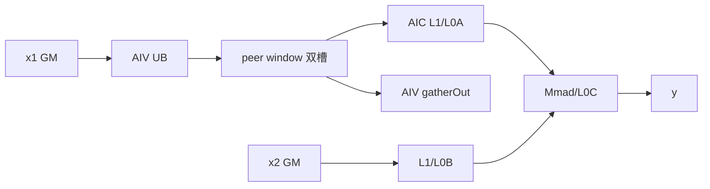
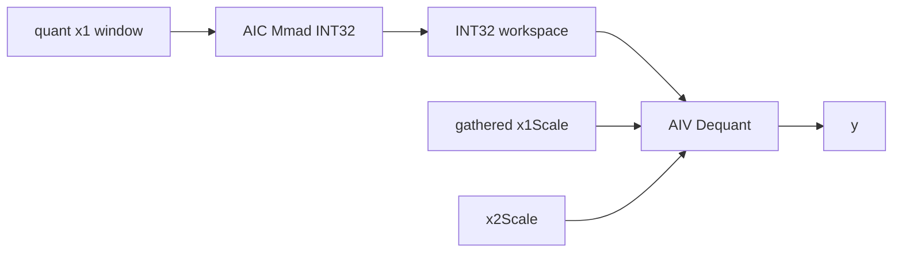
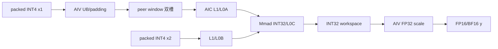

# AllGatherMatmul A2/A3 ACLNN 算子知识

## 算子速览

| 项目 | 内容 |
|---|---|
| 实际入口 | `aclnnAllGatherMatmulV2GetWorkspaceSize` / `aclnnAllGatherMatmulV2`，公开 ACLNN V2 |
| 计算语义 | `gatherOut=AllGather(x1)`；浮点 `y=gatherOut@x2`；INT8/INT4 先 INT32 累加再反量化 |
| 输入输出 | `x1:[m,k]`、`x2:[k,n]`/转置视图、`y:[rank*m,n]`、`gatherOut:[rank*m,k]` |
| 执行类型 | 单 Kernel `MIX_CV`；AIV 通信/padding/反量化，AIC CATLASS Matmul |
| Kernel 路线 | R-001 FP16/BF16；R-002 INT8；R-003 A2 INT4；各含 `TRANS_B=0/1`，INT4 固定 binary 仅 ND |
| 核心资源 | HCCL window GM、user workspace、160 KiB UB、L1/L0A/L0B/L0C、双槽流水 |
| 来源闭包 | `source_closed`：API→Host/Tiling/POD→MIX entry→AIV/AIC body→binary/CMake 闭合；A3 INT4 因固定 binary 缺失被排除 |
| 验证状态 | 已完成源码闭包检查；本次知识提取未执行编译、真机、数值或性能测试。 |

## 接口与语义

### 计算语义

每卡 `x1_r:[m,k]`，`A=[x1_0;...;x1_(p-1)]`。FP16/BF16 直接算 `y=A@x2`。INT8/INT4 以 INT32 累加；per-channel 使用 `x2Scale[n]`，per-token 还聚合 `x1Scale[m]`，由 AIV `DequantRunner` 输出 FP16/BF16。A2/A3 tiling 拒绝非空 bias，故此平台 V2 route 不执行加 bias。

### 输入、输出与属性

| 参数 | shape/layout | dtype | 约束、默认值与语义 |
|---|---|---|---|
| `x1` | `[m,k]` ND | FP16/BF16/INT8/INT4 | 不转置；`k∈[256,65535)`；不支持空 tensor |
| `x2` | `[k,n]` 或转置 view；ND/NZ binary | 同 x1 | 非转置非连续输入被拒；INT4 时 K/N 偶数 |
| `bias` | optional 1D | 接口允许 FP16/BF16/FP32 | 本 route 必须 null |
| `x1Scale` / `x2Scale` | per-token `[m,1]` / per-channel `[1,n]` | FP32；x2Scale 也可 INT64 packed | 量化 route；x1Scale 存在则 per-token |
| 属性 | scalar/string | — | `gatherIndex=0`,`commTurn=0`,`streamMode=1`,`commMode="aiv"`，rank 2/4/8 |
| `y` / `gatherOut` | `[p*m,n]` / `[p*m,k]` ND | y FP16/BF16；gatherOut 同 x1 | 仅在同步完成后有效 |

### 入口与版本

递归审计 `mc2/all_gather_matmul/` 可见旧版公开 ACLNN 仅覆盖 FP16/BF16；V2 README/API 明确是其功能扩展，并增加 A2/A3 INT8/INT4 与反量化，因此同平台选择 V2。API 在 DAV_2201 调用 `allGatherMatmulV2GetWorkspaceSizeAIVMode`；generated inner bridge 是框架边界。A2 的 V2 float/INT8/INT4 与 A3 的 V2 float/INT8 均由 API、OpDef、tiling、entry/body 和 binary 闭合；A3 OpDef/README 声明 INT4，但 `ascend910_93` binary JSON 没有 INT4 实例，故该组合不进入正式 Route。

## Host/Launcher 执行流程

### 参数校验与前处理

API 检查 `commMode`、必需指针、dtype、二维 shape、K/N 轴、`streamMode==1` 与 x1 不转置；推导 x2 是否为转置 view。DAV_2201 上，x2 非转置时还须 contiguous。合法参数连同 `isGatherOut`、`isAmaxOut=false` 交给 inner op。

### 参数、Workspace 与生命周期

总 workspace 为 `16 MiB system + user`。user 依次放可选 A/B 512B 对齐副本、量化 INT32 累加区、可选 per-token scale 区。`aAlignSize=M*align512(K)*bytes`；B 按转置方向取 `N*align512(K)` 或 `K*align512(N)`；INT4 除 2。累加区 `workspaceM*N*p*4`，其中 `workspaceM=(M>=2*m0*pValue)?2*m0*pValue:M`；per-token 区 `M*p*4`。workspace 持有到 stream 完成；HCCL window 由通信 context 持有。

### 启动图与失败传播

```text
ACLNN -> inner GetWorkspaceSize -> AllGatherMatmulTilingV2Func
 -> commMode==aiv -> AllGatherMatmulTilingAIVModeFunc
 -> scheduleMode=1, MIX blockDim, key=(bias=0,transA=0,transB=0/1)
ACLNN run -> HCCL server=MTE -> one all_gather_matmul_v2 MIX kernel
 AIV: padding -> peer window exchange -> gatherOut/dequant
 AIC: wait padding/slot -> local+remote Matmul
```

API、tiling、HCCL tiling 任一失败均阻止 launch；不存在 Device fallback。

## Route 与参数设计

### 分核与资源计算

Host 得 `M,K,N`、AIC/AIV 数和 UB，要求 rank 2/4/8，以 `CalcTschBlockDim(aivNum,aicNum,aivNum)` 编码 `MIX_AIC_1_2`。CoC 查表令 `m0=128/256`、`n0=256/128`、`k0=256` 元素并计算三个 ceil-div loop；Device Cube specialization 另用 `L1TileShapeK=TILE_SHAPE_K_512B<T>`、`L0TileShapeK=TILE_SHAPE_K_128B<T>`，不能把两者混成同一字段。rank/dtype/shape 查表产生 `pValue`、swizzle、通信分组和 `ubMoveNum`，Device 用 `calCount=ceil(mLoop/pValue)` 与两个 slot 轮转。

### Route 选择

| 顺序 | Route | Key/模板 | 精确选择条件与优先级 | 不适用去向 |
|---:|---|---|---|---|
| 1 | R-001 浮点 MIX | `(0,0,TRANS_B)` + FP16/BF16 binary | DAV_2201、aiv、bias null、x1/x2/y 同 FP16 或 BF16 | dtype 非浮点检查 R-002；其余失败 |
| 2 | R-002 INT8 MIX | 同 key + INT8/Y/scale binary | A2/A3 INT8→FP16/BF16，x2Scale 为 FP32，或 Y=FP16 时为 INT64；x1Scale 非空即 per-token | Host/binary 不支持则失败 |
| 3 | R-003 A2 INT4 MIX | 同 key + A2 INT4/Y/FP32-scale binary | 仅 A2，INT4→FP16/BF16，K/N 偶数，固定 binary 仅 ND B | A3 或其它格式无 binary，失败 |

```text
if platform!=DAV_2201 || commMode!=aiv || bias!=null: fail
else if FP16/BF16 same-type: R-001
else if INT8 and valid scales: R-002
else if A2 and INT4 and valid FP32 scales and K%2==0 and N%2==0: R-003
else: fail
```

### 模板/实现执行矩阵

| Route | key/selector | dtype/shape/platform 完整命中条件 | 执行族与 kernel 节点 | 实际模板/body | 内存与同步特征 | tail/fallback |
|---|---|---|---|---|---|---|
| R-001 | transB 0/1；ND/NZ binary | FP16/BF16，rank 2/4/8 | 单 MIX node | `AllGatherMatmulAIVMode` + `MmadAtlasA2Preload<false,true>` | window 双槽→AIC；AIV 同时写 gatherOut | actual M/N/K；失败无 fallback |
| R-002 | 同 key；INT8 binary | A2/A3 INT8→FP16/BF16 | 同 MIX，加 AIV dequant | `ElementC=int32_t`；INT64 scale+FP16 特例 Fixpipe | INT32 full/双槽；可选 x1Scale gather | actual M/N/K；失败无 fallback |
| R-003 | 同 key；A2 INT4 ND binary | A2 INT4→FP16/BF16，K/N 偶数 | 同 MIX，加 AIV dequant | `ElementC=int32_t`，`int4b_t` packed | INT32 full/双槽；可选 x1Scale gather | packed K/N；A3 无 binary |

### 隐藏性能 Guard

| Guard | Host/Tiling 条件 | Device/资源原因 | 影响 Route | 不满足时去向 | 源码符号 |
|---|---|---|---|---|---|
| HCCL buffer | 可查询时 ≥200 MiB | window 在 180 MiB offset 还有 flag | 两者 | tiling 失败；查询失败仅告警 | `AllGatherMatmulTilingAIVModeFunc` |
| 512B align | 内层维未对齐 | CATLASS/window 用 padded stride | 两者 | AIV PaddingRunner 写 workspace | `GetUsrWorkSpaceSize` |
| UB | 固定 160 KiB，copy halves 由 `UB_OFFSET=97440B` 划分 | MTE ping/pong | 两者 | 无动态 fallback | `USED_UB_SIZE` |
| accum ping-pong | `M>=2*m0*pValue` | 仅保留两轮 INT32 | R-002 | 否则全量 INT32 | `GetUsrWorkSpaceSize` |
| A3 INT4 build | README/OpDef 声明支持，但 A3 binary JSON 未列 INT4 | 固定构建实例缺证 | R-003 候选 | 排除出正式 Route | `ascend910_93/all_gather_matmul_v2_binary.json` |
| INT4 format | A2 binary 只有 ND/ND，且 K、N 为偶数 | packed int4 寻址与实例约束 | R-003 | NZ、奇数 K/N 失败 | `ascend910b/all_gather_matmul_v2_binary.json`、`AllGatherMatmulAIVModeCheckShapeAndSetTiling` |

### POD/ABI

| 结构 | 字段 | 类型/位宽 | ABI 布局 | 单位 | Host/launcher producer | Device consumer | 边界 |
|---|---|---|---|---|---|---|---|
| launch | `aGM` | `GM_ADDR`/目标指针宽度 | entry 参数 0；精确位宽由 Device ABI | byte address | generated inner bridge | `Init`/AIC+AIV | required |
| launch | `bGM` | `GM_ADDR` | 参数 1 | byte address | generated inner bridge | `Init`/AIC | required |
| launch | `biasGM` | `GM_ADDR` | 参数 2 | byte address | generated inner bridge | entry 透传但 A2/A3 tiling 拒绝非空 | inactive/null |
| launch | `scaleInv1` | `GM_ADDR` | 参数 3 | byte address | generated inner bridge | per-token AIV | 非 per-token 可空 |
| launch | `scaleInv2` | `GM_ADDR` | 参数 4 | byte address | generated inner bridge | Fixpipe/AIV dequant | 量化 Route 必需 |
| launch | `scale` | `GM_ADDR` | 参数 5 | byte address | generated inner bridge | 未读取 | 当前 Route inactive |
| launch | `cGM` | `GM_ADDR` | 参数 6 | byte address | generated inner bridge | AIC/Fixpipe/AIV | required |
| launch | `gatherOut` | `GM_ADDR` | 参数 7 | byte address | generated inner bridge | AIV copy-out | A2/A3 API 要求非空输出 |
| launch | `amax` | `GM_ADDR` | 参数 8 | byte address | generated inner bridge | 未读取 | 当前 Route inactive |
| launch | `workspaceGM` | `GM_ADDR` | 参数 9 | byte address | executor | padding/accum/scale | 保持到 stream 完成 |
| launch | `tilingGM` | `GM_ADDR` | 参数 10 | byte address | runtime | `GET_TILING_DATA` | launch 时有效 |
| tiling | `mc2InitTiling` | 外部 HCCL POD | 首字段；`sizeof/alignof/offsetof` 固定仓不可见 | POD | `Mc2CcTilingConfig::GetTiling` | HCCL `Init` | 只允许同 ABI 构建 |
| tiling | `mc2CcTiling` | 外部 HCCL POD | 第二字段；精确布局固定仓不可见 | POD | `Mc2CcTilingConfig::GetTiling` | HCCL task | 只允许同 ABI 构建 |
| info | `M` | `uint32_t/32` | 声明序；精确 offset 未断言 | element | shape tiling | `Init:m` | `[0,2^32-1]`，API 不支持空域 |
| info | `K` | `uint32_t/32` | 同上 | element | shape tiling | `Init:k` | 公开约束 `[256,65535)` |
| info | `N` | `uint32_t/32` | 同上 | element | shape tiling | `Init:n` | API 不支持空域 |
| info | `worldSize` | `uint32_t/32` | 同上 | rank | 固定仓未赋值 | Device 不读取 | inactive storage |
| info | `rankId` | `uint32_t/32` | 同上 | rank | 固定仓未赋值 | Device 不读取 | inactive storage |
| info | `aivNum` | `uint32_t/32` | 同上 | core | platform query | Device 不读取 | Host 诊断字段 |
| info | `totalUbSize` | `uint32_t/32` | 同上 | byte | platform query 窄化写入 | Device 不读取 | Host 诊断字段 |
| info | `aAlignSize` | `uint64_t/64` | 声明序；精确 offset 未断言 | byte | `GetUsrWorkSpaceSize` | `Init` | 无 A 副本时 0 |
| info | `bAlignSize` | `uint64_t/64` | 同上 | byte | `GetUsrWorkSpaceSize` | `Init` | 无 B 副本时 0 |
| info | `isTransposeX1` | `bool/实现定义` | padding/offset 未断言 | flag | attr check | Device 不读取，模板参数固定 false | 必须 false |
| info | `isTransposeX2` | `bool/实现定义` | 同上 | flag | attr check | Device 不读取，entry 模板化 | key 0/1 |
| info | `hasAAlign` | `bool/实现定义` | 同上 | flag | workspace tiling | `Init`/Padding | 无副本时 false |
| info | `hasBAlign` | `bool/实现定义` | 同上 | flag | workspace tiling | `Init`/Padding | NZ 时 Device 强制 false |
| info | `quantFlag` | `bool/实现定义` | 同上 | flag | dtype tiling | Device 由模板 dtype 重建 | Host workspace guard |
| info | `is910C` | `bool/实现定义` | 同上 | flag | SoC string | `Init` HCCL context 分支 | A3 true、A2 false |
| info | `isX2ScaleTypeInt64` | `bool/实现定义` | 同上 | flag | `CheckDtypeX2` | `Init`/Fixpipe guard | FP32 scale 时 false |
| info | `accumWorkSpacePingPong` | `bool/实现定义` | 同上 | flag | `GetUsrWorkSpaceSize` | accum offset | 非量化 false |
| info | `dequantType` | `enum:int` | 枚举底层按当前编译 ABI；offset 未断言 | mode | scale presence check | AIV dequant | float Route inactive |
| CoCTiling | `m` | `int32_t/32` | 声明序；精确 offset 未断言 | element | shape tiling | Device 不读取 | 与 info.M 重复 |
| CoCTiling | `k` | `int32_t/32` | 同上 | element | shape tiling | Device 不读取 | 与 info.K 重复 |
| CoCTiling | `n` | `int32_t/32` | 同上 | element | shape tiling | Device 不读取 | 与 info.N 重复 |
| CoCTiling | `numBlocks` | `int32_t/32` | 同上 | block | `CalcTschBlockDim` | Device 不读取 | runtime blockDim 另传 |
| CoCTiling | `rankSize` | `int32_t/32` | 同上 | rank | HCCL query | Device 不读取 | 仅 2/4/8 |
| CoCTiling | `m0` | `int32_t/32` | 同上 | element | lookup/decode | AIV/Cube | 128 或 256 |
| CoCTiling | `k0` | `int32_t/32` | 同上 | element | lookup/decode | AIV | 256；非 Cube K-byte tile |
| CoCTiling | `n0` | `int32_t/32` | 同上 | element | lookup/decode | AIV/Cube | 256 或 128 |
| CoCTiling | `mLoop` | `int32_t/32` | 同上 | count | ceil-div | AIV/Cube | `ceil(M/m0)` |
| CoCTiling | `kLoop` | `int32_t/32` | 同上 | count | ceil-div | AIV | `ceil(K/k0)` |
| CoCTiling | `nLoop` | `int32_t/32` | 同上 | count | ceil-div | AIV/Cube | `ceil(N/n0)` |
| CoCTiling | `swizzlCount` | `int32_t/32` | 同上 | count | lookup | Cube block mapping | 查表值 |
| CoCTiling | `swizzlDirect` | `int32_t/32` | 同上 | enum | lookup | Cube block mapping | 0/1 |
| CoCTiling | `pValue` | `int32_t/32` | 同上 | M tile count | lookup 后按 window clamp | AIV/Cube | 至少 1 |
| CoCTiling | `ubMoveNum` | `int32_t/32` | 同上 | element | decode 后乘 512 | AIV UB split | 两槽分配 |
| CoCTiling | `commNpuSplit` | `int32_t/32` | 同上 | group | lookup | AIV core mapping | 与 dataSplit 相乘 |
| CoCTiling | `commDataSplit` | `int32_t/32` | 同上 | group | lookup | AIV core mapping | 与 npuSplit 相乘 |
| CoCTiling | `commDirect` | `int32_t/32` | 同上 | enum | lookup | AIV exchange direction | 查表值 |
| CoCTiling | `lenPerLoop` | `int32_t/32` | 同上 | element | `ubMoveNum*commDataSplit` | AIV move loop | 派生值 |
| CoCTiling | `extraUbMoveNum` | `int32_t/32` | 声明序；精确 offset 未断言 | element | 默认 `-1` | 当前 body 不读取 | inactive |
| CoCTiling | `extraCommNpuSplit` | `int32_t/32` | 同上 | group | 默认 `-1` | 当前 body 不读取 | inactive |
| CoCTiling | `extraCommDataSplit` | `int32_t/32` | 同上 | group | 默认 `-1` | 当前 body 不读取 | inactive |
| CoCTiling | `extraCommDirect` | `int32_t/32` | 同上 | enum | 默认 `-1` | 当前 body 不读取 | inactive |
| CoCTiling | `extraLenPerLoop` | `int32_t/32` | 同上 | element | 默认 `-1` | 当前 body 不读取 | inactive |
| CoCTiling | `splitK` | `int32_t/32` | 同上 | count | 默认 `-1` | 当前 body 不读取 | inactive |
| CoCTiling | `write2OtherRank` | `int32_t/32` | 同上 | flag | 默认 `-1` | 当前 body 不读取 | inactive |
| CoCTiling | `withSerialMode` | `int32_t/32` | 同上 | flag | 默认 `-1` | 当前 body 不读取 | inactive |
| CoCTiling | `is91093` | `int32_t/32` | 同上 | flag | 默认 `-1` | 当前 body 不读取 | inactive；真实 A3 分支使用 info.is910C |

### Route 源码闭包

| Route | Key/selector | Host/Tiling producer | POD/参数 | Kernel entry/router | Kernel body/直接依赖 | 构建接线 |
|---|---|---|---|---|---|---|
| R-001 | key+FP binaries | `AllGatherMatmulTilingAIVModeFunc` | `AllGatherMatmulAIVModeTilingData` | `arch22::all_gather_matmul_v2` | `AllGatherMatmulAIVMode`、`gather_matmul.hpp` | A2/A3 JSON、CMake |
| R-002 | key+A2/A3 INT8 binaries | 同上 | 同 POD，quant 字段 active | 同 entry | 同 body + dequant/Fixpipe | A2/A3 INT8 JSON、CMake |
| R-003 | key+A2 INT4 ND binaries | 同上 + K/N even | 同 POD，INT4/quant 字段 active | 同 entry | 同 body + packed int4/dequant | A2 INT4 JSON、CMake |

## Kernel 实现

### 公共执行流程

entry 注册 POD，设置 `KERNEL_TYPE_MIX_AIC_1_2`。AIV 先 padding、清 window flag，以两 slot 发送 x1，拼 gatherOut；AIC 等 flag 12 后按 slot `WaitEvent` 计算本地和远端块。rank flag 0..3、AIV barrier 与 AIC flag 共同防止覆盖，结尾 `SyncAll<false>`。

### Route R-001：浮点 MIX_CV

#### 适用条件

##### 选择证据

| 层级 | 文件 | 符号 | 源码谓词/参数 | 结果/下一跳 |
|---|---|---|---|---|
| API | `op_api/aclnn_all_gather_matmul_v2.cpp` | AIV-mode API | DAV_2201 + float dtype | inner op |
| Tiling | `arch22/all_gather_matmul_aiv_mode_tiling.cpp` | `GetTilingKey` | bias=0,transA=0,transB | key |
| Router | `arch22/all_gather_matmul_v2.cpp` | entry | dtype/format/key | R-001 |

#### Device 数据流

##### 函数级调用链

```text
entry -> Init -> AIV Process(Padding/MoveWithSplit/gatherOut)
              -> AIC CatlassMatmul -> Gemm::Kernel::AllGatherMatmulV2::Matmul -> BlockMmad
```

##### 源码等价伪码

```text
AIV: for cal: wait reusable slot; rank rendezvous; x1 GM->UB->peer window; peer/local->gatherOut; SetAicSync
AIC: wait padding; for ready slot: map (mTile,nTile) by swizzle; GM/window->L1->L0A/B->Mmad->L0C->y
```

#### 内存与数据搬运

##### 资源与搬运表

| 层级/缓冲区 | offset/地址公式 | extent/容量公式 | dtype/layout | producer | consumer | owner/lifetime | 对齐/复用 |
|---|---|---|---|---|---|---|---|
| window | `slot*pValue*m0*kAlign*p + rank*pValue*m0*kAlign` | 2×该 rank extent | T/row K-align | AIV | AIC/AIV | HCCL/kernel | flag 保护 |
| UB | halves 0/`UB_OFFSET` | 160 KiB | T | MTE2 | MTE3 | AIV | events 0/1 |
| L1/L0 | L1 tile 128×256 或 256×128；K 512B，L0 K 128B | current CATLASS tile | T/acc traits | copy/Mmad | Fixpipe | AIC tile | preload |
| y/gatherOut | rank-major offsets | `p*M*N` / `p*M*K` | Y/T ND | AIC/AIV | caller | stream | actual tails |

##### 分层内存布局



##### 字节账、交接边与复用顺序

```text
user_workspace=aAlignSize+bAlignSize; UB=160KiB
peer_slot=pValue*m0*kAlign*p*sizeof(T); peer_window_pipeline=2*peer_slot
```

| 边/复用子区 | producer | offset/extent | dtype/layout | consumer | ordering/sync | owner/lifetime | 安全条件 |
|---|---|---|---|---|---|---|---|
| padding→AIC | AIV | align slices | T/padded | AIC | flag ID12 | workspace | MTE3 complete |
| slot→AIC | AIV | slot/rank chunk | T | Matmul | rank flags + SetAicSync/WaitEvent | window | two-round reuse |

#### 同步、精度与尾块

##### 同步与数值边界表

| 阶段 | primitive/机制 | producer | consumer/等待点 | 保护对象 | 精度/尾块 |
|---|---|---|---|---|---|
| UB copy | MTE events 0/1 | GM→UB | UB→GM | UB half | remaining elements |
| rank | atomic add + GM polling | ranks | rank AIV | window slot | round-count flag |
| Cube | BlockMmad | L0C | y | tile | FP16/BF16；actual M/N/K |

#### 关键实现

##### 符号证据表

| 阶段 | 文件 | 符号/模板实例 | 实现事实 |
|---|---|---|---|
| Host/Tiling producer | `arch22/all_gather_matmul_aiv_mode_tiling.cpp` | tiling func | key/workspace/comm |
| Kernel entry/router | `arch22/all_gather_matmul_v2.cpp` | entry | MIX instance |
| Device body/helper | `all_gather_matmul_aiv_mode.h`,`gather_matmul.hpp` | `Process/CatlassMatmul/Matmul` | pipeline and Cube |

### Route R-002：INT8 量化 MIX_CV

#### 适用条件

##### 选择证据

| 层级 | 文件 | 符号 | 源码谓词/参数 | 结果/下一跳 |
|---|---|---|---|---|
| API | API cpp | `CheckParamsAndShapeForAIVMode` | quant dtype/shape | inner op |
| Tiling | AIV tiling cpp | `quantFlag/CheckDtypeX1/X2` | scales | dequant mode |
| Router | entry + binary JSON | compile specialization | INT8 | R-002 |

#### Device 数据流

##### 函数级调用链

```text
entry -> AIV x1/(optional x1Scale) AllGather -> AIC INT32 Matmul
      -> Fixpipe direct FP16 or INT32 workspace -> AIV DequantRunner -> y
```

##### 源码等价伪码

```text
communicate as R-001; AIC accumulates INT32
if INT8+INT64 scale+FP16: Fixpipe direct
else AIC writes full/slot INT32; AIV two rounds later dequantizes with x2Scale and optional gathered x1Scale
```

#### 内存与数据搬运

##### 资源与搬运表

| 层级/缓冲区 | offset/地址公式 | extent/容量公式 | dtype/layout | producer | consumer | owner/lifetime | 对齐/复用 |
|---|---|---|---|---|---|---|---|
| accum | after A/B align | `workspaceM*N*p*4` | INT32 row | AIC | AIV | workspace | full/2-slot |
| scale | after accum | per-token `M*p*4` | FP32 | AIV gather | dequant | workspace | rank flags 2/3 |
| L0C/y | tile/rank offsets | tile / logical y | INT32→FP16/BF16 | Mmad/Fixpipe/dequant | caller | tile/output | actual M/N/K |

##### 分层内存布局



##### 字节账、交接边与复用顺序

```text
workspace=aAlign+bAlign+workspaceM*N*p*4+(perToken?M*p*4:0)
workspaceM=(M>=2*m0*pValue)?2*m0*pValue:M
```

| 边/复用子区 | producer | offset/extent | dtype/layout | consumer | ordering/sync | owner/lifetime | 安全条件 |
|---|---|---|---|---|---|---|---|
| accum→dequant | AIC | slot/rank rows | INT32 | AIV | PIPE_FIX flag/WaitEvent | workspace | dequant before reuse |

#### 同步、精度与尾块

##### 同步与数值边界表

| 阶段 | primitive/机制 | producer | consumer/等待点 | 保护对象 | 精度/尾块 |
|---|---|---|---|---|---|
| accumulation | BlockMmad | AIC | workspace/Fixpipe | tile | INT32 |
| dequant | `DequantRunner` | INT32+FP32 scales | y | slot | FP16/BF16 |
| tail | actual sizes | both | y | logical domain | actual M/N/K |

#### 关键实现

##### 符号证据表

| 阶段 | 文件 | 符号/模板实例 | 实现事实 |
|---|---|---|---|
| Host/Tiling producer | AIV tiling cpp | `GetUsrWorkSpaceSize` | accum/scale bytes |
| Kernel entry/router | arch22 entry | dtype instance | quant route |
| Device body/helper | AIV mode h / gather_matmul.hpp | `Dequant/FixpipeMatmul` | precision and handoff |

### Route R-003：A2 INT4 量化 MIX_CV

#### 适用条件

##### 选择证据

| 层级 | 文件 | 符号 | 源码谓词/参数 | 结果/下一跳 |
|---|---|---|---|---|
| API | `mc2/all_gather_matmul_v2/op_api/aclnn_all_gather_matmul_v2.cpp` | `CheckParamsAndShapeForAIVMode` | x1/x2 为 INT4，y 为 FP16/BF16 | 进入 inner op；dtype 相等在 tiling 再校验 |
| Tiling | `mc2/all_gather_matmul_v2/op_host/op_tiling/arch22/all_gather_matmul_aiv_mode_tiling.cpp` | `AllGatherMatmulAIVModeCheckShapeAndSetTiling` | `aType==bType==DT_INT4 && K%2==0 && N%2==0` | A2 8-rank 命中专用查表；其它 rank 走现有 A2 fallback 表 |
| Router | `mc2/all_gather_matmul_v2/op_kernel/arch22/all_gather_matmul_v2.cpp` | `AllGatherMatmulAIVMode<int4b_t,...>` | A2 binary 仅 ND/ND INT4，scale FP32，Y FP16/BF16 | R-003；A3 binary 无实例，终止 |

#### Device 数据流

##### 函数级调用链

```text
all_gather_matmul_v2<int4b_t,...>
 -> AllGatherMatmulAIVMode::Init/Process
 -> AIV packed-int4 padding/peer exchange
 -> CatlassMatmul<ElementC=int32_t>
 -> AllGatherMatmulV2::Matmul
 -> DequantRunner -> FP16/BF16 y
```

##### 源码等价伪码

```text
按 1024 个 INT4/512B 对齐 K/N；AIV 在两个 slot 中搬运 packed x1 并收集 x1Scale（若 per-token）；
AIC 以 int4b_t A/B、INT32 L0C 累加，写双槽/全量 accum workspace；AIV 等 PIPE_FIX 后乘 FP32 scale 并写 y。
```

#### 内存与数据搬运

##### 资源与搬运表

| 层级/缓冲区 | offset/地址公式 | extent/容量公式 | dtype/layout | producer | consumer | owner/lifetime | 对齐/复用 |
|---|---|---|---|---|---|---|---|
| x1/x2 或 padding 副本 | A=`0`；B=`aAlignSize` | A=`M*align1024(K)/2`；B=`K*align1024(N)/2` | packed INT4 ND | AIV PaddingRunner | AIC | workspace/launch | 512B |
| peer window | `slot*rank*pValue*m0*kAlign/2 + rankChunk` | `2*rank*pValue*m0*kAlign/2` | packed INT4 row-major | AIV | AIC/AIV gatherOut | HCCL/kernel | rank flags + slot |
| L1/L0A/L0B/L0C | L1 K=`TILE_SHAPE_K_512B<int4b_t>`；L0 K=`TILE_SHAPE_K_128B<int4b_t>` | M/N 为 128×256 或 256×128 specialization | INT4/INT32 | TileCopy/Mmad | accum | AIC tile | preload/actual tail |
| accum/scale | `aAlign+bAlign` 后 | `workspaceM*N*rank*4`；per-token 再 `M*rank*4` | INT32/FP32 | AIC/AIV | AIV dequant | workspace | 全量或双槽 |

##### 分层内存布局



##### 字节账、交接边与复用顺序

```text
align_elements = 1024                     # 1024 INT4 = 512 B
workspace_total = 16MiB + aAlignSize + bAlignSize
                + workspaceM*N*rank*4 + (perToken ? M*rank*4 : 0)
workspaceM = pingPong ? 2*m0*pValue : M
```

| 边/复用子区 | producer | offset/extent | dtype/layout | consumer | ordering/sync | owner/lifetime | 安全条件 |
|---|---|---|---|---|---|---|---|
| peer slot→Cube | AIV exchange | `flagIdx*rank*pValue*m0*kAlign/2` | packed INT4 | AIC Matmul | rank flag + `SetAicSync`/`WaitEvent` | HCCL window | 两槽轮次一致 |
| accum→dequant | AIC PIPE_FIX | rank/slot rows，`*4` byte | INT32 ND | AIV `DequantRunner` | flag 0/1 与两轮 drain | workspace | dequant 完成后才复用 |

#### 同步、精度与尾块

##### 同步与数值边界表

| 阶段 | primitive/机制 | producer | consumer/等待点 | 保护对象 | 精度/尾块 |
|---|---|---|---|---|---|
| 通信→Cube | rank GM flag + AIC/AIV cross-core event | AIV | AIC `WaitEvent(flagIdx)` | peer slot | packed K tail 已由 K 偶数和 512B padding 约束 |
| Cube→dequant | `FFTSCrossCoreSync<PIPE_FIX,2>` / AIV wait | AIC | AIV | INT32 slot | INT32 累加后 FP32 scale，写 FP16/BF16 |
| 尾块 | `actualPValue`、actual M/N/K | AIC/AIV | output | logical domain | K/N 必须偶数；INT4 binary 仅 ND |

#### 关键实现

##### 符号证据表

| 阶段 | 文件 | 符号/模板实例 | 实现事实 |
|---|---|---|---|
| Host/Tiling producer | `mc2/all_gather_matmul_v2/op_host/op_tiling/arch22/all_gather_matmul_aiv_mode_tiling.cpp` | `SetTilingDataA2` / `GetUsrWorkSpaceSize` | 8-rank INT4 查表、1024 元素对齐和 workspace |
| Kernel entry/router | `mc2/all_gather_matmul_v2/op_kernel/arch22/all_gather_matmul_v2.cpp` | `AllGatherMatmulAIVMode<DTYPE_X1,...>` | MIX entry 与 INT4 specialization |
| Device body/helper | `mc2/all_gather_matmul_v2/op_kernel/all_gather_matmul_aiv_mode.h`、`gather_matmul.hpp` | `CatlassMatmul` / `AllGatherMatmulV2::Matmul` | packed input、INT32 accumulate、两槽同步与 dequant |

## 算子特定优化

### Trick T-001：双槽通信—Cube—反量化流水

#### 触发与源码依据

- 适用 Route：R-001、R-002、R-003
- 触发条件：成功 A2/A3 tiling，`MAX_BLOCK_COUNT=2`
- Golden 来源：[`all_gather_matmul_aiv_mode.h:887-899`](../../../../../../../cann-ops-raw/ascendc/ops-transformer/be33d95bb755cedec3108f70805c1874d1792540/mc2/all_gather_matmul_v2/op_kernel/all_gather_matmul_aiv_mode.h#L887-L899)

**官方源码（固定 Commit 连续逐字摘录）**：

```cpp
// dequant
if (cal_idx >= MAX_BLOCK_COUNT) {
    Dequant(cal_idx - MAX_BLOCK_COUNT);
}

if (cal_idx < cal_count) {
    SetAndWaitAivSync(flag_idx);
    CrossRankSyncV2(FLAG_ONE_IDX, cal_idx + 1);
    SetAndWaitAivSync(flag_idx);
    // 发送aic同步
    SetAicSync(flag_idx);
}
```

#### 机制与设计原因

slot `cal%2` 让 AIV 发送下一块、AIC 计算已就绪块、量化 AIV 处理两轮前的 INT32；等待与 flag 是防覆盖协议。

#### 迁移边界

- 适用：固定两轮 producer/consumer 延迟的 MIX kernel
- 前提：1:2 核比、scheduleMode 1、相同 rank flag
- 失效：改变 tile/核比/拓扑须重算 extent 和轮次
- 未验证：本次知识提取未执行编译、真机、数值或性能测试。

#### 错误做法

只复用 offset 而遗漏 flag 轮次会覆盖 AIC/AIV 尚未消费的数据。

### Trick T-002：量化 workspace 全量/双槽自适应

#### 触发与源码依据

- 适用 Route：R-002、R-003
- 触发条件：`quantFlag && M>=2*m0*pValue`
- Golden 来源：[`all_gather_matmul_aiv_mode_tiling.cpp:440-447`](../../../../../../../cann-ops-raw/ascendc/ops-transformer/be33d95bb755cedec3108f70805c1874d1792540/mc2/all_gather_matmul_v2/op_host/op_tiling/arch22/all_gather_matmul_aiv_mode_tiling.cpp#L440-L447)

**官方源码（固定 Commit 连续逐字摘录）**：

```cpp
info.accumWorkSpacePingPong = (info.M >= MAX_BLOCK_COUNT * cocTiling.m0 * cocTiling.pValue);
int32_t workspaceM = info.accumWorkSpacePingPong ? MAX_BLOCK_COUNT * cocTiling.m0 * cocTiling.pValue : info.M;
userWorkSpaceSize += static_cast<uint64_t>(workspaceM * info.N * rankSize * sizeof(int32_t));
```

#### 机制与设计原因

大 M 只保留两轮 INT32，小 M 使用全量布局；Host bool 与 Device offset 公式必须一致。

#### 迁移边界

- 适用：INT32 producer/Vector consumer 流水
- 前提：两槽深度不变
- 失效：去掉 dequant 或改变 pipeline depth
- 未验证：本次知识提取未执行编译、真机、数值或性能测试。

#### 错误做法

固定仓给出了全量与 ping-pong 两套相反寻址；混用会跨 rank 读错行。

## 模板与实现对比

| 对比维度 | R-001 浮点 | R-002 INT8 | R-003 A2 INT4 | 设计选择依据 |
|---|---|---|---|---|
| 命中条件/优先级 | FP16/BF16 | A2/A3 INT8+scale | A2 INT4+FP32 scale、K/N even | dtype/binary specialization |
| 执行族/节点图 | AIV comm + AIC MM | 再加 AIV dequant | 同 R-002，输入 packed | INT32 intermediate |
| M/N/K、tile 与 scheduler | 128×256/256×128，K L1=512B | 同框架，查表不同 | INT4 8-rank 专表；512B=1024 elements | dtype/rank |
| workspace/L1/L0/UB | align，160KiB UB | align+INT32+scale | packed align+INT32+scale | precision/packing |
| AIC/AIV 或 kernel 交接 | window slot | window + INT32 slot | packed window + INT32 slot | flags |
| 同步、精度与 tail | FP output | INT32→scaled output | INT32→scaled output；K/N even | scale mode |
| fallback/失败边界 | no device fallback | no device fallback | A3/NZ 无 binary | Host/binary closure |

## 平台差异

| 项目 | A2 | A3 | 950 |
|---|---|---|---|
| 支持状态 | V2 FP16/BF16/INT8/INT4；INT4 fixed binary 仅 ND | V2 FP16/BF16/INT8 source-closed；README/OpDef 的 INT4 缺 fixed binary | 见 `_950` 卡 |
| Host/Launcher | MultiPut fullmesh | `is910C` AllGather fullmesh | registry + CCU/AICPU |
| Kernel/资源 | `HcclA2CombineOpParam` | `HcclOpResParam` | arch35 MatmulV3/QBMM |

## 限制与失败边界

- 只支持 `aiv`、rank 2/4/8、bias null、x1 不转置；非法组合在 API/tiling 失败。
- 固定 A3 binary JSON 未列 INT4，故本卡不把 A3 INT4 声明为构建闭合；A2 INT4 fixed binary 仅 ND/ND。
- HCCL window 底层可见性属于通信库边界；本仓闭合了地址、flag 与等待顺序。
- 复合 HCCL POD 缺少精确 size/offset assert，只能同 ABI 构建，不能手工重排。

## 源码索引

### 链路索引

| 链路阶段 | 文件 | 关键符号 | 支撑内容 |
|---|---|---|---|
| 入口声明/约束 | `mc2/all_gather_matmul/README.md` | 产品表/语义 | 旧版 FP16/BF16 边界与版本比较 |
| 入口声明/约束 | `mc2/all_gather_matmul_v2/README.md` | 产品表/量化场景 | V2 平台、语义与公开约束 |
| 入口声明/约束 | `mc2/all_gather_matmul_v2/op_api/aclnn_all_gather_matmul_v2.h` | ACLNN symbols | 签名 |
| 入口实现 | `mc2/all_gather_matmul_v2/op_api/aclnn_all_gather_matmul_v2.cpp` | `aclnnAllGatherMatmulV2GetWorkspaceSize` | 校验、DAV_2201 分流、MTE server |
| Host/注册 | `mc2/all_gather_matmul_v2/op_host/all_gather_matmul_v2_def.cpp` | `AllGatherMatmulV2` | A2/A3 dtype/format 与 ACLNN 接线 |
| Host/Tiling | `mc2/all_gather_matmul_v2/op_host/op_tiling/arch22/all_gather_matmul_v2_tiling_a2a3.cpp` | `AllGatherMatmulTilingV2Func` | `commMode=aiv` selector |
| Host/Tiling | `mc2/all_gather_matmul_v2/op_host/op_tiling/arch22/all_gather_matmul_aiv_mode_tiling.cpp` | `AllGatherMatmulTilingAIVModeFunc` | route、workspace、blockDim、HCCL POD |
| Host/Tiling | `mc2/all_gather_matmul_v2/op_host/op_tiling/arch22/tiling_func.h` | lookup maps/constants | dtype/rank/shape 到 CoC 参数 |
| POD/ABI | `mc2/all_gather_matmul_v2/op_kernel/all_gather_matmul_aiv_mode_tiling.h` | structs | POD |
| Kernel entry | `mc2/all_gather_matmul_v2/op_kernel/arch22/all_gather_matmul_v2.cpp` | `all_gather_matmul_v2` | MIX_CV entry 与模板参数 |
| Kernel body | `mc2/all_gather_matmul_v2/op_kernel/all_gather_matmul_aiv_mode.h` | `AllGatherMatmulAIVMode` | AIV/AIC 任务图、地址和两槽协议 |
| Kernel body | `mc2/all_gather_matmul_v2/op_kernel/all_gather_matmul_aiv_mode_dequant.h` | `DequantRunner` | INT32→scaled output |
| Kernel body | `mc2/all_gather_matmul_v2/op_kernel/all_gather_matmul_aiv_mode_padding.h` | `PaddingRunner` | 512B padding 与完成 flag |
| Kernel helper | `mc2/all_gather_matmul_v2/op_kernel/all_gather_matmul_aiv_mode_util.h` | sync/flag helpers | AIC↔AIV 与跨 rank 同步 primitive |
| Kernel body | `mc2/all_gather_matmul_v2/op_kernel/gather_matmul.hpp` | `AllGatherMatmulV2` | Cube 调度、peer slot、tail |
| Kernel helper | `mc2/all_gather_matmul_v2/op_kernel/block_mmad_preload_fixpipe.h` | `BlockMmad`/Fixpipe | L1→L0A/B→Mmad→L0C/Fixpipe |
| 构建接线 | `mc2/all_gather_matmul_v2/op_host/config/ascend910b/all_gather_matmul_v2_binary.json` | `op_list` | A2 float/INT8/INT4 实例 |
| 构建接线 | `mc2/all_gather_matmul_v2/op_host/config/ascend910_93/all_gather_matmul_v2_binary.json` | `op_list` | A3 float/INT8 实例及 INT4 缺口 |
| 构建接线 | `mc2/all_gather_matmul_v2/op_host/CMakeLists.txt` | module macros | source wiring |

### 实现复用检查

| 检查项 | 可复用事实 | 不得改变的约束 | 源码符号 |
|---|---|---|---|
| ABI/POD | tiling field producer/consumer | field order/bool/enum/HCCL ABI | Host tiling/Init |
| 调用顺序 | padding→exchange→MM→dequant | two-round drain | `Process` |
| workspace/内存 | align/INT32/scale formulas | byte vs element and ping-pong bool | `GetUsrWorkSpaceSize` |
| 同步 | rank flags, AIV/AIC flags | IDs/rounds/PIPE order | sync helpers |
| 精度与尾块 | FP direct or INT32 dequant | Fixpipe predicate/INT4 packing | `CatlassMatmul/Dequant` |
| 失败边界 | API+tiling+binary reachability | no 950/bias/unsupported rank | selectors |