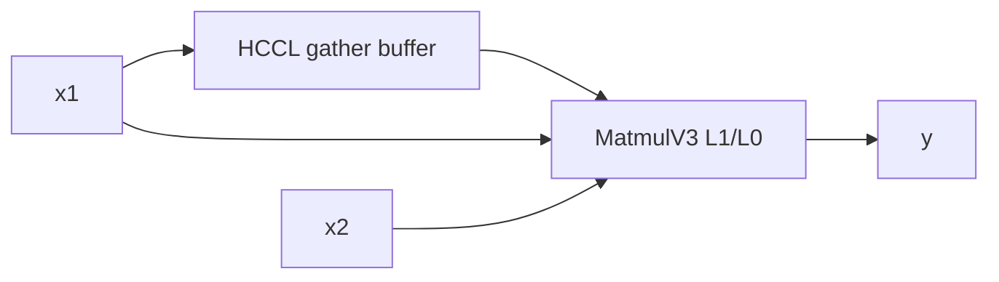
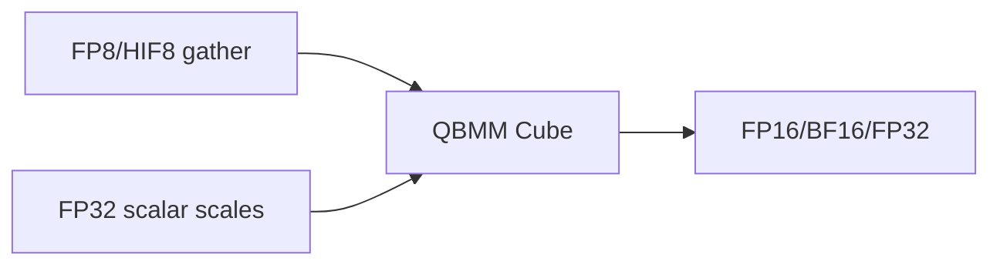
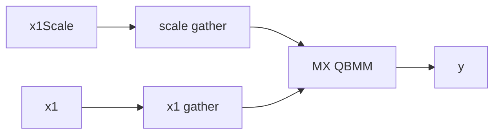
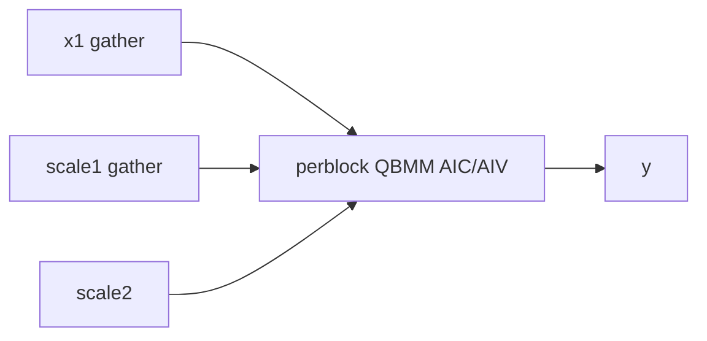

# AllGatherMatmul 950 ACLNN 算子知识

## 算子速览

| 项目 | 内容 |
|---|---|
| 实际入口 | `aclnnAllGatherMatmulV2GetWorkspaceSize` / `aclnnAllGatherMatmulV2` |
| 计算语义 | FP16/BF16 或 FP8/HIF8 pertensor/perblock/MX 的 AllGather+Matmul+dequant |
| 输入输出 | `x1:[m,k]`，`x2:[k,n]`/转置，`y:[rank*m,n]`，可选 `gatherOut:[rank*m,k]` |
| 执行类型 | 主 entry 为 `MIX_CV`：R-001/R-002/R-003 仅 AIC 分支执行 Cube，R-004 的 QBMM 同时执行 AIC/AIV；同图另含 CCU fusion task 或 AICPU server task |
| Kernel 路线 | R-001 FP16/BF16；R-002 pertensor；R-003 MX；R-004 perblock；各含 transB 与 CCU/AICPU key |
| 核心资源 | HCCL recv/gather buffer、user+lib workspace、MatmulV3/QBMM L1/L0/UB、tile/tail handles |
| 来源闭包 | `source_closed`：公开 API、task generation、priority tilers、POD、entry/body 与 950 binary 闭合 |
| 验证状态 | 已完成源码闭包检查；本次知识提取未执行编译、真机、数值或性能测试。 |

## 接口与语义

### 计算语义

FP16/BF16：`A=AllGather(x1)`，`y=A@x2+bias`。FP8/HIF8 pertensor：`y=(x1Scale*x2Scale)*(A@x2+bias)`；perblock 以 128×128×128 scale block 累加；MX 以 K block 32、E8M0 scale 执行。`gatherOut=A` 可为空；若不存储则用 workspace 作为通信接收区。`amaxOut` 当前必须 null/empty。

### 输入、输出与属性

| 参数 | shape/layout | dtype | 约束、默认值与语义 |
|---|---|---|---|
| `x1`,`x2` | 2D ND；x2 可转置 | FP16/BF16/FP8E4M3/FP8E5M2/HIF8 | K `[256,65535)`；HIF8 要求 A/B 同型 |
| `bias` | `[n]` 或 null | FP16/BF16 for float；FP32 for low precision | perblock 必须 null |
| `x1Scale`,`x2Scale` | `[1]` pertensor；2D perblock；3D MX | FP32 或 MX E8M0 | 两者必需、同 dtype/同维数；shape 由 route 检查 |
| 属性 | scalar/string | — | rank 2/4/8/16/32/64；`gatherIndex=0`,`commTurn=0`,`blockSize=0`,`streamMode=1`; `commMode=ccu/ai_cpu` |
| `y` | `[rank*m,n]` | FP16/BF16/FP32 | dtype 编入 tiling key |
| `gatherOut`,`amaxOut` | `[rank*m,k]` / empty | 同 x1 / FP32 | gatherOut 可为空；amaxOut 仅 null/empty |

### 入口与版本

递归审计 `mc2/all_gather_matmul/` 可见旧版 950 公开 ACLNN 只覆盖 FP16/BF16；V2 README/API 明确为扩展版本并加入 FP8/HIF8 的 pertensor、perblock、MX 三种 scene，因此 950 选择 V2。API 在 DAV_3510 走 `allGatherMatmulV2GetWorkspaceSizeCCUMode`，校验/必要时重建 x2/x2Scale 转置 view，保存 commMode 到 executor；运行时据此设置 HCCL server type。generated inner bridge 是框架边界。

## Host/Launcher 执行流程

### 参数校验与前处理

API 检查必需指针、dtype、streamMode、2D shape、K/N 和 amax；FP8/HIF8 要求 scale。转置 x2 时 `TransX2Tensor` 交换 view shape/stride，x2Scale 需要时同样转置。`CheckAndHandleCommMode` 只接受 `ai_cpu/ccu`，并把 enum 存到 executor user handle。

### 参数、Workspace 与生命周期

base workspace 为 `libApiWorkSpaceSize + storageA + biasLen`。950 不申请 ND2NZ；若 gatherOut 不存储，`gatherLen=align512(rankM*rankK*inputBytes)*rankDim`。BF16 bias 可另需 `align(N)*4`。量化 route 再加 QBMM workspace 与 scale1 聚合区：pertensor `rankDim*4`；perblock `rankDim*ceil(M/128)*ceil(K/128)*4`；MX `rankDim*M*ceil(K/64)*sizeof(E8M0)`（Device 物理处理为 `align(ceil(K/32),2)`）。所有 HCCL handle、tiling 与 buffer 在 kernel/finalize 前有效。

### 启动图与失败传播

```text
ACLNN -> inner -> registry DoTilingImpl
  priority 0 AllGatherMatmulTilingV2: FP16/BF16
  priority 1 AllGatherQuantBmmTiling: FP8/HIF8
 -> main all_gather_matmul_v2_apt MIX entry
 -> GenTask by commMode:
      ai_cpu: CommonKFC server task/kfc_stream
      ccu: arch35 CCU server task/ccu_stream
ccu: main stream 上把 CCU task 与 AICore task 封装成 fusion task
ai_cpu: attach stream wait -> Mc2ServerKernel -> main stream record -> AICore task(hidden Hcom)
main entry: AllGather async handles -> local MM -> Wait(handle[i]) -> remote MM -> Finalize
```

CCU task 和 main entry 共用主 stream 的 fusion task；AICPU server 使用 required attached stream，wait/record 建立与主 stream 的依赖。非法参数或两个 tiler 都不 capable 时失败；task generation、HCCL 或 tiling 任一失败均终止，不会安全落到别的 Device route。

## Route 与参数设计

### 分核与资源计算

公共 base 写 `RCSTiling(rankDim,rankM/N/K,tileCnt,tailM/tailCnt,gatherLen,aicCoreNum...)`。通信受单次 256 MiB 与最多 62 个 M 切片限制；`DoSplitMTiling` 产生 tile/tail。浮点分别生成 local/tile/tail MatmulV3 tiling；量化生成三套 adaptive sliding-window QBMM tiling。blockDim=`aicCoreNum`，scheduleMode=1。

### Route 选择

| 顺序 | Route | Key/模板 | 精确选择条件与优先级 | 不适用去向 |
|---:|---|---|---|---|
| 1 | R-001 FP16/BF16 | inputIsFP=1, transB, outType=0, mode=0,scale=0,comm | DAV_3510 + FP16/BF16；x1/x2Scale null | R-002+ 或失败 |
| 2 | R-002 FP8 pertensor | inputIsFP=0,mode=0,scale=0 | FP8/HIF8，两个 FP32 1D scalar scale | 下个 quant scene/失败 |
| 3 | R-003 MX | inputIsFP=0,mode=0,scale=1 | FP8E4M3/E5M2，两个 E8M0 3D scale，group [1,1,32] | 失败 |
| 4 | R-004 perblock | inputIsFP=0,mode=1,scale=0 | FP8/HIF8，FP32 2D scales，group [128,128,128]，M%128=0，bias null | 失败 |

```text
if FP16/BF16: priority0 R-001
else if supported FP8/HIF8 and amax empty: priority1
  scale dims 1 -> R-002; dims 3 + E8M0 -> R-003; dims 2 + FP32 -> R-004; else fail
each route expands transB=0/1 and commMode=CCU/AICPU key variants
```

### 模板/实现执行矩阵

| Route | key/selector | dtype/shape/platform 完整命中条件 | 执行族与 kernel 节点 | 实际模板/body | 内存与同步特征 | tail/fallback |
|---|---|---|---|---|---|---|
| R-001 | FP key variants | FP16/BF16 | MIX entry（AIC active、AIV no-op）+ CCU fusion/AICPU server | `AllGatherMatmulFP16BF16` + `Mc2MatmulAswKernel` | HCCL handles；gather/workspace；PIPE_FIX flag 3 | local/tile/tail 三 POD |
| R-002 | mode0/scale0 | FP8/HIF8 + scalar FP32 scales | MIX entry（AIC active、AIV no-op）+ server | `AllGatherQuantBmm<uint64_t>` + `Mc2QuantBatchMatmulASWKernel` | x1 handles；tiler 预留 rank×4 scale1 bytes，当前 body 不寻址该尾部 | tile/tail waits |
| R-003 | mode0/scale1 | FP8E4M3/E5M2 + E8M0 | MIX entry（AIC active、AIV no-op）+ server | `AllGatherQuantBmm<fp8_e8m0_t>` | scale1 handle 63；scale prefix 后接 x1 gather | N=0 communication-only supported |
| R-004 | mode1/scale0 | perblock constraints | MIX entry（AIC 通信/Cube + AIV epilogue）+ server | `AllGatherQuantBmmPerBlock<MatMulPerBlockASWNonContiguous,ON_CUBE>` | scale handle 63 wait；`SyncAll<false>` 后 AIV 才读 scale | M tile forced multiple 128 |

### 隐藏性能 Guard

| Guard | Host/Tiling 条件 | Device/资源原因 | 影响 Route | 不满足时去向 | 源码符号 |
|---|---|---|---|---|---|
| HCCL split | `ceil(M/62)*K*bytes*rank <=256MiB` | one communication limit | all | tiling fail | `CheckHCCLSize` |
| handles | tile+tail ≤63 | arrays `hHandles_[63]` | all | Host cut enforces | body constants |
| perblock | M%128=0; scales ceil(M/K/N/128) | QBMM block scale | R-004 | fail | `CheckPerBlockScaleInput` |
| MX | scales `[M,ceil(K/64),2]`; B scale depends transB | packed E8M0 pairs for K32；Host reservation 与 Device prefix 使用不同但可定位的公式 | R-003 | shape 不符失败 | `CheckMXFPScaleInput` / `AllGatherQuantBmm::Init` |
| comm backend | commMode exact ccu/ai_cpu | task and `HcclTypeSelector` differ | all | API fail | API/GenTask/key |

### POD/ABI

| 结构 | 字段 | 类型/位宽 | ABI 布局 | 单位 | Host/launcher producer | Device consumer | 边界 |
|---|---|---|---|---|---|---|---|
| launch | `aGM` | `GM_ADDR`/目标指针宽度 | entry 参数 0；精确位宽由 Device ABI | byte address | generated inner | HCCL/Matmul | required |
| launch | `bGM` | `GM_ADDR` | 参数 1 | byte address | generated inner | Matmul | required |
| launch | `biasGM` | `GM_ADDR` | 参数 2 | byte address | generated inner | Matmul/QBMM | Route guard 决定可空 |
| launch | `scaleInv1` | `GM_ADDR` | 参数 3 | byte address | generated inner | x1 scale / perblock communication | quant Route 必需 |
| launch | `scaleInv2` | `GM_ADDR` | 参数 4 | byte address | generated inner | x2 scale | quant Route 必需 |
| launch | `scale` | `GM_ADDR` | 参数 5 | byte address | generated inner | 当前 body 仅透传 quantScale，公开 Route 要求空 | inactive |
| launch | `cGM` | `GM_ADDR` | 参数 6 | byte address | generated inner | Matmul/QBMM | required |
| launch | `gatherOut` | `GM_ADDR` | 参数 7 | byte address | generated inner | HCCL recv 或空 | 空时改用 workspace |
| launch | `amax` | `GM_ADDR` | 参数 8 | byte address | generated inner | 当前 body 不读取 | 必须 null/empty |
| launch | `workspaceGM` | `GM_ADDR` | 参数 9 | byte address | executor | gather/scale/lib workspace | stream 完成前有效 |
| launch | `tilingGM` | `GM_ADDR` | 参数 10 | byte address | runtime | entry/HCCL/Matmul | launch 时有效 |
| both PODs | `mc2InitTiling` | 外部 HCCL POD | 首字段；精确 `sizeof/alignof/offsetof` 固定仓不可见 | POD | `Mc2CcTilingConfig::GetTiling` | `Hccl::InitV2` | 同 ABI 构建 |
| both PODs | `mc2CcTiling` | 外部 HCCL POD | 第二字段；Device 用结构 `offsetof` 定位 | POD | `Mc2CcTilingConfig::GetTiling` | `SetCcTilingV2`/server | 不得重排前导字段 |
| `RCSTiling` | `rankDim` | `uint32_t/32` | 声明序；精确 offset 未断言 | rank | `SetRcsTilingData` | HCCL/body | 2/4/8/16/32/64 |
| `RCSTiling` | `rankID` | `uint32_t/32` | 同上 | rank | 固定 tiler 未显式赋值 | 仅打印/tiling 分支读取 | 不用于 Device rank；Device 调 `GetRankId` |
| `RCSTiling` | `commtype` | `uint32_t/32` | 同上 | enum | `args_.cmdType` | HCCL tiling | AllGather |
| `RCSTiling` | `subtype` | `uint32_t/32` | 同上 | enum | 固定 tiler 未显式赋值 | 当前 body 不读取 | inactive storage |
| `RCSTiling` | `tileCnt` | `uint32_t/32` | 同上 | count | `DoSplitMTiling` | HCCL handle loops | 与 tail 总数 ≤63 |
| `RCSTiling` | `tailM` | `uint32_t/32` | 同上 | row | `DoSplitMTiling` | tail tiling/body | 0 表示无 tail |
| `RCSTiling` | `tailCnt` | `uint32_t/32` | 同上 | count | `DoSplitMTiling` | tail handle loops | 0 或公式切片数 |
| `RCSTiling` | `biasLen` | `uint32_t/32` | 同上 | byte | `SetRcsTilingData` | workspace offset | BF16 bias 需要 FP32 cast 区，否则 0 |
| `RCSTiling` | `isAdd` | `uint32_t/32` | 同上 | flag | 固定 tiler 未显式赋值 | 当前 body 不读取 | inactive storage |
| `RCSTiling` | `rankM` | `uint32_t/32` | 同上 | element | original x1 M | HCCL/body | 原始单 rank M |
| `RCSTiling` | `rankN` | `uint32_t/32` | 同上 | element | output N | HCCL/body | N=0 时只通信 |
| `RCSTiling` | `rankK` | `uint32_t/32` | 同上 | element | x1 K | HCCL/body | `[256,65535)` |
| `RCSTiling` | `gatherIndex` | `uint32_t/32` | 同上 | index | 固定 tiler 未显式赋值 | 当前 body 固定 gather x1 | API 必须 0 |
| `RCSTiling` | `isTransposeA` | `uint32_t/32` | 同上 | flag | attrs | Matmul tiling | 必须 0 |
| `RCSTiling` | `isTransposeB` | `uint32_t/32` | 同上 | flag | attrs | entry template/body | 0/1 |
| `RCSTiling` | `storageGather` | `uint32_t/32` | 同上 | flag | gatherOut shape | workspace/HCCL route | 非空=1 |
| `RCSTiling` | `nd2NzWorkLen` | `uint64_t/64` | uint32 段后；精确 offset 未断言 | byte | `GetStorageA` | Init workspace | 950 `enableNd2Nz=false`，为 0 |
| `RCSTiling` | `cToFloatLen` | `uint64_t/64` | 同上 | byte | `GetStorageA` | Init workspace | 本算子固定 0 |
| `RCSTiling` | `gatherLen` | `uint64_t/64` | 同上 | byte | `GetStorageA` | gather address selection | gatherOut 空时为 rank 对齐收集区 |
| `RCSTiling` | `workspaceAddr4` | `uint32_t/32` | 64 位段后；精确 offset 未断言 | offset | 固定 tiler 未显式赋值 | 当前 body 不读取 | inactive storage |
| `RCSTiling` | `aicCoreNum` | `uint32_t/32` | 同上 | core | platform args | blockDim/body | scheduleMode=1 |
| `RCSTiling` | `needUbBuffer` | `uint32_t/32` | 同上 | flag | 固定 tiler 未显式赋值 | 当前 body 不读取 | inactive storage |
| `RCSTiling` | `addX3UbCnt` | `uint32_t/32` | 同上 | count | 固定 tiler 未显式赋值 | 当前 body 不读取 | inactive storage |
| `RCSTiling` | `commWorkSpaceSize` | `uint32_t/32` | 同上 | byte | 固定 tiler 未显式赋值 | 当前 body 不读取 | inactive storage |
| `RCSTiling` | `isInputCommQuantScale` | `uint32_t/32` | 同上 | flag | 固定 tiler 未显式赋值 | 当前 body 不读取 | inactive storage |
| `RCSTiling` | `dataType` | `uint32_t/32` | 同上 | enum | 固定 RCSTiling producer 未显式赋值 | 当前 body 使用外层 `dataType` | inactive duplicate |
| `RCSTiling` | `commInt8WorkSpace` | `uint32_t/32` | 同上 | byte | 固定 tiler 未显式赋值 | 当前 body 不读取 | inactive storage |
| `RCSTiling` | `dynamicQuantTempBuffSize` | `uint32_t/32` | 同上 | byte | 固定 tiler 未显式赋值 | 当前 body 不读取 | inactive storage |
| FP POD | `dataType` | `uint32_t/32` | `param` 后；精确 offset 未断言 | HCCL enum | `DoAllGatherTiling` | `Hccl::AllGather` | 由 x1 dtype 转换 |
| FP POD | `debugMode` | `uint32_t/32` | 同上 | bit mode | env helper | FP body | 正式 Route 非 debug-only |
| FP POD | `mc2MmV3LocalTilingData` | `Mc2MatMulV3TilingData` composite | 同上 | POD | `DoVersion2Tiling` | local `Mc2MatmulAswKernel` | 单 rank M |
| FP POD | `mc2MmV3TileTilingData` | `Mc2MatMulV3TilingData` composite | 同上 | POD | `DoVersion2Tiling` | remote tile kernel | M 含 `(rankDim-1)` |
| FP POD | `mc2MmV3TailTilingData` | `Mc2MatMulV3TilingData` composite | 同上 | POD | `DoVersion2Tiling` | remote tail kernel | tailM>0 active |
| quant POD | `dataType` | `uint32_t/32` | `param` 后 | HCCL enum | `DoAllGatherTiling` | HCCL bodies | x1 low-precision dtype |
| quant POD | `debugMode` | `uint32_t/32` | 同上 | bit mode | env helper | quant bodies | 正式 Route 非 debug-only |
| quant POD | `quantBmmv3LocalTiling` | QBMM composite | 同上 | POD | `DoAdaptSlidWindowTiling` | local QBMM | scene-specific |
| quant POD | `quantBmmv3TileTiling` | QBMM composite | 同上 | POD | `DoAdaptSlidWindowTiling` | remote tile QBMM | scene-specific |
| quant POD | `quantBmmv3TailTiling` | QBMM composite | 同上 | POD | `DoAdaptSlidWindowTiling` | remote tail QBMM | tail active |

### Route 源码闭包

| Route | Key/selector | Host/Tiling producer | POD/参数 | Kernel entry/router | Kernel body/直接依赖 | 构建接线 |
|---|---|---|---|---|---|---|
| R-001 | priority0 key | `arch35/all_gather_matmul_tiling_v2.cpp::AllGatherMatmulTilingV2` | `AllGatherMatmulTilingDataV2` | `arch35/all_gather_matmul_v2_apt.cpp::all_gather_matmul_v2` | `AllGatherMatmulFP16BF16` + `Mc2MatmulAswKernel` | ascend950 JSON + CMake + GenTask/common task utils |
| R-002 | priority1 default/scale0 key | `arch35/all_gather_quant_bmm_tiling.cpp::AllGatherQuantBmmTiling` | `AllGatherMatmulTilingDataFp8` | 同 apt entry | `AllGatherQuantBmm<uint64_t>` + Cube on-the-fly | 同上 |
| R-003 | priority1 default/scale1 key | 同上 | 同 Fp8 POD，MX fields active | 同 apt entry | `AllGatherQuantBmm<fp8_e8m0_t>` + MatmulWithScale policy | 同上 |
| R-004 | priority1 perblock/scale0 key | 同上 + `PostDoSplitMTiling` | 同 Fp8 POD，perblock fields active | 同 apt entry | `AllGatherQuantBmmPerBlock` + `MatMulPerBlockASWNonContiguous` | 同上 |

## Kernel 实现

### 公共执行流程

entry 设置 `MIX_AIC_1_2`，解析 HCCL context 与 POD。R-001/R-002/R-003 的 `Process` 显式以 `ASCEND_IS_AIC` 包围全部通信与计算，AIV 子核无 body；R-004 的 `AllGatherMatmulBase<ON_CUBE>` 由 AIC 提交通信，但 `MatMulPerBlockASWNonContiguous` 内部同时运行 AIC Cube 和 AIV epilogue。所有 Route 均先异步提交 tile AllGather，先算本地 rank，再逐 handle wait 后算远端 rank，最后同步并由 block 0 `Finalize`。CCU/AICPU 使用相同 HCCL API 图，但 task generation、`HcclTypeSelector` 和 stream 拓扑不同。

```text
CCU graph:
  main stream fusion task { CCU task(group) || AICore MIX(blockDim=aicCoreNum, hidden Hcom) }
  AICore AllGather/Wait/Finalize <-> CCU server state

AICPU graph:
  attached kfc_stream: HcomWait -> Mc2ServerKernel(args={desc,hcom,IR...,workspace,tiling})
  main stream:          HcomRecord -> AICore MIX(hidden Hcom)
  AICore AllGather/Wait/Finalize <-> AICPU server state
```

`CommonKFCMc2GenTask` 把 wait 与 server task 插到原 AICore task 前，并在主 stream 插入 record；`CreateCCUFusionTask` 则用原 AICore task 与 CCU task 替换为同主 stream fusion task。生成任务失败不保留部分图，HCCL context、workspace、tiling 和输出均由 executor/stream 生命周期持有。

### Route R-001：FP16/BF16 HCCL+Cube

#### 适用条件

##### 选择证据

| 层级 | 文件 | 符号 | 源码谓词/参数 | 结果/下一跳 |
|---|---|---|---|---|
| API | API cpp | DAV_3510 branch | FP dtype, comm valid | inner |
| Tiling | `all_gather_matmul_tiling_v2.cpp` | `IsCapable` | inputIsBf16Fp16 | priority0 |
| Router | apt cpp | FP compile guard/key | inputIsFP=1 | FP body |

#### Device 数据流

##### 函数级调用链

```text
entry -> AllGatherMatmulFP16BF16::Init/Process
 -> StartNotify(AllGather handles) -> InnerProcessLocalMM(MatmulV3)
 -> Wait(handle[i]) -> MC2MatmulAsw remote slice -> EndNotify/Finalize
```

##### 源码等价伪码

```text
submit tile/tail AllGather; compute local rank y; for each gathered slice wait handle, update slice, MatmulV3; barrier; rank0 finalize
```

#### 内存与数据搬运

##### 资源与搬运表

| 层级/缓冲区 | offset/地址公式 | extent/容量公式 | dtype/layout | producer | consumer | owner/lifetime | 对齐/复用 |
|---|---|---|---|---|---|---|---|
| gather | tile prefix; stride=local M*K | gatherLen or gatherOut | T ND | HCCL | remote MM | output/workspace | tile/tail handles |
| L1/L0/UB | MatmulV3 tiling fields | per local/tile/tail POD | T/ND | ASW | y | kernel tile | library specialization |
| y | rank offset `rankId*M*N` then slice offsets | rank*M*N*sizeof(T) | T ND | Cube | caller | output | tail POD |

##### 分层内存布局



##### 字节账、交接边与复用顺序

```text
workspace=libApiWorkspace+gatherLen+biasLen; gatherLen=storageGather?0:align512(M*K*bytes)*rank
```

| 边/复用子区 | producer | offset/extent | dtype/layout | consumer | ordering/sync | owner/lifetime | 安全条件 |
|---|---|---|---|---|---|---|---|
| gather tile→MM | HCCL | tile prefix/count | T ND | ASW | `hccl.Wait(handle[i])` | gather buffer | wait before UpdateSlice/Process |

#### 同步、精度与尾块

##### 同步与数值边界表

| 阶段 | primitive/机制 | producer | consumer/等待点 | 保护对象 | 精度/尾块 |
|---|---|---|---|---|---|
| comm→Cube | HCCL handle wait | server | AIC | gather tile | no cast |
| finalize | PIPE_FIX cross-core flag 3 | all AIC | block0 | server state | FP16/BF16 MatmulV3; tail POD |

#### 关键实现

##### 符号证据表

| 阶段 | 文件 | 符号/模板实例 | 实现事实 |
|---|---|---|---|
| Host/Tiling producer | FP tiling cpp | `DoVersion2Tiling` | three MM tilings |
| Kernel entry/router | apt cpp | FP macro | comm/template selection |
| Device body/helper | FP body h | `StartNotify/MatmulKernelComputeGather` | overlap/wait/tail |

### Route R-002：FP8/HIF8 pertensor

#### 适用条件

##### 选择证据

| 层级 | 文件 | 符号 | 源码谓词/参数 | 结果/下一跳 |
|---|---|---|---|---|
| Tiling | quant tiling cpp | `SetQuantScene` | 1D FP32 scales | mode0/scale0 |
| Router | apt cpp | quant default | key | QuantBmm |

#### Device 数据流

##### 函数级调用链

```text
entry -> AllGatherQuantBmm::AllGatherCommit -> QuantMatmulLocalCompute
 -> Wait x1 tile -> Mc2QuantBatchMatmulASWKernel -> PostProcess
```

##### 源码等价伪码

```text
allgather x1; compute local QBMM; wait each remote tile; QBMM with scalar scales; sync/finalize
```

#### 内存与数据搬运

##### 资源与搬运表

| 层级/缓冲区 | offset/地址公式 | extent/容量公式 | dtype/layout | producer | consumer | owner/lifetime | 对齐/复用 |
|---|---|---|---|---|---|---|---|
| scale1 reserved tail | base/QBMM workspace 之后 | `rankDim*4` | FP32 | Host `CheckPerTensorScaleInput`/`GetWorkspaceSize` | 当前 `AllGatherQuantBmm<uint64_t>` body 未寻址 | workspace/stream | 保留分配，不得误写为通信边 |
| gather/QBMM | same tile formulas | scene POD | FP8/HIF8→Y | HCCL/Cube | caller | kernel | adaptive window |

##### 分层内存布局



##### 字节账、交接边与复用顺序

```text
workspace=base/QBMM workspace+gatherLen+rankDim*4
# 最后 rankDim*4 由 Host 预留；固定 body 未形成 producer→consumer 边
```

| 边/复用子区 | producer | offset/extent | dtype/layout | consumer | ordering/sync | owner/lifetime | 安全条件 |
|---|---|---|---|---|---|---|---|
| gather→QBMM | HCCL | tile | low precision ND | QBMM | handle wait | workspace/output | wait |
| pertensor scale | API x1Scale/x2Scale | scalar | FP32 | QBMM local/remote 参数 | 无跨 rank handle；直接按 GM 参数读取 | caller | 当前 body 不消费预留 tail |

#### 同步、精度与尾块

##### 同步与数值边界表

| 阶段 | primitive/机制 | producer | consumer/等待点 | 保护对象 | 精度/尾块 |
|---|---|---|---|---|---|
| QBMM | ASW + HCCL wait | communication | Cube | tile | scalar dequant to Y; tail POD |

#### 关键实现

##### 符号证据表

| 阶段 | 文件 | 符号/模板实例 | 实现事实 |
|---|---|---|---|
| Host/Tiling producer | quant tiling cpp | pertensor checks | scalar scene |
| Kernel entry/router | apt cpp | quant macro | uint64 scale template |
| Device body/helper | quant body h | `Process` | communication/QBMM |

### Route R-003：MX FP8

#### 适用条件

##### 选择证据

| 层级 | 文件 | 符号 | 源码谓词/参数 | 结果/下一跳 |
|---|---|---|---|---|
| Tiling | quant tiling cpp | `CheckMXFPScaleInput` | E8M0 3D, group [1,1,32] | scaleType1 |
| Router | apt cpp | MX macro | non-HIF8 | `AllGatherQuantBmm<fp8_e8m0_t>` |

#### Device 数据流

##### 函数级调用链

```text
AllGatherQuantBmm::AllGatherCommit(x1 + x1Scale handle63) -> local QBMM
 -> Wait(handle63) -> remote MX QBMM -> Finalize
```

##### 源码等价伪码

```text
reserve scale gather prefix; gather all x1Scale and x1 tiles; wait scale handle before remote QBMM; process tile/tail
```

#### 内存与数据搬运

##### 资源与搬运表

| 层级/缓冲区 | offset/地址公式 | extent/容量公式 | dtype/layout | producer | consumer | owner/lifetime | 对齐/复用 |
|---|---|---|---|---|---|---|---|
| scale gather | workspace start | `align(ceil(K/32),2)*M*rank*sizeof(E8M0)` | E8M0 packed | HCCL | MX QBMM | workspace | before x1 gather |
| x1 gather | after scale prefix | gatherLen | FP8 ND | HCCL | MX QBMM | workspace | handles 0..62 |

##### 分层内存布局



##### 字节账、交接边与复用顺序

```text
scale1k=rank*M*ceil(K/64)*sizeof(E8M0); Device prefix=rank*M*align(ceil(K/32),2)*sizeof(E8M0)
```

| 边/复用子区 | producer | offset/extent | dtype/layout | consumer | ordering/sync | owner/lifetime | 安全条件 |
|---|---|---|---|---|---|---|---|
| scale→QBMM | HCCL handle63 | prefix | E8M0 | MX QBMM | explicit Wait | workspace | wait once before remote slices |

#### 同步、精度与尾块

##### 同步与数值边界表

| 阶段 | primitive/机制 | producer | consumer/等待点 | 保护对象 | 精度/尾块 |
|---|---|---|---|---|---|
| MX scale | HCCL wait | server | QBMM | scale prefix | K32 scale grouping; K64 API packing |

#### 关键实现

##### 符号证据表

| 阶段 | 文件 | 符号/模板实例 | 实现事实 |
|---|---|---|---|
| Host/Tiling producer | quant tiling cpp | MX checks/key | shape/workspace |
| Kernel entry/router | apt cpp | MX invoke | E8M0 specialization |
| Device body/helper | quant body h | `AllGatherCommit` | handle63/prefix |

### Route R-004：FP8/HIF8 perblock

#### 适用条件

##### 选择证据

| 层级 | 文件 | 符号 | 源码谓词/参数 | 结果/下一跳 |
|---|---|---|---|---|
| Tiling | quant tiling cpp | perblock checks | 2D FP32 scales, M%128=0, no bias | mode1 |
| Router | apt/perblock h | perblock macro | CoreType ON_CUBE | perblock body |

#### Device 数据流

##### 函数级调用链

```text
PerBlock::Process -> HcclStart -> local perblock QBMM -> HcclWaitScale
 -> SyncAll<false> -> per-tile mixed QBMM -> HcclFinalize
```

##### 源码等价伪码

```text
start x1/scale communication; local QBMM; wait gathered x1Scale; all core sync; for each tile wait x1, run perblock QBMM, sync, advance A/C/scale
```

#### 内存与数据搬运

##### 资源与搬运表

| 层级/缓冲区 | offset/地址公式 | extent/容量公式 | dtype/layout | producer | consumer | owner/lifetime | 对齐/复用 |
|---|---|---|---|---|---|---|---|
| gathered scale1 | workspace scale slice | `rank*ceil(M/128)*ceil(K/128)*4` | FP32 2D | HCCL | perblock QBMM | workspace | M tile multiple 128 |
| A/B L1 | queue local offset | A=`2*baseM*baseK*stepKa`；B=`2*baseN*baseK*stepKb` bytes | FP8/HIF8 NZ after ND→NZ | AIC copy-in | L0A/L0B | AIC/one helper invocation | `BUFFER_NUM=2` |
| L0A/L0B | queue local offset | A=`2*baseM*baseK`；B=`2*baseN*baseK` bytes | low precision fractal | AIC LoadData | Mmad | AIC/K stage | ping-pong |
| L0C | queue local offset | `2*baseM*baseN*sizeof(l0cDtype)` | accumulator | Mmad | AIV result queue | cross-core round | unit flag + ping-pong |
| AIV MM result/add/out UB | queue local offset | MMRes=`baseM*baseN*sizeof(l0cDtype)`；Add=`baseM*baseN*sizeof(l0cDtype)/2`；cast-out（dtype 不同）=`baseM*baseN*sizeof(Y)/2` | L0C/FP32/Y | AIC/AIV | scale/cast/GM | AIV/tile | events 0/1 |
| pertile scale UB | queue local offset | `2*16*128*4 + 1*128*4` bytes | FP32 | GM gathered x1Scale/x2Scale | AIV multiply | AIV/scale stage | 仅 `groupSizeM==1` |

##### 分层内存布局



##### 字节账、交接边与复用顺序

```text
workspace=QBMM_lib+gatherLen+rank*ceil(M/128)*ceil(K/128)*4
L1=2*(baseM*baseK*stepKa + baseN*baseK*stepKb) bytes
L0=2*(baseM*baseK + baseN*baseK) bytes + 2*baseM*baseN*sizeof(l0cDtype)
AIV_UB=baseM*baseN*sizeof(l0cDtype)*3/2
       + (Y!=l0cDtype ? baseM*baseN*sizeof(Y)/2 : 0)
       + (groupSizeM==1 ? (2*16*128+128)*4 : 0)
```

| 边/复用子区 | producer | offset/extent | dtype/layout | consumer | ordering/sync | owner/lifetime | 安全条件 |
|---|---|---|---|---|---|---|---|
| scale→MIX | HCCL/AIC | scale slice | FP32 | QBMM mixed core | HcclWaitScale + SyncAll<false> | workspace | AIV cannot read before sync |

#### 同步、精度与尾块

##### 同步与数值边界表

| 阶段 | primitive/机制 | producer | consumer/等待点 | 保护对象 | 精度/尾块 |
|---|---|---|---|---|---|
| scale handoff | HCCL wait + SyncAll | AIC/server | mixed QBMM | scale1 | 128-block scales; tail M retiled |

#### 关键实现

##### 符号证据表

| 阶段 | 文件 | 符号/模板实例 | 实现事实 |
|---|---|---|---|
| Host/Tiling producer | quant tiling cpp | perblock/PostDoSplit | guards/tile alignment |
| Kernel entry/router | apt cpp | perblock macro | template instantiation |
| Device body/helper | perblock h | `QuantMatmulCompute` | scale sync/mixed QBMM |

## 算子特定优化

### Trick T-001：按 tile 提交通信并以 handle 粒度解锁远端 Matmul

#### 触发与源码依据

- 适用 Route：R-001、R-002、R-003
- 触发条件：非 debug-only-Cube，tile/tail 已由 Host 切分
- Golden 来源：[`all_gather_matmul_fp16_bf16.h:149-166`](../../../../../../../cann-ops-raw/ascendc/ops-transformer/be33d95bb755cedec3108f70805c1874d1792540/mc2/all_gather_matmul_v2/op_kernel/arch35/all_gather_matmul_fp16_bf16.h#L149-L166)

**官方源码（固定 Commit 连续逐字摘录）**：

```cpp
for (uint32_t i = 0; i < tileCnt; i++) {
    sendBuff = aGM_ + static_cast<uint64_t>(i) * tileSendCount * sizeof(A_T);
    recvBuffer = gatherAddr_ + static_cast<uint64_t>(i) * tileSendCount * sizeof(A_T);
    hHandles_[i] = hccl_.template AllGather<true>(sendBuff, recvBuffer, tileSendCount, dataType_, stride, repeat);
}
```

#### 机制与设计原因

所有 tile 先异步提交，AIC 同时计算本地块；远端块只等待对应 handle，而不是先做完整 AllGather，从源码上形成通信计算交叠。

#### 迁移边界

- 适用：可按 M 切片、每片独立消费的 collective+Matmul
- 前提：handle≤63、recv stride/offset 与 tile POD 一致
- 失效：单片超过 256MiB 或消费跨 tile 数据
- 未验证：本次知识提取未执行编译、真机、数值或性能测试。

#### 错误做法

未等待对应 handle 就 `UpdateSlice/Process` 会读取未完成的 gather buffer。

### Trick T-002：同一 key 图切换 CCU/AICPU server

#### 触发与源码依据

- 适用 Route：全部
- 触发条件：`commMode="ccu"` 或 `"ai_cpu"`
- Golden 来源：[`all_gather_matmul_v2_gen_task.cpp:71-86`](../../../../../../../cann-ops-raw/ascendc/ops-transformer/be33d95bb755cedec3108f70805c1874d1792540/mc2/all_gather_matmul_v2/op_graph/all_gather_matmul_v2_gen_task.cpp#L71-L86)

**官方源码（固定 Commit 连续逐字摘录）**：

```cpp
if (commMode == Mc2Comm::COMM_MODE_AICPU) {
    return Mc2GenTaskOpsUtils::CommonKFCMc2GenTask(context, tasks);
} else {
    return Mc2Arch35GenTaskOpsUtils::Mc2Arch35GenTaskCallBack(context, tasks);
}
```

#### 机制与设计原因

Host task generation、tiling key 和 Device `HcclTypeSelector` 三处共同选择 backend；算法节点顺序保持 AllGather/Wait/Finalize。

#### 迁移边界

- 适用：同时接线 CCU/AICPU 的 950 MC2 算子
- 前提：三处 enum 编码一致（CCU=0、AICPU=1）
- 失效：非 950 或缺失对应 server task
- 未验证：本次知识提取未执行编译、真机、数值或性能测试。

#### 错误做法

只改 API 字符串而不改 key/task/backend 会让 main kernel 与 server 类型不一致。

## 模板与实现对比

| 对比维度 | R-001 FP | R-002 pertensor | R-003 MX | R-004 perblock | 设计选择依据 |
|---|---|---|---|---|---|
| 命中条件/优先级 | priority0 | priority1 1D FP32 | priority1 3D E8M0 | priority1 2D FP32 | dtype/scale scene |
| 执行族/节点图 | AIC+server | AIC+server | AIC+server+scale handle | mixed QBMM+server | scale granularity |
| M/N/K、tile 与 scheduler | MatmulV3 ASW | QBMM ASW | MX QBMM | perblock aligned ASW | library specialization |
| workspace/L1/L0/UB | base+gather | +rank scalars | +MX scale gather | +2D scale gather | intermediate scale |
| AIC/AIV 或 kernel 交接 | HCCL→AIC | same | handle63→AIC | scale wait→SyncAll→MIX | consumer core |
| 同步、精度与 tail | handle/tail POD | scalar dequant | K32 MX | 128 blocks | numeric mode |
| fallback/失败边界 | scale must null | scene checks | E8M0 guards | M/bias guards | no Device fallback |

## 平台差异

| 项目 | A2 | A3 | 950 |
|---|---|---|---|
| 支持状态 | 见无后缀卡 | 见无后缀卡 | FP16/BF16/FP8/HIF8，rank 2..64 |
| Host/Launcher | aiv/MTE | aiv/MTE | priority registry + CCU/AICPU tasks |
| Kernel/资源 | AtlasA2 CATLASS | AtlasA2 CATLASS | arch35 MatmulV3/QBMM/HCCL |

## 限制与失败边界

- `commMode` 仅 `ccu/ai_cpu`；gatherIndex/commTurn/blockSize 固定 0；rank 仅 2/4/8/16/32/64。
- 单次通信按 256 MiB、最多 62 个 M tile 截断；仍超限即 tiling 失败。
- perblock、MX 的 scale shape/groupSize/bias guard 不可互换；HIF8 不走 MX entry。
- MX Host 预留式为 `rank*M*ceil(K/64)*sizeof(ge::DT_FLOAT8_E8M0)`，Device prefix 式为 `rank*M*align(ceil(K/32),2)*sizeof(fp8_e8m0_t)`；两式的类型语义不同，复用时必须保持原表达式，不能把枚举 `sizeof` 当成数据元素字节自行约简。
- HCCL server utility 和 MatmulV3/QBMM primitive 的通用内部属于库边界；本卡闭合当前 specialization、offset、handle/wait 与 tail 调用。
- composite POD 的精确 nested size/offset 除 `offsetof(mc2CcTiling)` 使用点外无固定仓 assert，复用须同 ABI 构建。

## 源码索引

### 链路索引

| 链路阶段 | 文件 | 关键符号 | 支撑内容 |
|---|---|---|---|
| 入口声明/约束 | `mc2/all_gather_matmul/README.md` | 产品表/语义 | 旧版 FP16/BF16 边界与版本比较 |
| 入口声明/约束 | `mc2/all_gather_matmul_v2/README.md` | 产品表/量化场景 | 950 V2 公开支持与约束 |
| 入口声明/约束 | `mc2/all_gather_matmul_v2/op_api/aclnn_all_gather_matmul_v2.h` | ACLNN symbols | 两段式签名 |
| 入口实现 | `mc2/all_gather_matmul_v2/op_api/aclnn_all_gather_matmul_v2.cpp` | CCU-mode API | validation、转置 view、backend handle |
| Host/注册 | `mc2/all_gather_matmul_v2/op_host/all_gather_matmul_v2_def.cpp` | `AllGatherMatmulV2` | 950 dtype/format 与 ACLNN 接线 |
| Host/Launcher | `mc2/all_gather_matmul_v2/op_graph/all_gather_matmul_v2_gen_task.cpp` | `AllGatherMatmulV2GenTask` | commMode 到 CCU/AICPU task 分支 |
| Host/Launcher | `mc2/common/op_graph/mc2_gen_task_ops_utils.cpp` | `CommonKFCMc2GenTask` | AICPU attached stream、wait/server/record/hidden Hcom |
| Host/Launcher | `mc2/common/op_graph/mc2_gen_task_ops_utils_arch35.cpp` | `CreateCCUFusionTask` | CCU+AICore fusion task 与主 stream |
| Host/Tiling | `mc2/all_gather_matmul_v2/op_host/op_tiling/all_gather_matmul_tiling_base.cpp` | base checks/workspace/split | RCS、256MiB、62 tiles、workspace |
| Host/Tiling | `mc2/all_gather_matmul_v2/op_host/op_tiling/arch35/all_gather_matmul_v2_tiling_a5.cpp` | `AllGatherMatmulTilingV2Func` | priority registry 入口 |
| Host/Tiling | `mc2/all_gather_matmul_v2/op_host/op_tiling/arch35/all_gather_hccl_utils.cpp` | `AdjustCutResultForHCCL` | 通信切片修正 |
| Host/Tiling | `mc2/all_gather_matmul_v2/op_host/op_tiling/arch35/all_gather_fit_balance_tiling.cpp` | `AllGatherMMFitBalanceTiling` | M tile/tail 初始切分 |
| Host/Tiling | `mc2/all_gather_matmul_v2/op_host/op_tiling/arch35/all_gather_matmul_tiling_v2.cpp` | `AllGatherMatmulTilingV2` | priority 0、FP 三套 MatmulV3 POD |
| Host/Tiling | `mc2/all_gather_matmul_v2/op_host/op_tiling/arch35/all_gather_quant_bmm_tiling.cpp` | `AllGatherQuantBmmTiling` | priority 1、三量化 scene/QBMM POD |
| POD/ABI | `mc2/all_gather_matmul_v2/op_kernel/arch35/all_gather_matmul_tiling_arch35.h` | two top-level PODs | 顶层 ABI |
| POD/ABI | `mc2/common/op_kernel/mc2_tiling_struct.h` | `RCSTiling` | 公共字段声明与位宽 |
| Kernel entry | `mc2/all_gather_matmul_v2/op_kernel/arch35/all_gather_matmul_v2_apt.cpp` | `all_gather_matmul_v2` | MIX key router 与完整实例 |
| Kernel helper | `mc2/all_gather_matmul_v2/op_kernel/common.h` | address/core/sync types | handle、core type、sync constants |
| Kernel body | `mc2/all_gather_matmul_v2/op_kernel/arch35/all_gather_matmul_fp16_bf16.h` | `AllGatherMatmulFP16BF16` | FP HCCL/本地/远端/finalize |
| Kernel body | `mc2/all_gather_matmul_v2/op_kernel/arch35/all_gather_matmul_base.h` | `AllGatherMatmulBase` | perblock x1/x1Scale handles 与地址 |
| Kernel body | `mc2/all_gather_matmul_v2/op_kernel/arch35/all_gather_quant_bmm.h` | `AllGatherQuantBmm` | pertensor/MX AIC body |
| Kernel body | `mc2/all_gather_matmul_v2/op_kernel/arch35/all_gather_quant_bmm_perblock.h` | `AllGatherQuantBmmPerBlock` | perblock 通信、sync 与 MIX helper |
| Matmul 实例 | `mc2/common/op_kernel/mc2_mat_mul_asw_kernel.h` | `Mc2MatmulAswKernel` | FP local/remote MatmulV3 wrapper |
| Matmul 实例 | `mc2/3rd/mat_mul_v3/op_kernel/arch35/mat_mul_asw_kernel.h` | ASW kernel | FP Cube mainloop/epilogue specialization |
| QBMM 实例 | `mc2/common/op_kernel/mc2_quant_batch_matmul.h` | `Mc2QuantBatchMatmulASWKernel` | pertensor/MX remote slice wrapper |
| QBMM 实例 | `mc2/3rd/quant_batch_matmul_v3/op_kernel/arch35/qbmm_cube_on_the_fly.h` | `MatMulASWKernel` | quant Cube on-the-fly specialization |
| QBMM 实例 | `mc2/common/op_kernel/qbmm_mix_perblock_noncontiguous.h` | `MatMulPerBlockASWNonContiguous` | perblock 跨 rank batch offset 与 MIX body |
| QBMM 实例 | `mc2/3rd/quant_batch_matmul_v3/op_kernel/arch35/qbmm_mix_perblock.h` | `MatMulPerBlockASW` | AIC/AIV perblock mainloop/epilogue |
| QBMM 实例 | `mc2/3rd/quant_batch_matmul_v3/op_kernel/arch35/qbmm_perblock_api_utils.h` | `MatMulPerBlock` | L1/L0/UB 字节账与 AIC/AIV Iterate |
| QBMM ABI | `mc2/3rd/quant_batch_matmul_v3/op_kernel/quant_batch_matmul_v3_base.h` | `BUFFER_NUM` | perblock 双缓冲深度 2 |
| 构建接线 | `mc2/all_gather_matmul_v2/op_host/config/ascend950/all_gather_matmul_v2_binary.json` | `op_list` | 950 dtype instances |
| 构建接线 | `mc2/all_gather_matmul_v2/op_host/CMakeLists.txt` | arch35 options/module | sources/dependencies |

### 实现复用检查

| 检查项 | 可复用事实 | 不得改变的约束 | 源码符号 |
|---|---|---|---|
| ABI/POD | V2/Fp8 POD field roles | composite order and HCCL offsetof | entry/Init |
| 调用顺序 | submit→local→wait→remote→finalize | handle index/shift | bodies |
| workspace/内存 | gather/scale/lib formulas | scale prefix and owner | tilers/Init |
| 同步 | handle wait, flag3, perblock SyncAll | backend/key/task consistency | GenTask/bodies |
| 精度与尾块 | FP, scalar, MX, perblock routes | scale dtype/group and tail POD | tilers/router |
| 失败边界 | selector/guard list | no cross-scene fallback | IsCapable/checks |

- [AllGather](../../../../apis/simd_api/adv_api/hccl_communication/hccl_kernel/all_gather.md)
