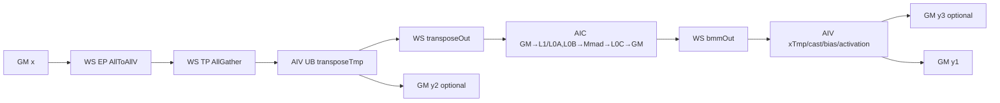
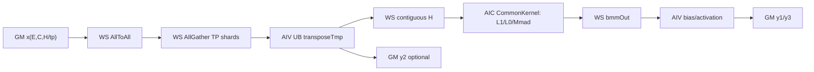

# AlltoAllAllGatherBatchMatMul A3 ACLNN 算子知识

## 算子速览

| 项目 | 内容 |
|---|---|
| 实际入口 | `aclnnAlltoAllAllGatherBatchMatMulGetWorkspaceSize` / `aclnnAlltoAllAllGatherBatchMatMul`，公开 ACLNN 两段式接口，无版本后缀 |
| 计算语义 | `x1=AllToAll(x)`，`y2=AllGather(x1)`，`y3=BatchMatMul(y2, weight)+bias`，`y1=Activation(y3)`；`y2/y3` 可选 |
| 输入输出 | `x/weight/y1/y2/y3` 为 FP16 或 BF16 ND；BF16 的 bias 为 FP32，FP16 的 bias 为 FP16；所有张量连续 |
| 执行类型 | 正常任务图含 Hcom wait、AICPU KFC server、Hcom record 与一个 `KERNEL_TYPE_MIX_AIC_1_2` entry；MIX 节点内为 AIC Cube + AIV Vector，通信由 `Hccl<HCCL_SERVER_TYPE_AICPU>` 与 server 协作，属于 MIX_CV/HYBRID |
| Kernel 路线 | R-001：`xShardType=1` C 轴 AllGather；R-002：`xShardType=0` H 轴 AllGather |
| 核心资源 | 输入/输出 GM、R-001 四片/R-002 三片通信 workspace、复用的 transpose/BMM workspace、整块 UB `TBuf`、Matmul 内部 L1/L0A/L0B/L0C、两个 HCCL context |
| 来源闭包 | `source_closed`：公开 ACLNN→generated inner bridge→OpDef/Tiling→Hcom wait/AICPU KFC/Hcom record/MIX 任务图→两条 Device body→HCCL/BatchMatMul specialization→构建接线闭合；框架生成 bridge、GE task runtime 和 AscendC/HCCL/Matmul primitive 为明确库边界 |
| 验证状态 | 已完成源码闭包检查；本次知识提取未执行编译、真机、数值或性能测试。 |

## 接口与语义

### 计算语义

令 `ep=epWorldSize`、`tp=tpWorldSize`、`e=E/ep`、`m=M/tp`。通信先在 EP 域做 AllToAll，再在 TP 域做 AllGather；BMM 以通信/转置后的张量为 A，`weight` 为 B。Kernel 的 BMM specialization 明确传入 `biasGM=nullptr`，bias 与激活都在 AIV 后处理完成。

- `xShardType=0`：`x:[E,C,H/tp]`，AllGather 拼 H，`weight:[e,H,m]`，`y2:[e,ep*C,H]`，`y1/y3:[e,ep*C,m]`。
- `xShardType=1`：`x:[E,C/tp,H]`，AllGather 拼 C，`weight:[e,H,m]`，`y2:[e,ep*C,H]`，`y1/y3:[e,ep*C,m]`。
- `bias` 存在时按专家批次广播到 C 行；FP16 路线在 FP16 中加 bias，BF16 路线先 `BF16→FP32`，在 FP32 中加 bias/激活，再以 `CAST_ROUND` 回 BF16。
- `y3` 记录 bias 后、激活前的 BMM 结果，所以公开 API 要求 `y3` 存在时 `actType!=0`。`y1` 为最终结果；无激活时为 BMM+bias，无 bias/激活时直接搬出 BMM。

### 输入、输出与属性

| 参数 | shape/layout | dtype | 约束、默认值与语义 |
|---|---|---|---|
| `x` | `xShard=0:[E,C,H/tp]`；`xShard=1:[E,C/tp,H]`；ND，3D | FP16/BF16 | 必选、连续；`E∈[2,512]`，`C>0`，`H∈[1,65535]` |
| `weight` | 逻辑 `[e,H,m]`；若传入末两维转置 view，则 inner attr `transpose_weight=true` | 与 `x` 相同 | 必选、连续；`e∈[1,32]`、`m∈[1,65535]`；`E=e*ep` |
| `biasOptional` | `[e,m]` 或 `[e,1,m]`，ND | FP16 对 FP16；FP32 对 BF16 | 可空；BMM 本体不消费，AIV 后处理广播 |
| `groupEp` / `groupTp` | 非空 C 字符串 | string | 长度 `<128`，两名称不得相同；分别提供 HCCL context 0/1 |
| `epWorldSize` / `tpWorldSize` | 标量 | int64 | 各为 `2/4/8/16/32`；只支持超节点内通信 |
| `xShardType` | 标量 | int64 | `0`=H 轴，`1`=C 轴；默认 0 |
| `actType` | 标量 | int64 | `0=None,1=GELU,2=SiLU,3=ReLU,4=FastGELU`；默认 0 |
| `y1Out` | `[e,ep*C,m]`，ND，3D | 与 `x` 相同 | 必选、连续，最终输出 |
| `y2OutOptional` | `[e,ep*C,H]`，ND，3D | 与 `x` 相同 | 可空；保存 AllGather 后、BMM 前的逻辑张量 |
| `y3OutOptional` | `[e,ep*C,m]`，ND，3D | 与 `x` 相同 | 可空；仅 `actType!=0` 时合法，保存激活前结果 |
| `workspaceSize/executor` | ACLNN 两段式输出 | `uint64_t*` / `aclOpExecutor**` | 第一段产生；第二段必须配套使用 |

### 入口与版本

固定 Commit 公开 README、文档和头文件只发布无后缀 `aclnnAlltoAllAllGatherBatchMatMul`，没有 V2/V3 公开版本。第一段依次执行 `CheckParams`、判断 `y2/y3`、用 `IsTransposeLastTwoDims` 检测 weight view；转置 view 由 `TransTensor` 交换 view shape/stride 的末两维，并把 `transposeWeight`、`isY2Out`、`isY3Out` 传入 generated `aclnnInnerAlltoAllAllGatherBatchMatMulGetWorkspaceSize`。第二段直接转发到对应 inner 执行入口。

README/docs 明确 A3 支持，A2、950 和其它列出的产品均不支持；OpDef 也只对 `ascend910_93` 添加 AICore 配置，因此本卡只覆盖 A3。

## Host/Launcher 执行流程

### 参数校验与前处理

1. `CheckNotNull` 要求 `x/weight/y1/groupEp/groupTp` 非空且 group 非空。
2. `CheckDtypeValid` 固定 FP16/BF16 组合及可选输出同 dtype；BF16 bias 必须 FP32。
3. `CheckAttr` 限制 `xShardType`、`actType`、EP/TP size。
4. `CheckTensorDim` 检查 3D、`E=e*ep`、H/C shard 关系、bias 与可选输出 shape；`CheckShapeRange` 排除空 tensor并限制 E/e/H/m。
5. `TransTensor` 只构造交换末两维 shape/stride 的 view，不搬运 weight 数据；inner op 的 `transpose_weight` 决定 BMM `MatmulType` 的 `isTrans` 模板值。
6. OpDef 对 `x/weight/bias` 声明 `AutoContiguous()`；公开文档也标明不接受非连续 Tensor。generated inner bridge 是框架边界，固定仓未公开它如何编码 executor task，但算子拥有的 attrs、Tiling 和 entry 均可见。

### 参数、Workspace 与生命周期

Tiling 先由公式化模型得到 local/non-local 的 E/C 块，再计算三个连续区域：

```text
commOut = GetCommOutSize(common)
transOut = max(local transpose tile, non-local transpose tile) * sizeof(x)
bmmOut = max(local BMM tile, non-local BMM tile) * sizeof(x)
workspace[0] = commOut + transOut + bmmOut + 16 MiB
```

Device 直接把 `workspaceGM` 当 user workspace 起址，没有 `GetUserWorkspace` 或二次偏移。`commOut` 内部依次放 AllToAll/AllGather 中间区；`transposeOutGM` 从 `commOut` 末尾开始，每轮复用；`bmmOutGM` 紧随 `transOut`，每轮复用。调用方/executor 拥有 workspace，直至传入 stream 上 entry、HCCL handle、AIC/AIV 后处理全部结束。尾部 16 MiB 是 Host 固定附加量；本算子 Device 源码未直接寻址该尾部。

### 启动图与失败传播

```text
aclnnAlltoAllAllGatherBatchMatMulGetWorkspaceSize
  -> generated inner bridge
    -> AlltoAllAllGatherBatchMatMulTilingFunc
      -> one_calc_two_comm formulaic tiling
      -> 5 份 Mc2BatchMatmulV3 tiling（按实际 tail 条件使用）
      -> HCCL init/AllToAll/AllGather tiling
      -> SetTilingKey / SetBlockDim / workspaceSize
        -> GenerateTask 正常任务序列
          -> attached kfc_stream: Hcom wait(group_ep)
          -> attached kfc_stream: AICPU RunAicpuKfcSrvLaunch(group_ep,group_tp,tiling)
          -> 主 stream: Hcom record(group_ep)
          -> 主 stream: all_to_all_all_gather_batch_mat_mul<XShard,WeightT,Bias,Y2,Y3>
             -> AIV: HCCL command + transpose + bias/activation/copyout
             -> AIC: Mc2BatchMatMulCommonKernel
```

| 节点 | stream/blockDim | 输入与输出 | 前驱→后继、owner/lifetime |
|---|---|---|---|
| N0 Hcom wait | attached `kfc_stream`；无 AICore blockDim | `group_ep` HCOM 同步对象 | task runtime 创建；先于同 attached stream 的 N1，等待对象由 runtime 持有 |
| N1 AICPU KFC server | attached `kfc_stream`；本 op 不设置 AICPU blockDim | `desc + hcom_ep + hcom_tp + tiling`；server 内部命令/状态 buffer 固定仓不可见 | N0→N1；server/attached stream 可按 `reuse_key=kfc_stream` 复用，释放点由 runtime 管理 |
| N2 Hcom record | 当前主 stream；无 AICore blockDim | `group_ep` HCOM 同步对象 | 与 N0 配对，序列化在 N3 前；具体 wait/record 状态内存由 runtime 管理 |
| N3 MIX entry | 当前主 stream；`CalcTschBlockDim(aivNum,aicNum,aivNum)` | 8 个显式 GM 参数 + 两个 hidden HCOM；写 y1/可选 y2/y3 | N2→N3；workspace/executor/输出保持到 stream 完成；Kernel 内 HCCL handle 将通信命令交给 N1 |

`AlltoAllAllGatherBatchMatMulCalcParamFunc` 要求一个 attached stream，名字为 `aicpu kfc server`、复用键为 `kfc_stream`。`Mc2MoeGenTaskCallback` 把原有 MIX task 的参数描述插入两个 `kHcom` hidden input，再按固定顺序插入 wait、AICPU、record，最终 `tasks=[wait,aicpu,record,MIX]`。A3 走 `libccl_kernel.so::RunAicpuKfcSrvLaunch`；AICPU 参数为 `desc(version=1,groupNum=2,hasFfts=0,tilingOff=3,isDyn=0)`、两个 HCOM hidden input 和 tiling。wait/AICPU 在 attached stream，record/MIX 在当前主 stream；跨 stream 的顺序由 `CreateHcomWaitTask/CreateHcomRecordTask` 与 HCCL server 协议承担，固定仓未公开这些 runtime primitive 的内部实现。

MIX 节点的 `blockDim=CalcTschBlockDim(aivNum,aicNum,aivNum)`，entry 声明 `KERNEL_TYPE_MIX_AIC_1_2`。同一 launch 内 `ASCEND_IS_AIV` 和 BMM kernel 的 AIV early-return 分离两侧工作；`SyncAll<false/true>`、HCCL handle wait/commit 以及跨 group sync 建立可见性。API/inner/Tiling、attached-stream 注册、hidden-input 注入或任务构造任一步失败都不会形成合法任务图；Kernel 没有 unknown-key runtime fallback，因为模板 key 在编译/launch 前完成实例选择。环境变量 `ASCEND_MC2_DEBUG_MODE=1` 只保留已注入 hidden HCOM 的计算 task，不生成 wait/AICPU/record，这是源码中的 computation-only 调试分支，不属于公开接口的正常通信语义。

## Route 与参数设计

### 分核与资源计算

- 公共维度：Host 写 `E,e,C,C/tp,H,H/tp,m`；AIC 数由 `GetCoreNumAic()`，AIV 数和 UB 容量由平台查询。
- R-001 公式化输入为 `M=C,N=m,K=H,batch=e`。local BMM 为 `M=tp*localC`，non-local 为 `M=(ep-1)*tp*tileC`；E tile 长度作为 batch。
- R-002 同样以 `M=C,N=m,K=H,batch=e` 做性能建模，但实际 local BMM `M=localC`，non-local `M=(ep-1)*tileC`；AIV transpose 把 `tp` 份 `H/tp` 拼为 H。
- `OneCalcTwoCommBase`/`ShardHBase` 以 Matmul/HCCL 性能模型决定切 E/C；总 local+non-local 通信 tile 数上限 5，AllToAll 数上限 32。Shard-H 只有 `max(E tile)==1` 且仍有切分预算时才切 C。
- transpose UB capacity 为 `ubSize/sizeof(x)`；后处理 capacity 为 `floor((ubSize-768)/coeff/16)*16`，`coeff=2 + castBytes + outBytes + biasBytes + geluTmpBytes`。Device 将 `ubSize` 下取整到 32B 后用一个 `TBuf` 分区。
- `MAlign=ceil(M/16)*16`；R-002 transpose 另以 `HAlign=ceil((H/tp)/256)*256` 决定一次可处理行数。

### Route 选择

| 顺序 | Route | Key/模板 | 精确选择条件与优先级 | 不适用去向 |
|---:|---|---|---|---|
| 1 | R-001 C-shard HYBRID | `GET_TPL_TILING_KEY(1,WeightTranspose,IsBias,Y2Need,Y3Need)`；`AlltoAllAllGatherBatchMatMul<DT_X,DT_BIAS,1,...>` | API/Host 校验成功且 `xShardType==1`；其余四个 bool 来自 weight view、bias 是否存在、y2/y3 是否存在 | `xShardType==0` 去 R-002；其它值 Host 失败 |
| 2 | R-002 H-shard HYBRID | `GET_TPL_TILING_KEY(0,WeightTranspose,IsBias,Y2Need,Y3Need)`；`AlltoAllAllGatherBatchMatMulShardH<DT_X,DT_BIAS,0,...>` | API/Host 校验成功且 `xShardType==0`；其余 bool 同上 | 无；非法组合 Host 失败 |

```text
if CheckParams/inner/Tiling fails: return error
else key = (xShardType, transposeWeight, bias!=null, y2!=null, y3!=null)
if xShardType == 1: R-001
else if xShardType == 0: R-002
else: unreachable after Host check
```

### 模板/实现执行矩阵

| Route | key/selector | dtype/shape/platform 完整命中条件 | 执行族与 kernel 节点 | 实际模板/body | 内存与同步特征 | tail/fallback |
|---|---|---|---|---|---|---|
| R-001 C-shard | `1,T,B,Y2,Y3`，`T/B/Y2/Y3∈{0,1}`，共 16 个 bool 子实例 | A3；FP16+FP16 bias 或 BF16+FP32 bias；`x:[E,C/tp,H]`；所有公开约束满足 | 正常图为 wait→AICPU KFC→record→单 MIX；MIX 内 AIV HCCL/transpose/epilogue + AIC BMM | `AlltoAllAllGatherBatchMatMul`；`Mc2BatchMatMulCommonKernel<GM-ND x, GM-ND w(transpose=T), GM-ND out>`，默认 `MM_CFG_NO_PRELOAD` | EP AllToAllV→TP AllGather；EP=2 增加 AllGather 输入转置后 `Commit`；`SyncAll` 连接 AIV/AIC | non-local C 可有 tail；local E 公式化均匀切分；`localE.tileLen==1&&!Y2` 直连 AG→BMM；无 Device fallback |
| R-002 H-shard | `0,T,B,Y2,Y3`，共 16 个 bool 子实例 | A3；FP16/BF16 组合；`x:[E,C,H/tp]`；所有公开约束满足 | 同一 wait→AICPU KFC→record→MIX 任务图 | `AlltoAllAllGatherBatchMatMulShardH`；同一 CommonKernel specialization | 每块 EP AllToAllV→TP AllGather；transpose 以 dstStride 将 TP H 分片拼接；`SyncAll` 连接 Cube/Vector | local/non-local E 可有长短块；non-local 在 E 最大块为 1 时可切 C；无 Device fallback |

### 隐藏性能 Guard

| Guard | Host/Tiling 条件 | Device/资源原因 | 影响 Route | 不满足时去向 | 源码符号 |
|---|---|---|---|---|---|
| 平台 | README 仅 A3 为 √；OpDef `AddConfig("ascend910_93")` | entry 位于 `arch22`，通信算法与 blockDim 依赖 A3 资源 | 全部 | 不发布其它平台 route | `README.md`；`AlltoAllAllGatherBatchMatMul::AlltoAllAllGatherBatchMatMul` |
| 通信 server task | 正常模式 `ASCEND_MC2_DEBUG_MODE` 未设为 `1`；`groupCnt=2` | AIV 的 `Hccl<HCCL_SERVER_TYPE_AICPU>` 需要两个 HCOM context 与 attached `kfc_stream` 上的 KFC server | 全部 | task 生成失败；debug=1 仅用于 computation-only，不具公开通信语义 | `AlltoAllAllGatherBatchMatMulGenTaskFunc`；`Mc2MoeGenTaskCallback` |
| tile 总数 | `localCutE + cutE*cutC <= 5`；AllToAll 上限 32 | handle 数组仅 32，且融合流水控制通信轮次 | R-001/R-002 | 公式化 Tiling 回缩切分数 | `MAX_TILE_CNT_TWO_COMM` / `MAX_ALL_TO_ALL_NUM` |
| R-001 切 C | 至少可分 2 块，且 `MAX_ALL_TO_ALL_NUM/batch>=2`；C tile 受 HCCL/Matmul 阈值 | 避免小通信块和过多 handle | R-001 | 保持整 C 或只切 E | `OneCalcTwoCommBase::GetTiling` |
| R-002 切 C | `maxNonLocalCnt>1 && max(E tile)==1` | Shard-H Device 的 tail-E 与 cut-C 分支互斥 | R-002 | 只切 E/整 C | `OneCalcTwoCommShardHBase::GetTiling` |
| EP=2 staging | `epRankSize==2` | non-local AllGather 输入需先去掉本 rank 的 EP 槽并重排 | R-001 | EP>2 走 group sync + eager AllGather | `NonLocalCommunication` / `TransposeAllGatherInput` |
| R-001 local transpose bypass | `localE.tileLen==1 && !IsNeedY2` | local AllGather buffer 已满足单 expert BMM A 的连续 ND 布局；不需要物化 y2 时可直接作为 `bmmInGm` | R-001 local | 其它情况执行 `TransposeBeforeBMMShardC` 并写 `transposeOutGM`/可选 y2 | `AlltoAllAllGatherBatchMatMul::LocalCalculation` |
| UB transpose | `ubCapacityForTrans=ubSize/sizeof(x)`；R-002 `HAlign=ceil(H/tp,256)` | 单 `TBuf` 分片，H 大时切列、否则切行 | 两 Route | 分更多 UB 循环；Host 无失败 guard | `CheckTransposeUBAndUpdateTileShard`；`TransposeBeforeBMM` |
| UB epilogue | `ubCapacityForAddActivate=floor((ubSize-768)/coeff/16)*16` | bias/cast/activation 临时区同一 TBuf 静态分区 | 两 Route | 分更多 M/C 片；固定仓未见容量为 0 的显式失败 | `CheckAddActivateUB`；`InitTpipe` |
| `y3` | `Y3Need => actType!=0` | y3 定义为激活前结果，None 时没有独立语义 | 两 Route | ACLNN/Host 失败 | `aclnn...GetWorkspaceSize`；`ActTypeCheck` |
| BMM core | `blockIdx < batchUsedCoreNum` | CommonKernel 只在分配的 AIC 上执行 | 两 Route | 多余 AIC/AIV early return | `Mc2BatchMatMulCommonKernel::Init/Process` |

### POD/ABI

固定仓对 `Mc2BatchMatmulTilingData` 使用 `#pragma pack(push,8)`/`alignas(8)`；`BMM_TileInfo`、`Mc2CommonTiling` 和总 POD 没有 `static_assert(sizeof/offsetof)`。因此下表固定字段顺序、类型、producer/consumer；凡仓内没有 `static_assert` 的精确 `sizeof/offsetof` 均明确标为“固定仓未常量化”，不能跨编译器手工重排。

| 结构 | 字段 | 类型/位宽 | ABI 布局 | 单位 | Host/launcher producer | Device consumer | 边界 |
|---|---|---|---|---|---|---|---|
| launch ABI | `xGM` | `GM_ADDR`/指针宽度 | entry 第 1 参数；非 struct | byte address | inner executor | `Init`→`xGM` | 必选 |
| launch ABI | `weightGM` | `GM_ADDR` | 第 2 参数 | byte address | inner executor | BMM `bGlobal_` | 必选 |
| launch ABI | `biasGM` | `GM_ADDR` | 第 3 参数 | byte address | inner executor | AIV `biasGM`，仅 `IsNeedBias` | inactive 时不读 |
| launch ABI | `y1GM` | `GM_ADDR` | 第 4 参数 | byte address | inner executor | AIV CopyOut | 必选 |
| launch ABI | `y2GM` | `GM_ADDR` | 第 5 参数 | byte address | inner executor | transpose，仅 `IsNeedY2` | inactive 时不读 |
| launch ABI | `y3GM` | `GM_ADDR` | 第 6 参数 | byte address | inner executor | epilogue，仅 `IsNeedY3` | inactive 时不读 |
| launch ABI | `workspaceGM` | `GM_ADDR` | 第 7 参数 | byte address | executor workspace | 全部 workspace tensor | 大小必须达到 Tiling 值 |
| launch ABI | `tilingGM` | `GM_ADDR` | 第 8 参数 | byte address | Tiling serializer | `GET_TILING_DATA` 与 HCCL 子指针 | 必须同构建 ABI |
| MIX task args | `hcom[0]` | hidden input/句柄宽度由 GE runtime 定义 | 参数描述中位于首个 IR input 前；不出现在 C++ entry 的 8 个显式形参中 | HCOM context | `McMoeInsertHiddenInputForAicore(groupCnt=2)` | `GetHcclContext<HCCL_GROUP_ID_0>()` | 对应 `group_ep`；runtime ABI 固定仓不可见 |
| MIX task args | `hcom[1]` | hidden input/句柄宽度由 GE runtime 定义 | 紧随 `hcom[0]` | HCOM context | 同上 | `GetHcclContext<1>()` | 对应 `group_tp`；顺序不可交换 |
| AICPU KFC args | `desc` | `uint64_t` 位域 | 第 1 项；`version:4,groupNum:4,hasFfts:1,tilingOff:7,isDyn:48` | packed flags | `CreateAicpuTaskMc2Moe` | `RunAicpuKfcSrvLaunch` 外部 server | 当前值 `1,2,0,3,0` |
| AICPU KFC args | `hcom[0]` | hidden input | 第 2 项 | HCOM context | `CreateAicpuTaskMc2Moe` | AICPU KFC server | EP group |
| AICPU KFC args | `hcom[1]` | hidden input | 第 3 项 | HCOM context | 同上 | AICPU KFC server | TP group |
| AICPU KFC args | `tiling` | `kTiling` descriptor | 第 4 项；`desc.tilingOff=3` | tiling address | task runtime | AICPU KFC server | 与 MIX task 同一算子 tiling owner；精确 runtime 指针 ABI 固定仓不可见 |
| `BMM_TileInfo` | `tileCnt` | `uint64_t` | 声明序第 1；精确 offsetof 固定仓未常量化 | tile count | 公式化 Tiling | Device 循环 | `>=1` 的主块或 inactive 0 |
| `BMM_TileInfo` | `tileLen` | `uint64_t` | 声明序第 2 | elements/rows | 公式化 Tiling | 通信、transpose、BMM offset | 与 route 轴一致 |
| `BMM_TileInfo` | `tailCnt` | `uint64_t` | 声明序第 3 | tile count | 公式化 Tiling | tail 循环 | 0/1 或公式化结果 |
| `BMM_TileInfo` | `tailLen` | `uint64_t` | 声明序第 4 | elements/rows | 公式化 Tiling | tail offset | `tailCnt==0` 时不读语义 |
| `Mc2CommonTiling` | `epGroupSize` | `uint32_t` | 声明序；精确 offsetof 固定仓未常量化 | ranks | `SetDataSliceInfoInCommmonTilingData` | 两 Device class | 2/4/8/16/32 |
| `Mc2CommonTiling` | `tpGroupSize` | `uint32_t` | 同上 | ranks | 同上 | 两 Device class | 2/4/8/16/32 |
| `Mc2CommonTiling` | `expert` | `uint64_t` | 同上 | elements | 同上 | workspace/offset | `[2,512]` |
| `Mc2CommonTiling` | `EOverEp` | `uint64_t` | 同上 | elements | 同上 | batch/tile | `[1,32]` |
| `Mc2CommonTiling` | `C` | `uint64_t` | 同上 | elements | 同上 | R-002；Host workspace | `>0` |
| `Mc2CommonTiling` | `COverTp` | `uint64_t` | 同上 | elements | 同上 | R-001 | `C/tp` |
| `Mc2CommonTiling` | `H` | `uint64_t` | 同上 | elements | 同上 | R-001/BMM | `[1,65535]` |
| `Mc2CommonTiling` | `HOverTp` | `uint64_t` | 同上 | elements | 同上 | R-002 | `H/tp` |
| `Mc2CommonTiling` | `MOverTp` | `uint64_t` | 同上 | elements | 同上 | BMM/epilogue | `[1,65535]` |
| `Mc2CommonTiling` | `aivCoreNum` | `uint32_t` | 同上 | cores | `SetCommonTilingData` | transpose/epilogue core split | 平台值 |
| `Mc2CommonTiling` | `inputDatasize` | `uint32_t` | 同上 | bytes/element | `SetDataTypeAndSizeInfo...` | Host workspace | 2 |
| `Mc2CommonTiling` | `biasDatasize` | `uint32_t` | 同上 | bytes/element | 同上 | UB partition | FP16=2，FP32=4 |
| `Mc2CommonTiling` | `ubCapacityForTrans` | `uint64_t` | 同上 | elements | `CheckTransposeUBAndUpdateTileShard` | transpose loops | `ubSize/2` |
| `Mc2CommonTiling` | `ubCapacityForAddActivate` | `uint64_t` | 同上 | aligned elements | `CheckAddActivateUB` | epilogue loops | 16 元素对齐 |
| `Mc2CommonTiling` | `isBias` | `bool` | 同上；bool ABI 未 static_assert | flag | `SetDataTypeAndSizeInfo...` | tiling key | 与 `IsNeedBias` 一致 |
| `Mc2CommonTiling` | `y2Flag` | `bool` | 同上 | flag | 同上 | tiling key | 与 `Y2Need` 一致 |
| `Mc2CommonTiling` | `y3Flag` | `bool` | 同上 | flag | 同上 | tiling key | 与 `Y3Need` 一致 |
| `Mc2CommonTiling` | `isWeightTrans` | `bool` | 同上 | flag | `SetDataSliceInfo...` | tiling key/BMM | 与 weight view 一致 |
| `Mc2CommonTiling` | `localTileE` | `BMM_TileInfo` | nested record | E tiles | formulaic Tiling | local comm/calc | 两 Route语义不同 |
| `Mc2CommonTiling` | `domesticTileE` | `BMM_TileInfo` | nested record | E tiles | formulaic Tiling | non-local comm/calc | 同上 |
| `Mc2CommonTiling` | `localTileC` | `BMM_TileInfo` | nested record | C rows | formulaic Tiling | local transpose/BMM | 通常整 C |
| `Mc2CommonTiling` | `domesticTileC` | `BMM_TileInfo` | nested record | C rows | formulaic Tiling | non-local path | 可有 tail |
| `Mc2CommonTiling` | `localUbTranspose` | `BMM_TileInfo` | nested record | elements/core | `SetUbTilingData...` | 固定 Device body未读取 | 当前 Commit dormant POD |
| `Mc2CommonTiling` | `localTailUbTranspose` | `BMM_TileInfo` | nested record | elements/core | 同上 | 固定 Device body未读取 | dormant |
| `Mc2CommonTiling` | `domesticUbTranspose` | `BMM_TileInfo` | nested record | elements/core | 同上 | 固定 Device body未读取 | dormant |
| `Mc2CommonTiling` | `domesticTailUbTranspose` | `BMM_TileInfo` | nested record | elements/core | 同上 | 固定 Device body未读取 | dormant |
| `Mc2CommonTiling` | `localUbAdd` | `BMM_TileInfo` | nested record | elements/core | `SetUbTilingData...` | 固定 Device body未读取 | dormant |
| `Mc2CommonTiling` | `localTailUbAdd` | `BMM_TileInfo` | nested record | elements/core | 同上 | 固定 Device body未读取 | dormant |
| `Mc2CommonTiling` | `domesticUbAdd` | `BMM_TileInfo` | nested record | elements/core | 同上 | 固定 Device body未读取 | dormant |
| `Mc2CommonTiling` | `domesticTailUbAdd` | `BMM_TileInfo` | nested record | elements/core | 同上 | 固定 Device body未读取 | dormant |
| `Mc2CommonTiling` | `activateType` | `uint32_t` | 声明序 | enum | `SetDataTypeAndSizeInfo...` | AIV switch | 0..4 |
| `Mc2CommonTiling` | `xShardFlag` | `uint32_t` | 声明序 | enum | `SetDataSliceInfo...` | tiling key/Host math | 0/1 |
| `Mc2CommonTiling` | `fastGeluBuffer` | `uint32_t` | 声明序 | bytes | `CheckAddActivateUB` | `sharedTmp` offset owner | 至少 768 |
| `Mc2CommonTiling` | `totalUbSize` | `uint64_t` | 声明序 | bytes | `SetCommonTilingData` | `InitTpipe` | Device 下取整到 32B |
| `BMM_Mc2MatmulTilingData` | `rankDim` | `uint32_t` | 声明序 | ranks | BMM Tiling | 固定 Device body未直接读 | 保留字段 |
| `BMM_Mc2MatmulTilingData` | `rankM` | `uint32_t` | 声明序 | rows | BMM Tiling | 固定 Device body未直接读 | 保留字段 |
| `BMM_Mc2MatmulTilingData` | `rankID` | `uint32_t` | 声明序 | rank | BMM Tiling | 固定 Device body未直接读 | 保留字段 |
| `BMM_Mc2MatmulTilingData` | `enableL2Tile` | `uint32_t` | 声明序 | flag | BMM Tiling | 固定 Device body未直接读 | 保留字段 |
| `BMM_Mc2MatmulTilingData` | `bmmTilingData` | `Mc2BatchMatmulTilingData` | nested `alignas(8)`；含 `Mc2MatmulV3TilingData` 与 `Mc2MultiBatchInfo` | mixed | `AlltoAllAllGatherBatchMatMulTiling::DoTiling` | CommonKernel block/MatmulImpl | 逐 shape 运行时值 |
| 总 POD | `hcclInitTiling` | `Mc2InitTiling` | 第 1 nested record；具体定义来自 CANN kernel_tiling 外部头 | mixed | `SetHcclTiling` | 两 HCCL `Init` | 固定仓未公开字段/offset |
| 总 POD | `alltoAllCcTiling` | `Mc2CcTiling` | 第 2 nested record | mixed | `SetHcclTiling` | EP HCCL | AllToAll config |
| 总 POD | `allGatherCcTiling` | `Mc2CcTiling` | 第 3 nested record | mixed | `SetHcclTiling` | TP HCCL | AllGather config |
| 总 POD | `commonTiling` | `Mc2CommonTiling` | 第 4 nested record | mixed | `SetCommon/UbTilingData` | 两 Device class | 必须与 key 一致 |
| 总 POD | `localTiling` | `BMM_Mc2MatmulTilingData` | 第 5 nested record | mixed | `HandleLocalBmmTilingData` | local standard BMM | 总是使用 |
| 总 POD | `domesticTiling` | `BMM_Mc2MatmulTilingData` | 第 6 nested record | mixed | `HandleNoneLocal...` | non-local standard BMM | 总是使用 |
| 总 POD | `localTailTiling` | `BMM_Mc2MatmulTilingData` | 第 7 nested record | mixed | local tail `DoTiling` | R-002 local tail | tailLen!=0 |
| 总 POD | `domesticTailTiling` | `BMM_Mc2MatmulTilingData` | 第 8 nested record | mixed | non-local C tail `DoTiling` | tail BMM | tailLen!=0 |
| 总 POD | `domesticTailETiling` | `BMM_Mc2MatmulTilingData` | 第 9 nested record | mixed | Shard-H tail-E `DoTiling` | R-002 tail-E BMM | `xShard=0 && C未切 && E有tail` |

### Route 源码闭包

| Route | Key/selector | Host/Tiling producer | POD/参数 | Kernel entry/router | Kernel body/直接依赖 | 构建接线 |
|---|---|---|---|---|---|---|
| R-001 C-shard | `xShard=1` + 4 bool key | `AlltoAllAllGatherBatchMatMulTilingFunc`→`GetAlltoAllAllGatherFormulateTileCnt`；`Mc2MoeGenTaskCallback` 生成 wait/AICPU/record/MIX | 总 POD；两个 HCOM hidden input；local/domestic/domesticTail BMM records | `all_to_all_all_gather_batch_mat_mul` 的 `if constexpr(XShard==1)` | `AlltoAllAllGatherBatchMatMul`；`Mc2BatchMatMulCommonKernel`；AscendC HCCL；AICPU KFC server 为外部 runtime body | OpDef `ascend910_93`；op_graph plugin；binary JSON FP16/BF16；Host CMake compile options |
| R-002 H-shard | `xShard=0` + 4 bool key | 同一 TilingFunc→`GetAlltoAllAllGatherFormulateTileCntShardH`；同一 task generator | 总 POD；两个 HCOM hidden input；额外 localTail/domesticTailE | entry 的 `if constexpr(XShard==0)` | `AlltoAllAllGatherBatchMatMulShardH`；CommonKernel；AscendC HCCL；AICPU KFC server 外部边界 | 同上 |

## Kernel 实现

### 公共执行流程

正常模式下，GE 先按 `[HcomWait(attached), AICPU KFC(attached), HcomRecord(main), MIX(main)]` 生成任务，并给 MIX task 注入 EP/TP 两个 HCOM hidden input。entry 从 `tilingGM` 同时取得 by-value `tilingData` 和三个 HCCL nested record 的 GM 指针，通过 `GetHcclContext<0/1>()` 取得对应 context，构造一个 `TPipe` 和相应 Route class。`Process` 的源码顺序都是：发起 local communication→发起 non-local communication→消费 local 分支→消费 non-local 分支。通信命令只在 AIV 分支提交给 `Hccl<HCCL_SERVER_TYPE_AICPU>`；BMM CommonKernel 在 AIV 立即返回，只由 AIC 执行；transpose/bias/activation/copyout 只在 AIV 执行。每个 BMM 前后都 `SyncAll<false>()`，并在 BMM 前 `tpipe->Reset()`，BMM 后再次 reset 后重建 AIV 的单 `TBuf`。`SyncAll` 的内部 flag ID 与 KFC server 的命令消费循环属于固定仓外部 AscendC/HCCL runtime 边界。

### Route R-001：C 轴 AllGather HYBRID

#### 适用条件

##### 选择证据

| 层级 | 文件 | 符号 | 源码谓词/参数 | 结果/下一跳 |
|---|---|---|---|---|
| API | `op_api/aclnn_all_to_all_all_gather_batch_matmul.cpp` | `CheckTensorDimUniqueShape` | `xShardType==1`，`x.H==weight.H`，`y1.C=x.C*ep*tp` | 合法后进入 inner op |
| Tiling | `op_host/op_tiling/allto_all_all_gather_batch_mat_mul_tiling.cpp` | `SetMatmulTilingAlltoAllAllGatherBatchMatMul` | `commonTiling.xShardFlag==1` | `GetAlltoAllAllGatherFormulateTileCnt` |
| Router | `op_kernel/arch22/allto_all_all_gather_batch_mat_mul.cpp` | `allto_all_all_gather_batch_mat_mul<XShard,...>` | `if constexpr(XShard==1)` | `AlltoAllAllGatherBatchMatMul<...>::Process` |

#### Device 数据流

##### 函数级调用链

```text
allto_all_all_gather_batch_mat_mul<1,T,B,Y2,Y3>
  -> AlltoAllAllGatherBatchMatMul::Init
    -> HCCL context0(AllToAll) + context1(AllGather)
  -> Process
    -> LocalCommunication: TP AllGather(local expert slice)
    -> NonLocalCommunication: EP AllToAllV -> TP AllGather
       -> ep==2: Wait AllToAll -> TransposeAllGatherInput -> Commit AllGather
    -> LocalCalculation: Wait -> [tileE==1&&!Y2 ? AG buffer直连 : TransposeBeforeBMMShardC] -> CommonKernel BMM -> TransposeAfterBMMShardC
    -> NonLocalCalculation: per E/C tile repeat same pipeline -> Finalize HCCL
```

##### 源码等价伪码

```text
for local E tile:
    hAG = TP.AllGather(x[epRankId local expert], ws.localAG)
for non-local E tile, C tile/tail:
    wait prior TP handle across group when ep!=2
    for each E row: hA2A = EP.AllToAllV(x, ws.a2a)
    if ep==2: create deferred TP.AllGather handle
    else: TP waits hA2A, submit TP.AllGather(ws.a2a, ws.nonLocalAG)
if ep==2:
    wait each hA2A; remove local EP slot into ws.nonLocalAGIn; Commit deferred AllGather
for local tile:
    wait hAG; SyncAll
    if tileE==1 and Y2Need==false: use local AG buffer directly as BMM A
    else: AIV transpose [tp,e,C/tp,H] -> [e,tp*C/tp,H] (and optional y2)
    SyncAll; AIC BMM(A=shortcut?localAG:ws.transpose,B=weight,C=ws.bmm); SyncAll
    AIV add bias, optional y3, activation, scatter rows to y1
for non-local tile: repeat after waiting corresponding hAG
```

#### 内存与数据搬运

##### 资源与搬运表

令 `s=sizeof(x)=2`，`c=C/tp`，`L=max(nonLocalC.tileLen,tailLen)`，`LEl=localE.tileLen`，`LEn=nonLocalE.tileLen`。

| 层级/缓冲区 | offset/地址公式 | extent/容量公式 | dtype/layout | producer | consumer | owner/lifetime | 对齐/复用 |
|---|---|---|---|---|---|---|---|
| GM `x` | API base | `E*c*H*s` | FP16/BF16 ND | caller | HCCL | caller | logical exact |
| WS AllToAll out | `0` | `E*c*H*s` | dtype x；EP-major tiles | EP AllToAllV | TP AllGather或 EP=2 transpose | executor | 逐 handle |
| WS local AG out | `E*c*H*s` | `e*c*H*tp*s=e*C*H*s` | TP-major | TP AllGather | before-BMM transpose | executor | local E tile 顺序 |
| WS EP=2 AG input | 上项末尾 | `e*c*H*ep*s=E*c*H*s` | 去除 local EP slot | `TransposeAllGatherInput` | deferred TP AllGather | executor | EP>2 仍保留容量但不作为 staging 读 |
| WS non-local AG out | 上项末尾 | `E*c*H*tp*s=E*C*H*s` | TP/EP/C/H tiles | TP AllGather | before-BMM transpose | executor | handle 完成前不覆盖 |
| WS transpose | `commOut` | `max(LEl*localC*H*tp,(ep-1)*LEn*L*H*tp)*s` | BMM A：batch×M×K ND | AIV DataCopyPad | AIC BMM | executor；每轮复用 | 以 SyncAll 防覆盖；local `LEl==1&&!Y2` 时已分配但该轮不读写 |
| BMM L1/L0 | MatmulImpl 内部 | 由对应 `TCubeTiling baseM/baseN/baseK/depth/step` 决定 | ND→L1/L0A/L0B；L0C accumulate | MatmulImpl | MatmulImpl/Fixpipe | 单 BMM tile | 固定仓未公开 `lib/matmul_intf.h` 实体，实际 specialization 与 POD 已固定 |
| WS BMM out | `commOut+transOut` | `max(LEl*localC*m*tp,(ep-1)*LEn*L*m*tp)*s` | dtype x ND | AIC CommonKernel | AIV epilogue | executor；每轮复用 | SyncAll 后读 |
| UB `tBuf` | 单 buffer offset 0 | `floor(totalUb/32)*32` bytes | 分区见字节账 | MTE2/AIV | AIV/MTE3 | 当前 AIV core | `Reset` 后重建；非双缓冲 |
| GM y1/y2/y3 | route 地址公式 | y1/y3=`e*ep*C*m*s`；y2=`e*ep*C*H*s` | ND | AIV | caller | caller | 只写有效 rows/M |

##### 分层内存布局



##### 字节账、交接边与复用顺序

```text
commOut = [(E+e)*C*H + E*c*H + e*ep*c*H] * s
transOut = max(LEl*localC*H*tp, (ep-1)*LEn*L*H*tp) * s
bmmOut = max(LEl*localC*m*tp, (ep-1)*LEn*L*m*tp) * s
workspace_total = commOut + transOut + bmmOut + 16 MiB
UB_total = floor(platformUB/32)*32
epilogue live bytes/element = 2 + cast(0/4) + out(0/2/4) + bias(0/2/4) + geluTmp(0/2/4)
```

| 边/复用子区 | producer | offset/extent | dtype/layout | consumer | ordering/sync | owner/lifetime | 安全条件 |
|---|---|---|---|---|---|---|---|
| EP→TP | `AlltoAllV` | WS A2A tile | x dtype，EP layout | TP AllGather | `InterHcclGroupSync`；EP=2 为 Wait+transpose+Commit | executor | handle 未完成不复用 |
| TP→AIV | `AllGather` | local/non-local AG tile | x dtype，TP shards | transpose | `hcclAllgather.Wait` | executor | Wait 后读取 |
| AIV/通信→AIC | 常规为 before-BMM transpose；local shortcut 为 TP AllGather | 常规 WS transpose 全片；shortcut 为 local AG slice | x dtype，batch×M×H | CommonKernel | `hcclAllgather.Wait` 后两次 `SyncAll<false>`；常规路径中间执行 transpose | executor | shortcut 仅 `localE.tileLen==1&&!Y2`；其它情况 AIC 前完成 MTE3 |
| AIC→AIV | CommonKernel | WS BMM out | x dtype，batch×M×m | epilogue | `SyncAll<false>` | executor | AIC完成后 AIV读 |
| UB 分区 | `tBuf` | `xTmp@0`，其后按 cast/out/bias/shared 顺序 | 混合 dtype | vector ops | HardEvent/PipeBarrier | 当前 AIV core | Host coeff 必须覆盖所有 active sub-buffers |

#### 同步、精度与尾块

##### 同步与数值边界表

| 阶段 | primitive/机制 | producer | consumer/等待点 | 保护对象 | 精度/尾块 |
|---|---|---|---|---|---|
| local AG | HCCL handle | TP AllGather | `hcclAllgather.Wait` | local AG WS | count 为 `tileE*c*H` |
| local AG→BMM shortcut | `Wait` + `SyncAll<false>` | TP AllGather | CommonKernel 读取 local AG slice | local AG WS | 仅 `tileE==1&&!Y2`；保持第二次 `SyncAll<false>`，不写 transpose WS |
| non-local group | `InterHcclGroupSync` | EP AllToAllV/前轮 TP AG | TP AG/后轮 EP A2A | 共享通信 WS | C tail 用独立 counts/displs |
| MIX handoff | `SyncAll<false>` | AIV transpose/AIC BMM | 对侧阶段 | transpose/BMM WS | 同一 MIX launch |
| UB copy | `MTE3_MTE2`,`MTE2_MTE3`,`MTE2_V`,`V_MTE3`,`MTE3_V` | copy/vector | 后继 pipeline | `tBuf` 分区 | 行/列 tail 由 end offset 与 blockLen 保护 |
| BF16 epilogue | Cast/Add/Activation/Cast | BMM BF16 | y1/y3 | FP32 temp | BF16→FP32；y3/最终都 `CAST_ROUND` 回 BF16 |
| FP16 SiLU | Cast/Silu/Cast | FP16 BMM | y1 | FP32 temp | SiLU 强制 FP32；其余 FP16 activation 留在 half |

#### 关键实现

##### 符号证据表

| 阶段 | 文件 | 符号/模板实例 | 实现事实 |
|---|---|---|---|
| Host/Tiling producer | `op_host/op_tiling/allto_all_all_gather_batch_mat_mul_tiling.cpp` | `GetAlltoAllAllGatherFormulateTileCnt` / `MC2SetWorkspaceShard` | C-shard E/C 切分、workspace 和 key |
| Kernel entry/router | `op_kernel/arch22/allto_all_all_gather_batch_mat_mul.cpp` | `if constexpr(XShard==1)` | 实例化 C-shard class |
| Device body/helper | `op_kernel/allto_all_all_gather_batch_mat_mul.h` | `Local/NonLocalCommunication/Calculation`、`Transpose*ShardC` | HCCL、BMM、UB 后处理、tail |
| BMM specialization | `3rd/batch_mat_mul_v3/op_kernel/batch_mat_mul_v3.h` | `Mc2BatchMatMulCommonKernel` | AIV early-return、AIC MatmulImpl、snake L2 tile 顺序 |

### Route R-002：H 轴 AllGather HYBRID

#### 适用条件

##### 选择证据

| 层级 | 文件 | 符号 | 源码谓词/参数 | 结果/下一跳 |
|---|---|---|---|---|
| API | `op_api/aclnn_all_to_all_all_gather_batch_matmul.cpp` | `CheckTensorDimUniqueShape` | `xShardType==0`，`x.H*tp==weight.H`，`y1.C=x.C*ep` | 合法后进入 inner op |
| Tiling | `op_host/op_tiling/allto_all_all_gather_batch_mat_mul_tiling.cpp` | `SetMatmulTilingAlltoAllAllGatherBatchMatMul` | `xShardFlag!=1` | `GetAlltoAllAllGatherFormulateTileCntShardH` |
| Router | `op_kernel/arch22/allto_all_all_gather_batch_mat_mul.cpp` | `if constexpr(XShard==0)` | 编译期条件 | `AlltoAllAllGatherBatchMatMulShardH<...>::Process` |

#### Device 数据流

##### 函数级调用链

```text
allto_all_all_gather_batch_mat_mul<0,T,B,Y2,Y3>
  -> AlltoAllAllGatherBatchMatMulShardH::Init
  -> Process
    -> LocalCommunication
    -> NonLocalCommunication (每块 A2A 后 group-sync AG)
    -> LocalCalculation (long/tail E BMM tiling)
    -> NonLocalCalculation (standard/C-tail/E-tail BMM tiling)
      -> TransposeBeforeBMM: 拼接 TP 的 H/tp 分片
      -> Mc2BatchMatMulCommonKernel
      -> TransposeAfterBMM: bias/y3/activation/y1
```

##### 源码等价伪码

```text
submit local TP AllGather for every local E long/tail tile
for each non-local E tile and C tile:
    EP waits previous TP handle
    hA2A = EP.AllToAllV(tile)
    TP waits hA2A
    hAG = TP.AllGather(tile)
repeat for C-tail or E-tail (mutually exclusive formulaic branches)
for each local E long/tail:
    wait hAG; AIV transpose [tp,E,C,H/tp] -> [E,C,H]; SyncAll
    AIC choose local/localTail BMM tiling; SyncAll
    AIV epilogue
for non-local long tiles and optional C-tail, then optional E-tail:
    choose domestic/domesticTail/domesticTailE BMM tiling and repeat
```

#### 内存与数据搬运

##### 资源与搬运表

令 `h=H/tp`，`L=max(nonLocalC.tileLen,tailLen)`，`LEl=max(localE.tileLen,tailLen)`，`LEn=max(nonLocalE.tileLen,tailLen)`。

| 层级/缓冲区 | offset/地址公式 | extent/容量公式 | dtype/layout | producer | consumer | owner/lifetime | 对齐/复用 |
|---|---|---|---|---|---|---|---|
| GM x | API base | `E*C*h*s` | ND | caller | HCCL | caller | exact |
| WS AllToAll out | `0` | `E*C*h*s` | EP tiles | EP AllToAllV | TP AllGather | executor | handles |
| WS local AG out | `E*C*h*s` | `e*C*h*tp*s=e*C*H*s` | TP H shards | TP AllGather | transpose | executor | local long/tail |
| WS non-local AG out | 上项末尾 | `E*C*h*tp*s=E*C*H*s` | TP H shards | TP AllGather | transpose | executor | per E/C tile |
| WS transpose | `commOut` | `max(LEl*C*h*tp,(ep-1)*LEn*L*h*tp)*s` | batch×C×H ND | AIV | AIC BMM | executor | 每轮复用 |
| BMM L1/L0 | MatmulImpl 内部 | runtime `TCubeTiling` | 同 R-001 | CommonKernel | CommonKernel | tile lifetime | 具体物理容量由外部 Matmul primitive 实现 |
| WS BMM out | `commOut+transOut` | `max(LEl*C*m,(ep-1)*LEn*L*m)*s` | batch×C×m | AIC | AIV | executor | 每轮复用 |
| UB | 0..`floor(UB/32)*32` | 同 R-001 分区 | mixed | MTE/AIV | AIV/MTE | core local | transpose 行容量用 `ceil(h/256)*256` |
| GM outputs | 逻辑地址 | y1/y3=`e*ep*C*m*s`；y2=`e*ep*C*H*s` | ND | AIV | caller | caller | DataCopy dstStride 拼 H |

##### 分层内存布局



##### 字节账、交接边与复用顺序

```text
commOut = [(E+e)*C*H + E*C*h] * s
transOut = max(LEl*C*H, (ep-1)*LEn*L*H) * s
bmmOut = max(LEl*C*m, (ep-1)*LEn*L*m) * s
workspace_total = commOut + transOut + bmmOut + 16 MiB
UB_total = floor(platformUB/32)*32
```

| 边/复用子区 | producer | offset/extent | dtype/layout | consumer | ordering/sync | owner/lifetime | 安全条件 |
|---|---|---|---|---|---|---|---|
| EP→TP | EP AllToAllV | WS A2A tile | x dtype | TP AllGather | `InterHcclGroupSync(HCCL_GROUP_ID_0,hA2A)` | executor | 当前 A2A 完成 |
| TP→AIV | TP AllGather | AG tile | TP-major H shards | transpose | `Wait(handle)` | executor | 对应 handle index |
| AIV→AIC | `TransposeBeforeBMM` | transpose slice | contiguous H | CommonKernel | `SyncAll<false>` | executor | dstStride 写完整 H |
| AIC→AIV | CommonKernel | BMM slice | ND | epilogue | `SyncAll<false>` | executor | 根据 long/C-tail/E-tail 选对 POD |

#### 同步、精度与尾块

##### 同步与数值边界表

| 阶段 | primitive/机制 | producer | consumer/等待点 | 保护对象 | 精度/尾块 |
|---|---|---|---|---|---|
| 通信流水 | 两次 `InterHcclGroupSync` + handles | 前轮 AG / 当前 A2A | 后轮 A2A / 当前 AG | 通信 WS | E/C tail 使用独立 counts |
| H 拼接 | `DataCopyPad` + `dstStride=(H-tileH)*s` | TP shards | contiguous transpose WS/y2 | H 行 | `HAlign=ceil(h/256)*256` 仅用于 UB 行容量；逻辑 H 不含 padding |
| long/tail BMM | 5 份可选 BMM POD | Host | CommonKernel | BMM shape | `localTail/domesticTail/domesticTailE` 只在 guard 命中读取 |
| epilogue | 同 R-001 HardEvent/Cast/Activation | BMM | y1/y3 | UB/GM | M tail 由 blockLen、MAlign 与 end offset 保护 |

#### 关键实现

##### 符号证据表

| 阶段 | 文件 | 符号/模板实例 | 实现事实 |
|---|---|---|---|
| Host/Tiling producer | `op_host/op_tiling/allto_all_all_gather_formulaic_tiling.h` | `All2AllAllGatherBMMShardH` | Shard-H 性能模型与短块前后置策略 |
| Kernel entry/router | `op_kernel/arch22/allto_all_all_gather_batch_mat_mul.cpp` | `if constexpr(XShard==0)` | 实例化 Shard-H class |
| Device body/helper | `op_kernel/allto_all_all_gather_batch_mat_mul_shard_h.h` | `NonLocalCommunication/Calculation`、`TransposeBefore/AfterBMM` | E/C tail、H 拼接、后处理 |
| BMM specialization | `3rd/batch_mat_mul_v3/op_kernel/batch_mat_mul_v3.h` | `Mc2BatchMatMulCommonKernel` | AIC-only计算与 MatmulImpl 调用 |

## 算子特定优化

### Trick T-001：用总通信轮次预算约束公式化 E/C 切分

#### 触发与源码依据

- 适用 Route：R-001；R-002 使用同一上限并增加 H-shard 特定分支预算。
- 触发条件：公式化 Tiling 已得到 local/non-local E 初始切分，并考虑进一步切 C。
- Golden 来源：[`mc2/common/op_host/op_tiling/one_calc_two_comm_tiling.cpp:118-149`](../../../../../../../cann-ops-raw/ascendc/ops-transformer/be33d95bb755cedec3108f70805c1874d1792540/mc2/common/op_host/op_tiling/one_calc_two_comm_tiling.cpp#L118-L149)

**官方源码（固定 Commit 连续逐字摘录）**：

```cpp
// E max cnt check
MaxTileCntCheckForE();

// Cut c
uint64_t minCutNum = TWO;  // if cut c, c totalTileCnt >= 2
bool underMaxCut = localCutE.totalTileCnt + minCutNum * cutE.totalTileCnt <=
                   MAX_TILE_CNT_TWO_COMM;
uint64_t maxCutNum = MAX_ALL_TO_ALL_NUM / clusterInfo.batchSize;
underMaxCut = underMaxCut && (maxCutNum >= minCutNum);
```

#### 机制与设计原因

公式化模型不是只按 BMM tile 尺寸切分：它先将 E 切分压到融合流水的 5 个总 tile 预算，再用 `32/batch` 限制 AllToAll 次数，只有仍可形成至少两个 C tile 才切 C。这同时约束 Device 的固定 handle 数组和跨通信域同步轮次。

#### 迁移边界

- 适用：一个计算节点串联两个 collective，且通信块数直接决定 handle/sync 数量。
- 前提：保留 `MAX_TILE_CNT_TWO_COMM=5`、`MAX_ALL_TO_ALL_NUM=32` 与当前 Device handle 生命周期。
- 失效：修改 handle 数组、通信算法或把 collective 拆成多 kernel 后必须重新建模。
- 未验证：本次知识提取未执行编译、真机、数值或性能测试。

#### 错误做法

固定源码反例是无条件按 C 切分：它会绕过 `underMaxCut` 与 `maxCutNum`，使通信轮次超出 Device 静态 handle/流水设计。

### Trick T-002：EP=2 时延迟 AllGather 提交并在中间重排去除本 rank 槽

#### 触发与源码依据

- 适用 Route：R-001。
- 触发条件：`epRankSize==2` 的 non-local C-shard 通信。
- Golden 来源：[`op_kernel/allto_all_all_gather_batch_mat_mul.h:492-515`](../../../../../../../cann-ops-raw/ascendc/ops-transformer/be33d95bb755cedec3108f70805c1874d1792540/mc2/allto_all_all_gather_batch_mat_mul/op_kernel/allto_all_all_gather_batch_mat_mul.h#L492-L515)

**官方源码（固定 Commit 连续逐字摘录）**：

```cpp
if (epRankSize == 2U) {
    alltoallHandleIndex = 0UL;
    handleIdx = localE.tileCnt + localE.tailCnt;
    bool isCTail = false;
    allgatherSendBufOffsetTile = allgatherSendBufOffsetTile / dataLen1;
    allgatherSendBufOffsetTail = allgatherSendBufOffsetTail / dataLen1;
    GlobalTensor<DataType1> alltoallOut = alltoallNonLocalOutGM;
    GlobalTensor<DataType1> allgatherIn = allgatherNonLocalInGM;
    for (uint32_t e_idx = 0U; e_idx < nonLocalE.tileCnt; e_idx++) {
        for (uint32_t c_idx = 0U; c_idx < nonLocalC.tileCnt + nonLocalC.tailCnt; c_idx++) {
            if ASCEND_IS_AIV {
                for (uint32_t k = 0U; k < nonLocalE.tileLen; k++) {
                    hcclAlltoall.Wait(alltoallHandleList[alltoallHandleIndex++]);
                }
                SyncAll<true>();
                TransposeAllGatherInput(isCTail, alltoallOut, allgatherIn);
                SyncAll<true>();
                hcclAllgather.Commit(allgatherHandleList[handleIdx++]);
```

#### 机制与设计原因

EP=2 的 AllToAll 接收区仍含 EP 槽布局，而 non-local 分支只需要对端槽。源码先创建 deferred `AllGather<false>` handle，等所有当前 AllToAll handle 完成后由 AIV 将对端槽压紧到独立 `allgatherNonLocalInGM`，再 `Commit`。这解释了 R-001 `commOut` 中额外的 AG-input slice，也避免把无关 local 槽送入 TP collective。

#### 迁移边界

- 适用：EP=2、C-shard、当前 workspace 四段布局。
- 前提：必须保留 Wait→`SyncAll<true>`→transpose→`SyncAll<true>`→Commit 顺序。
- 失效：EP>2 走 `InterHcclGroupSync` 和 eager `AllGather<true>`；不能套用本 staging 地址。
- 未验证：本次知识提取未执行编译、真机、数值或性能测试。

#### 错误做法

在 transpose 前提交 deferred AllGather 会使 TP collective 读取尚未去除 local EP 槽的布局；固定源码以两次 `SyncAll<true>` 明确禁止该重排。

### Trick T-003：BMM 不带 bias，把可选 y3、bias 与激活融合到同一 AIV UB 后处理

#### 触发与源码依据

- 适用 Route：R-001、R-002。
- 触发条件：所有实例；`IsNeedBias/IsNeedY3/actType/dtype` 决定实际 UB 子区。
- Golden 来源：[`op_host/op_tiling/allto_all_all_gather_batch_mat_mul_tiling.cpp:1188-1207`](../../../../../../../cann-ops-raw/ascendc/ops-transformer/be33d95bb755cedec3108f70805c1874d1792540/mc2/allto_all_all_gather_batch_mat_mul/op_host/op_tiling/allto_all_all_gather_batch_mat_mul_tiling.cpp#L1188-L1207)

**官方源码（固定 Commit 连续逐字摘录）**：

```cpp
MMV3ArgsInfo.opName = "AlltoAllAllGatherBatchMatMul";
MMV3ArgsInfo.isWeightTrans = tilingData->commonTiling.isWeightTrans;
MMV3ArgsInfo.isBias = false;
MMV3ArgsInfo.aType = inputDatatype;
MMV3ArgsInfo.bType = inputDatatype;
MMV3ArgsInfo.cType = inputDatatype;
MMV3ArgsInfo.biasType = biasDatatype;

BMMV3BatchInfo.biasWithBatch = false;
```

#### 机制与设计原因

Host 显式让 BMM Tiling `isBias=false`，Device 调用 CommonKernel 时也传 `biasGM=nullptr`。BMM 输出先落到可复用 workspace，AIV 再按 C/EP/TP 目标布局读入 UB：可先生成 y3，再执行 activation 并写 y1；BF16 和 FP16-SiLU 使用 FP32 cast buffer。这样 optional y3 不要求再跑一次 BMM，bias 广播和 layout 恢复也共享一次后处理遍历。

#### 迁移边界

- 适用：需要激活前可选输出，且输出布局恢复本来就由 AIV 完成的 BMM fusion。
- 前提：Host UB `coeff` 必须与 `InitTpipe` 的 active 子区完全一致；y3 只能在 activation 前写。
- 失效：若把 bias 下沉到 BMM/Fixpipe，必须同步修改 y3 语义、Tiling、UB 和精度顺序。
- 未验证：本次知识提取未执行编译、真机、数值或性能测试。

#### 错误做法

把 `MMV3ArgsInfo.isBias` 改为 true 而保留 AIV bias Add 会重复加 bias；固定源码的 Host 与 Device 都把 BMM bias 关闭。

### Trick T-004：用可复用 attached KFC stream 承载双通信域 AICPU server

#### 触发与源码依据

- 适用 Route：R-001、R-002 的正常通信模式。
- 触发条件：生成 `AlltoAllAllGatherBatchMatMul` 执行任务，且 `ASCEND_MC2_DEBUG_MODE!=1`。
- Golden 来源：[`op_graph/allto_all_all_gather_batch_mat_mul_gen_task.cpp:29-45`](../../../../../../../cann-ops-raw/ascendc/ops-transformer/be33d95bb755cedec3108f70805c1874d1792540/mc2/allto_all_all_gather_batch_mat_mul/op_graph/allto_all_all_gather_batch_mat_mul_gen_task.cpp#L29-L45)

**官方源码（固定 Commit 连续逐字摘录）**：

```cpp
ge::Status AlltoAllAllGatherBatchMatMulCalcParamFunc(gert::ExeResGenerationContext *context)
{
    const ge::AscendString name = "aicpu kfc server";
    const ge::AscendString reuseKey = "kfc_stream";
    return Mc2GenTaskOpsUtils::CommonKFCMc2CalcParamFunc(context, name, reuseKey);
}

ge::Status AlltoAllAllGatherBatchMatMulGenTaskFunc(const gert::ExeResGenerationContext *context,
                                            std::vector<std::vector<uint8_t>> &tasks)
{
    return Mc2MoeGenTaskOpsUtils::Mc2MoeGenTaskCallback(context, tasks);
}

// new ver
IMPL_OP(AlltoAllAllGatherBatchMatMul)
    .CalcOpParam(AlltoAllAllGatherBatchMatMulCalcParamFunc)
    .GenerateTask(AlltoAllAllGatherBatchMatMulGenTaskFunc);
```

#### 机制与设计原因

算子没有把 AICPU server 隐藏成“单 MIX Kernel 自己完成通信”。公共回调把 EP/TP 两个 HCOM hidden input 注入 MIX task，并生成 `[HcomWait(attached), AICPU KFC(attached), HcomRecord(main), MIX(main)]`。attached stream 用 `reuse_key=kfc_stream` 交给 runtime 复用，MIX AIV 侧再以 `Hccl<HCCL_SERVER_TYPE_AICPU>` 提交 AllToAllV/AllGather command；这样 server 生命周期、主计算 stream 与通信控制 stream 的职责在 task graph 上明确分离。

#### 迁移边界

- 适用：A3 上需要两个 HCCL group 的当前 MC2 task ABI。
- 前提：保留 `groupCnt=2`、hidden HCOM 顺序、wait/AICPU/record/MIX 顺序，以及 `libccl_kernel.so::RunAicpuKfcSrvLaunch` 的 A3 选择。
- 失效：950 会选择 `libmc2_server.so::Mc2ServerKernel`，而 computation-only debug 会省略 server/sync tasks；两者都不能套用本卡的 A3 正常通信图。
- 未验证：本次知识提取未执行编译、真机、数值或性能测试。

#### 错误做法

只启动 MIX entry 而遗漏 attached AICPU KFC server，会让 `Hccl<HCCL_SERVER_TYPE_AICPU>` 缺少正常通信服务任务；`ASCEND_MC2_DEBUG_MODE=1` 仅是固定源码显式标注的 computation-only 调试分支，不能当作公开算子的通信 fallback。

## 模板与实现对比

| 对比维度 | R-001 C-shard | R-002 H-shard | 设计选择依据 |
|---|---|---|---|
| 命中条件/优先级 | `xShardType=1` | `xShardType=0` | 公开 attr 与编译期 key 首位 |
| 执行族/节点图 | wait→AICPU KFC→record→MIX/HYBRID；EP=2 有 staging transpose | 同一四节点任务图；MIX 内每块直接 A2A→AG | 双 Route 共用双 HCOM server task ABI；C-shard 的 EP 槽布局与 H-shard 不同 |
| M/N/K、tile 与 scheduler | BMM `M=tp*tileC`；E 均匀切分，C 可切 | BMM `M=tileC`；E 可长短块，E=1 才切 C | 公式化 OneCalcTwoComm 两个基类 |
| workspace/L1/L0/UB | commOut 有额外 EP=2 AG-input；transpose/BMM 带 tp factor | commOut 三段；transpose 拼 H；BMM out 无 tp factor | Device 指针链与 Host size 公式一致 |
| AIC/AIV 或 kernel 交接 | AIV transpose→SyncAll→AIC BMM→SyncAll→AIV epilogue | 同，但读取 long/C-tail/E-tail 不同 BMM POD | 单 `KERNEL_TYPE_MIX_AIC_1_2` |
| 同步、精度与 tail | HCCL handles；C tail；BF16/SiLU FP32 epilogue | group sync；E/C tail；同精度顺序 | 通信布局和 tail 互斥条件 |
| fallback/失败边界 | Host/Tiling 失败；无 Device fallback | 同 | key 全编译期选择 |

## 平台差异

| 项目 | A2 | A3 | 950 |
|---|---|---|---|
| 支持状态 | README/docs 明确不支持 | 支持 | README/docs 明确不支持 |
| Host/Launcher | N/A | OpDef `ascend910_93`；两个 HCCL group；attached `kfc_stream` 上 `libccl_kernel.so::RunAicpuKfcSrvLaunch` | N/A；公共回调的 950 分支是外部迁移线索，README 明确本算子 950 不支持 |
| Kernel/资源 | N/A | `arch22` entry，`KERNEL_TYPE_MIX_AIC_1_2`；`CalcTschBlockDim`；CMake `--cce-auto-sync=off` | N/A |

## 限制与失败边界

- 只支持 A3、超节点内、非并发调用；同类及不同通算融合算子也不能并发。
- 空 tensor 不支持；E/e/H/m、EP/TP、group、shape、dtype 和 optional output 任一不合法都会在 ACLNN 或 Tiling 失败。
- `groupEp==groupTp` 在 Host `GroupCheck` 失败；公开 API 的早期 `CheckParams` 本身只检查非空/长度，不能单独视为完整 group 校验。
- Tiling 对 `ubSize-768`、多个维度乘积、workspace 总和没有显式溢出/下溢保护；公开 shape 范围和实际 A3 UB 是其前提，移植时不能放宽而不补检查。
- `Mc2InitTiling/Mc2CcTiling` 与 `TCubeTiling` 的具体字段定义来自 CANN 外部 `kernel_tiling` 头；固定仓可闭合 producer/consumer 和当前 specialization，但没有对总 POD 做 `sizeof/offsetof static_assert`，不能凭本卡手工序列化。
- Matmul 的 GM→L1→L0A/L0B→Mmad→L0C→GM 由 `MatmulImpl` 完成；本仓固定了 ND type traits、transpose、`MM_CFG_NO_PRELOAD`、runtime `TCubeTiling` 与调用顺序，但 `lib/matmul_intf.h` primitive 实体不在固定仓，L1/L0 的具体物理 buffer 实现是库边界。
- `CreateHcomWaitTask/CreateHcomRecordTask`、AICPU KFC server body、attached stream 的最终回收与跨 stream runtime 可见性属于 GE/HCCL 外部边界；固定仓只闭合任务顺序、stream id、server SO/kernel、双 HCOM 参数和失败返回。
- 本次知识提取未执行编译、单元测试、真机、通信、数值或性能测试。

## 源码索引

### 链路索引

| 链路阶段 | 文件 | 关键符号 | 支撑内容 |
|---|---|---|---|
| 公开产品/API | `mc2/allto_all_all_gather_batch_mat_mul/README.md` | 产品表/公式/约束 | A3-only、公开语义 |
| 公开接口文档 | `mc2/allto_all_all_gather_batch_mat_mul/docs/aclnnAlltoAllAllGatherBatchMatMul.md` | 两段式原型 | 参数、错误、shape |
| 入口声明/约束 | `mc2/allto_all_all_gather_batch_mat_mul/op_api/aclnn_all_to_all_all_gather_batch_matmul.h` | 两个 ACLNN symbol | 公共 ABI |
| 入口实现 | `mc2/allto_all_all_gather_batch_mat_mul/op_api/aclnn_all_to_all_all_gather_batch_matmul.cpp` | `CheckParams` / `TransTensor` / 两段入口 | 校验、weight view、inner bridge |
| OpDef/平台注册 | `mc2/allto_all_all_gather_batch_mat_mul/op_host/allto_all_all_gather_batch_mat_mul_def.cpp` | `OP_ADD` / `AddConfig` | dtype、attrs、A3、MC2 groups |
| Host/Tiling | `mc2/allto_all_all_gather_batch_mat_mul/op_host/op_tiling/allto_all_all_gather_batch_mat_mul_tiling.cpp` | `AlltoAllAllGatherBatchMatMulTilingFunc` | key、POD、workspace、HCCL/BMM tiling |
| BMM Tiling adapter | `mc2/allto_all_all_gather_batch_mat_mul/op_host/op_tiling/allto_all_all_gather_batch_mat_mul_tiling.h` | `AlltoAllAllGatherBatchMatMulTiling` | ND/type/shape→BMM V3 args |
| 公式化 route | `mc2/allto_all_all_gather_batch_mat_mul/op_host/op_tiling/allto_all_all_gather_formulaic_tiling.h` | `All2AllAllGatherBMM*` | 两 Route 性能模型实例 |
| 公式化公共实现 | `mc2/common/op_host/op_tiling/one_calc_two_comm_tiling.cpp` | 两个 `GetTiling` | E/C tile、轮次上限 |
| task 注册 | `mc2/allto_all_all_gather_batch_mat_mul/op_graph/allto_all_all_gather_batch_mat_mul_gen_task.cpp` | `CalcParamFunc` / `GenTaskFunc` | attached `kfc_stream`、公共 MC2 MOE callback |
| attached stream | `mc2/common/op_graph/mc2_gen_task_ops_utils.cpp` | `CommonKFCMc2CalcParamFunc` | 必需、可复用 AICPU KFC attached stream |
| task graph | `mc2/common/op_graph/mc2_moe_gen_task_ops_utils.cpp` | `Mc2MoeGenTaskCallback` / `Mc2MoeInsertTask` | 双 HCOM hidden input、wait/AICPU/record/MIX 顺序与 server ABI |
| POD | `mc2/allto_all_all_gather_batch_mat_mul/op_kernel/allto_all_all_gather_batch_mat_mul_tiling_struct.h` | 总 POD / common/BMM records | Host/device ABI |
| key | `mc2/allto_all_all_gather_batch_mat_mul/op_kernel/allto_all_all_gather_batch_mat_mul_tiling_key.h` | `ASCENDC_TPL_ARGS_DECL/SEL` | 5 维模板 key |
| Kernel entry | `mc2/allto_all_all_gather_batch_mat_mul/op_kernel/arch22/allto_all_all_gather_batch_mat_mul.cpp` | `allto_all_all_gather_batch_mat_mul` | MIX entry、两 Route router |
| R-001 body | `mc2/allto_all_all_gather_batch_mat_mul/op_kernel/allto_all_all_gather_batch_mat_mul.h` | `AlltoAllAllGatherBatchMatMul` | C-shard 通信、transpose、epilogue |
| R-002 body | `mc2/allto_all_all_gather_batch_mat_mul/op_kernel/allto_all_all_gather_batch_mat_mul_shard_h.h` | `AlltoAllAllGatherBatchMatMulShardH` | H-shard 通信、tail、epilogue |
| BMM body | `mc2/3rd/batch_mat_mul_v3/op_kernel/batch_mat_mul_v3.h` | `Mc2BatchMatMulCommonKernel` | AIC block/snake tile/MatmulImpl |
| BMM POD | `mc2/3rd/batch_mat_mul_v3/op_kernel/batch_mat_mul_v3_tiling_data.h` | `Mc2BatchMatmulTilingData` / `Mc2MultiBatchInfo` | 8-byte pack/alignment 与 batch/core 字段 |
| Matmul POD | `mc2/3rd/mat_mul_v3/op_kernel/mat_mul_v3_tiling_data.h` | `Mc2MatmulV3TilingData` | `TCubeTiling`、L2 tile/run/cache records 与 ND2NZ base 字段 |
| binary config | `mc2/allto_all_all_gather_batch_mat_mul/op_host/config/ascend910_93/allto_all_all_gather_batch_mat_mul_binary.json` | 两个 `bin_filename` | FP16/BF16 A3 binary variants |
| 构建接线 | `mc2/allto_all_all_gather_batch_mat_mul/op_host/CMakeLists.txt` | `add_modules_sources_with_soc` / compile options | API/Host/Kernel 接线与手工同步 |
| task plugin 接线 | `mc2/allto_all_all_gather_batch_mat_mul/op_graph/CMakeLists.txt` | `add_graph_plugin_sources` | task generator/fallback graph plugin 纳入构建 |

每行只写一个文件，并确保该文件存在于 Frontmatter `sources`。

### 实现复用检查

| 检查项 | 可复用事实 | 不得改变的约束 | 源码符号 |
|---|---|---|---|
| ABI/POD | 5 维 key、总 POD nested records、8 个 GM 参数、两个 MIX hidden HCOM、AICPU KFC desc/HCOM/tiling | 显式参数与 hidden input 顺序；`groupNum=2,tilingOff=3`；bool key 与 common flags；5 份 BMM POD inactive 条件 | `UpdateTilingKey` / `CreateAicpuTaskMc2Moe` / entry |
| 调用顺序 | wait→AICPU KFC→record→MIX；MIX 内 local comm→non-local comm→local calc→non-local calc | 双 HCOM hidden input 顺序；HCCL Wait/Commit、`SyncAll`、`tpipe Reset/Init` 顺序 | `Mc2MoeInsertTask`；两 class 的 `Process` |
| workspace/内存 | `commOut→transposeOut→bmmOut→16MiB` | 两 Route 的 offset/extent 不可混用；workspace 由 executor 持有到 stream 完成 | `MC2SetWorkspaceShard` / 两 `Init` |
| 同步 | Hcom wait/record、KFC attached stream、handles、跨 group sync、MIX `SyncAll`、HardEvent | task graph 四节点顺序；EP=2 deferred commit 协议；AIV/AIC 交接前后同步 | `Mc2MoeInsertTask`；`NonLocalCommunication` / transpose/epilogue |
| 精度与尾块 | BF16/SiLU FP32、y3 激活前、M/H/C/E tail | BMM bias 必须关闭；`CAST_ROUND` 与 optional y3 顺序；选择正确 tail POD | `CheckAddActivateUB` / `TransposeAfterBMM` |
| 失败边界 | API校验、Tiling检查、无 Device fallback | 不能把 A2/950、空 tensor、跨超节点或并发场景静默接入 | `CheckParams` / `TilingCheck...` / README |

- [AllGather](../../../../apis/simd_api/adv_api/hccl_communication/hccl_kernel/all_gather.md)
- [AlltoAllV](../../../../apis/simd_api/adv_api/hccl_communication/hccl_kernel/allto_all_v.md)
