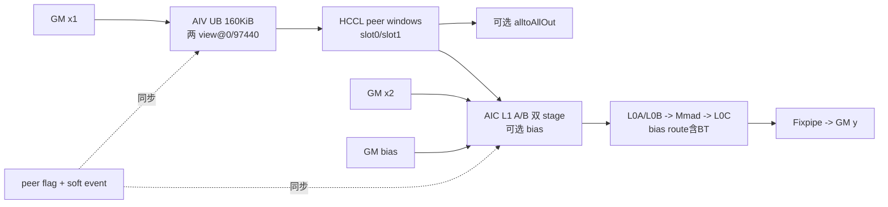
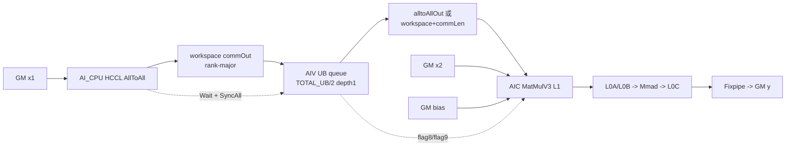

# AlltoAllMatmul A2/A3 ACLNN 算子知识

## 算子速览

| 项目 | 内容 |
|---|---|
| 实际入口 | 最新公开两段式入口 `aclnnAlltoAllMatmulV2GetWorkspaceSize` / `aclnnAlltoAllMatmulV2`；V2 相比旧入口新增 `commMode` |
| 计算语义 | `commOut = AlltoAll(x1.view(R, BS/R, H))`；`A = commOut.permute(1,0,2).view(BS/R,R*H)`；`y = A @ x2 + bias` |
| 输入输出 | `x1:[BS,H]`，`x2:[R*H,N]` 或转置布局 `[N,R*H]`，`y:[BS/R,N]`，可选 `alltoAllOut:[BS/R,R*H]`；ND；FP16/BF16 |
| 执行类型 | `MIX_CV` + 通信：单个 `KERNEL_TYPE_MIX_AIC_1_2` entry；A2 为 `AIV_VECTOR`（MTE/peer-window）+ `AIC_CUBE`，A3 为 AI_CPU HCCL + `AIV_VECTOR` transpose + `AIC_CUBE` MatMulV3 |
| Kernel 路线 | R-001 A2 CoC 双槽通信与 Catlass；R-002 A3 HCCL→transpose→MatMul 流水 |
| 核心资源 | A2：HCCL window、GM、160 KiB+128 B AIV UB、L1/L0A/L0B/L0C/BT；A3：workspace 两个 GM slice、半 UB transpose queue、MatMulV3 L1/L0 |
| 来源闭包 | `source_closed`：V2 ACLNN→base/inner bridge→SoC tiling/key/POD→单 MIX kernel 两个 SoC body→通信、转置、MatMul 直接依赖及构建接线闭合 |
| 验证状态 | 已完成源码闭包检查；本次知识提取未执行编译、真机、数值或性能测试。 |

## 接口与语义

### 计算语义

令 `R=rankSize`、`x1.shape=[BS,H]`。每卡把 `x1` 解释为 `[R,BS/R,H]`，AllToAll 后按 `permute(1,0,2)` 把来自各 rank 的 `H` 段拼为 `A:[BS/R,R*H]`，再计算：

```text
commOut    = AlltoAll(x1.view(R, BS/R, H))
A          = commOut.permute(1, 0, 2).view(BS/R, R*H)
y          = A @ x2 + biasOptional
alltoAllOutOptional = A（仅在请求该可选输出时写）
```

`transposeX1` 必须为 `false`。`transposeX2=false` 时 `x2:[R*H,N]`、B 为 RowMajor；`true` 时 API shape 为 `[N,R*H]`、Device B 为 ColumnMajor。FP16 走 FP16 bias，BF16 走 FP32 bias；无 bias 时不做偏置累加。本卡只覆盖非量化公开入口，量化 API 是独立逻辑语义，不并入版本族。

### 输入、输出与属性

| 参数 | shape/layout | dtype | 约束、默认值与语义 |
|---|---|---|---|
| `x1` | `[BS,H]`，ND | FP16/BF16 | 必选、连续、二维；固定 Commit 的 A2/A3 Host 均要求 `BS>0`；`BS % R == 0`；不支持转置。V2 文档声称 A3 支持 `BS=0`，与 Host guard 冲突，按实现失败边界记录 |
| `x2` | `[R*H,N]` 或转置 `[N,R*H]`，ND | 与 `x1` 相同 | 必选、连续、二维；A2/A3 均拒绝非连续 x2 |
| `biasOptional` | `[N]`，ND | FP16（x 为 FP16）或 FP32（x 为 BF16） | 可空；Host tiling再次校验平台真实组合 |
| `alltoAllAxesOptional` | 空或 `[-2,-1]` | `aclIntArray<int64_t>` | 空时等价 `[-2,-1]`，其它数组拒绝 |
| `group` | 长度 `(0,128)` 的字符串 | 属性 | 通信域；rank 可由 group 查询，inner 调用传 `worldSize=-1` |
| `commMode` | 字符串 | 属性 | A2 仅 `aiv`；A3 仅 `ai_cpu` |
| `transposeX1` | 标量 | bool | 必须 `false` |
| `transposeX2` | 标量 | bool | 控制 x2 shape 与 B 的 RowMajor/ColumnMajor specialization |
| `output` | `[BS/R,N]`，ND | 与 `x1` 相同 | 必选；MatMul 最终输出 |
| `alltoAllOutOptional` | `[BS/R,R*H]`，ND | 与 `x1` 相同 | 可空；A2 从 peer window 复制，A3 直接用作 transpose 目的地址 |
| `workspaceSize/executor` | Host 输出 | `uint64_t*` / `aclOpExecutor**` | 第一段接口输出，第二段必须原样配对使用 |
| `workspace/stream` | Device 地址/运行流 | `void*` / `aclrtStream` | 第二段在给定 stream 启动 inner 算子 |

### 入口与版本

固定 Commit 同时公开旧版 `aclnnAlltoAllMatmul` 与 V2；V2 文档明确相对旧版新增 `commMode`，因此无后缀 A2/A3 卡选择 V2 为该平台最新公开入口。V2 两个函数只转发到 `aclnnAlltoAllMatmulBaseGetWorkspaceSize/Base`。公开产品表同时支持 Atlas A2、Atlas A3 与 Ascend 950；本文件按平台命名规则仅覆盖 A2/A3，Ascend 950 归 `_950` 卡，不从 `arch35` 文件名反推到本卡。

## Host/Launcher 执行流程

### 参数校验与前处理

1. `aclnnAlltoAllMatmulBaseGetWorkspaceSize` 先 `CheckX2Valid`。A2/A3 分支要求 x2 连续；仅 DAV_3510 分支可识别末两维转置视图并 `TransX2Tensor`，该行为不属于本卡。
2. `CheckAndHandleParams` 按源码顺序执行必选指针、K/N 非零、shape、dtype、私有 format、ND reformat、axes、`transposeX1`、group 长度、`commMode` 非空校验。
3. 非量化 inner wrapper 把 scale/offset 置空，`worldSize=-1`，量化 mode 置 0，`yDtype/x1QuantDtype/commQuantDtype` 置 GE undefined(28)，再调用 generated `aclnnInnerAlltoAllMatmulGetWorkspaceSize`。
4. A2 Host 再校验 `commMode=="aiv"`、`R∈{2,4,8}`、M/K/N 与 dtype；A3 Host 校验 `commMode=="ai_cpu"`、`R∈{2,4,8,16}`、非量化 dtype、shape 与可选输出。
5. A2 不接受空 tensor。V2 文档声称 A3 支持仅 `BS=0` 的空 tensor，但 ACLNN 空 executor 捷径只覆盖 DAV_3510；A3 随后进入共享 `CheckShapeDimRange`，由 `x1Dim0 == 0` guard 返回 `GRAPH_FAILED`，所以固定 Commit 下 A3 `BS=0` 也无法到达 Device。Device 的 `tileCnt==tailCnt==0` 分支仅是不可由当前 Host 产生的防御性终点。

### 参数、Workspace 与生命周期

A2：`AlltoAllMatmulTiling910b::GetWorkspaceSize` 在非量化 key 上只返回 `SYSTEM_NEED_WORKSPACE=16 MiB`。实际通信数据位于 HCCL peer windows，不位于该 workspace；`Init` 虽取得 `GetUserWorkspace(workspaceGM)`，非量化路线不从中读写中间矩阵。executor 持有 generated inner 图及通信 server 配置，第二段在 launch 前按 SoC 设置 MTE server。

A3：基类先计算：

```text
commLen    = align_up(BS * H * sizeof(x1), 512)
permuteLen = alltoAllOutOptional ? 0 : commLen
biasLen    = bias ? align_up(N, 32) * sizeof(float) : 0
workspace  = libApiWorkSpaceSize + commLen + permuteLen + biasLen
```

Device 把 `workspaceGM` 起点作为 `commOutGM`；若没有可选输出，`transOutGM=workspaceGM+commLen`，否则 `transOutGM=all2all_out`。两个 GM slice 的 owner 是 executor/workspace，至少存活到 stream 上 kernel 完成；可选输出由调用者拥有。固定仓没有给出 `libApiWorkSpaceSize` 在 Device 参数地址前后的框架切片实现，卡中不推测该外部框架细节。

### 启动图与失败传播

```text
aclnnAlltoAllMatmulV2GetWorkspaceSize
  -> aclnnAlltoAllMatmulBaseGetWorkspaceSize
    -> aclnnInnerAlltoAllMatmulGetWorkspaceSize (generated bridge)
      -> AlltoAllMatmulTilingFunc
        -> R-001 AlltoAllMatmulTiling910b (Ascend910B)
        -> R-002 AllToAllFpMatmulTilingBaseA3 (Ascend910_93)
      -> key + POD + blockDim

aclnnAlltoAllMatmulV2
  -> aclnnAlltoAllMatmulBase
    -> set MTE(A2) / AICPU(A3) HCCL server
    -> aclnnInnerAlltoAllMatmul(workspace, executor, stream)
      -> allto_all_matmul<key>(..., workspaceGM, tilingGM)
        -> R-001: AIV peer-window AllToAll || AIC Catlass
        -> R-002: AIV-controlled HCCL -> AIV transpose -> AIC MatMulV3
```

这是一个 MIX kernel launch，不是 Host 侧多个 kernel。A2 `blockDim=CalcTschBlockDim(aivNum,aicNum,aivNum)`；A3 `blockDim=aicCoreNum`；entry 声明 AIC:AIV=1:2。API/tiling/HCCL 配置任一步失败均立即返回；第二段 inner launch 非成功统一转为 `ACLNN_ERR_INNER`，无 Device fallback，也不继续另一路线。

## Route 与参数设计

### 分核与资源计算

A2 先按 rank 对应的静态 M/K/N 条件表生成 `m0,pValue,ubMoveNum,sendCoreNum,recvCoreNum`。非量化默认值为：R=2 时 `m0=128,p=14,ubFactor=3,send=16,recv=4`；R=4 时 `128,12,2,8,8`；R=8 时 `128,12,2,8,8`，各值可被条件表覆盖。随后：

```text
transKAlign = align_up(H * R, 512 / 2)              // FP16/BF16 元素
mPerLoop = m0 * pValue                              // 每 rank 每轮输出行数
ubMoveNum = min(ubFactor * transKAlign * 2, 97280)  // 元素；Device 非量化 copy 实际使用固定 UB
pingPongBlockSize = mPerLoop * H * R                // 元素/slot
commCount = ceil(BS*H / (mPerLoop*H*R))
```

若双槽按 `transKAlign` 估算超过 HCCL window 数据区 180 MiB，Host 把 `m0` 收敛到 128 并下调 `pValue`。AIC 问题规模为 `M=BS/R,N,K=H*R`，`m0==128` 选择 `(L1/L0 MN)=(128,256)`，否则 Host 可达值为 256，选择 `(256,128)`；非量化 `L1K=256,L0K=64`。

A3 先得到 `M=BS/R,N,K=H*R`，公式化 tiling 输出 `tileM,tileCnt,tailM,tailCnt`，再分别以 tileM/tailM 调 `AllToAllFpMatmulHelper::DoTiling` 生成两套 MatMulV3 POD。通信、transpose 和 MatMul 共用 task index；AIV transpose 把每 task 的 `[R,tileM,H]` rank-major 数据搬成 `[tileM,R*H]`。

### Route 选择

| 顺序 | Route | Key/模板 | 精确选择条件与优先级 | 不适用去向 |
|---:|---|---|---|---|
| 1 | R-001 A2 CoC/Catlass | `(hasBias,transposeX2,NOQUANT,0,SOC_ASCEND910B)`；四个 bool key | `Short_SoC_version=="Ascend910B"`；FP16/FP16/FP16(+FP16 bias) 或 BF16/BF16/BF16(+FP32 bias)；R=2/4/8；`commMode=aiv`；`BS>0` | 任一校验失败即 GRAPH/ACLNN 失败，无 R-002 fallback |
| 2 | R-002 A3 pipeline | `(hasBias,transposeX2,NOQUANT,biasType∈{FP16,FP32},SOC_ASCEND910_93)` | `Short_SoC_version=="Ascend910_93"`；FP16 或 BF16 同 dtype；对应 bias 规则；R=2/4/8/16；`commMode=ai_cpu`；`BS>0` | 任一校验失败且不回退 A2；`BS=0` 被共享 Host shape guard 拒绝 |

```text
if npuArch == DAV_3510:
    交给 A5 registry（不属于本卡）
else:
    registry 按 SoC/IsCapable 选择
    if Short_SoC_version == Ascend910B:
        validate A2 -> GET_TPL_TILING_KEY(...SOC_ASCEND910B) -> R-001
    else if Short_SoC_version == Ascend910_93:
        validate A3 -> GET_TPL_TILING_KEY(...SOC_ASCEND910_93) -> R-002
    else:
        tiling failed
```

### 模板/实现执行矩阵

| Route | key/selector | dtype/shape/platform 完整命中条件 | 执行族与 kernel 节点 | 实际模板/body | 内存与同步特征 | tail/fallback |
|---|---|---|---|---|---|---|
| R-001 A2 CoC/Catlass | hasBias×transB 四 key；NOQUANT；A2 | 上表 A2 条件；`H*R∈[1,35000]`，`BS%R=0` | 单 MIX：AIV MTE copy/跨 rank flag；AIC Cube | `AlltoAllMatmul<DTYPE...>`；`MmadAtlasA2PingpongBias` 或 `MmadAtlasA2Preload`; MN tile 128×256 或 256×128 | 两个 peer-window slot；flag 0/1；AIV barrier 2/3；AIV `SetAicSync(slot)`→AIC `WaitEvent(slot)`；L1/L0 两 stage | 通信末轮缩短；MN/K tile 自带 tail；非法 key/资源直接失败 |
| R-002 A3 pipeline | hasBias×transB×biasType；NOQUANT；A3 | 上表 A3 条件；`H*R∈[2,65535]`，`BS>0` 且 `BS%R=0` | 单 MIX hybrid：AI_CPU HCCL，AIV transpose，AIC Cube | `HcclCommunicator<false,AICPU,...,0,1>` + `MC2VecTranspose<DTYPE_X1>` + `MC2FpMatmul<Mc2MatmulBaseKernel<...,Mc2MatmulBaseBlock,MM_CFG_NO_PRELOAD>>` | comm/permute workspace slices；HCCL handle；`SyncAll<true>`；soft flags 8/9；transpose UB=TOTAL_UB/2 | tile/tail 两套 MatMul tiling；非法/空 BS 失败，无 fallback |

### 隐藏性能 Guard

| Guard | Host/Tiling 条件 | Device/资源原因 | 影响 Route | 不满足时去向 | 源码符号 |
|---|---|---|---|---|---|
| A2 M/N tile | `m0=GetValueFromMKNConditionMap(BS,H,N,128,rank对应M0Map)`；map 仅给 128/256 | 唯一决定 `128×256` 与 `256×128` 两个 Catlass 实例 | R-001 | Host 默认 128；伪造其它 POD 会落 Device `else`，公开 Host 不产生 | `g_alltoallmatmul{Two,Four,Eight}RankFP16M0Map`, `CatlassMatmul` |
| A2 双槽容量 | `m0*p*align_up(H*R,256) <= (180 MiB/2 bytes)/2`，否则 `m0=128` 且 clamp p | 两个 slot 必须位于 180 MiB 数据区，flag 从 180 MiB 开始 | R-001 | 下调 p；HCCL 总 window<200 MiB 则 tiling 失败 | `TilingParamDeal`, `FLAG_OFFSET` |
| A2 HCCL window | 可查询时 `hcclBuffSize>=200 MiB` | 180 MiB 数据+20 MiB flag/保留区 | R-001 | tiling 失败；查询失败只 warning 后继续 | `DoOpTiling` |
| A2 rank/core | R=2/4/8；`sendCoreNum % R==0` 由表生成 | `dstRank=aicIdx/coreNumPerRank`，每 rank 必须有整数个 send AIV group | R-001 | Host 失败/条件表值 | `CheckAndSetAttrsInfo`, `CommBase::SetArgs` |
| A2 K/MN capacity | `H*R<=35000`；Catlass static_assert 检查两 stage L1/L0 | 固定 `L1K=256,L0K=64` 循环，L1/L0 容量不可超 | R-001 | Host 失败或编译期实例不可构造 | `CheckShapeInfo`, `block_mmad_*` |
| A3 task split | `tileCnt/tailCnt` 来自 `AlltoAllMM::GetTiling`；tailCnt=0 不生成 tail MM POD消费 | 每种 M 长度需要匹配的 MatMulV3 tiling | R-002 | 只执行存在的 tile/tail 段 | `TileCommAndCompute`, `DoMMTiling` |
| A3 transpose split | `ceil(transM/64)*ceil(H/256)`；used AIV=`min(totalCnt,2*blockDim)` | 每块 UB copy 的 `blockCount<=64,blockLen<=256*s` | R-002 | 自动尾块，无另一实现 | `MC2VecTranspose::getSplitCnt` |
| A3 HCCL handle | communicator 固定 `hTasks_[63]`；tile 与 tail 两次 `PrepareAll` 共用递增的 `endIndex_`，固定闭包未见 `tileCnt + tailCnt <= 63` 检查 | 两段任务累计写同一 handle/状态数组 | R-002 | 固定仓无法证明越界前的显式 guard；实现复用必须补证公式化 tiling 的累计任务上界 | `HcclCommunicator::{MAX_HCCL_HANDLE_,PrepareAll,AddIndex}` |
| commMode | A2=`aiv`，A3=`ai_cpu` | server 分别为 MTE/AICPU，协议不可互换 | 两 Route | Host 失败 | `CheckAndSetAttrsInfo`, `SetHcclTiling`, `aclnnAlltoAllMatmulBase` |

### POD/ABI

`Mc2InitTiling`、`Mc2CcTiling` 和 `TCubeTiling` 由 CANN 公共 `kernel_tiling`/HCCL API 定义，固定算子仓只持有类型引用与 producer/consumer，未给出其逐字段声明、`sizeof/alignof/offsetof`；下表对此明确标缺失，不推测 ABI。A3 的四个 MatMulV3 POD 明确使用 `#pragma pack(push, 8)` 和 `alignas(8)`，但固定仓未用 `static_assert(sizeof/offsetof)` 固化具体 offset，因此 ABI 布局列只记录可见的嵌套与字段顺序。

| 结构 | 字段 | 类型/位宽 | ABI 布局 | 单位 | Host/launcher producer | Device consumer | 边界 |
|---|---|---|---|---|---|---|---|
| 两 Route TilingData | `mc2InitTiling` | `Mc2InitTiling`，固定仓位宽不可见 | 首字段；size/align/offset 不可见 | HCCL init POD | `Mc2CcTilingConfig::GetTiling` | A2 `GetHcclContext`；A3 `Hccl::InitV2` | 必须为首个通信 POD |
| 两 Route TilingData | `mc2CcTiling` | `Mc2CcTiling`，固定仓位宽不可见 | 第二字段；size/align/offset 不可见 | HCCL task POD | `GetTiling` | A3 `SetCcTilingV2(offsetof(...))`；A2 HCCL context | offset 由真实 TilingData 决定 |
| A2 `AlltoAllMatmulInfo` | `M` | `uint32_t/32` | 第1个自有字段；精确 offset 未固化 | 元素行数 BS | `CheckShapeInfo` | `CommBase::SetTiling` | >0，且 BS%R=0 |
| A2 `AlltoAllMatmulInfo` | `K` | `uint32_t/32` | 第2字段；offset 未固化 | 元素 H | `CheckShapeInfo` | communication/Catlass | `H*R<=35000` |
| A2 `AlltoAllMatmulInfo` | `N` | `uint32_t/32` | 第3字段；offset 未固化 | 元素列数 | `CheckShapeInfo` | Catlass | >0 |
| A2 `AlltoAllMatmulInfo` | `rankSize` | `uint32_t/32` | 第4字段；offset 未固化 | rank | `CheckAndSetAttrsInfo` | `Init/SetArgs` | 2/4/8 |
| A2 `AlltoAllMatmulInfo` | `segmentsNum` | `uint32_t/32` | 第5字段；offset 未固化 | 次数 | `CalcQuantTokenNumPerUb` | 仅量化 `Quant` | 非量化 inactive，不读取 |
| A2 `AlltoAllMatmulInfo` | `copyTensorSize` | `uint32_t/32` | 第6字段；offset 未固化 | 元素 | `CalcQuantTokenNumPerUb` | 仅量化 | 非量化 inactive |
| A2 `AlltoAllMatmulInfo` | `quantSize` | `uint64_t/64` | 第7字段；offset 未固化 | byte | `CalcQuantWorkspaceSize` | 仅量化地址切片 | 非量化 inactive |
| A2 `AlltoAllMatmulInfo` | `dequantSize` | `uint64_t/64` | 第8字段；offset 未固化 | byte | `CalcQuantWorkspaceSize` | 仅量化 | 非量化 inactive |
| A2 `AlltoAllMatmulInfo` | `quantScaleSize` | `uint64_t/64` | 第9字段；offset 未固化 | byte | `CalcQuantWorkspaceSize` | 仅量化 | 非量化 inactive |
| A2 `AlltoAllMatmulInfo` | `isSegmentK` | `bool`，实现位宽相关 | 第10字段；offset 未固化 | bool | 量化 tiling | 仅量化 | 非量化 inactive |
| A2 `AlltoAllMatmulInfo` | `hasBias` | `bool` | 第11字段；offset 未固化 | bool | `CheckTensorDataType` | POD 被解包；非量化编译时行为以 key `hasBias` 为准 | 必须与 key 一致 |
| A2 `AlltoAllMatmulInfo` | `isAlltoallOut` | `bool` | 第12字段；offset 未固化 | bool | `CheckAndSetAttrsInfo` | `AlltoAll` optional-copy 分支 | false 时不得写空指针 |
| A2 `AlltoAllMatmulInfo` | `isSmoothQuant` | `bool` | 第13字段；offset 未固化 | bool | `CheckAndSetAttrsInfo` | 仅量化 | 非量化 inactive |
| A2 `AlltoAllMatmulInfo` | `quantCoreNum` | `uint32_t/32` | 末字段；offset 未固化 | AIV 核数 | `DoOpTiling` | 仅量化 | 非量化 inactive |
| A2 `CoCTiling` | `m0` | `int32_t/32` | 第1字段 | 行/tile | rank 对应 M0 map | `CatlassMatmul`, `SetArgs` | Host 可达 128/256 |
| A2 `CoCTiling` | `pValue` | `int32_t/32` | 第2字段 | M tile/slot | rank 对应 p map+capacity clamp | communication/Catlass | >=1 |
| A2 `CoCTiling` | `ubMoveNum` | `int32_t/32` | 第3字段 | 元素 | `TilingParamDeal` | `ubPingPongSize`；非量化 copy 未用该值 | 初值 -1 不可到达 Device |
| A2 `CoCTiling` | `allToAllSendCoreNum` | `int32_t/32` | 第4字段 | AIC index group/AIV0 | rank 对应表 | `AlltoAll` | 必须可按 R 分组 |
| A2 `CoCTiling` | `allToAllRecvCoreNum` | `int32_t/32` | 第5字段 | AIV1 核组 | rank 对应表 | optional output copy | optional output false 时分支 inactive |
| A2 `CoCTiling` | `k0` | `int32_t/32` | 第6字段 | tile | `CalTilingParam` 派生 | `SetTiling` 但非量化 body不使用 | 头文件标注暂未启用 |
| A2 `CoCTiling` | `n0` | `int32_t/32` | 第7字段 | tile | `CalTilingParam` 派生 | `SetTiling` 但 body不使用 | 暂未启用 |
| A2 `CoCTiling` | `swizzlCount` | `int32_t/32` | 第8字段 | tile group | rank 表 | `SetTiling`，但 `CatlassMatmul` Params 固定写3 | POD 值不控制当前非量化 kernel |
| A2 `CoCTiling` | `swizzlDirect` | `int32_t/32` | 第9字段 | 枚举 | rank 表 | `SetTiling`，但 Params 固定写0 | POD 值不控制当前非量化 kernel |
| A3 `AlltoAllMatmulTilingInfoA3` | `rankDim` | `uint32_t/32` | 第1字段 | rank | `SetTilingInfo` | 三 stage context | 2/4/8/16 |
| A3 `AlltoAllMatmulTilingInfoA3` | `tileM` | `uint32_t/32` | 第2字段 | 行/task | formulaic tiling | `ProcessTile` | tileCnt>0 时有效 |
| A3 `AlltoAllMatmulTilingInfoA3` | `tileCnt` | `uint32_t/32` | 第3字段 | task | formulaic tiling | `Process`/HCCL | 与 `tailCnt` 累计占用 communicator 的 63 个本地 handle，固定闭包未见显式上界校验 |
| A3 `AlltoAllMatmulTilingInfoA3` | `tailM` | `uint32_t/32` | 第4字段 | 行/task | formulaic tiling | `ProcessTail` | tailCnt=0 inactive |
| A3 `AlltoAllMatmulTilingInfoA3` | `tailCnt` | `uint32_t/32` | 第5字段 | task | formulaic tiling | `Process`/HCCL | 0 时 tail POD不执行 |
| A3 `AlltoAllMatmulTilingInfoA3` | `biasLen` | `uint32_t/32` | 第6字段 | byte | `SetUserWorkSpace` | body 不直接读取 | workspace sizing 字段 |
| A3 `AlltoAllMatmulTilingInfoA3` | `rankM` | `uint32_t/32` | 第7字段 | BS elements | `SetTilingInfo` | transpose strides/tail base | BS%R=0 |
| A3 `AlltoAllMatmulTilingInfoA3` | `rankN` | `uint32_t/32` | 第8字段 | N elements | `SetTilingInfo` | C offset | >0 |
| A3 `AlltoAllMatmulTilingInfoA3` | `rankK` | `uint32_t/32` | 第9字段 | H elements | `SetTilingInfo` | all stage offsets | `H*R<=65535` |
| A3 `AlltoAllMatmulTilingInfoA3` | `aicCoreNum` | `uint32_t/32` | 第10字段 | core | 本 producer未赋值；blockDim直接取 context | 本 body未读取 | inactive/未初始化值不得消费 |
| A3 `AlltoAllMatmulTilingInfoA3` | `commLen` | `uint64_t/64` | 第11字段 | byte | `SetUserWorkSpace`/`SetTilingInfo` | `Init` 的 transpose slice offset | 512-byte 对齐 |
| A3 `AlltoAllMatmulTilingInfoA3` | `permuteLen` | `uint64_t/64` | 第12字段 | byte | `SetUserWorkSpace` | body不直接读取 | 有 optional out 时0 |
| A3 `AlltoAllMatmulTilingInfoA3` | `hcclDataType` | `uint64_t/64` | 第13字段 | HCCL enum | `ConvertGeTypeToHcclType` | `MC2AlltoAllPrimitives` | cast 到 uint8 enum |
| A3 tile/tail `Mc2MatmulV3TilingData` | `matmulTiling` | `TCubeTiling`，固定仓声明不可见 | `alignas(8)` struct首字段；子布局不可见 | MatMul tile/core/resource | `AllToAllFpMatmulHelper::DoTiling` | `Mc2MatmulBaseKernel` | tile/tail 分开 |
| A3 `Mc2L2cacheTilePara` | `mTileCntL2` | `uint32_t/32` | `tileL2cacheTiling` 子结构第1字段；8-byte pack/alignment | tile count | MatMulV3 tiling | MatMulV3 | 固定仓未见本算子额外重写 |
| A3 `Mc2L2cacheTilePara` | `nTileCntL2` | `uint32_t/32` | 子结构第2字段 | tile count | MatMulV3 tiling | MatMulV3 | 同上 |
| A3 `Mc2L2cacheTilePara` | `mTileBlock` | `uint32_t/32` | 子结构第3字段 | tile block | MatMulV3 tiling | MatMulV3 | 同上 |
| A3 `Mc2L2cacheTilePara` | `nTileBlock` | `uint32_t/32` | 子结构第4字段 | tile block | MatMulV3 tiling | MatMulV3 | 同上 |
| A3 `Mc2L2cacheTilePara` | `calOrder` | `uint32_t/32` | 子结构第5字段 | scheduler enum | MatMulV3 tiling | MatMulV3 | 同上 |
| A3 `Mc2MatMulRunInfo` | `transA` | `uint32_t/32` | `matmulRunInfo` 子结构第1字段；8-byte pack/alignment | bool flag | MatMulV3 tiling | MatMulV3 | 同上 |
| A3 `Mc2MatMulRunInfo` | `transB` | `uint32_t/32` | 子结构第2字段 | bool flag | MatMulV3 tiling | MatMulV3 | 与公开 `transposeX2` specialization 一致 |
| A3 `Mc2MatMulRunInfo` | `nd2nzA` | `uint32_t/32` | 子结构第3字段 | bool flag | MatMulV3 tiling | MatMulV3 | 固定仓未见本算子额外重写 |
| A3 `Mc2MatMulRunInfo` | `nd2nzB` | `uint32_t/32` | 子结构第4字段 | bool flag | MatMulV3 tiling | MatMulV3 | 同上 |
| A3 `Mc2MatMulRunInfo` | `isNzA` | `uint32_t/32` | 子结构第5字段 | bool flag | MatMulV3 tiling | MatMulV3 | 同上 |
| A3 `Mc2MatMulRunInfo` | `isNzB` | `uint32_t/32` | 子结构第6字段 | bool flag | MatMulV3 tiling | MatMulV3 | 同上 |
| A3 `Mc2MatMulRunInfo` | `isHf32` | `uint32_t/32` | 子结构第7字段 | bool flag | MatMulV3 tiling | MatMulV3 | 同上 |
| A3 `Mc2L2cacheUseInfo` | `l2CacheFlag` | `uint32_t/32` | `l2cacheUseInfo` 唯一字段；8-byte pack/alignment | flag | MatMulV3 tiling | MatMulV3 | 固定仓未见本算子额外重写 |
| A3 tile/tail `Mc2MatmulV3TilingData` | `baseAN` | `uint32_t/32` | 外层第5字段 | element/tile | MatMulV3 tiling | MatMulV3 | 固定仓未见本算子额外重写 |
| A3 tile/tail `Mc2MatmulV3TilingData` | `baseAD` | `uint32_t/32` | 外层第6字段 | element/tile | MatMulV3 tiling | MatMulV3 | 同上 |
| A3 tile/tail `Mc2MatmulV3TilingData` | `baseBN` | `uint32_t/32` | 外层第7字段 | element/tile | MatMulV3 tiling | MatMulV3 | 同上 |
| A3 tile/tail `Mc2MatmulV3TilingData` | `baseBD` | `uint32_t/32` | 外层第8字段 | element/tile | MatMulV3 tiling | MatMulV3 | 同上 |

### Route 源码闭包

| Route | Key/selector | Host/Tiling producer | POD/参数 | Kernel entry/router | Kernel body/直接依赖 | 构建接线 |
|---|---|---|---|---|---|---|
| R-001 A2 CoC/Catlass | `GetTilingKey` + `ASCENDC_TPL_SEL` A2 非量化 key | `allto_all_matmul_tiling_910b.cpp::{Check*,DoMmCommTiling,DoOpTiling,GetWorkspaceSize,PostTiling}` | `AlltoAllMatmulTilingData`/`AlltoAllMatmulInfo`/`CoCTiling` | `arch22/allto_all_matmul.cpp::allto_all_matmul` A2 constexpr branch | `allto_all_matmul.h::{Init,AlltoAll,CatlassMatmul,Process}`；`allto_all_matmul_util.h`；`matmul.hpp::AlltoAllMatmulKernel`；Catlass two dispatch bodies | `allto_all_matmul_def.cpp` 的 ascend910b config；`op_host/CMakeLists.txt` |
| R-002 A3 pipeline | A3 `GetTilingKey` + `ASCENDC_TPL_SEL` A3 key | `allto_all_fp_matmul_tiling_910_93.cpp` + base/util formulaic tiling | `AlltoAllMatmulTilingDataA3` + tile/tail `Mc2MatmulV3TilingData` | 同 entry A3 constexpr branch/`ALL_TO_ALL_MATMUL_A3_FP_IMPL` | `AlltoAllMatmulArch35`、`AlltoAllMatmulPipeLine`、`HcclCommunicator`/primitive、`MC2VecTranspose`、`MC2FpMatmul`；当前 A3 `matmul_base.h` 选择 `Mc2MatmulBaseKernel`/`Mc2MatmulBaseBlock` 与 `MM_CFG_NO_PRELOAD` | `allto_all_matmul_def.cpp` 的 ascend910_93 config；`op_host/CMakeLists.txt` |

## Kernel 实现

### 公共执行流程

entry 参数顺序固定为 x1、x2、bias、五个量化保留输入、y、all2all_out、workspace、tiling。编译时先由原始 x1/x2 dtype 得到 `QUANT_TYPE`；本卡仅进入 `MC2_NON_QUANT`。entry 声明 `KERNEL_TYPE_MIX_AIC_1_2`，按 key 的 `ALL_TO_ALL_MM_SOC_VERSION` 解包互不兼容的 A2/A3 POD。两 Route 均用同一次 MIX launch 的 AIV/AIC 分支，不存在 unknown-key runtime switch；非法 key 在 Host `GET_TPL_TILING_KEY`/模板选择阶段终止。

### Route R-001：A2 CoC 双槽通信与 Catlass

#### 适用条件

##### 选择证据

| 层级 | 文件 | 符号 | 源码谓词/参数 | 结果/下一跳 |
|---|---|---|---|---|
| API | `op_api/allto_all_matmul_base.cpp` | `aclnnAlltoAllMatmulBaseGetWorkspaceSize` | A2/A3 分支拒绝非连续 x2；公共校验通过 | 调 inner bridge |
| Tiling registry | `op_host/op_tiling/arch22/allto_all_matmul_tiling_910b.cpp` | `IsCapable` | `Short_SoC_version=="Ascend910B"` | 进入 A2 tiling，否则 false |
| Host | 同上 | `CheckAndSetAttrsInfo`/`CheckTensorDataType`/`CheckShapeInfo` | `commMode=aiv`、R=2/4/8、非量化 dtype/shape | 生成 CoC；失败终止 |
| Key | 同上 | `GetTilingKey` | `(hasBias,x2Transpose,NOQUANT,0,SOC_ASCEND910B)` | A2 POD/key |
| Router | `op_kernel/arch22/allto_all_matmul.cpp` | `allto_all_matmul` | `QUANT_TYPE==NON_QUANT && SOC==ASCEND910B && keyQuant==NOQUANT` | `AlltoAllMatmul::Init/Process` |

#### Device 数据流

##### 函数级调用链

```text
allto_all_matmul<A2 key>
  -> AlltoAllMatmul::Init
    -> CommBase::SetArgs
    -> AICInit / AIVInit
  -> AlltoAllMatmul::Process
    -> AlltoAll
      -> ResetIpcFlags / CrossRankSyncV1
      -> CopyTokensFromGMToGM
      -> optional peer window -> alltoAllOut
      -> SetAicSync(slot)
    -> CatlassMatmul
      -> AlltoAllMatmulKernel::operator<AIC>
      -> BlockMmad<Preload|PingpongBias>
      -> GM->L1->L0A/L0B->Mmad->L0C->Fixpipe/GM
    -> SyncAll<false>
```

##### 源码等价伪码

```text
// 伪码；每个 MIX block 有 1 AIC + 2 AIV
rank = HCCLContext.rankId
derive mPerLoop=m0*p, tokenSize=H*R, slotElems=mPerLoop*tokenSize
for commIdx in [0, commCount]:
    slot = commIdx % 2
    if reusing live slot: AIV WaitEvent(slot)
    AIV all-core barrier(slot+2)
    if commIdx < commCount: cross-rank FLAG_ZERO = commIdx+1
    AIV all-core barrier(slot+2)
    if AIV0 and aicIdx < sendCoreNum:
        dstRank = aicIdx / (sendCoreNum/R)
        src = x1 + (dstRank*BS*H/R + src_offset + coreOffset) elements
        dst = peer[dstRank] + slot*slotElems + coreOffset*R + rank*H elements
        2D-copy rows of H bytes into row stride R*H bytes through two UB halves
    else if optional output and AIV1 and receive-core range and commIdx>0:
        copy completed local slot rows to alltoAllOut
    AIV barrier; cross-rank FLAG_ONE; AIV barrier
    if commIdx < commCount: AIV SetAicSync(slot)

// AIC concurrently consumes signaled slot
for commIdx in [0, ceil(ceil((BS/R)/tileM)/p)):
    slot=commIdx%2; WaitEvent(slot)
    schedule p M tiles x ceil(N/tileN) across AIC cores
    for each K tile (L1K=256) and K sub-tile (L0K=64):
        peer-window A + x2 B -> L1 ping-pong -> L0A/L0B -> Mmad accumulate L0C
    optional bias enters L1/BT on first K tile
    Fixpipe L0C -> y; signal PIPE_FIX(slot) for safe AIV reuse
```

#### 内存与数据搬运

##### 资源与搬运表

| 层级/缓冲区 | offset/地址公式 | extent/容量公式 | dtype/layout | producer | consumer | owner/lifetime | 对齐/复用 |
|---|---|---|---|---|---|---|---|
| GM x1 | `dstRank*BS*H/R + srcOffset + coreOffset` elements | 本核 `dataLen` elements，按 H-element rows | FP16/BF16 ND | caller | AIV MTE2 | caller至 stream完成 | row bytes=`H*s` |
| HCCL peer window data | `slot*m0*p*H*R + coreOffset*R + rank*H` elements | 2 slots；每 slot逻辑 `m0*p*H*R*s` bytes；物理容量检查用 `align_up(H*R,256)` | FP16/BF16，row `[R,H]` 拼接为 `[R*H]` | 本地/远端 AIV | 本 rank AIC与optional-copy AIV | HCCL window；slot完成后复用 | 数据区<180 MiB；slot 0/1 |
| HCCL flag | `(int32*)peer + 180MiB/4 + flagIdx` | 至少2个 int32（实现保留20 MiB区） | int32 scalar | `SetBuffFlag` | `CheckBuffFlag` | HCCL window | MTE/Scalar event保护 |
| AIV `uBuf_` | base；第二 copy tensor=`base+97440` bytes | `160 KiB` TBuf；两个交替 view | int8 byte view | GM→UB | UB→GM | 每 AIV，kernel lifetime | 32-byte block；EVENT_ID0/1 ping-pong |
| AIV `uBufSync_` | 独立 TBuf | 128 B | int32 | GM flag→UB/scalar或scalar→GM | flag poll/write | 每 AIV | MTE2/S、S/MTE3 event |
| L1 A/B | A offset0；B offset=`2*tileM*256*s` | 两 stage：A=`2*tileM*256*s`；B=`2*tileN*256*s`；MN为128×256或256×128 | A RowMajor→L1 fractal；B Row/ColumnMajor→L1 | Catlass copy GM→L1 | L1→L0 | 每 AIC block | `s=2` 时两种 MN specialization 的 A+B 均为 384 KiB，未占满 512 KiB L1 |
| L1 bias/BT | L1 after A/B；BT offset0 | bias route L1=`tileN*sizeof(BiasType)`；BT物理1024 B，实际=`tileN*4` accumulator bytes | vector/FP16或FP32→accumulator | GM bias→L1→BT | Mmad first K | 每 AIC tile | 无 bias为 N/A |
| L0A | stage `i*(64KiB/2)` | 64 KiB物理，两 stage；实际 tile=`tileM*64*s` | fractal | L1 | Mmad | 每 AIC | stage event |
| L0B | stage `i*(64KiB/2)` | 64 KiB物理，两 stage；实际 tile=`64*tileN*s` | fractal | L1 | Mmad | 每 AIC | stage event |
| L0C | offset0 | 128 KiB；实际 `tileM*tileN*4=128KiB` | accumulator（FP32）zN | Mmad | Fixpipe | 每 AIC tile | K循环累加，末尾copy out |
| GM y | `mLoopStart*tileM*N + tileOffset` | `[BS/R,N]` | FP16/BF16 RowMajor | Fixpipe | caller | caller | M/N tail由actual shape |
| GM optional out | `((commIdx-1)*mPerLoop+mSt)*H*R` elements | `[BS/R,H*R]` | 与x1同 dtype RowMajor | receive AIV | caller | caller | 仅非空输出分支 |
| workspace | framework/user workspace | 16 MiB system workspace；非量化 body无中间 slice | N/A | runtime | runtime | executor | 不替代 peer window |

##### 分层内存布局



##### 字节账、交接边与复用顺序

```text
s = sizeof(x1) = 2 bytes
workspace_total = 16 MiB（system；非量化无算子自有workspace slice）
peer_data_bound = 2 * m0 * pValue * align_up(H*R,256) * s <= 180 MiB
AIV_UB_total = 160 KiB + 128 B
L1_no_bias = 2*(tileM*256*s + tileN*256*s) = 384 KiB
L1_bias = L1_no_bias + tileN*sizeof(BiasType)
L0A_physical=64 KiB; L0B_physical=64 KiB; L0C_physical=128 KiB; BT=1 KiB(bias route)
```

| 边/复用子区 | producer | offset/extent | dtype/layout | consumer | ordering/sync | owner/lifetime | 安全条件 |
|---|---|---|---|---|---|---|---|
| x1→peer slot | send AIV0 | 上表 dataSrc/dataDst；`dataLen*s` | ND rows→拼接RowMajor | local AIC | cross-rank ZERO/ONE；`SetAicSync(slot)` | HCCL window slot | 复用前 `WaitEvent(slot)` |
| peer slot→Catlass | AIV all ranks | `slot*m0*p*H*R`，实际尾轮缩短 | `[rows,H*R]` RowMajor | AIC blockMmad | AIC `WaitEvent(slot)`；完成后 `CrossCoreSetFlag<2,PIPE_FIX>(slot)` | slot直到 AIC signal | pipeDepth=2 |
| peer slot→optional out | peer producer | 前一 slot；`mThisCoreThisLoop*H*R*s` | RowMajor | receive AIV1 | 跨rank ONE后在下一循环复制；AIV barriers | caller output | `commIdx>0`且输出非空 |
| AIV UB view0/view1 | MTE2 | offset0/97440，按 copyTokenPerTime | raw bytes | MTE3 | EVENT_ID0/1 MTE3↔MTE2 | 每AIV | 单 view 前次 MTE3 完成才覆写 |
| L1 stage0/1 | GM copy | A/B各自stage offset | fractal | L0 load | MTE2↔MTE1 events | 每AIC | stage event返回后复用 |

#### 同步、精度与尾块

##### 同步与数值边界表

| 阶段 | primitive/机制 | producer | consumer/等待点 | 保护对象 | 精度/尾块 |
|---|---|---|---|---|---|
| flag初始化 | `ResetIpcFlags`, `PipeBarrier<PIPE_ALL>` | AIV0/aic0 | 所有通信核 | peer flag | 无数值操作 |
| rank到达 | `CrossRankSyncV1(FLAG_ZERO/ONE,commIdx+1)` | 每rank AIV0 | 本rank aicIdx<R 的 AIV0 poll | 本轮跨rank GM写 | 末轮 `dataLen`/copyBytes缩短 |
| AIV内部 | `CrossCoreSetFlag<0,PIPE_MTE3>(slot+2)` + wait | 所有AIV分支 | 所有AIV | copy/optional-output阶段 | 无 cast |
| AIV→AIC | `SetAicSync(slot)` / `WaitEvent(slot)` | AIV | Catlass AIC | peer slot | FP16/BF16原样通信 |
| AIC→slot复用 | `CrossCoreSetFlag<2,PIPE_FIX>(slot)` | AIC Fixpipe后 | AIV `WaitEvent(slot)` | peer slot | L0C FP32累加后 Fixpipe 到 FP16/BF16；round mode由Catlass primitive，算子层未重写 |
| Cube tail | `actualPValue`, `GetBlockSizeCoord`, K ceil loops | scheduler | BlockMmad | M/N/K tile | M/N实际尺寸；K末 tile缩短并padding value=0 |
| 终止 | `SyncAll<false>` | AIC/AIV | kernel return | 全部输出/flags | `commCount`偶数时AIV额外等slot1 |

#### 关键实现

##### 符号证据表

| 阶段 | 文件 | 符号/模板实例 | 实现事实 |
|---|---|---|---|
| Host/Tiling producer | `op_host/op_tiling/arch22/allto_all_matmul_tiling_910b.cpp` | `DoMmCommTiling`, `TilingParamDeal`, `DoOpTiling` | rank/MKN表、双槽容量、blockDim、HCCL config |
| Kernel entry/router | `op_kernel/arch22/allto_all_matmul.cpp` | A2 constexpr branch | A2 POD解包与 `AlltoAllMatmul<...NON_QUANT>` |
| Device body/helper | `op_kernel/arch22/allto_all_matmul.h` | `AlltoAll`, `CatlassMatmul` | peer地址、optional copy、两个 tile specialization |
| Device body/helper | `op_kernel/arch22/allto_all_matmul_util.h` | `CommBase::SetArgs`, `CopyTokensFromGMToGM`, sync helpers | UB、2D copy、rank/core映射、soft flag |
| Device body/helper | `op_kernel/arch22/matmul.hpp` | `AlltoAllMatmulKernel::operator<AIC>` | slot等待、swizzle、M/N tail、PIPE_FIX signal |
| Device body/helper | `.../block_mmad_preload.hpp`, `.../block_mmad_pingpong_bias.hpp` | 当前 `BlockMmad` specialization | L1/L0双stage、Mmad、bias BT与Fixpipe |

### Route R-002：A3 HCCL→transpose→MatMul 流水

#### 适用条件

##### 选择证据

| 层级 | 文件 | 符号 | 源码谓词/参数 | 结果/下一跳 |
|---|---|---|---|---|
| Tiling registry | `op_host/op_tiling/arch22/allto_all_fp_matmul_tiling_910_93.cpp` | `IsCapable` | `Short_SoC_version=="Ascend910_93"` | 进入 A3非量化 tiling |
| Host | 同上 | `CheckOpInputInfo` | common attrs/format/shape + A3 dtype + alltoallOut | 失败终止 |
| Host HCCL | 同上 | `SetHcclTiling` | `commMode=="ai_cpu"`，dtype可转换 | AICPU AllToAll tiling |
| Key | 同上 | `GetTilingKey` | hasBias/transB；NOQUANT；bias同A或FP32；SOC_ASCEND910_93 | A3 key/POD |
| Router | `op_kernel/arch22/allto_all_matmul.cpp` | `ALL_TO_ALL_MATMUL_A3_FP_IMPL` | SOC=A3；bias key FP16或FP32 | 实例化 communication/transpose/MatMul pipeline |

#### Device 数据流

##### 函数级调用链

```text
allto_all_matmul<A3 key>
  -> ALL_TO_ALL_MATMUL_A3_FP_IMPL
    -> HcclCommunicator<false,AICPU,MC2AlltoAllContext,...,0,1>
    -> MC2VecTranspose<DTYPE_X1>
    -> MC2FpMatmul<Mc2MatmulBaseKernel<ND,ND,ND,...,MM_CFG_NO_PRELOAD>>
    -> AlltoAllMatmulArch35::Init
      -> AlltoAllMatmulPipeLine::Init/GetContext
    -> AlltoAllMatmulArch35::Process
      -> ProcessTile(tileCnt) -> pipeline.Process
      -> ProcessTail(tailCnt) -> pipeline.Process
      -> pipeline.End
```

##### 源码等价伪码

```text
// 伪码
commOut = workspace
transOut = alltoAllOut ? alltoAllOut : workspace + commLen
for segment in [(tileM,tileCnt,tileMmPOD), (tailM,tailCnt,tailMmPOD) if tailCnt>0]:
    set A/B/C/bias base pointers and task byte offsets
    set transpose src/dst, rank stride, H, M, row strides H and H*R
    set HCCL send/recv base, task byte offsets, sendCount=M*H, strideCount=BS*H/R
    HCCL PrepareAll(taskCnt): prepare all handles then Commit all AllToAll tasks on AIV0
    for taskIndex in [0,taskCnt):
        AIV0 HCCL Wait(handle[taskIndex])
        SyncAll<true>() across AIV
        each AIV copies assigned 64x256-or-tail blocks commOut -> transOut through UB
        all AIV soft barrier flag8; AIV sets flag9 to AIC
        AIC waits flag9, walks L2 M/N tiles with tail-aware Mc2MatmulBaseBlock,
        then MatmulImpl Iterate/GetTensorC writes this task's y slice
    End waits unfinished HCCL handles, Finalize, then MatMul End
```

#### 内存与数据搬运

##### 资源与搬运表

| 层级/缓冲区 | offset/地址公式 | extent/容量公式 | dtype/layout | producer | consumer | owner/lifetime | 对齐/复用 |
|---|---|---|---|---|---|---|---|
| GM x1 task | `segmentBase + task*taskM*H*s` | `taskM*H*s` send count per destination语义由HCCL AllToAll解释 | FP16/BF16 ND | caller | AICPU HCCL | caller | task offset连续 |
| workspace `commOut` | `workspace + segmentBase` | `commLen=align_up(BS*H*s,512)` | rank-major `[R,BS/R,H]`分段 | HCCL | AIV transpose | executor/workspace至stream完成 | task offset=`taskM*H*s` |
| `transOut` | optional output，或 `workspace+commLen` | logical `BS*H*s`；workspace reserve=`permuteLen` | `[BS/R,R*H]` RowMajor | AIV transpose | AIC MatMul | caller或workspace | task dst offset=`taskM*H*R*s` |
| AIV transpose UB | single queue buffer | `TOTAL_UB_SIZE/2`，depth=1 | FP16/BF16 | GM DataCopyPad | GM DataCopyPad | 每次 task `TPipe::Reset` 后重建 | tile 64 rows×256 H elems；tail自动缩短 |
| AIC MatMul A | `transOut + task*taskM*H*R*s` | `[taskM,H*R]` | ND GM | transpose | MatMulV3 | transOut owner | flag9后可见 |
| AIC MatMul B | x2，task offset0 | `[H*R,N]`或转置 | ND GM | caller | MatMulV3 | caller | key/tiling决定transB |
| AIC L1/L0 | 由 tile/tail `TCubeTiling` 的 `baseM/baseN/baseK,step*,depth*` 决定 | 每次 task 的实际容量随 MatMulV3 POD；固定算子仓无常量值 | MatMulV3内部ND→L1/L0 fractal→L0C | `Mc2MatmulBaseKernel` | Mmad/Fixpipe | 每AIC task | `MM_CFG_NO_PRELOAD`；POD是容量合同 |
| GM y | `segmentCBase + task*taskM*N*s` | `[BS/R,N]` | FP16/BF16 ND | MatMulV3 | caller | caller | tile/tail分别连续 |
| bias workspace reserve | workspace总式尾部 | `bias?align_up(N,32)*4:0` | byte reserve | Host size | 固定 route body未直接寻址 | executor | 不与comm/permute slice别名 |

##### 分层内存布局



##### 字节账、交接边与复用顺序

```text
s = 2 bytes
commLen = align_up(BS*H*s, 512)
permuteLen = alltoAllOut ? 0 : commLen
biasLen = bias ? align_up(N,32)*4 : 0
workspace_total = libApiWorkSpaceSize + commLen + permuteLen + biasLen
transpose_UB = TOTAL_UB_SIZE/2（queue depth 1）
MatMul L1/L0 = runtime tile/tail TCubeTiling；固定算子仓不提供单一常量字节数
```

| 边/复用子区 | producer | offset/extent | dtype/layout | consumer | ordering/sync | owner/lifetime | 安全条件 |
|---|---|---|---|---|---|---|---|
| HCCL→commOut | AIV0控制的 AICPU HCCL | task `send/recvOffset=taskM*H*s`；count=`taskM*H` | HCCL dtype，rank-major | AIV transpose | `PrepareAll` Commit；`Process(index)` Wait；随后 `SyncAll<true>` | workspace comm slice | handle成功且task index<prepared count |
| commOut→transOut | all AIV | rank src stride=`BS*H/R` elems；rank dst stride=H；行 stride H→H*R | FP16/BF16 | AIC MatMul | AIV内部 DataCopyPad/PipeBarrier；全AIV flag8；AIV→AIC flag9 | output/workspace permute slice | total split blocks映射唯一；tail count |
| transOut→AIC | transpose | `task*taskM*H*R*s` | `[taskM,H*R]` ND | `MC2FpMatmul::Process` | `CrossCoreSetFlag<2,PIPE_MTE3>(9)` / AIC wait9 | transOut | flag 8/9不得与所配MatMul软同步冲突 |
| tile→tail workspace reuse | tile segment | tail base=`tileCnt*tileM*H*s`（comm），再乘R（trans） | 同 dtype/layout | tail pipeline | 同一个 Process 调用先 tile 后 tail；每段 `End`仅最终调用 | 同workspace | base/extent不重叠 |

#### 同步、精度与尾块

##### 同步与数值边界表

| 阶段 | primitive/机制 | producer | consumer/等待点 | 保护对象 | 精度/尾块 |
|---|---|---|---|---|---|
| HCCL准备 | `Prepare`全部task，`Commit`全部WAIT_ONE任务 | AIV0 notify core | AICPU server | HCCL handles/commOut | FP16/BF16原样通信 |
| HCCL完成 | `Hccl::Wait(handle[index])` | AICPU | AIV0 | 当前 comm task | taskM可为tileM或tailM |
| AIV可见性 | `SyncAll<true>` | AIV0 | 全AIV | commOut task | 无cast |
| transpose内部 | `DataCopyPad`; `PIPE_ALL`; soft flag8全AIV barrier | AIV split blocks | 所有AIV | transOut task | 64×256 main block；最后M/H块缩短，pad value 0只作用UB尾部 |
| AIV→AIC | flag9 | AIV | AIC wait | transOut task | 不改变dtype |
| MatMul | MatMulV3 `TCubeTiling`/`MM_CFG_NO_PRELOAD` | AIC | Fixpipe/y | L1/L0/L0C | 累加/round由当前 MatMulV3 specialization；算子层未覆盖 |
| Device 防御性空终点 | tileCnt/tailCnt条件；`commStage::End`, `computeStage::End` | pipeline | kernel return | handles/MM资源 | POD 若两计数均为0则不进 task loop；但固定 Host 对 A3 `BS=0` 先失败，该终点不是公开入口可达 Route |

#### 关键实现

##### 符号证据表

| 阶段 | 文件 | 符号/模板实例 | 实现事实 |
|---|---|---|---|
| Host/Tiling producer | `op_host/op_tiling/arch22/allto_all_fp_matmul_tiling_910_93.cpp` | `DoOpTiling`, `DoMMTiling`, `SetHcclTiling`, `SetTilingInfo` | tile/tail、HCCL、POD、blockDim/key |
| Kernel entry/router | `op_kernel/arch22/allto_all_matmul.cpp` | `ALL_TO_ALL_MATMUL_A3_FP_IMPL` | AICPU communicator、transpose、A3 MatMul完整模板实例 |
| Device body/helper | `op_kernel/arch35/allto_all_matmul_arch35.h` | `Init`, `ProcessTile`, `ProcessTail` | workspace切片、每stage地址与task offsets |
| Device body/helper | `op_kernel/arch35/allto_all_matmul_pipeline.h` | `Process` | prepare-all、HCCL wait、transpose、flag8/9、MatMul顺序 |
| Device body/helper | `.../communication/communicator/hccl_communicator.h`, `.../primitives/hccl_primitives.h` | `HcclCommunicator`, `MC2AlltoAllPrimitives` | AIV0 notify、AllToAll参数、Commit/Wait/Finalize |
| Device body/helper | `.../computation/math/mc2_vec_transpose.h` | `MC2VecTranspose` | 64×256切块、GM strides、半UB队列、tail |
| Device body/helper | `.../computation/matmul/mc2_fp_matmul.h` | `MC2FpMatmul<Mc2MatmulBaseKernel<...>>` | task地址、TPipe reset、MatMulV3 specialization |
| Device body/helper | `.../computation/matmul/matmul_base.h`, `.../mat_mul_v3/op_kernel/mat_mul_base_kernel.h` | A3 include branch；`Mc2MatmulBaseKernel::{Init,Process}` | A3 选择当前 base kernel；绑定 GM/POD、HF32、bias，并逐 L2 tile 调 `MatmulImpl::Iterate/GetTensorC` |
| Device body/helper | `.../mat_mul_v3/op_kernel/mat_mul_base_block.h`, `mat_mul_v3_common.h` | `Mc2MatmulBaseBlock`；`MM_CFG_NO_PRELOAD` | L2 M/N scheduler、核间分块、M/N tail 与 GM offset；当前 MatMul config 常量 |

## 算子特定优化

### Trick T-001：A2 peer-window 双槽把通信结果直接变为 MatMul A

#### 触发与源码依据

- 适用 Route：R-001
- 触发条件：A2 非量化 key；`commIdx<commCount`；当前 slot 已由上次 AIC 释放；send AIV0 命中 send-core 范围
- Golden 来源：[`mc2/allto_all_matmul/op_kernel/arch22/allto_all_matmul.h:811-836`](../../../../../../../cann-ops-raw/ascendc/ops-transformer/be33d95bb755cedec3108f70805c1874d1792540/mc2/allto_all_matmul/op_kernel/arch22/allto_all_matmul.h#L811-L836)

**官方源码（固定 Commit 连续逐字摘录）**：

```cpp
            if (commIdx >= MAX_BLOCK_COUNT && commIdx < commCount) {
                WaitEvent(flagIdx);
            }

            SetAndWaitAivSync(flagIdx);
            if (commIdx < commCount) {
                CrossRankSyncV1(FLAG_ZERO_IDX, commIdx + 1);
            }
            SetAndWaitAivSync(flagIdx);

            if (aivIdx == 0 && commIdx < commCount && aicIdx < allToAllSendCoreNum) {
                int32_t dstRank = aicIdx / coreNumPerRank;
                int32_t dstLoc = aicIdx % coreNumPerRank;
                int32_t coreOffset = dstLoc * allToAllSizePerCore;
                int32_t dataLen = coreOffset + allToAllSizePerCore > allToAllSizePerRankPerLoop ?
                                      allToAllSizePerRankPerLoop - coreOffset :
                                      allToAllSizePerCore;
                uint64_t dataSrc = dstRank * allToAllSizePerRank + src_offset + coreOffset;
                int64_t dataDst = static_cast<int64_t>(flagIdx) * pingPongBlockSize +
                                  static_cast<int64_t>(coreOffset) * rankSize + static_cast<int64_t>(rank) * k;
                uint32_t copyBytes = Catlass::BitsToBytes(dataLen * Catlass::SizeOfBits<AType>::value);

                if (dataLen > 0) {
                    CopyTokensFromGMToGM(reinterpret_cast<__gm__ int8_t *>(aGM_) + ElemNumToBytes<AType>(dataSrc),
                                         (__gm__ int8_t *)buff[dstRank] + ElemNumToBytes<AType>(dataDst), copyBytes,
                                         kBytes, tokenBytes);
                }
```

#### 机制与设计原因

AIV把每个 rank 的 H 段按目标 row 的 `rank*H` 子区直接写入 peer window，因此完成后的 slot 已是 Catlass 所需 `[mPerLoop,R*H]` RowMajor A，不再申请独立 permute workspace。slot 按 `commIdx%2` 环形复用；AIV复用前等 AIC `PIPE_FIX` 完成事件，使通信与上一 slot 的 Cube 计算可并行而不覆盖。

#### 迁移边界

- 适用：MTE peer-window 可直接寻址、每 row 的目标 stride 为 `R*H` 的 AllToAll→MatMul
- 前提：A2、R=2/4/8、200 MiB HCCL window、双槽容量成立、AIC:AIV=1:2
- 失效：A3 使用 AI_CPU HCCL+显式 transpose；容量不满足时 Host 下调 p，而不是改 workspace route
- 未验证：本次知识提取未执行编译、真机、数值或性能测试。

#### 错误做法

去掉 `WaitEvent(slot)` 或改变 `dataDst` 的 `rank*H`/`coreOffset*R` 会分别导致双槽覆盖或破坏 `[R*H]` 拼接布局；源码中的等待与地址式即为可验证反例边界。

### Trick T-002：A2 按 M tile 与 bias 选择两套 Catlass specialization

#### 触发与源码依据

- 适用 Route：R-001
- 触发条件：`m0` 条件表输出 128 或 256；hasBias 来自 key；非量化 `L1K=256,L0K=64`
- Golden 来源：[`mc2/allto_all_matmul/op_kernel/arch22/allto_all_matmul.h:258-282`](../../../../../../../cann-ops-raw/ascendc/ops-transformer/be33d95bb755cedec3108f70805c1874d1792540/mc2/allto_all_matmul/op_kernel/arch22/allto_all_matmul.h#L258-L282)

**官方源码（固定 Commit 连续逐字摘录）**：

```cpp
        if (m0 == 128) {
            using L1TileShape = GemmShape<128, 256, L1TileShapeK>;
            using L0TileShape = GemmShape<128, 256, L0TileShapeK>;
            using BlockMmadOpt = Gemm::Block::BlockMmad<DispatchPolicy, L1TileShape, L0TileShape, AType_, BType_,
                                                        CType_, BiasType_, TileCopy>;
            using MatmulKernel =
                Gemm::Kernel::AlltoAllMatmulKernel<void, void, BlockMmadOpt, void, BlockScheduler30, aicCalBias>;
            MatmulKernel matmul_op;
            typename MatmulKernel::Params params{processSize,
                                                 reinterpret_cast<GM_ADDR>(srcGM),
                                                 layoutA,
                                                 reinterpret_cast<GM_ADDR>(bGM_),
                                                 layoutB,
                                                 reinterpret_cast<GM_ADDR>(biasGM_),
                                                 reinterpret_cast<GM_ADDR>(matmulResultGM),
                                                 layoutC,
                                                 pValue,
                                                 3,
                                                 0,
                                                 static_cast<int32_t>(rankSize),
                                                 MAX_BLOCK_COUNT};
            matmul_op(params);
        } else {
            using L1TileShape = GemmShape<256, 128, L1TileShapeK>;
            using L0TileShape = GemmShape<256, 128, L0TileShapeK>;
```

#### 机制与设计原因

Host 的 M/K/N 条件表只输出两种 m0，使同一 entry 在运行时选择宽 N 或宽 M 的完整编译期 tile。hasBias 又把 `DispatchPolicy` 切为 `MmadAtlasA2PingpongBias`（bias GM→L1→BT并在首K累加）或 `MmadAtlasA2Preload`（跨 block 预取 A/B）。两者都保持两 stage L1/L0，但 bias 的额外 L1/BT 与调度不能互换。

#### 迁移边界

- 适用：FP16/BF16、A2 Catlass、MN tile乘积固定32768的矩阵乘
- 前提：Host M0 map与Device `if(m0==128) else`同步，key hasBias 与真实指针一致
- 失效：A3 route使用 runtime MatMulV3 POD；伪造非128/256 m0虽落 `else`，不属于公开 Host 可达值
- 未验证：本次知识提取未执行编译、真机、数值或性能测试。

#### 错误做法

把 m0 仅当通信粒度而不联动 Cube tile，会让 peer slot/scheduler 与 L1/L0实例不一致；固定源码的 runtime分支证明二者是同一 ABI 决策。

### Trick T-003：A3 先全量提交通信，再以 flag8/9 串接 transpose 与 MatMul

#### 触发与源码依据

- 适用 Route：R-002
- 触发条件：A3 `taskCnt>0`，AI_CPU communicator 的 `(SendCnt,RecvCnt)=(0,1)` 形成 WAIT_ONE模式
- Golden 来源：[`mc2/allto_all_matmul/op_kernel/arch35/allto_all_matmul_pipeline.h:75-92`](../../../../../../../cann-ops-raw/ascendc/ops-transformer/be33d95bb755cedec3108f70805c1874d1792540/mc2/allto_all_matmul/op_kernel/arch35/allto_all_matmul_pipeline.h#L75-L92)

**官方源码（固定 Commit 连续逐字摘录）**：

```cpp
commStage_->PrepareAll(taskCnt);
uint32_t index;
for (index = 0; index < taskCnt; index++) {
    if ASCEND_IS_AIV {
        commStage_->Process(index);
        AscendC::SyncAll<true>();
        transStage_->Process(index);
        AscendC::CrossCoreSetFlag<0, PIPE_MTE3>(8);
        AscendC::CrossCoreWaitFlag(8);
        AscendC::CrossCoreSetFlag<2, PIPE_MTE3>(9);
    }
    if ASCEND_IS_AIC {
        AscendC::CrossCoreWaitFlag(9);
        computeStage_->Process(index);
    }
}
```

#### 机制与设计原因

`PrepareAll` 在 notify AIV0 上先为所有 task 建 handle 并 Commit；循环按 index 只等待当前通信，随后全 AIV 做 GM→UB→GM transpose，再用 flag9 交给 AIC。这样通信任务可提前进入 AI_CPU/HCCL 队列，而转置和 MatMul仍保持逐 task 的数据依赖。flag8 是 AIV全核汇合，flag9 是 AIV→AIC边；源码明确要求所配 MatMul不得占用8/9。

#### 迁移边界

- 适用：单 MIX kernel内的 AI_CPU通信→AIV重排→AIC计算
- 前提：AIC:AIV=1:2，MatMul不占flag8/9，tile 与 tail 累计 task handles 不超过可证明容量，comm/trans/mm offsets匹配
- 失效：A2使用peer flag+slot event；替换MatMul时必须重新审计soft flag编号
- 未验证：本次知识提取未执行编译、真机、数值或性能测试。

#### 错误做法

只依赖源码调用顺序而删除 `SyncAll<true>` 或 flag9，会让非notify AIV或AIC看到未完成的 comm/trans 数据；固定源码中的显式同步是反例。

### Trick T-004：A3 可选输出直接充当 MatMul A，缺省时才分配 permute slice

#### 触发与源码依据

- 适用 Route：R-002
- 触发条件：`all2all_out != nullptr` 或为空两种分支
- Golden 来源：[`mc2/allto_all_matmul/op_kernel/arch35/allto_all_matmul_arch35.h:64-72`](../../../../../../../cann-ops-raw/ascendc/ops-transformer/be33d95bb755cedec3108f70805c1874d1792540/mc2/allto_all_matmul/op_kernel/arch35/allto_all_matmul_arch35.h#L64-L72)

**官方源码（固定 Commit 连续逐字摘录）**：

```cpp
workspaceGM_ = workspaceGM;
commOutGM_ = workspaceGM;
transOutGM_ = all2all_out;
if (all2all_out == nullptr) {
    transOutGM_ = (GM_ADDR)((uint64_t)commOutGM_ + mc2Tiling_.commLen);
}
pipeLine_->Init();
pipeLine_->GetContext(&pipeLineContext_);
```

#### 机制与设计原因

transpose 的输出无论落用户 `alltoAllOut` 还是 workspace 第二片，都直接作为后续 MatMul A；Host 同步把 `permuteLen` 设为0或 `commLen`，避免请求可选输出时再物化一份相同 A。通信结果仍固定在第一片，二者生命周期在 flag9 前不能重叠。

#### 迁移边界

- 适用：可选中间输出与下一阶段输入完全同 dtype/layout/extent
- 前提：optional output shape `[BS/R,R*H]` 已 Host 校验，调用者保持输出到stream完成
- 失效：输出为空时必须保留 `workspace+commLen` slice；不得与 commOut alias
- 未验证：本次知识提取未执行编译、真机、数值或性能测试。

#### 错误做法

空输出时令 `transOutGM==commOutGM` 会让 in-place rank重排覆盖未读通信数据；源码明确使用不重叠的 `+commLen` slice。

## 模板与实现对比

| 对比维度 | R-001 A2 CoC/Catlass | R-002 A3 pipeline | 设计选择依据 |
|---|---|---|---|
| 命中条件/优先级 | Ascend910B，MTE/aiv，R=2/4/8 | Ascend910_93，AI_CPU，R=2/4/8/16 | README/API产品与通信引擎表+Host `IsCapable` |
| 执行族/节点图 | 单 MIX：AIV peer copy ↔ AIC Cube | 单 MIX hybrid：AI_CPU HCCL→AIV transpose→AIC Cube | 两平台通信结果布局不同 |
| M/N/K、tile 与 scheduler | M=BS/R,K=H*R；MN=128×256或256×128；K=256/64；swizzle Params固定3/0 | M公式化切tile/tail；MatMulV3 POD决定 base/step/depth/L2 | A2静态Catlass vs A3 runtime MatMulV3 |
| workspace/L1/L0/UB | 16MiB system；数据在200MiB peer window；AIV 160KiB+128B；Catlass固定资源 | `lib+comm+permute+bias`；transpose半UB；MatMul资源由POD | 中间布局与通信server |
| AIC/AIV 或 kernel 交接 | slot event0/1；AIV barrier2/3；peer flag0/1 | HCCL Wait+`SyncAll<true>`；flag8/9 | 明确跨族可见性 |
| 同步、精度与 tail | FP16/BF16通信；L0C FP32；末通信/M/N/K tail | FP16/BF16通信/transpose；MatMulV3精度POD；tile/tail两POD | 均无数值fallback |
| fallback/失败边界 | 容量可下调p；其它失败终止 | `BS=0` 被 Host 拒绝；其它失败终止 | 不跨SoC fallback |

## 平台差异

| 项目 | A2 | A3 | 950 |
|---|---|---|---|
| 支持状态 | 公开支持；本卡R-001 | 公开支持；本卡R-002 | 公开支持，但按命名规则属于 `_950` 卡，本文件不提取 |
| Host/Launcher | `AlltoAllMatmulTiling910b`；`commMode=aiv`；MTE server；R=2/4/8 | `AllToAllFpMatmulTilingBaseA3`；`commMode=ai_cpu`；AICPU server；R=2/4/8/16 | DAV_3510 registry/多通信模式；不从本卡外推 |
| Kernel/资源 | peer-window双槽直接拼A；Catlass AtlasA2 | comm workspace+显式AIV transpose；A3 MatMulV3 | `allto_all_matmul_apt`等独立实现；不纳入无后缀卡 |

## 限制与失败边界

- 仅非量化 V2：x1/x2/y/alltoAllOut同为 FP16 或 BF16；A2/A3 bias 仅 FP16→FP16、BF16→FP32；量化接口是独立逻辑算子。
- `BS%R==0`，`BS,N<=INT32_MAX`，`N>=1`；A2 `H*R∈[1,35000]` 且 `BS>0`，A3 `H*R∈[2,65535]` 且固定 Host 同样要求 `BS>0`。V2 文档关于 A3 支持 `BS=0` 的说明与 `CheckShapeDimRange` 冲突，固定 Commit 的真实失败终点是 `GRAPH_FAILED`。
- A2/A3 不支持非连续 tensor；`transposeX1=true`、私有 format、非法 axes/group/commMode均失败。
- 通算融合算子不支持并发调用；不支持跨超节点通信。A2仅MTE，A3仅AI_CPU。
- A2依赖至少200 MiB HCCL window；查询不到window size时 Host只警告并继续，这不是容量已验证。
- A3 `HcclCommunicator` 只分配63个handle，且 tile/tail 两段共享递增的 `endIndex_`；此闭包内未见 `tileCnt + tailCnt <= 63` 显式检查，在复用前必须从公式化 tiling 或更外层运行时补齐累计上界证据。
- `Mc2InitTiling/Mc2CcTiling/TCubeTiling` 的逐字段ABI定义在固定算子仓外部公共头，固定仓不可见；不得凭本卡重排或手工序列化这些子POD。
- 本次知识提取未执行编译、真机、数值或性能测试；不推断收益大小。

## 源码索引

### 链路索引

| 链路阶段 | 文件 | 关键符号 | 支撑内容 |
|---|---|---|---|
| 入口声明/约束 | `mc2/allto_all_matmul/docs/aclnnAlltoAllMatmulV2.md` | 产品表、公式、约束 | A2/A3公开支持、V2最新差异、rank/dtype/commMode边界 |
| 入口声明/约束 | `mc2/allto_all_matmul/op_api/aclnn_allto_all_matmul_v2.h` | 两段式V2声明 | 精确公开签名 |
| 入口实现 | `mc2/allto_all_matmul/op_api/aclnn_allto_all_matmul_v2.cpp` | V2两个函数 | 转发base |
| 入口实现 | `mc2/allto_all_matmul/op_api/allto_all_matmul_base.cpp` | `CheckAndHandleParams`, inner wrapper, Base | API校验、默认量化参数、server选择、失败传播 |
| Host/Tiling/Launcher | `mc2/allto_all_matmul/op_host/op_tiling/allto_all_matmul_tiling.cpp` | `AlltoAllMatmulTilingFunc` | DAV_3510与非950 registry分流 |
| Host/Tiling/Launcher | `mc2/allto_all_matmul/op_host/op_tiling/allto_all_matmul_tiling_base.cpp` | workspace、shape、formulaic tiling | A3公共M/N/K、workspace与tile/tail |
| Host/Tiling/Launcher | `mc2/allto_all_matmul/op_host/op_tiling/arch22/allto_all_matmul_tiling_910b.cpp` | A2 tiling类 | A2检查、条件表、CoC、key、workspace/blockDim |
| Host/Tiling/Launcher | `mc2/allto_all_matmul/op_host/op_tiling/arch22/allto_all_fp_matmul_tiling_910_93.cpp` | A3 tiling类 | A3检查、MatMulV3/HCCL POD、key/blockDim |
| Host/Tiling/Launcher | `mc2/matmul_allto_all/op_host/op_tiling/common/matmul_allto_all_util_tiling.cpp` | common checks | A3 rank/shape/attr producer |
| POD/Router | `mc2/allto_all_matmul/op_kernel/arch22/allto_all_matmul_tiling.h` | A2 structs | A2 POD字段 |
| POD/Router | `mc2/allto_all_matmul/op_kernel/arch22/allto_all_matmul_tiling_data_910_93.h` | A3 structs | A3 POD字段 |
| POD/Router | `mc2/allto_all_matmul/op_kernel/arch22/allto_all_matmul_tiling_key.h` | `ASCENDC_TPL_ARGS/SEL` | 合法key与POD绑定 |
| Kernel entry/body | `mc2/allto_all_matmul/op_kernel/arch22/allto_all_matmul.cpp` | `allto_all_matmul`, A3 macro | MIX entry、SoC router、完整模板实例 |
| Kernel entry/body | `mc2/allto_all_matmul/op_kernel/arch22/allto_all_matmul.h` | A2 class | A2通信、Catlass、optional output |
| Kernel entry/body | `mc2/allto_all_matmul/op_kernel/arch22/allto_all_matmul_util.h` | `CommBase` | A2地址、UB copy、sync |
| Kernel entry/body | `mc2/allto_all_matmul/op_kernel/arch22/matmul.hpp` | `AlltoAllMatmulKernel` | A2 scheduler、slot、tail与AIC完成signal |
| Kernel entry/body | `mc2/allto_all_matmul/op_kernel/arch35/allto_all_matmul_arch35.h` | A3 class | A3 workspace切片/task上下文 |
| Kernel entry/body | `mc2/allto_all_matmul/op_kernel/arch35/allto_all_matmul_pipeline.h` | pipeline | A3三阶段顺序与flag8/9 |
| Kernel entry/body | `mc2/common/op_kernel/mc2_templates/communication/communicator/hccl_communicator.h` | `HcclCommunicator` | A3 AIV0/HCCL handle生命周期 |
| Kernel entry/body | `mc2/common/op_kernel/mc2_templates/communication/primitives/hccl_primitives.h` | `MC2AlltoAllPrimitives` | A3 AllToAll精确参数 |
| Kernel entry/body | `mc2/common/op_kernel/mc2_templates/computation/math/mc2_vec_transpose.h` | `MC2VecTranspose` | A3 transpose切块/UB/地址/tail |
| Kernel entry/body | `mc2/common/op_kernel/mc2_templates/computation/matmul/mc2_fp_matmul.h` | `MC2FpMatmul` | A3实际MatMul模板与task地址 |
| Kernel router | `mc2/common/op_kernel/mc2_templates/computation/matmul/matmul_base.h` | A3 `__NPU_ARCH__==2201` include branch | A3 当前 MatMulV3 base kernel 选择 |
| Kernel entry/body | `mc2/3rd/mat_mul_v3/op_kernel/mat_mul_base_kernel.h` | `Mc2MatmulBaseKernel::{Init,Process}` | A3 GM/POD绑定、HF32/bias、MatmulImpl计算与输出 |
| Kernel entry/body | `mc2/3rd/mat_mul_v3/op_kernel/mat_mul_base_block.h` | `Mc2MatmulBaseBlock` | A3 L2 M/N scheduler、分核、tail与GM offset |
| Kernel config | `mc2/3rd/mat_mul_v3/op_kernel/mat_mul_v3_common.h` | `MM_CFG_NO_PRELOAD` | A3 当前 MatMul config 定义 |
| POD/Kernel | `mc2/3rd/mat_mul_v3/op_kernel/mat_mul_v3_tiling_data.h` | `Mc2MatmulV3TilingData` | A3 tile/tail MatMul POD外层字段 |
| Kernel resource | `mc2/3rd/template_linear_algebra/op_kernel/template_linear_algebra/arch/arch.hpp` | `Catlass::Arch::AtlasA2` | A2 bias/FIXBUF/UB/L1/L0物理容量常量 |
| Kernel config | `mc2/3rd/template_linear_algebra/op_kernel/template_linear_algebra/gemm/dispatch_policy.hpp` | `MmadAtlasA2Preload`, `MmadAtlasA2PingpongBias` | A2 两个可达 dispatch policy 的 `STAGES=2` |
| Kernel entry/body | `mc2/3rd/template_linear_algebra/op_kernel/template_linear_algebra/gemm/block/block_mmad_preload.hpp` | `BlockMmad<MmadAtlasA2Preload>` | A2无bias L1/L0两stage与Fixpipe |
| Kernel entry/body | `mc2/3rd/template_linear_algebra/op_kernel/template_linear_algebra/gemm/block/block_mmad_pingpong_bias.hpp` | `BlockMmad<MmadAtlasA2PingpongBias>` | A2 bias L1/BT/Mmad |
| 构建接线 | `mc2/allto_all_matmul/op_host/allto_all_matmul_def.cpp` | A2/A3 `AddConfig` | 公开ACLNN、SoC opFile与MIX配置 |
| 构建接线 | `mc2/allto_all_matmul/op_host/CMakeLists.txt` | module sources/options | Host/API/kernel依赖与910_93编译选项 |

### 实现复用检查

| 检查项 | 可复用事实 | 不得改变的约束 | 源码符号 |
|---|---|---|---|
| ABI/POD | 可分别复用 A2/A3 自有POD producer/consumer映射 | 两套POD不可混用；HCCL子POD必须保持前置；A3 tile/tail MatMul POD分别匹配M | 两个 `TilingData`, `ASCENDC_TPL_SEL` |
| 调用顺序 | V2→base→inner；单MIX entry内通信→重排/拼接→MatMul | A2/A3 server类型、POD解包和stage次序不可交换 | API base，entry，两个 Process |
| workspace/内存 | A2 peer双槽与A3 comm/permute slice公式可复用 | 元素offset与byte offset不得混算；A3 comm/trans slice不得alias；A2 flag区从180MiB起 | `SetArgs`, `SetUserWorkSpace`, `Init` |
| 同步 | A2 slot/peer flags；A3 HCCL Wait+flags8/9 | 删除wait/barrier、复用flag编号或提前覆盖均破坏可见性 | `AlltoAll`, `AlltoAllMatmulKernel`, pipeline |
| 精度与尾块 | 通信/transpose保持输入dtype；Cube按actual shape/tile-tail处理 | bias dtype组合、A2 L0C累加与MatMulV3 POD不可擅改；pad只补局部尾部 | Host dtype checks，BlockMmad，transpose |
| 失败边界 | 保留Host/API状态码与不可达的 Device 零 task 防御分支 | 不得把非法rank/commMode/window/key静默fallback到另一SoC路线；不得把文档中的 A3 `BS=0` 当作固定实现已支持 | 两套 Host、API base，`CheckShapeDimRange` |