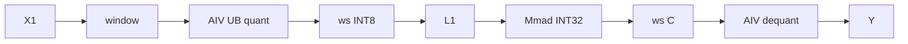
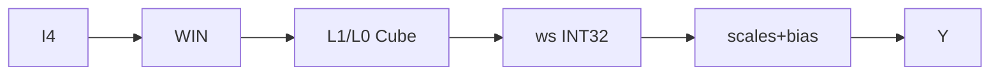

# AlltoAllQuantMatmul A2 ACLNN 算子知识

## 算子速览

| 项目 | 内容 |
|---|---|
| 实际入口 | `aclnnAlltoAllQuantMatmulV2GetWorkspaceSize` / `aclnnAlltoAllQuantMatmulV2`，公开 ACLNN V2 |
| 计算语义 | AlltoAll→Permute→静态或 per-token 动态 Quant→MatMul→双 scale Dequant→可选 bias |
| 输入输出 | `x1[BS,H]`、`x2[H*R,N]`（可转置）、scale/bias；`y[BS/R,N]` 与可选 `alltoAllOut[BS/R,H*R]` |
| 执行类型 | 单 Kernel `MIX_CV`：AIV 做 MTE 通信/重排/量化/反量化，AIC 做 CATLASS Cube MatMul |
| Kernel 路线 | R-001 A16W8 动态量化；R-002 A16W4 动态量化；R-003 A4W4 静态量化 |
| 核心资源 | HCCL window GM、workspace、L1/L0A/L0B/L0C、AIV 160 KiB UB |
| 来源闭包 | `source_closed`：V2 ACLNN、base/inner、Tiling/POD/key、MIX entry、通信/量化/Cube/dequant 与构建注册闭合 |
| 验证状态 | 已完成源码闭包检查；本次知识提取未执行编译、真机、数值或性能测试。 |

## 接口与语义

### 计算语义

令 `R=rankSize`、`M=BS/R`、`K=H*R`：

```text
A = AlltoAll(x1.view(R,BS/R,H)).permute(1,0,2).view(M,K)
动态路线: s1[row]=max(abs(A[row]))/qmax; Aq=Quant(A/s1)
Cq = Aq @ x2 或 x1_int4 @ x2_int4
y = cast(Cq * s1[:,None] * x2Scale[None,:] + bias)
```

R-001 的 `qmax=127`、Aq 为 INT8；R-002 的 `qmax=7`、Aq 为 packed INT4；R-003 直接消费 INT4 `x1` 与 API `x1Scale`。动态路线若传 `x1ScaleOptional`，先逐 K 乘 smooth scale。`commScale/x1Offset/x2Offset` 是保留参数，A2 body 不消费。

### 输入、输出与属性

| 参数 | shape/layout | dtype | 约束、默认值与语义 |
|---|---|---|---|
| `x1` | `[BS,H]` ND | FP16/BF16 或 INT4 | `BS%R=0`；不空、不非连续、不转置 |
| `x2` | `[H*R,N]` 或 `[N,H*R]` ND | INT8/INT4 | A16W4/A4W4 的 N 偶数；A4W4 的 H 偶数 |
| `biasOptional` | `[N]` | FP16/BF16/FP32 合法组合 | 可空；量化路线由 AIV epilogue 加 |
| `x1ScaleOptional` | smooth 为 `[H*R]`；A4W4 为 `[BS]` | smooth 同 x1；A4W4 FP32 | 动态可空，A4W4 必需 |
| `x2Scale` | `[N]` | FP32 | 必选、per-channel |
| `group/commMode` | 字符串 | — | group 非空；A2 V2 仅 `commMode="aiv"`，内核使用 MTE/window |
| 量化属性 | 标量 | INT64 | `x1QuantMode=3/7`、`x2QuantMode=2`、`commQuantMode=0`；axes 为空或 `[-2,-1]` |
| `output/alltoAllOutOptional` | `[BS/R,N]` / `[BS/R,H*R]` | output FP16/BF16；后者同 x1 | 后者可空 |

### 入口与版本

固定提交同时公开旧版与 V2；V2 新增显式 `commMode`，因此是 A2 同平台最新公开版本。V2 第一段转发 `aclnnAlltoAllQuantMatmulBaseGetWorkspaceSize`，第二段转发 `aclnnAlltoAllQuantMatmulBase`；旧版只补平台默认通信模式。

## Host/Launcher 执行流程

### 参数校验与前处理

顺序为 `CheckX2Valid`→A2 拒绝非连续 x2→DAV_2201 上 `InputPreProcessInt4` 将 INT32 打包视图改为 INT4→`CheckAndHandleParams` 校验空指针/空 tensor/shape/dtype/format/axes/transpose/group/commMode→`CheckAndHandleCommMode`→inner。inner 补 `worldSize=-1`、`yDtype` 和 `all2AllOutFlag`，调用 `aclnnInnerAlltoAllMatmulGetWorkspaceSize`。第二段为 A2 设置 `NNOPBASE_HCCL_SERVER_TYPE_MTE` 后调用 inner executor；失败立即传播。

### 参数、Workspace 与生命周期

```text
dequantSize = BS*N*4
dynamic quantSize = (m0*pValue)*(H*R)*2*(INT8:1, INT4:1/2) bytes
quantScaleSize = align32_elements(BS)*4/R
dynamic ws = 16 MiB + quantSize + dequantSize + quantScaleSize
static A4W4 ws = 16 MiB + dequantSize
```

`GetUserWorkspace` 跳过 16 MiB 系统区；动态布局依次为 quant A、INT32 C、FP32 per-token scale，静态布局仅 C。通信中间值位于 HCCL `windowsIn`，Tiling 在可查询时要求窗口至少 200 MiB。executor、转换 tensor 与 workspace 必须覆盖 stream 执行期。

### 启动图与失败传播

```text
ACLNN V2 -> base/inner -> AlltoAllMatmulTilingFunc -> AlltoAllMatmulTiling910b
  -> key(hasBias,transX2,quantType,biasDtype,SOC_ASCEND910B)
  -> allto_all_matmul [MIX_AIC_1_2]
       AIV: window AlltoAll/Permute -> optional Quant -> Dequant
       AIC: wait flag -> CATLASS MatMul -> signal reusable block
  -> SyncAll<false>
```

Tiling 设 `scheduleMode=1` 和 `blockDim=CalcTschBlockDim(aivNum,aicNum,aivNum)`；Host/Tiling/HCCL/key/launch 任一失败均无 Device fallback。

## Route 与参数设计

### 分核与资源计算

Host POD 保存原始 `M=BS,K=H,N`；Device MatMul 为 `[M/R,K*R]@[K*R,N]`。`m0/pValue/ubMoveNum/sendCore/recvCore` 由 route、R∈{2,4,8} 及 M/K/N 条件表选择，`mPerLoop=m0*pValue`，通信深度 `MAX_BLOCK_COUNT=2`。`m0=128` 时 L1/L0 tile 为 `128x256x{INT8:512,INT4:1024}` / `128x256x{128,256}`；否则 M/N 对调为 `256x128`。

### Route 选择

| 顺序 | Route | Key/模板 | 精确选择条件与优先级 | 不适用去向 |
|---:|---|---|---|---|
| 1 | R-001 A16W8 | `A16W8` | x1 FP16/BF16、x2 INT8、mode 7、`K*R%16=0` | Host 失败 |
| 2 | R-002 A16W4 | `A16W4` | x1 FP16/BF16、x2 INT4、mode 7、`K*R%16=0`、N 偶数 | Host 失败 |
| 3 | R-003 A4W4 | `A4W4` | x1/x2 INT4、mode 3、H/N 偶数、FP32 scales | Host 失败 |

```text
ASCEND910B -> dtype pair A16W8 / A16W4 / A4W4 -> 对应 Route；否则 GRAPH_FAILED
```

### 模板/实现执行矩阵

| Route | key/selector | dtype/shape/platform 完整命中条件 | 执行族与 kernel 节点 | 实际模板/body | 内存与同步特征 | tail/fallback |
|---|---|---|---|---|---|---|
| R-001 | bias×transB×A16W8 | A2、R 2/4/8、`K*R<=35000` | AIV comm+INT8 quant+dequant；AIC Cube | `AlltoAllMatmul<AType,int8_t,...,MC2_DYNAMIC_QUANT>` | window ping-pong；A/C/scale slices | M 尾轮裁剪；UB 大 K 分段 |
| R-002 | bias×transB×A16W4 | 同上且 N 偶 | AIV comm+INT4 quant+dequant；AIC Cube | `...<AType,int4b_t,...,MC2_DYNAMIC_QUANT>` | packed A；其余同 R-001 | 同上 |
| R-003 | bias×transB×A4W4 | A2、H/N 偶、`K*R<=35000` | AIV comm+dequant；AIC Cube | `...<int4b_t,int4b_t,...,MC2_STATIC_QUANT>` | 仅 INT32 C workspace | 无动态 quant fallback |

### 隐藏性能 Guard

| Guard | Host/Tiling 条件 | Device/资源原因 | 影响 Route | 不满足时去向 | 源码符号 |
|---|---|---|---|---|---|
| rank | R∈{2,4,8} | 专用 fullmesh/core 表 | 全部 | 失败 | `CheckAndSetAttrsInfo` |
| 对齐 | A16 `K*R%16=0`；INT4 H/N 偶 | Cube/pack | 对应 route | 失败 | `CheckShapeInfo` |
| token 上界 | `K*R<=35000` | window/tiling 表 | 全部 | 失败 | `CheckShapeInfo` |
| window | HCCL buffer≥200 MiB | flag offset 180 MiB 与数据区 | 全部 | 失败 | `DoOpTiling` |
| UB route | `doubleBufferSize<=0 \|\| ubLeft<=0 \|\| copyTokenNum==0` | 160 KiB 不容纳完整 token | R-001/2 | `QuantTokenSegment` | `CalcQuantTokenNumPerUb` |
| 可选输出 | alltoAllOut 非空 | 避免额外 GM 物化 | 全部 | 空则不复制 | `AlltoAll` |

### POD/ABI

| 结构 | 字段 | 类型/位宽 | ABI 布局 | 单位 | Host/launcher producer | Device consumer | 边界 |
|---|---|---|---|---|---|---|---|
| `AlltoAllMatmulInfo` | `M` | `uint32_t` | 第 1 字段；数值 offsetof/sizeof 未导出 | x1 行数 BS | `CheckShapeInfo` | `CommBase::SetTiling`的 `m` | 非 0，后续除 `rankSize` |
| 同上 | `K` | `uint32_t` | 第 2 字段 | x1 列元素 H | `CheckShapeInfo` | `k`，再得 `tokenSize=K*R` | `K*R<=35000` |
| 同上 | `N` | `uint32_t` | 第 3 字段 | y 列元素 | `CheckShapeInfo` | `n`/MatMul layout | 非 0；INT4 route 要求偶数 |
| 同上 | `rankSize` | `uint32_t` | 第 4 字段 | rank 数 | `GetRankSize(group)` | 通信、shape 与 scale offset | 只允许 2/4/8 |
| 同上 | `segmentsNum` | `uint32_t` | 第 5 字段 | K 分段次数 | `CalcQuantTokenNumPerUb` | `copyTimes`/`QuantTokenSegment` | 仅动态分段 route 有效 |
| 同上 | `copyTensorSize` | `uint32_t` | 第 6 字段 | FP32 元素 | 同上 | 分段 UB 搬运长度 | 32 B 对齐的 element count |
| 同上 | `quantSize` | `uint64_t` | 第 7 字段 | 字节 | 动态 route 的 `CalcQuantWorkspaceSize` | quant A extent 及 C 起始 offset | INT4 按两元素/字节 |
| 同上 | `dequantSize` | `uint64_t` | 第 8 字段 | 字节 | `orgM*orgN*sizeof(int32_t)` | scale workspace 起始 offset | 全 route 生成，量化 epilogue 消费 |
| 同上 | `quantScaleSize` | `uint64_t` | 第 9 字段 | 字节 | 动态 route 对齐后 scale 计算 | `SetTiling` 复制；后续 body 未读该数值 | 静态 route inactive |
| 同上 | `isSegmentK` | `bool` | 第 10 字段；C++ bool ABI | 布尔 | UB 字节选择器 | `Quant` 分支 | 仅动态 route |
| 同上 | `hasBias` | `bool` | 第 11 字段；C++ bool ABI | 布尔 | 固定仓 Tiling 未赋值 | Device 未读 POD 此字段 | bias 由 tiling key 模板参数承载 |
| 同上 | `isAlltoallOut` | `bool` | 第 12 字段；C++ bool ABI | 布尔 | API 的 output flag | AIV 可选拷贝分支 | output 空时 false |
| 同上 | `isSmoothQuant` | `bool` | 第 13 字段；C++ bool ABI | 布尔 | `x1ScaleOptional` 存在性 | 动态 quant 乘 smooth scale | A4W4 不走该分支 |
| 同上 | `quantCoreNum` | `uint32_t` | 第 14/末字段 | AIV 核数 | `DoOpTiling` 设为 `aivNum` | `Quant` 按 token 切分 | 动态 route 使用全部 AIV |
| `CoCTiling` | `m0` | `int32_t` | 第 1 字段 | M 行/tile | rank/dtype 参数表 | `mPerLoop=m0*pValue`、Cube tile | 为 128 或 256 |
| 同上 | `pValue` | `int32_t` | 第 2 字段 | 每通信批 M tile 数 | rank/dtype 参数表与 window clamp | commCount/Cube 批深 | INT4 特定路径再乘 4 |
| 同上 | `ubMoveNum` | `int32_t` | 第 3 字段 | 字节 | `TilingParamDeal` | 复制为 `ubPingPongSize=ubMoveNum/2`；后续 body 未读 | Host 用于动态 quant 分段选择 |
| 同上 | `allToAllSendCoreNum` | `int32_t` | 第 4 字段 | AIV 核数 | rank/dtype 参数表 | sender/core-to-rank mapping | 必须能映射 fullmesh |
| 同上 | `allToAllRecvCoreNum` | `int32_t` | 第 5 字段 | AIV 核数 | rank/dtype 参数表 | 可选 alltoAllOut 分行 | 与 `usedCoreNum` 联合限定 |
| 同上 | `k0` | `int32_t` | 第 6 字段 | K tile 元素 | `CalTilingParam` | `SetTiling` 复制；后续 body 未读 | 固定仓 inactive |
| 同上 | `n0` | `int32_t` | 第 7 字段 | N tile 元素 | `CalTilingParam`/clamp | `SetTiling` 复制；后续 body 未读 | 固定仓 inactive |
| 同上 | `swizzlCount` | `int32_t` | 第 8 字段 | tile 组数 | rank 参数表 | `GetBlockIdCoord` Cube scheduler | 与 direction 联合解码 |
| 同上 | `swizzlDirect` | `int32_t` | 第 9/末字段 | 枚举 0/1 | rank 参数表 | `GetBlockIdx` M/N swizzle | 未命中 0/1 时无合法分支 |
| `AlltoAllMatmulTilingData` | `mc2InitTiling` | `Mc2InitTiling` | 第 1 成员 | 通信描述 | `Mc2CcTilingConfig::GetTiling` | HCCL context 初始化 | 必须使用同头 ABI |
| 同上 | `mc2CcTiling` | `Mc2CcTiling` | 第 2 成员 | 通信描述 | 同上 | HCCL 通信参数 | 同上 |
| 同上 | `allToAllMatmulInfo` | `AlltoAllMatmulInfo` | 第 3 成员 | 混合 | shape/workspace/flag producers | `CommBase::SetTiling` | by-value tiling buffer |
| 同上 | `cocTiling` | `CoCTiling` | 第 4/末成员 | 混合 | rank/dtype tiling | comm/quant/Cube scheduler | by-value tiling buffer |

### Route 源码闭包

| Route | Key/selector | Host/Tiling producer | POD/参数 | Kernel entry/router | Kernel body/直接依赖 | 构建接线 |
|---|---|---|---|---|---|---|
| R-001 | A16W8 | `AlltoAllMatmulTiling910b` | A2 POD | dynamic branch | `AlltoAll/Quant/CatlassMatmul/Dequant` | ascend910b OpDef/CMake |
| R-002 | A16W4 | 同上 | 同上 | dynamic branch | 同上，INT4 specialization | 同上 |
| R-003 | A4W4 | 同上 | 同上 | static branch | `AlltoAll/CatlassMatmul/Dequant` | 同上 |

## Kernel 实现

### 公共执行流程

单 kernel 固定 AIC:AIV=1:2。AIV 清 window flag，每轮以 `flagIdx=commIdx%2` 将本 rank shard 搬到远端 window，并用 GM flag 完成跨 rank 到达同步；可选 alltoAllOut 由第二 AIV 子核复制。AIC 在 `CrossCoreWaitFlag(flagIdx)` 后读取 window 或量化 workspace，CATLASS 完成一个 block 后 `CrossCoreSetFlag<0x2,PIPE_FIX>` 允许 AIV 复用。最后 AIV 处理 dequant，`Process` 末尾全核同步。

### Route R-001：A16W8 动态量化

#### 适用条件

##### 选择证据

| 层级 | 文件 | 符号 | 源码谓词/参数 | 结果/下一跳 |
|---|---|---|---|---|
| Host | `allto_all_matmul_tiling_910b.cpp` | `CheckTensorDataType` | A16+INT8 | A16W8 |
| Router | `allto_all_matmul.cpp` | dynamic branch | key A16W8 | INT8 specialization |

#### Device 数据流

##### 函数级调用链

```text
allto_all_matmul -> Init -> Process -> AlltoAll(AIV:comm,Quant,Dequant) || CatlassMatmul(AIC) -> SyncAll
```

##### 源码等价伪码

```text
comm/permute block; s=max_abs/127; Aq=RINT(A/s)->INT8; AIC computes INT32 C; AIV computes C*x2Scale*s+bias
```

#### 内存与数据搬运

##### 资源与搬运表

| 层级/缓冲区 | offset/地址公式 | extent/容量公式 | dtype/layout | producer | consumer | owner/lifetime | 对齐/复用 |
|---|---|---|---|---|---|---|---|
| window | `flagIdx*mPerLoop*K` | 双块 | AType permuted | AIV copy | quant | HCCL context | flag 0/1 |
| workspace A/C/s | 0 / quantSize / quantSize+dequantSize | quantSize / BS*N*4 / scaleSize | INT8/INT32/FP32 | AIV/AIC | AIC/AIV | caller | POD offsets |
| L1/L0 | CATLASS tile | tile-specific | INT8/INT32 | MTE/LoadData | Mmad/Fixpipe | tile | preload |
| UB | quant 160 KiB；epilogue 2-stage | selector/static_assert | FP32/INT8/y | MTE2 | Vector/MTE3 | tile | hard events |

##### 分层内存布局



##### 字节账、交接边与复用顺序

```text
workspace_total = 16 MiB + quantSize + BS*N*4 + align32(BS)*4/R
```

| 边/复用子区 | producer | offset/extent | dtype/layout | consumer | ordering/sync | owner/lifetime | 安全条件 |
|---|---|---|---|---|---|---|---|
| window→quant | comm AIV | current flag block | AType | quant AIV | rank flag/AIV barrier | window | 到达后读 |
| quant→Cube | quant AIV | A slice | INT8 ND | AIC | AIV `SetAicSync(flagIdx)` 以 `CrossCoreSetFlag<0x2,PIPE_MTE3>` 发布；AIC `WaitEvent(flagIdx)` | workspace | quant MTE3 完成后 AIC 才读 |
| Cube→AIV 复用 | AIC | 当前 window/A 块 | AType/INT8 | 下一轮 AIV | AIC `CrossCoreSetFlag<0x2,PIPE_FIX>`；AIV 复用前 `WaitEvent(flagIdx)` | window/workspace | Fixpipe 完成后才覆盖 |
| Cube→dequant | AIC | C slice | INT32 | AIV | 循环 flag 收尾等待，再 AIV barrier 进入 `Dequant` | workspace | 所有 C 行完成 |

#### 同步、精度与尾块

##### 同步与数值边界表

| 阶段 | primitive/机制 | producer | consumer/等待点 | 保护对象 | 精度/尾块 |
|---|---|---|---|---|---|
| comm | GM flag + cross-rank sync | sender | receiver | window | last M loop缩短 |
| quant | MTE2/V/MTE3 events | GM | vector/store | UB/A | FP32 max/scale，RINT→INT8 |
| AIV→AIC | `CrossCoreSetFlag<0x2,PIPE_MTE3>` | quant/store AIV | AIC `WaitEvent(flagIdx)` | quant A/window block | M 尾轮按 `actualPValue` 裁剪 |
| AIC→AIV | `CrossCoreSetFlag<0x2,PIPE_FIX>` | CATLASS AIC | AIV `WaitEvent(flagIdx)` | ping-pong block 复用 | INT32 acc 完成后放行 |
| dequant | MTE2/V/MTE3 hard events | C/scale/bias GM | AIV UB/store | C/scales/D | INT32→FP32，依次乘 x2Scale、乘 s1、加 bias，RINT cast output |

#### 关键实现

##### 符号证据表

| 阶段 | 文件 | 符号/模板实例 | 实现事实 |
|---|---|---|---|
| Host/Tiling producer | `allto_all_matmul_tiling_910b.cpp` | workspace/UB selector | slice 与分段 |
| Kernel entry/router | `allto_all_matmul.cpp` | A16W8 branch | 模板实例 |
| Device body/helper | `allto_all_matmul.h` | `Quant/CatlassMatmul/Dequant` | 完整数据流 |

### Route R-002：A16W4 动态量化

#### 适用条件

##### 选择证据

| 层级 | 文件 | 符号 | 源码谓词/参数 | 结果/下一跳 |
|---|---|---|---|---|
| Host | A2 tiling | dtype selector | A16+INT4、N 偶 | A16W4 |

#### Device 数据流

##### 函数级调用链

```text
AlltoAll -> Quant(INT4) || CatlassMatmul(INT4->INT32) -> Dequant
```

##### 源码等价伪码

```text
s=max_abs/7; Aq=packed_INT4(A/s); Cq=Aq@x2; y=cast(Cq*x2Scale*s+bias)
```

#### 内存与数据搬运

##### 资源与搬运表

| 层级/缓冲区 | offset/地址公式 | extent/容量公式 | dtype/layout | producer | consumer | owner/lifetime | 对齐/复用 |
|---|---|---|---|---|---|---|---|
| workspace A | 0 | dynamic elements/2 | packed INT4 | AIV | AIC | caller | H/N even |
| C/s、L1/L0/UB | 与 R-001 相同偏移规则 | C/s 同 R-001；K tile 1024/256 | INT32/FP32/INT4 | body | body | tile/launch | events |

##### 分层内存布局


##### 字节账、交接边与复用顺序

```text
quantSize = ceil(dynamic_elements/2); workspace_total = 16 MiB + quantSize + BS*N*4 + scaleSize
```

| 边/复用子区 | producer | offset/extent | dtype/layout | consumer | ordering/sync | owner/lifetime | 安全条件 |
|---|---|---|---|---|---|---|---|
| packed A | quant | `dataOffset/2` | INT4 | Cube | AIV→AIC flag | workspace | even packing |

#### 同步、精度与尾块

##### 同步与数值边界表

| 阶段 | primitive/机制 | producer | consumer/等待点 | 保护对象 | 精度/尾块 |
|---|---|---|---|---|---|
| quant pack | V/MTE3 | FP32 vector | GM | INT4 bytes | qmax 7；半字节；M 尾轮 |

#### 关键实现

##### 符号证据表

| 阶段 | 文件 | 符号/模板实例 | 实现事实 |
|---|---|---|---|
| Host/Tiling producer | A2 tiling | A16W4 rank functions | 专用参数表 |
| Kernel entry/router | A2 entry | `BType=int4b_t` | packed route |
| Device body/helper | A2 body | `QuantPerToken/Segment` | qmax7 与 packed store |

### Route R-003：A4W4 静态量化

#### 适用条件

##### 选择证据

| 层级 | 文件 | 符号 | 源码谓词/参数 | 结果/下一跳 |
|---|---|---|---|---|
| Host/Router | A2 tiling/entry | A4W4 predicates | x1=x2=INT4 | static specialization |

#### Device 数据流

##### 函数级调用链

```text
AlltoAll(packed INT4) || CatlassMatmul(INT4->INT32) -> Dequant(API scales)
```

##### 源码等价伪码

```text
communicate packed x1; Cq=x1@x2; y=cast(Cq*x1Scale*x2Scale+bias)
```

#### 内存与数据搬运

##### 资源与搬运表

| 层级/缓冲区 | offset/地址公式 | extent/容量公式 | dtype/layout | producer | consumer | owner/lifetime | 对齐/复用 |
|---|---|---|---|---|---|---|---|
| window | element offset/2 | double block | INT4 | AIV | AIC | HCCL | H even |
| workspace C | 0 | BS*N*4 | INT32 | AIC | AIV | caller | row slices |
| L1/L0/UB | route tile | K 1024/256；epilogue 2-stage | INT4/INT32/FP32 | body | body | tile | flags/events |

##### 分层内存布局



##### 字节账、交接边与复用顺序

```text
workspace_total = 16 MiB + BS*N*4
```

| 边/复用子区 | producer | offset/extent | dtype/layout | consumer | ordering/sync | owner/lifetime | 安全条件 |
|---|---|---|---|---|---|---|---|
| window→Cube | AIV | packed block | INT4 | AIC | flag 0/1 | window | PIPE_FIX 后复用 |
| C→epilogue | AIC | BS*N*4 | INT32 | AIV | final sync | workspace | complete rows |

#### 同步、精度与尾块

##### 同步与数值边界表

| 阶段 | primitive/机制 | producer | consumer/等待点 | 保护对象 | 精度/尾块 |
|---|---|---|---|---|---|
| all | 共用协议 | AIV/AIC | paired wait | packed/C | INT32 acc，FP32 epilogue，M tail |

#### 关键实现

##### 符号证据表

| 阶段 | 文件 | 符号/模板实例 | 实现事实 |
|---|---|---|---|
| Host/Tiling producer | A2 tiling | `Do*RankTiling` | INT4 pValue×4/8-rank 特例 |
| Kernel entry/router | A2 entry | static branch | INT4 template |
| Device body/helper | A2 body | `CatlassMatmul/Dequant` | 无动态 quant |

## 算子特定优化

### Trick T-001：双 window block 的通算重叠

#### 触发与源码依据

- 适用 Route：全部
- 触发条件：MIX 1:2、`MAX_BLOCK_COUNT=2`
- Golden 来源：[`allto_all_matmul.h:797-876`](../../../../../../../cann-ops-raw/ascendc/ops-transformer/be33d95bb755cedec3108f70805c1874d1792540/mc2/allto_all_matmul/op_kernel/arch22/allto_all_matmul.h#L797-L876)

**官方源码（固定 Commit 连续逐字摘录）**：

```cpp
uint64_t flagIdx = commIdx % MAX_BLOCK_COUNT;
if (commIdx >= MAX_BLOCK_COUNT && commIdx < commCount) {
    WaitEvent(flagIdx);
}
```

#### 机制与设计原因

AIV 只在复用同一 block 前等 AIC，通信/量化下一块与 Cube 上一块重叠；AIC 的 PIPE_FIX flag 将写回完成纳入覆盖协议。

#### 迁移边界

- 适用：相同 window、1:2 task ratio 与 depth=2。
- 前提：flag ID、block extent、core 映射完全一致。
- 失效：改变深度或 task ratio 时重做同步。
- 未验证：本次知识提取未执行编译、真机、数值或性能测试。

#### 错误做法

跳过同 flag 的等待会覆盖 AIC 仍在读取的数据。

### Trick T-002：长 K 自动切换分段量化

#### 触发与源码依据

- 适用 Route：R-001、R-002
- 触发条件：160 KiB UB 字节账不能容纳整 token 路径
- Golden 来源：[`allto_all_matmul_tiling_910b.cpp:1568-1588`](../../../../../../../cann-ops-raw/ascendc/ops-transformer/be33d95bb755cedec3108f70805c1874d1792540/mc2/allto_all_matmul/op_host/op_tiling/arch22/allto_all_matmul_tiling_910b.cpp#L1568-L1588)

**官方源码（固定 Commit 连续逐字摘录）**：

```cpp
info.isSegmentK = doubleBufferSize <= 0 || ubLeftForCopyTensor <= 0 || copyTokenNum == 0;
if (info.isSegmentK) {
    quantScaleSize = Block32B<float>::AlignUp(tokenPerCore) * sizeof(float);
```

#### 机制与设计原因

短 K 一次量化多 token；长 K 先分段归约 max，再第二遍量化，避免 UB 超界并保持单一 per-token scale。

#### 迁移边界

- 适用：per-token dynamic quant。
- 前提：A/B dtype、smooth buffer 数与 UB 容量不变。
- 失效：资源变化后必须重算 selector。
- 未验证：本次知识提取未执行编译、真机、数值或性能测试。

#### 错误做法

固定仓 fallback 为 `QuantTokenSegment`；强制整 token route 会违反 UB 字节账。

## 模板与实现对比

| 对比维度 | R-001 A16W8 | R-002 A16W4 | R-003 A4W4 | 设计选择依据 |
|---|---|---|---|---|
| 命中条件/优先级 | A16+INT8 | A16+INT4 | INT4+INT4 | dtype 直接选择 |
| 执行族/节点图 | comm→dyn8→Cube→dequant | comm→dyn4→Cube→dequant | comm→Cube→dequant | 是否动态量化 |
| M/N/K、tile 与 scheduler | K 512/128 | K 1024/256 | K 1024/256 | 位宽 |
| workspace/L1/L0/UB | A+C+s | packed A+C+s | C | 中间物化 |
| AIC/AIV 或 kernel 交接 | flag 0/1 | 同 | window 与 C 两边 | 单 MIX |
| 同步、精度与 tail | qmax127 | qmax7 | API scale | last M loop |
| fallback/失败边界 | UB 分段 | UB 分段 | 无 | 非法条件 Host 失败 |

## 平台差异

| 项目 | A2 | A3 | 950 |
|---|---|---|---|
| 支持状态 | 支持 | 官方 V2 文档明确不支持量化 | 支持，见 `_950` 卡 |
| Host/Launcher | ascend910b，`commMode=aiv` | N/A | arch35 KC/MX，`ai_cpu/ccu` |
| Kernel/资源 | MTE window+CATLASS A2 | N/A | HCCL communicator+RegBase+QuantBMMV3 |

## 限制与失败边界

- 仅 A2；R=2/4/8，不支持空 tensor、非连续、跨超节点或并发调用。
- `commMode` 只接受 `aiv`；保留参数不能外推为已实现的低比特通信/offset。
- 两个动态量化 body 均直接计算 `qmax/maxValue`，固定源码未见 `maxValue==0` 显式分支；不得假定全零 token 有额外数值保护。
- 固定仓未导出 POD 数值 `sizeof/alignof/offsetof`；只可复用同头 ABI，不可手写布局。
- 本次知识提取未执行编译、真机、数值或性能测试。

## 源码索引

### 链路索引

| 链路阶段 | 文件 | 关键符号 | 支撑内容 |
|---|---|---|---|
| 公开约束 | `docs/aclnnAlltoAllQuantMatmulV2.md` | V2 文档 | 平台/公式/约束 |
| 入口声明 | `op_api/aclnn_allto_all_quant_matmul_v2.h` | V2 APIs | 签名 |
| 入口实现 | `op_api/aclnn_allto_all_quant_matmul_v2.cpp` | V2 APIs | base 转发 |
| ACLNN base | `op_api/allto_all_quant_matmul_base.cpp` | base/inner | 校验、INT4、executor |
| Host router | `op_host/op_tiling/allto_all_matmul_tiling.cpp` | tiling func | arch dispatch |
| A2 Tiling | `op_host/op_tiling/arch22/allto_all_matmul_tiling_910b.cpp` | tiling class | key/workspace/selector |
| POD | `op_kernel/arch22/allto_all_matmul_tiling.h` | structs | ABI |
| key | `op_kernel/arch22/allto_all_matmul_tiling_key.h` | template args | 合法组合 |
| Kernel entry | `op_kernel/arch22/allto_all_matmul.cpp` | entry | MIX router |
| Device body | `op_kernel/arch22/allto_all_matmul.h` | operator class | 完整 body |
| 通信 helper | `op_kernel/arch22/allto_all_matmul_util.h` | `CommBase` | window/flag/UB |
| Cube scheduler | `op_kernel/arch22/matmul.hpp` | CATLASS kernel | tile/sync |
| epilogue | `op_kernel/arch22/block_epilogue_dequant.hpp` | block epilogue | scales/bias/cast |
| 平台注册 | `op_host/allto_all_matmul_def.cpp` | ascend910b config | ACLNN 接线 |
| 构建接线 | `CMakeLists.txt` | subtree | 构建入口 |

每行文件均存在于 Frontmatter `sources`。

### 实现复用检查

| 检查项 | 可复用事实 | 不得改变的约束 | 源码符号 |
|---|---|---|---|
| ABI/POD | 同头 producer/consumer | 顺序、bool ABI、单位 | tiling structs |
| 调用顺序 | V2→base→inner→MIX | executor/workspace 生命周期 | API/base |
| workspace/内存 | 动态 A/C/s、静态 C | offsets、INT4 半字节、16 MiB system | workspace/Init |
| 同步 | window 双块/跨 rank/AIC-AIV | flag ID、depth、schedule mode | `AlltoAll/matmul.hpp` |
| 精度与尾块 | FP32 scale、INT32 acc | qmax、cast/round、M tail | quant/epilogue |
| 失败边界 | Host 无 Device fallback | rank/dtype/window/commMode | checks/tiling |