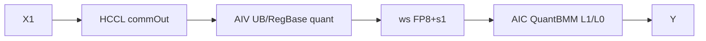
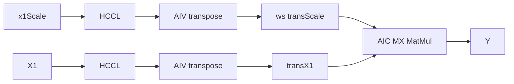

# AlltoAllQuantMatmul 950 ACLNN 算子知识

## 算子速览

| 项目 | 内容 |
|---|---|
| 实际入口 | `aclnnAlltoAllQuantMatmulV2GetWorkspaceSize` / `aclnnAlltoAllQuantMatmulV2`，公开 ACLNN V2 |
| 计算语义 | AlltoAll→Permute/动态 Quant→量化 MatMul；或 x1/x1Scale 双 AlltoAll→双 Permute→MX MatMul |
| 输入输出 | `x1[BS,H]`、`x2`、scale/bias；`y[BS/R,N]` 与可选 `alltoAllOut` |
| 执行类型 | 单 Kernel `MIX_CV`，并含 Device HCCL 通信节点：AIV 控制通信并执行 RegBase quant/transpose，AIC 执行 QuantBatchMatmulV3/MatMulASW Cube；通信不是独立 Kernel |
| Kernel 路线 | R-001 K-C per-token 动态 FP8；R-002 MX FP8/FP4 |
| 核心资源 | user/system workspace、HCCL CCU/AI_CPU、UB/寄存器、QuantBMMV3 L1/L0 |
| 来源闭包 | `source_closed`：公开 V2→base/inner→arch35 KC/MX Tiling→POD/key→APT MIX kernel→通信/quant/transpose/MatMul 闭合 |
| 验证状态 | 已完成源码闭包检查；本次知识提取未执行编译、真机、数值或性能测试。 |

## 接口与语义

### 计算语义

令 `R=rankSize`、`M=BS/R`、`K=H*R`。

- R-001：`A=Permute(AlltoAll(x1))`；每行 `s1=max(abs(A))/FP8_MAX`，动态量化到 `x1QuantDtype∈{FP8_E5M2,FP8_E4M3FN}`。实际 body 的顺序是 `C=Aq@x2`（当前实例 `l0cDtype=float`）→`C*x2Scale`→`*s1`→`+bias`→cast 到 y。公开文档写成 `(Aq@x2+bias)*s1*x2Scale`，与 `Mc2QuantBmmPertokenRegbaseKernel::VFDoDequant` 的顺序不一致；复用实现时以固定提交的 Device body 为准并保留此差异。
- R-002：`x1` 与 `x1Scale[BS,ceil(H/64),2]` 分别 AlltoAll/Permute；使用 group `[M,N,K]=[1,1,32]` 的 MX MatMul，x1/x2 scale 均为 FP8_E8M0，输出加可选 FP32 bias。

### 输入、输出与属性

| 参数 | shape/layout | dtype | 约束、默认值与语义 |
|---|---|---|---|
| `x1` | `[BS,H]` ND | KC: FP16/BF16；MX: FP8_E4M3FN/E5M2 或 FP4_E2M1 | `BS%R=0`，不空；MX H%64=0 |
| `x2` | KC `[H*R,N]` 或转置；MX 要求转置语义 | KC FP8 E4/E5；MX FP8 E4/E5 或 FP4 | MX FP4 要求 x1/x2 都是 FP4 |
| `biasOptional` | `[N]` | FP32 | 可空 |
| `x1ScaleOptional` | KC 不允许；MX `[BS,H/64,2]` | MX FP8_E8M0 | MX 必选 |
| `x2Scale` | KC `[N]`；MX `[N,(H*R)/64,2]` | KC FP32；MX FP8_E8M0 | 必选 |
| `x1QuantDtype` | scalar | INT64 | KC 35=E5M2、36=E4M3FN；MX 不生效 |
| `x1/x2QuantMode` | scalar | INT64 | KC `7/2`；MX `6/6` |
| `groupSize` | packed scalar | INT64 | MX 解析或推导后必须 `[1,1,32]` |
| `commMode` | string | — | `ai_cpu` 或 `ccu`；同一通信域只能一种；CCU 仅单机 UB 域 |
| output | `[BS/R,N]`，可选 alltoAllOut `[BS/R,H*R]` | y FP16/BF16/FP32；alltoAllOut 同 x1 | x2 可支持合法转置非连续，其它非连续不支持 |

### 入口与版本

V2 相对旧入口新增 `commMode`，950 可显式选择 `ai_cpu/ccu`，故为最新公开版本。V2 两段分别转发 base workspace/executor 与 base execute；base 对合法转置非连续 x2 执行 `TransX2Tensor` 并更新 `transposeX2`。

## Host/Launcher 执行流程

### 参数校验与前处理

base 先校验 x2；950 检测仅末两维转置的非连续视图，若调用者同时置 `transposeX2=true` 则报错，否则转成连续并置转置标志。随后校验非空、shape、scale shape、KC/MX dtype 组合、ND/private format、axes、transposeX1、group 与 commMode。inner 补 `worldSize=-1/yDtype/all2AllOutFlag`，构造 `AlltoAllMatmul` 节点并把通信枚举保存到 executor user handle。第二段据 user handle 选择 CCU 或 AI_CPU HCCL server type，再提交 inner executor。

### 参数、Workspace 与生命周期

KC：

```text
commLen = align512(M*K*sizeof(x1))
permuteLen = alltoAllOut为空 ? commLen : 0
x1ScaleOptionalLen = align512(M*4)
quantOutLen = align512(M*K)  // FP8 one byte
workspace = libApiWorkspace + commLen + permuteLen + x1ScaleOptionalLen + quantOutLen
```

Device 依次切为 `commOut`、可选 permute 区、FP32 s1、FP8 quantOut。

MX：`scaleLen=align512(BS*ceil(H/64)*2)`；workspace 布局为 `commScale[scaleLen]`、`commX1[commLen]`、`transScale[scaleLen]`、若 alltoAllOut 为空再分 `transX1[permuteLen]`，另加 lib workspace。FP4 的 `commLen=align512(ceil(M*K/2))`。executor/workspace 生命周期覆盖 stream。

### 启动图与失败传播

```text
V2 -> base/inner -> DAV_3510 tiling registry
  -> priority 1 KC IsCapable(7,2) / priority 2 MX IsCapable(6,6)
  -> key(quantMode,transX2,biasFP32,isSmallK,commType)
  -> all_to_all_matmul_apt [MIX_AIC_1_2]
       KC: HCCL wait -> AIV dynamic quant+optional permute -> AIC QuantBMM
       MX: scale HCCL+transpose; then per tile x1 HCCL+transpose -> AIC MX MatMul
```

Tiling `scheduleMode=1`、`blockDim=aicCoreNum`；HCCL `PrepareAll` 先 Commit 全量 wait-one tasks，逐 task `Wait`。任何 validation/Tiling/HCCL/launch 失败均由 executor 返回；kernel 内 MX 的空 pointer 或 `rankDim=0` 直接无输出返回。

## Route 与参数设计

### 分核与资源计算

Host 归一化 `orgM=BS, orgK=H, m=M, k=H*R, n=N`，通算公式化 Tiling 产生 `tileM/tileCnt/tailM/tailCnt`；4/8 卡 KC、4 卡 MX 可用 `AlltoAllMatmulFitBalanceTiling`，其它形态用基类公式。每个 head/tail 分别调用 QuantBMMV3 tiler，写入独立 `mc2QuantMmTile/TailTilingData`。KC `isSmallK`：

```text
inputTerm = ((sizeof(x1)*H + 31)/32) * R
quantTerm = ((sizeof(Aq)*H + 31)/32) * R
sizeSmall = 8*max(tileM,tailM) + 2*(inputTerm + quantTerm)
isSmallK = sizeSmall < 248 KiB
```

这里保留 `GetTilingKey` 的逐字算式：两个 `*Term` 在除以 32 后没有再乘 32，不能改写成“对齐后的字节数”。Device small-K body 则按 `ceil(H*sizeof(dtype)/32)*32*R` 分配每份真实 buffer；两者的单位口径差异是固定源码可见限制。

### Route 选择

| 顺序 | Route | Key/模板 | 精确选择条件与优先级 | 不适用去向 |
|---:|---|---|---|---|
| 1 | R-001 KC 动态 FP8 | KC E4/E5 × small/large K × transB × CCU/AI_CPU | modes 7/2、合法 x1/x2/bias/output、x1QuantDtype 35/36 | 失败；不转 MX |
| 2 | R-002 MX | MX × transB × CCU/AI_CPU | modes 6/6、MX dtype/scale/group/transpose 约束 | 失败 |

```text
mode(7,2)->KC(priority 1); mode(6,6)->MX(priority 2); 其它量化组合无 route
```

### 模板/实现执行矩阵

| Route | key/selector | dtype/shape/platform 完整命中条件 | 执行族与 kernel 节点 | 实际模板/body | 内存与同步特征 | tail/fallback |
|---|---|---|---|---|---|---|
| R-001 | E4/E5 × smallK × transB × comm | 950；R 2/4/8/16；K≤65535；KC types | AIV HCCL+RegBase quant；AIC QuantBMMV3 | `Fp8DynamicQuantPertoken<x1,E4/E5,isSmallK>` + `Mc2QuantBmmPertokenRegbaseKernel` | KC workspace；`SyncAll<true/false>` | head/tail POD；small/large UB specialization |
| R-002 | MX × transB(true) × comm | 950；H%64=0；MX scale/group/type | AIV scale comm+transpose、x1 comm+transpose；AIC `MatMulASWKernel` | FP8 或 FP4 specialization | 4 workspace slices；soft flags 8/9 | head/tail POD；无 fallback |

KC 的可达 key 轴是 `quantMode(E4/E5) × x2Transpose(0/1) × isSmallK(0/1) × comm(CCU/AI_CPU)`，bias 轴固定 FP32，即每个已编译 dtype 实例 16 种组合。MX 的 key 声明虽列出 `x2Transpose(0/1)`，Host `CheckX2Transpose` 强制 true；所以可达轴只有 `MX × transB(true) × biasFP32 × isSmallK(false) × comm(CCU/AI_CPU)`，false 组合是 dormant key。已编译 MX dtype 实例为 E4/E5 的四种 x1/x2 交叉组合及 FP4/FP4。

### 隐藏性能 Guard

| Guard | Host/Tiling 条件 | Device/资源原因 | 影响 Route | 不满足时去向 | 源码符号 |
|---|---|---|---|---|---|
| quant selector | KC 7/2；MX 6/6 | 不同 POD/body | 全部 | 无 route | `IsCapable` |
| KC output dtype | x1QuantDtype 35/36 | FP8 qmax/MatMul A type | R-001 | 失败 | `SetKcDataTypeInfo` |
| smallK | `8*maxM + 2*(((x1BytesPerRank+31)/32)*R + ((AqBytesPerRank+31)/32)*R) < 248*1024` | 选择双 buffer 整行路线；Host 表达式与 Device 真实 32B 对齐 buffer 的单位口径不一致 | R-001 | largeK specialization | `GetTilingKey` / `ProcessOneTokenSmallK` |
| MX group | inferred `[1,1,32]` | QuantBMM group contract | R-002 | 失败 | `CheckGroupSize` |
| MX layout | H%64=0、3D scales、x2 transpose | scale pair与 K block | R-002 | 失败 | `CheckMxQuantShapeInfo/CheckX2Transpose` |
| comm | `ai_cpu/ccu` | HCCL server template | 全部 | 失败 | `GetAndConvertCommMode` |
| task count | communicator handle array 63 | HCCL handle capacity | 全部 | 固定仓没有显式 Host 上界校验，需保持 Tiling task 数合法 | `HcclCommunicator` |

### POD/ABI

| 结构 | 字段 | 类型/位宽 | ABI 布局 | 单位 | Host/launcher producer | Device consumer | 边界 |
|---|---|---|---|---|---|---|---|
| `AlltoAllMatmulTilingInfo` | `rankDim` | `uint32_t/32` | 第 1 字段；数值 `offsetof/sizeof/alignof` 固定仓未导出 | rank 数 | `SetTilingInfo=contextInfo_.args_.rankDim` | KC/MX arch、通信/transpose context | 公开支持 2/4/8/16；MX body 额外拒绝 0 |
| 同上 | `tileM` | `uint32_t/32` | 第 2 字段；数值 ABI 未导出 | 行/task | `SetTilingInfo=inferredInfo_.tileM` | `ProcessTile` offsets/context | `tileCnt>0` 时有效 |
| 同上 | `tileCnt` | `uint32_t/32` | 第 3 字段；数值 ABI 未导出 | task 数 | `SetTilingInfo=inferredInfo_.tileCnt` | `Process/PrepareAll` | 与 63-handle 上限共同约束 |
| 同上 | `tailM` | `uint32_t/32` | 第 4 字段；数值 ABI 未导出 | 行/task | `SetTilingInfo=inferredInfo_.tailM` | `ProcessTail` offsets/context | `tailCnt=0` 时 inactive |
| 同上 | `tailCnt` | `uint32_t/32` | 第 5 字段；数值 ABI 未导出 | task 数 | `SetTilingInfo=inferredInfo_.tailCnt` | `Process/PrepareAll` | 可为 0 |
| 同上 | `biasLen` | `uint32_t/32` | 第 6 字段；数值 ABI 未导出 | 字节 | KC/MX `SetTilingInfo` 未赋值 | 量化 arch35 body 不读 | inactive；不可外推基类非量化含义 |
| 同上 | `rankM` | `uint32_t/32` | 第 7 字段；数值 ABI 未导出 | 原始 BS 行 | `contextInfo_.args_.orgMValue` | 通信 stride、tail 基址、scale 长度 | 写入前由 API/tiling shape 限制窄化 |
| 同上 | `rankN` | `uint32_t/32` | 第 8 字段；数值 ABI 未导出 | 输出列 | `contextInfo_.args_.nValue` | y task offset | `1..INT32_MAX` |
| 同上 | `rankK` | `uint32_t/32` | 第 9 字段；数值 ABI 未导出 | 每 rank H 元素 | `contextInfo_.args_.orgKValue` | 通信、quant/transpose、MatMul K | `rankDim*rankK<=65535`；MX `rankK%64=0` |
| 同上 | `aicCoreNum` | `uint32_t/32` | 第 10 字段；数值 ABI 未导出 | AIC 核 | KC/MX `SetTilingInfo` 未赋值；blockDim 直接由 context 设置 | 当前量化 arch35 body 不读 | inactive |
| 同上 | `commLen` | `uint64_t/64` | 第 11 字段；padding/offset 数值未导出 | 字节 | KC/MX `SetUserWorkSpace` 后写入 | workspace 切片、KC/MX arch | 512B 对齐；FP4 为 packed bytes |
| 同上 | `permuteLen` | `uint64_t/64` | 第 12 字段；数值 ABI 未导出 | 字节 | 无 `alltoAllOut` 时等于 `commLen` | workspace 切片 | 有正式输出时为 0 |
| 同上 | `hcclDataType` | `uint64_t/64` | 第 13 字段；数值 ABI 未导出 | HCCL enum | KC 写 x1 HCCL dtype；MX 也赋值但 entry 另按 x1 type 构造 runtime enum | KC communication context；MX 当前 body 不读该字段 | 高位未使用，Device 转 `uint8_t` |
| 同上 | `x1ScaleOptionalLen` | `uint64_t/64` | 第 14 字段；数值 ABI 未导出 | 字节 | KC 写 `align512(M*4)`；MX 不写 | KC `x1ScaleGM_`→`quantOutGM_` offset | MX inactive |
| 同上 | `dynamicExtraSpace` | `uint64_t/64` | 第 15 字段；数值 ABI 未导出 | 字节 | KC/MX 均显式写 0 | 当前 body 不读 | inactive |
| 同上 | `x1QuantDtype` | `uint64_t/64` | 第 16 字段；数值 ABI 未导出 | GE dtype enum | KC `SetKcDataTypeInfo` 写 35/36；MX 不写 | 当前 entry 已用 key 选择模板，arch body 不读 | MX inactive |
| `AlltoAllQuantMatmulTilingData` | `mc2InitTiling` | `Mc2InitTiling` | 第 1 字段；复合 ABI 数值未导出 | HCCL init descriptor | `SetHcclTiling` | `Hccl::InitV2` | by-value tiling buffer |
| 同上 | `mc2CcTiling` | `Mc2CcTiling` | 第 2 字段；`offsetof` 由同头编译 | HCCL task descriptor | `SetHcclTiling` | `SetCcTilingV2(offsetof(...))` | Host/Device 必须同头 |
| 同上 | `alltoAllQuantMatmulTilingInfo` | 上述结构 | 第 3 字段；复合 ABI 数值未导出 | 混合 | KC/MX `SetTilingInfo` | arch35 address/task producer | inactive 字段不得读取 |
| 同上 | `mc2QuantMmTileTilingData` | `Mc2QuantBatchMatmulV3TilingDataParams` | 第 4 字段；复合 ABI 数值未导出 | MatMul tiling | head helper `DoTiling` | KC/MX computation wrapper | `tileCnt>0` 时有效 |
| 同上 | `mc2QuantMmTailTilingData` | `Mc2QuantBatchMatmulV3TilingDataParams` | 第 5 字段；复合 ABI 数值未导出 | MatMul tiling | tail helper `DoTiling` | KC/MX computation wrapper | `tailCnt=0` 时 inactive |

### Route 源码闭包

| Route | Key/selector | Host/Tiling producer | POD/参数 | Kernel entry/router | Kernel body/直接依赖 | 构建接线 |
|---|---|---|---|---|---|---|
| R-001 | KC key axes | KC tiling base | Quant POD | `allto_all_matmul_apt.cpp` KC macro | KC arch/pipeline + communicator + FP8 quant + KC MatMul wrapper | ascend950 OpDef/CMake |
| R-002 | MX key axes | MX tiling base | Quant POD | APT MX macro | MX arch/pipeline + communicator + transpose + MX MatMul wrapper | 同上 |

## Kernel 实现

### 公共执行流程

APT entry 固定 MIX 1:2；`COMMTYPE` 编译期选择 `HCCL_SERVER_TYPE_CCU/AICPU`。`HcclCommunicator<false,...,send=0,recv=1>` 仅 block0 AIV 控制通信，`PrepareAll` 为任务建立并 Commit handle，`Process(i)` Wait。所有计算 wrapper 在每 task 前 `TPipe::Reset` 并从 head/tail POD 初始化底层 QuantBMMV3；`End` 等待未完成 HCCL handle 并 Finalize。

### Route R-001：K-C per-token 动态 FP8

#### 适用条件

##### 选择证据

| 层级 | 文件 | 符号 | 源码谓词/参数 | 结果/下一跳 |
|---|---|---|---|---|
| Host | KC tiling | `IsCapable/GetTilingKey` | 7/2；dtype 35/36；smallK byte guard；comm | KC key |
| Router | APT entry | KC macro | `QUANTMODE=KC_E4/E5` | FP8 quant + QuantBMM |

#### Device 数据流

##### 函数级调用链

```text
APT -> AlltoAllKcQuantMatmulArch35::Process
  -> Pipeline::Process(taskCnt): HCCL Wait(AIV) -> SyncAll<true> -> Fp8DynamicQuantPertoken(AIV)
  -> SyncAll<false> -> MC2KCQuantMatmul::Process(AIC)
```

##### 源码等价伪码

```text
for task: wait AlltoAll tile; gather R K-blocks per row; max_abs; s=max/FP8_MAX;
optional write original permute output; write FP8 Aq+s; all-core sync; QuantBMM(Aq,x2,x2Scale,s,bias)->y
```

#### 内存与数据搬运

##### 资源与搬运表

| 层级/缓冲区 | offset/地址公式 | extent/容量公式 | dtype/layout | producer | consumer | owner/lifetime | 对齐/复用 |
|---|---|---|---|---|---|---|---|
| commOut | ws 0 | commLen | x1 dtype, rank-major | HCCL | quant AIV | caller | 512B |
| transOut | API output 或 ws after comm | permuteLen | original x1 | quant AIV | caller | output/ws | optional |
| s1 | `commLen+permuteLen` | align512(M*4) | FP32 | quant AIV | QuantBMM | workspace | task offset tileM*4 |
| Aq | after s1 | align512(M*K) | FP8 ND | quant AIV | AIC | workspace | task offset tileM*K |
| UB/reg | small: 2×raw+2×quant；large: one queue, per-rank streaming | `<248KiB` selector / dynamic TOTAL_UB | x1/FP8/FP32 | MTE2 | RegBase/MTE3 | task | events/masks |
| L1/L0→UB | QuantBMMV3 head/tail POD；`cT=VECIN, ND_ALIGN, l0cDtype=float` | `baseM/baseN/singleCoreK` 由嵌套 tiling 决定 | FP8×FP8、float 累加/UB C | `MatmulImpl::Iterate/GetTensorC` | AIV `VFDoDequant` | 每个 Cube block/task | `Mc2QuantBmmAswBlock` 调度，AIC/AIV 硬同步防覆盖 |

##### 分层内存布局



##### 字节账、交接边与复用顺序

```text
workspace_total = libApi + commLen + permuteLen + align512(M*4) + align512(M*K)
Host_smallK_key = 8*maxTileM + 2*(((sizeof(x1)*H+31)/32)*R + ((sizeof(fp8)*H+31)/32)*R) < 248 KiB
Device_smallK_buffers = 2*(ceil(sizeof(x1)*H/32)*32*R + ceil(sizeof(fp8)*H/32)*32*R)
                       + align32(rowsThisCore*4) + 32
```

| 边/复用子区 | producer | offset/extent | dtype/layout | consumer | ordering/sync | owner/lifetime | 安全条件 |
|---|---|---|---|---|---|---|---|
| comm→quant | HCCL | task comm tile | x1 rank-major | AIV quant | HCCL Wait + `SyncAll<true>` | ws | task complete |
| quant→Cube | AIV | Aq+s1 task slices | FP8/FP32 | AIC QuantBMM | `SyncAll<false>` | ws | all AIV finished |
| Cube→Vector epilogue | AIC `GetTensorC` | `l0cOutUb_`，`ceil(singleCoreM/2)×alignedN` | float/ND_ALIGN | 两个 AIV `VFDoDequant` | AIC `NotifyVector`，AIV `WaitForCube`；AIV 完成后 `NotifyCube` | QuantBMM 内部 UB，单 block round | 下一 round AIC 覆盖前等待 AIV；末轮额外配对一次 |

#### 同步、精度与尾块

##### 同步与数值边界表

| 阶段 | primitive/机制 | producer | consumer/等待点 | 保护对象 | 精度/尾块 |
|---|---|---|---|---|---|
| HCCL | Commit/Wait | server | AIV | comm tile | head/tail distinct tasks |
| quant | MTE2_S/MTE3_S + RegBase masks | GM | scalar/vector/store | UB/Aq/s | E4 max448、E5 max57344；FP32 scale；RINT FP8 |
| AIV→AIC | `SyncAll<false>` | quant | QuantBMM | Aq/s | tail uses tail POD/offset |
| QuantBMM AIC↔AIV | `CrossCoreSet/WaitFlag<AIC_SYNC_AIV_MODE>`，AIC `PIPE_FIX`→AIV、AIV `PIPE_V`→AIC | Cube `GetTensorC` / AIV epilogue | AIV `VFDoDequant` / 下一 Cube round | `l0cOutUb_` 与输出队列 | float C 先乘 x2Scale、再乘 FP32 per-token scale、再加 FP32 bias，最后 RINT cast；M/N tail 来自 ASW block |

#### 关键实现

##### 符号证据表

| 阶段 | 文件 | 符号/模板实例 | 实现事实 |
|---|---|---|---|
| Host/Tiling producer | KC tiling | `GetTilingKey/SetUserWorkSpace` | smallK/key/slices |
| Kernel entry/router | APT | KC macro | E4/E5+comm specialization |
| Device body/helper | KC arch/pipeline + fp8 quant + `qbmm_mix_online_dynamic.h` | `ProcessTile/Tail/ProcessOneToken*`、`Mc2QuantBmmPertokenRegbaseKernel::ProcessWithoutBatch/VFDoDequant` | offsets、RegBase、Cube↔Vector flags 与双 scale/bias 顺序 |

### Route R-002：MX FP8/FP4

#### 适用条件

##### 选择证据

| 层级 | 文件 | 符号 | 源码谓词/参数 | 结果/下一跳 |
|---|---|---|---|---|
| Host | MX tiling | `IsCapable/Check*` | 6/6、H%64、scale 3D、group 1/1/32 | MX key |
| Router | APT | MX branches | FP8 pair 或 FP4 pair | MX specialization |

#### Device 数据流

##### 函数级调用链

```text
APT -> MX Arch::Process -> ProcessScale(HCCL+transpose)
  -> ProcessTile/Tail: HCCL x1 -> MC2VecTranspose(AIV) -> flags 8/9 -> MC2MXQuantMatmul(AIC)
```

##### 源码等价伪码

```text
alltoall+permute x1Scale once; for each tile alltoall+permute x1; wait soft flag9;
MatMulASW(x1,x2,per-block x1Scale,x2Scale,bias)->y
```

#### 内存与数据搬运

##### 资源与搬运表

| 层级/缓冲区 | offset/地址公式 | extent/容量公式 | dtype/layout | producer | consumer | owner/lifetime | 对齐/复用 |
|---|---|---|---|---|---|---|---|
| commScale | 0 | scaleLen | E8M0 rank-major | HCCL | scale transpose | ws | 512B |
| commX1 | scaleLen | commLen | FP8 or packed FP4 | HCCL | transpose | ws | FP4 K bytes=ceil(H/2) |
| transScale | scaleLen+commLen | scaleLen | E8M0 permuted | AIV | MX MatMul | ws | full lifetime |
| transX1 | API alltoAllOut or after transScale | permuteLen | FP8/FP4 ND | AIV | AIC | output/ws | optional alias choice |
| transpose UB | queue depth1 | TOTAL_UB/2 | source dtype | MTE2/MTE3 | GM | per task | 64×256 blocks |
| L1/L0 | QuantBMM tiling | POD | MX types/FP32 bias | ASW kernel | Cube/epilogue | task | group K=32 |

##### 分层内存布局



##### 字节账、交接边与复用顺序

```text
workspace_total = libApi + scaleLen + commLen + scaleLen + permuteLen
scaleLen = align512(BS*ceil(H/64)*2); FP4 commLen = align512(ceil(M*K/2))
```

| 边/复用子区 | producer | offset/extent | dtype/layout | consumer | ordering/sync | owner/lifetime | 安全条件 |
|---|---|---|---|---|---|---|---|
| HCCL→transpose | communicator | comm slice | rank-major | AIV | Wait+`SyncAll<true>` | ws | complete task |
| transpose→Cube | AIV | task trans slice | ND | AIC | AIV all flag8 then set flag9；AIC wait9 | ws/output | flag IDs unused by MatMul |

#### 同步、精度与尾块

##### 同步与数值边界表

| 阶段 | primitive/机制 | producer | consumer/等待点 | 保护对象 | 精度/尾块 |
|---|---|---|---|---|---|
| transpose | `DataCopyPad` + PIPE_ALL | GM | GM | 64×256/tail | blockCount/Len tail |
| AIV→AIC | soft flags 8/9 | transpose | MatMul | trans tile | head/tail offsets |
| MX math | `MatMulASWKernel` | FP8/FP4+E8M0 scales | y | L1/L0/epilogue | group `[1,1,32]`，bias FP32 |

#### 关键实现

##### 符号证据表

| 阶段 | 文件 | 符号/模板实例 | 实现事实 |
|---|---|---|---|
| Host/Tiling producer | MX tiling | `SetUserWorkSpace/DoMxQuantMMTiling` | slices 与 head/tail POD |
| Kernel entry/router | APT | MX macros | FP8/FP4、comm template |
| Device body/helper | MX arch/pipeline + vec transpose | `ProcessScale/Tile/Tail/Process` | 双通信、transpose、flags |

## 算子特定优化

### Trick T-001：KC small-K/large-K UB 专门化

#### 触发与源码依据

- 适用 Route：R-001
- 触发条件：`sizeOfSmallKUsed < 248*1024`
- Golden 来源：[`allto_all_kc_quant_matmul_tiling_base.cpp:545-569`](../../../../../../../cann-ops-raw/ascendc/ops-transformer/be33d95bb755cedec3108f70805c1874d1792540/mc2/allto_all_matmul/op_host/op_tiling/arch35/allto_all_kc_quant_matmul_tiling_base.cpp#L545-L569)

**官方源码（固定 Commit 连续逐字摘录）**：

```cpp
uint64_t sizeOfSmallKUsed = sizeof(double) * maxM + doubleBuffNum * (sizeOfInputKInUB + sizeOfQuantKInUB);
bool isSmallK = sizeOfSmallKUsed < sizeOfUB ? true : false;
```

#### 机制与设计原因

small-K 双缓冲整行跨 rank K，重叠搬入/量化；large-K 按 rank block 流式搬入并逐块归约，降低 UB 峰值。该 bool 进入模板 key，不是运行时猜测。需注意 Host 片段中的 `sizeOfInputKInUB/sizeOfQuantKInUB` 只保留了 32B block 数，而 Device `InitBuffer` 使用真实字节数；本卡不把二者擅自等同。

#### 迁移边界

- 适用：950 KC FP8 dynamic quant。
- 前提：248 KiB、双缓冲、输入/输出 dtype 与 maxM 一致，并重新核对上述 Host/Device 单位口径。
- 失效：UB 或 buffer 结构变化需重算 Host guard。
- 未验证：本次知识提取未执行编译、真机、数值或性能测试。

#### 错误做法

固定仓明确提供 large-K specialization；强制 small-K 可能超 UB。

### Trick T-002：MX scale 与数据分开通信并永久复用转置 scale

#### 触发与源码依据

- 适用 Route：R-002
- 触发条件：MX 6/6
- Golden 来源：[`allto_all_mx_quant_matmul_arch35.h:112-172`](../../../../../../../cann-ops-raw/ascendc/ops-transformer/be33d95bb755cedec3108f70805c1874d1792540/mc2/allto_all_matmul/op_kernel/arch35/allto_all_mx_quant_matmul_arch35.h#L112-L172)

**官方源码（固定 Commit 连续逐字摘录）**：

```cpp
// 启动scale通信和转置
ProcessScale();
// 启动主块流水
if (mc2Tiling_.tileCnt > 0) {
    ProcessTile(mc2Tiling_.tileCnt);
}
```

#### 机制与设计原因

x1Scale 只通信/转置一次，存入独立 `transX1Scale` slice；后续所有 head/tail MatMul 通过 task offset 复用，避免每个 x1 tile 重复处理 scale。

#### 迁移边界

- 适用：scale 对整个 M/K 域固定的 MX route。
- 前提：scale layout `[BS,H/64,2]`、group 64/32 解释与 workspace lifetime 不变。
- 失效：逐 task 更新 scale 或不同通信域时不能复用。
- 未验证：本次知识提取未执行编译、真机、数值或性能测试。

#### 错误做法

把 `transScale` 与 tile 临时区重叠会在后续 MatMul 尚需读取时被覆盖。

## 模板与实现对比

| 对比维度 | R-001 KC dynamic FP8 | R-002 MX | 设计选择依据 |
|---|---|---|---|
| 命中条件/优先级 | modes 7/2，priority1 | modes 6/6，priority2 | `IsCapable` |
| 执行族/节点图 | HCCL→RegBase quant→QuantBMM | scale HCCL/trans；x1 HCCL/trans→MX MM | 是否动态量化 |
| M/N/K、tile 与 scheduler | head/tail + small/largeK | head/tail + MX ASW | UB/group contract |
| workspace/L1/L0/UB | comm/perm/s/Aq | commScale/commX1/transScale/transX1 | 中间数据 |
| AIC/AIV 或 kernel 交接 | SyncAll true/false | soft flag8/9 | 计算模板冲突边界 |
| 同步、精度与 tail | FP32 max→E4/E5 | E8M0 scales、FP8/FP4 | 量化语义 |
| fallback/失败边界 | largeK specialization | 无非法 shape fallback | Host selector |

## 平台差异

| 项目 | A2 | A3 | 950 |
|---|---|---|---|
| 支持状态 | 支持，见无后缀卡 | 官方文档明确不支持量化 | 本卡支持 |
| Host/Launcher | ascend910b、`aiv` | N/A | DAV_3510 KC/MX、CCU/AI_CPU |
| Kernel/资源 | MTE window+CATLASS A2 | N/A | HCCL communicator+RegBase/transpose+QuantBMMV3 |

## 限制与失败边界

- 950 支持 R=2/4/8/16、`K<=65535`，不支持空 tensor、跨超节点或并发通算调用；CCU 仅单机 UB 域。
- KC 不接受 x1ScaleOptional；MX 必须满足 H%64、scale 3D、group `[1,1,32]` 与转置约束。
- KC Host small-K key 使用 32 B block count 参与与 248 KiB 比较，Device 则以对齐后真实字节分配 UB；两者单位口径不一致，不得擅自改写 guard。
- 公开文档的 KC bias/scale 公式与固定提交 `VFDoDequant` 不一致；Device 实际顺序是 C 乘 x2Scale、再乘 per-token scale、再加 bias。
- HCCL communicator 内部 handle 数组上限 63；固定目录未显示额外越界 fallback，迁移时必须保持 taskCnt 在实现契约内。
- 固定仓未导出复合 POD 的数值 `sizeof/alignof/offsetof`；不可手写替代 ABI。
- 本次知识提取未执行编译、真机、数值或性能测试。

## 源码索引

### 链路索引

| 链路阶段 | 文件 | 关键符号 | 支撑内容 |
|---|---|---|---|
| 公开约束 | `docs/aclnnAlltoAllQuantMatmulV2.md` | V2 文档 | 950 KC/MX/commMode |
| 入口声明 | `op_api/aclnn_allto_all_quant_matmul_v2.h` | V2 APIs | 签名 |
| 入口实现 | `op_api/aclnn_allto_all_quant_matmul_v2.cpp` | V2 APIs | base 转发 |
| ACLNN base | `op_api/allto_all_quant_matmul_base.cpp` | base/inner | 校验、x2 contiguous、executor |
| Host router | `op_host/op_tiling/allto_all_matmul_tiling.cpp` | tiling func | DAV_3510 registry |
| KC Tiling | `op_host/op_tiling/arch35/allto_all_kc_quant_matmul_tiling_base.cpp` | KC class | key/smallK/workspace/POD |
| MX Tiling | `op_host/op_tiling/arch35/allto_all_mx_quant_matmul_tiling_base.cpp` | MX class | group/scale/workspace/POD |
| POD | `op_kernel/arch35/allto_all_matmul_tiling_data.h` | Quant POD | ABI |
| key | `op_kernel/arch35/allto_all_matmul_tiling_key.h` | template args | 合法 key axes |
| Kernel entry | `op_kernel/arch35/allto_all_matmul_apt.cpp` | APT entry/macros | route/router |
| KC body | `op_kernel/arch35/allto_all_kc_quant_matmul_arch35.h` | KC arch | task offsets |
| KC pipeline | `op_kernel/arch35/allto_all_kc_quant_matmul_pipeline.h` | pipeline | HCCL→quant→Cube sync |
| MX body | `op_kernel/arch35/allto_all_mx_quant_matmul_arch35.h` | MX arch | scale/data graph |
| MX pipeline | `op_kernel/arch35/allto_all_mx_quant_matmul_pipeline.h` | pipeline | flag8/9 |
| HCCL helper | `mc2/common/op_kernel/mc2_templates/communication/communicator/hccl_communicator.h` | `HcclCommunicator` | block0 AIV、63 handles、Commit/Wait/Finalize |
| HCCL primitive | `mc2/common/op_kernel/mc2_templates/communication/primitives/hccl_primitives.h` | `MC2AlltoAllPrimitives` | send/recv offset、count、stride 与 `AlltoAll<false>` |
| quant helper | `mc2/common/op_kernel/mc2_templates/quantization/fp8/fp8_dynamic_quant_pertoken.h` | FP8 quant | small/largeK/RegBase |
| transpose helper | `mc2/common/op_kernel/mc2_templates/computation/math/mc2_vec_transpose.h` | VecTranspose | 64×256 copy/tail |
| KC MatMul | `mc2/common/op_kernel/mc2_templates/computation/matmul/mc2_kc_quant_matmul.h` | KC wrapper | QuantBMM instance |
| MX MatMul | `mc2/common/op_kernel/mc2_templates/computation/matmul/mc2_mx_quant_matmul.h` | MX wrapper | ASW instance |
| KC Cube/Vector body | `mc2/3rd/quant_batch_matmul_v3/op_kernel/arch35/qbmm_mix_online_dynamic.h` | `Mc2QuantBmmPertokenRegbaseKernel` | Cube MM、AIC/AIV flag、双 scale、bias 与 cast 顺序 |
| MX Cube body | `mc2/3rd/quant_batch_matmul_v3/op_kernel/arch35/qbmm_cube_on_the_fly.h` | `MatMulASWKernel` | scale A/B、bias、ASW Cube 调用与输出 |
| 平台注册 | `op_host/allto_all_matmul_def.cpp` | ascend950 config | ACLNN/APT 接线 |
| 构建接线 | `CMakeLists.txt` | subtree | 构建入口 |

每行文件均存在于 Frontmatter `sources`。

### 实现复用检查

| 检查项 | 可复用事实 | 不得改变的约束 | 源码符号 |
|---|---|---|---|
| ABI/POD | Quant POD 与 head/tail nested tiling | 顺序、单位、inactive tail | tiling data |
| 调用顺序 | V2→base→inner→APT | x2 前处理、comm handle、executor lifetime | API/base |
| workspace/内存 | KC 4 slices；MX scale/data 4 slices | 512B 对齐、FP4 half-byte、optional output alias | SetUserWorkSpace/Init |
| 同步 | HCCL Wait、KC SyncAll、MX flag8/9 | server type、flag ID、AIC:AIV=1:2 | pipelines/communicator |
| 精度与尾块 | E4/E5 max、E8M0 MX scales、head/tail POD | cast、group、task offsets | quant/MatMul wrappers |
| 失败边界 | KC/MX IsCapable 无跨 route fallback | mode/dtype/group/comm/layout | Host checks |