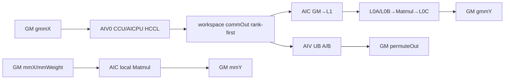
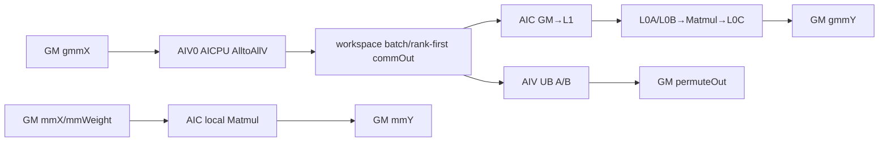

# AlltoAllvGroupedMatMul 950 ACLNN 算子知识

## 算子速览

| 项目 | 内容 |
|---|---|
| 实际入口 | `aclnnAlltoAllvGroupedMatMulV2GetWorkspaceSize` / `aclnnAlltoAllvGroupedMatMulV2`，公开 ACLNN V2 两段式入口 |
| 计算语义 | `ataOut=AlltoAllv(gmmX)`；`gmmY=GroupedMatMul(ataOut,gmmWeight)`；可选 `mmY=mmX×mmWeight`，可选输出 expert-first `permuteOut` |
| 输入输出 | FP16/BF16、ND；`gmmX(BSK,H1)`、`gmmWeight(e,H1,N1)` 或转置存放、`gmmY(A,N1)`；共享专家三件套可选 |
| 执行类型 | `MIX_CV` + runtime HCCL CCU/AICPU service task；单个 AscendC kernel 使用 `KERNEL_TYPE_MIX_AIC_1_2` |
| Kernel 路线 | R-001 CCU、R-002 AICPU；generated task callback分别配置CCU stream或AICPU/KFC stream，每个通信族四个 transpose tuple，共8个 key逐项闭合 |
| 核心资源 | GM、user workspace、AIC Matmul 的 L1/L0A/L0B/L0C；请求 permute时每AIV两块32768B UB |
| 来源闭包 | `source_closed`：V2 ACLNN→generated inner bridge（框架边界）→OpDef/Tiling→POD/key→MIX kernel→HCCL/permute/GMM specialization→构建接线闭合 |
| 验证状态 | 已完成源码闭包检查；本次知识提取未执行编译、真机、数值或性能测试。 |

## 接口与语义

### 计算语义

令 `P=epWorldSize`，`send[r,e]`/`recv[r,e]` 表示到/来自 rank `r`、本地专家 `e` 的 token数，`BSK=sum(send)`，`A=sum(recv)`。AIV0 以 `axis=H1` 提交分专家批次的 `AlltoAllV`，通信结果在 workspace中按 `rank→expert` 排列。AIC为每个 `(expert,rank)` group构造A offset table，直接对rank-first通信结果做GMM；仅当 `permuteOutFlag=true` 时，全体AIV才另行把它重排成expert-first `permuteOut(A,H1)`。

共享专家路径为 `mmY=mmX(BS,H2)×mmWeight(H2,N2)`。AIC执行local MM时，AIV已跳过该AIC-only body并提交通信，因此两者核间并行。非量化specialization的scale/bias均为`nullptr`，`aQuantMode=bQuantMode=DEFAULT`、`hasBias=false`、activation=NONE。底层 `MatmulImpl` 的累加与舍入细节位于固定仓未包含的AscendC库中，不能把wrapper的`float` scale类型写成累加类型。

### 输入、输出与属性

| 参数 | shape/layout | dtype | 约束、默认值与语义 |
|---|---|---|---|
| `gmmX` | `(BSK,H1)` / ND / 2D | FP16/BF16 | 必选；`0<BSK<52428800`，`0<H1<65536` |
| `gmmWeight` | `(e,H1,N1)` 或转置 `(e,N1,H1)` / ND / 3D | 同 `gmmX` | V2文档约束段写`e<=48`，目录README写`e<=32`，Host还要求`e*P<=256`；Device定长缓存也只支持32项，安全复用取`e<=32`，冲突见限制章节；K维等于H1，`0<N1<65536` |
| counts tensor两项 | N/A | N/A | 保留参数；V2 API与tiling当前都只接受`nullptr` |
| `mmX/mmWeight/mmY` | `(BS,H2)`、`(H2,N2)`或转置、`(BS,N2)` / ND | 同 `gmmX` | 三者全空或全非空；`0<H2<=12288`；`BSK%BS==0`且`BSK/BS∈[2,8]` |
| `group` | string | char | 必选，长度1..127 |
| `commMode` | string | char | 950只接受`"ccu"`或`"ai_cpu"`；比较上限7字节 |
| `epWorldSize` | 标量 | int64 | 950公开范围 `{2,4,8,16,32,64}` |
| `sendCounts/recvCounts` | 长度 `e*P` | int64 list | 非空、等长，和分别为BSK/A，长度`<=256`；公共检查保证`sendCounts>=0`，950不检查`sendCounts<=BSK`，也不检查`recvCounts`的非负或单项上界 |
| transpose两项 | 标量 | bool | 默认false；无共享专家时Host强制`transMmWeight=false` |
| `permuteOutFlag` | 标量 | bool | 与`permuteOut`是否存在严格一致 |
| `gmmY` | `(A,N1)` / ND | FP16/BF16 | 必选；dtype同`gmmX` |
| `permuteOut` | `(A,H1)` / ND | FP16/BF16 | flag=true时必选，否则必须为空 |

### 入口与版本

固定Commit同时公开V1/V2；V2文档明确相对V1新增`commMode`，故选V2为950最新公开入口。第一段按 `CheckParams→CheckSendAndRecv→CheckAndHandleCommMode` 校验，将通信枚举编码进executor user handle，再调用generated `aclnnInnerAlltoAllvGroupedMatMulGetWorkspaceSize`。第二段在DAV_3510读取handle并把HCCL server设为CCU或AICPU，再调用generated inner执行。generated bridge不在固定仓，是框架边界；算子自有selector、POD、workspace和Device body均可追溯。

## Host/Launcher 执行流程

### 参数校验与前处理

API检查必需指针、两项counts tensor必须为空、group非空且短于128字节、共享专家三件套全空或全非空、permute flag与输出指针一致、send/recv list非空以及commMode合法。OpDef对输入声明`AutoContiguous()`；generated bridge的具体contiguous节点不可见。Tiling顺序为 `GetContextAttr→CheckShapeDims→CheckDType→CheckShapeRelation→CheckShapeSize→CheckAttrsShapeSize/Relation→CheckSendRecvDataVolumn→CheckMKN`。公共 `CheckAttrsShapeRelation` 仍逐项拒绝负的 `sendCounts`；950 `NeedToCheckCounts=false` 只跳过 `CheckSendRecvDataVolumn` 内的 `sendCounts<=BSK` 与 `0<=recvCounts<=A`，随后仍检查两数组总和。任一步失败均为`GRAPH_FAILED`，没有Device fallback。

### 参数、Workspace 与生命周期

```text
S = sizeof(FP16/BF16) = 2
commOut = align_up(A*H1*S, 512)
userWorkspace = commOut + groupList(8eP) + aOffset(8eP) + xScaleOffsetReserve(8eP) + pointerReserve(512)
workspace[0] = libApiWorkSpaceSize + align_up(A*H1*2,512) + 24eP + 512
```

Device用`SetSysWorkspace`/`GetUserWorkspace`取得user slice。共享MM与routing GMM按AIC程序顺序复用commOut之后的metadata区；通信只写commOut，与compute metadata不重叠。workspace、输入输出和executor必须保持到传入stream上kernel完成；generated bridge的精确释放点固定仓不可见。

### 启动图与失败传播

```text
V2 GetWorkspaceSize -> generated inner -> A5 tiling(priority 0)
  -> CCU/AICPU HCCL tiling + two optional TCubeTiling + workspace/blockDim/key
V2(stream) -> read executor user handle -> SetHcclServerType(CCU/AICPU)
  -> generated task callback(CCU stream或AICPU/KFC stream) -> generated launch
  -> one allto_allv_grouped_mat_mul MIX kernel, blockDim=min(AIC,AIV/2)
     AIC: optional local MM -> wait flags 8 and 24 -> routing GMM
     AIV0: submit all AlltoAllV batches -> wait each handle
     both AIV subblocks: barrier -> set flag 8/24 -> optional permute
     all: final barrier; AIV HCCL Finalize
```

API/inner/tiling失败时不launch；entry遇到空workspace/user workspace直接返回无输出。HCCL handle运行错误传播属于HCCL/runtime边界，固定Device body没有自定义错误码回传分支。

## Route 与参数设计

### 分核与资源计算

`blockDim=min(aicCoreNum,aivCoreNum/2)`，entry声明AIC:AIV=1:2。`CalcExpertNum`规则：`e<=4→1`；`ceil(e/4)<=4→4`；否则默认4，当 `(BSK/P)*N1<20*1024*1024` 时取 `max(1,min(e,128/P,e/2))`。每批实际expert数为`min(expertNum,e-start)`，routing GMM group数为`actualExpertNum*P`。

非量化TCube：`baseM=align16(min(M,256))`；`baseN`从`min(N,256)`按B layout对齐；`baseK=align16(min(64,K))`。`baseM*baseN*4`超L0C时缩baseN。`stepM=stepN=1`，`dbL0A=dbL0B=2`，`dbL0C`按`2*baseM*baseN*4<=L0C`取2否则1。L1以`baseA=baseM*baseK*2`、`baseB=baseN*baseK*2`推出`depthA1/depthB1`与`stepKa/stepKb`。

### Route 选择

| 顺序 | Route | Key/模板 | 精确选择条件与优先级 | 不适用去向 |
|---:|---|---|---|---|
| 1 | R-001 CCU MIX | `GET_TPL_TILING_KEY(gmmT,mmT,0)` | 950；`commMode=ccu`；`gmmT=transGmmWeight`；`mmT=isNeedMM?transMmWeight:false` | 非ccu转R-002；参数/资源不满足则失败 |
| 2 | R-002 AICPU MIX | `GET_TPL_TILING_KEY(gmmT,mmT,1)` | 950；`commMode=ai_cpu`；同上 | 非ai_cpu失败；无其它通信route |

```text
commMode == ccu    -> comm=0 -> R-001
commMode == ai_cpu -> comm=1 -> R-002
mmT = isNeedMM ? transMmWeight : false
(gmmT,mmT,comm) in {0,1}×{0,1}×{0,1} -> eight exact specializations
```

### 模板/实现执行矩阵

| Route | key/selector | dtype/shape/platform完整命中条件 | 执行族与kernel节点 | 实际模板/body | 内存与同步特征 | tail/fallback |
|---|---|---|---|---|---|---|
| R-001/NN | `(0,0,0)` | 950 FP16/BF16 ND；shared可无或非转置；ccu | 单MIX：AIV HCCL/permute，AIC local/routing GMM | `HcclA2avOp<T,true,0>`；两条`bTrans=false` | rank-first commOut；flags8/24 | expert/M/N/K tail；失败终止 |
| R-001/TN | `(1,0,0)` | routing B转置；shared可无或非转置；ccu | 同上 | routing `bTrans=true`，local false | B offset=`nOffset*K` | 同上 |
| R-001/NT | `(0,1,0)` | shared必须存在且B转置；ccu | 同上 | routing false，local true | local phase先复用compute区 | 同上 |
| R-001/TT | `(1,1,0)` | shared必须存在；两条B转置；ccu | 同上 | 两条`bTrans=true` | 两套独立TCubeTiling | 同上 |
| R-002/NN | `(0,0,1)` | 与R-001/NN相同；ai_cpu | 同节点图 | `HcclA2avOp<T,true,1>`；两条false | HCCL实现换AICPU；flags8/24 | 同上 |
| R-002/TN | `(1,0,1)` | routing B转置；ai_cpu | 同节点图 | routing true，local false | 同上 | 同上 |
| R-002/NT | `(0,1,1)` | shared存在且B转置；ai_cpu | 同节点图 | routing false，local true | 同上 | 同上 |
| R-002/TT | `(1,1,1)` | shared存在；两条B转置；ai_cpu | 同节点图 | 两条true | 同上 | 同上 |

### 隐藏性能 Guard

| Guard | Host/Tiling 条件 | Device/资源原因 | 影响Route | 不满足时去向 | 源码符号 |
|---|---|---|---|---|---|
| 核配比 | `min(AIC,AIV/2)>0` | MIX 1:2 | R-001/R-002 | tiling失败 | `mc2tiling::GetNumBlocks` |
| counts容量 | `len=eP<=256` | POD数组固定256 | 两者 | tiling失败 | `CheckAttrsShapeSize/Relation` |
| Device每卡expert缓存 | `expertTokenNum_[32]`要求`e<=32`，但950 Host只显式限制`e<=48`、`eP<=256` | `QuantGroupedMatmul::Init`按`e`写定长32项数组 | 两者 | `e>32`没有Host fallback，存在固定源码越界风险 | `MAX_EXPERT_PER_RANK`,`QuantGroupedMatmul::Init` |
| GMM batch | `expertNum*P<=128` | `GMMArray[128]` | 两者 | helper失败 | `CalcExpertNum`,`SetInputParams` |
| L0C | `baseM*baseN*4<=L0C` | accumulator tile | 两者 | 缩baseN或失败 | `CalBasicBlock` |
| L1 | `depthA1*baseA+depthB1*baseB<=L1` | A/B stage | 两者 | 降depth/step或失败 | `CalL1Depth` |
| permute UB | flag=true才 `2*32768B` | GM↔UB双缓冲 | 两者 | flag=false跳过 | `PermuteData` |
| 空expert batch | token和为0 | 避免空GMM | 两者 | 直接return | `QuantGroupedMatmul::Process` |

### POD/ABI

`Mc2InitTiling`、`Mc2CcTiling`、`TCubeTiling`来自固定仓未包含的SDK头，含它们的外层numeric `sizeof/offsetof`不可见；下表只记录仓内可证明布局。

| 结构 | 字段 | 类型/位宽 | ABI布局 | 单位 | Host/launcher producer | Device consumer | 边界 |
|---|---|---|---|---|---|---|---|
| launch | 11个GM参数 | `GM_ADDR`/64bit | entry参数顺序 | 地址 | generated inner | entry/scheduler | counts tensor地址不消费；workspace必需 |
| outer POD | `hcclA2avTilingInfo` | SDK HCCL structs | offset0，size不可见 | bytes | `SetHcclTiling` | `InitV2/SetCcTilingV2` | engine由key选CCU/AICPU |
| outer POD | `taskTilingInfo` | `TaskTilingInfo` | symbolic outer offset；`sizeof=2160,align=8` | mixed | `PostTiling` | scheduler/comm/GMM | counts<=256 |
| Task | 12个shape/resource字段 | uint64×12 | offsets0,8,...,88 | 元素/字节/核 | `PostTiling` | 各body | inactive BS/H2/N2=0 |
| Task | 四个loop字段 | uint32×4 | offsets96,100,104,108 | expert/loop | `CalcExpertNum/PostTiling` | scheduler | expertNum>=1 |
| Task | `sendCnt` | int32[256] | offset112，1024B | token | int64 attr窄化 | HCCL/GMM | Host检查非负与总和=BSK，但不检查单项`<=BSK`或int32窄化 |
| Task | `recvCnt` | int32[256] | offset1136，1024B；Task总2160B | token | int64 attr窄化 | HCCL/GMM | Host只检查总和=A，不检查负值、单项上界或int32窄化 |
| outer POD | `isPermuteOut,isNeedMM` | bool | Task之后，numeric outer offset不可见 | flag | `PostTiling` | scheduler | false不读可选GM |
| outer POD | 两套GMM tiling | `GMMQuantTilingData` | 各含24B params+1536B arrays+SDK TCube | tiling | helper | local/routing GMM | inactive mm不消费 |
| GMM params | 4×uint32 + flags | 24B，align4 | groupNum@0；modes@8/12；flags@16..23 | count/enum | helper | GMM body | no quant/no bias/SPLIT_M |
| GMM array | m/k/n list | int32[128]×3 | offsets0/512/1024；1536B | 元素 | helper | `SetMNK` | groupNum<=128 |
| Cube tiling | M/N/K/base/step/depth/db/core | SDK struct | numeric ABI不可见 | mixed | `DoLibApiTiling` | Matmul/block scheduler | 同SDK构建 |

### Route 源码闭包

| Route | Key/selector | Host/Tiling producer | POD/参数 | Kernel entry/router | Kernel body/直接依赖 | 构建接线 |
|---|---|---|---|---|---|---|
| R-001四tuple | `(gmmT,mmT,0)` | `AlltoAllvGmmTilingStructA5`→`RunFusionKernelTiling/GetTilingKey` | outer POD + 两套GMM POD | `allto_allv_grouped_mat_mul<gmmT,mmT,0>` | scheduler→CCU HCCL/permute/GMM→Matmul | 950 binary JSON + CMake |
| R-002四tuple | `(gmmT,mmT,1)` | 同上，comm enum=AICPU | 同上 | `allto_allv_grouped_mat_mul<gmmT,mmT,1>` | scheduler→AICPU HCCL/permute/GMM→Matmul | 同上 |

## Kernel 实现

### 公共执行流程

entry设置system workspace、读取POD并按key实例化 `HcclA2avOp<DTYPE_GMM_X,true,comm>` 及local/routing两个`QuantGroupedMatmul`。AIV跳过Cube body并提交通信；AIC可先做local MM。每批仅AIV0 wait HCCL handle，全部AIV barrier后，subblock 0/1分别以flag8/24通知AIC。AIC等待两flag后从rank-first commOut直接做routing GMM；AIV发flag后做可选permute，因此两者可重叠。末尾 `SyncAll<false>`，仅AIV执行HCCL Finalize。

### Route R-001：CCU 通信先行 MIX

#### 适用条件

##### 选择证据

| 层级 | 文件 | 符号 | 源码谓词/参数 | 结果/下一跳 |
|---|---|---|---|---|
| API | `op_api/...v2.cpp` | `CheckAndHandleCommMode` | DAV_3510且字符串前7字节匹配`ccu` | comm enum=0并写user handle |
| Host | `...tiling.cpp` | `GetAndConvertCommMode/GetTilingKey` | CCU engine + 两个effective transpose bool | 四个comm=0 tuple之一 |
| Launch task | `op_graph/...gen_task_training.cpp` | `CalcParamFunc/GenTaskFunc` | 950且`commMode==ccu` | CCU server/stream任务 |
| Router | `op_kernel/...cpp` | entry模板 | tuple编译实例 | `HcclTypeSelector<0>`默认CCU；无unknown fallback |

#### Device 数据流

##### 函数级调用链

```text
entry -> Scheduler::Init
  -> [AIC] localComputeOp.Process(0) || [AIV0] commOp.Launch(all batches)
  -> [AIV0] Wait -> [all AIV] SyncAll<true>/SetFlag(8 or 24)
  -> [AIC] WaitFlag(8),WaitFlag(24)/computeOp.Process
  -> [AIV optional] PermuteData/TileDataCopyLoopDoubleBuf
  -> End/SyncAll<false>/AIV Finalize
```

##### 源码等价伪码

```text
if workspace/userWorkspace null: return
commOut=userWorkspace; computeWS=commOut+align512(A*H1*2)
if AIC && isNeedMM: local GMM
if AIV0: submit CCU AlltoAllV for every expert batch
for batch:
  AIV0 Wait(handle); all AIV barrier+SetFlag(8+16*subblock); optional rank→expert permute
  AIC WaitFlag(8), WaitFlag(24); build recv groupList/A offsets; routing GMM
all-core barrier; AIV Finalize
```

#### 内存与数据搬运

##### 资源与搬运表

| 层级/缓冲区 | offset/地址公式 | extent/容量公式 | dtype/layout | producer | consumer | owner/lifetime | 对齐/复用 |
|---|---|---|---|---|---|---|---|
| GM gmmX | HCCL send offsets | `BSK*H1*2` | ND rank→expert slices | caller | AIV0 HCCL | caller/stream | count×H1元素 |
| commOut | user+0 | `align512(A*H1*2)` | rank-first | HCCL | AIC GMM/AIV permute | executor WS | 与compute区分离 |
| groupList/A/xScale表 | commOut末尾+0/8eP/16eP | 各8eP | int64/uint64 | AIC | block scheduler | 当前batch | xScale表非量化保留不读 |
| pointer reserve | +24eP | 512B | 非量化实际写slot 0/1/3三个16B descriptor；slot2量化scale未用 | `BuildPtrTable` | GMM | 当前调用 | 固定reserve；local阶段ptr起点为`+8e`，routing阶段改写为`+24eP` |
| permute UB | AIV local | 2×32768B | FP16/BF16 raw tile | GM load | GM store | 当前kernel | 双缓冲，flag控制分配 |
| L1 | Matmul内部 | `depthA1*baseM*baseK*2 + depthB1*baseN*baseK*2` | Cube A/B stage | GM | L0A/B | 当前Matmul | <=L1 |
| L0A/B | Matmul内部 | 各`2*baseM*baseK*2` / `2*baseN*baseK*2`上界 | Cube tiles | L1 | Matmul | tile | exact库排布不可见 |
| L0C | Matmul内部 | `dbL0C*baseM*baseN*4` | accumulator tile | Matmul | GetTensorC | tile | <=L0C |
| GM outputs | token/N offsets | `A*N1*2`等 | ND | AIC/AIV | caller | caller/stream | 只写有效tail |

##### 分层内存布局



##### 字节账、交接边与复用顺序

```text
workspace_total = libApiWorkSpaceSize + align512(A*H1*2) + 24eP + 512
L1_visible = depthA1*baseM*baseK*2 + depthB1*baseN*baseK*2
L0C = dbL0C*baseM*baseN*4
permute_UB = isPermuteOut ? 65536 : 0 bytes/AIV
```

| 边/复用子区 | producer | offset/extent | dtype/layout | consumer | ordering/sync | owner/lifetime | 安全条件 |
|---|---|---|---|---|---|---|---|
| comm→GMM | HCCL | 当前batch连续slice；batch内rank→expert | FP16/BF16 ND | AIC GMM | handle wait→AIV barrier→flags8/24 | WS/End | 两AIV subblock均完成 |
| comm→permute | HCCL | 同一batch slice | batch内rank→expert | AIV permute | handle wait→barrier | WS/permute完成 | `pairIdx`按源码`GetBlockIdx()`和`aivCoreNum`分段；MIX下物理subblock展开语义属于AscendC边界 |
| computeWS local→routing | local GMM metadata | 24eP+512 | tables | routing重写 | AIC程序序 | WS | local返回 |
| UB ping-pong | prior store | 32768B buffer | raw | next load | MTE3_MTE2 wait；load→store MTE2_MTE3 | AIV | final store wait |

#### 同步、精度与尾块

##### 同步与数值边界表

| 阶段 | primitive/机制 | producer | consumer/等待点 | 保护对象 | 精度/尾块 |
|---|---|---|---|---|---|
| HCCL | handle/Wait | AIV0 | AIV0 | commOut batch | FP16/BF16，count×H1 |
| AIV→AIC | `SyncAll<true>` + mode4 flags8/24 PIPE_V→PIPE_MTE2 | 两AIV subblock | AIC双wait | batch slice | 每批复用flag |
| permute | MTE events | GM load/store | same AIV | two UB buffers | last `realLength`，zero skip |
| GMM | SetSingleShape/Iterate/GetTensorC | L0C | GM | M/N/K tile | base tail；最后group可细分空闲核 |
| 空组 | token sum==0 | counts | routing | N/A | 直接return |

#### 关键实现

##### 符号证据表

| 阶段 | 文件 | 符号/模板实例 | 实现事实 |
|---|---|---|---|
| Host/Tiling producer | `...tiling.cpp` | `GetAndConvertCommMode`,`CalcExpertNum`,`RunFusionKernelTiling`,`PostTiling` | CCU selector、batch、workspace、POD/key |
| Kernel entry/router | `op_kernel/...cpp` | `allto_allv_grouped_mat_mul<gmmT,mmT,0>` | MIX 1:2和CCU实例 |
| Device body/helper | `a2av_gmm_scheduler.h` | `ProcessCommRoundMode` | overlap、wait/双flag、optional permute |
| Device body/helper | `hccl_a2av_op.h` | `HcclTypeSelector<0>`,`LaunchCommData/Wait` | CCU实现、counts/offset/HCCL |
| Device body/helper | `gqmm_cube_on_the_fly.h` | `Mc2GmmASWKernel::Process` | Cube调度/tail/Matmul |

### Route R-002：AICPU 通信先行 MIX

#### 适用条件

##### 选择证据

| 层级 | 文件 | 符号 | 源码谓词/参数 | 结果/下一跳 |
|---|---|---|---|---|
| API | `op_api/...v2.cpp` | `CheckAndHandleCommMode` | DAV_3510且字符串前7字节匹配`ai_cpu` | comm enum=1并写executor user handle；否则转CCU检查或失败 |
| Host | `...tiling.cpp` | `GetAndConvertCommMode/GetTilingKey` | AICPU engine + 两个effective transpose bool | 四个comm=1 tuple之一；不是CCU失败后的自动fallback |
| Launch task | `op_graph/...gen_task_training.cpp` | `CalcParamFunc/GenTaskFunc` | 950且`commMode==ai_cpu` | AICPU KFC server/stream任务 |
| Router | `op_kernel/...cpp` | entry模板 | tuple编译实例 | `HcclTypeSelector<1>`选择AICPU HCCL；无unknown fallback |

#### Device 数据流

##### 函数级调用链

```text
entry -> Scheduler::Init
  -> [AIC] localComputeOp.Process(0) || [AIV0] AICPU commOp.Launch(all batches)
  -> [AIV0] Wait -> [all AIV] SyncAll<true>/SetFlag(8 or 24)
  -> [AIC] WaitFlag(8),WaitFlag(24)/computeOp.Process
  -> [AIV optional] PermuteData/TileDataCopyLoopDoubleBuf
  -> End/SyncAll<false>/AIV HCCL Finalize
```

##### 源码等价伪码

```text
if workspace/userWorkspace null: return
commOut=userWorkspace; computeWS=commOut+align512(A*H1*2)
if AIC && isNeedMM: local GMM
if AIV && GetBlockIdx()==0: 为所有expert batch提交AICPU AlltoAllV handle
for batch:
  AIV block0 Wait(handle); all AIV barrier; subblock0/1发布flag8/24
  AIC双wait后构造recv groupList/A offsets并做routing GMM
  if permuteOut: AIV按rank→expert pair搬到expert→rank输出
all-core barrier; AIV Finalize
```

#### 内存与数据搬运

##### 资源与搬运表

| 层级/缓冲区 | offset/地址公式 | extent/容量公式 | dtype/layout | producer | consumer | owner/lifetime | 对齐/复用 |
|---|---|---|---|---|---|---|---|
| GM gmmX | 每rank `sendOffset`由前序rank全部expert与当前rank前序expert求和 | `BSK*H1*2` | FP16/BF16 ND，rank→expert | caller | AIV0 AICPU HCCL | caller/stream | count与offset均按H1元素 |
| commOut | user workspace +0 | `align512(A*H1*2)` | batch-major；batch内rank→expert | AICPU HCCL | AIC routing GMM/AIV permute | executor workspace至End | 与compute metadata不重叠 |
| groupList/A/xScale表 | computeWS +0/`8eP`/`16eP` | 各`8eP` | int64/uint64 | AIC | block scheduler | 当前batch | xScale表为非量化保留、不读 |
| pointer reserve | computeWS+`24eP` | 512B | slot0/1/3各16B | `BuildPtrTable` | GMM wrapper | 当前调用 | routing覆盖local阶段的metadata |
| permute UB | AIV local | `2*32768B` | FP16/BF16 raw bytes | MTE2 | MTE3 | 当前kernel | 双TBuf；只在flag=true时初始化 |
| L1 | Matmul内部 | `depthA1*baseM*baseK*2 + depthB1*baseN*baseK*2` | A/B stage | GM | L0A/L0B | 当前Matmul | Tiling保证不超L1 |
| L0A/L0B | Matmul库内部 | 可见上界分别为`dbL0A*baseM*baseK*2`、`dbL0B*baseN*baseK*2` | Cube tile | L1 | Mmad/Matmul | tile | `dbL0A=dbL0B=2`；库内物理排布固定仓不可见 |
| L0C | Matmul库内部 | `dbL0C*baseM*baseN*4` | accumulator tile | Matmul | `GetTensorC` | tile | `dbL0C∈{1,2}` |
| GM outputs | `expertTokenOffset*N1`及local MM对应offset | `A*N1*2`；可选`BS*N2*2`、`A*H1*2` | ND | AIC/AIV | caller | caller/stream | 只提交有效M/N和permute tail |

##### 分层内存布局



##### 字节账、交接边与复用顺序

```text
workspace_total = libApiWorkSpaceSize + align512(A*H1*2) + 24eP + 512
L1_visible = depthA1*baseM*baseK*2 + depthB1*baseN*baseK*2
L0C = dbL0C*baseM*baseN*4
permute_UB = isPermuteOut ? 65536 : 0 bytes/AIV
```

| 边/复用子区 | producer | offset/extent | dtype/layout | consumer | ordering/sync | owner/lifetime | 安全条件 |
|---|---|---|---|---|---|---|---|
| comm→GMM | AICPU HCCL | 当前batch连续slice | FP16/BF16，batch内rank→expert | AIC GMM | AIV0 handle wait→AIV barrier→flags8/24→AIC双wait | workspace/End | 两subblock信号均到达 |
| comm→permute | AICPU HCCL | 同一batch slice | rank→expert | AIV permute | handle wait→AIV barrier | workspace/该batch permute完成 | pair的count非零才搬运 |
| local→routing metadata复用 | local GMM | computeWS从0开始；local ptr起点`8e` | groupList/descriptor | routing GMM重写为`0/8eP/16eP/24eP` | AIC程序顺序 | workspace | local `Process`返回后才启动routing写入 |
| UB ping-pong | 当前tile MTE2 | 32768B A/B | raw byte tile | 当前tile MTE3/下一tile MTE2 | `MTE2_MTE3`与`MTE3_MTE2` event | 当前AIV | 覆盖前先等上一次store，末tile等store完成 |

#### 同步、精度与尾块

##### 同步与数值边界表

| 阶段 | primitive/机制 | producer | consumer/等待点 | 保护对象 | 精度/尾块 |
|---|---|---|---|---|---|
| AICPU HCCL | `AlltoAllV<true>` handle/`Wait` | AIV block0 | 同AIV block0 | 当前batch commOut | FP16/BF16；每rank count=`Σexpert recvCnt*H1` |
| AIV→AIC | `SyncAll<true>` + mode4 flags8/24，PIPE_V→PIPE_MTE2 | 两AIV subblock | AIC双wait | 当前batch commOut可见性 | 每batch复用同组flag，等待后才读 |
| permute | MTE2/MTE3 events | GM load | GM store/下一次load | 两块32768B TBuf | `realLength`为字节，零count跳过，末store显式wait |
| routing/local GMM | `SetSingleShape→SetTensorA/B→Iterate→GetTensorC` | L0C | GM输出 | M/N/K tile | FP16/BF16非量化；base tail及最后group空闲核再切分 |
| kernel结束 | `SyncAll<false>` + `Finalize` | 所有AIC/AIV | AIV HCCL finalize | workspace与通信上下文 | AIC在finalize前返回分支；无Device错误码fallback |

#### 关键实现

##### 符号证据表

| 阶段 | 文件 | 符号/模板实例 | 实现事实 |
|---|---|---|---|
| API/launch | `op_api/...v2.cpp`、`op_graph/...gen_task_training.cpp` | `CheckAndHandleCommMode`、`NnopbaseSetHcclServerType(AICPU)`、task callbacks | executor、server与AICPU/KFC stream一致 |
| Host/Tiling producer | `...tiling.cpp` | `GetAndConvertCommMode`,`GetTilingKey`,`PostTiling` | comm=1、transpose tuple、workspace/POD |
| Kernel entry/router | `op_kernel/...cpp` | `allto_allv_grouped_mat_mul<gmmT,mmT,1>` | MIX 1:2和AICPU模板实例 |
| Device communication | `hccl_a2av_op.h`,`a2av_comm_params.h` | `HcclTypeSelector<1>`,`CalcA2avCommBeforeParams` | AICPU HCCL类及batch count/offset |
| Device compute | `quant_grouped_matmul.h`,`gqmm_cube_on_the_fly.h`,`quant_block_sch.h` | `QuantGroupedMatmul`,`Mc2GmmASWKernel`,`QuantASWBlockSch` | rank-first A表、Cube调度、tail与GM offset |

## 算子特定优化

### Trick T-001：按 expert 与每-rank MN 自适应合并批次

#### 触发与源码依据

- 适用Route：R-001/R-002。
- 触发条件：`e,P,BSK,N1`进入`CalcExpertNum`。
- Golden来源：[`allto_allv_grouped_mat_mul_tiling.cpp:35-62`](../../../../../../../cann-ops-raw/ascendc/ops-transformer/be33d95bb755cedec3108f70805c1874d1792540/mc2/allto_allv_grouped_mat_mul/op_host/op_tiling/allto_allv_grouped_mat_mul_tiling.cpp#L35-L62)

**官方源码（固定Commit连续逐字摘录）**：

```cpp
if (e == 0 || e == 1) {
    return 1U;
}
if (e <= SMALL_EXPERT_THRESHOLD) {
    return 1U;
}
uint32_t originalLoopCount = static_cast<uint32_t>((e + DEFAULT_MERGED_EXPERT_NUM - 1U)
    / DEFAULT_MERGED_EXPERT_NUM);
if (originalLoopCount <= ORIGINAL_LOOP_THRESHOLD) {
    return DEFAULT_MERGED_EXPERT_NUM;
}
```

#### 机制与设计原因

同一值控制HCCL handle批次、GMM `groupNum=expertNum*P`和tail。大e且每-rank MN较小时扩大批次，同时受128项GMM数组与至少两轮约束，使通信/计算调度和POD容量一致。

#### 迁移边界

- 适用：rank×expert group共享同一M/N/K上界tiling。
- 前提：`expertNum*P<=128`、`eP<=256`。
- 失效：专家K/N/layout不同或group数越界时必须重做POD/tiling。
- 未验证：本次未执行编译、真机、数值或性能测试。

#### 错误做法

`groupNum>128`时`SetInputParams`失败，不能无限增大batch。

### Trick T-002：双 AIV 子块交接并与可选 permute 重叠

#### 触发与源码依据

- 适用Route：R-001/R-002。
- 触发条件：950每个expert batch；permute还要求flag=true。
- Golden来源：[`a2av_gmm_scheduler.h:129-134`](../../../../../../../cann-ops-raw/ascendc/ops-transformer/be33d95bb755cedec3108f70805c1874d1792540/mc2/allto_allv_quant_grouped_mat_mul/op_kernel/mc2_templates/scheduler/a2av_gmm_scheduler.h#L129-L134)

**官方源码（固定Commit连续逐字摘录）**：

```cpp
if ASCEND_IS_AIC {
    AscendC::CrossCoreWaitFlag<SYNC_MODE_AIV_TO_AIC, PIPE_MTE2>(SYNC_FLAG_ID_COMM_DONE);
#if defined(__NPU_ARCH__) && __NPU_ARCH__ == 3510
    AscendC::CrossCoreWaitFlag<SYNC_MODE_AIV_TO_AIC, PIPE_MTE2>(
        SYNC_FLAG_ID_COMM_DONE + SYNC_FLAG_AIV1_OFFSET);
#endif
```

#### 机制与设计原因

950常量把AIV→AIC sync mode设为4、subblock offset设为16、base flag设为8。两个AIV subblock分别发布flag8/24，AIC双wait后才消费commOut。AIV在set flag后才执行可选permute，因此AIC routing GMM可与AIV重排并行。

#### 迁移边界

- 适用：950单MIX kernel、AIC:AIV=1:2的通信producer/计算consumer。
- 前提：保留mode4、flags8/24、barrier和关闭auto-sync时的显式协议。
- 失效：减少AIV subblock或改变核配比必须同步修改wait集合并重新证明可见性。
- 未验证：本次未执行编译、真机、数值或性能测试。

#### 错误做法

只等待flag8会漏掉第二AIV subblock；删除barrier/flag会让AIC读取未完成slice。

### Trick T-003：rank-first commOut 直接做 GMM

#### 触发与源码依据

- 适用Route：R-001/R-002。
- 触发条件：routing GMM；permute输出独立可选。
- Golden来源：[`quant_grouped_matmul.h:210-243`](../../../../../../../cann-ops-raw/ascendc/ops-transformer/be33d95bb755cedec3108f70805c1874d1792540/mc2/allto_allv_quant_grouped_mat_mul/op_kernel/mc2_templates/compute/quant_grouped_matmul.h#L210-L243)

**官方源码（固定Commit连续逐字摘录）**：

```cpp
} else if constexpr (!isLocal && isA2avGmm) {
    const auto *opCnt = &tilingData_->taskTilingInfo.recvCnt[0];
    __gm__ uint64_t *aGroupOffsetTable = reinterpret_cast<__gm__ uint64_t *>(aGroupOffsetTableGm_);
    for (uint32_t e = 0; e < expertNum; e++) {
        for (uint32_t r = 0; r < epWorldSize_; r++) {
            uint32_t absExpertIdx = startExpertIdx + e;
            uint64_t cnt = static_cast<uint64_t>(opCnt[absExpertIdx + r * expertNumInOneRank_]);
            groupListPtr[GROUP_LIST_INDEX + e * epWorldSize_ + r] = static_cast<int64_t>(cnt);
        }
    }
```

#### 机制与设计原因

每个`(expert,rank)`是一个GMM group，A offset table指向rank-first源，weight只在expert边界推进；因此routing计算不依赖完整permute。未请求permute时也不分配其64KiB/AIV UB。

#### 迁移边界

- 适用：GMM scheduler接受rank维group和外部A offset table。
- 前提：groupList expert-major，A offsets指向rank-first，weight按expert推进。
- 失效：下游只接受连续expert tensor时必须保留permute。
- 未验证：本次未执行编译、真机、数值或性能测试。

#### 错误做法

把rank-first数据当普通expert-first连续矩阵会配错权重。

## 模板与实现对比

| 对比维度 | R-001 CCU | R-002 AICPU | transpose四变体 | 设计选择依据 |
|---|---|---|---|---|
| 命中条件/优先级 | comm=0 | comm=1 | NN/TN/NT/TT；NT/TT需shared | exact三元tuple，无fallback |
| 执行族/节点图 | MIX/CCU HCCL/optional local+permute/GMM | MIX/AICPU HCCL/其余相同 | runtime flags控制可选子图 | engine与计算解耦 |
| M/N/K、tile与scheduler | 公共TCube策略 | 同 | routing/local B layout由key固定 | 两套TCubeTiling |
| workspace/L1/L0/UB | 公共公式 | 同 | local先复用compute区 | commOut/compute分区 |
| AIC/AIV交接 | mode4 flags8/24 | 同 | 同 | wait→barrier→双flag |
| 同步、精度与tail | CCU handle + FP16/BF16 tail | AICPU handle + 同tail | expert/Matmul/permute tail | 无量化 |
| fallback/失败边界 | 校验/CCU tiling失败 | 校验/AICPU tiling失败 | 无shared时mmT强制false | 不跨engine自动回退 |

## 平台差异

| 项目 | A2 | A3 | 950 |
|---|---|---|---|
| 支持状态 | 公开文档明确不支持 | 支持，独立无后缀卡 | 本卡：支持 |
| Host/Launcher | N/A | ascend910_93/arch22；仅ai_cpu；P={8,16,32,64,128} | ascend950/arch35；ai_cpu/ccu；公开P={2,4,8,16,32,64} |
| Kernel/资源 | N/A | sync mode2，flag8；AICPU | sync mode4，flags8/24；CCU或AICPU |
| 构建选项 | N/A | `--cce-auto-sync=off`、exception restart | `--cce-auto-sync=off`、950 dcci选项 |

## 限制与失败边界

- V2文档约束段称`e*P`最大384，但同一文档参数表和固定Host/POD均规定`MAX_EXPERT_SIZE=256`，Host显式拒绝更长数组；实现复用按`<=256`。
- 950 virtual `GetEpWorldSizeOptional()`返回`{2,4,8,16,32,64}`，与公开文档一致；通用`GetContextAttr`代码还出现128/256分支，但该virtual在目录内无调用点。正式支持范围取公开文档与950实现的交集，不扩展到128/256。
- 950 `NeedToCheckCounts=false`只跳过`CheckSendRecvDataVolumn`里的逐项上下界；公共`CheckAttrsShapeRelation`仍拒绝负`sendCounts`，但`recvCounts`没有非负/单项上界检查，且总和以`0ULL`累加。不能把“总和命中”误写为完整逐项合法性证明。
- 目录README规定`e<=32`，但V2接口文档约束段和Host允许`e<=48`；`QuantGroupedMatmul::Init`又以`e`循环写仅32项的`expertTokenNum_`。在950 `P=2/4`时`e>32`仍可满足`eP<=256`并到达Device，固定仓没有Host guard或fallback，故安全复用必须按README/Device容量取`e<=32`。
- counts从int64 attr写入int32 POD，代码没有独立`INT32_MAX`检查；不得依赖溢出窄化。
- outer POD中的HCCL/TCube numeric ABI、Matmul内部L0排布及累加舍入固定仓不可见；必须用同一SDK。
- CCU仅支持单机UB域内互联；跨机UB域按公开文档使用AICPU。固定仓没有CCU失败后自动切换AICPU的Device fallback。
- 本次知识提取未执行编译、真机、数值或性能测试；静态闭包不等于性能保证。

## 源码索引

### 链路索引

| 链路阶段 | 文件 | 关键符号 | 支撑内容 |
|---|---|---|---|
| 入口声明/约束 | `mc2/allto_allv_grouped_mat_mul/docs/aclnnAlltoAllvGroupedMatMulV2.md` | V2原型/产品表 | 最新入口、950平台、shape/commMode |
| 目录公开约束 | `mc2/allto_allv_grouped_mat_mul/README.md` | 产品表/约束说明 | A3/950支持、`e<=32`与`eP<=256`安全边界 |
| 入口实现 | `mc2/allto_allv_grouped_mat_mul/op_api/aclnn_allto_allv_grouped_mat_mul_v2.cpp` | API checks/V2函数 | 校验、user handle、server选择 |
| OpDef | `mc2/allto_allv_grouped_mat_mul/op_host/allto_allv_grouped_mat_mul_def.cpp` | `AlltoAllvGroupedMatMul` | IO/attr/平台注册 |
| Host/Tiling | `mc2/allto_allv_grouped_mat_mul/op_host/op_tiling/allto_allv_grouped_mat_mul_tiling.cpp` | `CalcExpertNum`,`GetAndConvertCommMode`,`RunFusionKernelTiling`,`PostTiling` | selector/workspace/POD/key |
| Host平台 | `mc2/allto_allv_grouped_mat_mul/op_host/op_tiling/arch35/allto_allv_grouped_mat_mul_tiling_a5.cpp` | 950 tiling struct | P集合、counts策略、注册 |
| Launch task | `mc2/allto_allv_grouped_mat_mul/op_graph/allto_allv_grouped_mat_mul_gen_task_training.cpp` | `AlltoAllvGroupedMatMulCalcParamFunc/GenTaskFunc` | CCU stream或AICPU/KFC stream任务 |
| 分核 | `mc2/common/op_host/op_tiling/mc2_calc_num_blocks.h` | `mc2tiling::GetNumBlocks` | `min(AIC,AIV/2)`和零核失败 |
| POD/ABI | `mc2/allto_allv_grouped_mat_mul/op_kernel/allto_allv_grouped_mat_mul_tiling.h` | outer POD | ABI顺序 |
| POD公共结构 | `mc2/allto_allv_quant_grouped_mat_mul/op_kernel/mc2_templates/common/a2av_common_tiling.h` | `TaskTilingInfo`/同步常量 | 字段/数组容量、950 mode4/flags8/24 |
| Kernel entry/body | `mc2/allto_allv_grouped_mat_mul/op_kernel/allto_allv_grouped_mat_mul.cpp` | entry | MIX/8个模板实例 |
| Scheduler | `mc2/allto_allv_quant_grouped_mat_mul/op_kernel/mc2_templates/scheduler/a2av_gmm_scheduler.h` | scheduler | task graph/workspace/双flag |
| 通信 | `mc2/allto_allv_quant_grouped_mat_mul/op_kernel/mc2_templates/communication/hccl_a2av_op.h` | HCCL op/selectors | CCU/AICPU、counts/offset/wait |
| 通信参数 | `mc2/allto_allv_quant_grouped_mat_mul/op_kernel/mc2_templates/communication/a2av_comm_params.h` | `CalcA2avCommBeforeParams` | batch/rank/expert count和offset |
| Permute | `mc2/allto_allv_quant_grouped_mat_mul/op_kernel/mc2_templates/communication/a2av_permute_engine.h` | permute | 分核/UB/tail |
| GMM wrapper | `mc2/allto_allv_quant_grouped_mat_mul/op_kernel/mc2_templates/compute/quant_grouped_matmul.h` | `QuantGroupedMatmul` | rank-first offsets |
| Cube body | `mc2/3rd/grouped_matmul/op_kernel/gqmm_cube_on_the_fly.h` | `Mc2GmmASWKernel` | Cube/tail/Matmul |
| Cube scheduler | `mc2/3rd/grouped_matmul/op_kernel/quant_block_sch.h` | `QuantASWBlockSch` | group/core/tile/GM offset映射 |
| GMM POD | `mc2/3rd/grouped_matmul/op_kernel/grouped_matmul_tiling_data_apt.h` | `GMMQuantTilingData` | params/数组/TCube顺序与定长数组 |
| Cube tiling | `mc2/3rd/grouped_matmul/op_tiling/gmm_qbmm_tiling.cpp` | base/L1 tiling | base/depth/step/db |
| 构建配置 | `mc2/allto_allv_grouped_mat_mul/op_host/config/ascend950/allto_allv_grouped_mat_mul_binary.json` | FP16/BF16 entries | dtype/layout |
| 构建接线 | `mc2/allto_allv_grouped_mat_mul/op_host/CMakeLists.txt` | modules/options | 依赖与显式同步编译 |

### 实现复用检查

| 检查项 | 可复用事实 | 不得改变的约束 | 源码符号 |
|---|---|---|---|
| ABI/POD | Task内部2160B、两套GMM POD | outer SDK ABI、counts256、tuple/build一致 | POD structs |
| 调用顺序 | AIV通信/AIC local并行→逐批交接→routing/permute | wait/barrier先于读取；Finalize在End | scheduler |
| workspace/内存 | `libApi+align512(AH1*2)+24eP+512` | offset、owner、local→routing复用 | Host/scheduler Init |
| 同步 | 950 mode4 flags8/24及MTE events | auto-sync关闭时保留双subblock协议 | scheduler/permute/CMake |
| 精度与尾块 | 非量化FP16/BF16、expert/Matmul/permute tail | 不推断外部Matmul round | GMM/permute bodies |
| 通信路由 | CCU=0、AICPU=1，engine/server/key一致 | 不做跨engine Device fallback | API/Host/entry/HCCL selector |
| 失败边界 | 公开P集合、shape/count/resource | `e>32`不可安全复用；unknown key/空workspace不fallback | API/tiling/entry/`QuantGroupedMatmul::Init` |