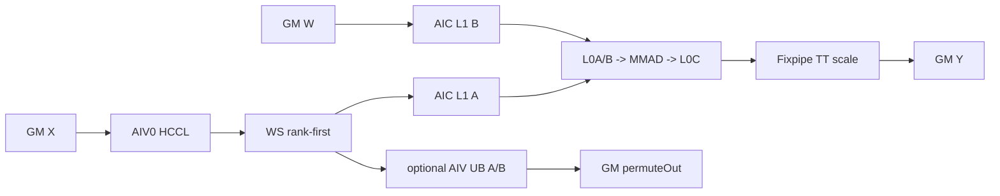
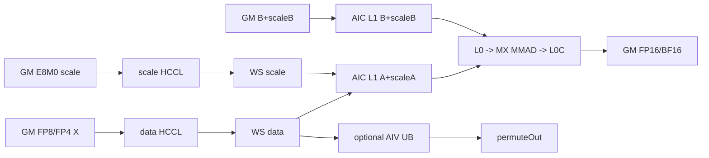

# AlltoAllvQuantGroupedMatMul 950 ACLNN 算子知识

## 算子速览

| 项目 | 内容 |
|---|---|
| 实际入口 | `aclnnAlltoAllvQuantGroupedMatMulV2GetWorkspaceSize` / `aclnnAlltoAllvQuantGroupedMatMulV2`，公开 ACLNN V2 |
| 计算语义 | 共享专家量化 MM 与路由数据 AlltoAllV 并行；路由侧通信后按本卡专家执行量化 GMM |
| 输入输出 | `gmmX[BSK,H1]`、`gmmWeight[e,H1,N1]` 或转置布局、scale、counts；输出 `gmmY[A,N1]`，可选 `mmY[BS,N2]`、`permuteOut[A,H1]` |
| 执行类型 | `MIX_CV/HYBRID`：单 Kernel `KERNEL_TYPE_MIX_AIC_1_2`；AIV 执行 HCCL/permute，AIC 执行 Cube |
| Kernel 路线 | R-001 HIFLOAT8 PerTensor；R-002 FP8/FP4 MX |
| 核心资源 | GM、HCCL context、system/user workspace、L1/L0A/L0B/L0C、可选 AIV 双 32768-byte UB |
| 来源闭包 | `source_closed`：V2 ACLNN→inner bridge→950 Tiling→单 MIX Kernel→HCCL、量化 GMM 与构建接线闭合 |
| 验证状态 | 已完成源码闭包检查；本次知识提取未执行编译、真机、数值或性能测试。 |

## 接口与语义

### 计算语义

令 `W=epWorldSize`、每卡专家数为 `e`，`BSK=sum(sendCounts)`、`A=sum(recvCounts)`。路由侧先得 `Xcomm=AlltoAllV(gmmX)`，再按 expert/rank 分组计算 `gmmY=(Xcomm×gmmXScale)@(gmmWeight×gmmWeightScale)`。固定实现直接让 GMM 借助 offset table 读取 rank-first 通信结果。共享专家存在时计算 `mmY=(mmX×mmXScale)@(mmWeight×mmWeightScale)`，该 AIC 计算与 AIV 通信重叠。若 `permuteOutFlag=true`，AIV 另将 rank-first `Xcomm` 重排为 expert-first `permuteOut`。

PerTensor 路线在 AIC 上把两个 FP32 scale 相乘，将位模式与 `0xFFFFE000` 后送入 `SetQuantScalar`；MX 路线用 E8M0 的 A/B tensor scale 和 `MatmulWithScalePolicy`。均无 bias/activation，输出 FP16/BF16。

### 输入、输出与属性

| 参数 | shape/layout | dtype | 约束、默认值与语义 |
|---|---|---|---|
| `gmmX` | `[BSK,H1]` / ND | HIFLOAT8、E4M3FN、E5M2、FP4_E2M1 | `0<BSK<52428800`，`0<H1<65536` |
| `gmmWeight` | `[e,H1,N1]` 或转置 `[e,N1,H1]` / ND | 同支持集合 | `0<e<=32`、`0<N1<65536`；FP4 时 X/W 同型 |
| `gmmXScale` | TT `[1]`；MX `[BSK,ceil(H1/64),2]` | FP32 或 E8M0 | 与路线严格对应 |
| `gmmWeightScale` | TT `[1]`；MX `[e,ceil(H1/64),N1,2]` 或转置 | FP32 或 E8M0 | MX 与 weight 转置状态一致 |
| 两个 counts tensor | N/A | N/A | 当前只接受 `nullptr` |
| `mmXOptional` | `[BS,H2]` / ND | 与 `gmmX` 同型 | 与 weight/output 同时存在；`BS>0`、`BSK%BS=0`、`2<=BSK/BS<=8`、`0<H2<=12288` |
| `mmWeightOptional` | `[H2,N2]` 或 `[N2,H2]` / ND | 与 gmmWeight 同型 | `0<N2<65536` |
| 两个 MM scale | TT `[1]`；MX X=`[BS,ceil(H2/64),2]`，W 按 H/N 转置 | 与路由 scale 同型 | 共享专家存在时必选 |
| 四个 quant mode | 标量 | INT64 | 路由均为 1 或均为 6；共享专家 mode 与路由一致 |
| `group/commMode` | 字符串 | STRING | group 长度 `(0,128)`；950 实现只接受 `ai_cpu`、`ccu` |
| `epWorldSize` | 标量 | INT64 | `{2,4,8,16,32,64,128,256}`；`e*W<=256` |
| `sendCounts/recvCounts` | 长度 `e*W` | INT64 list | 元素非负且分别不超过 BSK/A；sum 分别等于 BSK/A |
| 两个 transpose attr | 标量 | BOOL | 默认 false；成为 B 的 compile-time 模板位 |
| `groupSize` | `K\|(N<<16)\|(M<<32)` | INT64 | TT 为 0；MX 只允许 `M∈{0,1},N∈{0,1},K∈{0,32}` |
| `permuteOutFlag` | 标量 | BOOL | 与 `permuteOutOptional!=nullptr` 等价 |
| `gmmY/mmY/permuteOut` | `[A,N1]` / `[BS,N2]` / `[A,H1]` | FP16/BF16；permute 与 X 同型 | 后两者按 optional 条件存在 |

### 入口与版本

README 和 V1/V2 文档均只公开支持 Ascend 950DT，A2/A3 明确不支持。V2 是 950 最新公开入口，相对 V1 新增 `commMode`，仍桥接同一组 `aclnnInnerAlltoAllvQuantGroupedMatMulGetWorkspaceSize` / `aclnnInnerAlltoAllvQuantGroupedMatMul`。头文件注释称 `commMode` 还支持 `default`，但 950 API 实现和 Tiling 都只接受 `ai_cpu/ccu`；正式行为以实现为准。

## Host/Launcher 执行流程

### 参数校验与前处理

API 先要求 gmmWeight 为 3D。若末两维是转置 view 且显式 transpose attr 也为 true，则报错；否则 950 只交换 view shape/stride 并翻转 attr，不做 device copy。MX weightScale 同步交换对应 H/N 维。共享 MM 的 2D weight 与 3D scale 同理，原始 weight/scale 的 view 转置状态必须一致。

随后拒绝非空 counts tensor，检查 permute flag/指针一致和必选 tensor、`gmmXQuantMode∈{1,6}`。完整 dtype/shape/counts/quant guard 在 inner op 的 Host/Tiling 完成。V2 把输出 dtype 和 commMode 传给 inner bridge；executor 创建后以 user handle 保存通信枚举，第二段据此选择 AICPU/CCU HCCL server。

### 参数、Workspace 与生命周期

设 `E=e*W`，FP4 的 `P=2`，其它 `P=1`，`S=GetSizeByDataType(gmmWeightDataType)`（当前支持的 FP8/FP4 存储分支为 1-byte 通信单元）：

```text
dataBytes  = Align512(ceil(A*H1/P))
scaleBase  = MX ? Align512(A*ceil(H1/64)*2*S) : 0
scaleHost  = (MX && e>=32) ? 2*scaleBase : scaleBase
metadata   = 8E(groupList)+8E(aOffset)+8E(xScaleOffset)+512(pointer table)+8e(TT scale reserve)
workspace  = libApiWorkSpaceSize + dataBytes + scaleHost + metadata
```

Kernel 经 `GetUserWorkspace` 跳过 system/lib-api 区，user workspace 依次为 data commOut、MX active scaleBase、compute metadata。共享 MM 先用 compute 区，完成后 routed GMM 原位复用。Host 在 `e>=32` 多申请的第二份 scaleBase 在当前 Kernel offset 中无可见 consumer，是保守尾部。输入、输出、workspace 与 HCCL context 必须存活到 stream 完成；executor 连接两段接口，临时 view descriptor 的释放/复制由生成 bridge 管理，固定文件不可见。

### 启动图与失败传播

```text
V2 GetWorkspaceSize -> view 归一化 -> inner bridge
 -> GenTask: ai_cpu => aicpu kfc server/kfc_stream/Mc2MoeGenTaskCallback
             ccu    => ccu server/ccu_stream/Mc2Arch35GenTaskCallBack
 -> TilingRegistry: TT(priority 1) / MX(priority 2)
 -> blockDim=CalcTschBlockDim(aivCoreNum,aicCoreNum,aivCoreNum)
 -> key=(transGmmWeight,transMmWeight,commMode)

aclnnAlltoAllvQuantGroupedMatMulV2(workspace,workspaceSize,executor,stream)
 -> 选择 HCCL server -> aclnnInnerAlltoAllvQuantGroupedMatMul
 -> 单 Kernel allto_allv_quant_grouped_mat_mul<Kg,Km,Comm>
    AIC: optional local MM ------------------┐
    AIV0: launch all data/scale HCCL batches ├ overlap
    batch: wait -> all-AIV barrier -> flags 8/24 -> AIC routed GMM
                                          \-> optional AIV permuteOut
 -> MIX barrier -> AIV HCCL Finalize
```

ACLNN、inner、Tiling/HCCL tiling 或 launch 失败均向上传播；Kernel 的 user workspace 为空时直接返回。HCCL 异步错误到 ACLNN 状态的映射属于固定仓外 runtime 边界。

## Route 与参数设计

### 分核与资源计算

Host 由 shape 得 `BSK,H1,e,N1,A` 和 optional `BS,H2,N2`，再算每专家 `maxM=max_e(sum_r recvCounts[r,e])`。专家批 `q=CalcExpertNum`：`e<=4→1`；`ceil(e/4)<=4→4`；否则当 `(BSK/W)*N1/P<20Mi` 时取 `max(1,min(e,128/W,e/2))`，其它为 4。写入 `tail=e%q,loops=ceil(e/q)`。

TT：`baseM=align16(min(M,256))`，`baseN=align(transB?16:32,min(N,256))`，`baseK=align32(min(K,128))`；若 `2*baseM*baseN*4<=L0C` 则 L0C 双缓冲。L1 由 `baseA+baseB` 推 depth/stepK。

MX：QBMM tiler 对 baseM/N 做 dtype/转置对齐，baseK 再对齐 64；FP4 非转置 B 的 baseN 对齐 64。L0C 不足时收缩 baseN；L1 同时计 A/B 与 E8M0 scale tile，生成 depth/step 与 `mxTypePara` scale factors。

### Route 选择

| 顺序 | Route | Key/模板 | 精确选择条件与优先级 | 不适用去向 |
|---:|---|---|---|---|
| 1 | R-001 HIFLOAT8 PerTensor | TT Tiling；8 个 `(Kg,Km,Comm)` | X/W 均 HIFLOAT8；mode=1、FP32 scale `[1]` | predicate false 尝试 MX；命中后校验失败则失败 |
| 2 | R-002 FP8/FP4 MX | MX Tiling；8 个 `(Kg,Km,Comm)` | X/W 各在 E4M3FN/E5M2/FP4；mode=6、E8M0 scale | predicate false/校验失败均无 Device fallback |

```text
HIFLOAT8/HIFLOAT8 -> R-001
X,W in {E4M3FN,E5M2,FP4} -> R-002
else -> no template
每 Route: Kg∈{0,1} × Km∈{0,1} × Comm∈{CCU(0),AICPU(1)}
共享 MM 与 permuteOut 是 POD runtime 分支，不进入 key。
```

### 模板/实现执行矩阵

| Route | key/selector | dtype/shape/platform 完整命中条件 | 执行族与 kernel 节点 | 实际模板/body | 内存与同步特征 | tail/fallback |
|---|---|---|---|---|---|---|
| R-001 | tuple 8 keys | 950、HIFLOAT8、TT guard 和公共 shape/count guard | 单 MIX：AIV HCCL，AIC local/routed Cube | comm=`HcclA2avOp<DTYPE_GMM_WEIGHT,true,Comm>`；routed=`QuantGroupedMatmul<QuantAlltoAllvGroupedMatmulTilingData,GMMQuantTilingData,DTYPE_GMM_X,DTYPE_GMM_WEIGHT,DTYPE_GMM_X_SCALE,DTYPE_GMM_Y,CubeFormat::ND,false,Kg,false,true>`；local 同型但 `bTrans=Km,isLocal=true` | data commOut、metadata、flags 8/24、TT scalar | q/e%q；零 token group 跳过；无 fallback |
| R-002 | tuple 8 keys | 950、FP8/FP4、MX guard | 同一 MIX，增加 scale HCCL | `HcclA2avOp<W,true,Comm>` + `MatmulWithScalePolicy` | data+scale commOut、offset tables、flags 8/24 | FP4 pack；最后 group M/N 拆尾；无 fallback |

### 隐藏性能 Guard

| Guard | Host/Tiling 条件 | Device/资源原因 | 影响 Route | 不满足时去向 | 源码符号 |
|---|---|---|---|---|---|
| expert batch | q 受 `128/W`、`e/2`、MN 阈值约束 | GMM array 128，至少两轮 | 两者 | q=4/1 | `CalcExpertNum` |
| L0C DB | `2*baseM*baseN*4<=l0cSize` | 双缓冲容量 | 两者 | `dbL0C=1` | TT setter / MX `CalL1Tiling` |
| MX alignment | `baseK%64=0` | MX MMAD inner-axis | R-002 | Tiling 调整或失败 | `CalBasicBlock` |
| FP4 | H1/H2 偶且不为2；非转置 B 的 N 偶 | 2 元素/byte pack | R-002 FP4 | Tiling 失败 | `CheckFp4Input` |
| rank/expert | W 为离散集合且 `e*W<=256` | POD arrays/HCCL | 两者 | Tiling 失败 | `CheckEpWorldSizeValue` |
| optional UB | 每 AIV 两个 32768-byte TBuf | permute 双缓冲 | 两者 | flag=false 不分配 | `PermuteData` |
| manual sync | 950 `--cce-auto-sync=off` | 依赖显式 flag/event | 两者 | 无 auto-sync fallback | `op_host/CMakeLists.txt` |

### POD/ABI

| 结构 | 字段 | 类型/位宽 | ABI 布局 | 单位 | Host/launcher producer | Device consumer | 边界 |
|---|---|---|---|---|---|---|---|
| top POD | `hcclA2avTilingInfo` | HCCL POD | offset 0；嵌套 sizeof 在固定仓不可见 | POD | `SetHcclTiling` | `HcclA2avOp::Init` | 外部 HCCL ABI |
| top POD | `taskTilingInfo` | `TaskTilingInfo`, sizeof 2160, align 8 | `align8(sizeof(HCCL POD))` | 混合 | `PostTiling` | scheduler/comm/compute | top offset 依赖外部类型 |
| top POD | `isPermuteOut/isNeedMM` | 两个 bool | task 后，GMM POD 前有对齐 padding | flag | check/post | scheduler | false 分支不得读 optional |
| top POD | 两个 GMM tiling | `GMMQuantTilingData` | 每个 `params@0,array@24,TCube@1560` | tiling | TT/MX tiler | local/routed compute | TCube sizeof/offsets外部 |
| Task | `BSK,BS,H1,H2,A,N1,N2,epWorldSize,e` | 各 uint64 | offsets 0,8,16,24,32,40,48,56,64 | element/token/rank | common PostTiling | scheduler | public ranges |
| Task | `ubSize,aivCoreNum,aicCoreNum` | 各 uint64 | offsets 72,80,88 | byte/core | platform query | permute/compute | core/resource nonzero |
| Task | `expertNum,mainLoopExpertNum,tailLoopExpertNum,totalLoopCount` | 各 uint32 | offsets 96,100,104,108 | expert/loop | CalcExpertNum | scheduler | q in [1,e] |
| Task | `sendCnt` | int32[256] | offset 112, 1024 bytes | token | int64 list 窄化 | HCCL/compute | Host 无 INT32_MAX guard |
| Task | `recvCnt` | int32[256] | offset 1136, 1024 bytes | token | int64 list 窄化 | HCCL/compute | struct ends 2160 |
| GMM params | `groupNum,activeType,aQuantMode,bQuantMode` | 各 uint32 | offsets 0,4,8,12 | group/enum | TT/MX tiler | GMM | TT mode=1；MX internal bit=8 |
| GMM params | `singleX,singleW,singleY,groupType` | 3×uint8+int8 | offsets 16..19 | flag | tiler | GMM | single flags=1 |
| GMM params | `groupListType,hasBias,reserved` | uint8,uint8,uint16 | offsets 20,21,22 | flag | tiler | GMM | 1,0,0；sizeof 24 |
| GMM array | `mList/kList/nList` | 各 int32[128] | offsets 0/512/1024；sizeof 1536 | element | tiler | GMM | groupNum<=128 |
| TCube | M/N/K/core/base/depth/step/db/mxTypePara | 外部固定 POD | GMM POD offset 1560；逐字段 offset 固定仓不可见 | mixed | TT setter/MX QBMM | Matmul/block scheduler | 不推测外部 ABI |

### Route 源码闭包

| Route | Key/selector | Host/Tiling producer | POD/参数 | Kernel entry/router | Kernel body/直接依赖 | 构建接线 |
|---|---|---|---|---|---|---|
| R-001 | TT `IsCapable` + 8 tuples | registry/base/common + TT setter | top/Task/TT Cube | templated apt entry | scheduler/HCCL/QuantGMM/GmmASW | OpDef + GenTask + CMake 950 |
| R-002 | MX `IsCapable` + 8 tuples | registry/base/common + MX/QBMM tiler | top/Task/MX Cube | 同一 entry | 同上 + scale HCCL/WithScale | 同上 |

## Kernel 实现

### 公共执行流程

entry 获取 user workspace，注册 top POD，按 `Kg/Km/Comm` 实例化 routed/local `QuantGroupedMatmul` 和 `HcclA2avOp`。compute 在 AIV 立即返回，通信在 AIC 立即返回。AIC optional local MM 与 AIV0 所有 batch 的异步 HCCL launch 并行；第二轮逐 batch 等待，全部 AIV `SyncAll<true>` 后 sub-block 0/1 置 flag 8/24，AIC 等两 flag 后做 routed GMM。optional permute 在置旗后执行。结束时 MIX `SyncAll<false>`，仅 AIV Finalize HCCL。

entry 的三个完整类型实例为：

```text
ComputeOpType = QuantGroupedMatmul<QuantAlltoAllvGroupedMatmulTilingData,
  GMMQuantTilingData,DTYPE_GMM_X,DTYPE_GMM_WEIGHT,DTYPE_GMM_X_SCALE,
  DTYPE_GMM_Y,CubeFormat::ND,false,TILINGKEY_GMM_WEIGHT_TRANSPOSE,false,true>
LocalComputeOpType = QuantGroupedMatmul<QuantAlltoAllvGroupedMatmulTilingData,
  GMMQuantTilingData,DTYPE_GMM_X,DTYPE_GMM_WEIGHT,DTYPE_GMM_X_SCALE,
  DTYPE_GMM_Y,CubeFormat::ND,false,TILINGKEY_MM_WEIGHT_TRANSPOSE,true,true>
A2avGmmScheduler<HcclA2avOp<DTYPE_GMM_WEIGHT,true,TILINGKEY_COMM_MODE>,
  ComputeOpType,LocalComputeOpType,QuantAlltoAllvGroupedMatmulTilingData,
  GMMQuantTilingData,TILING_TYPE>
```

### Route R-001：HIFLOAT8 PerTensor

#### 适用条件

##### 选择证据

| 层级 | 文件 | 符号 | 源码谓词/参数 | 结果/下一跳 |
|---|---|---|---|---|
| Tiling | TT tiling cpp | `IsCapable` | X/W 都 HIFLOAT8 | R-001 |
| validation | 同上 | `CheckQuantMode/Scale` | mode=1、FP32 ND [1] | 失败终止 |
| key | 同上 | `GetTilingKey` | Kg,Km,Comm | 8 specialization |
| entry | apt cpp | `ComputeOpType` | scale dtype、两个 B transpose | TT Cube |

#### Device 数据流

##### 函数级调用链

```text
entry -> A2avGmmScheduler::Init
 -> HcclA2avOp<hifloat8_t>::Init
 -> QuantGroupedMatmul::Init(local/routed)
 -> Process: local Process -> HCCL Launch/Wait -> flags
 -> routed QuantGroupedMatmul::Process
 -> Mc2GmmASWKernel::Process
 -> QuantASWBlockSch -> MatmulImpl::Iterate/GetTensorC
```

##### 源码等价伪码

```text
if AIC && isNeedMM: local TT MM
if AIV0: for batch launch data AlltoAllV(axis=H1)
for batch:
  AIV0 wait; all AIV barrier; set flag 8+16*subBlock
  AIV optional rank-first->expert-first permute
  AIC wait 8 and 24; build recv offset tables; grouped Cube
barrier; AIV finalize
```

#### 内存与数据搬运

##### 资源与搬运表

| 层级/缓冲区 | offset/地址公式 | extent/容量公式 | dtype/layout | producer | consumer | owner/lifetime | 对齐/复用 |
|---|---|---|---|---|---|---|---|
| GM X | counts×H1 | BSK×H1 bytes | HIFLOAT8 | caller | HCCL | caller/stream | counts slice |
| WS commOut | 0 | Align512(A×H1) | rank-first HIFLOAT8 | HCCL | routed GMM/permute | workspace | 512 |
| WS metadata | dataBytes+{0,8E,16E,24E} | group/A-offset/scale-offset/ptr table | int64/uint64/raw ptr | AIC | GMM | call | local/routed reuse |
| WS TT repeat | metadata+512 | active 8q，reserve 8e bytes | FP32 | AIC scalar copy | Fixpipe | batch | X/W adjacent |
| L1 | Matmul internal | `depthA1*baseM*baseK + depthB1*baseN*baseK` bytes | HIFLOAT8 | GM | L0 | K stage | depth/step |
| L0A/B/C | Matmul internal | visible `2*baseM*baseK`, `2*baseN*baseK`, `dbL0C*baseM*baseN*4` | Cube internal | L1/MMAD | MMAD/Fixpipe | tile | DB |
| AIV UB | per AIV | optional 2×32768 bytes | HIFLOAT8 | GM | GM | permute | event ping-pong |
| GM Y | expert offset×N | A×N1×2；optional BS×N2×2 | FP16/BF16 | Fixpipe | caller | stream | tail |

##### 分层内存布局



##### 字节账、交接边与复用顺序

```text
workspace = libApi + Align512(A*H1) + 24E + 512 + 8e
L1 = depthA1*baseM*baseK + depthB1*baseN*baseK
L0 visible = 2*baseM*baseK + 2*baseN*baseK + dbL0C*baseM*baseN*4
optional UB/AIV = 65536
```

| 边/复用子区 | producer | offset/extent | dtype/layout | consumer | ordering/sync | owner/lifetime | 安全条件 |
|---|---|---|---|---|---|---|---|
| HCCL→GMM | AIV0 | rank-first batch | HIFLOAT8 | AIC via offset table | wait+barrier+flags 8/24 | WS | both flags |
| HCCL→permute | HCCL | same | rank-first | all AIV | after wait；overlap AIC | WS/output | static pair split |
| metadata reuse | local MM | compute WS | table | routed GMM | AIC program order | WS | comm slices separate |
| UB ping-pong | GM→UB | 32768 each | bytes | UB→GM | MTE2/MTE3 events | AIV | wait before overwrite |

#### 同步、精度与尾块

##### 同步与数值边界表

| 阶段 | primitive/机制 | producer | consumer/等待点 | 保护对象 | 精度/尾块 |
|---|---|---|---|---|---|
| HCCL | `AlltoAllV<true>` handle | AIV0 | `Wait` | recv slice | zero count valid |
| AIV→AIC | AIV barrier + flags 8/24 | two subblocks | AIC MTE2 wait | commOut | both required |
| dequant | FP32 multiply + mask | AIC | `SetQuantScalar` | tile | high 19 bits，FP16/BF16 out |
| Cube/tail | Matmul pipe + ASW | AIC | GetTensorC | M/N/K tile | M/N tail；K internal |
| end | MIX barrier | all | AIV Finalize | HCCL | N/A |

#### 关键实现

##### 符号证据表

| 阶段 | 文件 | 符号/模板实例 | 实现事实 |
|---|---|---|---|
| Host/Tiling producer | TT tiling cpp | `DoGmmTiling/SetTilingParams` | TT params/base/depth |
| Kernel entry/router | apt cpp | templated entry | MIX/TT specialization |
| Device body/helper | scheduler、QuantGMM、gqmm | `Process/SetMMParaAndCompute` | HCCL→Cube、scale、tail |

### Route R-002：FP8/FP4 MX

#### 适用条件

##### 选择证据

| 层级 | 文件 | 符号 | 源码谓词/参数 | 结果/下一跳 |
|---|---|---|---|---|
| Tiling | MX tiling cpp | `IsCapable` | X/W in FP8/FP4 set | R-002 |
| validation | 同上 | dtype/scale/mode checks | mode=6、E8M0、MX shapes | 失败终止 |
| library tiling | QBMM cpp | `CalBasicBlock/CalL1Tiling` | MX tile/depth/scale | TCube POD |
| entry | apt cpp | HCCL/compute types | dtype macros、Kg/Km/Comm | MX body |

#### Device 数据流

##### 函数级调用链

```text
entry -> scheduler Init(data/scale buffers)
 -> optional local MX GMM
 -> LaunchScaleBeforeCompute -> Launch data
 -> WaitScale -> Wait data -> AIV flags
 -> routed QuantGroupedMatmul
 -> A/xScale offset tables
 -> Mc2GmmASWKernel<MatmulWithScalePolicy>
 -> SetTensorScaleA/B -> Iterate -> GetTensorC
```

##### 源码等价伪码

```text
P = FP4 ? 2 : 1
AIV0 per batch:
  AlltoAllV(scale, axis=ceil(H1/64)*2, E8M0)
  AlltoAllV(data, axis=ceil(H1/P), FP8 or packed INT8)
per batch: wait both -> barrier -> flags -> AIC MX GMM
optional AIV data permute after flag
```

#### 内存与数据搬运

##### 资源与搬运表

| 层级/缓冲区 | offset/地址公式 | extent/容量公式 | dtype/layout | producer | consumer | owner/lifetime | 对齐/复用 |
|---|---|---|---|---|---|---|---|
| GM X | counts×ceil(H1/P) | ceil(BSK×H1/P) | FP8/packed FP4 | caller | HCCL | caller | FP4 HCCL INT8 |
| WS data | 0 | Align512(ceil(A×H1/P)) | rank-first | HCCL | GMM/permute | WS | 512 |
| WS scale | dataBytes | `Align512(A×ceil(H1/64)×2×S)` active | E8M0 rank-first | HCCL | GMM | WS | Host e>=32 reserves 2× |
| WS metadata | after active scale | 24E+512 | tables | AIC | GMM | reuse | Host also adds 8e |
| L1 | Matmul internal | `dA*Abytes+dB*Bbytes+sfA*dA*scaleA+sfB*dB*scaleB` | FP8/FP4+E8M0 | GM | L0 | K stage | `sfA/sfB` 编入 `mxTypePara` |
| L0A/B/C | internal | `2*Abytes`、`2*Bbytes`、`dbL0C*baseM*baseN*4` | Cube internal | L1/MMAD | MMAD/GetTensorC | tile | baseK 64；A/B DB=2 |
| AIV UB | optional | 2×32768/AIV | bytes | data WS | permuteOut | branch | events |

##### 分层内存布局



##### 字节账、交接边与复用顺序

```text
workspace = libApi + Align512(ceil(A*H1/P))
          + (e>=32?2:1)*Align512(A*ceil(H1/64)*2*S) + 24E + 512 + 8e
Abytes  = bytes(baseM*baseK, A_dtype); Bbytes = bytes(baseN*baseK, B_dtype)
scaleA = baseM*(baseK/32); scaleB = baseN*(baseK/32)   // E8M0 bytes, baseK%64=0
L1 = dA*Abytes + dB*Bbytes + sfA*dA*scaleA + sfB*dB*scaleB
L0A/L0B = 2*Abytes + 2*Bbytes
L0C = dbL0C*baseM*baseN*4
optional UB/AIV = 65536
```

| 边/复用子区 | producer | offset/extent | dtype/layout | consumer | ordering/sync | owner/lifetime | 安全条件 |
|---|---|---|---|---|---|---|---|
| data HCCL→GMM | AIV0 | batch | FP8/packed FP4 | AIC A | data wait+flags | WS | P一致 |
| scale HCCL→GMM | AIV0 | count×ceil(H1/64)×2 | E8M0 | AIC scale A | WaitScale+data Wait before flags | WS | mode=6 |
| offset tables | AIC | 8E each | uint64 | ASW scheduler | AIC order | WS | group=expert×W+rank |
| final group tail | ASW | M/N split | Cube | extra AIC | block remap | group | only last group/half cores free |

#### 同步、精度与尾块

##### 同步与数值边界表

| 阶段 | primitive/机制 | producer | consumer/等待点 | 保护对象 | 精度/尾块 |
|---|---|---|---|---|---|
| scale/data | two HCCL handles | AIV0 | WaitScale/Wait | two slices | FP4 packed |
| AIV→AIC | barrier+8/24 | AIV | AIC | data+scale visibility | both wait first |
| MX Cube | `SetTensorScaleA/B` | L1 | MatmulWithScale | tile | E8M0→FP16/BF16 |
| tail | ASW snake/last split | AIC | output | M/N | FP4 inner axis 64 |

#### 关键实现

##### 符号证据表

| 阶段 | 文件 | 符号/模板实例 | 实现事实 |
|---|---|---|---|
| Host/Tiling producer | MX tiling + QBMM cpp | `DoGmmTiling/CalBasicBlock` | MX guard/tile/scale |
| Kernel entry/router | apt cpp | HCCL/compute aliases | FP8/FP4 specialization |
| Device body/helper | hccl/QuantGMM/gqmm | `LaunchCommScale/SetTensorScale` | scale comm+MX Cube |

## 算子特定优化

### Trick T-001：共享专家 MM 与路由通信跨 AIC/AIV 重叠

#### 触发与源码依据

- 适用 Route：R-001、R-002
- 触发条件：`isNeedMM=true`、单 MIX Kernel
- Golden 来源：[`a2av_gmm_scheduler.h:86-92`](../../../../../../../cann-ops-raw/ascendc/ops-transformer/be33d95bb755cedec3108f70805c1874d1792540/mc2/allto_allv_quant_grouped_mat_mul/op_kernel/mc2_templates/scheduler/a2av_gmm_scheduler.h#L86-L92)

**官方源码（固定 Commit 连续逐字摘录）**：

```cpp
localComputeOp.Process(0);
ProcessCommRoundMode();
```

#### 机制与设计原因

同一代码在 MIX 两执行族并发：local compute 在 AIV 返回，HCCL launch 在 AIC 返回，于是 AIC local MM 与 AIV0 异步通信重叠；routed GMM 仍受通信 flags 门控。

#### 迁移边界

- 适用：AIC local compute 与 AIV communication 的切片不重叠
- 前提：MIX 1:2、手工同步、metadata 可时序复用
- 失效：纯 AIC/AIV 或多 Kernel 必须重建 ordering
- 未验证：本次知识提取未执行编译、真机、数值或性能测试。

#### 错误做法

把 local MM 移到通信 wait 后会串行化任务图；固定仓未提供运行反例。

### Trick T-002：rank-first 通信结果直供 GMM，optional permute 后移

#### 触发与源码依据

- 适用 Route：R-001、R-002
- 触发条件：路由 GMM 总是；optional output 时再 permute
- Golden 来源：[`a2av_gmm_scheduler.h:123-126`](../../../../../../../cann-ops-raw/ascendc/ops-transformer/be33d95bb755cedec3108f70805c1874d1792540/mc2/allto_allv_quant_grouped_mat_mul/op_kernel/mc2_templates/scheduler/a2av_gmm_scheduler.h#L123-L126)

**官方源码（固定 Commit 连续逐字摘录）**：

```cpp
CrossCoreSetFlag<SYNC_MODE_AIV_TO_AIC, PIPE_V>(SYNC_FLAG_ID_COMM_DONE);
if (isPermuteOut_) { commOp.PermuteData(start, actualExpertNum, permuteOutGm_); }
```

#### 机制与设计原因

`aGroupOffsetTable` 让 AIC 直接消费 rank-first recv；AIV 发出完成 flag 后才物化 optional expert-first 输出，因此 permute 与 routed GMM 重叠，关闭输出时不分配 UB。

#### 迁移边界

- 适用：下游支持显式 group offset
- 前提：group 顺序为 `expert*W+rank`
- 失效：只接受连续 expert-first 的下游必须先 permute
- 未验证：本次知识提取未执行编译、真机、数值或性能测试。

#### 错误做法

按 expert-first 地址读取 rank-first buffer 且不传 offset table 会混组。

### Trick T-003：shape-aware 专家合批

#### 触发与源码依据

- 适用 Route：R-001、R-002
- 触发条件：`e>4`，按 per-rank MN/数组上界选择 q
- Golden 来源：[`allto_allv_quant_grouped_mat_mul_tiling_common.h:93-99`](../../../../../../../cann-ops-raw/ascendc/ops-transformer/be33d95bb755cedec3108f70805c1874d1792540/mc2/allto_allv_quant_grouped_mat_mul/op_host/op_tiling/arch35/allto_allv_quant_grouped_mat_mul_tiling_common.h#L93-L99)

**官方源码（固定 Commit 连续逐字摘录）**：

```cpp
if (perRankTotalMN < PER_RANK_TOTAL_MN_THRESHOLD) {
    expertNum = std::max(upperBound, 1U);
}
```

#### 机制与设计原因

q 同时控制 HCCL handle 粒度、`q*W` GMM group 数和轮次；`128/W` 防止 group array 溢出，`e/2` 保留至少两轮，FP4 用 pack factor 2 修正 MN。

#### 迁移边界

- 适用：expert/rank counts 可独立分批
- 前提：`q*W<=128`、q<=e
- 失效：group array/通信拓扑变化须重算
- 未验证：本次知识提取未执行编译、真机、数值或性能测试。

#### 错误做法

固定 q=e 在大 world size 会超过 128-entry GMM array。

## 模板与实现对比

| 对比维度 | R-001 HIFLOAT8 TT | R-002 FP8/FP4 MX | 设计选择依据 |
|---|---|---|---|
| 命中条件/优先级 | HIFLOAT8，priority 1 | FP8/FP4，priority 2 | dtype predicates 互斥 |
| 执行族/节点图 | data HCCL→AIC Cube | 增加 scale HCCL | MX scale 随 token |
| M/N/K、tile 与 scheduler | 手写 256/256/128 上界 | QBMM K64、scale factors | MX MMAD/L1 |
| workspace/L1/L0/UB | data+metadata+TT repeat | data+scale+metadata | scale only MX |
| AIC/AIV 交接 | flags 8/24 | both waits 后 flags | complete visibility |
| 同步、精度与 tail | FP32 scale high19 | E8M0 WithScale、FP4 pack | quant policy |
| fallback/失败边界 | invalid TT fails | invalid MX fails | no Device fallback |

## 平台差异

| 项目 | A2 | A3 | 950 |
|---|---|---|---|
| 支持状态 | 公开不支持 | 公开不支持 | Ascend 950DT 支持 |
| Host/Launcher | N/A | N/A | V2 commMode，arch35 TT/MX |
| Kernel/资源 | N/A | N/A | MIX 1:2、flags 8/24、manual sync |

## 限制与失败边界

- 950 只接受 `commMode="ai_cpu"` 或 `"ccu"`；header 所述 `"default"` 被实现拒绝。CCU 仅单机 UB 域，AI_CPU 可跨机。
- Task counts 是 int32[256]，公开 BSK 上界可超过 INT32_MAX，Host 从 int64 list 窄化前无可见检查；复用时必须补 guard。
- `e>=32` MX Host scale workspace 为 2×，当前 Kernel 只以 1× 推进 compute offset；第二份无可见 consumer，不推测用途。
- TT 的 `CheckQuantMode` 在有共享专家时校验四个 mode 后提前返回，不再检查 `groupSize==0`；公开 TT 契约仍要求传 0，不应依赖该校验空洞。
- MX 公开允许 E4M3FN/E5M2 交叉组合；固定 entry 将 HCCL 模板类型绑定为 `DTYPE_GMM_WEIGHT`，而 send buffer 来自 `gmmX`。两者都是 1-byte 通信单元，固定源无数值转换；迁移时必须保留位级搬运语义。
- `TCubeTiling/Mc2InitTiling/Mc2CcTiling` 的精确 ABI 来自固定仓外公共头。
- CMake 关闭 auto sync，必须保留 HCCL wait、AIV barrier、flags 8/24、MTE events、end barrier。
- 本次知识提取未执行编译、真机、数值或性能测试；HCCL runtime 错误映射和 Matmul 基础库内部 L0 format/rounding 是固定仓外边界。

## 源码索引

### 链路索引

| 链路阶段 | 文件 | 关键符号 | 支撑内容 |
|---|---|---|---|
| 平台/语义 | `mc2/allto_allv_quant_grouped_mat_mul/README.md` | 产品表/公式 | 950 与语义 |
| 公开文档 | `mc2/allto_allv_quant_grouped_mat_mul/docs/aclnnAlltoAllvQuantGroupedMatMulV2.md` | V2 prototype | 公开参数 |
| 入口声明 | `mc2/allto_allv_quant_grouped_mat_mul/op_api/aclnn_allto_allv_quant_grouped_mat_mul_v2.h` | 两段 API | ABI |
| 入口实现 | `mc2/allto_allv_quant_grouped_mat_mul/op_api/aclnn_allto_allv_quant_grouped_mat_mul_v2.cpp` | V2 functions | view/comm bridge |
| 注册 | `mc2/allto_allv_quant_grouped_mat_mul/op_host/allto_allv_quant_grouped_mat_mul_def.cpp` | 950 config | dtype/opFile/MC2 |
| 任务生成 | `mc2/allto_allv_quant_grouped_mat_mul/op_graph/allto_allv_quant_grouped_mat_mul_gen_task_training.cpp` | `CalcParam/GenerateTask` | AICPU/CCU server、stream 与 callback |
| Tiling 入口 | `mc2/allto_allv_quant_grouped_mat_mul/op_host/op_tiling/allto_allv_quant_grouped_mat_mul_tiling.cpp` | `AlltoAllvGmmTilingFunc` | TilingRegistry 转发 |
| 公共 Host | `mc2/allto_allv_quant_grouped_mat_mul/op_host/op_tiling/allto_allv_quant_grouped_mat_mul_tiling_base.cpp` | checks | shape/count guard |
| 公共 Tiling | `mc2/allto_allv_quant_grouped_mat_mul/op_host/op_tiling/arch35/allto_allv_quant_grouped_mat_mul_tiling_common.cpp` | Tiling methods | workspace/POD/HCCL |
| 公共 Tiling 声明 | `mc2/allto_allv_quant_grouped_mat_mul/op_host/op_tiling/arch35/allto_allv_quant_grouped_mat_mul_tiling_common.h` | `CalcExpertNum` | 专家合批规则与阈值 |
| TT Tiling | `mc2/allto_allv_quant_grouped_mat_mul/op_host/op_tiling/arch35/allto_allv_tt_quant_grouped_mat_mul_tiling.cpp` | TT class | R-001 |
| MX Tiling | `mc2/allto_allv_quant_grouped_mat_mul/op_host/op_tiling/arch35/allto_allv_mx_quant_grouped_mat_mul_tiling.cpp` | MX class | R-002 |
| POD | `mc2/allto_allv_quant_grouped_mat_mul/op_kernel/allto_allv_quant_grouped_mat_mul_tiling.h` | top POD | ABI nesting |
| Task POD | `mc2/allto_allv_quant_grouped_mat_mul/op_kernel/mc2_templates/common/a2av_common_tiling.h` | `TaskTilingInfo` | 维度/core/counts ABI |
| Key | `mc2/allto_allv_quant_grouped_mat_mul/op_kernel/allto_allv_quant_grouped_mat_mul_tiling_key.h` | TPL args | 8 tuples |
| Entry | `mc2/allto_allv_quant_grouped_mat_mul/op_kernel/arch35/allto_allv_quant_grouped_mat_mul_apt.cpp` | kernel entry | MIX/template |
| Scheduler | `mc2/allto_allv_quant_grouped_mat_mul/op_kernel/mc2_templates/scheduler/a2av_gmm_scheduler.h` | Process | graph/flags |
| HCCL | `mc2/allto_allv_quant_grouped_mat_mul/op_kernel/mc2_templates/communication/hccl_a2av_op.h` | launch/wait | comm |
| 通信参数 | `mc2/allto_allv_quant_grouped_mat_mul/op_kernel/mc2_templates/communication/a2av_comm_params.h` | `CalcA2avCommBeforeParams` | batch/rank count 与 offset |
| Permute | `mc2/allto_allv_quant_grouped_mat_mul/op_kernel/mc2_templates/communication/a2av_permute_engine.h` | parallel permute | UB/events |
| GMM wrapper | `mc2/allto_allv_quant_grouped_mat_mul/op_kernel/mc2_templates/compute/quant_grouped_matmul.h` | Process | tables/scales |
| Cube body | `mc2/3rd/grouped_matmul/op_kernel/gqmm_cube_on_the_fly.h` | GmmASW | Matmul |
| Cube scheduler | `mc2/3rd/grouped_matmul/op_kernel/quant_block_sch.h` | QuantASW | offsets/tail |
| GMM POD | `mc2/3rd/grouped_matmul/op_kernel/grouped_matmul_tiling_data_apt.h` | `GMMQuantTilingData` | params/array/TCube 布局 |
| MX tiling lib | `mc2/3rd/grouped_matmul/op_tiling/gmm_qbmm_tiling.cpp` | CalBasic/L1 | MX resources |
| 构建 | `mc2/allto_allv_quant_grouped_mat_mul/op_host/CMakeLists.txt` | options/deps | 950 manual sync |

每行只写一个文件，并确保该文件存在于 Frontmatter `sources`。

### 实现复用检查

| 检查项 | 可复用事实 | 不得改变的约束 | 源码符号 |
|---|---|---|---|
| ABI/POD | Task 2160-byte 布局、top nesting | counts int32/256、外部 HCCL/TCube ABI | Task/top POD |
| 调用顺序 | local MM overlap comm；routed after wait | optional permute 非前置依赖 | scheduler |
| workspace/内存 | data→scale→metadata，时序复用 | offsets、512 alignment、owner | Host/scheduler Init |
| 同步 | AIV0 wait、barrier、8/24、end barrier | 950 两 flags、manual sync | scheduler/HCCL End |
| 精度与尾块 | TT high19；MX E8M0；ASW tail | FP4 K/N alignment/scale shapes | GmmASW/ASW |
| 失败边界 | ACLNN/Tiling/workspace-null terminus | illegal comm/count/optional 不得静默成功 | API/common checks |
