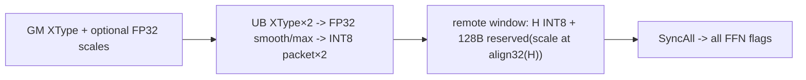
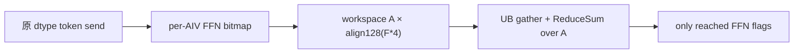
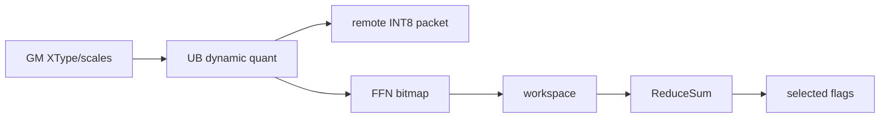
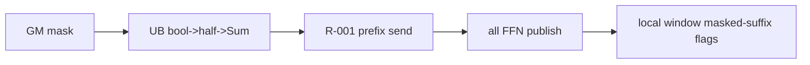
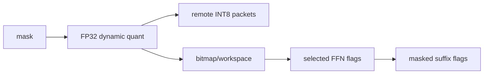

# AttentionToFfn A3 ACLNN 算子知识

## 算子速览

| 项目 | 内容 |
|---|---|
| 实际入口 | `aclnnAttentionToFFNGetWorkspaceSize` / `aclnnAttentionToFFN`；公开 ACLNN 两段式接口，无普通输出 Tensor |
| 计算语义 | Attention worker 将每个有效 token 的 `K` 个 MoE 副本和 `sharedExpertNum` 个共享专家副本，按 `expertRankTable` 选择 FFN rank/local expert，写入对端 HCOM window，并发布 token 状态与批次 flag |
| 输入输出 | `x:[1,Bs,H]` FP16/BF16；ID/路由表 INT32；可选 FP32 scales、BOOL activeMask；副作用输出为对端 token-info/token-data window |
| 执行类型 | `HYBRID`：AIV Vector + MTE 远端 window 通信；无 Cube、SIMT、NDDMA，也不为本算子插入 AICPU server task |
| Kernel 路线 | R-001～R-008：`isQuant × isSync × isActiveMask` 的 8 个 A3 编译期实例；`isSync` 名称实际由 `syncFlag==1` 产生，对应文档的异步模式 |
| 核心资源 | 输入 GM、HCOM 本地/远端 window、按异步路线使用的 user workspace、AIV UB/TQue/TBuf；L1/L0A/L0B/L0C 均不使用 |
| 来源闭包 | `source_closed`：公开 ACLNN→生成式 inner bridge→OpDef/Tiling→task hidden-HCOM 注入→AIV entry/body→远端 window 发布协议均在固定 Commit 闭合；inner bridge 与 HCOM runtime 为框架边界 |
| 验证状态 | 已完成源码闭包检查；本次知识提取未执行编译、真机、数值或性能测试。 |

## 接口与语义

### 计算语义

设 `S=sharedExpertNum`、`T=curBsCnt*(K+S)`。对有效 token `b∈[0,curBsCnt)` 及副本位 `j∈[0,K+S)`：当 `j<K` 时 `expert=expertIds[b,j]`，否则 `expert=moeExpertNum+j-K`。实现读取该专家在 `expertRankTable[layerId,expert,:]` 的部署数 `rankCnt`，以 `sessionId % rankCnt` 选择 `(toRankId, localExpId)`；随后等待对端当前 `(sessionId,microBatchId)` 表头 flag 不为 1，把 token 数据写到对端 token-data window，把 `localExpId` 写到 token-info 的 `2+b*(K+S)+j`，全 AIV 同步后写表头 `[1,layerId]` 发布。

非量化路线原样发送 `H*sizeof(XType)` 字节。动态量化路线先把 `x` 转 FP32，可选逐专家乘 `scales[layerId,expert,:]`（源码地址只含 `expertIndex*H`，当前 `L=1`），求 `amax(abs(x))`，令 `dynamicScale=127/amax`，经 `CAST_RINT→CAST_ROUND→CAST_TRUNC` 得 INT8，并在 `align32(H)` 字节位置附带 FP32 `1/dynamicScale`；每个副本通信长度固定为 `H+128` 字节。固定源码没有 `amax==0` 的保护。

`activeMask` 不做任意压缩：文档要求 `true` 在 `false` 前，Kernel 只对 BOOL 向量求和得到前缀长度 `curBsCnt`，发送前缀 token，并在 Attention 本地状态区把尾部副本标为 1。

### 输入、输出与属性

| 参数 | shape/layout | dtype | 约束、默认值与语义 |
|---|---|---|---|
| `x` | `[X,Bs,H]` / ND | FP16、BF16 | `X=1`，`0<Bs≤512`，`1024≤H≤8192`；AutoContiguous |
| `sessionId` | `[X]` / ND | INT32 | 必选；Device 只读元素 0，用于选专家副本及 window 行 |
| `microBatchId` | `[X]` / ND | INT32 | 必选；Device 只读元素 0，用于 window offset |
| `layerId` | `[X]` / ND | INT32 | 必选；`L=1` 的公开约束下只应为有效层；Device 只读元素 0 |
| `expertIds` | `[X,Bs,K]` / ND | INT32 | `0<K≤min(16,moeExpertNum)`；值域 `[0,moeExpertNum)` 由调用侧保证，Tiling 只验 shape/dtype |
| `expertRankTable` | `[L,moeExpertNum+S,M]` / ND | INT32 | `L=1`、`0≤S≤4`；每项编码 `rankCnt,(rank,localExpId)...`，映射值正确性由外部保证 |
| `scalesOptional` | `[L,moeExpertNum+S,H]` / ND | FP32 | `quantMode=0` 必须为空；`quantMode=2` 可空或有效；有效时逐专家平滑 |
| `activeMaskOptional` | `[X,Bs]` / ND | BOOL | 空表示全发送；非空时 `true` 必须连续位于 `false` 前 |
| `group` | 标量字符串 | STRING | 长度 `[1,128)`；作为唯一 HCCL group |
| `worldSize` | 标量 | INT64/API，Host 读取为 `int` | `[2,768]` |
| `ffnTokenInfoTableShape` | 长度 3 | ListInt | `[attentionWorkerNum,microBatchNum,infoTableLastDimNum]` |
| `ffnTokenDataShape` | 长度 5 | ListInt | `[attentionWorkerNum,microBatchNum,Bs,K+S,HS]`；Tiling 只交叉校验第 0/1/2/3 维，未校验 `HS` 与 `H`/量化通信长度相等 |
| `attnTokenInfoTableShape` | 长度 3 | ListInt | `[microBatchNum,Bs,K+S]`；与前两表交叉校验 |
| `moeExpertNum` | 标量 | INT64/API，Host 读取为 `int` | `(0,1024]` |
| `quantMode` | 标量 | INT64/API，Host 读取为 `int` | 公开支持 0 非量化、2 动态量化；Host 明确拒绝 1 静态量化 |
| `syncFlag` | 标量 | INT64/API，Host 读取为 `int` | 0 同步：向全部 FFN 发布表头；1 异步：经 workspace 聚合，仅向收到 token 的 FFN 发布 |
| `ffnStartRankId` | 标量 | INT64/API，Host 读取为 `int` | `[0,worldSize)`；FFN rank 被实现视为连续区间 `[ffnStartRankId,ffnStartRankId+ffnNum)` |
| 普通输出 | 无 | N/A | `attention_to_ffn_binary.json` 的 `outputs` 为空；结果通过远端 HCOM window 副作用发布 |

### 入口与版本

固定 Commit 公开 README、API 文档和头文件只给出未带版本后缀的 `aclnnAttentionToFFN` 两段式接口；本卡因此是 A3 上该逻辑算子的最新公开无后缀版本。README/API 产品表均明确仅 A3 支持，A2、Atlas 200I/500 A2、旧推理/训练产品以及 Ascend 950PR/950DT 均不支持。`AttentionToFFN` 不是量化变体的独立 API：`quantMode=0/2` 是同一公开语义内的合法 route。

## Host/Launcher 执行流程

### 参数校验与前处理

1. `CheckParams` 仅在公开 wrapper 检查六个必选 Tensor 与 `group` 非空，并检查 `group` 长度小于 `HCCL_GROUP_NAME_MAX`；其余 dtype/shape/attr 由 inner op 的 `AttentionToFFNTilingFunc` 检查。
2. OpDef 为八个 Tensor 输入配置 `AutoContiguous()`；生成的 `aclnnInnerAttentionToFFNGetWorkspaceSize` 是固定仓未展开的框架 bridge，接收原顺序参数并建立 executor。
3. Tiling 依次执行 `CheckAndSetAttrs`、`CheckInputAndSetTilingData`、window 容量检查、workspace、HCOM tiling、tiling key、blockDim/UB/core 数写入；任何一步失败返回 `GRAPH_FAILED`。
4. 第二段 wrapper 若弱符号存在，将 executor 的 server 类型设为 `NNOPBASE_HCCL_SERVER_TYPE_MTE`，再调用 `aclnnInnerAttentionToFFN`；wrapper 不吞掉返回码。

### 参数、Workspace 与生命周期

令 `A=GetCoreNumAiv()`、`F=worldSize-attentionWorkerNum`、`WA=align128(F*4)`。Host 设置：

```text
workspaceSize = GetLibApiWorkSpaceSize() + A * WA
每个 AIV 的状态切片 = workspaceGM + aivId * WA
每切片有效前缀 = F * sizeof(int32_t)，其余为 128B 对齐 padding
```

仅 `syncFlag=1` 的实例读写 user workspace；`syncFlag=0` 仍获得同一 Host 公式的 workspace，但 Device 不消费该状态区。workspace 由 ACLNN 调用方按第一段返回值分配，并至少活到第二段 stream 工作完成。通信 token-info/token-data 不位于 ACLNN workspace，而位于 `GetHcclContext<HCCL_GROUP_ID_0>()` 给出的本地/远端 windows；它们由通信运行时拥有，要求所有卡及网络各层的 shape/group/worldSize/`HCCL_BUFFSIZE` 一致。

### 启动图与失败传播

```text
aclnnAttentionToFFNGetWorkspaceSize
  -> generated aclnnInnerAttentionToFFNGetWorkspaceSize
    -> AttentionToFFNTilingFunc
      -> Mc2CcTilingConfig(group, ALL_TO_ALL, "AlltoAll=level0:fullmesh;level1:pairwise")
      -> key + AIV blockDim + workspace

aclnnAttentionToFFN
  -> NnopbaseSetHcclServerType(executor, MTE)（弱符号存在时）
  -> generated aclnnInnerAttentionToFFN(workspace, executor, stream)
    -> AttentionToFFNGenTaskFunc
      -> 向唯一 AICore task 插入 1 个 kHcom hidden input
      -> AttentionToFFN 被 V2 白名单排除，不插入 wait/AICPU/record task
    -> attention_to_ffn<Q,S,M,A3><<<CalcTschBlockDim(A,0,A), stream>>>
      -> GetHcclContext -> AttentionToFFN::Init -> Process
```

`AttentionToFFNCalcParamFunc` 要求一个名为 `aicpu kfc server`、复用键 `kfc_stream` 的 attached stream，但 `Mc2MoeGenTaskCallbackV2` 对 `AttentionToFFN` 只修改 AICore task 的 hidden-HCOM 参数并直接成功，不新增 AICPU task。API/Tiling/task 生成/inner launch 任一失败都阻止后续提交；Kernel 内没有错误返回通道，若对端 flag 长期为 1，会在 `CheckFlagAndSetTableGM` 自旋等待。

## Route 与参数设计

### 分核与资源计算

`numBlocks=CalcTschBlockDim(A,0,A)`，Device 的 `aivId=GetBlockIdx()`；仅 `ASCEND_IS_AIV` 执行 body。有效发送总数 `Nsend=X*curBsCnt*(K+S)`，`SplitToCore` 令每核先取 `floor(Nsend/A)`，前 `Nsend%A` 核多 1 项，得到连续 `[startId,endId)`；每项映射 `tokenId=tokenOffset/(K+S)`、`topkId=tokenOffset%(K+S)`。FFN 表头发布同样把 `F` 个连续 rank 均分给 AIV。

远端 window 物理布局：

```text
infoBytes = attentionWorkerNum * microBatchNum * infoTableLastDimNum * 4
winOffsetData = align512(infoBytes)
infoOffset(session,micro) = (session * microBatchNum + micro) * infoTableLastDimNum * 4
dataElemOffset = ((session * microBatchNum + micro) * Bs * (K+S) + tokenId*(K+S)+topkId) * HS
非量化 dataByteOffset = winOffsetData + dataElemOffset * sizeof(XType)
量化   dataByteOffset = winOffsetData + dataElemOffset
```

Host 的 window 需求为 `infoBytes + attentionWorkerNum*microBatchNum*Bs*(K+S)*HS*(quant?1:2)`，并用 `actual/MB+1` 与 `GetMaxWindowSize()/MB` 比较；这是整 MB 的保守比较，不是精确 `ceil`。AIV UB 由各 route 的条件 buffer 公式决定，Host 只记录平台 `totalUbSize`，未按公式显式做 UB 上界检查。

### Route 选择

| 顺序 | Route | Key/模板 | 精确选择条件与优先级 | 不适用去向 |
|---:|---|---|---|---|
| 1 | R-001 非量化/同步/全 token | `<false,false,false,A3>` | `quantMode=0 && syncFlag=0 && activeMask不存在` | 对应条件变化后选后续唯一组合；非法参数 Tiling 失败 |
| 2 | R-002 动态量化/同步/全 token | `<true,false,false,A3>` | `quantMode=2 && syncFlag=0 && activeMask不存在` | 同上 |
| 3 | R-003 非量化/异步/全 token | `<false,true,false,A3>` | `quantMode=0 && syncFlag=1 && activeMask不存在` | 同上 |
| 4 | R-004 动态量化/异步/全 token | `<true,true,false,A3>` | `quantMode=2 && syncFlag=1 && activeMask不存在` | 同上 |
| 5 | R-005 非量化/同步/掩码前缀 | `<false,false,true,A3>` | `quantMode=0 && syncFlag=0 && activeMask存在` | 同上 |
| 6 | R-006 动态量化/同步/掩码前缀 | `<true,false,true,A3>` | `quantMode=2 && syncFlag=0 && activeMask存在` | 同上 |
| 7 | R-007 非量化/异步/掩码前缀 | `<false,true,true,A3>` | `quantMode=0 && syncFlag=1 && activeMask存在` | 同上 |
| 8 | R-008 动态量化/异步/掩码前缀 | `<true,true,true,A3>` | `quantMode=2 && syncFlag=1 && activeMask存在` | 同上 |

```text
isQuant      = (quantMode == 2)
isSync       = (syncFlag == 1)       // 模板名；公开语义为异步模式
isActiveMask = (optional activeMask shape != nullptr)
key = GET_TPL_TILING_KEY(isQuant, isSync, isActiveMask, TILINGKEY_TPL_A3)
```

`x` dtype 不改变三位 key，但 binary config 分别构建 `AttentionToFFN_ND_FP16_FP16` 与 `AttentionToFFN_ND_BF16_BF16`，`DTYPE_X` 决定 `XType`。

### 模板/实现执行矩阵

| Route | key/selector | dtype/shape/platform 完整命中条件 | 执行族与 kernel 节点 | 实际模板/body | 内存与同步特征 | tail/fallback |
|---|---|---|---|---|---|---|
| R-001 | Q0/S0/M0 | A3；FP16/BF16；公共 shape/attr 合法 | 单 AIV+MTE window kernel | `AttentionToFFN<XType,false,false,false>` | 双缓冲原 dtype；无状态 workspace；向全部 FFN 发布 | 核无任务早退；无 fallback |
| R-002 | Q1/S0/M0 | R-001 且 `quantMode=2` | 同上 | `<XType,true,false,false>` | FP32 smooth/abs/max；INT8+scale；向全部 FFN 发布 | 同上 |
| R-003 | Q0/S1/M0 | R-001 且 `syncFlag=1` | 同上 | `<XType,false,true,false>` | 原 dtype；每核 workspace bitmap，跨 AIV ReduceSum 后选择性发布 | 同上 |
| R-004 | Q1/S1/M0 | R-002 且 `syncFlag=1` | 同上 | `<XType,true,true,false>` | 量化 UB + workspace 聚合 | 同上 |
| R-005 | Q0/S0/M1 | R-001 且 activeMask 有效 | 同上 | `<XType,false,false,true>` | mask 求和；原 dtype；全部 FFN 发布；本地尾部状态回填 | 只发 true 前缀 |
| R-006 | Q1/S0/M1 | R-002 且 activeMask 有效 | 同上 | `<XType,true,false,true>` | mask 复用量化 FP32 buffers；全部 FFN 发布 | 只发 true 前缀 |
| R-007 | Q0/S1/M1 | R-003 且 activeMask 有效 | 同上 | `<XType,false,true,true>` | mask UB + workspace 聚合，选择性发布 | 只发 true 前缀 |
| R-008 | Q1/S1/M1 | R-004 且 activeMask 有效 | 同上 | `<XType,true,true,true>` | 量化/mask buffer alias + workspace 聚合 | 只发 true 前缀 |

### 隐藏性能 Guard

| Guard | Host/Tiling 条件 | Device/资源原因 | 影响 Route | 不满足时去向 | 源码符号 |
|---|---|---|---|---|---|
| 平台 | OpDef 仅 `AddConfig("ascend910_93")`，文档仅 A3 √ | entry 仅实例化 `ArchTag==A3` | 全部 | 不发布/Host 无配置 | `AttentionToFFN::AttentionToFFN`、`attention_to_ffn` |
| dtype/layout | `x∈{FP16,BF16}`，其余 INT32/FP32/BOOL；主格式不能为 FRACTAL_NZ | binary 与 `GlobalTensor` 类型固定 | 全部 | `GRAPH_FAILED` | `CheckTensorDataType/CheckTensorFormat` |
| shape | `X=L=1`、`Bs≤512`、`H∈[1024,8192]`、`K≤16` | 标量 ID 只读第 0 项；UB/索引按这些维度 | 全部 | `GRAPH_FAILED` | `CheckTensorShapeAndSetTinglingData` |
| 量化模式 | 只允许 0/2；模式 1 明确拒绝；mode0 不允许 scales | 编译期 `isQuant` 决定 UB/输出 dtype | R-001～R-008 | `GRAPH_FAILED` | `CheckInputAndSetTilingData`、`CalTilingKey` |
| activeMask 前缀 | 非空 shape `[1,Bs]`，公开文档要求 true 前置 | Kernel 只 Sum 得计数，不做 gather | R-005～R-008 | 调用约束；无 Device fallback | `ActiveMaskCalCnt` |
| window 容量 | `actualNeed/MB+1 <= maxWindow/MB` | token-info/data 必须容纳于每个 window | 全部 | `GRAPH_FAILED` | `CalWinSize`、`AttentionToFFNTilingFunc` |
| window stride | 调用方必须使 `HS` 符合远端表布局 | 地址用 `HS`，实际 copy 用 `H*2` 或 `H+128` | 全部 | 固定仓无校验/fallback | `CheckAndSetShapeAttrs`、`SendTokenToFFNByTokenIdx` |
| workspace stride | `WA=align128(F*4)` | 异步 route 每核写独立 bitmap，避免覆盖 | R-003/004/007/008 | Host workspace 失败 | `SetWorkSpace`、`SendTokenToFFN` |
| 专家表内容 | `rankCnt>0`、rank/localExpId 合法由外部保证 | Device 有 `%rankCnt` 且直接索引 remoteRes | 全部 | 固定仓无运行 guard | `FindExpertRank` |
| 对端 flag | 表头 flag 必须最终从 1 变为非 1 | producer 覆盖 window 前的生命周期握手 | 全部 | Kernel 自旋，无超时 fallback | `CheckFlagAndSetTableGM` |
| 自动同步关闭 | A3 编译选项 `--cce-auto-sync=off` | 正确性依赖源码显式 event/barrier/SyncAll | 全部 | 构建约束 | `op_host/CMakeLists.txt` |

### POD/ABI

`AttentionToFFNInfo` 的声明字段均由 Host 直接写、Device 直接读。固定仓没有导出 `static_assert(sizeof/alignof/offsetof)`；下表给出声明类型和顺序，不把编译器实际 padding 猜成已验证 ABI。父结构前两个 `Mc2*` 类型来自外部 `kernel_tiling/kernel_tiling.h`，其内部布局在固定仓不可见。

| 结构 | 字段 | 类型/位宽 | ABI 布局 | 单位 | Host/launcher producer | Device consumer | 边界 |
|---|---|---|---|---|---|---|---|
| `AttentionToFFNTilingData` | `mc2InitTiling` | `Mc2InitTiling`/固定仓不可见 | 第 1 字段；sizeof/alignof/offsetof 不可见 | HCOM tiling | `SetHcommCfg/GetTiling` | HCOM/runtime hidden context | 当前 Kernel body 不直接读取 |
| 同上 | `mc2CcTiling1` | `Mc2CcTiling`/固定仓不可见 | 第 2 字段；ABI 不可见 | HCOM tiling | `SetHcommCfg/GetTiling` | HCOM/runtime | 当前 body 不直接读取 |
| 同上 | `attentionToFFNInfo` | 聚合结构 | 第 3 字段；相对父结构 offset 不可见 | 算子参数 | 下列函数 | `InitByTinglingData` | Host/Device 必须同构建产物 |
| `AttentionToFFNInfo` | `X` | `uint32_t`/32 | 第 1 字段 | token 组数 | `InitTilingDataByXDim` | `axisX_` | 固定为 1 |
| 同上 | `BS` | `uint32_t`/32 | 第 2 字段 | token | 同上 | `axisBS_` | `(0,512]` |
| 同上 | `H` | `uint32_t`/32 | 第 3 字段 | 元素 | 同上 | `axisH_`/copy/quant | `[1024,8192]` |
| 同上 | `K` | `uint32_t`/32 | 第 4 字段 | 专家副本/token | `InitTilingDataByExpert` | `axisK_` | `(0,min(16,moeExpertNum)]` |
| 同上 | `L` | `uint32_t`/32 | 第 5 字段 | 层 | 同上 | `axisL_`（仅保存） | 固定为 1 |
| 同上 | `expertNum` | `uint32_t`/32 | 第 6 字段 | 专家 | 同上 | 表 stride | `moeExpertNum+S` |
| 同上 | `moeExpertNum` | `uint32_t`/32 | 第 7 字段 | 专家 | `CheckAndSetAttrs` | 共享专家 ID 起点 | `(0,1024]` |
| 同上 | `sharedExpertNum` | `uint32_t`/32 | 第 8 字段 | 专家 | `expertRankTableDim1-moeExpertNum` | `K+S` 副本数 | `[0,4]` |
| 同上 | `HS` | `uint32_t`/32 | 第 9 字段 | 远端数据槽元素/字节 stride | `ffnTokenDataShape[4]` | data window offset | 与实际 copy 长度关系未校验 |
| 同上 | `expRankTableM` | `uint32_t`/32 | 第 10 字段 | INT32 元素 | `expertRankTableDim2` | 专家表 stride | 内容外部保证 |
| 同上 | `microBatchNum` | `uint32_t`/32 | 第 11 字段 | micro-batch | `ffnTokenDataShape[1]` | window offset | shape list 一致 |
| 同上 | `attentionWorkerNum` | `uint32_t`/32 | 第 12 字段 | rank | `ffnTokenDataShape[0]` | window/FFN 数 | `(0,worldSize)` |
| 同上 | `infoTableLastDimNum` | `uint32_t`/32 | 第 13 字段 | INT32 元素 | `ffnTokenInfoTableShape[2]` | info offset | 固定仓未给下界校验 |
| 同上 | `aivNum` | `uint32_t`/32 | 第 14 字段 | AIV 核 | `GetCoreNumAiv` | 分核/SyncAll/workspace | 必须非 0，平台保证 |
| 同上 | `worldSize` | `uint32_t`/32 | 第 15 字段 | rank | `CheckAndSetAttrs` | `ffnNum_` | `[2,768]` |
| 同上 | `syncFlag` | `uint32_t`/32 | 第 16 字段 | 枚举 | `CheckAndSetAttrs` | body 未直接读；key 使用 | 0/1 |
| 同上 | `quantMode` | `uint32_t`/32 | 第 17 字段 | 枚举 | `CheckAndSetAttrs` | `QuantProcess` | 0/2 |
| 同上 | `ffnStartRankId` | `uint32_t`/32 | 第 18 字段 | rank | `CheckAndSetAttrs` | workspace bitmap/rank loop | `[0,worldSize)` |
| 同上 | `isScales` | `bool`/实现位宽 | 第 19 字段；精确 ABI 未断言 | 布尔 | optional scales shape 是否存在 | 量化 smooth 分支 | mode0 时 false |
| 同上 | `isActiveMask` | `bool`/实现位宽 | 第 20 字段；精确 ABI 未断言 | 布尔 | optional mask shape 是否存在 | body 未直接读；key 使用 | key 与值必须一致 |
| 同上 | `windowType` | `uint8_t`/8 | 第 21 字段 | 枚举 | **固定算子 Tiling 未赋值** | `windowType_` 仅保存、未使用 | inactive；不得据此推断默认值 |
| 同上 | `totalUbSize` | `uint64_t`/64 | 第 22 字段 | 字节 | `GetCoreMemSize(UB)` | 当前 body 不读 | 仅记录平台值 |
| 同上 | `totalWinSize` | `uint64_t`/64 | 第 23 字段 | 字节 | `CalWinSize/GetMaxWindowSize` | 当前 body 不读 | 仅用于 Host 检查/记录 |
| launch ABI | `x...active_mask` | 8 个 `GM_ADDR` | entry 参数顺序固定；单参数 ABI 由 AscendC 工具链定义 | GM 地址 | generated inner task | `Init` | optional 可为空，仅对应 key 可读 |
| launch ABI | `workspaceGM` | `GM_ADDR` | 第 9 个显式 GM 参数 | GM 地址 | executor | 异步实例状态 bitmap | 同步实例 inactive |
| launch ABI | `tilingGM` | `GM_ADDR` | 第 10 个显式 GM 参数 | GM 地址 | Tiling runtime | `GET_TILING_DATA_WITH_STRUCT` | 与注册结构一致 |

### Route 源码闭包

| Route | Key/selector | Host/Tiling producer | POD/参数 | Kernel entry/router | Kernel body/直接依赖 | 构建接线 |
|---|---|---|---|---|---|---|
| R-001～R-008 | `CalTilingKey` 三布尔组合；逐项见 Route 表 | `AttentionToFFNTilingFunc` | `AttentionToFFNTilingData` | `attention_to_ffn<Q,S,M,A3>` → `AttentionToFFN<XType,Q,S,M>` | `AttentionToFFN::Init/Process`、`mc2_kernel_utils::SyncFunc`、HCOM context structs | A3 OpDef、两 dtype binary、`--cce-auto-sync=off`、hidden-HCOM task 注入 |

## Kernel 实现

### 公共执行流程

所有 route 共用一个 AIV Kernel 节点。`Init` 读取 HCOM rank/context 与 tiling，绑定输入 GM，标量方式读取三个 ID，计算 window/workspace stride，并按编译期布尔分配 UB。`Process` 的阶段固定为：可选 mask 计数→每核 token 副本发送→`PIPE_ALL` barrier→全 AIV `SyncAll<true>`→发布 FFN 表头→可选回填 Attention 侧 mask 尾部状态。没有 Cube 或第二个 device kernel。

公共跨域协议是 `对端 flag==0 → 写 token payload/localExpId → 全 AIV barrier → 写 [1,layerId]`。对端 FFN 算子负责何时消费并清零 flag，不属于本逻辑算子源码闭包；本卡只声明 AttentionToFFN 侧可见协议。

### Route R-001：非量化、同步、全 token

#### 适用条件

##### 选择证据

| 层级 | 文件 | 符号 | 源码谓词/参数 | 结果/下一跳 |
|---|---|---|---|---|
| Tiling | `op_tiling/attention_to_ffn_tiling.cpp` | `CalTilingKey` | `quantMode=0,syncFlag=0,activeMask=false` | Q0/S0/M0 |
| Router | `attention_to_ffn_tiling_key.h` | 第 1 个 `ASCENDC_TPL_ARGS_SEL` | `(0,0,0,A3)` | 实例 R-001 |
| Entry | `arch22/attention_to_ffn.cpp` | `attention_to_ffn` | `ArchTag==A3` | `<DTYPE_X,false,false,false>::Process` |

#### Device 数据流

##### 函数级调用链

```text
attention_to_ffn -> Init -> SendTokenToFFN -> SendTokenToFFNByTokenIdx
  -> SetExpertAndRank -> FindExpertRank -> CheckFlagAndSetTableGM
  -> DataCopyPad(remote token data) -> DataCopyPad(remote localExpId)
  -> SyncAll -> SetFlagToFFN(all FFN ranks)
```

##### 源码等价伪码

```text
Nsend = BS*(K+S); split contiguous replicas across A AIVs
for replica in my range:
    (token,slot) = divmod(replica,K+S)
    expert = routed expert or shared expert
    (rank,localExpert) = table[expert][session % rankCnt]
    wait remoteInfo(rank)[0] != 1
    copy x[token,0:H] as XType to remoteData(rank)[slot]
    remoteInfo(rank)[2+replica] = localExpert
SyncAll(A); for every FFN rank assigned to this core: remoteInfo[0:2] = [1,layerId]
```

#### 内存与数据搬运

##### 资源与搬运表

| 层级/缓冲区 | offset/地址公式 | extent/容量公式 | dtype/layout | producer | consumer | owner/lifetime | 对齐/复用 |
|---|---|---|---|---|---|---|---|
| GM `x` | `tokenId*H` | `H*2`/copy | FP16/BF16 ND | caller | `xQueue_` | caller/Kernel | `DataCopyPad` |
| UB `xQueue_` | queue slot | `2*(H*2)=4H` | XType | MTE2 | remote MTE3 | TPipe/loop | depth 2 |
| UB expert/status/flag | 0 | `E + max(sendNum,1)*32 + 32` | INT32 | GM/scalar | lookup/publish | TPipe/Kernel | expert `E=align32(BS*K*4)` |
| remote info/data window | 公共公式 | info + `H*2` per replica | INT32 + XType | AIV | FFN worker | HCOM runtime | info区 512B 对齐 |
| workspace/L1/L0 | N/A | 0 device-consumed bytes | N/A | N/A | N/A | N/A | workspace inactive；无 Cube |

##### 分层内存布局


##### 字节账与复用顺序

```text
UB_R001 = align32(BS*K*4) + 32 + max(sendNum,1)*32 + 4H
workspace_device = 0（Host 仍按公共公式返回）
L1=L0A=L0B=L0C=0
```

| 边/复用子区 | producer | offset/extent | dtype/layout | consumer | ordering/sync | owner/lifetime | 安全条件 |
|---|---|---|---|---|---|---|---|
| remote payload→表头 | per-token AIV copy | 公共 data offset/`H*2` | XType/ND row | FFN worker | `SyncAll` 后才写 flag=1 | HCOM window | 写前轮询旧 flag 清零 |

#### 同步、精度与尾块

##### 同步与数值边界表

| 阶段 | primitive/机制 | producer | consumer/等待点 | 保护对象 | 精度/尾块 |
|---|---|---|---|---|---|
| GM→UB→远端 | TQue EnQue/DeQue | MTE2 | MTE3 | 一个 H row | 原 dtype，无 cast；每副本整 H |
| 旧批次防覆盖 | `MTE2_S` 自旋 + `S_MTE3` | FFN 清 flag | Attention 写 payload | 远端 micro-batch 槽 | 无超时 |
| 发布 | `PIPE_ALL; SyncAll<true>` | 所有 AIV payload | `SetFlagToFFN` | 全部 payload | 空核也参加 SyncAll |

#### 关键实现

##### 符号证据表

| 阶段 | 文件 | 符号/模板实例 | 实现事实 |
|---|---|---|---|
| Host/Tiling producer | `attention_to_ffn_tiling.cpp` | `CalTilingKey/SetWorkSpace` | Q0/S0/M0 与公共资源 |
| Kernel entry/router | `arch22/attention_to_ffn.cpp` | `<DTYPE_X,false,false,false>` | A3 AIV entry |
| Device body/helper | `attention_to_ffn.h` | `SendTokenToFFNByTokenIdx/SetFlagToFFN` | 原 dtype远端 copy、全 FFN 发布 |

### Route R-002：动态量化、同步、全 token

#### 适用条件

##### 选择证据

| 层级 | 文件 | 符号 | 源码谓词/参数 | 结果/下一跳 |
|---|---|---|---|---|
| Tiling | `attention_to_ffn_tiling.cpp` | `CalTilingKey` | `quantMode=2,syncFlag=0,mask=false` | Q1/S0/M0 |
| Router | `attention_to_ffn_tiling_key.h` | 第 2 selector | `(1,0,0,A3)` | R-002 |
| Entry | `arch22/attention_to_ffn.cpp` | `attention_to_ffn` | A3 | `<XType,true,false,false>` |

#### Device 数据流

##### 函数级调用链

```text
R-001 chain + QuantInit -> QuantProcess
  -> Cast FP32 -> optional Mul smoothScale -> Abs/ReduceMax -> Muls(127/amax)
  -> CAST_RINT -> CAST_ROUND -> CAST_TRUNC -> append reciprocal scale -> remote copy(H+128)
```

##### 源码等价伪码

```text
fp = float(x[token]); if scales exists: fp *= scales[expert]
amax=max(abs(fp)); dynamicScale=127/amax; q=trunc(round(cast_rint(fp*dynamicScale)))
packet[0:H]=int8(q); packet[align32(H):align32(H)+4]=1/dynamicScale
执行与 R-001 相同的远端等待、localExpId 写入、SyncAll 和全 FFN flag 发布
```

#### 内存与数据搬运

##### 资源与搬运表

| 层级/缓冲区 | offset/地址公式 | extent/容量公式 | dtype/layout | producer | consumer | owner/lifetime | 对齐/复用 |
|---|---|---|---|---|---|---|---|
| UB input/output queues | slot | `2*(2H)+2*(H+128)=6H+256` | XType/INT8 packet | MTE2/Vector | MTE3 | TPipe | depth 2 |
| UB FP32 pair | 0 | `4H+4H=8H` | FP32 | Cast/scales | quant | TPipe | smooth buffer also abs scratch |
| common metadata | 0 | `E+32+max(sendNum,1)*32` | INT32 | common | common | Kernel | 32B aligned |
| remote data | quant data offset | `H+128` | INT8 + FP32 scale | QuantProcess | FFN | HCOM | scale at `align32(H)` |
| L1/L0/workspace | N/A | 0 consumed | N/A | N/A | N/A | N/A | no Cube；workspace inactive |

##### 分层内存布局



##### 字节账与复用顺序

```text
UB_R002 = E + 32 + max(sendNum,1)*32 + (6H+256) + 8H = E+32+status+14H+256
workspace_device=0; L1/L0*=0
```

| 边/复用子区 | producer | offset/extent | dtype/layout | consumer | ordering/sync | owner/lifetime | 安全条件 |
|---|---|---|---|---|---|---|---|
| quant packet | `QuantProcess` | data slot/`H+128` | INT8 + FP32 | remote FFN | queue + MTE3；后续 SyncAll/flag | HCOM | `HS` 必须匹配槽 stride |

#### 同步、精度与尾块

##### 同步与数值边界表

| 阶段 | primitive/机制 | producer | consumer/等待点 | 保护对象 | 精度/尾块 |
|---|---|---|---|---|---|
| scale load | `MTE2_V` | GM scales | Mul | FP32 H row | scales 可空 |
| reduce/scalar | V barrier、`V_S/S_V` | Abs/ReduceMax | scalar scale/Muls | `amax` | `amax==0` 无保护 |
| cast | 三段 Cast | FP32 | INT8 | H elements | RINT→ROUND→TRUNC |
| publish | 同 R-001 | AIVs | FFN | packet | 固定 H+128 copy |

#### 关键实现

##### 符号证据表

| 阶段 | 文件 | 符号/模板实例 | 实现事实 |
|---|---|---|---|
| Host/Tiling producer | `attention_to_ffn_tiling.cpp` | `CalTilingKey/CalWinSize` | 动态量化 key、1 byte/HS window |
| Kernel entry/router | `arch22/attention_to_ffn.cpp` | `<XType,true,false,false>` | 编译期量化实例 |
| Device body/helper | `attention_to_ffn.h` | `QuantInit/QuantProcess/ReduceMaxInplace` | FP32 scale/max 与 INT8 packet |

### Route R-003：非量化、异步、全 token

#### 适用条件

##### 选择证据

| 层级 | 文件 | 符号 | 源码谓词/参数 | 结果/下一跳 |
|---|---|---|---|---|
| Tiling | `attention_to_ffn_tiling.cpp` | `CalTilingKey` | `quantMode=0,syncFlag=1,mask=false` | Q0/S1/M0 |
| Router | `attention_to_ffn_tiling_key.h` | 第 3 selector | `(0,1,0,A3)` | R-003 |
| Entry | `arch22/attention_to_ffn.cpp` | entry | A3 | `<XType,false,true,false>` |

#### Device 数据流

##### 函数级调用链

```text
R-001 token path -> per-core ffnStatus[toRank-ffnStart]=1
  -> copy each core bitmap to workspace[aivId*WA]
  -> SyncAll -> SetFlagToFFN
  -> gather assigned FFN columns across A cores -> ReduceSum -> only touched FFN publish
```

##### 源码等价伪码

```text
localBitmap[0:F]=0; mark every destination reached by my replicas
workspace[aivId,0:F]=localBitmap; SyncAll(A)
for my contiguous FFN rank range:
    gather that column range from all A workspace rows
    sum over A; publish [1,layerId] only where sum != 0
```

#### 内存与数据搬运

##### 资源与搬运表

| 层级/缓冲区 | offset/地址公式 | extent/容量公式 | dtype/layout | producer | consumer | owner/lifetime | 对齐/复用 |
|---|---|---|---|---|---|---|---|
| R-001 buffers | 同 R-001 | `E+32+status+4H` | XType/INT32 | common | common | TPipe | common |
| UB local bitmap | 0 | `align32(F*4)` | INT32 | `SetExpertAndRank` | workspace copy | TPipe | zero then mark |
| workspace bitmap | `aivId*WA` | Host `A*WA`，有效 `F*4`/row | INT32 row-major | all AIV | SetFlagToFFN gather | caller | row stride align128 |
| UB gather | 0 | `A*align32(sentFFNNum*4)` | INT32/FP32 reinterpret | workspace | ReduceSum | TPipe/SetFlag | per route phase |
| L1/L0 | N/A | 0 | N/A | N/A | N/A | N/A | no Cube |

##### 分层内存布局



##### 字节账与复用顺序

```text
UB_R003 = UB_R001 + align32(F*4) + A*align32(sentFFNNum*4)
workspace_total = libApiWorkspace + A*align128(F*4)
```

| 边/复用子区 | producer | offset/extent | dtype/layout | consumer | ordering/sync | owner/lifetime | 安全条件 |
|---|---|---|---|---|---|---|---|
| bitmap rows | each AIV | `aivId*WA/F*4` | INT32 | assigned publisher AIV | `SyncAll` before gather | ACLNN workspace | unique row per AIV |

#### 同步、精度与尾块

##### 同步与数值边界表

| 阶段 | primitive/机制 | producer | consumer/等待点 | 保护对象 | 精度/尾块 |
|---|---|---|---|---|---|
| bitmap GM write | `V_MTE3` on empty cores；queue/order on active cores | local bitmap | workspace | row | INT32 0/1 |
| cross-core visibility | `PIPE_ALL + SyncAll<true>` | all workspace rows | gather | A×F bitmap | all cores including empty |
| reduction | `MTE2_V`, `ReduceSum<float,RA,true>`, `V_S` | workspace | scalar branch | assigned FFN subset | integer 0/1 reinterpreted as float; zero/nonzero decision |

#### 关键实现

##### 符号证据表

| 阶段 | 文件 | 符号/模板实例 | 实现事实 |
|---|---|---|---|
| Host/Tiling producer | `attention_to_ffn_tiling.cpp` | `SetWorkSpace` | A×128B-aligned bitmap |
| Kernel entry/router | `arch22/attention_to_ffn.cpp` | `<XType,false,true,false>` | 异步 specialization |
| Device body/helper | `attention_to_ffn.h` | `SendTokenToFFN/SetFlagToFFN` | 写、聚合、选择性通知 |

### Route R-004：动态量化、异步、全 token

#### 适用条件

##### 选择证据

| 层级 | 文件 | 符号 | 源码谓词/参数 | 结果/下一跳 |
|---|---|---|---|---|
| Tiling | `attention_to_ffn_tiling.cpp` | `CalTilingKey` | Q1/S1/M0 | R-004 |
| Router | `attention_to_ffn_tiling_key.h` | 第 4 selector | `(1,1,0,A3)` | R-004 |
| Entry | `arch22/attention_to_ffn.cpp` | entry | A3 | `<XType,true,true,false>` |

#### Device 数据流

##### 函数级调用链

```text
R-002 QuantProcess/token packet path + R-003 bitmap workspace/ReduceSum/selected publish path
```

##### 源码等价伪码

```text
对每个副本执行 R-002 动态量化并发送，同时标记本核 FFN bitmap；
全部副本完成后执行 R-003 的 workspace 聚合，只向实际目的 FFN 发布。
```

#### 内存与数据搬运

##### 资源与搬运表

| 层级/缓冲区 | offset/地址公式 | extent/容量公式 | dtype/layout | producer | consumer | owner/lifetime | 对齐/复用 |
|---|---|---|---|---|---|---|---|
| quant buffers | 同 R-002 | `14H+256` 加 metadata | XType/FP32/INT8 | quant | remote | TPipe | depth/alias 同 R-002 |
| async buffers/workspace | 同 R-003 | `align32(F*4)+A*align32(sentF*4)`；GM `A*WA` | INT32 | token path | publisher | TPipe/caller | SyncAll |
| L1/L0 | N/A | 0 | N/A | N/A | N/A | N/A | no Cube |

##### 分层内存布局



##### 字节账与复用顺序

```text
UB_R004 = UB_R002 + align32(F*4) + A*align32(sentFFNNum*4)
workspace_total = libApiWorkspace + A*align128(F*4); L1/L0*=0
```

| 边/复用子区 | producer | offset/extent | dtype/layout | consumer | ordering/sync | owner/lifetime | 安全条件 |
|---|---|---|---|---|---|---|---|
| packet/bitmap | quant token loop | R-002 packet + R-003 bitmap row | mixed | FFN/publisher | per-token events then SyncAll | remote/caller | 两条边都完成后发布 |

#### 同步、精度与尾块

##### 同步与数值边界表

| 阶段 | primitive/机制 | producer | consumer/等待点 | 保护对象 | 精度/尾块 |
|---|---|---|---|---|---|
| quant | 同 R-002 | Vector | MTE3 | packet | INT8+reciprocal scale |
| selective publish | 同 R-003 | workspace | flag branch | rank set | float ReduceSum 仅判零 |

#### 关键实现

##### 符号证据表

| 阶段 | 文件 | 符号/模板实例 | 实现事实 |
|---|---|---|---|
| Host/Tiling producer | `attention_to_ffn_tiling.cpp` | `CalTilingKey/SetWorkSpace` | Q1/S1/M0 |
| Kernel entry/router | `arch22/attention_to_ffn.cpp` | `<XType,true,true,false>` | 合并两个编译期特征 |
| Device body/helper | `attention_to_ffn.h` | `QuantProcess/SetFlagToFFN` | 量化发送+选择性通知 |

### Route R-005：非量化、同步、掩码前缀

#### 适用条件

##### 选择证据

| 层级 | 文件 | 符号 | 源码谓词/参数 | 结果/下一跳 |
|---|---|---|---|---|
| Tiling | `attention_to_ffn_tiling.cpp` | optional mask detection | Q0/S0/M1 | R-005 |
| Router | `attention_to_ffn_tiling_key.h` | 第 5 selector | `(0,0,1,A3)` | R-005 |
| Entry | `arch22/attention_to_ffn.cpp` | entry | A3 | `<XType,false,false,true>` |

#### Device 数据流

##### 函数级调用链

```text
ActiveMaskCalCnt -> R-001 token path limited to curBsCnt -> SyncAll -> all FFN publish -> SetFlagInAttn(masked suffix)
```

##### 源码等价伪码

```text
curBsCnt=sum(bool activeMask[0:Bs]); send only tokenId<curBsCnt as R-001;
after global publish, mark local Attention status entries for tokenId>=curBsCnt as 1.
```

#### 内存与数据搬运

##### 资源与搬运表

| 层级/缓冲区 | offset/地址公式 | extent/容量公式 | dtype/layout | producer | consumer | owner/lifetime | 对齐/复用 |
|---|---|---|---|---|---|---|---|
| R-001 buffers | 同 R-001 | `UB_R001(curBsCnt)` | common | common | common | TPipe | common |
| mask UB | 0 | `align32(Bs)+2*align32(Bs*2)` | BOOL + two HALF scratch | activeMask GM | Sum | TPipe | 32B |
| local Attention status | `microBatch*Bs*(K+S)+curBsCnt*(K+S)` | `(Bs-curBsCnt)*(K+S)*4` | INT32 | Duplicate/MTE3 | Attention protocol | local HCOM window | `attnStatusBuf_` aliases expertIdsBuf after SyncAll |

##### 分层内存布局



##### 字节账与复用顺序

```text
UB_R005 = UB_R001 + align32(Bs) + 2*align32(2Bs)
attnStatusBuf aliases expertIdsBuf（token send 与 SyncAll 后才覆盖）
```

| 边/复用子区 | producer | offset/extent | dtype/layout | consumer | ordering/sync | owner/lifetime | 安全条件 |
|---|---|---|---|---|---|---|---|
| expertIdsBuf→attnStatusBuf alias | token routing | same `E` bytes | INT32 | suffix Duplicate | Process 顺序 + SyncAll | TPipe | 固定仓未显式检查 suffix 每核 `sendNum*4 <= E` |

#### 同步、精度与尾块

##### 同步与数值边界表

| 阶段 | primitive/机制 | producer | consumer/等待点 | 保护对象 | 精度/尾块 |
|---|---|---|---|---|---|
| mask count | `MTE2_V`、Cast、Sum、`V_S` | mask | scalar `curBsCnt` | prefix length | 依赖 true-prefix contract |
| suffix status | `V_MTE3` | Duplicate | local window | masked replicas | 无数据移动，只写状态 1 |

#### 关键实现

##### 符号证据表

| 阶段 | 文件 | 符号/模板实例 | 实现事实 |
|---|---|---|---|
| Host/Tiling producer | `attention_to_ffn_tiling.cpp` | `CheckInputForActiveMask/CalTilingKey` | mask shape与 key |
| Kernel entry/router | `arch22/attention_to_ffn.cpp` | `<XType,false,false,true>` | mask specialization |
| Device body/helper | `attention_to_ffn.h` | `ActiveMaskCalCnt/SetFlagInAttn` | 前缀计数与尾部状态 |

### Route R-006：动态量化、同步、掩码前缀

#### 适用条件

##### 选择证据

| 层级 | 文件 | 符号 | 源码谓词/参数 | 结果/下一跳 |
|---|---|---|---|---|
| Tiling | `attention_to_ffn_tiling.cpp` | key | Q1/S0/M1 | R-006 |
| Router | `attention_to_ffn_tiling_key.h` | 第 6 selector | `(1,0,1,A3)` | R-006 |
| Entry | `arch22/attention_to_ffn.cpp` | entry | A3 | `<XType,true,false,true>` |

#### Device 数据流

##### 函数级调用链

```text
R-005 mask prefix/suffix protocol + R-002 QuantProcess packet path
```

##### 源码等价伪码

```text
用 mask 求有效前缀；对该前缀的每个专家副本执行动态量化并发送；
向全部 FFN 发布，再回填本地 masked suffix 状态。
```

#### 内存与数据搬运

##### 资源与搬运表

| 层级/缓冲区 | offset/地址公式 | extent/容量公式 | dtype/layout | producer | consumer | owner/lifetime | 对齐/复用 |
|---|---|---|---|---|---|---|---|
| quant buffers | 同 R-002 | `UB_R002` | mixed | common | common | TPipe | common |
| mask | 0 | `align32(Bs)` only | BOOL | GM | Sum | TPipe | cast/sum scratch alias quant FP32 pair |
| suffix local status | 同 R-005 | tail replicas*4 | INT32 | AIV | local protocol | HCOM | expert buffer alias |
| workspace/L1/L0 | N/A | 0 consumed | N/A | N/A | N/A | N/A | no Cube |

##### 分层内存布局


##### 字节账与复用顺序

```text
UB_R006 = UB_R002 + align32(Bs)
castTempBuf=receiveDataCastFloatBuf; sumOutBuf=smoothScalesBuf; no extra mask half scratch
```

| 边/复用子区 | producer | offset/extent | dtype/layout | consumer | ordering/sync | owner/lifetime | 安全条件 |
|---|---|---|---|---|---|---|---|
| mask scratch→quant scratch alias | ActiveMaskCalCnt | same two 4H buffers | HALF/FP32 reinterpret | QuantProcess | mask phase completes before token loop | TPipe | `2*Bs <= 4H` under Bs≤512,H≥1024 |

#### 同步、精度与尾块

##### 同步与数值边界表

| 阶段 | primitive/机制 | producer | consumer/等待点 | 保护对象 | 精度/尾块 |
|---|---|---|---|---|---|
| mask | 同 R-005 | mask | curBsCnt | prefix | scratch reused after `V_S` |
| quant/publish | 同 R-002/R-005 | prefix | remote/local | packet/suffix | INT8+scale |

#### 关键实现

##### 符号证据表

| 阶段 | 文件 | 符号/模板实例 | 实现事实 |
|---|---|---|---|
| Host/Tiling producer | `attention_to_ffn_tiling.cpp` | key/window | Q1/S0/M1 |
| Kernel entry/router | `arch22/attention_to_ffn.cpp` | `<XType,true,false,true>` | route instance |
| Device body/helper | `attention_to_ffn.h` | `Init` aliases、`ActiveMaskCalCnt/QuantProcess` | UB 跨阶段复用 |

### Route R-007：非量化、异步、掩码前缀

#### 适用条件

##### 选择证据

| 层级 | 文件 | 符号 | 源码谓词/参数 | 结果/下一跳 |
|---|---|---|---|---|
| Tiling | `attention_to_ffn_tiling.cpp` | key | Q0/S1/M1 | R-007 |
| Router | `attention_to_ffn_tiling_key.h` | 第 7 selector | `(0,1,1,A3)` | R-007 |
| Entry | `arch22/attention_to_ffn.cpp` | entry | A3 | `<XType,false,true,true>` |

#### Device 数据流

##### 函数级调用链

```text
R-005 mask prefix/suffix + R-003 per-AIV bitmap/workspace ReduceSum/selective publish
```

##### 源码等价伪码

```text
求 mask 前缀，仅原 dtype 发送前缀并记录实际 FFN；
聚合 bitmap、仅通知实际 FFN；最后回填本地 masked suffix 状态。
```

#### 内存与数据搬运

##### 资源与搬运表

| 层级/缓冲区 | offset/地址公式 | extent/容量公式 | dtype/layout | producer | consumer | owner/lifetime | 对齐/复用 |
|---|---|---|---|---|---|---|---|
| R-005 buffers | 同 R-005 | `UB_R005` | XType/BOOL/HALF | common | common | TPipe | common |
| R-003 async state | 同 R-003 | `align32(F*4)+A*align32(sentF*4)` + GM A*WA | INT32 | send | publisher | TPipe/caller | SyncAll |
| L1/L0 | N/A | 0 | N/A | N/A | N/A | N/A | no Cube |

##### 分层内存布局


##### 字节账与复用顺序

```text
UB_R007 = UB_R005 + align32(F*4) + A*align32(sentFFNNum*4)
workspace_total = libApiWorkspace + A*align128(F*4)
```

| 边/复用子区 | producer | offset/extent | dtype/layout | consumer | ordering/sync | owner/lifetime | 安全条件 |
|---|---|---|---|---|---|---|---|
| prefix destinations | token loop | per-AIV bitmap | INT32 | selective publisher | SyncAll | workspace | mask count fixed before split |

#### 同步、精度与尾块

##### 同步与数值边界表

| 阶段 | primitive/机制 | producer | consumer/等待点 | 保护对象 | 精度/尾块 |
|---|---|---|---|---|---|
| mask/send | R-005 | prefix | remote | token rows | XType |
| async publish | R-003 | bitmap | flags | reached ranks | ReduceSum |
| suffix | R-005 | Duplicate | local window | masked replicas | status only |

#### 关键实现

##### 符号证据表

| 阶段 | 文件 | 符号/模板实例 | 实现事实 |
|---|---|---|---|
| Host/Tiling producer | `attention_to_ffn_tiling.cpp` | key/workspace | Q0/S1/M1 |
| Kernel entry/router | `arch22/attention_to_ffn.cpp` | `<XType,false,true,true>` | route instance |
| Device body/helper | `attention_to_ffn.h` | `ActiveMaskCalCnt/SendTokenToFFN/SetFlagToFFN/SetFlagInAttn` | 完整阶段图 |

### Route R-008：动态量化、异步、掩码前缀

#### 适用条件

##### 选择证据

| 层级 | 文件 | 符号 | 源码谓词/参数 | 结果/下一跳 |
|---|---|---|---|---|
| Tiling | `attention_to_ffn_tiling.cpp` | key | Q1/S1/M1 | R-008 |
| Router | `attention_to_ffn_tiling_key.h` | 第 8 selector | `(1,1,1,A3)` | R-008 |
| Entry | `arch22/attention_to_ffn.cpp` | entry | A3 | `<XType,true,true,true>` |

#### Device 数据流

##### 函数级调用链

```text
ActiveMaskCalCnt -> QuantProcess per prefix replica -> bitmap workspace -> SyncAll
  -> selected FFN SetFlagToFFN -> local masked-suffix SetFlagInAttn
```

##### 源码等价伪码

```text
组合 R-006 的 mask/量化/本地尾部协议与 R-004 的异步目的 rank 聚合；
只有 true 前缀产生 INT8 packet，只有实际目的 FFN 收到表头 flag。
```

#### 内存与数据搬运

##### 资源与搬运表

| 层级/缓冲区 | offset/地址公式 | extent/容量公式 | dtype/layout | producer | consumer | owner/lifetime | 对齐/复用 |
|---|---|---|---|---|---|---|---|
| R-006 quant/mask | 同 R-006 | `UB_R006` | mixed | mask/quant | remote/local | TPipe/HCOM | FP32 alias |
| R-004 async state | 同 R-004 | bitmap/gather + GM A*WA | INT32 | token path | publisher | TPipe/caller | SyncAll |
| L1/L0 | N/A | 0 | N/A | N/A | N/A | N/A | no Cube |

##### 分层内存布局



##### 字节账与复用顺序

```text
UB_R008 = UB_R006 + align32(F*4) + A*align32(sentFFNNum*4)
workspace_total = libApiWorkspace + A*align128(F*4); L1/L0*=0
```

| 边/复用子区 | producer | offset/extent | dtype/layout | consumer | ordering/sync | owner/lifetime | 安全条件 |
|---|---|---|---|---|---|---|---|
| all feature edges | mask/quant/token loop | packet + bitmap + suffix status | mixed | remote FFN/local Attention | phase order + SyncAll | TPipe/workspace/HCOM | true-prefix、HS stride、workspace lifetime |

#### 同步、精度与尾块

##### 同步与数值边界表

| 阶段 | primitive/机制 | producer | consumer/等待点 | 保护对象 | 精度/尾块 |
|---|---|---|---|---|---|
| mask | R-006 alias protocol | mask | curBsCnt | FP32 scratch | prefix only |
| quant | R-002 | FP32 | remote | packet | INT8+scale；zero amax unguarded |
| publish/suffix | R-003/R-005 | all AIV | remote/local flags | rank/token state | selected ranks + masked suffix |

#### 关键实现

##### 符号证据表

| 阶段 | 文件 | 符号/模板实例 | 实现事实 |
|---|---|---|---|
| Host/Tiling producer | `attention_to_ffn_tiling.cpp` | all producers | Q1/S1/M1 |
| Kernel entry/router | `arch22/attention_to_ffn.cpp` | `<XType,true,true,true>` | 最完整实例 |
| Device body/helper | `attention_to_ffn.h` | `Process` 全部条件分支 | mask、量化、workspace、远端发布闭合 |

## 算子特定优化

### Trick T-001：远端 window 的 payload-first 两阶段发布

#### 触发与源码依据

- 适用 Route：R-001～R-008
- 触发条件：对端 token-info 表头 flag 为 0，当前 route 有待发送副本
- Golden 来源：[`mc2/attention_to_ffn/op_kernel/attention_to_ffn.h:419-425`](../../../../../../../cann-ops-raw/ascendc/ops-transformer/be33d95bb755cedec3108f70805c1874d1792540/mc2/attention_to_ffn/op_kernel/attention_to_ffn.h#L419-L425)

**官方源码（固定 Commit 连续逐字摘录）**：

```cpp
while (ffnFlage == 1) {
    DataCopy(ffnFlagTensor_, tokenInfoTableGMTensor, STATUS_REP_STRIDE);
    SyncFunc<AscendC::HardEvent::MTE2_S>();
    ffnFlage = ffnFlagTensor_.GetValue(0);
}
SyncFunc<AscendC::HardEvent::S_MTE3>();
```

#### 机制与设计原因

每个 producer 在覆盖对端槽前等待上一轮 flag 被 consumer 清除；写完 token data 和每副本 local expert 后，所有 AIV 通过 `SyncAll` 汇合，再写 `[flag=1,layerId]`。表头因此是 payload 完成标记，而非仅凭 Host launch 顺序推定可见性。

#### 迁移边界

- 适用：对端拥有固定 token-info/data window 且以表头 flag 管生命周期的 AIV-MTE 发送。
- 前提：唯一通信域、双方 shape/offset/flag 语义一致，对端最终清 flag。
- 失效：没有远端可写 window、需要超时/错误返回或 consumer 不遵守清零协议。
- 未验证：本次知识提取未执行编译、真机、数值或性能测试。

#### 错误做法

若先写 flag 再写 payload，FFN 可观察到未完成数据；若省略旧 flag 轮询，会覆盖仍在消费的上一轮 window。

### Trick T-002：三布尔编译期 specialization 精确裁剪 UB 与控制流

#### 触发与源码依据

- 适用 Route：R-001～R-008
- 触发条件：Host 从 `quantMode==2`、`syncFlag==1`、optional mask presence 生成 key
- Golden 来源：[`mc2/attention_to_ffn/op_host/op_tiling/attention_to_ffn_tiling.cpp:621-639`](../../../../../../../cann-ops-raw/ascendc/ops-transformer/be33d95bb755cedec3108f70805c1874d1792540/mc2/attention_to_ffn/op_host/op_tiling/attention_to_ffn_tiling.cpp#L621-L639)

**官方源码（固定 Commit 连续逐字摘录）**：

```cpp
if (syncFlag == SYNC_MODE) {
    isSync = true;
}
if (quantMode == DYNAMIC_QUANT_MODE) {
    isQuant = true;
}
if (activeMaskFlag) {
    isActiveMask = true;
}
```

#### 机制与设计原因

三个特征进入 tiling key，entry 将其变成类模板布尔参数；`if constexpr` 使非量化 route 不分配量化队列，`syncFlag=0` route 不读 workspace，mask 缺省 route 不分配 mask buffer。这里 `SYNC_MODE=1` 的内部命名与公开文档“1=异步”相反，迁移必须跟随实际布尔生产式。

#### 迁移边界

- 适用：可选功能显著改变 UB、workspace 或发布协议，且 Host 能唯一生成 key。
- 前提：key 注册表覆盖全部 8 组合并与 Device template 参数顺序一致。
- 失效：新增 mode 未同步扩展 selector；unknown key 没有安全 fallback。
- 未验证：本次知识提取未执行编译、真机、数值或性能测试。

#### 错误做法

把 `isSync` 按名字解释为 `syncFlag=0` 会交换同步/异步 route，并导致 workspace 与通知范围错误。

### Trick T-003：逐专家平滑与动态 INT8 packet 原位封装

#### 触发与源码依据

- 适用 Route：R-002、R-004、R-006、R-008
- 触发条件：`quantMode=2`；若 `scalesOptional` 非空再乘专家平滑系数
- Golden 来源：[`mc2/attention_to_ffn/op_kernel/attention_to_ffn.h:332-357`](../../../../../../../cann-ops-raw/ascendc/ops-transformer/be33d95bb755cedec3108f70805c1874d1792540/mc2/attention_to_ffn/op_kernel/attention_to_ffn.h#L332-L357)

**官方源码（固定 Commit 连续逐字摘录）**：

```cpp
Abs(floatLocalAbsTemp, floatLocalTemp, axisH_);
PipeBarrier<PIPE_V>();
ReduceMaxInplace(floatLocalAbsTemp, axisH_);
SyncFunc<AscendC::HardEvent::V_S>();
dynamicScale = float(INT8_MAX_VALUE) / floatLocalAbsTemp.GetValue(0);
```

#### 机制与设计原因

每个专家副本可使用不同 smooth scale，故路由完成后才量化。输出队列同时承载 `H` 个 INT8 与对齐后的 reciprocal FP32 scale，单次 `DataCopyPad` 发送 `H+128` 字节，避免另建 scale 通信边。128B 是预留容量；实际 scale 写在 `align32(H)`。

#### 迁移边界

- 适用：consumer 明确识别 INT8 payload 与 reciprocal scale 的同槽 ABI。
- 前提：`HS` stride、`H+128` copy 与 FFN 侧 packet 布局一致；`scales` 按专家连续。
- 失效：`amax=0` 需要明确零保护、量化格式或 scale 位置变化时必须改协议。
- 未验证：本次知识提取未执行编译、真机、数值或性能测试。

#### 错误做法

固定源码自身未给 `amax==0` 的 fallback；迁移时不能宣称该输入已安全处理，也不能把 reciprocal scale 错放到紧邻 `H` 而忽略 32B 对齐。

### Trick T-004：异步模式按目的 rank 聚合通知

#### 触发与源码依据

- 适用 Route：R-003、R-004、R-007、R-008
- 触发条件：公开 `syncFlag=1`，即 template `isSync=true`
- Golden 来源：[`mc2/attention_to_ffn/op_kernel/attention_to_ffn.h:546-558`](../../../../../../../cann-ops-raw/ascendc/ops-transformer/be33d95bb755cedec3108f70805c1874d1792540/mc2/attention_to_ffn/op_kernel/attention_to_ffn.h#L546-L558)

**官方源码（固定 Commit 连续逐字摘录）**：

```cpp
DataCopyPad(syncStatusWorkspaceTensor_, syncStatusGMTensor_[startFFNId - ffnStartRankId_], syncStatusParams, copyPadParams);
SyncFunc<AscendC::HardEvent::MTE2_V>();
LocalTensor<float> syncStatusWorkspaceTensorFloat = syncStatusWorkspaceTensor_.ReinterpretCast<float>();
LocalTensor<float> ffnStatusTensorFloat = ffnStatusTensor_.ReinterpretCast<float>();
const uint32_t shape[] = {aivNum_, static_cast<uint32_t>(sentFFNNumAlignSize / sizeof(float))};
AscendC::ReduceSum<float, AscendC::Pattern::Reduce::RA, true>(ffnStatusTensorFloat, syncStatusWorkspaceTensorFloat, shape, true);
```

#### 机制与设计原因

每核只在本地 bitmap 标记实际目的 rank，再写独占的 128B 对齐 workspace 行。全核同步后，负责某段 FFN rank 的 AIV 以二维 strided copy 收集所有行并沿 AIV 轴求和，只给非零目的 rank 写表头，避免异步调用唤醒未收到 token 的 FFN。

#### 迁移边界

- 适用：目的集合由各核独立产生，需要在单 Kernel 内合并。
- 前提：workspace 为 `A*align128(F*4)`、全核均写行并参加 `SyncAll`。
- 失效：blockDim/AIV 数与 tiling 不一致、workspace stride 改变或没有全核 barrier。
- 未验证：本次知识提取未执行编译、真机、数值或性能测试。

#### 错误做法

省掉空核的 workspace 清零/写回或在 `SyncAll` 前 gather，会把旧状态或未完成行误判为已发送 rank。

### Trick T-005：mask 前缀协议与量化 scratch 跨阶段复用

#### 触发与源码依据

- 适用 Route：R-005～R-008；其中 R-006/R-008 复用量化 FP32 buffers
- 触发条件：`activeMaskOptional` 非空且满足 true 前置
- Golden 来源：[`mc2/attention_to_ffn/op_kernel/attention_to_ffn.h:243-263`](../../../../../../../cann-ops-raw/ascendc/ops-transformer/be33d95bb755cedec3108f70805c1874d1792540/mc2/attention_to_ffn/op_kernel/attention_to_ffn.h#L243-L263)

**官方源码（固定 Commit 连续逐字摘录）**：

```cpp
if constexpr (isQuant) {
    QuantInit(scales);
    castTempBuf_ = receiveDataCastFloatBuf_;
    sumOutBuf_ = smoothScalesBuf_;
}
```

#### 机制与设计原因

mask 先转 HALF 再 Sum，只需要在 token 量化前短暂使用 scratch。量化 route 将这两个 scratch alias 到随后才使用的两个 FP32 H buffers，少分配两块 `align32(2Bs)` UB；非量化 route 则独立分配。发送完后，`attnStatusBuf_` 再 alias 已不需要的 expertIds buffer，用于回填 masked suffix 状态。

#### 迁移边界

- 适用：阶段严格串行且 buffer 最大容量覆盖两种解释。
- 前提：mask true 前置；mask 阶段在 quant/token loop 前结束，expertIds 在 suffix 回填前不再读取。
- 失效：任意 mask 压缩、阶段重叠、增加并发流水或改变 buffer 容量。
- 未验证：本次知识提取未执行编译、真机、数值或性能测试。

#### 错误做法

若允许 `true/false` 交错仍只用 Sum，发送的将是错误 token 前缀；若提前复用 expertIds buffer，会破坏路由表读取。

## 模板与实现对比

| 对比维度 | R-001/002 同步无 mask | R-003/004 异步无 mask | R-005/006 同步 mask | R-007/008 异步 mask | 设计选择依据 |
|---|---|---|---|---|---|
| 命中条件/优先级 | S0/M0，Q0/Q1 | S1/M0，Q0/Q1 | S0/M1，Q0/Q1 | S1/M1，Q0/Q1 | 三布尔 key 唯一映射，无优先级 fallback |
| 执行族/节点图 | 单 AIV+MTE | 单 AIV+MTE | 单 AIV+MTE | 单 AIV+MTE | 都是一个 AICore task + hidden HCOM context |
| M/N/K、tile 与 scheduler | N/A Matmul；副本域均分 | 同左 | 有效前缀副本域均分 | 同左 | `SplitToCore` 连续均分，无 tile tail copy |
| workspace/L1/L0/UB | workspace inactive；原 dtype或量化 UB | 增加 bitmap/gather 与 workspace | 增加 mask；量化时 alias scratch | 两类增量同时存在 | compile-time buffer 裁剪 |
| AIC/AIV 或 kernel 交接 | 无 AIC；远端 window | 无 AIC；另有 AIV→workspace→AIV | 无 AIC；本地 window suffix | 两种 window + workspace | `SyncAll` 是跨 AIV 可见性边 |
| 同步、精度与 tail | 全 FFN flag；Q1为 INT8+scale | 选择性 flag；Q1同左 | 前缀发送、尾部状态；Q1同左 | 选择性 flag+尾部状态 | 公开 `syncFlag` 和 mask 语义 |
| fallback/失败边界 | Tiling 失败/远端自旋 | 同左+workspace | 同左+prefix contract | 所有限制叠加 | Device 无替代 route |

## 平台差异

| 项目 | A2 | A3 | 950 |
|---|---|---|---|
| 支持状态 | README/API 明确不支持 | 唯一公开支持平台 | Ascend 950PR/950DT 明确不支持 |
| Host/Launcher | 无正式 route | `ascend910_93` OpDef、A3 三布尔 key、MTE server type | 无正式 route |
| Kernel/资源 | N/A | `arch22` 单 AIV Kernel、HCOM remote window、`--cce-auto-sync=off` | N/A；不得因其他算子有 arch35 推断支持 |

## 限制与失败边界

- API wrapper 只校验必选指针和 group；dtype/shape/attr 错误在 Tiling 报错。公开错误包括 `ACLNN_ERR_PARAM_NULLPTR`、`ACLNN_ERR_PARAM_INVALID`、`ACLNN_ERR_INNER_TILING_ERROR`。
- `quantMode=1` 虽在早期属性范围 `[0,2]` 内，随后明确拒绝；只有 0/2 可达。
- `ffnTokenDataShape[4]=HS` 与实际非量化 `H*sizeof(XType)`、量化 `H+128` packet 长度没有 Host 等值检查；跨算子部署必须由调用方保持一致。
- `windowType` POD 字段在本算子 Tiling 中未赋值且 body 不使用；不能把环境常量 `ASCEND_ATTN_TO_FFN_WIN_TYPE` 当成 producer。
- 专家 ID 值、`rankCnt>0`、rank/local expert 映射、`layerId/microBatchId/sessionId` 值域均缺少 Device guard；公开文档明确 expert rank table 内容由外部保证。
- `dynamicScale=127/amax` 没有 `amax==0` guard；固定源码未提供数值 fallback。
- mask 尾部回填将 `expertIdsBuf_` alias 为 `attnStatusBuf_`，但固定仓没有显式校验该核 suffix `sendNum*sizeof(int32_t)` 不超过 `align32(Bs*K*4)`；不能外推为任意 shape 都有独立容量证明。
- 对端 flag 自旋没有超时或错误返回；通信域不得包含其他算子，且所有卡/层的 group、worldSize、shape 与 `HCCL_BUFFSIZE` 必须一致。
- Host 记录 `totalUbSize` 但未用 route 字节账做显式容量检查；UB 可行性依赖 A3 约束与构建。
- `AttentionToFFNGenTaskFunc` 对本算子不增加 AICPU task；不要按 attached stream 名称误画多 Kernel 图。
- 固定源码没有普通输出 Tensor、空 shape route 或 unknown key fallback。本次知识提取未执行编译、真机、数值或性能测试。

## 源码索引

### 链路索引

| 链路阶段 | 文件 | 关键符号 | 支撑内容 |
|---|---|---|---|
| 入口声明/约束 | `mc2/attention_to_ffn/README.md` | 产品支持表/约束说明 | A3 唯一公开支持、算子级语义与一致性约束 |
| 入口声明/约束 | `mc2/attention_to_ffn/docs/aclnnAttentionToFFN.md` | 两段式原型/产品表 | A3 支持、公开 shape/dtype/语义 |
| 入口声明/约束 | `mc2/attention_to_ffn/op_api/aclnn_attention_to_ffn.h` | `aclnnAttentionToFFN*` | C API 参数顺序 |
| 入口实现 | `mc2/attention_to_ffn/op_api/aclnn_attention_to_ffn.cpp` | `CheckParams/aclnnAttentionToFFN` | wrapper 校验、MTE server、inner bridge |
| Host OpDef | `mc2/attention_to_ffn/op_host/attention_to_ffn_def.cpp` | `AttentionToFFN` | 输入/属性、A3 config、MC2 group |
| Host/Tiling | `mc2/attention_to_ffn/op_host/op_tiling/attention_to_ffn_tiling.cpp` | `AttentionToFFNTilingFunc` | 校验、workspace/window、key、blockDim |
| Host 公共参数 | `mc2/common/op_host/op_tiling/mc2_tiling_utils.cpp` | `Mc2TilingUtils::GetMaxWindowSize` | `HCCL_BUFFSIZE` 到 window 字节上限的 producer |
| POD/ABI | `mc2/attention_to_ffn/op_kernel/attention_to_ffn_tiling.h` | `AttentionToFFNInfo/TilingData` | 字段定义 |
| Router | `mc2/attention_to_ffn/op_kernel/attention_to_ffn_tiling_key.h` | `ASCENDC_TPL_SEL` | 8 个 A3 specialization |
| Task graph | `mc2/attention_to_ffn/op_graph/attention_to_ffn_gen_task.cpp` | `AttentionToFFN*TaskFunc` | attached stream 与 V2 callback |
| Task graph helper | `mc2/common/op_graph/mc2_gen_task_ops_utils.cpp` | `CommonKFCMc2CalcParamFunc/InsertHiddenInputsForAicoreTask` | attached stream 与 hidden-HCOM 参数接线 |
| Task graph helper | `mc2/common/op_graph/mc2_moe_gen_task_ops_utils.cpp` | `Mc2MoeGenTaskCallbackV2` | hidden HCOM 注入、AttentionToFFN 无 AICPU task |
| Kernel entry | `mc2/attention_to_ffn/op_kernel/arch22/attention_to_ffn.cpp` | `attention_to_ffn` | A3 entry、POD 解析、模板实例 |
| Kernel body | `mc2/attention_to_ffn/op_kernel/attention_to_ffn.h` | `AttentionToFFN::*` | 分核、量化、workspace、window、同步 |
| Kernel helper | `mc2/common/op_kernel/mc2_kernel_utils.h` | `SyncFunc` | event 的 SetFlag/WaitFlag 实现 |
| HCOM ABI | `mc2/common/op_kernel/moe_distribute_base.h` | `HcclOpResParam/HcclRankRelationResV2` | local/remote/user window 地址 |
| 构建接线 | `mc2/attention_to_ffn/op_host/CMakeLists.txt` | `add_mc2_modules_sources` | MC2 构建与 A3 auto-sync 关闭 |
| binary 接线 | `mc2/attention_to_ffn/op_host/config/ascend910_93/attention_to_ffn_binary.json` | FP16/BF16 entries | 两种 x dtype、无 outputs |

每行只写一个文件，并确保该文件存在于 Frontmatter `sources`。

### 实现复用检查

| 检查项 | 可复用事实 | 不得改变的约束 | 源码符号 |
|---|---|---|---|
| ABI/POD | 三段聚合 Tiling、8+workspace+tiling GM 参数 | 字段顺序、Host/Device 同构建、三布尔 key 次序；`windowType` 不得臆造 | `AttentionToFFNTilingData`、`attention_to_ffn` |
| 调用顺序 | 校验→Tiling→hidden HCOM→Init→payload→SyncAll→flag | flag 不得先于 payload；空核也必须到全核 barrier | `AttentionToFFNTilingFunc/Process` |
| workspace/内存 | 异步 bitmap `A*align128(F*4)`；window info 512B 对齐 | row stride、remote packet stride、owner/lifetime | `SetWorkSpace/Init/SetFlagToFFN` |
| 同步 | `SyncFunc` event pair、旧 flag 自旋、`PIPE_ALL+SyncAll` | auto-sync 关闭；不可省略显式依赖 | `mc2_kernel_utils.h/CheckFlagAndSetTableGM/Process` |
| 精度与尾块 | FP16/BF16 原样或 FP32→INT8+reciprocal；副本余数均分 | cast 顺序、scale offset、mask true-prefix | `QuantProcess/SplitToCore/ActiveMaskCalCnt` |
| 失败边界 | Host/Tiling 失败、window 容量、无 key fallback、远端自旋 | 不得将 A2/950、static quant、任意 mask 或无效专家表静默降级 | `CheckInputAndSetTilingData/CalWinSize/FindExpertRank` |