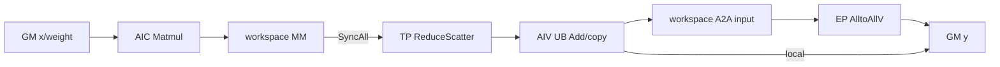

# BatchMatMulReduceScatterAlltoAll A3 ACLNN 算子知识

## 算子速览

| 项目 | 内容 |
|---|---|
| 实际入口 | `aclnnBatchMatMulReduceScatterAlltoAllGetWorkspaceSize` + `aclnnBatchMatMulReduceScatterAlltoAll`，固定提交唯一公开、无版本后缀的两段式 ACLNN |
| 计算语义 | `BatchMatMul(x,weight)` → TP 域 `ReduceScatter(sum)` → 可选 `Add(bias)` → EP 域 `AlltoAllV`；`yShardType=0/1` 分别沿 H/C 分片 |
| 输入输出 | `x/weight/out` 为 3D ND FP16/BF16；bias 可空，FP16 路线为 FP16，BF16 路线为 FP32；out 与 x 同 dtype |
| 执行类型 | 单 Kernel `MIX_CV`，`KERNEL_TYPE_MIX_AIC_1_2`；AIC 跑 BMM，AIV 跑重排、Add 与 HCCL(AICPU server) 调度 |
| Kernel 路线 | R-001 H-shard；R-002 C-shard 标准；R-003 C-shard lite |
| 核心资源 | GM、单块 user workspace、Matmul 管理的 L1/L0A/L0B/L0C、AIV UB、HCCL handle |
| 来源闭包 | `source_closed`：公开 ACLNN、Host/Tiling、tuple key、MIX entry、两套 body、BMM 当前实例、通信任务生成与 A3 构建闭合；generated inner bridge、`MatmulImpl` 和 HCCL 协议内部为框架/库边界 |
| 验证状态 | 已完成源码闭包检查；本次知识提取未执行编译、真机、数值或性能测试。 |

## 接口与语义

### 计算语义

令 `ep=epWorldSize`、`tp=tpWorldSize`、`e=E/ep`、`m=M/tp`。bias 不传入 BMM，而在 ReduceScatter 后由 AIV 相加。

- `yShardType=0`：`x=[e,ep*C,m]`、`weight=[e,m,H]`（或最后两维转置 view）、`out=[E,C,H/tp]`。BMM 输出先抽取每个 TP rank 的 H 分片，再 ReduceScatter；非本地专家 Add/重排后 AlltoAllV，本地专家直接写 y。
- `yShardType=1`：`x=[e,ep*tp*(C/tp),m]`、`weight=[e,m,H]`、`out=[E,C/tp,H]`。标准路线直接 BMM 到通信布局；lite 路线先把小 C 片聚成 batch BMM 布局，BMM 后再散回。
- FP16 bias 在 FP16 中相加；BF16 ReduceScatter 输出先 `CAST_NONE` 到 FP32，与 FP32 bias 相加，再 `CAST_ROUND` 回 BF16。无 bias 时只搬运/重排。

### 输入、输出与属性

| 参数 | shape/layout | dtype | 约束、默认值与语义 |
|---|---|---|---|
| `x` | 3D ND | FP16/BF16 | 必选；`x[2]=M/tp` 为 `[1,65535]`，`x[0]=E/ep` 为 `[1,32]`；OpDef `AutoContiguous` |
| `weight` | 3D ND，逻辑 `[e,m,H]` 或最后两维转置 view | 与 x 相同 | API 以 `IsTransposeLastTwoDims` 检测；`TransTensor` 只交换 view shape/stride，不搬数据 |
| `biasOptional` | shard 0 `[e,H/tp]`/`[e,1,H/tp]`；shard 1 `[e,H]`/`[e,1,H]` | FP16 或 FP32 | 可空；x=FP16 时 bias=FP16，x=BF16 时 bias=FP32；3D 中间维为 1 |
| `groupEp/groupTp` | 非空字符串 | STRING | 长度 `<HCCL_GROUP_NAME_MAX`（公开文档为 `<128`），名称不同；分别用于 AlltoAll/ReduceScatter |
| `epWorldSize/tpWorldSize` | 标量 | INT64 | 仅 2、4、8、16、32；仅超节点内；通算融合算子不支持并发 |
| `yShardType` | 标量 | INT64 | 0=H shard，1=C shard；其它值失败 |
| `out` | shard 0 `[E,C,H/tp]`；shard 1 `[E,C/tp,H]`；3D ND | 与 x 相同 | `E∈[2,512]`、C 或 C/tp>0、`H∈[1,65535]` |
| `workspaceSize/executor` | 第一段输出 | UINT64/handle | workspace 包含 user slices 和固定 16 MiB system workspace |
| `workspace/workspaceSize/stream` | 第二段输入 | device pointer/UINT64/stream | 必须配套第一段 executor，在指定 stream 执行 |

### 入口与版本

README、API 文档、头文件和实现只公开这组无后缀接口；固定提交全仓符号与文件名扫描均未发现本逻辑算子的 V2/V3。README/API 明确 A3 支持、A2/950 不支持；OpDef 仅 `AddConfig("ascend910_93")` 并声明 `support_aclnn`。因此本无后缀接口就是 A3 在该提交实际支持的最新公开版本，本卡只覆盖 A3。

## Host/Launcher 执行流程

### 参数校验与前处理

第一段依次执行 `CheckNotNull`、group 长度、`CheckDtypeValid`、`CheckAttr`、`CheckTensorDim`、`CheckShapeRange`；空 tensor 不支持。随后判断 weight 是否为最后两维转置 view，命中时 `TransTensor` 交换 view shape/stride 并保留 storage、offset、地址。两条分支都调用 generated `aclnnInnerBatchMatMulReduceScatterAlltoAllGetWorkspaceSize`，额外传 `transposeWeight`。第二段转发到 generated inner 执行函数；状态原样返回。

### 参数、Workspace 与生命周期

Tiling 从 storage shape 得到 `e=x[0]`、`E=y[0]`、`H=weight[wDimH]`、`M/tp=x[2]`。shard 1：`C=y[1]*tp,C/tp=y[1]`；shard 0：`C=y[1],C/tp=y[1]/tp`。平台提供 AIC/AIV 核数与 UB，`CalcTschBlockDim(aiv,aic,aiv)` 产生 MIX blockDim。workspace 由调用者持有至 stream 完成，Kernel 用 `GetUserWorkspace` 跳过 system workspace 头。令 `s=sizeof(X_T)=2`：

```text
R-001:
  comm = (2*E*C*(H/tp) + E*C*H) * s
  trans = max(maxLocalE*maxLocalC*H,
              (ep-1)*maxNonLocalE*maxNonLocalC*H) * s
  workspace = comm + trans + 16 MiB
R-002:
  workspace = (2*E*(C/tp)*H + E*C*H) * s + 16 MiB
R-003:
  before = max(localMaxC*localE*tp*(M/tp),
               nonLocalMaxC*nonLocalE*tp*(M/tp)*(ep-1))
  after = max(localMaxC*localE*tp*H,
              nonLocalMaxC*nonLocalE*tp*H*(ep-1))
  workspace = (2*E*(C/tp)*H + E*C*H + before + after) * s + 16 MiB
```

### 启动图与失败传播

```text
公开 ACLNN -> generated inner bridge（固定仓未展开）
  -> BatchMatMulReduceScatterAlltoAllTilingFunc
  -> 单次 batch_mat_mul_reduce_scatter_allto_all<YShard,Trans,Bias,Lite>
     MIX_AIC_1_2
     AIC: Mc2BatchMatMulCommonKernel/MatmulImpl
     AIV: reshape/Add/layout copy/HCCL prepare-commit-wait
     AICPU KFC resource: CommonKFCMc2CalcParamFunc + Mc2MoeGenTaskCallback
  -> y
```

Tiling 校验、公式化切分、BMM tiling 或 workspace 设置失败应返回 `GRAPH_FAILED`。Kernel 遇到空 `workspaceGM` 或空 user workspace 直接 return 而不写输出。tuple key 只编译声明组合，不存在运行时 default body。设备侧 HCCL 协议错误传播细节在固定仓不可见。

## Route 与参数设计

### 分核与资源计算

`SetFormulaicArgs` 固定 BMM `M=C,N=H,K=M/tp`，bias=false。公式化 tiling 按计算/通信模型切 local/non-local E/C，单算双通总 tile 上限 5；local/non-local main/tail 各调用一次 BMM V3 tiling，写四份 nested POD。UB Add 容量为 `floor(UB/coeff/16)*16`：FP16 无/有 bias 的 coeff 为 2/6 字节；BF16 有 FP32 bias 为 12 字节。BF16 无 bias 因 Host 将缺省 bias dtype 设为输入 dtype，公式保守得到 14 字节系数，而 Device 只分配一个 `ubCapacity*2` bound queue。

### Route 选择

| 顺序 | Route | Key/模板 | 精确选择条件与优先级 | 不适用去向 |
|---:|---|---|---|---|
| 1 | R-001 H-shard | `(0,isWeightTrans,isBias,0)`；`BatchMatMulReduceScatterAlltoAllShard0` | `yShardType==0`；Lite 强制 false | shard 1 进入 R-002/003，其它失败 |
| 2 | R-002 C-shard 标准 | `(1,isWeightTrans,isBias,0)`；main class | `yShardType==1 && C/tp>640` | 小 C 进入 R-003 |
| 3 | R-003 C-shard lite | `(1,isWeightTrans,isBias,1)`；main class | `yShardType==1 && C/tp<=640` | 无；非法组合失败 |

```text
if shard==0: key=(0,trans,bias,false) -> R-001
else if shard==1:
  lite=(C/tp<=640); key=(1,trans,bias,lite) -> R-002/R-003
else: fail
```

每个 Route 内 transpose、bias 与 FP16/BF16 均为独立编译 specialization：transpose 改 B layout，bias 改 UB body，BF16 改 HCCL dtype与 Add 精度；它们共享调度/交接图。

### 模板/实现执行矩阵

| Route | key/selector | dtype/shape/platform 完整命中条件 | 执行族与 kernel 节点 | 实际模板/body | 内存与同步特征 | tail/fallback |
|---|---|---|---|---|---|---|
| R-001 | `(0,T,B,0)` | A3；FP16/BF16；`H%tp==0`；API/Host 校验通过 | 单 MIX_CV + HCCL server | `Shard0<BMMRSATAType<X,BIAS,B,0,T,0>>` | BMM→reshape→RS→Add/重排→A2A | E/C main/tail，大 H/tp 切列；无 fallback |
| R-002 | `(1,T,B,0)` | A3；FP16/BF16；`C%tp==0`；C/tp>640 | 单 MIX_CV + HCCL server | `main<BMMRSATAType<X,BIAS,B,1,T,0>>` | 直接 BMM 到 workspace，RS/A2A 流水 | C main/tail；无 fallback |
| R-003 | `(1,T,B,1)` | 同 R-002，但 C/tp<=640 | 单 MIX_CV + 两段 AIV layout copy | `main<...,1,T,1>` | gather→batch BMM→scatter→RS/A2A | C main/tail；无 fallback |

### 隐藏性能 Guard

| Guard | Host/Tiling 条件 | Device/资源原因 | 影响 Route | 不满足时去向 | 源码符号 |
|---|---|---|---|---|---|
| Lite | `C/tp<=640 && shard==1` | 聚合小 C 为 batch BMM，新增前后 copy | R-003 | R-002 | `CalculateTensorInfo` |
| tuple | shard 0 仅 Lite=0；shard 1 Lite=0/1 | `ASCENDC_TPL_SEL` 编译集合 | 全部 | Host 不生成其它组合 | tiling key header |
| MIX 比例 | `KERNEL_TYPE_MIX_AIC_1_2` | 同 launch AIC/AIV 以 `SyncAll` 协作 | 全部 | 无其它 kernel | entry |
| 对齐 | row bytes 非 32 对齐时逐行 `DataCopyPad`；C tiling 尝试 128 对齐 | 防止跨逻辑行误搬 | AIV | 切行/列 | `AddTranspose`、`C_ALIGN_LENGTH` |
| UB | `floor(UB/coeff/16)*16` | 同时容纳 input/bias/output/cast | 全部 | 行过大切列 | `CalculateMaxSplitUB` |
| handle | E/ep<=32，EP/TP<=32 | 静态 handle/stride 数组上限 32 | 全部 | Host 失败 | `CalculateTensorInfo`、Device constants |
| BMM 核 | blockIdx<`batchUsedCoreNum` | nested tiling 只给部分 AIC tile | 全部 | 多余 AIC 跳过 BMM | `Mc2BatchMatMulCommonKernel` |
| workspace | workspace 和 user workspace 非空 | 中间值全在 workspace | 全部 | kernel return，无输出 | entry |

### POD/ABI

顶层结构未声明 pack/alignas，固定仓也没有 `sizeof/offsetof` 常量；外部 `Mc2InitTiling/Mc2CcTiling/TCubeTiling` 定义不在仓中。下表记录源码顺序和位宽，精确 offset/总大小标缺失而不猜测。

| 结构 | 字段 | 类型/位宽 | ABI 布局 | 单位 | Host/launcher producer | Device consumer | 边界 |
|---|---|---|---|---|---|---|---|
| `Batch...TilingData` | `hcclInitTiling` | `Mc2InitTiling` | 成员1；精确 ABI 不可见 | HCCL POD | `SetHcclTiling` | 两个 `Hccl::Init` | 共享初始化 |
| 同上 | `alltoAllCcTiling` | `Mc2CcTiling` | 成员2；不可见 | config | EP group/opType8/fullmesh+pairwise | `hcclAlltoAll.SetCcTiling` | active |
| 同上 | `reduceScatterCcTiling` | `Mc2CcTiling` | 成员3；不可见 | config | TP group/opType7/doublering/sum | `hcclReduceScatter.SetCcTiling` | active |
| 同上 | `commonTiling` | `Mc2RSATATiling` | 成员4；自然 ABI offset 不可见 | scalar POD | `CalculateTensorInfo` | 两个 body | active |
| 同上 | `localTiling` | `BMM_Mc2MatmulTilingData` | 成员5 | BMM POD | `DoBmmTiling(local,main)` | local main BMM | active |
| 同上 | `domesticTiling` | 同左 | 成员6 | BMM POD | nonlocal main | nonlocal main BMM | active |
| 同上 | `localTailTiling` | 同左 | 成员7 | BMM POD | local tail 非零时 | local tail BMM | tail=0 时不读 |
| 同上 | `domesticTailTiling` | 同左 | 成员8 | BMM POD | nonlocal tail 非零时 | nonlocal tail BMM | tail=0 时不读 |
| `Mc2RSATATiling` | `epGroupSize` | uint32 | 顺序1 | ranks | ep attr | loops/offset | 2/4/8/16/32 |
| 同上 | `tpGroupSize` | uint32 | 顺序2 | ranks | tp attr | RS/offset | 同上 |
| 同上 | `expert` | uint64 | 顺序3 | E elements | y[0] | workspace 间接 | [2,512] |
| 同上 | `EOverEp` | uint64 | 顺序4 | elements | x[0] | E tiles | [1,32] |
| 同上 | `C` | uint64 | 顺序5 | elements | y shape 推导 | BMM M/workspace | >0 |
| 同上 | `COverTp` | uint64 | 顺序6 | elements | y shape 推导 | C-shard offsets | >0 |
| 同上 | `H` | uint64 | 顺序7 | elements | weight H | BMM N/row copy | [1,65535] |
| 同上 | `HOverTp` | uint64 | 顺序8 | elements | H/tp | H-shard | shard0 整除 |
| 同上 | `MOverTp` | uint64 | 顺序9 | elements | x[2] | BMM K | [1,65535] |
| 同上 | `aivCoreNum` | uint32 | 顺序10 | cores | platform | AIV partition | 非零平台值 |
| 同上 | `inputDatasize` | uint32 | 顺序11 | bytes/element | x dtype | workspace | 当前2 |
| 同上 | `biasDatasize` | uint32 | 顺序12 | bytes/element | bias dtype | UB formula | 2或4 |
| 同上 | `ubCapacityForAdd` | uint64 | 顺序13 | elements | `CalculateMaxSplitUB` | AIV buffers | 16 对齐 |
| 同上 | `totalUbSize` | uint64 | 顺序14 | bytes | platform | TBuf/lite copy | 平台值 |
| 同上 | `isBias` | bool | 顺序15 | flag | optional presence | tuple/body | 与 key 一致 |
| 同上 | `isWeightTrans` | bool | 顺序16 | flag | inner attr | B layout | 与 key 一致 |
| `commonTiling.localTileE` | `tileCnt` | uint64 | 子结构顺序1 | tiles | `GetBatch...FormulateTileCnt*` | local E 主循环 | 至少1 |
| 同上 | `tileLen` | uint64 | 子结构顺序2 | elements/tile | 同上 | local E offset/BMM batch | >0 |
| 同上 | `tailCnt` | uint64 | 子结构顺序3 | tiles | 同上 | local E tail 循环 | 0或1；0时 tail inactive |
| 同上 | `tailLen` | uint64 | 子结构顺序4 | elements/tile | 同上 | local tail BMM/offset | `tailCnt=0` 时不读 |
| `commonTiling.domesticTileE` | `tileCnt` | uint64 | 子结构顺序1 | tiles | `GetBatch...FormulateTileCnt*` | non-local E 主循环/handle 下标 | 至少1 |
| 同上 | `tileLen` | uint64 | 子结构顺序2 | elements/tile | 同上 | non-local E offset/BMM batch | >0 |
| 同上 | `tailCnt` | uint64 | 子结构顺序3 | tiles | 同上 | non-local E tail 循环 | 0或1 |
| 同上 | `tailLen` | uint64 | 子结构顺序4 | elements/tile | 同上 | non-local tail BMM/offset | `tailCnt=0` 时不读 |
| `commonTiling.localTileC` | `tileCnt` | uint64 | 子结构顺序1 | tiles | `InitTileInfo`/formulaic tiling | local C 主循环 | shard 0 固定1；shard 1 由公式切分 |
| 同上 | `tileLen` | uint64 | 子结构顺序2 | elements/tile | 同上 | local BMM M/RS count | >0 |
| 同上 | `tailCnt` | uint64 | 子结构顺序3 | tiles | 同上 | local C tail 循环 | 0或1 |
| 同上 | `tailLen` | uint64 | 子结构顺序4 | elements/tile | 同上 | local tail BMM/RS | `tailCnt=0` 时不读 |
| `commonTiling.domesticTileC` | `tileCnt` | uint64 | 子结构顺序1 | tiles | `GetBatch...FormulateTileCnt*` | non-local C 主循环/handle 下标 | 受总 tile/AlltoAll handle 上限约束 |
| 同上 | `tileLen` | uint64 | 子结构顺序2 | elements/tile | 同上 | non-local BMM M/RS/A2A count | >0；切分尝试128对齐 |
| 同上 | `tailCnt` | uint64 | 子结构顺序3 | tiles | 同上 | non-local C tail 循环 | 0或1 |
| 同上 | `tailLen` | uint64 | 子结构顺序4 | elements/tile | 同上 | non-local tail BMM/RS/A2A | `tailCnt=0` 时不读 |
| `Mc2RSATATiling` | `yShardFlag` | uint32 | 顺序21 | enum | attr | key/body | 0/1 |
| `BMM_Mc2MatmulTilingData` | `rankDim` | uint32 | 成员1 | 保留 | 当前 producer 未赋值 | 当前 body 不直接读 | inactive，不外推 |
| 同上 | `rankM` | uint32 | 成员2 | 保留 | 当前 producer 未赋值 | 当前 body 不直接读 | inactive，不外推 |
| 同上 | `rankID` | uint32 | 成员3 | 保留 | 当前 producer 未赋值 | 当前 body 不直接读 | inactive，不外推 |
| 同上 | `enableL2Tile` | uint32 | 成员4 | 保留 | 当前 producer 未赋值 | 当前 body 不直接读 | inactive；实际 L2 策略读 nested tiling |
| 同上 | `bmmTilingData` | `Mc2BatchMatmulTilingData` | 成员5；outer/nested structs 均 `alignas(8)` | Matmul tile/core/layout | BMM V3 tiling | common BMM kernel | A/B/C GM ND，B transpose=key，bias=false；`TCubeTiling` 精确 ABI 由外部 kernel_tiling 头定义 |

### Route 源码闭包

| Route | Key/selector | Host/Tiling producer | POD/参数 | Kernel entry/router | Kernel body/直接依赖 | 构建接线 |
|---|---|---|---|---|---|---|
| R-001 | `(0,T,B,0)` | TilingFunc + `ReduceScatterAll2AllBMMShardH` | common+4 BMM+HCCL | arch22 `YShard==0` | Shard0 + common BMM | op_host CMake + A3 binary |
| R-002 | `(1,T,B,0)` | TilingFunc + `ReduceScatterAll2AllBMM` | 同上 | arch22 `YShard==1` | main standard + common BMM | 同上 |
| R-003 | `(1,T,B,1)` | 同上，lite selector | 同上 | arch22 `YShard==1` | main lite/transpose + common BMM | 同上 |

## Kernel 实现

### 公共执行流程

entry 固定 `KERNEL_TYPE_MIX_AIC_1_2`，校验 workspace，解包 tiling 及三段 HCCL POD，再按 dtype/tuple 构造 `BMMRSATAType<X_T,BIAS_T,NEED_BIAS,YShard,IS_TRANS,IS_LITE>`。EP group 0 用于 AlltoAll，group 1 用于 ReduceScatter。AIC 进入 `Mc2BatchMatMulCommonKernel`；当前实例为 A/B/C GM+ND、B transpose=tuple、默认 `MM_CFG_NO_PRELOAD`、BMM bias=false。它按 nested M/N tile 反蛇形遍历并调用 `MatmulImpl::IterateAll`。GM→L1→L0A/L0B→L0C→GM 的内部 allocator 属于固定仓外的 AscendC `MatmulImpl`；本仓已闭合当前 type/layout/transpose、M/N/K、core/tile POD 与 GM 边界。

### Route R-001：H-shard

#### 适用条件

##### 选择证据

| 层级 | 文件 | 符号 | 源码谓词/参数 | 结果/下一跳 |
|---|---|---|---|---|
| API | `op_api/...cpp` | `CheckAttr/CheckTensorDimUniqueShape` | shard=0，`out[2]*tp=weightH`，`out[1]*ep=x[1]` | inner op |
| Tiling | tiling cpp | `CalculateTensorInfo/UpdateTilingKey` | shard=0，Lite=false | `(0,T,B,0)` |
| Router | arch22 entry | `if constexpr(YShard==0)` | FP16/BF16 compile branch | Shard0 body |

#### Device 数据流

##### 函数级调用链

```text
entry -> Shard0::Init -> InitTilingData/InitBuffers -> Process
  -> NonLocalCommunication (prepare RS/A2A)
  -> NonLocalCalculation -> BMM -> SyncAll -> ReshapeAfterBmm -> RS/Add/A2A
  -> LocalCommunication -> LocalCalculation -> BMM -> reshape -> RS -> y
  -> HCCL Finalize
```

##### 源码等价伪码

```text
prepare nonlocal RS handles and all but last A2A handle
for each nonlocal E/C main/tail:
  AIC: for remote ep and expert, BMM(Ctile,H,M/tp) -> mmOut
  SyncAll; AIV extract each TP rank's H/tp slice -> reshapeNonLocal; SyncAll
  wait previous RS; optional bias Add/reorder; commit its A2A
prepare local RS handles and missing last nonlocal A2A
for each local tile:
  AIC BMM; SyncAll; AIV reshapeLocal; SyncAll
  commit current RS; wait/postprocess previous result
wait final RS; postprocess final local tile directly to y
```

#### 内存与数据搬运

##### 资源与搬运表

| 层级/缓冲区 | offset/地址公式 | extent/容量公式 | dtype/layout | producer | consumer | owner/lifetime | 对齐/复用 |
|---|---|---|---|---|---|---|---|
| GM x/weight | `[e,ep,C,M/tp]`/expert offset | API tensor | X_T/ND，B 可 trans view | caller | BMM | caller | transpose 由模板解释 |
| `mmOutGM` | user workspace+0 | `max(localMaxE*localMaxC*H,(ep-1)*nonLocalMaxE*nonLocalMaxC*H)*s` | X_T/ND H-full | AIC | AIV reshape | tile | local/nonlocal 互斥复用 |
| `reshapeLocalOutGM` | maxScratch 后 | `e*C*H*s` | X_T/TP-major | AIV reshape | local RS | route | 独立 slice |
| `reshapeNonLocalOutGM` | local reshape 后 | `(ep-1)*e*C*H*s` | 同上 | AIV | nonlocal RS | route | 独立 slice |
| RS local/nonlocal | 后续连续 slices | `e*C*H/tp*s`、`(ep-1)*e*C*H/tp*s` | X_T/ND | HCCL | Add/reorder | wait 前 | sum |
| `addTransposeOutGM` | RS 后 | nonlocal A2A staging；Host 为完整 `E*C*H/tp*s` 预算 | X_T/EP-send | AIV | A2A | A2A wait 前 | local 直接写 y |
| L1/L0A/B/C | nested `TCubeTiling` | base/depth 对应容量；精确字节由外部 MatmulImpl 分配 | Cube internal | MatmulImpl | MatmulImpl | BMM tile | 固定仓不可见 allocator |
| UB `tBuf` | 一块 UB 内分区 | `totalUbSize`；active Add≤`ubCapacity*coeff` | X_T/BIAS/FP32 | MTE2 | Vector/MTE3 | chunk | events 防覆盖 |

##### 分层内存布局


##### 字节账、交接边与复用顺序

```text
workspace_user = maxScratch*s + E*C*H*s + 2*E*C*(H/tp)*s
workspace_total = workspace_user + 16 MiB
UB_alloc = totalUbSize; L1/L0 exact bytes = nested TCubeTiling/external MatmulImpl boundary
```

| 边/复用子区 | producer | offset/extent | dtype/layout | consumer | ordering/sync | owner/lifetime | 安全条件 |
|---|---|---|---|---|---|---|---|
| BMM→reshape | AIC | mmOut/maxScratch | X_T/ND H-full | AIV | `SyncAll<false>` | workspace/tile | reshape 前不覆盖 |
| reshape→RS | AIV | local/nonlocal reshape slice | X_T/TP-major | HCCL | 第二次 `SyncAll<false>` 后 Commit | workspace | 仅提交已写 tile |
| RS→Add | HCCL | RS output | X_T/H/tp | AIV | `Wait(handle)` | workspace | previous-loop pipeline |
| Add→A2A | AIV | staging slice | X_T/EP-send | HCCL | `SyncAll<true>` 后 Commit；下一 RS 可依赖前 A2A | workspace | wait 后复用 |

#### 同步、精度与尾块

##### 同步与数值边界表

| 阶段 | primitive/机制 | producer | consumer/等待点 | 保护对象 | 精度/尾块 |
|---|---|---|---|---|---|
| BMM→reshape | `SyncAll<false>` | AIC | AIV | mmOut | main/tail 用不同 BMM POD |
| UB reshape | `MTE3_MTE2`、`MTE2_MTE3` event | MTE | 下一 chunk | TBuf | 大 H/tp 切列；多行 srcStride=`(H-H/tp)*s` |
| 通信流水 | Commit/Wait/`InterHcclGroupSync` | RS/A2A | 后处理/下一 RS | GM slices | recvCount 按实际 tile |
| BF16 bias | cast→FP32 Add→round | RS+bias | output copy | UB | actual dataCnt 尾块 |

#### 关键实现

##### 符号证据表

| 阶段 | 文件 | 符号/模板实例 | 实现事实 |
|---|---|---|---|
| Host/Tiling producer | tiling cpp | `GetBatch...FormulateTileCnt/MC2SetWorkspace` | shard-H 切分/字节公式 |
| Kernel entry/router | arch22 entry | `BMMRSATAType<...,0,...,false>` | 路由 |
| Device body/helper | shard-zero header | `Process/ReshapeAfterBmm/AddTranspose` | BMM、H 抽取、通信、Add |

### Route R-002：C-shard 标准

#### 适用条件

##### 选择证据

| 层级 | 文件 | 符号 | 源码谓词/参数 | 结果/下一跳 |
|---|---|---|---|---|
| API/Tiling | API+tiling cpp | checks/`CalculateTensorInfo` | shard=1，`x[1]=out[1]*ep*tp`，C/tp>640 | `(1,T,B,0)` |
| Router | arch22 entry | `YShard==1` | FP16/BF16 | standard specialization |

#### Device 数据流

##### 函数级调用链

```text
entry -> main<...,IS_LITE=false>::Init
  -> NonLocalCommunicationAndCal -> BmmNonLocalCal -> RS -> AddTranspose -> A2A
  -> LocalCommunicationAndCal -> BmmLocalCal -> RS -> Add directly to y
  -> WaitAllAlltoAll -> Finalize
```

##### 源码等价伪码

```text
for nonlocal E/C tile:
  AIV prepare RS/A2A; AIC loops tp, remote ep, expert and BMM -> nonLocalMMOut
  SyncAll; AIV commits current RS, waits previous RS, Add/copy then commits A2A
for local E/C tile:
  AIC loops tp/expert and BMM -> localMMOut
  SyncAll; AIV commits RS, waits/postprocesses previous result
wait all nonlocal A2A and final local RS; write local result to y
```

#### 内存与数据搬运

##### 资源与搬运表

| 层级/缓冲区 | offset/地址公式 | extent/容量公式 | dtype/layout | producer | consumer | owner/lifetime | 对齐/复用 |
|---|---|---|---|---|---|---|---|
| local/nonlocal MM | 0；后者偏移 `tp*e*(C/tp)*H` | 合计 `E*C*H` elements | X_T/ND | AIC | RS | workspace | 独立 slices |
| RS local/nonlocal | MM 后 | 合计 `E*(C/tp)*H` | X_T/ND | RS | Add | workspace | wait |
| transposeOut | RS 后 | Host 再预算 `E*(C/tp)*H` | X_T/A2A-send | AIV | A2A | workspace | wait 前 |
| L1/L0 | nested Matmul | `TCubeTiling` | internal | Matmul | GM | tile | library boundary |
| UB | queue depth 1 | no-bias `cap*s`；bias `cap*(s+biasLen+s)`；BF16 bias 再 `cap*4` | X/BIAS/FP32 | MTE2 | Add/MTE3 | chunk | FreeTensor 后复用 |

##### 分层内存布局



##### 字节账、交接边与复用顺序

```text
workspace_user = (E*C*H + 2*E*(C/tp)*H)*s
workspace_total = workspace_user + 16 MiB
UB_total = ubCapacity*active_coeff <= platform UB
```

| 边/复用子区 | producer | offset/extent | dtype/layout | consumer | ordering/sync | owner/lifetime | 安全条件 |
|---|---|---|---|---|---|---|---|
| BMM→RS | AIC | MM tile | X_T/ND | RS | `SyncAll<false>` 后 Commit | workspace | tile complete |
| RS→AIV | HCCL | RS tile | X_T/ND | Add/copy | Wait | workspace | exact main/tail recvCount |
| AIV→A2A | AddTranspose | transposeOut | X_T/EP-major | A2A | `SyncAll<true>` 后 Commit | workspace | wait 后覆盖 |

#### 同步、精度与尾块

##### 同步与数值边界表

| 阶段 | primitive/机制 | producer | consumer/等待点 | 保护对象 | 精度/尾块 |
|---|---|---|---|---|---|
| MIX | `SyncAll<false>` | AIC | AIV/HCCL | MM | C tail 选 tail POD |
| comm overlap | handle prepare/Commit/Wait/inter-group | HCCL | next loop | workspace | tail recv count |
| Add | queue + `PipeBarrier<PIPE_V>` | MTE/vector | MTE3 | UB | BF16 FP32 Add；H 大切列 |

#### 关键实现

##### 符号证据表

| 阶段 | 文件 | 符号/模板实例 | 实现事实 |
|---|---|---|---|
| Host/Tiling producer | tiling cpp | `CalculateTensorInfo/MC2SetWorkspaceShard` | standard key/workspace |
| Kernel entry/router | arch22 entry | `BMMRSATAType<...,1,...,false>` | 路由 |
| Device body/helper | main header | `NonLocalCommunicationAndCal/LocalCommunicationAndCal/AlltoAll` | 标准流水/stride |

### Route R-003：C-shard lite

#### 适用条件

##### 选择证据

| 层级 | 文件 | 符号 | 源码谓词/参数 | 结果/下一跳 |
|---|---|---|---|---|
| Tiling | tiling cpp | `CalculateTensorInfo` | `C/tp<=640 && shard==1` | Lite=true |
| BMM Tiling | tiling cpp | `SetMatmulTiling...` | local batch=localE.len；nonlocal batch=nonLocalE.len；M 乘 tp/`tp*(ep-1)` | lite POD |
| Router | arch22 entry | tuple Lite=1 | shard1 only | lite specialization |

#### Device 数据流

##### 函数级调用链

```text
R-002 flow
 + AllocBuf -> AIV TransposeAroundBMM(before) -> SyncAll
 + AIC one batched bmmV3.Process -> sharedBMMOut -> SyncAll
 + AllocBuf -> AIV TransposeAroundBMM(after) -> SyncAll
 + standard RS/Add/A2A pipeline
```

##### 源码等价伪码

```text
for each local/nonlocal C tile:
  AIV gather [tp,remote-ep?,E-tile,C-tile,K] to contiguous batch buffer; SyncAll
  AIC one batch BMM to shared buffer; SyncAll
  AIV scatter output to standard MM layout; SyncAll
  continue R-002 communication pipeline
```

#### 内存与数据搬运

##### 资源与搬运表

| 层级/缓冲区 | offset/地址公式 | extent/容量公式 | dtype/layout | producer | consumer | owner/lifetime | 对齐/复用 |
|---|---|---|---|---|---|---|---|
| `transBeforeBMMGM` | 0 | `max(localMaxC*localE*tp*K,nonLocalMaxC*nonLocalE*tp*K*(ep-1))*s` | X_T/batch ND | AIV | BMM A | tile | local/nonlocal max reuse |
| `sharedBMMOutGM` | before 后 | `max(localMaxC*localE*tp*H,nonLocalMaxC*nonLocalE*tp*H*(ep-1))*s` | X_T/batch ND | AIC | AIV scatter | tile | max reuse |
| standard MM/RS/A2A | shared 后 | 同 R-002 | X_T | scatter/HCCL | HCCL/y | route | 独立 |
| UB `bmmTransQue` | pipe reset 后 | `totalUbSize` depth1 | X_T | GM copy-in | GM copy-out | chunk | 每段前重建 |
| L1/L0 | lite nested BMM | batch tiling | internal | Matmul | shared GM | tile | library boundary |

##### 分层内存布局


##### 字节账、交接边与复用顺序

```text
workspace_user = (before + after + E*C*H + 2*E*(C/tp)*H)*s
workspace_total = workspace_user + 16 MiB
UB transpose = totalUbSize; chunk <= floor(totalUbSize/s) elements
```

| 边/复用子区 | producer | offset/extent | dtype/layout | consumer | ordering/sync | owner/lifetime | 安全条件 |
|---|---|---|---|---|---|---|---|
| gather→BMM | AIV | before max slice | X_T/batch | AIC | `SyncAll<false>` | workspace/tile | all chunks done |
| BMM→scatter | AIC | shared max slice | X_T/batch | AIV | `SyncAll<false>` | workspace/tile | BMM done |
| scatter→RS | AIV | standard MM | X_T/ND | HCCL | third `SyncAll<false>` | workspace | scatter done |

#### 同步、精度与尾块

##### 同步与数值边界表

| 阶段 | primitive/机制 | producer | consumer/等待点 | 保护对象 | 精度/尾块 |
|---|---|---|---|---|---|
| pre-layout | queue+`SyncAll` | AIV | AIC | before | `ceil(totalRows/aivNum)`，末核 min |
| post-layout | queue+`SyncAll` | AIC/AIV | RS | shared/std MM | C main/tail、local/nonlocal factor |
| communication | 同 R-002 | RS/Add | A2A/y | standard slices | lite 不改精度 |

#### 关键实现

##### 符号证据表

| 阶段 | 文件 | 符号/模板实例 | 实现事实 |
|---|---|---|---|
| Host/Tiling producer | tiling cpp | `isLite/SetMatmulTiling/MC2SetWorkspaceShard` | 阈值、batch、extra workspace |
| Kernel entry/router | arch22 entry | `BMMRSATAType<...,1,...,true>` | lite route |
| Device body/helper | main header | `AllocBuf/TransposeAroundBMM/Bmm*Cal` | gather-BMM-scatter |

## 算子特定优化

### Trick T-001：local/non-local 分块流水化 BMM 与双通信

#### 触发与源码依据

- 适用 Route：R-001、R-002、R-003
- 触发条件：合法 shape；formulaic tiling 根据 BMM/通信模型生成 local/non-local E/C main/tail，总 tile 上限为 5。
- Golden 来源：[`one_calc_two_comm_tiling.cpp:118-124`](../../../../../../../cann-ops-raw/ascendc/ops-transformer/be33d95bb755cedec3108f70805c1874d1792540/mc2/common/op_host/op_tiling/one_calc_two_comm_tiling.cpp#L118-L124)

**官方源码（固定 Commit 连续逐字摘录）**：

```cpp
// E max cnt check
MaxTileCntCheckForE();

// Cut c
uint64_t minCutNum = TWO;  // if cut c, c totalTileCnt >= 2
bool underMaxCut = localCutE.totalTileCnt + minCutNum * cutE.totalTileCnt <=
                   MAX_TILE_CNT_TWO_COMM;
```

#### 机制与设计原因

公式化 tiling 同时约束计算 tile 与 RS/A2A 轮次；Device 先 prepare handle，再把本轮 BMM 与上一轮 RS 后处理/A2A 交错。local 专家不需要 EP AlltoAll，non-local 专家必须写 staging，因此两者切片和生命周期不同。

#### 迁移边界

- 适用：一个计算节点后接两个集合通信、能区分 local/non-local 数据的 MIX_CV 算子。
- 前提：EP/TP 拓扑、handle 上限、workspace 与 HCCL inter-group ordering 同时闭合。
- 失效：通信轮次超过 handle 资源或不存在 local bypass 时必须重做 tiling/流水。
- 未验证：本次知识提取未执行编译、真机、数值或性能测试。

#### 错误做法

在前一轮 A2A 完成前覆盖 staging 会破坏通信；源码用 `InterHcclGroupSync` 和 `WaitAllAlltoAll` 防止覆盖。

### Trick T-002：小 C 的 gather-batched-BMM-scatter 特化

#### 触发与源码依据

- 适用 Route：R-003
- 触发条件：`yShardType==1 && C/tp<=640`。
- Golden 来源：[`batch_matmul_reduce_scatter_all_to_all_tiling.cpp:820-822`](../../../../../../../cann-ops-raw/ascendc/ops-transformer/be33d95bb755cedec3108f70805c1874d1792540/mc2/batch_mat_mul_reduce_scatter_allto_all/op_host/op_tiling/batch_matmul_reduce_scatter_all_to_all_tiling.cpp#L820-L822)

**官方源码（固定 Commit 连续逐字摘录）**：

```cpp
tensorInfo.isLite = (c <= LITE_THRESHOLD) && (*yShard == 1);
tilingData->commonTiling.COverTp = c;
tilingData->commonTiling.C = C;
```

#### 机制与设计原因

标准路线逐个 tp/ep/expert 更新 BMM 地址；lite 用 AIV 将小 C 行聚合到连续 batch buffer，让 BMM tiling 把 E tile 作为 batch，一次 `Process` 后再散回通信布局。代价是两片 max-sized workspace 和两次额外 AIC/AIV 交接。

#### 迁移边界

- 适用：C 小、layout copy 可控、batch BMM 能增大任务粒度的 C-shard。
- 前提：仅 shard 1；阈值 640、tp/ep factor、before/after 容量和 `SyncAll` 一起迁移。
- 失效：C/tp>640 走 R-002；shard 0 不编译 Lite=true。
- 未验证：本次知识提取未执行编译、真机、数值或性能测试。

#### 错误做法

把 shared buffer 当标准 MM layout 会让 RS 误读；源码强制 post-BMM scatter 后再 `SyncAll`。

### Trick T-003：bias 延后到 ReduceScatter 后并保持 BF16 的 FP32 Add

#### 触发与源码依据

- 适用 Route：全部 Route 的 bias=true、BF16 specialization
- 触发条件：x/weight/out=BF16，bias=FP32；BMM tiling 固定 `hasBias=false`。
- Golden 来源：[`batch_mat_mul_reduce_scatter_allto_all.h:891-912`](../../../../../../../cann-ops-raw/ascendc/ops-transformer/be33d95bb755cedec3108f70805c1874d1792540/mc2/batch_mat_mul_reduce_scatter_allto_all/op_kernel/batch_mat_mul_reduce_scatter_allto_all.h#L891-L912)

**官方源码（固定 Commit 连续逐字摘录）**：

```cpp
if constexpr (AscendC::IsSameType<X_T, bfloat16_t>::value) {
    rsOutCastTmp = rsOutCastBuf.Get<float>();
    Cast(rsOutCastTmp, rsOutTmp, RoundMode::CAST_NONE, (dataCnt + H - 1U) / H * alignedH); // cast成float
    PipeBarrier<PIPE_V>();
    if (dataCnt > H) { // 多行add bias, dataCnt为H的倍数
        for (int i = 0; i < (dataCnt / H); i++) {
            Add(rsOutCastTmp[i * alignedH], rsOutCastTmp[i * alignedH], biasTmp, H);
        }
    } else { // 单行add部分bias
        Add(rsOutCastTmp, rsOutCastTmp, biasTmp, dataCnt);
    }
    PipeBarrier<PIPE_V>();
    Cast(transposeOutTmp, rsOutCastTmp, RoundMode::CAST_ROUND, (dataCnt + H - 1U) / H * alignedH); // cast回bfloat16
} else {
    if (dataCnt > H) { // 多行add bias
        for (int i = 0; i < (dataCnt / H); i++) {
            Add(transposeOutTmp[i * alignedH], rsOutTmp[i * alignedH], biasTmp, H);
        }
    } else { // 单行add部分bias
        Add(transposeOutTmp, rsOutTmp, biasTmp, dataCnt);
    }
}
```

#### 机制与设计原因

bias 对 TP 归约结果只加一次，不能在每个 rank 的 BMM 中提前加；Host 令 BMM `hasBias=false`，AIV 等 RS sum 完成后才 Add。BF16 扩到 FP32 与 FP32 bias 运算，再 round 回 BF16。

#### 迁移边界

- 适用：线性归约后加共享 bias 的 BF16 通算融合。
- 前提：bias shape 对应最终 H/Htp 分片，UB 可容纳 BF16 input/output、FP32 input 和 bias。
- 失效：bias 依 rank 不同或语义要求 Matmul 内加时不可移动。
- 未验证：本次知识提取未执行编译、真机、数值或性能测试。

#### 错误做法

在各 TP rank 的 BMM 中先加 bias 再 sum 会把 bias 累加 tp 次；源码以 `args_.hasBias=false` 避免此语义错误。

## 模板与实现对比

| 对比维度 | R-001 H-shard | R-002 C-shard 标准 | R-003 C-shard lite | 设计选择依据 |
|---|---|---|---|---|
| 命中条件/优先级 | shard=0 | shard=1、C/tp>640 | shard=1、C/tp<=640 | 语义轴优先，C 阈值次之 |
| 执行族/节点图 | BMM→H reshape→RS→Add→A2A | BMM→RS→Add→A2A | gather→BMM→scatter→RS→Add→A2A | H 分片需抽取；小 C 聚 batch |
| M/N/K、tile 与 scheduler | M=C tile,N=H,K=M/tp | M=C/tp tile,N=H,K=M/tp | M 乘 tp 或 tp*(ep-1)，E 为 batch | 公式化 tiling+四份 BMM POD |
| workspace/L1/L0/UB | max scratch+reshape+2×H/tp | ECH MM+2×EC/tpH | R-002+before/after | 生命周期/layout 不同 |
| AIC/AIV 或 kernel 交接 | BMM/reshape 多次 SyncAll | BMM 后 SyncAll | gather/BMM/scatter 三段 SyncAll | 单 Kernel 1:2 MIX |
| 同步、精度与 tail | MTE events，H/Htp 切列 | queue/event，C tail | 额外 layout tail | BF16 Add 均为 FP32 |
| fallback/失败边界 | 无 Device fallback | 阈值转 R-003 | 阈值转 R-002 | 非法输入 Host 失败 |

## 平台差异

| 项目 | A2 | A3 | 950 |
|---|---|---|---|
| 支持状态 | README/API 明确不支持 | 支持；本卡平台 | README/API 明确不支持 |
| Host/Launcher | 无公开接线 | `ascend910_93` OpDef/binary/arch22 | 无公开接线 |
| Kernel/资源 | 不发布 | MIX_AIC_1_2、A3 AIC/AIV/UB、超节点内 HCCL | 目录无 arch35 且文档不支持，不能由其它 MC2 arch35 外推 |

## 限制与失败边界

- 仅 A3、FP16/BF16 公开组合、EP/TP 为 2/4/8/16/32、shard 0/1、超节点内通信；不支持并发。文档明确 x/out/bias 不接受非连续 tensor；weight 仅 transpose view 可非连续。
- API 头与 README 的 E 上限是 512；内部 infershape 注释曾出现 2048，但 ACLNN `CheckShapeRange` 也是 `[2,512]`，不扩大公开能力。
- `BatchMatMulReduceScatterAlltoAllTilingFunc` 没有检查 `CalculateTensorInfo` 和 `ComputeCoreTiling` 的直接返回值；后者内部会返回失败，但调用点丢失状态是固定源码可见风险，不是 fallback。
- `SetHcclTiling` 为 `void`：其 dtype/attr `OP_TILING_CHECK(..., return)` 只能提前退出该函数，主 Tiling 仍继续设置 data size 并返回成功；这也是固定源码可见的错误传播缺口，不能解释成通信 fallback。
- top-level POD 的精确 `sizeof/alignof/offsetof`、generated inner bridge、HCCL POD/协议内部和 `MatmulImpl` 的 L1/L0 allocator 不在固定仓公开；本卡只记录可验证的成员顺序、producer/consumer、实例与边界。
- 本次知识提取未执行编译、真机、数值或性能测试。

## 源码索引

### 链路索引

| 链路阶段 | 文件 | 关键符号 | 支撑内容 |
|---|---|---|---|
| 公开支持 | `mc2/batch_mat_mul_reduce_scatter_allto_all/README.md` | 产品表/约束 | A3 only、语义/shape |
| 入口声明/约束 | `.../op_api/aclnn_batch_matmul_reduce_scatter_all_to_all.h` | 两段式 ACLNN | 签名/范围 |
| 入口实现 | `.../op_api/aclnn_batch_matmul_reduce_scatter_all_to_all.cpp` | `CheckParams/TransTensor` | 校验、view、inner bridge |
| 平台注册 | `.../op_host/batch_mat_mul_reduce_scatter_allto_all_def.cpp` | OpDef | dtype、AutoContiguous、A3/HCCL |
| 图形状/类型 | `.../op_host/bmm_reduce_scatter_all_to_all_infershape.cpp` | `InferShapeBmmReduceScatterAlltoAll` | transpose 维度、输出 shape/type |
| Host/Tiling | `.../op_host/op_tiling/batch_matmul_reduce_scatter_all_to_all_tiling.cpp` | TilingFunc | shape→tile/key/workspace/HCCL |
| BMM Tiling adapter | `.../op_host/op_tiling/batch_matmul_reduce_scatter_all_to_all_tiling.h` | `BatchMatMulReduceScatterAlltoAllTiling` | ND/type/transpose/batch 参数写入 BMM V3 |
| 公式化切分 | `mc2/common/op_host/op_tiling/one_calc_two_comm_tiling.cpp` | `OneCalcTwoComm*::GetTiling` | local/nonlocal E/C |
| 公式约束 | `mc2/common/op_host/op_tiling/one_calc_two_comm_tiling.h` | `MAX_TILE_CNT_TWO_COMM` 等 | tile/AlltoAll/对齐常量与两套基类 |
| POD | `.../op_kernel/batch_mat_mul_reduce_scatter_allto_all_tiling_struct.h` | POD structs | ABI 成员 |
| Key | `.../op_kernel/batch_mat_mul_reduce_scatter_allto_all_tiling_key.h` | `ASCENDC_TPL_SEL` | 合法 tuple |
| Kernel entry | `.../op_kernel/arch22/batch_mat_mul_reduce_scatter_allto_all.cpp` | entry | MIX/dtype/router |
| C-shard body | `.../op_kernel/batch_mat_mul_reduce_scatter_allto_all.h` | main class | R-002/003 |
| H-shard body | `.../op_kernel/batch_mat_mul_reduce_scatter_allto_all_shard_zero.h` | Shard0 | R-001 |
| BMM 实例 | `mc2/3rd/batch_mat_mul_v3/op_kernel/batch_mat_mul_v3.h` | common BMM kernel | AIC tile/MatmulImpl |
| BMM 调度 | `mc2/3rd/batch_mat_mul_v3/op_kernel/batch_mat_mul_v3_com_base_block.h` | common base block | block→batch/M/N tile、tail 与 GM offset |
| BMM nested POD | `mc2/3rd/batch_mat_mul_v3/op_kernel/batch_mat_mul_v3_tiling_data.h` | `Mc2BatchMatmulTilingData` | 8-byte aligned nested POD 与 batch/core 元数据 |
| Matmul nested POD | `mc2/3rd/mat_mul_v3/op_kernel/mat_mul_v3_tiling_data.h` | `Mc2MatmulV3TilingData` | TCube/L2/run-info 外层顺序与8字节对齐 |
| KFC task | `.../op_graph/bmm_reduce_scatter_all_to_all_gen_task.cpp` | CalcParam/GenTask | AICPU server resource |
| 构建接线 | `.../op_host/CMakeLists.txt` | add_mc2/add_ops_compile_options | inner、依赖、auto-sync off |
| binary | `.../op_host/config/ascend910_93/batch_mat_mul_reduce_scatter_allto_all_binary.json` | FP16/BF16 entries | A3 dtype/layout |

### 实现复用检查

| 检查项 | 可复用事实 | 不得改变的约束 | 源码符号 |
|---|---|---|---|
| ABI/POD | common+4 BMM+3 HCCL producer/consumer | 成员顺序、tuple flags、external ABI 与工具链一致 | top-level tiling data |
| 调用顺序 | ACLNN 两段式；nonlocal 后 local；prepare/compute/postprocess | Add 不得移到 RS 前；不能省 final wait/finalize | 两套 `Process` |
| workspace/内存 | Host 公式和 Device 连续 slice | element offset/byte size 不混用；16 MiB system 部分不作 user slice | `MC2SetWorkspace*`、`Init` |
| 同步 | MIX SyncAll、MTE events、HCCL Commit/Wait/inter-group | producer 完成前不读；A2A wait 前不覆盖 | NonLocal/Local methods |
| 精度与尾块 | BF16 FP32 bias Add；main/tail BMM POD | cast/round 顺序、dataCnt、H/Htp stride | `AddTranspose*`/`ReshapeAfterBmm` |
| 失败边界 | Host 拒绝非法 dtype/shape/group/key | workspace null silent return 不是成功 fallback | `CheckParams`/entry |
