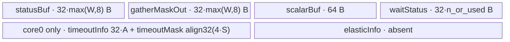
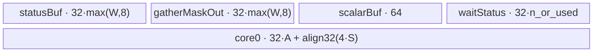
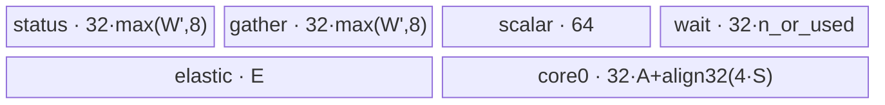

# DistributeBarrier A3 ACLNN 算子知识

## 算子速览

| 项目 | 内容 |
|---|---|
| 实际入口 | `aclnnDistributeBarrierV2GetWorkspaceSize` / `aclnnDistributeBarrierV2`，公开 ACLNN V2 |
| 计算语义 | 在独占通信域内等待全部 rank 到达；`xRef` 只建立 Tensor 依赖，Kernel 不读写其数据 |
| 输入输出 | `xRef`：ND、rank 0–8、A3 支持 BF16/FP16/FP32/BOOL/有符号与无符号 8/16/32/64 位整数；可选 `timeOut`、`elasticInfo` 为 INT32 |
| 执行类型 | 非 Cube 通信/Hybrid（AIV 执行，节点内使用 Vector `DataCopy/Duplicate/ReduceSum`），单 Kernel：`distribute_barrier`；通信配置为 `AIV_ENGINE`，ACLNN 执行时将 HCCL server type 设为 MTE |
| Kernel 路线 | R-001 无可选输入；R-002 timeout；R-003 elastic；R-004 timeout+elastic |
| 核心资源 | HCCL rank window、GM optional tensor、每核 `TBuf`、Vector `DataCopy/Duplicate/ReduceSum`、硬事件与 `SyncAll`；16 MiB system workspace 不被算子 body 解引用 |
| 来源闭包 | `source_closed`：V2 API→base 平台分发→inner bridge→A3 Tiling/POD→`distribute_barrier` entry→共享 body 与构建接线闭合；自动生成 inner bridge 为框架边界 |
| 验证状态 | 已完成源码闭包检查；本次知识提取未执行编译、真机、数值或性能测试。 |

## 接口与语义

### 计算语义

设原通信域大小为 `W`，本 rank 为 `r`，平台 AIV 数为 `A`。Kernel 保留 core 0 作为完成协调核，其余 `S=A-1` 个 worker 均衡分配目标 rank。worker 将 8 个 FP32 `1`（32 B）写到每个目标 rank 的窗口中、属于源 rank `r` 的 512 B 槽；随后轮询本地窗口中分配给自己的源 rank 槽，`ReduceSum` 等于 `8 × 分配 rank 数` 才认为全部到达。worker 清零这些槽并写完成标记，core 0 等全部有效 worker 完成后清零完成标记，最后所有核 `SyncAll<true>()` 同时退出。

每次调用先读取并翻转本 rank 每核状态位，由 `dataState∈{0,1}` 选择相距 512 KiB 的状态窗口，避免连续调用复用同一轮状态。`xRef` 和底层 `xRefOut` 均不被 Kernel entry/body 访问；公开 ACLNN 也没有数据输出参数。

### 输入、输出与属性

| 参数 | shape/layout | dtype | 约束、默认值与语义 |
|---|---|---|---|
| `xRef` | ND，公开文档 rank 0–8，可非连续；OpDef `AutoContiguous` | BF16、FP16、FP32、BOOL、INT/UINT 8/16/32/64 | 必选且非空；仅建立依赖，模板 `XType` 不参与 body 计算；A3 不支持 FP8/FP4/HIFLOAT8/INT4 |
| `timeOutOptional` | 文档写 rank 0–1；实际 Tiling 只接受 1D、长度 1、非 FRACTAL_NZ | INT32 | 可空；非空时每轮轮询按 `(GetSystemCycle()-begin)/50` 与其值比较并 `assert` 超时 |
| `elasticInfoOptional` | 文档写 rank 0–1；实际 Tiling 只接受 1D、长度 `4+2W`、非 FRACTAL_NZ | INT32 | 可空；元素 0 为使能，元素 1 为缩容后 `W'`，从元素 4 起读取本地与目标 rank 映射 |
| `group` | C 字符串 | STRING | 必选，`strnlen` 必须在 `[1,127]`；该算子需独占通信域 |
| `worldSize` | 标量属性 | INT64，写入 POD 时窄化为 UINT32 | A3 Tiling 接受 `[2,384]` |
| ACLNN 第二段参数 | `workspace`、`workspaceSize`、`executor`、`stream` | 指针/UINT64/句柄 | 必须使用第一段返回的 workspace 大小与 executor；第二段在指定 stream 提交 |

### 入口与版本

固定提交同时公开 V1 与 V2。V2 比 V1 新增 `timeOutOptional` 和 `elasticInfoOptional`，并复用 `aclnnDistributeBarrierGetWorkspaceSizeBase` / `aclnnDistributeBarrierBase`，因此本卡取同平台最新公开 `aclnnDistributeBarrierV2`。公开文档、`DistributeBarrier` OpDef 的 `ascend910_93` 注册和 binary config 均支持 A3；公开文档明确 A2 不支持。

## Host/Launcher 执行流程

### 参数校验与前处理

1. `aclnnDistributeBarrierV2GetWorkspaceSize` 原样把五个业务参数交给 base。
2. `BarrierCheckParams` 只显式检查 `xRef`、`group` 非空及 group 长度；其余 tensor/type/format 约束由 inner bridge、OpDef 与 Tiling 承担。
3. base 判断当前架构不是 `DAV_3510` 后调用自动生成的 `aclnnInnerDistributeBarrierGetWorkspaceSize`；A3 不创建 `Mc2MoeContext`。
4. Tiling 由 optional shape 指针是否为空生成两个 bool；若存在则检查 timeout 的 `[1]`/INT32/非 NZ，elastic 的 `[4+2W]`/INT32/非 NZ，并校验 `W∈[2,384]`。
5. `SetHcommCfg` 以 group、opType `8`、fullmesh/pairwise 配置生成两段 MC2 tiling，并显式选择 `AIV_ENGINE`。

### 参数、Workspace 与生命周期

Tiling 固定上报 `workSpaces[0]=16×1024×1024` B。该地址作为 `workspaceGM` 传入 entry/`Init`，但固定 body 没有一次读写；它是 inner/系统工作区，而非节点间数据边。executor 保存 inner op、POD 与自动连续化对象，调用者持有 workspace，直到第二段在同一 stream 提交完成。base 在执行前通过弱符号把 HCCL server type 设为 `MTE`。

`PlatformAscendC` 读取 `A=GetCoreNumAiv()`、`U=GetCoreMemSize(UB)`，`blockDim=CalcTschBlockDim(A,0,A)`，并设置 batch schedule mode 1；POD 写入 `aivNum=A`、`totalUbSize=U`，但 body 不读取 `totalUbSize`。

### 启动图与失败传播

```text
aclnnDistributeBarrierV2GetWorkspaceSize
  -> aclnnDistributeBarrierGetWorkspaceSizeBase
    -> generated aclnnInnerDistributeBarrierGetWorkspaceSize
      -> DistributeBarrierTilingFunc -> one executor node
aclnnDistributeBarrierV2(workspace, executor, stream)
  -> aclnnDistributeBarrierBase -> aclnnInnerDistributeBarrier
    -> distribute_barrier<<<blockDim, stream>>>(xRef,timeOut,elasticInfo,xRefOut,workspace,POD)
```

唯一 Device 节点为 `distribute_barrier`，真实执行族是“非 Cube 通信/Hybrid（AIV Vector）”；grid/blockDim 由上述 `CalcTschBlockDim` 产生，使用 `DistributeBarrierTilingData`。没有 Kernel 间 workspace 边；rank window 是跨设备状态介质，worker 写远端窗口、读本地窗口，硬事件、DCCI、`PipeBarrier` 与 `SyncAll` 保证节点内阶段顺序和持久状态可见性。任一 API/base、Tiling 或 inner launch 错误直接返回，单 Kernel 不存在后续节点。

## Route 与参数设计

### 分核与资源计算

`S=A-1`。每核先算 `q=floor(W/S)`、`m=W mod S`。core 0 不分 rank；worker `i=coreId-1` 的 `n_i=q+(i<m)`，起点 `b_i=q×i+min(i,m)`，终点 `e_i=b_i+n_i`。若 `b_i>=W`，worker 在广播后直接返回且不写完成标记；core 0 因而等待 `used=min(S,W)` 个完成标记。

状态槽每 rank 512 B，实际 payload 为 32 B；epoch 间隔 512 KiB，轮次/完成区起点 900 KiB。无 tile/loop Tiling 字段，轮询次数由远端到达时间决定。Host 只读取 UB 总量但不以它筛 Route，也不比较 Device 分配公式与 `U`。

### Route 选择

| 顺序 | Route | Key/模板 | 精确选择条件与优先级 | 不适用去向 |
|---:|---|---|---|---|
| 1 | R-001 基础屏障 | default / `DistributeBarrier<DTYPE_X_REF>` | `timeOutShape==nullptr && elasticInfoShape==nullptr` | 有 optional 时匹配后续行 |
| 2 | R-002 超时屏障 | default / 同一模板 | `timeOutShape!=nullptr && elasticInfoShape==nullptr` 且 timeout 检查通过 | 检查失败则 Tiling 失败 |
| 3 | R-003 弹性屏障 | default / 同一模板 | `timeOutShape==nullptr && elasticInfoShape!=nullptr` 且 elastic 检查通过 | 检查失败则 Tiling 失败 |
| 4 | R-004 超时弹性屏障 | default / 同一模板 | 两个 shape 均非空且两项检查都通过 | 任一检查失败则 Tiling 失败 |

```text
optional presence -> flags
  00 -> R-001
  10 -> validate timeout -> R-002
  01 -> validate elastic -> R-003
  11 -> validate timeout then elastic -> R-004
all routes -> no SetTilingKey; REGISTER_TILING_DEFAULT -> dtype-compiled DistributeBarrier<XType>
```

### 模板/实现执行矩阵

| Route | key/selector | dtype/shape/platform 完整命中条件 | 执行拓扑与 Kernel 节点 | 实际模板/body | 内存与同步特征 | tail/fallback |
|---|---|---|---|---|---|---|
| R-001 | default；flags `0,0` | A3，受支持 xRef dtype，`W∈[2,384]` | 单个非 Cube 通信/Hybrid 节点 `distribute_barrier`（AIV Vector） | `DistributeBarrier<DTYPE_X_REF>::Process` | 无 elastic TBuf；core 0 仍有完成轮询 TBuf | 余数 rank 给前 m 个 worker；无 fallback |
| R-002 | default；flags `1,0` | R-001 + timeout `[1]` INT32 非 NZ | 同上 | 同 body，轮询内启用 cycle/assert | UB 与 R-001 相同；多 scalar cycle 检查 | 超时 assert；无 fallback |
| R-003 | default；flags `0,1` | R-001 + elastic `[4+2W]` INT32 非 NZ | 同上 | 同 body + `InitElasticInfo`/rank 映射 | 每核增加 aligned elastic TBuf 和 MTE2→S | tensor 内容不合法无 Device fallback |
| R-004 | default；flags `1,1` | 同时满足 R-002/R-003 | 同上 | R-003 + timeout 检查 | R-003 UB；两类硬事件均存在 | timeout assert；映射错误无 fallback |

### 隐藏性能 Guard

| Guard | Host/Tiling 条件 | Device/资源原因 | 影响 Route | 不满足时去向 | 源码符号 |
|---|---|---|---|---|---|
| A3 world size | `2<=W<=384` | `uint16_t blockCount`、窗口/UB 与 rank map 都依赖 W | 全部 | Tiling failed | `CheckAndSetAttrs` |
| worker 数 | `S=A-1`，源码无 `A>=2` 检查 | 除法 `W/S` 且 core 0 专用于协调 | 全部 | 固定仓没有 fallback；依赖平台 AIV 配置 | `SplitToCore` |
| timeout 形状 | optional 非空时 rank=1 且 dim0=1 | Device 只读 `timeOut[0]` | R-002/R-004 | Tiling failed | `CheckTimeOut` |
| elastic 形状 | optional 非空时 rank=1 且 dim0=`4+2W` | Device 读取头 4 项和两张 W 长映射表 | R-003/R-004 | Tiling failed | `CheckElasticInfo` |
| status DMA pitch | `STATE_OFFSET=512`, `UB_ALIGN=32` | `DataCopyParams(blockLen=1, stride=15)` 形成 512 B 源/目的节距 | 全部 | 编译期常量，无 fallback | `WaitStatus` / `CleanStatus` |
| dtype compile guard | A3 仅 12 种基础 dtype | entry 的 `#elif ORIG_DTYPE_X_REF...` 才实例化 body | 全部 | 无 body 执行 | `distribute_barrier` |
| UB 容量 | Host 仅记录 `totalUbSize`，没有源码级比较 | TBuf 总量随 W/A/elastic 增长 | 全部 | 固定仓无 Route/fallback，编译/运行资源边界 | `Init` |

### POD/ABI

`DistributeBarrierTilingData` 的嵌套 `Mc2InitTiling/Mc2CcTiling` 布局来自 CANN tiling header；固定仓没有 `sizeof/alignof/offsetof` 断言，因此 ABI 列只给出声明顺序，不能臆造字节偏移。

| 结构 | 字段 | 类型/位宽 | ABI 布局 | 单位 | Host/launcher producer | Device consumer | 边界 |
|---|---|---|---|---|---|---|---|
| `DistributeBarrierTilingData` | `mc2InitTiling` | `Mc2InitTiling` | 第 1 字段；具体布局固定仓不可见 | MC2 配置 | `SetHcommCfg::GetTiling` | 框架/HCCL context 边界；body 不直接读 | GetTiling 失败则 Tiling 失败 |
| 同上 | `mc2CcTiling1` | `Mc2CcTiling` | 第 2 字段；具体布局固定仓不可见 | MC2 配置 | `SetHcommCfg::GetTiling` | 框架/HCCL context 边界；body 不直接读 | 同上 |
| `DistributeBarrierInfo` | `worldSize` | `uint32_t/32` | info 第 1 字段；精确 offset 无断言 | rank 数 | `CheckAndSetAttrs`: cast `*worldSizePtr` | `Init`、`SplitToCore`、elastic/UB 公式 | Host 先校验 2..384 |
| 同上 | `rankId` | `uint32_t/32` | 第 2 字段；精确 offset 无断言 | rank id | 固定 Host 未赋值 | body 不读取 | inactive，值不可依赖 |
| 同上 | `aivNum` | `uint32_t/32` | 第 3 字段；精确 offset 无断言 | AIV 数 | `GetCoreNumAiv()` | `Init`: `aivNum_`、`sendAivNum_` | 源码未检查 A>=2 |
| 同上 | `totalUbSize` | `uint64_t/64` | 第 4 字段；精确 offset 无断言 | byte | `GetCoreMemSize(UB)` | body 不读取 | 仅日志/携带 |
| 同上 | `totalWinSize` | `uint64_t/64` | 第 5 字段；精确 offset 无断言 | byte | 固定 Host 未赋值 | body 不读取 | inactive，值不可依赖 |
| 同上 | `isInputTimeOut` | `bool` | 第 6 字段；bool ABI 细节无断言 | flag | `timeOutShape!=nullptr` | `Init`、`TimeOutTest` | 只控制超时 assert，不控制 core0 TBuf 分配 |
| 同上 | `isInputElasticInfo` | `bool` | 第 7 字段；bool ABI 细节无断言 | flag | `elasticShape!=nullptr` | `Init` / `InitElasticInfo` | 控制每核 elastic TBuf |
| 同上 | `isMc2Context` | `bool` | 第 8 字段；bool ABI 细节无断言 | flag | A3 config 固定 false | `InitContextAndRankInfo` | false 时取 `GetHcclContext` |
| 同上 | `reserved1` | `bool` | 第 9 字段；bool ABI 细节无断言 | reserved | 固定 Host 未赋值 | body 不读取 | inactive |

### Route 源码闭包

| Route | Key/selector | Host/Tiling producer | POD/参数 | Kernel entry/router 节点 | Kernel body/直接依赖 | 构建接线 |
|---|---|---|---|---|---|---|
| R-001 | default, flags 00 | `mc2/distribute_barrier/op_host/op_tiling/distribute_barrier_tiling.cpp`：`DistributeBarrierTilingFunc`→`DistributeBarrierExtendTilingFuncNew` | `mc2/distribute_barrier/op_kernel/distribute_barrier_tiling.h`：shared POD；无 optional GM | `mc2/distribute_barrier/op_kernel/distribute_barrier.cpp`：`distribute_barrier` A3 dtype guard | `mc2/distribute_barrier/op_kernel/distribute_barrier.h`：`Init/Process/SetStatus/WaitStatus/CleanStatus/TimeOutTest`；`mc2/common/op_kernel/mc2_kernel_utils.h`：`SyncFunc` | `mc2/distribute_barrier/op_host/distribute_barrier_def.cpp`、binary JSON、op_host CMake |
| R-002 | default, flags 10 | 同一 tiling 文件：`CheckTimeOut`→`DistributeBarrierExtendTilingFuncNew` | 同一 POD：`isInputTimeOut=true`、timeOut GM | 同一 entry：A3 dtype guard | 同一 body：启用 `GetSystemCycle/assert` | 同 R-001 |
| R-003 | default, flags 01 | 同一 tiling 文件：`CheckElasticInfo`→`DistributeBarrierExtendTilingFuncNew` | 同一 POD：`isInputElasticInfo=true`、elastic GM | 同一 entry：A3 dtype guard | 同一 body：`InitElasticInfo`/双 rank map | 同 R-001 |
| R-004 | default, flags 11 | 同一 tiling 文件：`CheckTimeOut` 后 `CheckElasticInfo` | 同一 POD：两 flag 与两 optional GM | 同一 entry：A3 dtype guard | 同一 body：R-002 与 R-003 分支汇合 | 同 R-001 |

## Kernel 实现

### 公共执行流程

entry 解包默认 POD，A3 仅在 12 种公开基础 dtype 宏之一时构造 `DistributeBarrier<DTYPE_X_REF>`；`XType` 实际未参与运算。`InitContextAndRankInfo` 从 `GetHcclContext<HCCL_GROUP_ID_0>()` 获取 A3 `HcclOpResParam`，以 `localUsrRankId` 为 rank id、`localWindowsExp/remoteRes[].windowsExp` 为状态窗口。每核初始化状态 epoch、分 rank、分配 TBuf；core 0 执行 `TimeOutTest`，worker 执行 `SetStatus→WaitStatus→CleanStatus`，末尾全核同步。

### Route R-001：基础屏障

#### 适用条件

##### 选择证据

| 层级 | 文件 | 符号 | 源码谓词/参数 | 结果/下一跳 |
|---|---|---|---|---|
| API/base | `mc2/distribute_barrier/op_api/distribute_barrier_base.cpp` | `aclnnDistributeBarrierGetWorkspaceSizeBase` | `is950==false` | inner `DistributeBarrier` |
| Tiling | `mc2/distribute_barrier/op_host/op_tiling/distribute_barrier_tiling.cpp` | `DistributeBarrierExtendTilingFuncNew` | 两 optional shape 均 null；attrs 合法 | flags 00、默认 tiling |
| Router | `mc2/distribute_barrier/op_kernel/distribute_barrier.cpp` | `distribute_barrier` | A3 dtype 宏在 12 种集合 | `DistributeBarrier<XType>::Process` |

#### Device 数据流

##### 函数级调用链

```text
distribute_barrier -> Init -> InitContextAndRankInfo -> InitStatus -> SplitToCore
  core0 -> TimeOutTest: finish GM -> timeoutInfoBuf -> ReduceSum -> clear finish GM
  worker -> BarrierProcess: statusBuf -> remote status GM -> local status GM -> waitStatusBuf
                         -> ReduceSum -> zero waitStatusBuf -> local status GM -> finish GM
  all cores -> SyncAll<true>
```

##### 源码等价伪码

```text
S=A-1; q=W/S; i=core-1; n=q+(i<W%S); begin=q*i+min(i,W%S)
epoch = toggle(local[900KiB + core*128B])
if core==0:
  used=min(S,W)
  while sum(strided_load_32B(finish[j*128B], j<used)) < used: ReduceSum
  strided_store_32B(0, finish[j*128B], j<used)
else:
  for dst in [begin,begin+n): store_32B(1, remote[dst].epoch + r*512B)
  if begin<W:
    while sum(strided_load_32B(local.epoch + src*512B, src in slice)) != 8*n: ReduceSum
    finish[(core-1)*128B]=1; strided_store_32B(0, local.epoch + src*512B)
SyncAll
```

#### 内存与数据搬运

##### 资源与搬运表

| 层级/缓冲区 | offset/地址公式 | extent/容量公式 | dtype/layout | producer | consumer | owner/lifetime | 对齐/复用 |
|---|---|---|---|---|---|---|---|
| rank status GM | `GeWindowAddr(dst,r)+r*512B`；其中 `GeWindowAddr` 已含 `epoch*512KiB` | 每源 rank 有效 32 B，pitch 512 B | 8×FP32 | source worker | target worker | HCCL window，整次 barrier | 32 B payload；不得重复叠加 epoch 偏移 |
| local status GM | `self epoch + begin*512B` | n 个 32 B block | FP32 strided | remote workers | `WaitStatus`/`CleanStatus` | barrier 期间 | srcStride/dstStride=15 |
| completion GM | `self epoch+900KiB+A*128B+j*128B` | used 个 32 B block | FP32 strided | worker scalar/cache write | core0 `TimeOutTest` | 至 core0 clear | pitch 128 B |
| `statusBuf_` | UB 独立 TBuf | `32*max(W,8)` B | FP32 | `Duplicate(1)` | `SetStatus` | Kernel；只读复用 | 无 Queue/depth |
| `gatherMaskOutBuf_` | UB 独立 TBuf | `32*max(W,8)` B | Reduce scratch | `ReduceSum` | primitive | Kernel | 无显式别名 |
| `scalarBuf_` | offset 0/32 B 子区 | 64 B | FP32 | Reduce/scalar | scalar read | Kernel | sum 输出从 offset 32 B 开始 |
| `waitStatusBuf_` | UB 独立 TBuf | worker `32*n`；core0 `32*used` B | FP32/INT32 reinterpret | DMA 或 Duplicate | ReduceSum/DMA | 阶段复用 | Wait 后改作清零 buffer |
| core0 timeout buffers | UB 独立 TBuf | `32*A + align32(4*S)` B | FP32 + Reduce scratch | finish DMA/Reduce | core0 | Kernel | 即使 timeout 未提供也分配 |
| workspace | base 不使用 offset | 16 MiB system workspace | byte | ACLNN caller | body 不消费 | executor/stream | N/A |

##### 分层内存布局



##### 字节账与复用顺序

```text
B_worker = 64*max(W,8) + 64 + 32*n
B_core0  = 64*max(W,8) + 64 + 32*used + 32*A + align32(4*(A-1))
Host 仅把 U 写入 totalUbSize；固定源码没有 B<=U 的 selector/失败分支。
```

| 复用子区 | 写入者 | 读取者/消费点 | 下一次覆盖 | 同步或释放依据 | 安全条件 |
|---|---|---|---|---|---|
| `waitStatusBuf_` | `WaitStatus` DMA | `ReduceSum` | `CleanStatus::Duplicate(0)` | `MTE2_V`、`V_S` 后才覆盖 | sum 已读回 scalar |
| 同一 buffer INT32 view | `Duplicate<int32_t>` | `CleanStatus` MTE3 | Kernel 结束 | `V_MTE3` / `MTE3_S` | 仅零位模式，reinterpret 不改字节数 |
| 双 epoch GM | 上一次 barrier | 当前 barrier | 下一次调用翻转后复用 | `InitStatus` cache clean+invalidate | 调用结束前 worker clear、core0 clear |

#### 同步、精度与尾块

##### 同步与数值边界表

| 阶段 | primitive/机制 | producer | consumer/等待点 | 保护对象 | 精度/尾块 |
|---|---|---|---|---|---|
| UB fill→GM | `SyncFunc<V_MTE3>` | `Duplicate(1/0)` | DataCopy store | status/zero buffer | 精确 FP32 1 或 bitwise int32 0 |
| GM→Reduce | `SyncFunc<MTE2_V>` | strided DataCopy | ReduceSum | n×32 B statuses | 8 lanes/rank；目标 `8n`，无数值 cast |
| Reduce→scalar | `SyncFunc<V_S>` | ReduceSum | `GetValue(0)` | sum scalar | equality 对整数可精确表示范围 |
| worker阶段 | `PipeBarrier<PIPE_ALL>` | SetStatus | WaitStatus | 发送完成/pipe | worker 无 rank 时在此后返回 |
| worker→core0 | DCCI + finish poll | worker finish store | core0 ReduceSum | 128 B pitch finish slots | `used=min(S,W)` 排除 idle worker |
| Kernel退出 | `SyncAll<true>` | 全部 core | Kernel return | 下一次调用状态安全 | 无 tile tail；rank tail由前 m 核多处理 1 个 |

#### 关键实现

##### 符号证据表

| 阶段 | 文件 | 符号/模板实例 | 实现事实 |
|---|---|---|---|
| Host/Tiling producer | `mc2/distribute_barrier/op_host/op_tiling/distribute_barrier_tiling.cpp` | `DistributeBarrierExtendTilingFuncNew` | flags、W、A、U、blockDim、workspace 与 AIV HCCL tiling |
| Kernel entry/router | `mc2/distribute_barrier/op_kernel/distribute_barrier.cpp` | `distribute_barrier` | default POD 与 A3 dtype guard |
| Device body/helper | `mc2/distribute_barrier/op_kernel/distribute_barrier.h` | `DistributeBarrier<XType>::Process` 等 | 完整 rank window、轮询、清零、尾 rank 与全核同步 |

### Route R-002：超时屏障

#### 适用条件

##### 选择证据

| 层级 | 文件 | 符号 | 源码谓词/参数 | 结果/下一跳 |
|---|---|---|---|---|
| Tiling | `distribute_barrier_tiling.cpp` | `CheckTimeOut` | shape 非空、rank=1、dim0=1、INT32、非 NZ | `isInputTimeOut=true` |
| Device | `distribute_barrier.h` | `Init` / `TimeOutTest` | flag true时读 `timeOut[0]`，轮询中比较 duration | 超时触发 assert |

#### Device 数据流

##### 函数级调用链

```text
R-001 full chain + Init: timeOutGM[0] -> scalar timeOut_
core0 TimeOutTest loop -> GetSystemCycle -> duration_us -> assert guard
```

##### 源码等价伪码

```text
timeout = uint32(timeOutGM[0]); beginCycle=GetSystemCycle()
while completion_sum<used:
  poll_and_reduce()
  duration=(GetSystemCycle()-beginCycle)/50
  if duration>=timeout: PipeBarrier; assert(duration<timeout); PipeBarrier
workers and cleanup exactly R-001
```

#### 内存与数据搬运

##### 资源与搬运表

| 层级/缓冲区 | offset/地址公式 | extent/容量公式 | dtype/layout | producer | consumer | owner/lifetime | 对齐/复用 |
|---|---|---|---|---|---|---|---|
| timeout GM | element 0 | 4 B | INT32 ND | caller | core0 scalar load | call | Tiling 要求 `[1]` |
| status/completion GM | 与 R-001 完全相同 | 同 R-001 | FP32 strided | workers | workers/core0 | barrier | 同 R-001 |
| all TBuf | 与 R-001 完全相同 | `B_worker/B_core0` 同 R-001 | 同 R-001 | body | body | Kernel | timeout buffers 本来就存在 |

##### 分层内存布局



##### 字节账与复用顺序

```text
B_worker 与 B_core0 均等于 R-001；timeOut_ 是类 scalar，不申请 TBuf。
```

| 复用子区 | 写入者 | 读取者/消费点 | 下一次覆盖 | 同步或释放依据 | 安全条件 |
|---|---|---|---|---|---|
| `waitStatusBuf_` | DMA | ReduceSum | CleanStatus zero | MTE2_V、V_S | 同 R-001 |
| completion TBuf | 每轮 DMA | ReduceSum | 下一轮 DMA | MTE2_V、V_S | scalar 已读取 |

#### 同步、精度与尾块

##### 同步与数值边界表

| 阶段 | primitive/机制 | producer | consumer/等待点 | 保护对象 | 精度/尾块 |
|---|---|---|---|---|---|
| timeout | `GetSystemCycle/50` + assert | cycle counter | core0 poll loop | 整个 barrier | `timeOut_` 为 uint32；负 INT32 会转换为大正数，Host 未校验 |
| 其余阶段 | R-001 全部硬事件、barrier、SyncAll | 同 R-001 | 同 R-001 | 同 R-001 | rank tail同 R-001 |

#### 关键实现

##### 符号证据表

| 阶段 | 文件 | 符号/模板实例 | 实现事实 |
|---|---|---|---|
| Host/Tiling producer | `distribute_barrier_tiling.cpp` | `CheckTimeOut` | 仅结构校验并置 flag |
| Kernel entry/router | `distribute_barrier.cpp` | `distribute_barrier` | 同默认 entry |
| Device body/helper | `distribute_barrier.h` | `Init` / `TimeOutTest` | GM scalar、cycle 换算、assert 与基础屏障 |

### Route R-003：弹性屏障

#### 适用条件

##### 选择证据

| 层级 | 文件 | 符号 | 源码谓词/参数 | 结果/下一跳 |
|---|---|---|---|---|
| Tiling | `distribute_barrier_tiling.cpp` | `CheckElasticInfo` | `[4+2W]`、INT32、非 NZ | `isInputElasticInfo=true` |
| Device | `distribute_barrier.h` | `InitElasticInfo` | `elastic[0]==1` 才启用 W' 和两张 map | 动态 rank 路线或原 W 路线 |

#### Device 数据流

##### 函数级调用链

```text
elasticInfo GM -> DataCopyPad -> elasticInfoBuf -> MTE2_S
  -> optional W'=value[1], localRank=value[4+oldRank]
  -> SplitToCore(W') -> SetStatus maps dst=value[4+W+logicalDst]
  -> same Wait/Clean/finish protocol
```

##### 源码等价伪码

```text
copy 4*(4+2W) bytes to aligned UB
if elastic[0]==1:
  activeW=elastic[1]; activeRank=elastic[4+originalRank]
split activeW over S workers
remoteDst = elastic[4+W+logicalDst]
status slot offset uses activeRank*512B; GeWindowAddr uses originalRank for A3 relation lookup
then R-001 polling/cleanup
```

#### 内存与数据搬运

##### 资源与搬运表

| 层级/缓冲区 | offset/地址公式 | extent/容量公式 | dtype/layout | producer | consumer | owner/lifetime | 对齐/复用 |
|---|---|---|---|---|---|---|---|
| elastic GM | 0 | `4*(4+2W)` B | INT32 ND | caller | `InitElasticInfo` | call | `DataCopyPad`, one block |
| `elasticInfoBuf_` | UB | `E=align32(4*(4+2W))` B | INT32 | MTE2 | scalar reads/SetStatus | Kernel | all cores allocate |
| rank windows/TBuf | 地址使用 W'/mapped rank | base formulas同 R-001，status buffers use `max(W',8)` | FP32 | workers | workers/core0 | barrier | map values无 Host value guard |

##### 分层内存布局


##### 字节账与复用顺序

```text
E=align32(4*(4+2*W_original))
B_worker = 64*max(W_active,8)+64+32*n+E
B_core0  = 64*max(W_active,8)+64+32*used+32*A+align32(4*S)+E
固定源码不校验 W_active/map 内容，也不做 B<=U 比较。
```

| 复用子区 | 写入者 | 读取者/消费点 | 下一次覆盖 | 同步或释放依据 | 安全条件 |
|---|---|---|---|---|---|
| elasticInfoBuf | DataCopyPad | scalar map reads | Kernel结束 | MTE2_S | 整个 barrier 保持不变 |
| waitStatusBuf | Wait DMA | ReduceSum/CleanStatus | 同 R-001 | 硬事件 | 同 R-001 |

#### 同步、精度与尾块

##### 同步与数值边界表

| 阶段 | primitive/机制 | producer | consumer/等待点 | 保护对象 | 精度/尾块 |
|---|---|---|---|---|---|
| elastic load | `SyncFunc<MTE2_S>` | DataCopyPad | scalar `GetValue` | map UB | INT32，无 cast 校验 |
| rank/status | R-001 事件协议 | mapped workers | mapped target/local window | active ranks | W' 余数均衡；非法 W'/map 未保护 |
| exit | `SyncAll<true>` | all AIV | return | epoch/lifetime | idle workers仍参加最终同步 |

#### 关键实现

##### 符号证据表

| 阶段 | 文件 | 符号/模板实例 | 实现事实 |
|---|---|---|---|
| Host/Tiling producer | `distribute_barrier_tiling.cpp` | `CheckElasticInfo` | 只校验外层 shape/dtype/format |
| Kernel entry/router | `distribute_barrier.cpp` | `distribute_barrier` | 传入 elastic GM |
| Device body/helper | `distribute_barrier.h` | `InitElasticInfo` / `SetStatus` | W'、local/target map 与 aligned UB |

### Route R-004：超时弹性屏障

#### 适用条件

##### 选择证据

| 层级 | 文件 | 符号 | 源码谓词/参数 | 结果/下一跳 |
|---|---|---|---|---|
| Tiling | `distribute_barrier_tiling.cpp` | `DistributeBarrierExtendTilingFuncNew` | 两 optional 均存在；先 `CheckTimeOut` 后 `CheckElasticInfo` | flags 11 |
| Device | `distribute_barrier.h` | `Init` / `Process` | 同时执行 elastic 初始化和 core0 timeout 分支 | 组合路线 |

#### Device 数据流

##### 函数级调用链

```text
R-003 elastic GM -> mapped rank barrier
R-002 timeout GM -> core0 completion polling with cycle/assert
all workers -> mapped cleanup/finish -> SyncAll
```

##### 源码等价伪码

```text
validate/copy elastic; derive W' and maps; read timeout
workers execute mapped SetStatus/WaitStatus/CleanStatus
core0 waits used=min(A-1,W') completion slots and checks duration_us>=timeout
clear completion slots; SyncAll
```

#### 内存与数据搬运

##### 资源与搬运表

| 层级/缓冲区 | offset/地址公式 | extent/容量公式 | dtype/layout | producer | consumer | owner/lifetime | 对齐/复用 |
|---|---|---|---|---|---|---|---|
| timeout GM | 0 | 4 B | INT32 | caller | core0 | call | scalar load |
| elastic GM/TBuf | 同 R-003 | `4*(4+2W)`/E B | INT32 | caller/MTE2 | all cores | Kernel | MTE2_S |
| rank/completion/TBuf | 以 W' 代入 R-001 公式 | 同 R-003 | FP32 | workers | workers/core0 | barrier | timeout不增加 UB |

##### 分层内存布局



##### 字节账与复用顺序

```text
UB 公式与 R-003 完全相同；timeout 是 scalar 路径，不增加 TBuf。
```

| 复用子区 | 写入者 | 读取者/消费点 | 下一次覆盖 | 同步或释放依据 | 安全条件 |
|---|---|---|---|---|---|
| elasticInfoBuf | MTE2 | map scalar reads | Kernel结束 | MTE2_S | 不可提前复用 |
| wait/completion buffers | DMA/Vector | Reduce/scalar | 下一轮或清零 | MTE2_V、V_S、V_MTE3 | 同 R-002/R-003 |

#### 同步、精度与尾块

##### 同步与数值边界表

| 阶段 | primitive/机制 | producer | consumer/等待点 | 保护对象 | 精度/尾块 |
|---|---|---|---|---|---|
| elastic | MTE2_S | map copy | scalar reads | W'/maps | 未校验内容 |
| timeout | cycle/50 + assert | counter | core0 | barrier | uint32 timeout |
| status/exit | R-001 全事件图 + SyncAll | workers/core0 | next phase/return | GM/TBuf/epoch | rank tail按 W' |

#### 关键实现

##### 符号证据表

| 阶段 | 文件 | 符号/模板实例 | 实现事实 |
|---|---|---|---|
| Host/Tiling producer | `distribute_barrier_tiling.cpp` | `DistributeBarrierExtendTilingFuncNew` | 两检查顺序、flags 与 shared POD |
| Kernel entry/router | `distribute_barrier.cpp` | `distribute_barrier` | 单 default body |
| Device body/helper | `distribute_barrier.h` | `InitElasticInfo` / `TimeOutTest` / `BarrierProcess` | 两条 optional 行为在同一 Kernel 汇合 |

## 算子特定优化

### Trick T-001：一个协调核加均衡 worker，批量轮询稀疏状态槽

#### 触发与源码依据

- 适用 Route：R-001～R-004
- 触发条件：合法 A3 world size，平台 `A>=2`；worker 有分配 rank 时进入轮询。
- Golden 来源：[`mc2/distribute_barrier/op_kernel/distribute_barrier.h:323-337`](../../../../../../../cann-ops-raw/ascendc/ops-transformer/be33d95bb755cedec3108f70805c1874d1792540/mc2/distribute_barrier/op_kernel/distribute_barrier.h#L323-L337)

**官方源码（固定 Commit 连续逐字摘录）**：

```cpp
    float compareTarget = static_cast<float>(1.0) * sendRankNum_ * UB_ALIGN / sizeof(float);
    float sumOfFlag = static_cast<float>(-1.0);
    DataCopyParams intriParams{static_cast<uint16_t>(sendRankNum_), 1, (STATE_OFFSET - UB_ALIGN) / UB_ALIGN, 0};
    uint64_t systemCntBegin = static_cast<uint64_t>(GetSystemCycle());
    SyncFunc<AscendC::HardEvent::S_V>();
    while (sumOfFlag != compareTarget) {
        DataCopy(
            statusFp32Tensor_,
            windowInstatusFp32Tensor_[startRankId_ * stateOffset_ / sizeof(float)],
            intriParams);
        SyncFunc<AscendC::HardEvent::MTE2_V>();
        ReduceSum(statusSumOutTensor, statusFp32Tensor_, gatherMaskOutTensor, sendRankNum_ * UB_ALIGN / sizeof(float));
        SyncFunc<AscendC::HardEvent::V_S>();
        sumOfFlag = statusSumOutTensor.GetValue(0);
    }
```

#### 机制与设计原因

一个 `DataCopy` 用 `blockCount=n`、`blockLen=1×32 B`、`srcStride=15×32 B` 把 n 个相隔 512 B 的 rank 状态一次收进连续 UB，再用 Vector `ReduceSum` 判断 n×8 个 FP32 lane 是否全为 1。它避免逐 rank scalar GM load；`SplitToCore` 又让 worker 处理数只差至多 1。core 0 独立轮询每 worker 的完成槽，使状态清零结束后所有核通过 `SyncAll` 同时退出。

#### 迁移边界

- 适用：远端每生产者占固定稀疏槽、可用精确小整数和做完成判定的纯 Vector 屏障。
- 前提：32 B payload、512 B pitch、FP32 1/0、AIV 数至少 2，DMA blockCount/stride 可表示分配量。
- 失效：状态不是等长槽、完成值不可精确求和或需要非 AIV 通信执行时必须重做协议/改用相应执行族。
- 未验证：本次知识提取未执行编译、真机、数值或性能测试。

#### 错误做法

固定仓未提供可验证反例。

### Trick T-002：双 epoch 状态窗口支持连续调用

#### 触发与源码依据

- 适用 Route：R-001～R-004
- 触发条件：每次 Kernel 启动的每个 AIV 都执行 `InitStatus`。
- Golden 来源：[`mc2/distribute_barrier/op_kernel/distribute_barrier.h:186-200`](../../../../../../../cann-ops-raw/ascendc/ops-transformer/be33d95bb755cedec3108f70805c1874d1792540/mc2/distribute_barrier/op_kernel/distribute_barrier.h#L186-L200)

**官方源码（固定 Commit 连续逐字摘录）**：

```cpp
__aicore__ inline void DistributeBarrier<TemplateDistributeBarrierTypeFunc>::InitStatus() {
    GlobalTensor<int32_t> selfDataStatusTensor;
    // 获取flag标记，flag标记写在win状态区的STATE_WIN_OFFSET偏移的位置
    selfDataStatusTensor.SetGlobalBuffer((__gm__ int32_t *)(statusDataSpaceGm_ + STATE_WIN_OFFSET));
    DataCacheCleanAndInvalid<int32_t, CacheLine::SINGLE_CACHE_LINE,
                            DcciDst::CACHELINE_OUT>(selfDataStatusTensor[aivId_ * UB_ALIGN]);
    dataState_ = selfDataStatusTensor(aivId_ * UB_ALIGN);
    if (dataState_ == 0) {
        selfDataStatusTensor(aivId_ * UB_ALIGN) = 1;
    } else {
        selfDataStatusTensor(aivId_ * UB_ALIGN) = 0;
    }
    DataCacheCleanAndInvalid<int32_t, CacheLine::SINGLE_CACHE_LINE, DcciDst::CACHELINE_OUT>(
    selfDataStatusTensor[aivId_ * UB_ALIGN]);
}
```

#### 机制与设计原因

每核读取并翻转持久状态位，`GeWindowAddr` 用旧值乘 512 KiB 选择本轮窗口。相邻调用因此交替使用两个 GM 子区；配合本轮结束清零，避免下一调用过早观察上一轮残留。DCCI 围住 scalar 状态位读写，防止 cache 中的旧 epoch 值绕过 GM 协议。

#### 迁移边界

- 适用：同一通信域连续执行且能预留两个等距状态区的屏障/握手协议。
- 前提：所有 rank、所有参与 AIV 对 epoch 翻转和 512 KiB 布局达成一致，上一轮在 `SyncAll` 前完成清零。
- 失效：并发重入同一通信域、状态布局或 DCCI 可见性规则改变时不能直接复用。
- 未验证：本次知识提取未执行编译、真机、数值或性能测试。

#### 错误做法

固定仓未提供可验证反例。

## 模板与实现对比

| 对比维度 | R-001 基础 | R-002 timeout | R-003 elastic | R-004 timeout+elastic | 设计选择依据 |
|---|---|---|---|---|---|
| 命中条件/优先级 | flags 00 | flags 10 | flags 01 | flags 11 | optional presence；timeout 校验先于 elastic |
| 模板与 dtype | 同一未使用 XType 的 A3 dtype实例 | 同左 | 同左 | 同左 | xRef 只建依赖 |
| 循环与分核 | W 均衡到 A-1 worker | 同左 + core0 cycle check | W' 和映射 | W' + cycle | runtime flag 决定附加逻辑 |
| Queue/TBuf/寄存器 | 无 TQue；common/core0 TBuf | UB 同基础 | 每核 +E | 同 elastic | timeout scalar 不增加 UB |
| UB 总占用与复用 | 基础公式 | 同基础 | 基础以 W' 代入再 +E | 同 elastic | only elastic 条件分配 |
| 搬运/Vector API | strided DMA + ReduceSum | 同左 | 加 DataCopyPad map | 两者组合 | 批量轮询固定槽 |
| 同步、精度与 tail | FP32 exact sum；rank余数 | +assert | +MTE2_S、映射 tail | 组合 | 无数据输出/cast |
| fallback/失败边界 | 无 key fallback | timeout 结构失败 | elastic 结构失败 | 任一失败 | 内容值错误无 Device fallback |

## 平台差异

| 项目 | A2 | A3 | 950 |
|---|---|---|---|
| 支持状态 | 公开文档明确不支持 | 支持，本卡 | 公开 V2 支持 950DT，见 `_950` 卡 |
| Host/Launcher | N/A | base→inner `DistributeBarrier`，生成 AIV HCCL tiling | base→`DistributeBarrierExtend`，预建 MC2 context |
| Kernel/资源 | N/A | `GetHcclContext` + A3 local/remote window helper；12 dtype guard | context tensor + `epHcclBuffer_`；同一 body |

## 限制与失败边界

- 公开文档称 optional tensor 支持 rank 0–1，但固定 Tiling 实际只接受 1D：timeout 长度 1、elastic 长度 `4+2W`；实现约束更窄。
- `elasticInfo` 只校验外层 shape/dtype/format；使能值、`W'` 范围和两张 rank map 内容没有 Host/Device 越界校验。迁移时不得把其内容视为已验证。
- timeout 未做数值范围检查；INT32 被读入 `uint32_t timeOut_`，负值会转换为大正数。A3 公开文档未声明单位，Device 固定按每微秒 50 cycle 换算。
- `A>=2`、UB 分配总量不超过平台 U，以及窗口覆盖最大访问末端 `epoch*512KiB+900KiB+A*128B+(used-1)*128B+32B`，均没有显式 selector/fallback；`epoch∈{0,1}`、`used=min(A-1,W_active)`，这些只能作为平台/通信资源前提。
- `rankId`、`totalWinSize`、`reserved1` POD 字段在固定 Host 不赋值且 body 不读取；不得用于派生实现。workspace 固定 16 MiB 但 body 不解引用。
- 自动生成 `aclnnInnerDistributeBarrier*`、CANN primitive 内部和 HCCL context 建立为框架边界；固定仓未执行编译、真机、数值或性能验证。

## 源码索引

### 链路索引

| 链路阶段 | 文件 | 关键符号 | 支撑内容 |
|---|---|---|---|
| 入口声明/约束 | `mc2/distribute_barrier/docs/aclnnDistributeBarrierV2.md` | V2 prototypes / 产品表 | 最新公开版本、平台、参数与约束 |
| 入口实现 | `mc2/distribute_barrier/op_api/aclnn_distribute_barrier_v2.cpp` | `aclnnDistributeBarrierV2*` | 两段式转发 |
| API 平台分发 | `mc2/distribute_barrier/op_api/distribute_barrier_base.cpp` | `*Base` | A3 inner 路线、MTE server type、失败传播 |
| Host/Tiling | `mc2/distribute_barrier/op_host/op_tiling/distribute_barrier_tiling.cpp` | checks / `DistributeBarrierExtendTilingFuncNew` | optional、W、workspace、A/U/blockDim、AIV HCCL 配置 |
| Tiling 常量/索引 | `mc2/distribute_barrier/op_host/op_tiling/distribute_barrier_tiling_helper.h` | `DistributeBarrierConfig` / `SYSTEM_NEED_WORKSPACE` / world-size 常量 | 输入索引、16 MiB workspace、A3/950 上限 |
| POD/ABI | `mc2/distribute_barrier/op_kernel/distribute_barrier_tiling.h` | `DistributeBarrierTilingData` | 嵌套 POD 与字段顺序 |
| Kernel entry | `mc2/distribute_barrier/op_kernel/distribute_barrier.cpp` | `distribute_barrier` | 默认 POD、A3 dtype guard、单节点启动 |
| Kernel body | `mc2/distribute_barrier/op_kernel/distribute_barrier.h` | `DistributeBarrier<XType>` | 全部地址、UB、Vector API、同步与 optional 路径 |
| 同步 helper | `mc2/common/op_kernel/mc2_kernel_utils.h` | `SyncFunc` | SetFlag→WaitFlag 硬事件闭包 |
| A3 window helper | `mc2/common/op_kernel/moe_distribute_base.h` | `Mc2Kernel::*` A3 branch | rank id 与 local/remote state window 地址 |
| 平台注册 | `mc2/distribute_barrier/op_host/distribute_barrier_def.cpp` | `DistributeBarrier` OpDef | dtype、ND、A3/950 config 与 ACLNN 支持 |
| binary config | `mc2/distribute_barrier/op_host/config/ascend910_93/distribute_barrier_binary.json` | `DistributeBarrier_*` | A3 12 dtype binary 实例 |
| 构建接线 | `mc2/distribute_barrier/op_host/CMakeLists.txt` | `add_modules_sources_with_soc` | API/Host/MC2 target 与 A3 auto-sync off |

### 实现复用检查

| 检查项 | 可复用事实 | 不得改变的约束 | 源码符号 |
|---|---|---|---|
| ABI/POD | flags、W、A 与嵌套 MC2 tiling 的 producer/consumer | 字段顺序与 inactive 字段；不能依赖未赋值值 | `DistributeBarrierTilingData` |
| 调用顺序 | V2→base→inner→single Kernel→`Init/Process` | A3 必须走非 DAV_3510 分支 | `aclnnDistributeBarrier*Base` |
| workspace/内存 | 16 MiB system workspace；32/128/512 B pitch；512 KiB epoch | window offset、payload、双 epoch 与 owner 不可改 | `SetWorkSpace` / `GeWindowAddr` |
| 同步 | MTE2_V、V_S、V_MTE3、MTE3_S、PipeBarrier、DCCI、SyncAll | producer 完成前不得 reduce/复用/退出 | `SyncFunc` / `Process` |
| 精度与尾块 | 8 个 FP32 1 的精确和；余 rank给前 m 核 | compareTarget、blockLen、stride、idle worker处理不可改 | `SplitToCore` / `WaitStatus` |
| 失败边界 | API/Tiling/inner 错误直接传播 | 不得把 optional 内容、UB/window 前提伪装为已校验 | `Check*` / base |