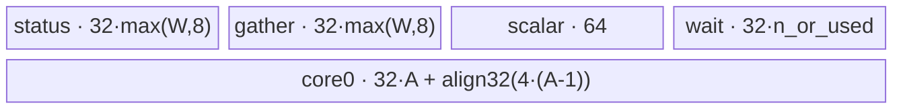

# DistributeBarrier 950 ACLNN 算子知识

## 算子速览

| 项目 | 内容 |
|---|---|
| 实际入口 | `aclnnDistributeBarrierV2GetWorkspaceSize` / `aclnnDistributeBarrierV2`，公开 ACLNN V2；950 内部实际 op 为 `DistributeBarrierExtend` |
| 计算语义 | 在独占通信域内等待全部 rank 到达；`xRef` 只建立依赖，Kernel 不读写其数据 |
| 输入输出 | `xRef` ND；950 公开支持基础 dtype 及 FP8/FP4/HIFLOAT8/INT4；可选 timeout/elastic 为 INT32 |
| 执行类型 | 非 Cube 通信/Hybrid（AIV 执行，节点内使用 Vector DMA/Reduce），单 Kernel `distribute_barrier_extend`；context 使用 `COMM_ENGINE_AIV` 与 `COMM_PROTOCOL_UB_MEM` |
| Kernel 路线 | R-001 无可选输入；R-002 timeout；R-003 elastic；R-004 timeout+elastic |
| 核心资源 | 8208 B `Mc2MoeContext`、UB Memory rank window、GM optional tensor、每核 TBuf、Vector DMA/Reduce、硬事件与全核同步 |
| 来源闭包 | `source_closed`：公开 V2→950 base/context→inner Extend→Extend Tiling→共享 POD→`distribute_barrier_extend`→共享 body 与构建/CI 接线闭合；自动生成 inner bridge 为框架边界 |
| 验证状态 | 已完成源码闭包检查；本次知识提取未执行编译、真机、数值或性能测试。 |

## 接口与语义

### 计算语义

令通信域大小为 `W`、AIV 数为 `A`、本 rank 为 `r`。core 0 轮询 worker 完成标记，`A-1` 个 worker 均衡分配目标 rank。每个 worker 向目标卡本轮状态窗口的 `r×512 B` 槽写 32 B FP32 `1`，再批量读取本地窗口中相隔 512 B 的状态槽并 `ReduceSum`；和等于 `8×分配数` 后清零槽、写完成标记。core 0 等待 `min(A-1,W)` 个有效 worker 后清零完成区，所有 AIV 最终 `SyncAll<true>()`。

950 不从 Kernel HCCL context 取窗口；ACLNN 第一段预建 `Mc2MoeContext`，其 `epRankId` 和 1024 个 `epHcclBuffer_` 指针直接被 body 使用。每次调用通过持久状态位在两个相距 512 KiB 的 epoch 间切换。`xRef/xRefOut/workspaceGM` 均未被 body 解引用。

### 输入、输出与属性

| 参数 | shape/layout | dtype | 约束、默认值与语义 |
|---|---|---|---|
| `xRef` | ND，rank 0–8；INT4 公开为 rank 2–3；可非连续，inner OpDef 自动连续化 | BF16、FP16、FP32、BOOL、INT/UINT 8/16/32/64、FP8 E5M2/E4M3FN、FP4 E1M2/E2M1、HIFLOAT8、INT4 | 必选，仅依赖占位；`XType` 在共享 body 未使用 |
| `timeOutOptional` | 文档 rank 0–1；Tiling 实际要求 1D `[1]`、非 FRACTAL_NZ | INT32 | 可空；950 文档单位 µs，建议 5,000,000；Device 用 50 cycle/µs |
| `elasticInfoOptional` | 文档 rank 0–1；Tiling 实际要求 1D `[4+2W]`、非 FRACTAL_NZ | INT32 | 可空；元素 0 使能，1 为 W'，元素 4 起为 local/target rank map |
| `group` | C 字符串 | STRING | 必选，长度 `[1,127]`；算子必须独占通信域 |
| `worldSize` | 属性 | INT64→POD UINT32 | 950 `[2,1024]` |
| `context`（内部） | 1D `[2052]`，ND | INT32 view | ACLNN base 生成；公开调用者不提供；对应 8208 B `Mc2MoeContext` |
| 第二段 | workspace/executor/stream | 句柄 | 使用第一段返回对象；错误原样传播 |

### 入口与版本

V2 是固定提交内最新公开版本，比 V1 增加 timeout 与 elastic。公开 ACLNN 文档明确支持 Ascend 950DT；内部 Extend README 还列 950PR，但公开 V2 文档没有该公开平台证据，因此本卡只承诺公开的 950DT。`DistributeBarrierExtend` OpDef 仅注册 `ascend950`，CI 列表也同时构建 `distribute_barrier` 与 `distribute_barrier_extend`。

## Host/Launcher 执行流程

### 参数校验与前处理

1. V2 第一段转入 `aclnnDistributeBarrierGetWorkspaceSizeBase`；base 显式校验 `xRef/group` 非空、group 长度 1–127。
2. `GetCurNpuArch()==DAV_3510` 时，以 `group + "distribute_barrier_extend"` 为 context tag 调用 `GetMc2ContextTensor`。
3. context loader 固定 `COMM_ENGINE_AIV`，检查所有链路支持 UB Memory；cache miss 时获取 rank/channel/buffer，写入 `Mc2MoeContext` 并复制到 HCCL engine context，cache hit 复用它。
4. base 调自动生成 `aclnnInnerDistributeBarrierExtendGetWorkspaceSize(context,xRef,timeOut,elastic,group,W,...)`。
5. Extend Tiling 配置 `isMc2Context=true`，检查 context 为 1D INT32 非 NZ，再执行共享 timeout/elastic/W 检查；它显式跳过 `SetHcommCfg`。

上述 950 路线受 `HCOMM_VERSION_NUM>=89999700` 编译门控；不满足时第一段保持内部错误，第二段不会进入 Extend 分支。

### 参数、Workspace 与生命周期

`Mc2MoeContext` 顺序为 `epRankId:uint32`、`rankSizePerServer:uint32`、`kfcContextAddr:uint64`、`epHcclBuffer_[1024]:uint64`，自然字段总量为 8208 B；Host 用 `sizeof(Mc2MoeContext)/4` 创建 INT32 `[2052]` view。`epHcclBuffer_[i]` 写为 HCCL buffer 基址加 `i×1024 B`，context 由 HCCL engine/context cache 持有。

共享 Tiling 固定 workspace 16 MiB，读取 `A` 与 `U`，设置 `blockDim=CalcTschBlockDim(A,0,A)`、schedule mode 1，并写 POD。body 不访问 workspace 或 `totalUbSize`。executor 持有内部 context tensor与连续化对象，调用者持有 workspace，直到第二段 stream 提交完成。

### 启动图与失败传播

```text
V2 GetWorkspaceSize -> Base[is950]
  -> GetMc2ContextTensor(AIV, UB_MEM) -> generated InnerDistributeBarrierExtendGetWorkspaceSize
    -> DistributeBarrierExtendTilingFunc -> one executor node
V2 execute -> Base[is950] -> InnerDistributeBarrierExtend
  -> distribute_barrier_extend<<<blockDim,stream>>>(context,xRef,timeOut,elastic,xRefOut,workspace,POD)
```

只有一个 Device 节点，真实执行族是“非 Cube 通信/Hybrid（AIV Vector）”，无跨 Kernel workspace 边。跨 rank 边是 context 指向的 UB Memory window：源 worker 写远端 buffer，目标 worker 读本地 buffer；节点内通过硬事件、DCCI、`PipeBarrier` 和 `SyncAll` 排序。context/HCCL、Tiling、inner launch 任一步失败都会阻断 Kernel 或向第二段返回错误。

## Route 与参数设计

### 分核与资源计算

设 `S=A-1`、`q=floor(Wa/S)`、`m=Wa mod S`，其中 `Wa=W`，elastic 真使能时为 `W'`。worker `i=core-1` 得到 `n=q+(i<m)`、`begin=q*i+min(i,m)`；core 0 等待 `used=min(S,Wa)`。状态 payload 32 B、rank pitch 512 B、epoch pitch 512 KiB、epoch 内完成区偏移 900 KiB；完成槽 pitch 128 B。

### Route 选择

| 顺序 | Route | Key/模板 | 精确选择条件与优先级 | 不适用去向 |
|---:|---|---|---|---|
| 1 | R-001 基础 950 context | default / `DistributeBarrier<DTYPE_X_REF>` | timeout/elastic shape 均 null，context/W 合法 | optional 存在则后续 Route |
| 2 | R-002 950 timeout | default / 同模板 | timeout 非空、elastic 空；timeout 结构校验通过 | 失败则 Tiling failed |
| 3 | R-003 950 elastic | default / 同模板 | timeout 空、elastic 非空；elastic 结构校验通过 | 失败则 Tiling failed |
| 4 | R-004 950 timeout+elastic | default / 同模板 | 两者非空；先 timeout 后 elastic 均通过 | 任一失败则 Tiling failed |

```text
DAV_3510 -> context ready -> Extend Tiling
  flags 00/10/01/11 -> R-001/R-002/R-003/R-004
  no SetTilingKey -> REGISTER_TILING_DEFAULT -> distribute_barrier_extend
```

### 模板/实现执行矩阵

| Route | key/selector | dtype/shape/platform 完整命中条件 | 执行拓扑与 Kernel 节点 | 实际模板/body | 内存与同步特征 | tail/fallback |
|---|---|---|---|---|---|---|
| R-001 | default, flags 00 | 950DT、context合法、W 2..1024、xRef支持 dtype | 单个非 Cube 通信/Hybrid 节点 `distribute_barrier_extend`（AIV Vector） | shared `DistributeBarrier<XType>::Process` | context windows + common/core0 TBuf | rank余数均衡；无 fallback |
| R-002 | default, flags 10 | R-001 + timeout `[1]` INT32 | 同上 | 同 body + cycle/assert | UB 与 R-001 相同 | 超时 assert |
| R-003 | default, flags 01 | R-001 + elastic `[4+2W]` INT32 | 同上 | 同 body + W'/maps | 每核增加 aligned elastic TBuf | 内容非法无 fallback |
| R-004 | default, flags 11 | 同时满足 R-002/R-003 | 同上 | 两 optional 分支合并 | UB 同 R-003 | assert或未定义映射后果 |

### 隐藏性能 Guard

| Guard | Host/Tiling 条件 | Device/资源原因 | 影响 Route | 不满足时去向 | 源码符号 |
|---|---|---|---|---|---|
| HCOMM version | `>=89999700` | 950 context/Extend 符号只在门控内可用 | 全部 | 第一段内部错误或非 Extend 执行分支 | `distribute_barrier_base.cpp` macros |
| UB Memory | 每个远端链路至少一个 UB_MEM protocol | body 直接 load/store peer buffer | 全部 | `GetCommProtocol` 返回错误 | `CheckProtocolSupport` |
| world size | `2<=W<=1024` | context array、DMA blockCount、UB 均依赖 W | 全部 | Tiling failed | `CheckAndSetAttrs` |
| context shape/type | 1D INT32 非 NZ | body reinterpret为 `Mc2MoeContext` | 全部 | Tiling failed | `CheckMc2Context` |
| optional shape | timeout `[1]`；elastic `[4+2W]` | scalar load与两张 map | R-002～R-004 | Tiling failed | `CheckTimeOut/CheckElasticInfo` |
| AIV count | 源码隐含 `A>=2` | `S=A-1` 作除数 | 全部 | 无 fallback | `SplitToCore` |
| UB fit | Host 记录 U 但不比较 | TBuf 随 Wa/A/elastic 增长 | 全部 | 无 selector/fallback | `Init` |
| window extent | epoch pitch 为 512 KiB，完成区相对每个 epoch 起点再偏移 900 KiB | 最大访问地址由 epoch、A 与 `used` 共同决定 | 全部 | 无 Device 检查 | `GeWindowAddr/finishGm_` |

### POD/ABI

固定仓没有 POD `offsetof/sizeof/alignof` 断言；嵌套 MC2 tiling 类型的具体 ABI 由外部 CANN header 定义。950 `isMc2Context=true` 时 body 不读两个 MC2 tiling字段。

| 结构 | 字段 | 类型/位宽 | ABI 布局 | 单位 | Host/launcher producer | Device consumer | 边界 |
|---|---|---|---|---|---|---|---|
| `DistributeBarrierTilingData` | `mc2InitTiling` | `Mc2InitTiling` | 第1字段，具体布局不可见 | MC2 | 950 路线跳过 producer | body 不读 | inactive |
| 同上 | `mc2CcTiling1` | `Mc2CcTiling` | 第2字段，具体布局不可见 | MC2 | 950 路线跳过 producer | body 不读 | inactive |
| `DistributeBarrierInfo` | `worldSize` | uint32/32 | info第1字段，offset无断言 | rank | checked INT64 cast | `Init/SplitToCore` | 2..1024 |
| 同上 | `rankId` | uint32/32 | 第2字段，offset无断言 | rank | 未赋值 | 未读取 | inactive |
| 同上 | `aivNum` | uint32/32 | 第3字段，offset无断言 | AIV | `GetCoreNumAiv()` | `Init` | A>=2未显式校验 |
| 同上 | `totalUbSize` | uint64/64 | 第4字段，offset无断言 | B | `GetCoreMemSize(UB)` | 未读取 | 仅记录 |
| 同上 | `totalWinSize` | uint64/64 | 第5字段，offset无断言 | B | 未赋值 | 未读取 | inactive |
| 同上 | `isInputTimeOut` | bool | 第6字段，bool ABI无断言 | flag | optional presence | `Init/TimeOutTest` | 不控制 TBuf 分配 |
| 同上 | `isInputElasticInfo` | bool | 第7字段，bool ABI无断言 | flag | optional presence | `Init/InitElasticInfo` | 控制 elastic TBuf |
| 同上 | `isMc2Context` | bool | 第8字段，bool ABI无断言 | flag | Extend config 固定 true | `InitContextAndRankInfo` | 选择 context pointer 路线 |
| 同上 | `reserved1` | bool | 第9字段，bool ABI无断言 | reserved | 未赋值 | 未读取 | inactive |
| `Mc2MoeContext` | `epRankId` | uint32/32 | 第1字段 | rank | `HcclGetRankId` | `InitContextAndRankInfo` | <1024 |
| 同上 | `rankSizePerServer` | uint32/32 | 第2字段 | rank/server | Host resource discovery | body不读 | inactive于本算子 |
| 同上 | `kfcContextAddr` | uint64/64 | 第3字段 | address | 本路径固定仓未赋值 | body不读 | inactive |
| 同上 | `epHcclBuffer_[1024]` | uint64×1024 | 第4字段；整体 struct 8208 B | GM address | per-rank HCCL buffer + rank×1024B | `GeWindowAddr/statusDataSpaceGm_` | W<=1024 |

### Route 源码闭包

| Route | Key/selector | Host/Tiling producer | POD/参数 | Kernel entry/router 节点 | Kernel body/直接依赖 | 构建接线 |
|---|---|---|---|---|---|---|
| R-001 | default/00 | `mc2/distribute_barrier_extend/op_host/op_tiling/distribute_barrier_extend_tiling.cpp`：Extend config→shared Tiling | `mc2/distribute_barrier/op_kernel/distribute_barrier_tiling.h`：context + shared POD | `mc2/distribute_barrier_extend/op_kernel/distribute_barrier_extend.cpp`：`distribute_barrier_extend` | `mc2/distribute_barrier/op_kernel/distribute_barrier.h`：shared body；`mc2/common/op_kernel/mc2_moe_context.h`：context；`mc2/common/op_kernel/mc2_kernel_utils.h`：`SyncFunc` | public/Extend OpDef 与 CMake + ascend950 CI |
| R-002 | default/10 | shared tiling 文件：`CheckTimeOut` | 同一 POD：timeout GM + flag | 同一 Extend entry | shared body：`TimeOutTest` | 同 R-001 |
| R-003 | default/01 | shared tiling 文件：`CheckElasticInfo` | 同一 POD：elastic GM + flag | 同一 Extend entry | shared body：`InitElasticInfo/SetStatus` | 同 R-001 |
| R-004 | default/11 | shared tiling 文件：先 `CheckTimeOut` 后 `CheckElasticInfo` | 同一 POD：两 optional GM/flags | 同一 Extend entry | shared body：两分支汇合 | 同 R-001 |

## Kernel 实现

### 公共执行流程

`distribute_barrier_extend` 总是实例化 `DistributeBarrier<DTYPE_X_REF>`，无 A3 dtype guard；模板类型未参与 body。`InitContextAndRankInfo` 把 context reinterpret为 `Mc2MoeContext`，以 `epRankId` 为 original/current rank、`epHcclBuffer_[rank]` 为本地状态区。`GeWindowAddr(dst,_) = epHcclBuffer_[dst]+epoch×512KiB`。随后所有 Route 共用 epoch 翻转、rank split、core0 completion poll、worker status send/poll/clean 和全核退出同步。

### Route R-001：基础 950 context 屏障

#### 适用条件

##### 选择证据

| 层级 | 文件 | 符号 | 源码谓词/参数 | 结果/下一跳 |
|---|---|---|---|---|
| API | `mc2/distribute_barrier/op_api/distribute_barrier_base.cpp` | `aclnnDistributeBarrierGetWorkspaceSizeBase` / `aclnnDistributeBarrierBase` | `is950` 且 HCOMM 门控满足 | inner `DistributeBarrierExtend` |
| Tiling | `mc2/distribute_barrier/op_host/op_tiling/distribute_barrier_tiling.cpp` | `DistributeBarrierExtendTilingFuncNew` | context true、optional 皆空、W 合法 | flags 00 |
| Router | `mc2/distribute_barrier_extend/op_kernel/distribute_barrier_extend.cpp` | `distribute_barrier_extend` | 无 key/dtype 分支 | `DistributeBarrier<DTYPE_X_REF>::Process` |

#### Device 数据流

##### 函数级调用链

```text
distribute_barrier_extend -> Init(context) -> InitStatus -> SplitToCore
  core0 -> TimeOutTest(finish window -> TBuf -> ReduceSum -> clear)
  workers -> SetStatus(remote UB Memory) -> WaitStatus(local window)
          -> CleanStatus(local) + finish flag
  -> SyncAll<true>
```

##### 源码等价伪码

```text
epoch=toggle(context.epHcclBuffer[r]+900KiB+core*128B)
split W over A-1 workers
worker: for dst in slice, store 32B ones to context.buffer[dst]+epoch*512KiB+r*512B
worker: strided-load local slots until ReduceSum==8*n; clear; publish finish
core0: strided-load finish slots until sum==used; clear
all cores synchronize and return
```

#### 内存与数据搬运

##### 资源与搬运表

| 层级/缓冲区 | offset/地址公式 | extent/容量公式 | dtype/layout | producer | consumer | owner/lifetime | 对齐/复用 |
|---|---|---|---|---|---|---|---|
| context GM | base | 8208 B / `[2052]` INT32 | `Mc2MoeContext` | ACLNN/HCCL | all AIV | context cache | fields direct scalar |
| rank status | `buffer[dst]+epoch*512KiB+r*512B` | 32 B per source，pitch512 | FP32 | worker | remote/local worker | HCCL buffer | UB Memory |
| completion | self epoch +900KiB+A*128B+j*128B | 32 B per worker | FP32 | worker | core0 | barrier | pitch128 |
| common TBuf | independent | status/gather each `32*max(W,8)`；scalar64；wait worker `32*n`/core0 `32*used` | FP32/INT32 view | DMA/Vector | Reduce/DMA | Kernel | no TQue/depth |
| core0 TBuf | independent | `32*A+align32(4*(A-1))` | FP32 scratch | DMA/Reduce | core0 | Kernel | always allocated |
| workspace | unused | 16MiB | byte | caller | body不读 | stream | N/A |

##### 分层内存布局



##### 字节账与复用顺序

```text
Bworker=64*max(W,8)+64+32*n
Bcore0=64*max(W,8)+64+32*used+32*A+align32(4*(A-1))
固定 Host 无 B<=U 检查。
```

| 复用子区 | 写入者 | 读取者/消费点 | 下一次覆盖 | 同步或释放依据 | 安全条件 |
|---|---|---|---|---|---|
| waitStatus | MTE2 | ReduceSum | Duplicate zero | MTE2_V/V_S | scalar sum已读 |
| waitStatus INT32 view | Duplicate zero | MTE3 clean | Kernel结束 | V_MTE3/MTE3_S | 仅零值 reinterpret |
| epoch windows | 当前调用 | peers | 下一同域调用 | clear + SyncAll + epoch toggle | 不允许并发重入 |

#### 同步、精度与尾块

##### 同步与数值边界表

| 阶段 | primitive/机制 | producer | consumer/等待点 | 保护对象 | 精度/尾块 |
|---|---|---|---|---|---|
| GM↔UB | V_MTE3、MTE2_V、MTE3_S | Duplicate/DMA | DMA/Reduce/scalar | status TBuf/window | FP32 1/0，无 cast |
| Reduce | V_S | ReduceSum | scalar compare | n×8 lanes | exact integer sum `8n` |
| epoch/finish | DCCI/PipeBarrier | scalar/worker | peer/core0 | persistent slots | used排除idle worker |
| exit | SyncAll true | all AIV | return | context/window lifetime | 前m个worker多1 rank |

#### 关键实现

##### 符号证据表

| 阶段 | 文件 | 符号/模板实例 | 实现事实 |
|---|---|---|---|
| Host/Tiling producer | `mc2/distribute_barrier_extend/op_host/op_tiling/distribute_barrier_extend_tiling.cpp`；`mc2/distribute_barrier/op_host/op_tiling/distribute_barrier_tiling.cpp` | `DistributeBarrierExtendTilingFunc` / `DistributeBarrierExtendTilingFuncNew` | context flag、W/A/U/blockDim/workspace |
| Kernel entry/router | `mc2/distribute_barrier_extend/op_kernel/distribute_barrier_extend.cpp` | `distribute_barrier_extend` | single default body |
| Device body/helper | `mc2/distribute_barrier/op_kernel/distribute_barrier.h` | `Init/Process/BarrierProcess` | context 地址、DMA、Reduce、同步、tail |

### Route R-002：950 timeout 屏障

#### 适用条件

##### 选择证据

| 层级 | 文件 | 符号 | 源码谓词/参数 | 结果/下一跳 |
|---|---|---|---|---|
| Tiling | `mc2/distribute_barrier/op_host/op_tiling/distribute_barrier_tiling.cpp` | `CheckTimeOut` | optional 存在且 1D `[1]`、INT32、非 NZ | timeout flag |
| Device | `mc2/distribute_barrier/op_kernel/distribute_barrier.h` | `Init` / `TimeOutTest` | flag true | µs cycle assert |

#### Device 数据流

##### 函数级调用链

```text
R-001 chain + timeOutGM[0] -> timeOut_; core0 poll -> GetSystemCycle/50 -> assert
```

##### 源码等价伪码

```text
timeout=uint32(timeOut[0]); begin=cycle()
while finishSum<used: poll/reduce; if (cycle()-begin)/50>=timeout: assert
workers/cleanup/SyncAll同R-001
```

#### 内存与数据搬运

##### 资源与搬运表

| 层级/缓冲区 | offset/地址公式 | extent/容量公式 | dtype/layout | producer | consumer | owner/lifetime | 对齐/复用 |
|---|---|---|---|---|---|---|---|
| timeout GM | 0 | 4B | INT32 `[1]` | caller | core0 | call | scalar |
| context/window/TBuf | 同R-001 | 同R-001 | 同R-001 | same | same | Kernel/context | timeout不增加TBuf |

##### 分层内存布局


##### 字节账与复用顺序

```text
Bworker/Bcore0与R-001一致；timeOut_为scalar成员。
```

| 复用子区 | 写入者 | 读取者/消费点 | 下一次覆盖 | 同步或释放依据 | 安全条件 |
|---|---|---|---|---|---|
| completion TBuf | poll DMA | Reduce/scalar | next poll | MTE2_V/V_S | scalar已读 |

#### 同步、精度与尾块

##### 同步与数值边界表

| 阶段 | primitive/机制 | producer | consumer/等待点 | 保护对象 | 精度/尾块 |
|---|---|---|---|---|---|
| timeout | cycle/50/assert | counter | core0 | whole barrier | µs；负INT32转uint32 |
| rest | R-001 events/SyncAll | workers/core0 | next phase | windows | rank tail同R-001 |

#### 关键实现

##### 符号证据表

| 阶段 | 文件 | 符号/模板实例 | 实现事实 |
|---|---|---|---|
| Host/Tiling producer | `mc2/distribute_barrier/op_host/op_tiling/distribute_barrier_tiling.cpp` | `CheckTimeOut` | shape/dtype/format 与 flag |
| Kernel entry/router | `mc2/distribute_barrier_extend/op_kernel/distribute_barrier_extend.cpp` | `distribute_barrier_extend` | default entry |
| Device body/helper | `mc2/distribute_barrier/op_kernel/distribute_barrier.h` | `TimeOutTest` | cycle 换算、assert、completion clear |

### Route R-003：950 elastic 屏障

#### 适用条件

##### 选择证据

| 层级 | 文件 | 符号 | 源码谓词/参数 | 结果/下一跳 |
|---|---|---|---|---|
| Tiling | `mc2/distribute_barrier/op_host/op_tiling/distribute_barrier_tiling.cpp` | `CheckElasticInfo` | 1D `[4+2W]`、INT32、非 NZ | elastic flag |
| Device | `mc2/distribute_barrier/op_kernel/distribute_barrier.h` | `InitElasticInfo` | `value[0]==1` | W'/maps 生效 |

#### Device 数据流

##### 函数级调用链

```text
elastic GM -> DataCopyPad -> elastic TBuf -> MTE2_S -> W'/local map/target map
  -> mapped R-001 barrier -> clear -> SyncAll
```

##### 源码等价伪码

```text
copy 4*(4+2W)B; if enabled: Wa=value[1], rank=value[4+oldRank]
dst=value[4+W+logicalDst]; address=context.buffer[dst]+epoch*512KiB
split/poll/clean using Wa
```

#### 内存与数据搬运

##### 资源与搬运表

| 层级/缓冲区 | offset/地址公式 | extent/容量公式 | dtype/layout | producer | consumer | owner/lifetime | 对齐/复用 |
|---|---|---|---|---|---|---|---|
| elastic GM/TBuf | base | raw `4*(4+2W)` B；UB `E=align32(raw)` | INT32 | caller/MTE2 | scalar/map reads | Kernel | DataCopyPad/MTE2_S |
| mapped windows | `context.buffer[mappedDst]+epoch*512KiB+mappedSrc*512B` | 32B slots | FP32 | workers | peers | barrier | map内容未验证 |
| common/core0 TBuf | R-001以Wa代W + E | formulas below | mixed | body | body | Kernel | no queues |

##### 分层内存布局


##### 字节账与复用顺序

```text
E=align32(4*(4+2W_original))
Bworker=64*max(Wa,8)+64+32*n+E
Bcore0=64*max(Wa,8)+64+32*used+32*A+align32(4*(A-1))+E
```

| 复用子区 | 写入者 | 读取者/消费点 | 下一次覆盖 | 同步或释放依据 | 安全条件 |
|---|---|---|---|---|---|
| elastic TBuf | DataCopyPad | all map reads | Kernel end | MTE2_S | 内容调用期间不变 |
| wait TBuf | DMA | Reduce/zero DMA | stage transition | event graph | 同R-001 |

#### 同步、精度与尾块

##### 同步与数值边界表

| 阶段 | primitive/机制 | producer | consumer/等待点 | 保护对象 | 精度/尾块 |
|---|---|---|---|---|---|
| map load | MTE2_S | DataCopyPad | scalar | elastic UB | raw INT32 |
| mapped barrier | R-001 events | mapped peers | worker/core0 | windows | Wa余数均衡；非法map无保护 |

#### 关键实现

##### 符号证据表

| 阶段 | 文件 | 符号/模板实例 | 实现事实 |
|---|---|---|---|
| Host/Tiling producer | `mc2/distribute_barrier/op_host/op_tiling/distribute_barrier_tiling.cpp` | `CheckElasticInfo` | 外层结构与 flag |
| Kernel entry/router | `mc2/distribute_barrier_extend/op_kernel/distribute_barrier_extend.cpp` | `distribute_barrier_extend` | elastic GM 传入 |
| Device body/helper | `mc2/distribute_barrier/op_kernel/distribute_barrier.h` | `InitElasticInfo/GeWindowAddr/SetStatus` | 950 buffer map 与 Wa |

### Route R-004：950 timeout+elastic 屏障

#### 适用条件

##### 选择证据

| 层级 | 文件 | 符号 | 源码谓词/参数 | 结果/下一跳 |
|---|---|---|---|---|
| Tiling | `mc2/distribute_barrier/op_host/op_tiling/distribute_barrier_tiling.cpp` | `DistributeBarrierExtendTilingFuncNew` | 两 optional 存在；timeout 检查先于 elastic | flags 11 |
| Device | `mc2/distribute_barrier/op_kernel/distribute_barrier.h` | `Init/Process` | 两 flag true | mapped barrier + timeout |

#### Device 数据流

##### 函数级调用链

```text
context + elastic -> mapped worker barrier
timeout -> core0 cycle-checked finish polling
mapped cleanup -> SyncAll
```

##### 源码等价伪码

```text
load timeout and elastic; derive Wa/maps
workers send/poll/clear mapped status
core0 waits min(A-1,Wa) finishes and asserts on timeout
clear finish; all-core sync
```

#### 内存与数据搬运

##### 资源与搬运表

| 层级/缓冲区 | offset/地址公式 | extent/容量公式 | dtype/layout | producer | consumer | owner/lifetime | 对齐/复用 |
|---|---|---|---|---|---|---|---|
| timeout | 0 | 4B | INT32 | caller | core0 | call | scalar |
| elastic/context/windows | 同R-003 | 同R-003 | INT32/FP32 | caller/workers | all AIV | barrier | UB_MEM |
| TBuf | 同R-003 | 同R-003 | mixed | body | body | Kernel | timeout不增加UB |

##### 分层内存布局


##### 字节账与复用顺序

```text
UB公式与R-003相同；timeout只增加scalar控制流。
```

| 复用子区 | 写入者 | 读取者/消费点 | 下一次覆盖 | 同步或释放依据 | 安全条件 |
|---|---|---|---|---|---|
| elastic/wait/completion TBuf | MTE/Vector | scalar/Reduce/MTE | next phase/loop | MTE2_S、MTE2_V、V_S、V_MTE3 | 各事件完成后覆盖 |

#### 同步、精度与尾块

##### 同步与数值边界表

| 阶段 | primitive/机制 | producer | consumer/等待点 | 保护对象 | 精度/尾块 |
|---|---|---|---|---|---|
| optional | MTE2_S + cycle/assert | caller/counter | workers/core0 | maps/barrier | INT32内容未范围检查 |
| barrier/exit | R-001 event graph + SyncAll | all AIV | phases/return | UB_MEM windows | rank tail按Wa |

#### 关键实现

##### 符号证据表

| 阶段 | 文件 | 符号/模板实例 | 实现事实 |
|---|---|---|---|
| Host/Tiling producer | `mc2/distribute_barrier/op_host/op_tiling/distribute_barrier_tiling.cpp` | `DistributeBarrierExtendTilingFuncNew` | 两 flag 与检查顺序 |
| Kernel entry/router | `mc2/distribute_barrier_extend/op_kernel/distribute_barrier_extend.cpp` | `distribute_barrier_extend` | one default body |
| Device body/helper | `mc2/distribute_barrier/op_kernel/distribute_barrier.h` | `InitElasticInfo/TimeOutTest/BarrierProcess` | optional 组合与共同清理 |

## 算子特定优化

### Trick T-001：ACLNN 侧缓存 AIV/UB Memory context，Kernel 直接索引远端窗口

#### 触发与源码依据

- 适用 Route：R-001～R-004
- 触发条件：DAV_3510、HCOMM版本满足、group全部链路支持 UB Memory。
- Golden 来源：[`mc2/common/op_api/mc2_context.cpp:480-492`](../../../../../../../cann-ops-raw/ascendc/ops-transformer/be33d95bb755cedec3108f70805c1874d1792540/mc2/common/op_api/mc2_context.cpp#L480-L492)

**官方源码（固定 Commit 连续逐字摘录）**：

```cpp
aclnnStatus Mc2Context::CheckContextCache(const HcclComm &hcclHandle, const std::string &mc2ContextTag,
                                          const CommEngine &engine, void *&ctx, uint64_t &hcclBuffSize)
{
    uint64_t ctxSize = 0;
    auto hcclRet = HcclEngineCtxGet(hcclHandle, mc2ContextTag.c_str(), engine, &ctx, &ctxSize);
    if (hcclRet != HCCL_SUCCESS) { // 没找到缓存，创建context
        hcclBuffSize = 0;
        OP_LOGI("Context cache not found, need to create");
        return ACLNN_SUCCESS;
    }
    auto aclnnRet = GetHcclBufferSize(hcclHandle, hcclBuffSize);
    CHECK_RET(aclnnRet == ACLNN_SUCCESS, aclnnRet);
    return ACLNN_SUCCESS;
}
```

#### 机制与设计原因

context tag 将通信域与 Extend op 隔离，`COMM_ENGINE_AIV` 明确把可达执行节点留在 Vector 侧。cache 命中时直接把已有 engine context 包装成 tensor；miss 才获取 channel、验证 UB_MEM 并复制 8208 B 指针表。Device 随后用 `epHcclBuffer_[dst]` 做普通地址计算，无需在每次 barrier 重建 per-rank 窗口表。

#### 迁移边界

- 适用：950 上同一 group 多次调用、通信资源可稳定缓存的 AIV UB Memory 协议。
- 前提：HCOMM API 版本、UB_MEM 链路、1024 rank 上限和 context 生命周期都满足。
- 失效：任一链路不支持 UB_MEM、context tag过长或资源获取失败时第一段直接失败，没有 Device fallback。
- 未验证：本次知识提取未执行编译、真机、数值或性能测试。

#### 错误做法

固定仓提供的失败边界是 `CheckProtocolSupport` 找不到 UB_MEM 时返回 `ACLNN_ERR_INNER`；不能在此平台偷偷降级到未闭合的另一通信协议。

### Trick T-002：32 B 稀疏块批量 DMA 加 Vector 求和

#### 触发与源码依据

- 适用 Route：R-001～R-004
- 触发条件：worker 分配至少一个 active rank。
- Golden 来源：[`mc2/distribute_barrier/op_kernel/distribute_barrier.h:323-337`](../../../../../../../cann-ops-raw/ascendc/ops-transformer/be33d95bb755cedec3108f70805c1874d1792540/mc2/distribute_barrier/op_kernel/distribute_barrier.h#L323-L337)

**官方源码（固定 Commit 连续逐字摘录）**：

```cpp
    float compareTarget = static_cast<float>(1.0) * sendRankNum_ * UB_ALIGN / sizeof(float);
    float sumOfFlag = static_cast<float>(-1.0);
    DataCopyParams intriParams{static_cast<uint16_t>(sendRankNum_), 1, (STATE_OFFSET - UB_ALIGN) / UB_ALIGN, 0};
    uint64_t systemCntBegin = static_cast<uint64_t>(GetSystemCycle());
    SyncFunc<AscendC::HardEvent::S_V>();
    while (sumOfFlag != compareTarget) {
        DataCopy(
            statusFp32Tensor_,
            windowInstatusFp32Tensor_[startRankId_ * stateOffset_ / sizeof(float)],
            intriParams);
        SyncFunc<AscendC::HardEvent::MTE2_V>();
        ReduceSum(statusSumOutTensor, statusFp32Tensor_, gatherMaskOutTensor, sendRankNum_ * UB_ALIGN / sizeof(float));
        SyncFunc<AscendC::HardEvent::V_S>();
        sumOfFlag = statusSumOutTensor.GetValue(0);
    }
```

#### 机制与设计原因

一次 DMA 用 `blockCount=n, blockLen=1, srcStride=15` 收集 n 个相隔 512 B 的 32 B 状态块，随后对连续 UB 做 `ReduceSum`。这把逐 rank GM scalar polling 变成批量 MTE2+Vector 流水；精确 1/0 状态使 `8n` 等值判断无需容差。

#### 迁移边界

- 适用：固定 pitch 的小状态槽和可精确求和的完成协议。
- 前提：32 B block、512 B pitch、FP32 lane、DMA参数范围与 UB fit。
- 失效：槽布局、dtype或完成判据变化时必须同步修改 DMA stride、mask/元素数和目标和。
- 未验证：本次知识提取未执行编译、真机、数值或性能测试。

#### 错误做法

固定仓未提供可验证反例。

## 模板与实现对比

| 对比维度 | R-001基础 | R-002 timeout | R-003 elastic | R-004组合 | 设计选择依据 |
|---|---|---|---|---|---|
| 命中条件/优先级 | flags00 | flags10 | flags01 | flags11 | optional presence，timeout先检 |
| 模板与 dtype | 同一未使用XType，950全公开dtype | 同左 | 同左 | 同左 | xRef仅依赖 |
| 循环与分核 | W/A-1 | +cycle | W'/maps | W'/maps+cycle | runtime flags |
| Queue/TBuf/寄存器 | 无TQue；common/core0 TBuf | 同基础 | 每核+E | 同elastic | timeout scalar |
| UB 总占用与复用 | 基础公式 | 同基础 | Wa公式+E | 同elastic | elastic条件分配 |
| 搬运/Vector API | strided DMA/Reduce | 同左 | +DataCopyPad | 组合 | 批量状态轮询 |
| 同步、精度与 tail | exact FP32 sum/rank余数 | +assert | +MTE2_S/map tail | 组合 | 无xRef数据计算 |
| fallback/失败边界 | context/Tiling fail | timeout结构/超时 | elastic结构/内容风险 | 两者 | 无Device fallback |

## 平台差异

| 项目 | A2 | A3 | 950 |
|---|---|---|---|
| 支持状态 | 公开不支持 | 公开支持，见无后缀卡 | 公开支持 950DT，本卡 |
| Host/Launcher | N/A | inner `DistributeBarrier` + runtime HCCL tiling | context cache + inner `DistributeBarrierExtend` |
| Kernel/资源 | N/A | `GetHcclContext`、A3 window relation、12 dtype guard | 8208B context、UB_MEM pointer table、Extend entry、无dtype guard |

## 限制与失败边界

- 公开 V2 文档只明确 950DT；Extend README 的 950PR 支持不等于公开 ACLNN 平台承诺。
- 950 路径必须满足 HCOMM 版本门控和所有通信链路 UB_MEM；失败没有 Device fallback。
- context Tiling 仅检查 1D/INT32/非NZ，没有检查 dim0=2052；正确长度由 `CreatMc2ContextTensor(sizeof(Mc2MoeContext)/4)` 保证，外部不得伪造。
- optional 文档允许 rank 0–1，而固定 Tiling 只接受 1D `[1]` 与 `[4+2W]`。elastic 内容、W'和maps没有范围校验；timeout负值转uint32。
- Host 不校验 `A>=2`、UB 字节账或窗口 extent；窗口必须覆盖最大访问末端 `epoch*512KiB+900KiB+A*128B+(used-1)*128B+32B`，其中 `epoch∈{0,1}`、`used=min(A-1,W_active)`。body 不使用 workspace、xRef/xRefOut、POD totalUbSize/totalWinSize/rankId。
- 自动生成 inner bridge、CANN primitive与HCCL库内部为框架边界；本次未执行编译、真机、数值或性能测试。

## 源码索引

### 链路索引

| 链路阶段 | 文件 | 关键符号 | 支撑内容 |
|---|---|---|---|
| 入口声明/约束 | `mc2/distribute_barrier/docs/aclnnDistributeBarrierV2.md` | V2 prototypes/产品表 | 最新公开版本、950DT、dtype/optional/UB_MEM |
| 入口实现 | `mc2/distribute_barrier/op_api/aclnn_distribute_barrier_v2.cpp` | V2 two-stage functions | base转发 |
| API平台分发 | `mc2/distribute_barrier/op_api/distribute_barrier_base.cpp` | GetWorkspaceSizeBase/Base | DAV_3510、context与Extend分支、HCOMM门控 |
| context producer | `mc2/common/op_api/mc2_context.cpp` | `GetMc2ContextTensor`等 | AIV/UB_MEM、cache、per-rank buffer、tensor |
| context ABI | `mc2/common/op_kernel/mc2_moe_context.h` | `Mc2MoeContext` | 8208B字段与1024指针 |
| 公开 OpDef | `mc2/distribute_barrier/op_host/distribute_barrier_def.cpp` | `DistributeBarrier` | 公开 inner 的 dtype、ND、AutoContiguous 与 ascend950 注册 |
| 公开 API 构建 | `mc2/distribute_barrier/op_host/CMakeLists.txt` | `add_modules_sources_with_soc` | V2/base、公开 inner 与 MC2 依赖接线 |
| 950 内部平台约束 | `mc2/distribute_barrier_extend/README.md` | 产品支持表 | Extend 内部实现列出 950PR/950DT；与公开 V2 文档的 950DT 承诺区分 |
| 平台注册 | `mc2/distribute_barrier_extend/op_host/distribute_barrier_extend_def.cpp` | Extend OpDef | ascend950、dtype/ND/ACLNN inner |
| Extend Tiling入口 | `mc2/distribute_barrier_extend/op_host/op_tiling/distribute_barrier_extend_tiling.cpp` | `DistributeBarrierExtendTilingFunc` | indices与isMc2Context=true |
| shared Tiling | `mc2/distribute_barrier/op_host/op_tiling/distribute_barrier_tiling.cpp` | checks/shared FuncNew | W/A/U/workspace/optional、skip HcommCfg |
| Tiling 常量/索引 | `mc2/distribute_barrier/op_host/op_tiling/distribute_barrier_tiling_helper.h` | `DistributeBarrierConfig` / `SYSTEM_NEED_WORKSPACE` / world-size 常量 | Extend 输入索引、16 MiB workspace、A3/950 上限 |
| POD/ABI | `mc2/distribute_barrier/op_kernel/distribute_barrier_tiling.h` | tiling structs | Host/Device字段 |
| Kernel entry | `mc2/distribute_barrier_extend/op_kernel/distribute_barrier_extend.cpp` | `distribute_barrier_extend` | context参数与single default body |
| Kernel body | `mc2/distribute_barrier/op_kernel/distribute_barrier.h` | `DistributeBarrier<XType>` | 地址、UB、DMA、Reduce、同步与tail |
| 同步helper | `mc2/common/op_kernel/mc2_kernel_utils.h` | `SyncFunc` | SetFlag→WaitFlag |
| 构建接线 | `mc2/distribute_barrier_extend/op_host/CMakeLists.txt` | `add_modules_sources_with_soc` | Extend依赖shared barrier/common/3rd |
| CI接线 | `scripts/ci/ascend950/ops_transformer_operator_list.yaml` | `distribute_barrier_extend` | ascend950活动构建列表 |

### 实现复用检查

| 检查项 | 可复用事实 | 不得改变的约束 | 源码符号 |
|---|---|---|---|
| ABI/POD | context 8208B/2052 INT32与shared POD flags | 1024指针、字段顺序、inactive MC2字段 | `Mc2MoeContext`/tiling structs |
| 调用顺序 | V2→950 context→InnerExtend→single Kernel | HCOMM门控、context先于executor、同stream | base / `GetMc2ContextTensor` |
| workspace/内存 | 16MiB system workspace；32/128/512B pitch；512KiB epoch | UB_MEM owner、pointer偏移、双epoch不可改 | shared Tiling/body |
| 同步 | hard events、DCCI、PipeBarrier、SyncAll | producer完成前不得reduce/clear/退出 | `SyncFunc`/`Process` |
| 精度与尾块 | FP32 1/0 exact sum；balanced rank remainder | `8n`、stride15、idle worker/used规则 | `SplitToCore/WaitStatus` |
| 失败边界 | context/UB_MEM/Tiling/inner错误直返 | 不得把elastic内容、UB/window前提视为已校验 | `CheckProtocolSupport`/checks |