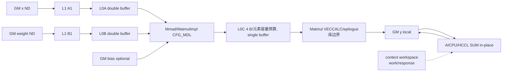

# GroupedMatMulAllReduce A2 ACLNN 算子知识

## 算子速览

| 项目 | 内容 |
|---|---|
| 实际入口 | `aclnnGroupedMatMulAllReduceGetWorkspaceSize` + `aclnnGroupedMatMulAllReduce`，固定提交中唯一公开 ACLNN 版本，已标记将废弃 |
| 计算语义 | 每组先做 `X_g×W_g+bias_g`，再在 `group` 通信域对该组结果做 `AllReduce(SUM)` |
| 输入输出 | ND TensorList；FP16 路线 bias=FP16，BF16 路线 bias=FP32；`splitItem` 决定 x/y 是否以单个连续 Tensor 表示多组 |
| 执行类型 | AIC_CUBE：`MatmulImpl<...,CFG_MDL>`；同一 MC2 任务图另含非 Vector 通信节点 AICPU/HCCL，AIV 分支立即返回 |
| Kernel 路线 | R-001：TilingKey 0 的逐组、逐轮 Cube→AllReduce |
| 核心资源 | GM y 原位通信，L1/L0A/L0B/L0C/Matmul UB，16 MiB 算子 workspace slot，HCCL context 中 64 B work + 64 B response 消息 |
| 来源闭包 | `source_closed`：ACLNN→generated inner bridge→OpDef/Tiling/POD→AIC body→AIC/AICPU 握手与构建接线闭合；generated bridge、`MatmulImpl` 内部和 HCCL/AICPU 引擎为明示外部边界 |
| 验证状态 | 已完成源码闭包检查；本次知识提取未执行编译、真机、数值或性能测试。 |

## 接口与语义

### 计算语义

```text
local_y[g,r] = X[g,r] [M_g,K_g] × W[g,r] [K_g,N_g] + (hasBias ? bias[g,r] : 0)
y[g]         = Σ_rank local_y[g,rank]
```

`splitItem=0/1/2/3` 分别表示 x/y 都不切分、仅 x 切分、仅 y 切分、x/y 都切分。Host 切分只创建指向原 GM 的 view；Device 通过 `GetTensorAddr(groupIdx, table)` 获取每组地址。A/W 均是 ND、不转置。

### 输入、输出与属性

| 参数 | shape/layout | dtype | 约束、默认值与语义 |
|---|---|---|---|
| `x` | ND TensorList；`splitItem=0` 为 2–6D，其他为 2D | 全 FP16 或全 BF16 | 不支持非连续；实际上限 64 组；`M=∏shape[0:-1]`,`K=shape[-1]` |
| `weight` | 每组 `[K,N]` ND 2D | 与 x 相同 | 不能为空；上限 64 组 |
| `bias` | 可选，每组 `[N]` ND | x=FP16 时 FP16；x=BF16 时 FP32 | null/空 list/首 Tensor null/单 Tensor 且 dim0=0 归一为无 bias |
| `groupListOptional` | Host `aclIntArray` | INT64 | `splitItem=1/3` 必需，长度=weight 组数，API 要求非递减且末值=x.dim0；`0/2` 必须为 null |
| `splitItem` | 标量 | INT64 | 只允许 0/1/2/3 |
| `group` | Host 字符串 | STRING | HCCL 通信域名，公开文档要求长度>0 |
| `reduceOp` | Host 字符串 | STRING | 只允许 `"sum"` |
| `commTurn` | 标量 | INT64 | ACLNN 只允许 0；Tiling 将其改写为 `COMM_TILE=8` 并存入 `args_.commTurn`，但本 route 的轮数实际由 M 分块公式产生，后续不读取该字段 |
| `streamMode` | 标量 | INT64 | 只允许 1，不下传为 Op 属性 |
| `y` | 每组 `[M,N]` ND | 与 x 相同 | `splitItem=0/1` 时每组独立；`2/3` 时 Host 将单个连续 y 拆成 views，安全域要求各组 N 相同 |

### 入口与版本

固定提交全仓检索只有这一个公开版本族，头文件、API 清单和文档均标记将废弃，没有 V2/V3 替代符号；`op_graph/fallback_grouped_mat_mul_all_reduce.cpp` 也只是把图执行转接回同一个 `aclnnGroupedMatMulAllReduce`，不是新版本。README 明确不支持 Kernel 直调。公开产品表仅支持 Atlas A2 训练/推理系列；A3、Ascend 950PR/950DT、Atlas 200I/500 A2 均不支持。A2 正式实现证据为 `ascend910b` OpDef/binary→arch22 body。仓库通用编译文档把 `ascend910_93` 映射为 Atlas A3，而本算子 OpDef/binary 仍有该接线，形成“公开不支持、实现有接线”的冲突；按公开产品表优先，`ascend910_93` 只作审计证据，不发布 A3 卡。API 文档样例末尾误写“基于 Atlas A3”也不能推翻顶部产品表。

## Host/Launcher 执行流程

### 参数校验与前处理

`GetWorkspaceSize` 先检查 `streamMode==1`、`commTurn==0`、`strcmp(reduceOp,"sum")==0`，随后扫 x 找 dtype，所以 `reduceOp==nullptr` 或 `x==nullptr` 会在 `CheckNotNull` 前被解引用。之后顺序为：

1. 归一化空 groupList/bias；检查 list 长度、rank、dtype、K 和 split 关系。
2. `splitItem=1/3` 按 groupList 差分 x views；`2/3` 按 x.M/weight.N 分 y views。`SplitTensorList` 的真实第 `i` 组地址是 `base + prefixM_i * shape_i[1] * sizeof(dtype)`，随后才执行 `prefixM += shape_i[0]`；因此 x 切分依赖各组相同 K，y 合并切分还要求各组 N 相同，否则该公式不是 `Σ_{j<i}(M_j*N_j)`。
3. `CheckMatmulShape` 检查每组 M 前缀、K、N 和 bias.N。
4. 无 bias 时为 inner bridge 创建对应 dtype 的空 TensorList，调 `aclnnInnerGroupedMatMulAllReduceGetWorkspaceSize`。

入口不做 Contiguous/ViewCopy，切分不复制 Device 数据。

### 参数、Workspace 与生命周期

- Tiling 的单 workspace slot 固定为 16 MiB；公开 `workspaceSize` 由 generated inner bridge 返回，固定仓不显示 bridge 是否叠加 lib-api 系统区。
- entry 取 `GetUserWorkspace(workspace)` 并绑定 `workspaceGm`，但当前 body 之后不读写它；Matmul 直接写 y。
- HCCL 消息区来自 `GetHcclContext<0>()->WorkSpace + notifyOff`，不能与 user workspace 混同。Host 侧 `mc2tiling::AC_MAX_AIV=64`,`AC_MSG_CNT=64`，因此 `notifyOff=sizeof(KFCMsgBody)=64*64*64*2=524288` B，其后为 64 B work 和 64 B response。Kernel helper 内另有本地 `AC_MSG_CNT=16`，但 entry 定位使用的是 Host POD 产生的 `notifyOff`。
- KFC 选 `useBufferType=OUTPUT`；通信数据 owner 是 y，16 MiB workspace 不是 Matmul→AllReduce 交接区。
- executor、workspace、所有 tensor 存储和 stream 必须在第二段完成前有效。`CreateXYTensorList` 的 cleanup 指针按值传递，所以调用者局部指针仍为 null，返回后的两个 `aclDestroyTensorList` 分支不可达；固定源码没有其它 split view-list descriptor 释放点。

### 启动图与失败传播

```text
GetWorkspaceSize -> ACLNN 校验/view -> generated inner bridge
  -> TilingGMMAllReduce
     -> KFCGroupedTiling[group] (AICPU/HCCL tasks)
     -> GMMAllReduceCoreTiling + blockDim + key 0

aclnnGroupedMatMulAllReduce(..., stream) -> generated inner bridge
  -> MC2 AICPU/HCCL task: 每轮等 AIC record
  -> grouped_mat_mul_all_reduce<<<CalcTschBlockDim(...)>>>
     -> AIV return
     -> AIC Matmul+bias 直写 y
     -> 所有参与 AIC 硬同步
     -> core0 发 work message -> AICPU/HCCL 对当轮 y 做 SUM
     -> 每组末 core0 等 rcvCnt>=totalRun
```

POD `coreNum` 是 AIC 核数，blockDim 由 `CalcTschBlockDim(AIV_NUM,AIC_NUM,AIV_NUM)` 编码。Tiling 失败即 `GRAPH_FAILED`；第一段 inner 失败被统一映射到 `ACLNN_ERR_PARAM_INVALID`，第二段 launch 失败映射到 `ACLNN_ERR_INNER`。HCCL 引擎内部错误传播不在固定仓。

## Route 与参数设计

### 分核与资源计算

Host 产生 `M_g=∏x.shape[0:-1]`,`K_g=x.shape[-1]`,`N_g=weight.shape[1]` 和 maxM/K/N；dtype 均为 2 B。M/K/N 必须容纳于 32 B 对齐后的 int32。

```text
baseN = min(256, 不小于 maxN 的 2 次幂)
baseK = alignDown16(L0B/2/(baseN*dtypeB)); cap 128; 必要时反向收紧 baseN
baseK = min(baseK, alignUp16(maxK))
baseM = alignDown16(min(L0A/2/(baseK*dtypeB), L0C/(baseN*4)))
baseM = min-by-branch(baseM, alignUp16(maxM))

lambdaN   = ceil(N/(AIC_num*baseN)); singleN=lambdaN*baseN
numBlockN = max(1,ceil(N/singleN))
splitM    = AIC_num%numBlockN==0 ? AIC_num/numBlockN : 1
lambdaM   = ceil(M/(16*splitM*baseM)); singleM=lambdaM*baseM
turnMain  = max(1,floor(M/(singleM*splitM)))
turnTail  = turnMain*singleM*splitM<M
totalRun  = ceil(M/(singleM*splitM))
```

Matmul specialization：A/B=`GM,ND,not-transposed`，C tiling=`VECCALC,ND_ALIGN,DT_FLOAT16`，`OrgShape(maxM,maxN,maxK)`，`Shape(maxM,baseN,maxK)`，`FixSplit(min(baseM,maxM),baseN)`。Host 显式覆盖 `usedCoreNum=AIC_num`,`shareMode=0`,`dbL0C=1`,`stepM=stepN=1`,`baseM/N/K`；`stepKa=(128KiB/2)/(baseM*baseK*dtypeB)`，`stepKb=(256KiB/2)/(baseN*baseK*dtypeB)`，两者调成倍数关系，`depthA1=2*stepKa`,`depthB1=2*stepKb`。

### Route 选择

| 顺序 | Route | Key/模板 | 精确选择条件与优先级 | 不适用去向 |
|---:|---|---|---|---|
| 1 | R-001 逐轮 Cube→AllReduce | key 0；`MMImplType<xType,weightType,yType,biasType,CFG_MDL>` | A2；FP16/FP16/FP16/FP16 或 BF16/BF16/FP32/BF16；形状、rankSize、平台资源和 Matmul tiling 全部成功 | 无第二 key/fallback；Host/Tiling 失败 |

```text
API 校验 -> A2 -> dtype/shape/rank/resource guard -> key 0
  -> AIV return
  -> AIC R-001
其他 key -> entry 无 body，但 Host 不产生
```

### 模板/实现执行矩阵

| Route | key/selector | dtype/shape/platform 完整命中条件 | 执行族与 kernel 节点 | 实际模板/body | 内存与同步特征 | tail/fallback |
|---|---|---|---|---|---|---|
| R-001 | key 0 | A2，FP16/BF16 ND，group≤64，M/K/N 为正且可窄化为 int32，`baseM/baseK!=0`，rank 过检查 | 同一 MC2 执行图的 AIC kernel + AICPU HCCL；AIV 不工作 | `MatmulImpl<...,CFG_MDL>`→`GMMCompute::MMCompute`→`GMMProcess::Process`；`HcclServer` | Matmul 写 y；每轮 AIC 硬同步后 core0 发消息；AICPU 对 y 原位 SUM | M/N 用 `curSingleM/N`；K tail 由 Matmul 库；无 fallback |

### 隐藏性能 Guard

| Guard | Host/Tiling 条件 | Device/资源原因 | 影响 Route | 不满足时去向 | 源码符号 |
|---|---|---|---|---|---|
| 平台资源 | `GetCoreNumAiv()>0` 且 UB/L1/L0A/L0B/L0C 均>0；源码重复检查 AIV，未显式检查 `AIC_NUM>0` | blockDim、tile 与 Cube 分核需要；`usedCoreNum=AIC_NUM` | R-001 | 已检查项失败为 `GRAPH_FAILED`；AIC=0 仅 Device `ASCENDC_ASSERT(coreNum!=0)` | `RunFusionKernelTiling`; `GMMProcess::Process` |
| rank | 内部 `{1,2,4,8}`，公开 `{2,4,8}` | HCCL 资源上限 8 | R-001 | 失败；1 rank 不属公开域 | `GetRankSize`; `rankSizeSupported` |
| POD 上限 | group≤64，M/K/N 过 int32 对齐上界 | 三个 `int32_t[64]` | R-001 | API/Tiling 失败 | `InitForLoop` |
| 非零 tile | 安全域要求 `maxM,maxN,maxK>0`；源码仅在派生后检查 `baseM/baseK!=0`，`maxN=0` 会先进入 `baseK=L0B/(baseN*dtype)` | 分母、`singleM/N` 和 Device 分块不可为 0 | R-001 | 无空域 kernel/fallback；零维不是已闭合成功路径 | `CalMMTiling`; `CalculateMMTiling`; `GMMProcess::Process` |
| L0 double buffer | `2*baseM*baseK*dtypeB<=L0A`; `2*baseN*baseK*dtypeB<=L0B` | L0A/B 双缓冲 | R-001 | 缩 tile；为 0 则失败 | `CalMMTiling` |
| L0C | `baseM*baseN*4<=L0C`; `dbL0C=1` | 按 4 B/元素预算 L0C，单缓冲；真实累加类型由 Matmul 库决定 | R-001 | 缩 baseM | `CalMMTiling`; `GMMAllReduceSetMMTiling` |
| 轮次 | `lambdaM=ceil(M/(16*splitM*baseM))` | 最多 16 个 M 轮次，每轮激活通信 | R-001 | 增大 singleM | `CalculateMMTiling`; `GMMProcess::Process` |
| arch22 preload | `__CCE_AICORE__==220` 时 `PRELOAD(4)` | 源码注释明言去掉会阻塞 | R-001 | 无 fallback | kernel entry |
| 通信块不复用 | `reuseMode=turnNum` | 每轮独立 y 切片 | R-001 | 无内存优化 route | `DoAllReduceTiling` |

### POD/ABI

`TILING_DATA_FIELD_DEF*` 宏展开和 `TCubeTiling` 完整定义不在固定仓；下表因此只能固定声明顺序/位宽/长度，`sizeof/alignof/offsetof` 明确为不可见，不推测 padding。

| 结构 | 字段 | 类型/位宽 | ABI 布局 | 单位 | Host/launcher producer | Device consumer | 边界 |
|---|---|---|---|---|---|---|---|
| `GMMAllReduceBaseParams` | `groupNum/coreNum` | `uint32_t/32` 各一 | 声明第1/2；sizeof/alignof/offsetof 不可见 | 组/AIC核 | `InitForLoop`; `SetBaseParams` | `GMMProcess` | group≤64，core>0 |
| 同上 | `activeType` | `uint32_t/32` | 第3；其余不可见 | 枚举 | 未 set | 未读 | inactive；默认值不可推测 |
| 同上 | `ubBaseM/ubBaseN` | `uint32_t/32` 各一 | 第4/5 | 元素 | maxM/maxN | Init 读后未用 | inactive |
| 同上 | `ubCalSize/ubRestSize` | `uint32_t/32` 各一 | 第6/7 | B | 16384/16384 | 未读 | inactive |
| 同上 | `workspaceSize` | `uint32_t/32` | 第8 | B | 16777216 | 未读 | context workspace slot 才是 owner |
| 同上 | `mList/kList/nList` | `int32_t[64]` 各一 | 第9/10/11 | 元素/组 | `InitForLoop` | Process/MMCompute | 仅 `[0,groupNum)` 活跃 |
| `GMMAllReduceCoreTiling` | `baseParams` | nested | 第1；offset 不可见 | N/A | 上述 producer | `GMMProcess` | by-value tiling buffer |
| 同上 | `mmTilingData` | `TCubeTiling` | 第2；库 ABI 不可见 | mixed | `MatmulApiTiling` + explicit overrides | `MatmulImpl`; Process 读 baseM/N | key 0 |
| 同上 | `notifyOff/debugMode` | `uint32_t/32` 各一 | 第3/4 | B/bit mode | 524288/`GetDebugMode` | entry/HcclServer | 与 Host `KFCMsgBody` 协议一致 |
| `TCubeTiling` | `baseM/N/K,usedCoreNum` | 库定义 | 库 ABI 不可见 | 元素/核 | explicit overrides | Process/MatmulImpl | baseK≤128，16 对齐 |
| 同上 | `stepKa/Kb,depthA1/B1,stepM/N` | 库定义 | 同上 | tile/depth | L1 公式，depth=2*step，stepM/N=1 | MatmulImpl | 双缓冲 depth |
| 同上 | `shareMode/shareL1Size/shareL0CSize/dbL0C` | 库定义 | 同上 | enum/B | 0/L1/L0C/1 | MatmulImpl | dbL0C=1 表示不双缓冲 |
| 同上 | `M/N/Ka/Kb/singleCore*` 及其余 | 库定义 | 同上 | mixed | `GetTiling` | MatmulImpl | 非算子显式 override，不外推 |
| `KFCGroupedTiling` | `msg` | `uint8_t[8192]` | 第1；offset/sizeof 不可见 | B | 每组 128 B `Mc2Msg` | generated MC2/AICPU | 仅前 `groupNum*128` 活跃 |
| 同上 | `groupNum/groupTilingMagicNum` | `uint32_t/32` 各一 | 第2/3 | 组/magic | groupNum/99 | generated MC2/AICPU | grouped all-reduce 协议 |
| `Mc2Msg` | `preparePosition` | `uint32_t/32` | 128 B 内 offset 固定仓不可见 | enum | 0 | AICPU | Host 准备任务 |
| 同上 | `sendOff/recvOff/tailSendOff/tailRecvOff` | `uint64_t/64` 各一 | 同上 | B | main/tail count*dtypeB | AICPU | 连续轮步进 |
| 同上 | `sendCnt/recvCnt/tailSendCnt/tailRecvCnt/totalCnt` | `uint64_t/64` 各一 | 同上 | 元素 | main=`min(M,singleM*splitM)*N`; tail 公式；total=M*N | AICPU | 无 tail 时 tail=0 |
| 同上 | `turnNum/tailNum` | `uint32_t/32` 各一 | 同上 | 轮 | main+tail/tail | AICPU | 与 Device totalRun 一致 |
| 同上 | `stride/workspaceOff/notifyOff` | `uint32_t/32` 各一 | 同上 | 元素/B | 0/libApiWorkspaceSize/524288 | AICPU/runtime | bufferType=OUTPUT |
| 同上 | `notifyBeginCnt/notifyEndCnt` | `uint16_t/16` 各一 | 同上 | notify数 | 1/1 | AICPU | 每轮 work/response |
| 同上 | `useBufferType/funID/dataType` | `uint8_t/8` 各一 | 同上 | enum | OUTPUT/ALL_REDUCE(2)/FP16(3)或BF16(11) | AICPU/HCCL | 与 y dtype 匹配 |
| 同上 | `groupNum` | `uint8_t/8` | 同上 | 组 | 未 set | AICPU | inactive/default 不可推测；外层 groupNum 已 set |
| 同上 | `reuseMode/commType/reduceOp/commOrder` | `uint8_t/8` 各一 | 同上 | enum | turnNum/ALLREDUCE/SUM/1 | AICPU/HCCL | 不复用，先 MM 后 AICPU |
| 同上 | `waitPolicy/rspPolicy/exitPolicy/commAlg/taskType` | `uint8_t/8` 各一 | 同上 | enum | 1/1/0/default(0)/DELIVER(4) | AICPU | 每轮 wait/response |
| 同上 | `debugMode` | `uint8_t/8` | 同上 | bit | helper | AICPU | 调试 |
| 同上 | `stepSize` | `uint8_t/8` | 同上 | 步长 | 未 set | AICPU | inactive/default 不可推测 |
| 同上 | `sendArgIndex/recvArgIndex` | `uint8_t/8` 各一 | 同上 | index | 0/4 | AICPU | 与 entry x=0,y=4 对应；bufferType 同时固定 OUTPUT |
| 同上 | `commOutArgIndex/hasCommOut/reserve/reserve2` | `uint8_t/8`×3 + `uint32_t/32` | 同上 | reserved | 未 set | AICPU | inactive/default 不可推测 |
| `GMMAllReduceTilingData` | `aicpuTiling/aicoreTiling` | nested | 第1/2；offset/sizeof 不可见 | N/A | `DoAllReduceTiling/DoAiCoreTiling` | AICPU/AIC | 两个 consumer 不可交换 |

### Route 源码闭包

| Route | Key/selector | Host/Tiling producer | POD/参数 | Kernel entry/router | Kernel body/直接依赖 | 构建接线 |
|---|---|---|---|---|---|---|
| R-001 | `TilingGMMAllReduce`→key 0 | `InitForLoop/CalMMTiling/GMMAllReduceSetMMTiling/DoAllReduceTiling` | `GMMAllReduceTilingData`=`KFCGroupedTiling`+`GMMAllReduceCoreTiling` | arch22 `grouped_mat_mul_all_reduce` | `GMMProcess::Process`; `GMMCompute::MMCompute`; `HcclServer::{TurnNotifyRun,TurnWait}`; `GetTensorAddr` | `op_host/CMakeLists.txt`; A2 `ascend910b` binary JSON；OpDef `AddConfig`（`ascend910_93` 仅冲突审计） |

## Kernel 实现

### 公共执行流程

唯一 route 中，entry 只解包 `aicoreTiling`，`aicpuTiling` 由 generated MC2/AICPU 路径消费。`debugMode==ONLY_AICPU(4)` 时 entry 返回；key 0 中 AIV 返回，AIC 初始化 `CFG_MDL` Matmul、HCCL message 和 GMM process。没有 Vector epilogue 或另一个 Device kernel。

### Route R-001：逐轮 Cube→AllReduce

#### 适用条件

##### 选择证据

| 层级 | 文件 | 符号 | 源码谓词/参数 | 结果/下一跳 |
|---|---|---|---|---|
| API | `docs/aclnnGroupedMatMulAllReduce.md` | 产品/约束 | Atlas A2；FP16/BF16；2/4/8 卡 | 其他不是公开支持域 |
| OpDef | `op_host/grouped_mat_mul_all_reduce_def.cpp` | `GroupedMatMulAllReduce` | 正式 A2 route 取 `ascend910b`；MC2 group=`group` | arch22；`ascend910_93` 接线因公开 A3 不支持而不进入正式 route |
| Tiling | `op_host/op_tiling/grouped_mat_mul_all_reduce_tiling.cpp` | `RunFusionKernelTiling` | 资源/rank/Matmul/HCCL tiling 成功 | key 0 |
| Router | `op_kernel/arch22/grouped_mat_mul_all_reduce.cpp` | entry | `TILING_KEY_IS(0)` 且不是 AIV | `MMImplType<...,CFG_MDL>` |

#### Device 数据流

##### 函数级调用链

```text
grouped_mat_mul_all_reduce
  -> GET_TILING_DATA_MEMBER(...,aicoreTiling)
  -> GetHcclContext<0>() / HcclServer::Init(context->WorkSpace+notifyOff)
  -> [key0,AIC] MatmulImpl<GM ND,GM ND,GM ND,GM ND,CFG_MDL>::Init
  -> GMMCompute::Init -> GMMProcess::Init -> GMMProcess::Process
     -> for group -> for round
        -> GMMCompute::MMCompute -> SetOrg/SingleShape -> IterateAll(y,false)
        -> HcclServer::TurnNotifyRun -> cross-AIC event3 -> core0 work message
     -> core0 HcclServer::TurnWait(totalRun)
```

##### 源码等价伪码

```text
伪码：
if debugMode==ONLY_AICPU or key!=0 or coreType==AIV: return
for g in groups:
  derive singleN,numBlockN,splitM,singleM,numBlockM,totalRun
  for i in [0,totalRun):
    mIdx=i*splitM+coreIdx/numBlockN; nIdx=coreIdx%numBlockN
    if core active and mIdx<numBlockM:
      validM=(last M block ? M-mIdx*singleM : singleM)
      validN=(last N block ? N-nIdx*singleN : singleN)
      xOff=mIdx*singleM*K; wOff=nIdx*singleN
      yOff=mIdx*singleM*N+nIdx*singleN
      Matmul(X[g]+xOff,W[g]+wOff,Bias[g]+nIdx*singleN,Y[g]+yOff,validM,validN,K)
    all_participating_AIC_hard_barrier()
    if coreIdx==0: publish_work(turn=i+1)
  if coreIdx==0: wait(response.rcvCnt>=totalRun); clear_response()
```

#### 内存与数据搬运

##### 资源与搬运表

| 层级/缓冲区 | offset/地址公式 | extent/容量公式 | dtype/layout | producer | consumer | owner/lifetime | 对齐/复用 |
|---|---|---|---|---|---|---|---|
| GM x | `table[g]+mIdx*singleM*K` | `M*K*2` B/组 | FP16/BF16 ND | caller | Matmul A | 至 stream 完成 | K tail 由 Matmul |
| GM weight | `table[g]+nIdx*singleN` | `K*N*2` B/组，row stride=N | FP16/BF16 ND | caller | Matmul B | 同上 | N 列分块 |
| GM bias | `table[g]+nIdx*singleN` | `N*2/4` B | FP16/FP32 ND | caller | Matmul | 同上 | optional |
| GM y | `table[g]+mIdx*singleM*N+nIdx*singleN` | `M*N*2` B/组 | FP16/BF16 ND | Matmul→AICPU/HCCL SUM | caller | caller；response 前不可覆盖 | main/tail 连续 M 切片 |
| user workspace | `GetUserWorkspace` | slot=16 MiB | byte GM | framework | 当前 body 不读写 | caller/executor | 不是 y 交接区 |
| HCCL message | `context->WorkSpace+524288` | 64 B work + 64 B response | protocol | AIC/AICPU | AICPU/AIC | runtime | Barrier+DCCI，valid magic |
| L1 A/B | Matmul 库内 | `baseM*baseK*depthA1*2`; `baseN*baseK*depthB1*2` B tiling 需求 | Cube tiles | GM copy | L0A/B | Matmul pipeline | depth=2*step |
| L0A/B | 库内 | guard `2*baseM*baseK*2`; `2*baseN*baseK*2` B | fractal | L1 | Mmad | K loop | double-buffer capacity |
| L0C | 库内 | `baseM*baseN*4` B | 4 B/元素容量预算；实际累加 dtype 为库边界 | Mmad | epilogue/y | output tile | `dbL0C=1`，单缓冲 |
| UB/VECCALC | 库内 | Host 传整个 ubSize；子切片不可见 | C tiling=`ND_ALIGN,FP16` | L0C | y | IterateAll | 无算子自有 AIV queue |
| 寄存器 | 库内 | 固定仓不可见 | 库 specialization | Matmul | Matmul | 库 | N/A |

##### 分层内存布局



##### 字节账、交接边与复用顺序

```text
operator_workspace_slot = 16*1024*1024 B
user_workspace_data_used_by_body = 0 B
message_prefix = 64 AIV * 64 messages * 64 B * 2 areas = 524288 B
message_pair = 64+64 = 128 B
L1_A = baseM*baseK*depthA1*2 B; L1_B = baseN*baseK*depthB1*2 B
L0A_guard = 2*baseM*baseK*2 B; L0B_guard = 2*baseN*baseK*2 B
L0C_guard = baseM*baseN*4 B
UB_total = MatmulImpl internal, fixed repository unavailable
main_comm = min(M,singleM*splitM)*N*2 B
tail_comm = tail ? (M-min(M,singleM*splitM*turnMain))*N*2 B : 0
```

| 边/复用子区 | producer | offset/extent | dtype/layout | consumer | ordering/sync | owner/lifetime | 安全条件 |
|---|---|---|---|---|---|---|---|
| Matmul→AllReduce 当轮 y | 所有活跃 AIC | 连续 M 切片，main/tail 如上 | FP16/BF16 ND | AICPU/HCCL | 跨 AIC event3，然后 core0 发 turn/valid | caller owner | 发布前所有参与核完成 |
| response→下一组 | AICPU | 64 B response | protocol | AIC core0 | poll+DCCI，达 totalRun 后 clear | runtime，每组复用 | 未收齐不进下一 group |
| work message 复用 | AIC core0 | 64 B | protocol | AICPU | 先写 turn，后写 valid，Barrier+DCCI | runtime | valid 为发布标记 |
| L1/L0 pipeline | MatmulImpl | 库内 | Cube layout | 下一 K/tile stage | 库内 pipe | IterateAll | depth/tile 不得脱节 |

#### 同步、精度与尾块

##### 同步与数值边界表

| 阶段 | primitive/机制 | producer | consumer/等待点 | 保护对象 | 精度/尾块 |
|---|---|---|---|---|---|
| Matmul | `IterateAll<false>` | GM/L1/L0 | y | current tile | x/w FP16/BF16，bias FP16/FP32，L0C 按 4 B/元素预算；库内 accumulate/cast/round 不可见 |
| M/N tail | `SetSingleShape` | GMMProcess | MatmulImpl | 最后 M/N block | `M-mIdx*singleM`; `N-nIdx*singleN` |
| K tail | `OrgShape(K)` + baseK | Host tiling | MatmulImpl | 末 K block | Host `enablePad=true`；库内 mask/pad 不可见 |
| AIC 轮屏障 | `CrossCoreSetFlag<0,PIPE_FIX>(3)` + `WaitFlag(3)` | 所有参与 AIC | core0 publish | 当轮 y | Fixpipe/GM 可见后通信 |
| AIC→AICPU | turn+valid+Barrier+DCCI | core0 | KFC | work/y | AllReduce dtype 与 y 一致 |
| AICPU→AIC | response poll+DCCI | HCCL | core0 | group completion | `rcvCnt>=totalRun` |

#### 关键实现

##### 符号证据表

| 阶段 | 文件 | 符号/模板实例 | 实现事实 |
|---|---|---|---|
| Host/Tiling | `op_host/op_tiling/grouped_mat_mul_all_reduce_tiling.cpp` | `InitForLoop`; `CalMMTiling`; `GMMAllReduceSetMMTiling`; `DoAllReduceTiling` | M/K/N、tile/depth、round/count/buffer/policy、key/blockDim |
| entry/router | `op_kernel/arch22/grouped_mat_mul_all_reduce.cpp` | entry; `MMImplType<...,CFG_MDL>` | AIV return，AIC Matmul，arch220 `PRELOAD(4)` |
| body | `op_kernel/grouped_mat_mul_all_reduce.h` | `GMMProcess`; `GMMCompute` | group/round/core 映射，offset，M/N tail，bias/y |
| communication helper | `op_kernel/rac_server.h` | `TurnNotifyRun`; `TurnWait`; `SetMsg` | event3，64 B work/response，DCCI |
| TensorList helper | `op_kernel/grouped_mat_mul_all_reduce_utils.h` | `GetTensorAddr` | 从表首 offset 定位指针表并按 group 取指针 |

## 算子特定优化

### Trick T-001：用 L0A/L0B/L0C 容量反推唯一 tile

#### 触发与源码依据

- 适用 Route：R-001
- 触发条件：key 0，FP16/BF16，平台 L0 容量有效
- Golden 来源：[`grouped_mat_mul_all_reduce_tiling.cpp:548-565`](../../../../../../../cann-ops-raw/ascendc/ops-transformer/be33d95bb755cedec3108f70805c1874d1792540/mc2/grouped_mat_mul_all_reduce/op_host/op_tiling/grouped_mat_mul_all_reduce_tiling.cpp#L548-L565)

**官方源码（固定 Commit 连续逐字摘录）**：

```cpp
uint32_t baseN = BEST_BASEN;
while (baseN > static_cast<uint32_t>(maxN)) {
    baseN = baseN >> 1;
}
if (baseN < static_cast<uint32_t>(maxN)) {
    baseN = baseN << 1;
}
baseN_ = std::min<int32_t>(BEST_BASEN, baseN);

// 基于使能double buffer的L0B内存计算baseK
baseK_ = (PLATFORM_SIZE.l0BSize / DOUBLE_BUFFER_L0A_L0B) / (baseN_ * mmDataTypeSize);
baseK_ = SixteenAlign(baseK_);
```

#### 机制与设计原因

N 先量化到最大 256 的 2 次幂，K 由 L0B 半容量反推并 cap 128，M 再同时受 L0A 双缓冲和 L0C 4 B/元素容量预算限制。Host 因此产生与 `MatmulImpl` 一致的唯一 tile，Device 无需再 selector。

#### 迁移边界

- 适用：ND×ND FP16/BF16 Cube Matmul。
- 前提：dtype=2 B、L0C 按4 B/元素、16 对齐、L0A/B 双缓冲。
- 失效：量化、转置、不同 accumulator 或缓冲策略需重新推导；无 fallback。
- 未验证：本次知识提取未执行编译、真机、数值或性能测试。

#### 错误做法

不能只 cap `baseK=128` 而不反算 `baseN`；源码的后续分支明确收紧 N 以维持 L0B 双缓冲容量。

### Trick T-002：把 M 轮次直接作为 AllReduce 激活粒度

#### 触发与源码依据

- 适用 Route：R-001
- 触发条件：`totalRun=ceil(M/(splitM*singleM))`，正常通算模式
- Golden 来源：[`grouped_mat_mul_all_reduce.h:127-141`](../../../../../../../cann-ops-raw/ascendc/ops-transformer/be33d95bb755cedec3108f70805c1874d1792540/mc2/grouped_mat_mul_all_reduce/op_kernel/grouped_mat_mul_all_reduce.h#L127-L141)

**官方源码（固定 Commit 连续逐字摘录）**：

```cpp
for (uint32_t i = 0; i < totalRun; ++i) {
    mnConfig.mIdx = i * mnConfig.splitM + coreIdx / mnConfig.numBlocksN;
    mnConfig.nIdx = coreIdx % mnConfig.numBlocksN;
    if (coreIdx < mnConfig.splitM * mnConfig.numBlocksN && mnConfig.mIdx < mnConfig.numBlocksM) {
        computeOp.MMCompute(groupIdx, mnConfig);
    }
#ifndef __CCE_KT_TEST__
    hcclServer.TurnNotifyRun(coreIdx, mnConfig.numBlocksN * mnConfig.splitM, i + 1);
#endif
}
```

#### 机制与设计原因

每轮铺开 `splitM×numBlocksN` 个 tile，完成后全 AIC 经 event3 同步，core0 发 `i+1`。KFC 的 `commOrder=1`,`waitPolicy=rspPolicy=1` 使 AICPU 逐轮消费 y；仅下一 group 前收齐所有 response。

#### 迁移边界

- 适用：输出能按 M 连续切片的 Cube+collective。
- 前提：Host/Device 的 singleM/splitM/turn/tail 公式一致，publish 前所有参与核到达屏障。
- 失效：split-K 需二次归并、非连续 y 或 collective 不能原位消费时需改同步图。
- 未验证：本次知识提取未执行编译、真机、数值或性能测试。

#### 错误做法

不能在单个 tile 写完后就发消息；`TurnNotifyRun` 先做全参与 AIC 的 event3 硬同步，再由唯一 core0 发布，否则 AICPU 会读到部分 y。

### Trick T-003：输出缓冲原位 AllReduce

#### 触发与源码依据

- 适用 Route：R-001
- 触发条件：`useBufferType=OUTPUT`，输出切片连续
- Golden 来源：[`grouped_mat_mul_all_reduce_tiling.cpp:463-485`](../../../../../../../cann-ops-raw/ascendc/ops-transformer/be33d95bb755cedec3108f70805c1874d1792540/mc2/grouped_mat_mul_all_reduce/op_host/op_tiling/grouped_mat_mul_all_reduce_tiling.cpp#L463-L485)

**官方源码（固定 Commit 连续逐字摘录）**：

```cpp
msg.set_reuseMode(coreTilingInfo.tileTurnNum + coreTilingInfo.tailTurnNum); // workspace未复用，为总轮次
uint32_t totalSingleM = coreTilingInfo.singleM * coreTilingInfo.splitM;
uint32_t sendCnt = std::min<uint32_t>(args_.orgMValue, totalSingleM) * args_.orgNValue;
msg.set_sendOff(sendCnt * args_.outputDtypeSize);
msg.set_recvOff(sendCnt * args_.outputDtypeSize);
msg.set_sendCnt(sendCnt);
msg.set_recvCnt(sendCnt);
// 通信公式化Tiling计算中，可能有尾块
sendCnt =
    coreTilingInfo.tailTurnNum == 0 ?
        0 :
        (args_.orgMValue - std::min<uint32_t>(args_.orgMValue, totalSingleM * coreTilingInfo.tileTurnNum)) *
            args_.orgNValue;
```

#### 机制与设计原因

Matmul 直写 y，KFC 以 OUTPUT buffer 对同一缓冲原位 SUM，main/tail count 精确描述每轮 M×N 切片。因此 16 MiB user workspace 不物化中间 y。

#### 迁移边界

- 适用：collective 支持输出原位操作。
- 前提：`commOrder=1`，AIC publish 前写完，caller 在 response 前不读/改 y。
- 失效：非原位 collective、输出别名或切片不连续时需 workspace 及新 owner/lifetime。
- 未验证：本次知识提取未执行编译、真机、数值或性能测试。

#### 错误做法

不能因 `workspaceSize=16 MiB` 或 `workspaceGm.SetGlobalBuffer` 就声称中间结果在 workspace；body 没有任何 workspaceGm 读写，POD 明确选 OUTPUT。

## 模板与实现对比

| 对比维度 | R-001 逐轮 Cube→AllReduce | 设计选择依据 |
|---|---|---|
| 命中条件/优先级 | 唯一 key 0，FP16/BF16，A2 | binary config 仅两个 dtype specialization |
| 执行族/节点图 | AIC Matmul + AICPU/HCCL；AIV return | AIC work record 逐轮激活 |
| M/N/K、tile 与 scheduler | baseN≤256,baseK≤128，baseM 受 L0A/L0C，最多16 M rounds | L0 容量与通信粒度 |
| workspace/L1/L0/UB | 16 MiB slot 不承载 y；L1/L0A/B 双缓冲，L0C 单缓冲，UB 为库边界 | y 直接作 collective buffer |
| AIC/AIV 或 kernel 交接 | AIC y GM→AICPU/HCCL；无 AIV 数据边 | OUTPUT buffer + work/response |
| 同步、精度与 tail | event3，每轮 work/response，M/N 显式 tail | AICPU 仅消费已完成轮 |
| fallback/失败边界 | 无 fallback | 仅编译 key 0 |

## 平台差异

| 项目 | A2 | A3 | 950 |
|---|---|---|---|
| 支持状态 | Atlas A2 训练/推理；正式 config=`ascend910b` | 公开文档不支持；`ascend910_93` 实现接线与之冲突，不发布 | 公开文档不支持 950PR/950DT |
| Host/Launcher | `ascend910b`，`--cce-auto-sync=off` | 有 `ascend910_93` CMake/OpDef/binary 接线，但不是公开 route | N/A |
| Kernel/资源 | arch22，AIC+AICPU/HCCL，arch220 `PRELOAD(4)` | 接线复用 arch22 body；仅审计，不形成正式卡 | N/A，无 arch35 正式路线 |

Atlas 200I/500 A2 产品表明确不支持，不能从 `platforms:[a2]` 泛化到它。

## 限制与失败边界

- 接口已将废弃，固定提交没有替代 V2/V3。
- API 文档顶部产品表明确 A3 不支持，但同文件调用样例末尾误写“基于 Atlas A3”，OpDef/binary 也存在通用编译文档映射为 A3 的 `ascend910_93` 接线；这是公开支持与实现接线冲突，故不发布 A3 卡。
- 文档与 API 实现以 64 为 list 上限，头文件注释却写 128；必须以 runtime 校验和 64 项 POD 为准。
- 文档声称 `splitItem=0` 支持 2–6D，但 API `CheckDims` 用 `xDims>=6` 拒绝 6D，固定实现实际可达上限是 5D。
- API 对 groupList 要求非递减，InferShape 要求严格递增；安全调用应使用严格递增。
- `splitItem=2/3` 的合并 y view 地址使用 `prefixM_i*N_i` 而非前序逐组字节和，InferShape 又用首组 `N_0` 建 y；安全调用要求所有组 N 相同。
- 文档要求 x/weight 各组最后一维小于 65536，但 ACLNN 校验和 Tiling 只落实 K 相等及 int32 对齐上界；调用者仍必须遵守公开约束。
- 固定源码没有闭合零维成功路径：`maxN=0` 会让 `baseN=0` 后参与除法，M/K 为 0 也会使 tile 派生或 Device 分块失效；应使用正的 M/N/K。
- `RunFusionKernelTiling` 重复判定 AIV 核数而未显式判定 AIC 核数；A2 实际平台具备 AIC，但移植时必须补上 `AIC_NUM>0` 前提。
- Tiling 允许 rank=1，但公开文档只支持 2/4/8 卡。
- `reduceOp` 和 `x` 在 null 检查前被解引用，不得依赖 null 稳定返回 161001。
- `CreateXYTensorList` 的 cleanup 指针按值传递，调用者两个 cleanup 指针始终为 null，split view-list descriptor 在固定源码中没有可达释放点。
- BF16 binary 的 Device `yType` 是 BF16，但 Host `MatmulApiTiling::SetCType` 仍固定 `DT_FLOAT16`；最终 BF16 写回的转换/round 行为位于 Matmul 库内，固定仓不可见，不能外推。
- `TCubeTiling` 完整 ABI、Matmul 内部 offset/累加/cast/round、generated bridge task 插入和 HCCL/AICPU body 不在固定仓；本卡只固定实例参数、消息协议与外部边界。
- 本次知识提取未执行编译、真机、数值或性能测试。

## 源码索引

### 链路索引

| 链路阶段 | 文件 | 关键符号 | 支撑内容 |
|---|---|---|---|
| API 清单 | `docs/zh/op_api_list.md` | `aclnnGroupedMatMulAllReduce` 条目 | 唯一公开名与 deprecated 状态 |
| 平台映射 | `docs/zh/install/compile.md` | `soc_version` 说明 | `ascend910b`=A2，`ascend910_93`=A3，`ascend950`=950 |
| 公开约束 | `mc2/grouped_mat_mul_all_reduce/README.md` | 产品表/调用说明 | A2 支持、无 Kernel 直调、dtype/shape/rank |
| 公开约束 | `mc2/grouped_mat_mul_all_reduce/docs/aclnnGroupedMatMulAllReduce.md` | 产品表/原型/约束 | A2、deprecated、dtype/shape/rank |
| 入口声明 | `mc2/grouped_mat_mul_all_reduce/op_api/aclnn_grouped_mat_mul_all_reduce.h` | 两段入口 | ABI 签名 |
| 入口实现 | `mc2/grouped_mat_mul_all_reduce/op_api/aclnn_grouped_mat_mul_all_reduce.cpp` | `CheckParam*`; `CreateXYTensorList`; `PreAndPostProcessForInner` | 校验、view、空 bias、inner bridge |
| 图入口转接 | `mc2/grouped_mat_mul_all_reduce/op_graph/fallback_grouped_mat_mul_all_reduce.cpp` | `GroupedMatMulAllReduceExecuteFunc` | 图执行仍调用同一 ACLNN，不构成新版本 |
| OpDef/平台 | `mc2/grouped_mat_mul_all_reduce/op_host/grouped_mat_mul_all_reduce_def.cpp` | `GroupedMatMulAllReduce` | inputs/attrs、ACLNN/MC2、`ascend910b/ascend910_93` 接线 |
| Shape/Dtype | `mc2/grouped_mat_mul_all_reduce/op_host/grouped_mat_mul_all_reduce_infershape.cpp` | `InferMAxisShape`; `InferDataTypeGroupedMatMulAllReduce` | splitItem 四形式 |
| POD | `mc2/grouped_mat_mul_all_reduce/op_host/op_tiling/grouped_mat_mul_all_reduce_tiling.h` | 四个 tiling struct | 算子自有 ABI |
| Host/Tiling | `mc2/grouped_mat_mul_all_reduce/op_host/op_tiling/grouped_mat_mul_all_reduce_tiling.cpp` | `GMMAllReduceTiling` | M/K/N、tile、分核、KFC、workspace/key |
| 通信 POD | `mc2/common/op_host/op_tiling/mc2_tiling_struct.h` | `Mc2Msg` | 128 B message 字段 |
| 通信枚举/常量 | `mc2/common/op_host/op_tiling/matmul_formulaic_tiling.h` | `HcclDataType`; `KfcTaskType`; `TilingArgs` | 消息枚举、64×64 区域常量、通信参数 |
| rank producer | `mc2/common/op_host/op_tiling/matmul_formulaic_tiling.cpp` | `MatmulFormulaicTiling::GetRankSize` | 通信域查询与失败返回 0 |
| entry | `mc2/grouped_mat_mul_all_reduce/op_kernel/arch22/grouped_mat_mul_all_reduce.cpp` | entry; `MMImplType` | key/AIV return/Matmul/PRELOAD/HCCL context |
| body | `mc2/grouped_mat_mul_all_reduce/op_kernel/grouped_mat_mul_all_reduce.h` | `GMMProcess`; `GMMCompute` | group/round/core/offset/Matmul |
| helper | `mc2/grouped_mat_mul_all_reduce/op_kernel/grouped_mat_mul_all_reduce_utils.h` | `GetTensorAddr`; `MMImplType` | TensorList Device ABI |
| 通信同步 | `mc2/grouped_mat_mul_all_reduce/op_kernel/rac_server.h` | `AivAicpuOpParam`; `HcclServer` | message/event3/DCCI |
| 构建接线 | `mc2/grouped_mat_mul_all_reduce/op_host/CMakeLists.txt` | module/compile options | inner/MC2/common/3rd/A2 |
| binary config | `mc2/grouped_mat_mul_all_reduce/op_host/config/ascend910b/grouped_mat_mul_all_reduce_binary.json` | BF16/FP16 entries | ascend910b specialization |
| binary config | `mc2/grouped_mat_mul_all_reduce/op_host/config/ascend910_93/grouped_mat_mul_all_reduce_binary.json` | BF16/FP16 entries | ascend910_93 specialization |

每行只写一个文件，并确保该文件存在于 Frontmatter `sources`。

### 实现复用检查

| 检查项 | 可复用事实 | 不得改变的约束 | 源码符号 |
|---|---|---|---|
| ABI/POD | 外层 `GMMAllReduceTilingData` 和字段语义 | KFC 在前、AICore 在后；Mc2Msg=128 B；64项；notifyOff 一致；不自定 padding | tiling header; `Mc2Msg` |
| 调用顺序 | 两段 ACLNN，每组逐轮 Matmul→publish→AllReduce→wait | GetWorkspaceSize 先行；`commOrder=1`；下一 group 前 wait | ACLNN entries; `GMMProcess::Process` |
| workspace/内存 | 16 MiB slot、y 原位通信、message pair | 不把 workspace 写成中间 y；response 前不重用 y；Host POD 产生的 +524288 不变 | Tiling; entry; `GMMCompute::Init` |
| 同步 | event3 + core0 turn/valid + response poll | publish 在全参与核后；Barrier+DCCI；达 totalRun 才 clear | `HcclServer` |
| 精度与尾块 | FP16/BF16 及 bias 组合，L0C 4 B/元素容量预算，M/N tail | dtype 组合、`curSingleM/N`、main/tail comm count 同步变更 | API checks; `MMCompute`; `DoAllReduceTiling` |
| 失败边界 | API/Tiling 立即返回 | 不将 unknown key、tiling 失败、非法 rank 或 launch 失败改为静默成功 | `RunFusionKernelTiling`; ACLNN entries |
