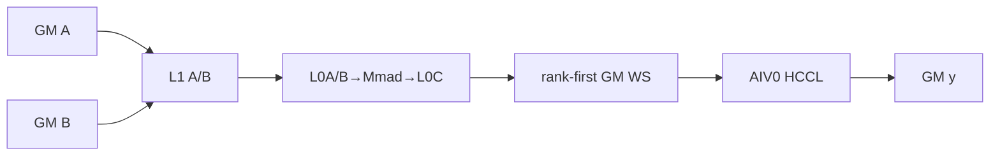
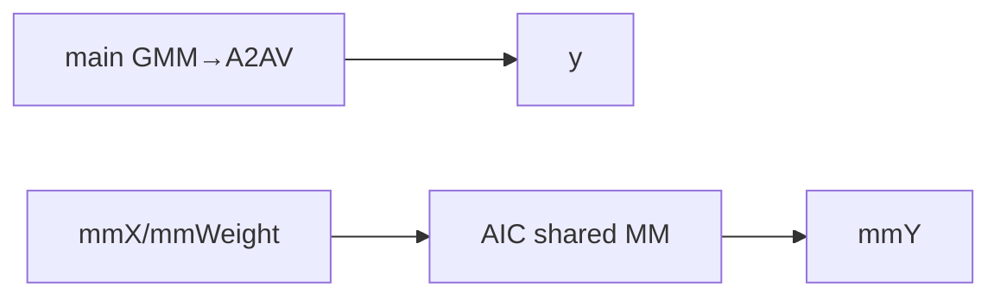
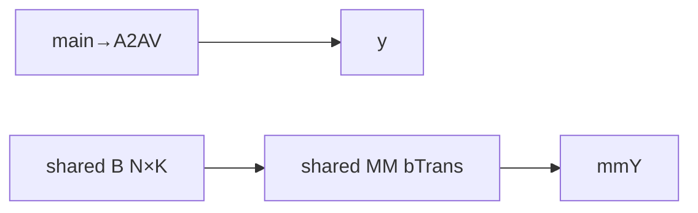
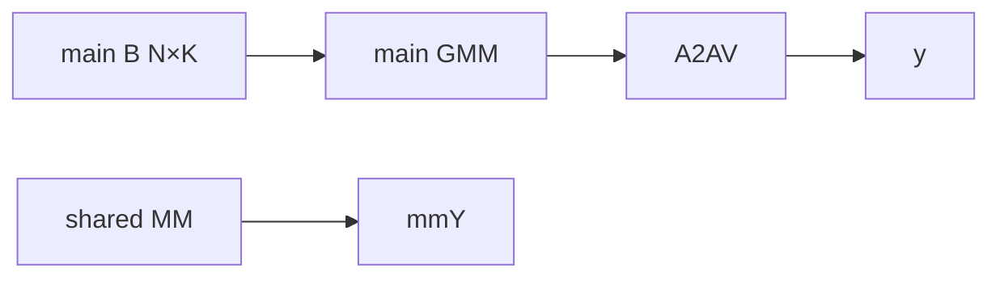
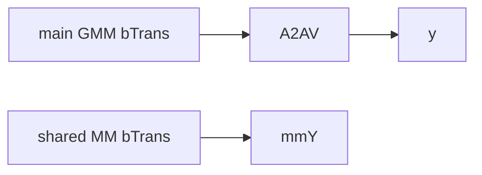

# GroupedMatMulAlltoAllv A3 ACLNN 算子知识

## 算子速览

| 项目 | 内容 |
|---|---|
| 实际入口 | `aclnnGroupedMatMulAlltoAllvV2GetWorkspaceSize` / `aclnnGroupedMatMulAlltoAllvV2`，公开 ACLNN V2 两段式接口 |
| 计算语义 | 路由专家 `gmmY=GroupedMatMul(gmmX,gmmWeight)`，按 rank-first 布局写临时输出，再 `y=AlltoAllV(gmmY)`；可选并行 `mmY=mmX×mmWeight` |
| 输入输出 | FP16/BF16、ND；`gmmX[A,H1]`、`gmmWeight[e,H1,N1]`（或转置）、`y[BSK,N1]`；共享 MM 三元组同时存在或缺省 |
| 执行类型 | 单 Kernel `MIX_CV`：AIC Cube + AIV0 HCCL 通信；`KERNEL_TYPE_MIX_AIC_1_2` |
| Kernel 路线 | R-001～R-006：A3 AI_CPU 通信下的 `hasSharedMm × transGmmWeight × transMmWeight` 六个可达实例 |
| 核心资源 | user workspace、L1/L0A/L0B/L0C、AIV0 HCCL handle；当前后通信路线不调用 UB permute |
| 来源闭包 | `source_closed`：V2 ACLNN、生成式 inner bridge 边界、Host/Tiling/POD、MIX entry、Cube/HCCL body、同步和构建闭合 |
| 验证状态 | 已完成源码闭包检查；本次知识提取未执行编译、真机、数值或性能测试。 |

## 接口与语义

### 计算语义

公开文档明确“先计算后通信”且声明默认确定性实现。AIC 按 `sendCounts[rank,e]` 将本 rank 的 token 分组做 GMM，并用 `cGroupOffsetTable` 把 C 写成目标 rank 优先的 `gmmOutputGM`；AIV0 以 `N1` 为通信轴调用 AlltoAllV，recv buffer 直接是 `y`。共享三元组存在时，在主通信 handle 已发起后，AIC 计算 `mmY=mmX×mmWeight`。当前 specialization 无 bias、activation、quant/dequant 或独立 Vector cast；Matmul 的 C trait 直接是 FP16/BF16 `yType`，而 L0C 到 GM 的内部转换、累加和 round 细节位于固定仓外的 Matmul 库边界。

### 输入、输出与属性

| 参数 | shape/layout | dtype | 约束、默认值与语义 |
|---|---|---|---|
| `gmmX` | `[A,H1]`, ND | FP16/BF16 | `A=sum(sendCounts)`；不支持非连续 Tensor |
| `gmmWeight` | `[e,H1,N1]` 或转置 `[e,N1,H1]`, ND | 同 `gmmX` | `0<e<=32`；`transGmmWeight` 固化 `bTrans` |
| 两个 counts tensor | 1D, ND | INT32/INT64 | 当前版本必须为 `nullptr`，API/Tiling 都拒绝非空 |
| `mmX/mmWeight/mmY Optional` | `[BS,H2]`、`[H2,N2]`/转置、`[BS,N2]` | 同 `gmmX` | 三者同时存在/缺省；存在时 `BSK%BS=0` 且 `BSK/BS∈[2,8]` |
| `group` / `commMode` | 字符串 | char | group 长度 `(0,128)`；A3 V2 只接受 `ai_cpu` |
| `epWorldSize` | 标量 | INT64 | A3 为 `{8,16,32,64,128}` |
| `sendCounts/recvCounts` | 长度 `e×world` | INT64 list | 分别求和为 A、BSK；每项非负，随后写入 i32 POD |
| `y` | `[BSK,N1]`, ND | 同 `gmmX` | HCCL 直接写入 |

### 入口与版本

同目录 V2 在 V1 基础上新增 `commMode`，是 A3 实际支持的最新公开版本。第一段顺序是 `CheckParams→CheckSendAndRecv→CheckAndHandleCommMode→aclnnInner...GetWorkspaceSize`，并把通信枚举编码为 executor user handle；第二段在 A3 把 HCCL server 固定为 AICPU，再执行 inner。generated inner 不在仓内，是允许的框架边界；算子拥有的 selector、workspace、POD 和 Kernel 均可追溯。

## Host/Launcher 执行流程

### 参数校验与前处理

API 检查必选指针、两个 counts tensor 必须空、共享三元组一致性、group 长度、counts list 非空和 A3 `ai_cpu`。Tiling 再检查 FP16/BF16、ND、2D/3D、转置 shape、rank、专家数、counts 长度/和/取值以及共享 K/H2/N2。OpDef 声明 `AutoContiguous()`，但公开 ACLNN 约束仍是不支持非连续 Tensor；固定源码没有额外 TransData 节点。

### 参数、Workspace 与生命周期

```text
workspace_total = libApiWorkSpaceSize
  + align512(A*N1*sizeof(Y))
  + align512(2*e*world*8 + 512 + 2*e*4)
  + align512(e*8 + 512 + 2*e*4)
```

`GetUserWorkspace` 越过 system/lib-api 区，entry 顺序切出 `gmmOutputGM`、路由 GMM 内部区、共享 GMM 内部区。即使无共享 MM，Host 仍保留第三段。workspace、输入输出、tiling backing 和 executor 必须存活到当前 stream 上所有 handle wait/finalize 完成。

### 启动图与失败传播

```text
V2 GetWorkspaceSize -> generated inner -> GroupedMatMulAlltoAllvTilingFunc
  -> GroupedMatmulAllToAllvTiling(priority 0)
  -> DoOpTiling -> PostTiling(blockDim=aicCoreNum) -> workspace size
V2 execute -> set AICPU server -> generated inner(current stream)
  -> grouped_mat_mul_allto_allv<tuple>
  -> AIC GMM -> flags 8/9 -> AIV0 async AlltoAllV
  -> optional AIC shared MM -> HCCL Wait -> SyncAll -> Finalize
```

API/Tiling 失败阻止 launch；entry 的 `workspaceGM` 或 user workspace 为 null 时返回。无 device fallback。

## Route 与参数设计

### 分核与资源计算

`mMax=max_expert(sum_rank sendCnt[rank*e+expert])`；`expertNum=ceil(e/4)`，使 `ceil(e/expertNum)<=4`。主 GMM adapter 取 `M=mMax,K=H1,N=N1,groupNum=expertNum,SPLIT_M`；共享 MM 取 `M=BS,K=H2,N=N2,groupNum=1`。`baseM=align16(min(M,256))`；`baseN<=256` 并按 B 转置方向对齐；`baseK` 由 K、dtype 和 128B/32B Cube 粒度求得。`baseM*baseN*4` 超 L0C 时缩小 baseN；`dbL0A=dbL0B=2`，`dbL0C` 按 L0C 是否容纳双份决定。L1 以 `baseA/baseB` 推导 `depthA1/depthB1` 和 `stepKa/stepKb`。最后 group 使用不足一半核时，把最后 M/N tail 二次切给空闲核。

### Route 选择

| 顺序 | Route | Key/模板 | 精确选择条件与优先级 | 不适用去向 |
|---:|---|---|---|---|
| 1 | R-001 无共享/NN | `<F,F,F,AICPU>` | 无共享、GMM B 不转置 | tuple 下一项 |
| 2 | R-002 无共享/NT | `<F,T,F,AICPU>` | 无共享、GMM B 转置 | tuple 下一项 |
| 3 | R-003 共享/NN/NN | `<T,F,F,AICPU>` | 共享存在、两个 B 不转置 | tuple 下一项 |
| 4 | R-004 共享/NN/NT | `<T,F,T,AICPU>` | 共享存在、仅共享 B 转置 | tuple 下一项 |
| 5 | R-005 共享/NT/NN | `<T,T,F,AICPU>` | 共享存在、仅主 B 转置 | tuple 下一项 |
| 6 | R-006 共享/NT/NT | `<T,T,T,AICPU>` | 共享存在、两个 B 转置 | 失败；无 fallback |

```text
commMode != ai_cpu -> fail
!hasSharedMm && transMmWeight -> fail
otherwise exact tuple -> R-001..R-006
```

### 模板/实现执行矩阵

| Route | key/selector | dtype/shape/platform 完整命中条件 | 执行族与 kernel 节点 | 实际模板/body | 内存与同步特征 | tail/fallback |
|---|---|---|---|---|---|---|
| R-001 | F,F,F,AICPU | A3 FP16/BF16，无共享 | AIC GMM→AIV0 A2AV | 主 `bTrans=false` | rank-first WS；flags8/9 | M/N/K tail |
| R-002 | F,T,F,AICPU | 同上，主 B 转置 | 同上 | 主 `bTrans=true` | B offset=`n*K` | 同上 |
| R-003 | T,F,F,AICPU | 共享三元组存在 | 主 GMM→A2AV，与 shared MM overlap | 两个 `bTrans=false` | 第三 WS slice | 两套 tail |
| R-004 | T,F,T,AICPU | 同上，共享 B 转置 | 同 R-003 | shared `bTrans=true` | shared B offset=`n*K` | 同上 |
| R-005 | T,T,F,AICPU | 同上，主 B 转置 | 同 R-003 | main `bTrans=true` | main B offset=`n*K` | 同上 |
| R-006 | T,T,T,AICPU | 同上，两个 B 转置 | 同 R-003 | 两个 `bTrans=true` | 两套转置 tiling | 同上 |

### 隐藏性能 Guard

| Guard | Host/Tiling 条件 | Device/资源原因 | 影响 Route | 不满足时去向 | 源码符号 |
|---|---|---|---|---|---|
| 至多四批 | `expertNum=ceil(e/4)` | 控制同步/handle 次数 | 全部 | Tiling失败 | `SetTilingCommonInfo` |
| L0C | `baseM*baseN*4<=L0C` | FP32-class C 容量 | 全部 | 缩 baseN/失败 | `CalBasicBlock` |
| L1 | `leftL1>=baseA+baseB` | A/B depth | 全部 | Tiling失败 | `CalL1Depth` |
| HCCL 单发起核 | AIV 且 `blockIdx==0` | 避免重复 collective | 全部 | 其它 AIV 返回 | `A2AV_AIV_ONLY` |
| GMM→A2AV 可见 | AIC flag8 barrier→flag9 | 保护 rank-first C | 全部 | 无 fallback | `GmmA2avScheduler::Process` |
| counts 窄化 | count 非负且不超 A/BSK，随后 cast i32 | POD 容量 | 全部 | Host失败；无显式 INT32_MAX guard | `CheckAndSetSendRecvCountsAttr` |
| workspace 位宽 | u64切片和赋给u32 `workSpaceSize_`，源码无fit检查 | 返回workspace可能发生窄化 | 全部 | 无fallback；调用前提是总字节数可由u32表示 | `SetGmmA2avWorkspaceInfo/GetWorkspaceSize` |

### POD/ABI

`GmmA2avWorkspaceInfo` 可见大小 24B；`TaskTilingInfo` 可见大小 2160B。外层包含 SDK `Mc2InitTiling/Mc2CcTiling/TCubeTiling`，固定仓不能给出整体数值 `sizeof/offsetof`，entry 也用 `offsetof` 取 HCCL 子结构，不能猜测。

| 结构 | 字段 | 类型/位宽 | ABI 布局 | 单位 | Host/launcher producer | Device consumer | 边界 |
|---|---|---|---|---|---|---|---|
| launch ABI | `gmmx,gmmweight,sendTensor,recvTensor,mmx,mmweight,y,mmy,workspace,tiling` | 10×GM_ADDR/64 | 参数0..9 | 地址 | inner bridge | entry/三个 op | counts tensor 固定 null；workspace null 返回 |
| `QuantGmmA2avTilingData` | `hcclA2avTiling` | SDK POD | offset0 | POD | `SetHcclTiling` | `HcclA2avOp::Init` | SDK大小不可见 |
| 同上 | `workspaceInfo` | `GmmA2avWorkspaceInfo`/24B/align8 | `offsetof`，数值受前置SDK POD影响 | POD | `SetGmmA2avWorkspaceInfo` | entry | 三个slice均512B对齐 |
| 同上 | `taskTilingInfo` | 2160B | `offsetof` | 混合 | common tiling | scheduler/GMM/HCCL | 数组上限256 |
| 同上 | `sharedGmmTiling` | `GMMQuantTilingData` | `offsetof`，整体大小依赖SDK `TCubeTiling` | POD | shared adapter | shared GMM | 无shared时不Process |
| 同上 | `gmmBaseTiling` | `GMMQuantTilingData` | `offsetof`，整体大小依赖SDK `TCubeTiling` | POD | main adapter | main GMM | 始终有效 |
| 同上 | `isPermuteOut` | bool/8 | 尾字段 | flag | 默认false | 当前entry不读 | inactive |
| workspace | `wsGmmOutputSize` | u64 | +0 | bytes | `align512(A*N1*2)` | HCCL send | 必选 |
| workspace | `wsGmmComputeWorkspaceSize` | u64 | +8 | bytes | `align512(16*e*world+512+8e)` | main GMM | group+cOffset+ptr |
| workspace | `wsSharedGmmComputeWorkspaceSize` | u64 | +16 | bytes | `align512(16e+512)` | shared GMM | 无共享仍分配 |
| Task | `BSK` | u64 | +0 | elements | `localParams_.BsK` | HCCL/shape | `(0,52428800)` |
| Task | `BS` | u64 | +8 | elements | `localParams_.Bs` | shared GMM | 无shared为0 |
| Task | `H1` | u64 | +16 | elements | `localParams_.H1` | main GMM/HCCL | `(0,65536)` |
| Task | `H2` | u64 | +24 | elements | `localParams_.H2` | shared GMM | 无shared为0；否则`<=12288` |
| Task | `A` | u64 | +32 | tokens | `localParams_.A` | main GMM | 等于sendCounts和 |
| Task | `N1` | u64 | +40 | elements | `localParams_.N1` | main GMM/HCCL | `(0,65536)` |
| Task | `N2` | u64 | +48 | elements | `localParams_.N2` | shared GMM | 无shared为0；否则`(0,65536)` |
| Task | `epWorldSize` | u64 | +56 | ranks | rank属性/通信域 | GMM/HCCL | A3集合`{8,16,32,64,128}` |
| Task | `e` | u64 | +64 | experts/rank | weight dim0 | scheduler/GMM/HCCL | `1..32`且`e*world<=256` |
| Task | `ubSize` | u64 | +72 | bytes | 固定仓未见赋值 | 当前可达body不读 | 不得推测值 |
| Task | `aivCoreNum` | u64 | +80 | cores | `GetCoreNumAiv()` | `HcclA2avOp::Init` | MIX AIV数 |
| Task | `aicCoreNum` | u64 | +88 | cores | 固定仓未见写入POD；blockDim另取平台AIC数 | 当前可达body不读 | 不得当作blockDim |
| Task | `expertNum` | u32 | +96 | experts/batch | `ceil(e,4)` | scheduler/GMM | 至少1 |
| Task | `mainLoopExpertNum` | u32 | +100 | experts | `expertNum` | 固定仓body不读 | 保留ABI |
| Task | `tailLoopExpertNum` | u32 | +104 | experts | `e%expertNum`或0 | 固定仓body不读 | scheduler用actualExpertNum重算tail |
| Task | `totalLoopCount` | u32 | +108 | loops | `ceil(e/expertNum)` | 固定仓body不读 | `<=4` |
| Task | `sendCnt` | i32[256] | +112 | tokens | int64 attr逐项窄化 | GMM/HCCL | 前`e*world`有效；无INT32_MAX guard |
| Task | `recvCnt` | i32[256] | +1136 | tokens | int64 attr逐项窄化 | HCCL | 前`e*world`有效；无INT32_MAX guard |
| GMM tiling | `gmmQuantParams` | 24B/align8 | +0 | flags/count | adapter | wrapper/Cube | 下面逐字段列出 |
| GMM params | `groupNum` | u32 | +0 | groups | main=`expertNum`；shared=1 | wrapper后按批修正/Cube | main Device改为`actualExpertNum*world` |
| GMM params | `activeType` | u32 | +4 | enum | 0 | Cube | 无activation |
| GMM params | `aQuantMode` | u32 | +8 | enum | DEFAULT/0 | Cube | 非量化 |
| GMM params | `bQuantMode` | u32 | +12 | enum | DEFAULT/0 | Cube | 非量化 |
| GMM params | `singleX` | u8 | +16 | flag | 1 | Cube offset | 单一X地址 |
| GMM params | `singleW` | u8 | +17 | flag | 1 | `SetMNK`/offset | 单一weight tensor |
| GMM params | `singleY` | u8 | +18 | flag | 1 | Cube | 单一Y地址 |
| GMM params | `groupType` | i8 | +19 | enum | `SPLIT_M`/0 | `SetMNK` | groupList给M |
| GMM params | `groupListType` | u8 | +20 | enum | 1 | split helper | 非累积count序列 |
| GMM params | `hasBias` | u8 | +21 | flag | 0 | Cube | bias指针为null |
| GMM params | `reserved` | u16 | +22 | reserved | 默认0 | 不读 | 必须保持 |
| GMM tiling | `gmmArray.mList` | i32[128] | +24 | elements | main写前`expertNum`项；shared覆盖第0项 | SPLIT_M下实际M来自groupList | shared复用adapter，尾项可保留main值但groupNum=1不读 |
| GMM tiling | `gmmArray.kList` | i32[128] | +536 | elements | adapter写`kList[0]=K` | `SetMNK` | K窄化为i32 |
| GMM tiling | `gmmArray.nList` | i32[128] | +1048 | elements | adapter写`nList[0]=N` | `SetMNK` | N窄化为i32 |
| GMM tiling | `mmTilingData` | `TCubeTiling` | +1560 | elements/count | `DoLibApiTiling` | Matmul/scheduler | SDK size不可见 |
| TCube | `M` | SDK字段 | SDK ABI | elements | mMax/BS | block scheduler/Matmul | 动态 |
| TCube | `N` | SDK字段 | SDK ABI | elements | N1/N2 | block scheduler/Matmul | 动态 |
| TCube | `Ka` | SDK字段 | SDK ABI | elements | H1/H2 | Matmul | 与Kb相同 |
| TCube | `Kb` | SDK字段 | SDK ABI | elements | H1/H2 | Matmul | 与Ka相同 |
| TCube | `usedCoreNum` | SDK字段 | SDK ABI | cores | 平台AIC数 | block scheduler | 也是PostTiling blockDim来源 |
| TCube | `baseM` | SDK字段 | SDK ABI | elements | `CalBasicBlock` | block scheduler/Matmul | `align16(min(M,256))` |
| TCube | `baseN` | SDK字段 | SDK ABI | elements | `CalBasicBlock` | block scheduler/Matmul | 转置相关对齐且受L0C限制 |
| TCube | `baseK` | SDK字段 | SDK ABI | elements | `CalBasicBlock` | Matmul | dtype/Cube粒度对齐 |
| TCube | `singleCoreM` | SDK字段 | SDK ABI | elements | `min(M,baseM)` | Matmul | Device按实际group/tail覆盖shape |
| TCube | `singleCoreN` | SDK字段 | SDK ABI | elements | `min(N,baseN)` | Matmul | Device按实际group/tail覆盖shape |
| TCube | `singleCoreK` | SDK字段 | SDK ABI | elements | K | Matmul | 全K，内部按baseK循环 |
| TCube | `depthA1` | SDK字段 | SDK ABI | stages | `CalL1Depth` | Matmul | L1容量约束 |
| TCube | `depthB1` | SDK字段 | SDK ABI | stages | `CalL1Depth` | Matmul | L1容量约束 |
| TCube | `stepM` | SDK字段 | SDK ABI | tiles | 1 | Matmul | 固定 |
| TCube | `stepN` | SDK字段 | SDK ABI | tiles | 1 | Matmul | 固定 |
| TCube | `stepKa` | SDK字段 | SDK ABI | baseK steps | depth/容量推导 | Matmul | 不超过K循环 |
| TCube | `stepKb` | SDK字段 | SDK ABI | baseK steps | depth/容量推导 | Matmul | 不超过K循环 |
| TCube | `dbL0A` | SDK字段 | SDK ABI | depth | 2 | Matmul | 双缓冲 |
| TCube | `dbL0B` | SDK字段 | SDK ABI | depth | 2 | Matmul | 双缓冲 |
| TCube | `dbL0C` | SDK字段 | SDK ABI | depth | L0C能容纳双份则2否则1 | Matmul/Fixpipe | `baseM*baseN*4`字节/份 |
| TCube | `iterateOrder` | SDK字段 | SDK ABI | enum | 0 | Matmul | 固定 |
| TCube | `isBias` | SDK字段 | SDK ABI | flag | 0 | Matmul | 无bias |

### Route 源码闭包

| Route | Key/selector | Host/Tiling producer | POD/参数 | Kernel entry/router | Kernel body/直接依赖 | 构建接线 |
|---|---|---|---|---|---|---|
| R-001～R-006 | 六个 `<hasShared,gmmTrans,mmTrans,AICPU>` tuple | operator tiling + common/adapter | `QuantGmmA2avTilingData` | templated `grouped_mat_mul_allto_allv` | scheduler→GMM/Cube + HCCL | A3注册、910_93 binary、CMake |

## Kernel 实现

### 公共执行流程

entry 实例化 `HcclA2avOp<DTYPE_Y,false,AICPU>`、主 `QuantGroupedMatmul<...,CubeFormat::ND,aTrans=false,bTrans=key,isLocal=false,isA2avGmm=false>` 和共享 `QuantGroupedMatmul<...,CubeFormat::ND,aTrans=false,bTrans=key,isLocal=true,isA2avGmm=false>`。当前非量化实例把 A/B/C type traits 固化为 `MatmulType<GM,ND,DTYPE_GMM_X,false>`、`MatmulType<GM,ND,DTYPE_GMM_WEIGHT,bTrans>`、`MatmulType<GM,ND,DTYPE_Y>`，bias trait 为 GM/ND/float，并选择 `MatmulImpl<...,MM_CFG_NO_PRELOAD_OPEN_UNIT_FLAG>`；该 config 的固定实参是 `GetMDLConfig(false,false,0,false,false,false,true)`。AIC 写 rank-first C，flag 8 经 `<0,PIPE_FIX>` set/wait 聚合全部 AIC，随后 flag 9 经 `<2,PIPE_FIX>` 唤醒每个 AIC 对应的两个 AIV；每个 AIV 都 wait flag 9，但 `A2AV_AIV_ONLY` 使仅 AIV0 异步发起 collective。AIC 可继续下一批/共享 MM，末尾仅 AIV0 wait 所有 handle，随后全部 MIX core 执行 `SyncAll<false>`，AIC 返回、各 AIV 执行 `Finalize`。

令扁平 counts 为 `S[r,e]=sendCnt[e+r*E]`、`R[r,e]=recvCnt[e+r*E]`，当前批 `B=[s,s+b)`，通信轴 `axis=N1`，则 Cube 与通信的同一批地址关系为：

```text
batchBase = axis * sum(j<s, r) S[r,j]
rankBase[r] = axis * sum(q<r, j in B) S[q,j]
cGroupOffset[j-s,r] = rankBase[r] + axis * sum(s<=t<j) S[r,t]
absolute Cube C offset = batchBase + cGroupOffset[j-s,r]

hccl.sendCnt[r] = axis * sum(j in B) S[r,j]
hccl.sendOffset[0] = batchBase
hccl.sendOffset[r>0] = batchBase + axis * sum(q<r, j in B) S[q,j]
hccl.recvCnt[r] = axis * sum(j in B) R[r,j]
hccl.recvOffset[0] = axis * sum(j<s) R[0,j]
hccl.recvOffset[r>0] = hccl.recvOffset[r-1]
  + axis * sum(0<=j<E) rawRecv[s + (r-1)*E + j]
```

这些 count/offset 的单位都是 FP16/BF16 元素，HCCL 根据 `hcclDataType_` 解释字节数。最后一条是固定源码 `CalcA2avCommAfterParams` 的逐字索引关系，不应擅自改写成常见的 rank-prefix 公式；固定仓没有另一条 fallback，迁移时需连同 `cGroupOffsetTable`、batch base 和多批 recv 布局一起验证。

### Route R-001：无共享、GMM B 非转置、AI_CPU

#### 适用条件

##### 选择证据

| 层级 | 文件 | 符号 | 源码谓词/参数 | 结果/下一跳 |
|---|---|---|---|---|
| API | `..._v2.cpp` | `CheckAndHandleCommMode` | A3且`ai_cpu` | AICPU |
| Tiling | `...tiling.cpp` | `GetTilingKey` | `(0,0,0,AICPU)` | R-001 |
| Router | `...op_kernel...cpp` | template entry | exact tuple | main GMM+A2AV |

#### Device 数据流

##### 函数级调用链

```text
entry<F,F,F,AICPU> -> Scheduler::Process -> QuantGroupedMatmul::Process
 -> Mc2GmmASWKernel::Process -> MatmulImpl::Iterate/GetTensorC
 -> flags8/9 -> HcclA2avOp::LaunchCommData/AlltoAllV -> Wait/Finalize
```

##### 源码等价伪码

```text
for expert batch: AIC build groupList+cOffset and compute valid tiles; AIC barrier8 then signal9;
AIV waits9; AIV0 launches async A2AV. After all batches AIV0 waits handles and finalizes.
```

#### 内存与数据搬运

##### 资源与搬运表

| 层级/缓冲区 | offset/地址公式 | extent/容量公式 | dtype/layout | producer | consumer | owner/lifetime | 对齐/复用 |
|---|---|---|---|---|---|---|---|
| GM A/B | expert prefixes；B offset=`nOffset` | A×H1×2；e×H1×N1×2 | ND | caller | AIC Matmul | caller/stream | tile tail |
| WS C | cOffset table + tile C | align512(A×N1×2) | rank-first | AIC | AIV0 HCCL | through handle wait | batch regions disjoint |
| WS meta | groupList/cOffset/ptr table | align512(16eW+512+8e) | i64/u64/ptr | AIC | AIC | launch | fixed slice |
| L1 | Matmul internal | depthA1×baseM×baseK×2 + depthB1×baseN×baseK×2 | Cube staging | MTE | L0 | tile | depth reuse |
| L0A/B/C | Matmul internal | 2×baseM×baseK×2；2×baseN×baseK×2；dbC×baseM×baseN×4 | Cube | load/Mmad | Mmad/Fixpipe | tile | double buffer |
| UB | N/A | N/A | N/A | N/A | N/A | `PermuteData`未调用 | HCCL私有资源不可见 |

##### 分层内存布局



##### 字节账、交接边与复用顺序

```text
userWS = align512(A*N1*2)+align512(16eW+512+8e)+align512(16e+512)
L1 = depthA1*baseM*baseK*2 + depthB1*baseN*baseK*2
L0 = 2*baseM*baseK*2 + 2*baseN*baseK*2 + dbL0C*baseM*baseN*4
```

| 边/复用子区 | producer | offset/extent | dtype/layout | consumer | ordering/sync | owner/lifetime | 安全条件 |
|---|---|---|---|---|---|---|---|
| GMM→A2AV | AIC | rank-first batch，sum(sendCnt)×N1×2 | FP16/BF16 | AIV0 | flags8/9 | user WS至Wait | 不同批region不重叠 |
| HCCL→y | HCCL | recv offsets，sum(recvCnt)×N1×2 | FP16/BF16 | caller | handle Wait | caller | sum=BSK |

#### 同步、精度与尾块

##### 同步与数值边界表

| 阶段 | primitive/机制 | producer | consumer/等待点 | 保护对象 | 精度/尾块 |
|---|---|---|---|---|---|
| AIC barrier | `CrossCoreSetFlag<0,PIPE_FIX>(8)` / `CrossCoreWaitFlag(8)` | all AIC | all AIC | batch C | 空 group 跳过 Matmul，但仍参与屏障 |
| AIC→AIV | `CrossCoreSetFlag<2,PIPE_FIX>(9)` / `CrossCoreWaitFlag(9)` | 每个 AIC | 对应两个 AIV | C 的 PIPE_FIX 可见性 | flag ID 每批在 wait 后复用 |
| HCCL | `AlltoAllV<true>` handle / `Wait` | AIV0 | AIV0 末尾等待 | y | 原FP16/BF16；`SyncAll<false>` 后各 AIV finalize |
| Cube tail | `singleCoreM/N`、K tiling、last-group split | AIC | Fixpipe | M/N/K | 越界tile跳过 |

#### 关键实现

##### 符号证据表

| 阶段 | 文件 | 符号/模板实例 | 实现事实 |
|---|---|---|---|
| Host | `...tiling_common.cpp` | common info/workspace | 批次与切片 |
| entry | `...grouped_mat_mul_allto_allv.cpp` | `<F,F,F,AICPU>` | MIX实例 |
| body | scheduler/Cube/HCCL headers | `Process/LaunchCommData` | 计算、同步、通信 |

### Route R-002：无共享、GMM B 转置、AI_CPU

#### 适用条件

##### 选择证据

| 层级 | 文件 | 符号 | 源码谓词/参数 | 结果/下一跳 |
|---|---|---|---|---|
| Tiling/Router | tiling.cpp / entry | tuple | `(0,1,0,AICPU)` | R-002 |

#### Device 数据流

##### 函数级调用链

```text
entry<F,T,F,AICPU> -> main QuantGroupedMatmul<bTrans=true> -> scheduler/HCCL
```

##### 源码等价伪码

```text
同R-001，但B为[N1,H1]，offsetB=nOffset*K，SetTensorB(...,true)。
```

#### 内存与数据搬运

##### 资源与搬运表

| 层级/缓冲区 | offset/地址公式 | extent/容量公式 | dtype/layout | producer | consumer | owner/lifetime | 对齐/复用 |
|---|---|---|---|---|---|---|---|
| GM B | `nOffset*K` | e×N1×H1×2 | ND N×K | caller | Matmul | stream | baseN 16对齐 |
| 其它 | 同R-001 | 同R-001 | 同 | 同 | 同 | 同 | 同 |

##### 分层内存布局


##### 字节账、交接边与复用顺序

```text
同R-001；仅B stride与baseN对齐改变。
```

| 边/复用子区 | producer | offset/extent | dtype/layout | consumer | ordering/sync | owner/lifetime | 安全条件 |
|---|---|---|---|---|---|---|---|
| GMM→A2AV | AIC | 同R-001 | rank-first | AIV0 | flags8/9 | WS | 同R-001 |

#### 同步、精度与尾块

##### 同步与数值边界表

| 阶段 | primitive/机制 | producer | consumer/等待点 | 保护对象 | 精度/尾块 |
|---|---|---|---|---|---|
| 全流程 | 同R-001 | AIC/AIV0 | end | C/y | transpose改变N tail对齐 |

#### 关键实现

##### 符号证据表

| 阶段 | 文件 | 符号/模板实例 | 实现事实 |
|---|---|---|---|
| body | `quant_block_sch.h` | `CalcGMOffset<bTrans=true>` | B offset公式 |

### Route R-003：共享、两个 B 均非转置、AI_CPU

#### 适用条件

##### 选择证据

| 层级 | 文件 | 符号 | 源码谓词/参数 | 结果/下一跳 |
|---|---|---|---|---|
| Tiling/Router | tiling.cpp / entry | tuple | `(1,0,0,AICPU)` | R-003 |

#### Device 数据流

##### 函数级调用链

```text
main GMM batches -> async A2AV -> SharedQuantGroupedMatmul<isLocal=true,bTrans=false> -> Wait
```

##### 源码等价伪码

```text
执行R-001主循环；collective在途时AIC计算mmX×mmWeight到mmY；末尾等所有通信。
```

#### 内存与数据搬运

##### 资源与搬运表

| 层级/缓冲区 | offset/地址公式 | extent/容量公式 | dtype/layout | producer | consumer | owner/lifetime | 对齐/复用 |
|---|---|---|---|---|---|---|---|
| main | 同R-001 | 同R-001 | 同 | AIC | HCCL | launch | 同 |
| shared WS | third slice | align512(16e+512) | i64+ptr | AIC | shared GMM | launch | 512B |
| mmY | tile C | BS×N2×2 | ND | AIC | caller | stream | own tail |

##### 分层内存布局



##### 字节账、交接边与复用顺序

```text
主账同R-001；第三slice服务独立shared TCubeTiling，输出不经通信。
```

| 边/复用子区 | producer | offset/extent | dtype/layout | consumer | ordering/sync | owner/lifetime | 安全条件 |
|---|---|---|---|---|---|---|---|
| overlap | AIV0 HCCL/AIC | y与mmY分离 | FP16/BF16 | caller | Wait+SyncAll | executor | 地址不别名 |

#### 同步、精度与尾块

##### 同步与数值边界表

| 阶段 | primitive/机制 | producer | consumer/等待点 | 保护对象 | 精度/尾块 |
|---|---|---|---|---|---|
| overlap | async handle | AIV0 | end | y | shared MM有独立M/N/K tail |

#### 关键实现

##### 符号证据表

| 阶段 | 文件 | 符号/模板实例 | 实现事实 |
|---|---|---|---|
| scheduler | `gmm_a2av_scheduler.h` | `if(IsNeedMM)` | shared MM位于Wait前 |

### Route R-004：共享、仅共享 B 转置、AI_CPU

#### 适用条件

##### 选择证据

| 层级 | 文件 | 符号 | 源码谓词/参数 | 结果/下一跳 |
|---|---|---|---|---|
| Tiling/Router | tiling.cpp / entry | tuple | `(1,0,1,AICPU)` | R-004 |

#### Device 数据流

##### 函数级调用链

```text
R-003，shared QuantGroupedMatmul<bTrans=true>。
```

##### 源码等价伪码

```text
主同R-001；shared B按[N2,H2]、offset=nOffset*H2读取。
```

#### 内存与数据搬运

##### 资源与搬运表

| 层级/缓冲区 | offset/地址公式 | extent/容量公式 | dtype/layout | producer | consumer | owner/lifetime | 对齐/复用 |
|---|---|---|---|---|---|---|---|
| shared B | nOffset×H2 | N2×H2×2 | ND N×K | caller | shared MM | stream | N tail 16对齐 |

##### 分层内存布局



##### 字节账、交接边与复用顺序

```text
同R-003；shared B stride/tiling改变。
```

| 边/复用子区 | producer | offset/extent | dtype/layout | consumer | ordering/sync | owner/lifetime | 安全条件 |
|---|---|---|---|---|---|---|---|
| main→A2AV | AIC | rank-first | FP16/BF16 | AIV0 | flags8/9 | WS | 同R-001 |

#### 同步、精度与尾块

##### 同步与数值边界表

| 阶段 | primitive/机制 | producer | consumer/等待点 | 保护对象 | 精度/尾块 |
|---|---|---|---|---|---|
| 全流程 | 同R-003 | AIC/AIV | end | y/mmY | shared N tail按转置规则 |

#### 关键实现

##### 符号证据表

| 阶段 | 文件 | 符号/模板实例 | 实现事实 |
|---|---|---|---|
| entry | `grouped_mat_mul_allto_allv.cpp` | `<T,F,T,AICPU>` | shared bTrans=true |

### Route R-005：共享、仅主 B 转置、AI_CPU

#### 适用条件

##### 选择证据

| 层级 | 文件 | 符号 | 源码谓词/参数 | 结果/下一跳 |
|---|---|---|---|---|
| Tiling/Router | tiling.cpp / entry | tuple | `(1,1,0,AICPU)` | R-005 |

#### Device 数据流

##### 函数级调用链

```text
R-003，main bTrans=true、shared bTrans=false。
```

##### 源码等价伪码

```text
主按R-002；shared按R-003。
```

#### 内存与数据搬运

##### 资源与搬运表

| 层级/缓冲区 | offset/地址公式 | extent/容量公式 | dtype/layout | producer | consumer | owner/lifetime | 对齐/复用 |
|---|---|---|---|---|---|---|---|
| main B | nOffset×H1 | e×N1×H1×2 | ND N×K | caller | main GMM | stream | 同R-002 |

##### 分层内存布局



##### 字节账、交接边与复用顺序

```text
同R-003；main B stride按R-002。
```

| 边/复用子区 | producer | offset/extent | dtype/layout | consumer | ordering/sync | owner/lifetime | 安全条件 |
|---|---|---|---|---|---|---|---|
| main→A2AV | AIC | rank-first | FP16/BF16 | AIV0 | flags8/9 | WS | 同R-001 |

#### 同步、精度与尾块

##### 同步与数值边界表

| 阶段 | primitive/机制 | producer | consumer/等待点 | 保护对象 | 精度/尾块 |
|---|---|---|---|---|---|
| 全流程 | 同R-003 | AIC/AIV | end | y/mmY | main N tail按转置规则 |

#### 关键实现

##### 符号证据表

| 阶段 | 文件 | 符号/模板实例 | 实现事实 |
|---|---|---|---|
| entry | entry cpp | `<T,T,F,AICPU>` | main bTrans=true |

### Route R-006：共享、两个 B 均转置、AI_CPU

#### 适用条件

##### 选择证据

| 层级 | 文件 | 符号 | 源码谓词/参数 | 结果/下一跳 |
|---|---|---|---|---|
| Tiling/Router | tiling.cpp / entry | tuple | `(1,1,1,AICPU)` | R-006 |

#### Device 数据流

##### 函数级调用链

```text
R-003，main/shared均bTrans=true。
```

##### 源码等价伪码

```text
主按R-002；shared按R-004；通信同步不变。
```

#### 内存与数据搬运

##### 资源与搬运表

| 层级/缓冲区 | offset/地址公式 | extent/容量公式 | dtype/layout | producer | consumer | owner/lifetime | 对齐/复用 |
|---|---|---|---|---|---|---|---|
| 两个 B | 各nOffset×K | 主e×N1×H1×2；共享N2×H2×2 | ND N×K | caller | Matmul | stream | transpose tail |

##### 分层内存布局



##### 字节账、交接边与复用顺序

```text
同R-003；两套B均转置。
```

| 边/复用子区 | producer | offset/extent | dtype/layout | consumer | ordering/sync | owner/lifetime | 安全条件 |
|---|---|---|---|---|---|---|---|
| main→A2AV | AIC | rank-first | FP16/BF16 | AIV0 | flags8/9 | WS | 同R-001 |

#### 同步、精度与尾块

##### 同步与数值边界表

| 阶段 | primitive/机制 | producer | consumer/等待点 | 保护对象 | 精度/尾块 |
|---|---|---|---|---|---|
| 全流程 | 同R-003 | AIC/AIV | end | y/mmY | 两套transpose tail |

#### 关键实现

##### 符号证据表

| 阶段 | 文件 | 符号/模板实例 | 实现事实 |
|---|---|---|---|
| entry | entry cpp | `<T,T,T,AICPU>` | 两个bTrans=true |

## 算子特定优化

### Trick T-001：专家批次限制为至多四轮

#### 触发与源码依据

- 适用 Route：R-001～R-006
- 触发条件：合法 `1<=e<=32`
- Golden 来源：[`quant_grouped_mat_mul_allto_allv_tiling_common.cpp:843-858`](../../../../../../../cann-ops-raw/ascendc/ops-transformer/be33d95bb755cedec3108f70805c1874d1792540/mc2/quant_grouped_mat_mul_allto_allv/op_host/op_tiling/arch35/quant_grouped_mat_mul_allto_allv_tiling_common.cpp#L843-L858)

**官方源码（固定 Commit 连续逐字摘录）**：

```cpp
constexpr uint32_t TARGET_COMM_ROUNDS = 4U;
expertNum_ = static_cast<uint32_t>(
    Ops::Base::CeilDiv(localParams_.ep, static_cast<uint64_t>(TARGET_COMM_ROUNDS)));
if (expertNum_ == 0U) {
    expertNum_ = 1U;
}
gmmQTilingCommonInfoPtr->expertNum = expertNum_;
```

#### 机制与设计原因

每批 `ceil(e/4)` 个专家，使 GMM/HCCL 交接与 collective handle 数不超过四轮；tail 批由 `actualExpertNum` 收缩。

#### 迁移边界

- 适用：本地专家维可分批的后通信融合。
- 前提：rank-major/expert-minor counts 与 handle 索引保持一致。
- 失效：修改专家上界、handle 容量或批次 offset 时需重推。
- 未验证：本次知识提取未执行编译、真机、数值或性能测试。

#### 错误做法

固定仓未提供可验证反例；不能只改 Host 批宽而不同步修改 scheduler/groupList/HCCL offset。

### Trick T-002：rank-first C 直接作为通信 send buffer

#### 触发与源码依据

- 适用 Route：R-001～R-006
- 触发条件：后通信 route
- Golden 来源：[`grouped_mat_mul_allto_allv.cpp:91-108`](../../../../../../../cann-ops-raw/ascendc/ops-transformer/be33d95bb755cedec3108f70805c1874d1792540/mc2/grouped_mat_mul_allto_allv/op_kernel/arch22/grouped_mat_mul_allto_allv.cpp#L91-L108)

**官方源码（固定 Commit 连续逐字摘录）**：

```cpp
uint64_t wsOffset = 0;
GM_ADDR gmmOutputGM = userWorkspace + wsOffset;
wsOffset += tilingData_->workspaceInfo.wsGmmOutputSize;
GM_ADDR gmmComputeWSGM = userWorkspace + wsOffset;
wsOffset += tilingData_->workspaceInfo.wsGmmComputeWorkspaceSize;
GM_ADDR sharedGmmComputeWSGM = userWorkspace + wsOffset;

GM_ADDR sendBufferAddr = gmmOutputGM;
```

#### 机制与设计原因

`cGroupOffsetTable` 让 Cube C 直接成为 rank-first send buffer；HCCL 只计算 count/offset，recv 又直接写 `yGM`，因此无需独立 Unpermute/permute Kernel 或当前模板中预留的 UB permute。

#### 迁移边界

- 适用：GMM 可按目标 rank 排列 C。
- 前提：counts 索引与 C/HCCL offset 公式一致。
- 失效：要求 expert-first 输出、额外 token permutation 或通信前量化。
- 未验证：本次知识提取未执行编译、真机、数值或性能测试。

#### 错误做法

若恢复普通 expert-major C 却复用当前 HCCL offsets，会发送错误分片。

### Trick T-003：PIPE_FIX 交接与异步通信流水

#### 触发与源码依据

- 适用 Route：R-001～R-006
- 触发条件：MIX 1:2 launch
- Golden 来源：[`gmm_a2av_scheduler.h:39-59`](../../../../../../../cann-ops-raw/ascendc/ops-transformer/be33d95bb755cedec3108f70805c1874d1792540/mc2/allto_allv_quant_grouped_mat_mul/op_kernel/mc2_templates/scheduler/gmm_a2av_scheduler.h#L39-L59)

**官方源码（固定 Commit 连续逐字摘录）**：

```cpp
if ASCEND_IS_AIC {
    computeOp_.Process(start, actualExpertNum);
    AscendC::CrossCoreSetFlag<0, PIPE_FIX>(8);
    AscendC::CrossCoreWaitFlag(8);
    AscendC::CrossCoreSetFlag<2, PIPE_FIX>(9);
}
if ASCEND_IS_AIV {
    AscendC::CrossCoreWaitFlag(9);
    hcclOp_.LaunchCommData(start, actualExpertNum);
}
```

#### 机制与设计原因

flag8 形成 AIC 屏障，flag9 建立 AIC→AIV 可见性；AIV0 异步发起 HCCL 后，AIC 继续下一批或共享 MM，handle 延迟到末尾等待。

#### 迁移边界

- 适用：单 MIX Kernel 的 AIC producer/AIV collective consumer。
- 前提：flag 8/9、PIPE_FIX、AIV0 单发起者和末尾 Wait 不变。
- 失效：多 Kernel、不同核比或 workspace 重用需重建同步图。
- 未验证：本次知识提取未执行编译、真机、数值或性能测试。

#### 错误做法

删除 flags 会读到未完成 C；让全部 AIV 发起会重复 collective，源码 `A2AV_AIV_ONLY` 明确阻止此事。

## 模板与实现对比

| 对比维度 | R-001/R-002 | R-003～R-006 | 设计选择依据 |
|---|---|---|---|
| 命中条件/优先级 | 无共享，主B两种转置 | 共享存在，两个B四种组合 | exact tuple |
| 执行族/节点图 | AIC GMM→AIV0 A2AV | 再加AIC shared MM overlap | `IsNeedMM` |
| M/N/K、tile 与 scheduler | mMax/H1/N1 | 再加BS/H2/N2独立tiling | adapter运行两次 |
| workspace/L1/L0/UB | 三段WS仍全分配；主Cube；UB N/A | 第三slice和第二套Cube | 固定公式 |
| AIC/AIV 或 kernel 交接 | flags8/9 | 同；shared不经AIV | scheduler |
| 同步、精度与 tail | FP16/BF16，主tail | 两套tail，共同结束 | 两个TCube |
| fallback/失败边界 | Host失败 | 三元组/shape失败 | 无device fallback |

## 平台差异

| 项目 | A2 | A3 | 950 |
|---|---|---|---|
| 支持状态 | README明确不支持 | 支持 | 支持，见 `_950` 卡 |
| Host/Launcher | N/A | 仅ai_cpu；rank 8/16/32/64/128 | ai_cpu/ccu；rank 2/4/8/16/32/64 |
| Kernel/资源 | N/A | 同一MIX entry；AICPU HCCL；编译启用异常重启 | 同entry；CCU specialization；不同编译选项 |

## 限制与失败边界

- counts tensor 必须空。V2 公开文档和 README 描述共享三元组，API/Tiling/Kernel 也存在完整可达 route；但公开头部 docblock 仍把共享输入/输出和 `transMmWeight` 标成“当前暂未支持”，这是固定 Commit 内的文档冲突，复用时不得忽略。
- V2 头部 docblock 写 `commMode` 还接受 `default`，实际 API、Tiling 和公开 V2 文档只接受 A3 的 `ai_cpu`；`default` 会在 `CheckAndHandleCommMode` 失败。
- 公开契约列出 A3 rank 集合；Tiling 另有 `epWorldSize==-1` 时通过 `GetRankSize(group)` 查询的内部路径。若显式传 rank，Device HCCL 仍从 context 读取 `rankDim_`，固定源码未比较二者，调用方必须保证 attr、group 与实际通信域一致。
- `H1,N1∈(0,65536)`、`BSK∈(0,52428800)`；共享时 `H2∈(0,12288]`、`N2∈(0,65536)`、K∈[2,8]。
- counts 写 i32 前没有显式 `INT32_MAX` guard；不得把较大的公开总 token 上界推断为可安全窄化。
- `A*N1*sizeof(Y)`、metadata 加法和512B对齐使用u64但无显式溢出检查，最终总和又写入u32 `workSpaceSize_`；固定源码没有大workspace fallback，复用必须先证明乘加不溢出且总字节数不超过 `UINT32_MAX`。
- HCCL/Matmul 库内部错误传播与 intrinsic round mode在固定仓不可见；本次未做运行验证。

## 源码索引

### 链路索引

| 链路阶段 | 文件 | 关键符号 | 支撑内容 |
|---|---|---|---|
| 入口声明 | `mc2/grouped_mat_mul_allto_allv/op_api/aclnn_grouped_mat_mul_allto_allv_v2.h` | V2 prototypes | 公开入口 |
| 公开约束 | `mc2/grouped_mat_mul_allto_allv/README.md` | 产品表/公式 | 平台与语义 |
| V2 文档 | `mc2/grouped_mat_mul_allto_allv/docs/aclnnGroupedMatMulAlltoAllvV2.md` | 版本差异/约束 | 最新入口、共享参数与通信引擎 |
| 入口实现 | `mc2/grouped_mat_mul_allto_allv/op_api/aclnn_grouped_mat_mul_allto_allv_v2.cpp` | V2 functions | API校验/通信server |
| OpDef | `mc2/grouped_mat_mul_allto_allv/op_host/grouped_mat_mul_allto_allv_def.cpp` | OpDef | dtype/format/platform |
| Host/Tiling | `mc2/grouped_mat_mul_allto_allv/op_host/op_tiling/grouped_mat_mul_allto_allv_tiling.cpp` | tiling class | shape/rank/key |
| A3注册 | `mc2/grouped_mat_mul_allto_allv/op_host/op_tiling/arch22/grouped_mat_mul_allto_allv_tiling_a3.cpp` | registration | priority0 |
| 公共Tiling | `mc2/quant_grouped_mat_mul_allto_allv/op_host/op_tiling/arch35/quant_grouped_mat_mul_allto_allv_tiling_common.cpp` | `DoOpTiling` | counts/workspace/HCCL/POD |
| Matmul adapter | `mc2/quant_grouped_mat_mul_allto_allv/op_host/op_tiling/arch35/quant_grouped_mat_mul_allto_allv_tiling_adapter.cpp` | adapter | M/N/K/transpose |
| 约束常量 | `mc2/quant_grouped_mat_mul_allto_allv/op_host/op_tiling/quant_grouped_mat_mul_allto_allv_tiling_base.h` | shape/handle 常量 | H/N/BSK/K 上界 |
| POD | `mc2/quant_grouped_mat_mul_allto_allv/op_kernel/arch35/quant_grouped_mat_mul_allto_allv_tiling.h` | outer tiling | ABI |
| 公共POD | `mc2/allto_allv_quant_grouped_mat_mul/op_kernel/mc2_templates/common/a2av_common_tiling.h` | `TaskTilingInfo` | 字段顺序与数组容量 |
| key | `mc2/grouped_mat_mul_allto_allv/op_kernel/grouped_mat_mul_allto_allv_tiling_key.h` | tuple | routes |
| entry | `mc2/grouped_mat_mul_allto_allv/op_kernel/arch22/grouped_mat_mul_allto_allv.cpp` | kernel | MIX/切片/实例 |
| scheduler | `mc2/allto_allv_quant_grouped_mat_mul/op_kernel/mc2_templates/scheduler/gmm_a2av_scheduler.h` | `Process` | 任务图/同步 |
| 通信 | `mc2/allto_allv_quant_grouped_mat_mul/op_kernel/mc2_templates/communication/hccl_a2av_op.h` | HCCL op | launch/wait |
| 通信guard | `mc2/allto_allv_quant_grouped_mat_mul/op_kernel/mc2_templates/communication/a2av_comm_guard.h` | `A2AV_AIV_ONLY` | AIV0 单发起者 |
| 通信offset | `mc2/allto_allv_quant_grouped_mat_mul/op_kernel/mc2_templates/communication/a2av_comm_params.h` | after params | offsets |
| GMM wrapper | `mc2/allto_allv_quant_grouped_mat_mul/op_kernel/mc2_templates/compute/quant_grouped_matmul.h` | wrapper | group/ptr table |
| Cube body | `mc2/3rd/grouped_matmul/op_kernel/gqmm_cube_on_the_fly.h` | Cube kernel | Matmul/tail |
| Core映射 | `mc2/3rd/grouped_matmul/op_kernel/quant_block_sch.h` | block scheduler | tile/offset |
| GMM POD | `mc2/3rd/grouped_matmul/op_kernel/grouped_matmul_tiling_data_apt.h` | `GMMQuantTilingData` | 24B 参数与三组128项数组 |
| Matmul traits | `mc2/3rd/grouped_matmul/op_kernel/quant_utils.h` | `MM_CFG_NO_PRELOAD_OPEN_UNIT_FLAG` | 当前 config 实参 |
| 资源Tiling | `mc2/3rd/grouped_matmul/op_tiling/gmm_qbmm_tiling.cpp` | lib tiling | base/depth/db |
| binary | `mc2/grouped_mat_mul_allto_allv/op_host/config/ascend910_93/grouped_mat_mul_allto_allv_binary.json` | two entries | FP16/BF16 A3 |
| 构建 | `mc2/grouped_mat_mul_allto_allv/op_host/CMakeLists.txt` | options/deps | 接线 |

### 实现复用检查

| 检查项 | 可复用事实 | 不得改变的约束 | 源码符号 |
|---|---|---|---|
| ABI/POD | 三段WS、Task/GMM tiling | 字段顺序、i32 counts、SDK ABI | outer tiling |
| 调用顺序 | batch GMM→A2AV→optional shared→Wait | handle下标与IsNeedMM | scheduler |
| workspace/内存 | rank-first C直接send | 512B slices、offset公式 | workspace producer/GMM |
| 同步 | flags8/9、AIV0单发起 | ID/PIPE_FIX/Wait/Finalize | scheduler/guard |
| 精度与尾块 | FP16/BF16、动态TCube、last tail split | transpose地址/MNK tail | tiler/block scheduler |
| 失败边界 | Host失败不launch；null WS返回 | 不补造fallback | API/Tiling/entry |