# GroupedMatMulAlltoAllv 950 ACLNN 算子知识

## 算子速览

| 项目 | 内容 |
|---|---|
| 实际入口 | `aclnnGroupedMatMulAlltoAllvV2GetWorkspaceSize` / `aclnnGroupedMatMulAlltoAllvV2`，公开 ACLNN V2 |
| 计算语义 | `GroupedMatMul→rank-first布局→AlltoAllV`；可选共享专家 `MatMul` 与通信并行 |
| 输入输出 | FP16/BF16、ND；主输入 `[A,H1]`、权重 `[e,H1,N1]`/转置、输出 `[BSK,N1]` |
| 执行类型 | 单 Kernel `MIX_CV`：AIC Cube + AIV0 HCCL 通信；`KERNEL_TYPE_MIX_AIC_1_2` |
| Kernel 路线 | R-001～R-006 为 AI_CPU；R-007～R-012 为 CCU；每种引擎各有六个 shared/transpose tuple |
| 核心资源 | user workspace、L1/L0A/L0B/L0C、AIV0 HCCL handle；当前 route 不调用 UB permute |
| 来源闭包 | `source_closed`：V2 API、生成式 inner 边界、950 Tiling/POD、MIX/Cube/HCCL、同步、CCU/AICPU selector 和构建闭合 |
| 验证状态 | 已完成源码闭包检查；本次知识提取未执行编译、真机、数值或性能测试。 |

## 接口与语义

### 计算语义

公开文档声明默认确定性实现。AIC 先按 `sendCounts[rank,e]` 对本 rank token 做路由专家 GMM，并用 `cGroupOffsetTable` 直接把 C 写为 rank-first `gmmOutputGM`；AIV0 随后按 N1 轴发起 AlltoAllV，recv 直接写 `yGM`。共享三元组存在时，主通信在途期间 AIC 计算 `mmX×mmWeight→mmY`。950 的 `commMode` 只改变 HCCL server specialization 与 Host engine 配置，不改变数学结果、workspace layout 或 AIC Cube body。当前无独立 Vector cast；Matmul C trait 直接为 FP16/BF16 `yType`，L0C 到 GM 的内部转换、累加和 round 属于固定仓外的 Matmul 库边界。

### 输入、输出与属性

| 参数 | shape/layout | dtype | 约束、默认值与语义 |
|---|---|---|---|
| `gmmX` | `[A,H1]`, ND | FP16/BF16 | A=sum(sendCounts)，不支持非连续 Tensor |
| `gmmWeight` | `[e,H1,N1]` 或 `[e,N1,H1]`, ND | 同输入 | `0<e<=32`；模板化 B 转置 |
| counts tensor pair | 1D, ND | INT32/INT64 | 当前必须两个都为 nullptr |
| optional shared triplet | `[BS,H2]`、weight、`[BS,N2]` | 同输入 | 同时存在/缺省；存在时 BSK/BS=K∈[2,8] |
| `group` | 字符串 | char | 长度 `(0,128)` |
| `commMode` | 字符串 | char | 950 接受 `ai_cpu` 或 `ccu`；CCU 仅单机 UB 域互联，AI_CPU 可跨机 UB 域互联 |
| `epWorldSize` | 标量 | INT64 | 950 为 `{2,4,8,16,32,64}` |
| `sendCounts/recvCounts` | e×world | INT64 list | 分别求和 A/BSK；非负，写入 i32 POD |
| `y/mmYOptional` | `[BSK,N1]` / `[BS,N2]`, ND | 同输入 | y由HCCL直接写；mmY由AIC直写 |

### 入口与版本

V2 是 950 最新公开版本，相对 V1 新增 `commMode`。第一段先完成基础指针/list检查和 950 engine 解析，再调用 generated `aclnnInner...GetWorkspaceSize`，把 engine enum 编码为 executor user handle；第二段读取 handle，分别调用 `NnopbaseSetHcclServerType(AICPU/CCU)`，然后在用户 stream 执行 inner。generated bridge 是框架边界，不影响仓内 source closure。

## Host/Launcher 执行流程

### 参数校验与前处理

API 检查必选指针、counts tensor 必须空、shared 三元组存在性、group 长度、counts list 和 `commMode∈{ai_cpu,ccu}`。Tiling 检查 FP16/BF16、ND、维数、转置 shape、950 rank、e×world≤256、counts 和、H/N/BSK 上界与 shared K。OpDef 的 `AutoContiguous()` 是框架能力；公开接口明确不支持非连续 Tensor，源码无算子专属 layout transform。

### 参数、Workspace 与生命周期

```text
workspace_total = libApiWorkSpaceSize
  + align512(A*N1*sizeof(Y))
  + align512(2*e*world*8 + 512 + 2*e*4)
  + align512(e*8 + 512 + 2*e*4)
```

user workspace 三段依次为 rank-first GMM 输出、main GMM meta/ptr 区、shared GMM meta/ptr 区；无 shared 也保留第三段。950 AI_CPU/CCU 共用布局。executor user handle、workspace、所有 tensor 与 tiling backing 存活到当前 stream 的 Wait/Finalize。

### 启动图与失败传播

```text
V2 GetWorkspaceSize -> generated inner -> A5 priority-0 tiling
  -> validate -> GMM lib tiling + HCCL tiling(engine) -> POD/blockDim/workspace
V2 execute -> server type from executor handle -> single MIX entry
  -> AIC batch GMM -> flags8/9 -> AIV0 AlltoAllV<true, selected server>
  -> optional shared MM -> all handle Wait -> SyncAll -> Finalize
```

API/Tiling/HCCL tiling失败阻止 launch；null workspace 在 entry 返回。算子无 fallback。

## Route 与参数设计

### 分核与资源计算

`mMax=max_e(sum_rank sendCnt[rank*e+e])`，`expertNum=ceil(e/4)`、总批次≤4。main adapter：`M=mMax,K=H1,N=N1,groupNum=expertNum,SPLIT_M`；shared adapter：`M=BS,K=H2,N=N2,groupNum=1`。`baseM=align16(min(M,256))`，`baseN<=256` 且随 `bTrans` 对齐，`baseK` 按 dtype/Cube 粒度对齐；L0C 不足则缩 N。A/B L0 双缓冲固定 2，L0C 由容量选 1/2；L1 容量决定 depth/stepK。blockDim=AIC core count，MIX 核比 1:2；最后 group 若占核≤一半，再拆 M/N tail。

### Route 选择

| 顺序 | Route | Key/模板 | 精确选择条件与优先级 | 不适用去向 |
|---:|---|---|---|---|
| 1 | R-001 | `<F,F,F,AICPU>` | ai_cpu，无shared，main NN | tuple下一项 |
| 2 | R-002 | `<F,T,F,AICPU>` | ai_cpu，无shared，main NT | tuple下一项 |
| 3 | R-003 | `<T,F,F,AICPU>` | ai_cpu，shared，NN/NN | tuple下一项 |
| 4 | R-004 | `<T,F,T,AICPU>` | ai_cpu，shared，NN/NT | tuple下一项 |
| 5 | R-005 | `<T,T,F,AICPU>` | ai_cpu，shared，NT/NN | tuple下一项 |
| 6 | R-006 | `<T,T,T,AICPU>` | ai_cpu，shared，NT/NT | engine下一组 |
| 7 | R-007 | `<F,F,F,CCU>` | ccu，无shared，main NN | tuple下一项 |
| 8 | R-008 | `<F,T,F,CCU>` | ccu，无shared，main NT | tuple下一项 |
| 9 | R-009 | `<T,F,F,CCU>` | ccu，shared，NN/NN | tuple下一项 |
| 10 | R-010 | `<T,F,T,CCU>` | ccu，shared，NN/NT | tuple下一项 |
| 11 | R-011 | `<T,T,F,CCU>` | ccu，shared，NT/NN | tuple下一项 |
| 12 | R-012 | `<T,T,T,CCU>` | ccu，shared，NT/NT | 失败；无fallback |

```text
engine = ai_cpu ? Hccl<AICPU> : commMode==ccu ? Hccl<CCU> : fail
!hasShared && transMmWeight -> fail
exact (hasShared,gmmTrans,mmTrans,engine) -> R-001..R-012
```

### 模板/实现执行矩阵

| Route | key/selector | dtype/shape/platform 完整命中条件 | 执行族与 kernel 节点 | 实际模板/body | 内存与同步特征 | tail/fallback |
|---|---|---|---|---|---|---|
| R-001/R-007 | F,F,F,engine | 950 FP16/BF16，无shared，NN | AIC GMM→AIV0 A2AV | main bTrans=false | rank-first WS，flags8/9 | MNK tail |
| R-002/R-008 | F,T,F,engine | 同上，NT | 同 | main bTrans=true | B offset=n*K | 同 |
| R-003/R-009 | T,F,F,engine | shared，NN/NN | main→A2AV overlap shared MM | both false | third WS | two tails |
| R-004/R-010 | T,F,T,engine | shared，NN/NT | 同 | shared true | shared transpose tiling | 同 |
| R-005/R-011 | T,T,F,engine | shared，NT/NN | 同 | main true | main transpose tiling | 同 |
| R-006/R-012 | T,T,T,engine | shared，NT/NT | 同 | both true | both transpose | 同 |

### 隐藏性能 Guard

| Guard | Host/Tiling 条件 | Device/资源原因 | 影响 Route | 不满足时去向 | 源码符号 |
|---|---|---|---|---|---|
| 批数 | expertNum=ceil(e/4) | ≤4 collective rounds | all | tiling失败 | `SetTilingCommonInfo` |
| L0C/L1 | baseC≤L0C；baseA+baseB≤L1 | Matmul层级容量 | all | 缩baseN/失败 | `CalBasicBlock/CalL1Depth` |
| AIV0 only | AIV && blockIdx=0 | 避免重复collective | all | 其它AIV返回 | `A2AV_AIV_ONLY` |
| 可见性 | flag8 barrier→flag9 | HCCL不得读未完成C | all | 无fallback | scheduler |
| CCU平台 | DAV_3510且commMode=ccu | CCU server/tiling仅950 | R-007..012 | API失败 | API/`SetHcclTiling` |
| counts窄化 | 非负且≤A/BSK后cast i32 | POD数组i32 | all | Host失败；无INT32_MAX guard | counts checker |
| workspace位宽 | u64切片和赋给u32 `workSpaceSize_`，源码无fit检查 | 返回workspace可能发生窄化 | all | 无fallback；调用前提是总字节数可由u32表示 | `SetGmmA2avWorkspaceInfo/GetWorkspaceSize` |

### POD/ABI

`GmmA2avWorkspaceInfo` 为24B，`TaskTilingInfo` 可见字段为2160B。外层含 SDK `Mc2InitTiling/Mc2CcTiling/TCubeTiling`，整体数值 `sizeof/offsetof` 在固定仓不可见；Host/Device依赖同构建物和源码 `offsetof`。

| 结构 | 字段 | 类型/位宽 | ABI 布局 | 单位 | Host/launcher producer | Device consumer | 边界 |
|---|---|---|---|---|---|---|---|
| launch | 十个 GM 参数 | 10×64bit | args0..9 | address | inner | entry | counts tensor inactive，WS null返回 |
| outer tiling | `hcclA2avTiling` | SDK POD | offset0 | POD | `SetHcclTiling` | HCCL Init/SetCc | engine-specific content |
| outer tiling | `workspaceInfo` | `GmmA2avWorkspaceInfo`/24B/align8 | `offsetof`，数值受前置SDK POD影响 | POD | `SetGmmA2avWorkspaceInfo` | entry | 三个slice均512B对齐 |
| outer tiling | `taskTilingInfo` | 2160B | offsetof | mixed | common tiling | scheduler/GMM/HCCL | arrays256 |
| outer tiling | `sharedGmmTiling` | `GMMQuantTilingData` | `offsetof`，整体大小依赖SDK `TCubeTiling` | POD | shared adapter | shared GMM | 无shared时不Process |
| outer tiling | `gmmBaseTiling` | `GMMQuantTilingData` | `offsetof`，整体大小依赖SDK `TCubeTiling` | POD | main adapter | main GMM | 始终有效 |
| outer tiling | `isPermuteOut` | bool | tail | flag | false | not read | inactive |
| workspace | `wsGmmOutputSize` | u64 | +0 | bytes | `align512(A*N1*2)` | HCCL send | 必选 |
| workspace | `wsGmmComputeWorkspaceSize` | u64 | +8 | bytes | `align512(16*e*world+512+8e)` | main GMM | group+cOffset+ptr |
| workspace | `wsSharedGmmComputeWorkspaceSize` | u64 | +16 | bytes | `align512(16e+512)` | shared GMM | 无shared仍分配 |
| Task | `BSK` | u64 | +0 | elements | `localParams_.BsK` | HCCL/shape | `(0,52428800)` |
| Task | `BS` | u64 | +8 | elements | `localParams_.Bs` | shared GMM | 无shared为0 |
| Task | `H1` | u64 | +16 | elements | `localParams_.H1` | main GMM/HCCL | `(0,65536)` |
| Task | `H2` | u64 | +24 | elements | `localParams_.H2` | shared GMM | 无shared为0；否则`<=12288` |
| Task | `A` | u64 | +32 | tokens | `localParams_.A` | main GMM | 等于sendCounts和 |
| Task | `N1` | u64 | +40 | elements | `localParams_.N1` | main GMM/HCCL | `(0,65536)` |
| Task | `N2` | u64 | +48 | elements | `localParams_.N2` | shared GMM | 无shared为0；否则`(0,65536)` |
| Task | `epWorldSize` | u64 | +56 | ranks | rank属性/通信域 | GMM/HCCL | 950集合`{2,4,8,16,32,64}` |
| Task | `e` | u64 | +64 | experts/rank | weight dim0 | scheduler/GMM/HCCL | `1..32`且`e*world<=256` |
| Task | `ubSize` | u64 | +72 | bytes | 固定仓未见赋值 | 当前可达body不读 | 不得推测值 |
| Task | `aivCoreNum` | u64 | +80 | cores | `GetCoreNumAiv()` | `HcclA2avOp::Init` | MIX AIV数 |
| Task | `aicCoreNum` | u64 | +88 | cores | 固定仓未见写入POD；blockDim另取平台AIC数 | 当前可达body不读 | 不得当作blockDim |
| Task | `expertNum` | u32 | +96 | experts/batch | `ceil(e,4)` | scheduler/GMM | 至少1 |
| Task | `mainLoopExpertNum` | u32 | +100 | experts | `expertNum` | 固定仓body不读 | 保留ABI |
| Task | `tailLoopExpertNum` | u32 | +104 | experts | `e%expertNum`或0 | 固定仓body不读 | scheduler用actualExpertNum重算tail |
| Task | `totalLoopCount` | u32 | +108 | loops | `ceil(e/expertNum)` | 固定仓body不读 | `<=4` |
| Task | `sendCnt` | i32[256] | +112 | tokens | int64 attr逐项窄化 | GMM/HCCL | 前`e*world`有效；无INT32_MAX guard |
| Task | `recvCnt` | i32[256] | +1136 | tokens | int64 attr逐项窄化 | HCCL | 前`e*world`有效；无INT32_MAX guard |
| GMM | `gmmQuantParams` | 24B/align8 | +0 | flags/count | adapter | wrapper/Cube | 下面逐字段列出 |
| GMM params | `groupNum` | u32 | +0 | groups | main=`expertNum`；shared=1 | wrapper后按批修正/Cube | main Device改为`actualExpertNum*world` |
| GMM params | `activeType` | u32 | +4 | enum | 0 | Cube | 无activation |
| GMM params | `aQuantMode` | u32 | +8 | enum | DEFAULT/0 | Cube | 非量化 |
| GMM params | `bQuantMode` | u32 | +12 | enum | DEFAULT/0 | Cube | 非量化 |
| GMM params | `singleX` | u8 | +16 | flag | 1 | Cube offset | 单一X地址 |
| GMM params | `singleW` | u8 | +17 | flag | 1 | `SetMNK`/offset | 单一weight tensor |
| GMM params | `singleY` | u8 | +18 | flag | 1 | Cube | 单一Y地址 |
| GMM params | `groupType` | i8 | +19 | enum | `SPLIT_M`/0 | `SetMNK` | groupList给M |
| GMM params | `groupListType` | u8 | +20 | enum | 1 | split helper | 非累积count序列 |
| GMM params | `hasBias` | u8 | +21 | flag | 0 | Cube | bias指针为null |
| GMM params | `reserved` | u16 | +22 | reserved | 默认0 | 不读 | 必须保持 |
| GMM | `gmmArray.mList` | i32[128] | +24 | elements | main写前`expertNum`项；shared覆盖第0项 | SPLIT_M下实际M来自groupList | shared复用adapter，尾项可保留main值但groupNum=1不读 |
| GMM | `gmmArray.kList` | i32[128] | +536 | elements | adapter写`kList[0]=K` | `SetMNK` | K窄化为i32 |
| GMM | `gmmArray.nList` | i32[128] | +1048 | elements | adapter写`nList[0]=N` | `SetMNK` | N窄化为i32 |
| GMM | `mmTilingData` | TCube | +1560 | mixed | lib tiling | Matmul | SDK size unknown |
| TCube | `M` | SDK字段 | SDK ABI | elements | mMax/BS | block scheduler/Matmul | 动态 |
| TCube | `N` | SDK字段 | SDK ABI | elements | N1/N2 | block scheduler/Matmul | 动态 |
| TCube | `Ka` | SDK字段 | SDK ABI | elements | H1/H2 | Matmul | 与Kb相同 |
| TCube | `Kb` | SDK字段 | SDK ABI | elements | H1/H2 | Matmul | 与Ka相同 |
| TCube | `usedCoreNum` | SDK字段 | SDK ABI | cores | 平台AIC数 | block scheduler | 与blockDim取同一平台值 |
| TCube | `baseM` | SDK字段 | SDK ABI | elements | `CalBasicBlock` | block scheduler/Matmul | `align16(min(M,256))` |
| TCube | `baseN` | SDK字段 | SDK ABI | elements | `CalBasicBlock` | block scheduler/Matmul | 转置相关对齐且受L0C限制 |
| TCube | `baseK` | SDK字段 | SDK ABI | elements | `CalBasicBlock` | Matmul | dtype/Cube粒度对齐 |
| TCube | `singleCoreM` | SDK字段 | SDK ABI | elements | `min(M,baseM)` | Matmul | Device按实际group/tail覆盖shape |
| TCube | `singleCoreN` | SDK字段 | SDK ABI | elements | `min(N,baseN)` | Matmul | Device按实际group/tail覆盖shape |
| TCube | `singleCoreK` | SDK字段 | SDK ABI | elements | K | Matmul | 全K，内部按baseK循环 |
| TCube | `depthA1` | SDK字段 | SDK ABI | stages | `CalL1Depth` | Matmul | L1容量约束 |
| TCube | `depthB1` | SDK字段 | SDK ABI | stages | `CalL1Depth` | Matmul | L1容量约束 |
| TCube | `stepM` | SDK字段 | SDK ABI | tiles | 1 | Matmul | 固定 |
| TCube | `stepN` | SDK字段 | SDK ABI | tiles | 1 | Matmul | 固定 |
| TCube | `stepKa` | SDK字段 | SDK ABI | baseK steps | depth/容量推导 | Matmul | 不超过K循环 |
| TCube | `stepKb` | SDK字段 | SDK ABI | baseK steps | depth/容量推导 | Matmul | 不超过K循环 |
| TCube | `dbL0A` | SDK字段 | SDK ABI | depth | 2 | Matmul | 双缓冲 |
| TCube | `dbL0B` | SDK字段 | SDK ABI | depth | 2 | Matmul | 双缓冲 |
| TCube | `dbL0C` | SDK字段 | SDK ABI | depth | L0C能容纳双份则2否则1 | Matmul/Fixpipe | `baseM*baseN*4`字节/份 |
| TCube | `iterateOrder` | SDK字段 | SDK ABI | enum | 0 | Matmul | 固定 |
| TCube | `isBias` | SDK字段 | SDK ABI | flag | 0 | Matmul | 无bias |

### Route 源码闭包

| Route | Key/selector | Host/Tiling producer | POD/参数 | Kernel entry/router | Kernel body/直接依赖 | 构建接线 |
|---|---|---|---|---|---|---|
| R-001～R-012 | 12个 exact tuple | 950 tiling + common/adapter | `QuantGmmA2avTilingData` | templated MIX entry | scheduler→Cube + `HcclA2avOp<engine>` | 950 registration、950 binary、CMake |

## Kernel 实现

### 公共执行流程

两组 route 只在 `HcclTypeSelector<commMode>` 不同：AICPU 选择 `Hccl<HCCL_SERVER_TYPE_AICPU>`，CCU 选择 `Hccl<HCCL_SERVER_TYPE_CCU>`。主/共享计算分别实例化 `QuantGroupedMatmul<...,CubeFormat::ND,aTrans=false,bTrans=key,isLocal=false/true,isA2avGmm=false>`；当前非量化路径的 A/B/C traits 是 `MatmulType<GM,ND,DTYPE_GMM_X,false>`、`MatmulType<GM,ND,DTYPE_GMM_WEIGHT,bTrans>`、`MatmulType<GM,ND,DTYPE_Y>`，bias trait 为 GM/ND/float，并选择 `MatmulImpl<...,MM_CFG_NO_PRELOAD_OPEN_UNIT_FLAG>`，其 config 固定为 `GetMDLConfig(false,false,0,false,false,false,true)`。任务图均为 AIC 批 GMM→flag 8 AIC barrier→flag 9 AIC-to-AIV→AIV0 async collective；AIC 继续下一批/共享 MM。末尾仅 AIV0 wait handle，全部 MIX core `SyncAll<false>`，AIC 返回、各 AIV `Finalize`。C 为 rank-first，通信 recv 直接写 y。

令扁平 counts 为 `S[r,e]=sendCnt[e+r*E]`、`R[r,e]=recvCnt[e+r*E]`，当前批 `B=[s,s+b)`，`axis=N1`。两种通信引擎共用同一组元素单位 offset：

```text
batchBase = axis * sum(j<s, r) S[r,j]
rankBase[r] = axis * sum(q<r, j in B) S[q,j]
cGroupOffset[j-s,r] = rankBase[r] + axis * sum(s<=t<j) S[r,t]
absolute Cube C offset = batchBase + cGroupOffset[j-s,r]

hccl.sendCnt[r] = axis * sum(j in B) S[r,j]
hccl.sendOffset[0] = batchBase
hccl.sendOffset[r>0] = batchBase + axis * sum(q<r, j in B) S[q,j]
hccl.recvCnt[r] = axis * sum(j in B) R[r,j]
hccl.recvOffset[0] = axis * sum(j<s) R[0,j]
hccl.recvOffset[r>0] = hccl.recvOffset[r-1]
  + axis * sum(0<=j<E) rawRecv[s + (r-1)*E + j]
```

HCCL 根据 `hcclDataType_` 把这些元素数转换为字节传输。最后一条严格保留固定源码 `CalcA2avCommAfterParams` 的索引式；固定仓无替代 fallback，不能在迁移时擅自归一成常见 rank-prefix 公式。CCU/AICPU 只改变 server specialization，不改变这组地址关系。

### Route R-001：AI_CPU，无shared，main NN

#### 适用条件

##### 选择证据

| 层级 | 文件 | 符号 | 源码谓词/参数 | 结果/下一跳 |
|---|---|---|---|---|
| API/Tiling/Router | API+tiling+entry | comm/key | `(0,0,0,AICPU)` | R-001 |

#### Device 数据流

##### 函数级调用链

```text
entry<F,F,F,AICPU> -> Scheduler -> QuantGroupedMatmul -> Mc2GmmASWKernel/Matmul
 -> flags8/9 -> HcclA2avOp<AICPU>::AlltoAllV -> Wait/Finalize
```

##### 源码等价伪码

```text
for batch: AIC builds rank-first offsets and computes C; barrier8/signal9; AIV0 async A2AV. End: wait/finalize.
```

#### 内存与数据搬运

##### 资源与搬运表

| 层级/缓冲区 | offset/地址公式 | extent/容量公式 | dtype/layout | producer | consumer | owner/lifetime | 对齐/复用 |
|---|---|---|---|---|---|---|---|
| GM A/B | group prefixes；B nOffset | A×H1×2；e×H1×N1×2 | ND | caller | AIC | stream | tail |
| WS C | cOffset+tileC | align512(A×N1×2) | rank-first | AIC | AIV0 | to Wait | batches disjoint |
| WS meta | group+cOffset+ptr | align512(16eW+512+8e) | mixed | AIC | AIC | launch | fixed |
| L1 | Matmul | depthA×baseM×baseK×2 + depthB×baseN×baseK×2 | Cube | MTE | L0 | tile | depth |
| L0A/B/C | Matmul | 2baseMbaseK×2；2baseNbaseK×2；dbCbaseMbaseN×4 | Cube | load/Mmad | Mmad/Fixpipe | tile | db |
| UB | N/A | N/A | N/A | N/A | N/A | no PermuteData | library-private excluded |

##### 分层内存布局

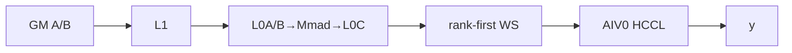

##### 字节账、交接边与复用顺序

```text
userWS=align512(A*N1*2)+align512(16eW+512+8e)+align512(16e+512)
L1=depthA*baseM*baseK*2+depthB*baseN*baseK*2
L0=2*baseM*baseK*2+2*baseN*baseK*2+dbC*baseM*baseN*4
```

| 边/复用子区 | producer | offset/extent | dtype/layout | consumer | ordering/sync | owner/lifetime | 安全条件 |
|---|---|---|---|---|---|---|---|
| GMM→A2AV | AIC | rank-first batch | FP16/BF16 | AIV0 | flags8/9 | WS to Wait | batch regions disjoint |
| A2AV→y | HCCL | recv count/offset×N1 | same | caller | handle Wait | caller | sum=BSK |

#### 同步、精度与尾块

##### 同步与数值边界表

| 阶段 | primitive/机制 | producer | consumer/等待点 | 保护对象 | 精度/尾块 |
|---|---|---|---|---|---|
| AIC barrier | `CrossCoreSetFlag<0,PIPE_FIX>(8)` / `CrossCoreWaitFlag(8)` | all AIC | all AIC | batch C | 空 group 跳过 Matmul，但仍参与屏障 |
| AIC→AIV | `CrossCoreSetFlag<2,PIPE_FIX>(9)` / `CrossCoreWaitFlag(9)` | 每个 AIC | 对应两个 AIV | C 的 PIPE_FIX 可见性 | flag ID 每批在 wait 后复用 |
| HCCL | `AlltoAllV<true>` handle / `Wait` | AIV0 | AIV0 末尾等待 | y | FP16/BF16；`SyncAll<false>` 后各 AIV finalize |
| Cube | singleCoreMN/K loops | AIC | Fixpipe | tiles | last group split |

#### 关键实现

##### 符号证据表

| 阶段 | 文件 | 符号/模板实例 | 实现事实 |
|---|---|---|---|
| Host | common tiling | workspace/common info | POD/slices |
| entry | kernel cpp | exact tuple | AICPU instance |
| body | scheduler/Cube/HCCL | Process | full graph |

### Route R-002：AI_CPU，无shared，main NT

#### 适用条件

##### 选择证据

| 层级 | 文件 | 符号 | 源码谓词/参数 | 结果/下一跳 |
|---|---|---|---|---|
| Tiling/Router | tiling/entry | tuple | `(0,1,0,AICPU)` | R-002 |

#### Device 数据流

##### 函数级调用链

```text
R-001 with main bTrans=true.
```

##### 源码等价伪码

```text
B=[N1,H1], offsetB=nOffset*K; other stages equal R-001.
```

#### 内存与数据搬运

##### 资源与搬运表

| 层级/缓冲区 | offset/地址公式 | extent/容量公式 | dtype/layout | producer | consumer | owner/lifetime | 对齐/复用 |
|---|---|---|---|---|---|---|---|
| B | nOffset×H1 | e×N1×H1×2 | ND N×K | caller | Matmul | stream | N tail16 |
| other | R-001 | R-001 | same | same | same | same | same |

##### 分层内存布局

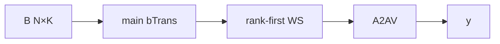

##### 字节账、交接边与复用顺序

```text
R-001 totals; B stride/baseN alignment differs.
```

| 边/复用子区 | producer | offset/extent | dtype/layout | consumer | ordering/sync | owner/lifetime | 安全条件 |
|---|---|---|---|---|---|---|---|
| C→A2AV | AIC | rank-first | same | AIV0 | flags8/9 | WS | R-001 |

#### 同步、精度与尾块

##### 同步与数值边界表

| 阶段 | primitive/机制 | producer | consumer/等待点 | 保护对象 | 精度/尾块 |
|---|---|---|---|---|---|
| all | R-001 | AIC/AIV | end | C/y | transpose N-tail |

#### 关键实现

##### 符号证据表

| 阶段 | 文件 | 符号/模板实例 | 实现事实 |
|---|---|---|---|
| block | quant_block_sch.h | bTrans CalcGMOffset | B offset |

### Route R-003：AI_CPU，shared，NN/NN

#### 适用条件

##### 选择证据

| 层级 | 文件 | 符号 | 源码谓词/参数 | 结果/下一跳 |
|---|---|---|---|---|
| Tiling/Router | tiling/entry | tuple | `(1,0,0,AICPU)` | R-003 |

#### Device 数据流

##### 函数级调用链

```text
R-001 main batches -> async A2AV -> shared Matmul<bTrans=false> -> Wait.
```

##### 源码等价伪码

```text
Main communication remains in flight while AIC writes mmY from mmX×mmWeight.
```

#### 内存与数据搬运

##### 资源与搬运表

| 层级/缓冲区 | offset/地址公式 | extent/容量公式 | dtype/layout | producer | consumer | owner/lifetime | 对齐/复用 |
|---|---|---|---|---|---|---|---|
| main | R-001 | R-001 | same | AIC | HCCL | launch | same |
| sharedWS/mmY | third slice / tileC | align512(16e+512) / BS×N2×2 | meta/ND | AIC | shared/caller | stream | own TCube |

##### 分层内存布局

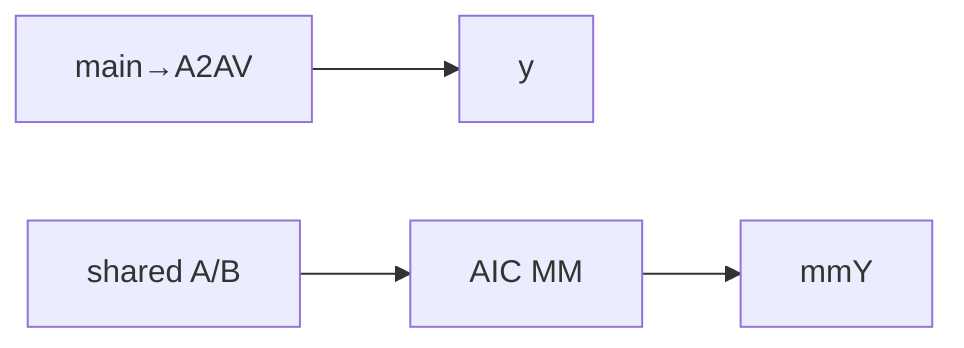

##### 字节账、交接边与复用顺序

```text
R-001 main totals + independent shared TCube using preallocated third slice.
```

| 边/复用子区 | producer | offset/extent | dtype/layout | consumer | ordering/sync | owner/lifetime | 安全条件 |
|---|---|---|---|---|---|---|---|
| overlap | AIV0/AIC | separate y/mmY | same | caller | Wait+SyncAll | executor | no alias |

#### 同步、精度与尾块

##### 同步与数值边界表

| 阶段 | primitive/机制 | producer | consumer/等待点 | 保护对象 | 精度/尾块 |
|---|---|---|---|---|---|
| overlap | async handle | AIV0 | end | y | shared own MNK tail |

#### 关键实现

##### 符号证据表

| 阶段 | 文件 | 符号/模板实例 | 实现事实 |
|---|---|---|---|
| scheduler | gmm_a2av_scheduler.h | IsNeedMM | shared before Wait |

### Route R-004：AI_CPU，shared，NN/NT

#### 适用条件

##### 选择证据

| 层级 | 文件 | 符号 | 源码谓词/参数 | 结果/下一跳 |
|---|---|---|---|---|
| Router | entry | tuple | `(1,0,1,AICPU)` | R-004 |

#### Device 数据流

##### 函数级调用链

```text
R-003; shared bTrans=true.
```

##### 源码等价伪码

```text
shared B=[N2,H2], offset=n*H2.
```

#### 内存与数据搬运

##### 资源与搬运表

| 层级/缓冲区 | offset/地址公式 | extent/容量公式 | dtype/layout | producer | consumer | owner/lifetime | 对齐/复用 |
|---|---|---|---|---|---|---|---|
| sharedB | n×H2 | N2×H2×2 | N×K | caller | sharedMM | stream | transpose tail |

##### 分层内存布局

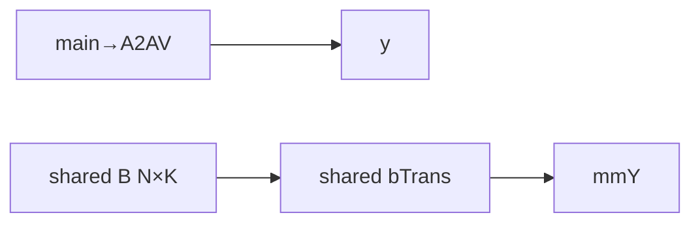

##### 字节账、交接边与复用顺序

```text
R-003 totals; shared stride differs.
```

| 边/复用子区 | producer | offset/extent | dtype/layout | consumer | ordering/sync | owner/lifetime | 安全条件 |
|---|---|---|---|---|---|---|---|
| C→A2AV | AIC | rank-first | same | AIV0 | flags | WS | same |

#### 同步、精度与尾块

##### 同步与数值边界表

| 阶段 | primitive/机制 | producer | consumer/等待点 | 保护对象 | 精度/尾块 |
|---|---|---|---|---|---|
| all | R-003 | AIC/AIV | end | y/mmY | shared transpose tail |

#### 关键实现

##### 符号证据表

| 阶段 | 文件 | 符号/模板实例 | 实现事实 |
|---|---|---|---|
| entry | kernel cpp | exact tuple | shared true |

### Route R-005：AI_CPU，shared，NT/NN

#### 适用条件

##### 选择证据

| 层级 | 文件 | 符号 | 源码谓词/参数 | 结果/下一跳 |
|---|---|---|---|---|
| Router | entry | tuple | `(1,1,0,AICPU)` | R-005 |

#### Device 数据流

##### 函数级调用链

```text
R-003; main bTrans=true.
```

##### 源码等价伪码

```text
main follows R-002; shared follows R-003.
```

#### 内存与数据搬运

##### 资源与搬运表

| 层级/缓冲区 | offset/地址公式 | extent/容量公式 | dtype/layout | producer | consumer | owner/lifetime | 对齐/复用 |
|---|---|---|---|---|---|---|---|
| mainB | n×H1 | e×N1×H1×2 | N×K | caller | mainGMM | stream | transpose |

##### 分层内存布局

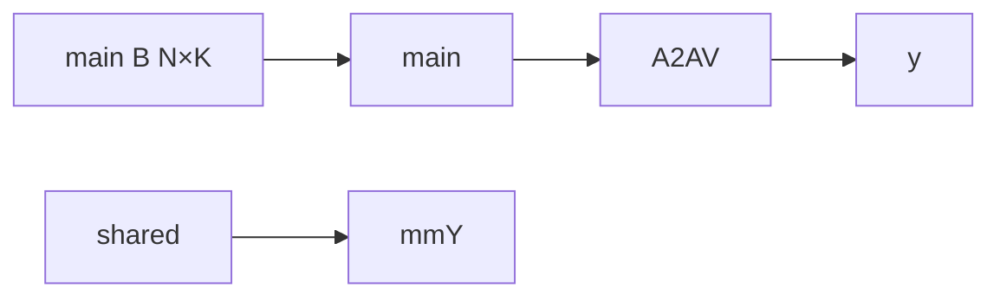

##### 字节账、交接边与复用顺序

```text
R-003 totals; main stride differs.
```

| 边/复用子区 | producer | offset/extent | dtype/layout | consumer | ordering/sync | owner/lifetime | 安全条件 |
|---|---|---|---|---|---|---|---|
| C→A2AV | AIC | rank-first | same | AIV0 | flags | WS | same |

#### 同步、精度与尾块

##### 同步与数值边界表

| 阶段 | primitive/机制 | producer | consumer/等待点 | 保护对象 | 精度/尾块 |
|---|---|---|---|---|---|
| all | R-003 | AIC/AIV | end | y/mmY | main transpose tail |

#### 关键实现

##### 符号证据表

| 阶段 | 文件 | 符号/模板实例 | 实现事实 |
|---|---|---|---|
| entry | kernel cpp | exact tuple | main true |

### Route R-006：AI_CPU，shared，NT/NT

#### 适用条件

##### 选择证据

| 层级 | 文件 | 符号 | 源码谓词/参数 | 结果/下一跳 |
|---|---|---|---|---|
| Router | entry | tuple | `(1,1,1,AICPU)` | R-006 |

#### Device 数据流

##### 函数级调用链

```text
R-003; both bTrans=true.
```

##### 源码等价伪码

```text
main R-002 + shared R-004.
```

#### 内存与数据搬运

##### 资源与搬运表

| 层级/缓冲区 | offset/地址公式 | extent/容量公式 | dtype/layout | producer | consumer | owner/lifetime | 对齐/复用 |
|---|---|---|---|---|---|---|---|
| bothB | n×K | respective full tensors | N×K | caller | Matmuls | stream | transpose tails |

##### 分层内存布局

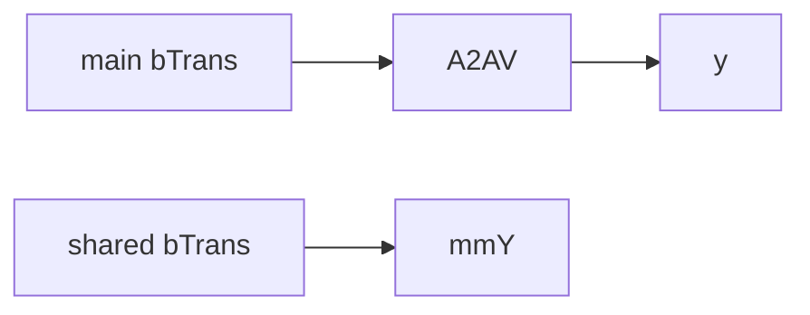

##### 字节账、交接边与复用顺序

```text
R-003 totals; both B transposed.
```

| 边/复用子区 | producer | offset/extent | dtype/layout | consumer | ordering/sync | owner/lifetime | 安全条件 |
|---|---|---|---|---|---|---|---|
| C→A2AV | AIC | rank-first | same | AIV0 | flags | WS | same |

#### 同步、精度与尾块

##### 同步与数值边界表

| 阶段 | primitive/机制 | producer | consumer/等待点 | 保护对象 | 精度/尾块 |
|---|---|---|---|---|---|
| all | R-003 | AIC/AIV | end | y/mmY | both transpose tails |

#### 关键实现

##### 符号证据表

| 阶段 | 文件 | 符号/模板实例 | 实现事实 |
|---|---|---|---|
| entry | kernel cpp | exact tuple | both true |

### Route R-007：CCU，无shared，main NN

#### 适用条件

##### 选择证据

| 层级 | 文件 | 符号 | 源码谓词/参数 | 结果/下一跳 |
|---|---|---|---|---|
| API/Tiling/Router | API/tiling/entry | CCU tuple | `(0,0,0,CCU)` on DAV_3510 | R-007 |

#### Device 数据流

##### 函数级调用链

```text
R-001 with Hccl<HCCL_SERVER_TYPE_CCU> and ENGINE_CCU_SCHED tiling.
```

##### 源码等价伪码

```text
AIC body/flags/offsets equal R-001; AIV0 invokes CCU server specialization.
```

#### 内存与数据搬运

##### 资源与搬运表

| 层级/缓冲区 | offset/地址公式 | extent/容量公式 | dtype/layout | producer | consumer | owner/lifetime | 对齐/复用 |
|---|---|---|---|---|---|---|---|
| all owned buffers | R-001 | R-001 | same | same | CCU HCCL | same | same |

##### 分层内存布局

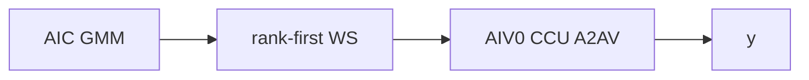

##### 字节账、交接边与复用顺序

```text
Equal R-001; CCU library-private resources are outside fixed repository visibility.
```

| 边/复用子区 | producer | offset/extent | dtype/layout | consumer | ordering/sync | owner/lifetime | 安全条件 |
|---|---|---|---|---|---|---|---|
| GMM→CCU | AIC | rank-first | FP16/BF16 | AIV0 CCU | flags8/9 | WS | same |

#### 同步、精度与尾块

##### 同步与数值边界表

| 阶段 | primitive/机制 | producer | consumer/等待点 | 保护对象 | 精度/尾块 |
|---|---|---|---|---|---|
| all | same flags/handle | AIC/AIV0 | end | C/y | equal R-001 |

#### 关键实现

##### 符号证据表

| 阶段 | 文件 | 符号/模板实例 | 实现事实 |
|---|---|---|---|
| Host/HCCL | API/common/HCCL headers | CCU server/engine selector | CCU specialization |

### Route R-008：CCU，无shared，main NT

#### 适用条件

##### 选择证据

| 层级 | 文件 | 符号 | 源码谓词/参数 | 结果/下一跳 |
|---|---|---|---|---|
| Router | entry | tuple | `(0,1,0,CCU)` | R-008 |

#### Device 数据流

##### 函数级调用链

```text
R-002 compute + R-007 CCU communication.
```

##### 源码等价伪码

```text
main B transposed; CCU server.
```

#### 内存与数据搬运

##### 资源与搬运表

| 层级/缓冲区 | offset/地址公式 | extent/容量公式 | dtype/layout | producer | consumer | owner/lifetime | 对齐/复用 |
|---|---|---|---|---|---|---|---|
| buffers | R-002 | R-002 | same | AIC | CCU | stream | same |

##### 分层内存布局

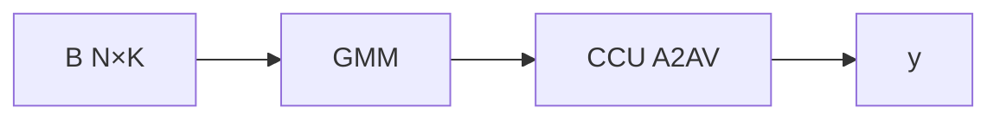

##### 字节账、交接边与复用顺序

```text
R-002 totals.
```

| 边/复用子区 | producer | offset/extent | dtype/layout | consumer | ordering/sync | owner/lifetime | 安全条件 |
|---|---|---|---|---|---|---|---|
| C→CCU | AIC | rank-first | same | AIV0 | flags | WS | same |

#### 同步、精度与尾块

##### 同步与数值边界表

| 阶段 | primitive/机制 | producer | consumer/等待点 | 保护对象 | 精度/尾块 |
|---|---|---|---|---|---|
| all | R-002/R-007 | AIC/AIV | end | y | transpose tail |

#### 关键实现

##### 符号证据表

| 阶段 | 文件 | 符号/模板实例 | 实现事实 |
|---|---|---|---|
| entry | kernel cpp | exact tuple | NT+CCU |

### Route R-009：CCU，shared，NN/NN

#### 适用条件

##### 选择证据

| 层级 | 文件 | 符号 | 源码谓词/参数 | 结果/下一跳 |
|---|---|---|---|---|
| Router | entry | tuple | `(1,0,0,CCU)` | R-009 |

#### Device 数据流

##### 函数级调用链

```text
R-003 compute/overlap + R-007 CCU communication.
```

##### 源码等价伪码

```text
CCU collective remains in flight during shared NN Matmul.
```

#### 内存与数据搬运

##### 资源与搬运表

| 层级/缓冲区 | offset/地址公式 | extent/容量公式 | dtype/layout | producer | consumer | owner/lifetime | 对齐/复用 |
|---|---|---|---|---|---|---|---|
| buffers | R-003 | R-003 | same | AIC | CCU/caller | stream | same |

##### 分层内存布局

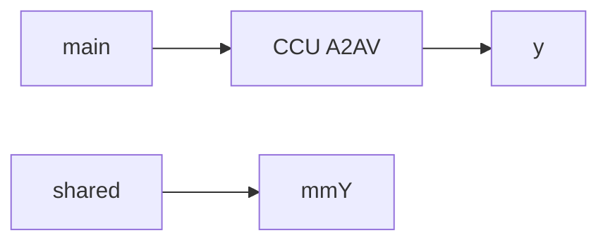

##### 字节账、交接边与复用顺序

```text
R-003 totals.
```

| 边/复用子区 | producer | offset/extent | dtype/layout | consumer | ordering/sync | owner/lifetime | 安全条件 |
|---|---|---|---|---|---|---|---|
| overlap | CCU/AIC | separate outputs | same | caller | Wait+SyncAll | executor | no alias |

#### 同步、精度与尾块

##### 同步与数值边界表

| 阶段 | primitive/机制 | producer | consumer/等待点 | 保护对象 | 精度/尾块 |
|---|---|---|---|---|---|
| all | R-003/R-007 | AIC/AIV | end | y/mmY | two tails |

#### 关键实现

##### 符号证据表

| 阶段 | 文件 | 符号/模板实例 | 实现事实 |
|---|---|---|---|
| entry | kernel cpp | exact tuple | shared NN+CCU |

### Route R-010：CCU，shared，NN/NT

#### 适用条件

##### 选择证据

| 层级 | 文件 | 符号 | 源码谓词/参数 | 结果/下一跳 |
|---|---|---|---|---|
| Router | entry | tuple | `(1,0,1,CCU)` | R-010 |

#### Device 数据流

##### 函数级调用链

```text
R-004 compute + R-007 CCU.
```

##### 源码等价伪码

```text
shared B transposed; CCU collective.
```

#### 内存与数据搬运

##### 资源与搬运表

| 层级/缓冲区 | offset/地址公式 | extent/容量公式 | dtype/layout | producer | consumer | owner/lifetime | 对齐/复用 |
|---|---|---|---|---|---|---|---|
| buffers | R-004 | R-004 | same | AIC | CCU/caller | stream | same |

##### 分层内存布局

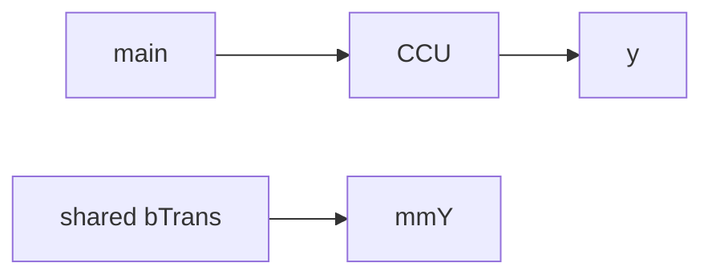

##### 字节账、交接边与复用顺序

```text
R-004 totals.
```

| 边/复用子区 | producer | offset/extent | dtype/layout | consumer | ordering/sync | owner/lifetime | 安全条件 |
|---|---|---|---|---|---|---|---|
| C→CCU | AIC | rank-first | same | AIV0 | flags | WS | same |

#### 同步、精度与尾块

##### 同步与数值边界表

| 阶段 | primitive/机制 | producer | consumer/等待点 | 保护对象 | 精度/尾块 |
|---|---|---|---|---|---|
| all | R-004/R-007 | AIC/AIV | end | outputs | shared transpose tail |

#### 关键实现

##### 符号证据表

| 阶段 | 文件 | 符号/模板实例 | 实现事实 |
|---|---|---|---|
| entry | kernel cpp | exact tuple | shared NT+CCU |

### Route R-011：CCU，shared，NT/NN

#### 适用条件

##### 选择证据

| 层级 | 文件 | 符号 | 源码谓词/参数 | 结果/下一跳 |
|---|---|---|---|---|
| Router | entry | tuple | `(1,1,0,CCU)` | R-011 |

#### Device 数据流

##### 函数级调用链

```text
R-005 compute + R-007 CCU.
```

##### 源码等价伪码

```text
main B transposed; CCU collective.
```

#### 内存与数据搬运

##### 资源与搬运表

| 层级/缓冲区 | offset/地址公式 | extent/容量公式 | dtype/layout | producer | consumer | owner/lifetime | 对齐/复用 |
|---|---|---|---|---|---|---|---|
| buffers | R-005 | R-005 | same | AIC | CCU/caller | stream | same |

##### 分层内存布局

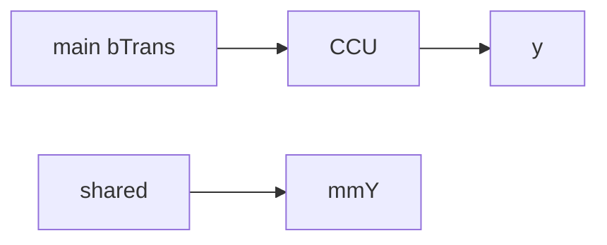

##### 字节账、交接边与复用顺序

```text
R-005 totals.
```

| 边/复用子区 | producer | offset/extent | dtype/layout | consumer | ordering/sync | owner/lifetime | 安全条件 |
|---|---|---|---|---|---|---|---|
| C→CCU | AIC | rank-first | same | AIV0 | flags | WS | same |

#### 同步、精度与尾块

##### 同步与数值边界表

| 阶段 | primitive/机制 | producer | consumer/等待点 | 保护对象 | 精度/尾块 |
|---|---|---|---|---|---|
| all | R-005/R-007 | AIC/AIV | end | outputs | main transpose tail |

#### 关键实现

##### 符号证据表

| 阶段 | 文件 | 符号/模板实例 | 实现事实 |
|---|---|---|---|
| entry | kernel cpp | exact tuple | main NT+CCU |

### Route R-012：CCU，shared，NT/NT

#### 适用条件

##### 选择证据

| 层级 | 文件 | 符号 | 源码谓词/参数 | 结果/下一跳 |
|---|---|---|---|---|
| Router | entry | tuple | `(1,1,1,CCU)` | R-012 |

#### Device 数据流

##### 函数级调用链

```text
R-006 compute + R-007 CCU.
```

##### 源码等价伪码

```text
both B transposed; CCU collective; shared overlaps communication.
```

#### 内存与数据搬运

##### 资源与搬运表

| 层级/缓冲区 | offset/地址公式 | extent/容量公式 | dtype/layout | producer | consumer | owner/lifetime | 对齐/复用 |
|---|---|---|---|---|---|---|---|
| buffers | R-006 | R-006 | same | AIC | CCU/caller | stream | same |

##### 分层内存布局


##### 字节账、交接边与复用顺序

```text
R-006 totals.
```

| 边/复用子区 | producer | offset/extent | dtype/layout | consumer | ordering/sync | owner/lifetime | 安全条件 |
|---|---|---|---|---|---|---|---|
| C→CCU | AIC | rank-first | same | AIV0 | flags | WS | same |

#### 同步、精度与尾块

##### 同步与数值边界表

| 阶段 | primitive/机制 | producer | consumer/等待点 | 保护对象 | 精度/尾块 |
|---|---|---|---|---|---|
| all | R-006/R-007 | AIC/AIV | end | outputs | both transpose tails |

#### 关键实现

##### 符号证据表

| 阶段 | 文件 | 符号/模板实例 | 实现事实 |
|---|---|---|---|
| entry | kernel cpp | exact tuple | both NT+CCU |

## 算子特定优化

### Trick T-001：最多四批的专家流水

#### 触发与源码依据

- 适用 Route：R-001～R-012
- 触发条件：`1<=e<=32`
- Golden 来源：[`quant_grouped_mat_mul_allto_allv_tiling_common.cpp:843-858`](../../../../../../../cann-ops-raw/ascendc/ops-transformer/be33d95bb755cedec3108f70805c1874d1792540/mc2/quant_grouped_mat_mul_allto_allv/op_host/op_tiling/arch35/quant_grouped_mat_mul_allto_allv_tiling_common.cpp#L843-L858)

**官方源码（固定 Commit 连续逐字摘录）**：

```cpp
constexpr uint32_t TARGET_COMM_ROUNDS = 4U;
expertNum_ = static_cast<uint32_t>(
    Ops::Base::CeilDiv(localParams_.ep, static_cast<uint64_t>(TARGET_COMM_ROUNDS)));
if (expertNum_ == 0U) {
    expertNum_ = 1U;
}
```

#### 机制与设计原因

每批 `ceil(e/4)` 个专家，限制 GMM/HCCL 交接和 handle 数，并保留分批 overlap。

#### 迁移边界

- 适用：后通信的 expert batching。
- 前提：counts/layout/handle index 同批。
- 失效：专家上界、handle容量或offset规则改变。
- 未验证：本次知识提取未执行编译、真机、数值或性能测试。

#### 错误做法

固定仓未提供可验证反例；不能孤立修改批宽。

### Trick T-002：rank-first 输出消除独立 Unpermute

#### 触发与源码依据

- 适用 Route：R-001～R-012
- 触发条件：全部后通信 route
- Golden 来源：[`grouped_mat_mul_allto_allv.cpp:91-108`](../../../../../../../cann-ops-raw/ascendc/ops-transformer/be33d95bb755cedec3108f70805c1874d1792540/mc2/grouped_mat_mul_allto_allv/op_kernel/arch22/grouped_mat_mul_allto_allv.cpp#L91-L108)

**官方源码（固定 Commit 连续逐字摘录）**：

```cpp
GM_ADDR gmmOutputGM = userWorkspace + wsOffset;
wsOffset += tilingData_->workspaceInfo.wsGmmOutputSize;
GM_ADDR gmmComputeWSGM = userWorkspace + wsOffset;
wsOffset += tilingData_->workspaceInfo.wsGmmComputeWorkspaceSize;
GM_ADDR sharedGmmComputeWSGM = userWorkspace + wsOffset;

GM_ADDR sendBufferAddr = gmmOutputGM;
```

#### 机制与设计原因

Cube 用 cGroupOffsetTable 直接产出 rank-first C，HCCL send 别名该 slice，recv 直接 y；无需另一 Kernel 或当前 HCCL template 的 UB permute。

#### 迁移边界

- 适用：C可按目的rank排布。
- 前提：GMM与HCCL offsets一致。
- 失效：expert-first或额外token permutation。
- 未验证：本次知识提取未执行编译、真机、数值或性能测试。

#### 错误做法

改变C layout而不改HCCL offsets会发送错误数据。

### Trick T-003：编译期通信引擎选择保持同一任务图

#### 触发与源码依据

- 适用 Route：R-001～R-012
- 触发条件：950 `commMode=ai_cpu/ccu`
- Golden 来源：[`hccl_a2av_op.h:43-51`](../../../../../../../cann-ops-raw/ascendc/ops-transformer/be33d95bb755cedec3108f70805c1874d1792540/mc2/allto_allv_quant_grouped_mat_mul/op_kernel/mc2_templates/communication/hccl_a2av_op.h#L43-L51)

**官方源码（固定 Commit 连续逐字摘录）**：

```cpp
template<int commMode = TILINGKEY_TPL_CCU>
struct HcclTypeSelector {
    using type = Hccl<HcclServerType::HCCL_SERVER_TYPE_CCU>;
};

template<>
struct HcclTypeSelector<TILINGKEY_TPL_AICPU> {
    using type = Hccl<HcclServerType::HCCL_SERVER_TYPE_AICPU>;
};
```

#### 机制与设计原因

Host 同时设置 executor server 与 HCCL tiling engine，key 再把 server type 固化进 Kernel；Cube、workspace 和 flags 图保持一致，避免 device runtime 分支。

#### 迁移边界

- 适用：950同一数学/布局下切换通信server。
- 前提：Host engine、executor server、tiling key三者一致；CCU只用于支持域。
- 失效：A3或跨机CCU场景必须使用AI_CPU/失败。
- 未验证：本次知识提取未执行编译、真机、数值或性能测试。

#### 错误做法

只改字符串而不改 executor server/key，会造成Host/Device通信实现不一致。

## 模板与实现对比

| 对比维度 | R-001～R-006 AI_CPU | R-007～R-012 CCU | 设计选择依据 |
|---|---|---|---|
| 命中条件/优先级 | `commMode=ai_cpu` | `commMode=ccu` | 950 API+key |
| 执行族/节点图 | AIC GMM→AIV0 AICPU A2AV→optional shared | 同图，CCU server | compile-time selector |
| M/N/K、tile 与 scheduler | 六个shared/transpose tuple | 同六个tuple | engine不改Cube |
| workspace/L1/L0/UB | 共用三段WS和Cube资源；UB N/A | 相同；CCU私有资源不可见 | common tiling |
| AIC/AIV 或 kernel 交接 | flags8/9 | flags8/9 | same scheduler |
| 同步、精度与 tail | async handle；FP16/BF16 | 同 | HCCL specialization |
| fallback/失败边界 | engine/list/shape失败 | CCU域限制；失败 | no fallback |

## 平台差异

| 项目 | A2 | A3 | 950 |
|---|---|---|---|
| 支持状态 | README不支持 | 支持 | 支持 |
| Host/Launcher | N/A | only ai_cpu；rank 8/16/32/64/128 | ai_cpu/ccu；rank 2/4/8/16/32/64 |
| Kernel/资源 | N/A | AICPU HCCL；异常重启选项 | AICPU或CCU；`--cce-auto-sync=off`、禁kernel-end DCCI |

## 限制与失败边界

- CCU 仅单机 UB 域互联；跨机需 AI_CPU。counts tensor 当前不支持。
- V2 公开文档和 README 描述共享三元组，API/Tiling/Kernel 也存在完整可达 route；但公开头部 docblock 仍把共享输入/输出和 `transMmWeight` 标成“当前暂未支持”，这是固定 Commit 内的文档冲突，复用时不得忽略。
- V2 头部 docblock 写 `commMode` 还接受 `default`，实际 API、Tiling 和公开 V2 文档在 950 只接受 `ai_cpu`/`ccu`；`default` 会在 `CheckAndHandleCommMode` 失败。
- 公开契约列出 950 rank 集合；Tiling 另有 `epWorldSize==-1` 时通过 `GetRankSize(group)` 查询的内部路径。若显式传 rank，Device HCCL 仍从 context 读取 `rankDim_`，固定源码未比较二者，调用方必须保证 attr、group 与实际通信域一致。
- `H1,N1∈(0,65536)`、`BSK∈(0,52428800)`；shared时H2≤12288、K∈[2,8]。
- counts到i32 POD没有显式INT32_MAX guard，不能推断大值安全。
- `A*N1*sizeof(Y)`、metadata 加法和512B对齐使用u64但无显式溢出检查，最终总和又写入u32 `workSpaceSize_`；固定源码没有大workspace fallback，复用必须先证明乘加不溢出且总字节数不超过 `UINT32_MAX`。
- HCCL/Matmul库内部错误传播、CCU私有buffer和intrinsic round mode在固定仓不可见；未运行验证。

## 源码索引

### 链路索引

| 链路阶段 | 文件 | 关键符号 | 支撑内容 |
|---|---|---|---|
| 声明 | `mc2/grouped_mat_mul_allto_allv/op_api/aclnn_grouped_mat_mul_allto_allv_v2.h` | V2 | API |
| 支持 | `mc2/grouped_mat_mul_allto_allv/README.md` | product table | 950/A3/A2 |
| V2文档 | `mc2/grouped_mat_mul_allto_allv/docs/aclnnGroupedMatMulAlltoAllvV2.md` | version/constraints | 最新API、共享参数与引擎 |
| API实现 | `mc2/grouped_mat_mul_allto_allv/op_api/aclnn_grouped_mat_mul_allto_allv_v2.cpp` | V2 functions | engine/server |
| OpDef | `mc2/grouped_mat_mul_allto_allv/op_host/grouped_mat_mul_allto_allv_def.cpp` | OpDef | 950接线 |
| Tiling | `mc2/grouped_mat_mul_allto_allv/op_host/op_tiling/grouped_mat_mul_allto_allv_tiling.cpp` | tiling class | validation/key |
| 950注册 | `mc2/grouped_mat_mul_allto_allv/op_host/op_tiling/arch35/grouped_mat_mul_allto_allv_tiling_a5.cpp` | registration | priority0 |
| common | `mc2/quant_grouped_mat_mul_allto_allv/op_host/op_tiling/arch35/quant_grouped_mat_mul_allto_allv_tiling_common.cpp` | DoOpTiling | workspace/HCCL/POD |
| adapter | `mc2/quant_grouped_mat_mul_allto_allv/op_host/op_tiling/arch35/quant_grouped_mat_mul_allto_allv_tiling_adapter.cpp` | adapter | MNK/transpose |
| 约束常量 | `mc2/quant_grouped_mat_mul_allto_allv/op_host/op_tiling/quant_grouped_mat_mul_allto_allv_tiling_base.h` | shape/handle constants | H/N/BSK/K边界 |
| POD | `mc2/quant_grouped_mat_mul_allto_allv/op_kernel/arch35/quant_grouped_mat_mul_allto_allv_tiling.h` | outer | ABI |
| 公共POD | `mc2/allto_allv_quant_grouped_mat_mul/op_kernel/mc2_templates/common/a2av_common_tiling.h` | `TaskTilingInfo` | 字段顺序与数组容量 |
| key | `mc2/grouped_mat_mul_allto_allv/op_kernel/grouped_mat_mul_allto_allv_tiling_key.h` | tuple | 12 routes |
| entry | `mc2/grouped_mat_mul_allto_allv/op_kernel/arch22/grouped_mat_mul_allto_allv.cpp` | kernel | MIX/slices |
| scheduler | `mc2/allto_allv_quant_grouped_mat_mul/op_kernel/mc2_templates/scheduler/gmm_a2av_scheduler.h` | Process | task graph |
| HCCL | `mc2/allto_allv_quant_grouped_mat_mul/op_kernel/mc2_templates/communication/hccl_a2av_op.h` | selector/op | engines |
| HCCL guard | `mc2/allto_allv_quant_grouped_mat_mul/op_kernel/mc2_templates/communication/a2av_comm_guard.h` | `A2AV_AIV_ONLY` | AIV0单发起者 |
| offsets | `mc2/allto_allv_quant_grouped_mat_mul/op_kernel/mc2_templates/communication/a2av_comm_params.h` | after params | counts/offsets |
| wrapper | `mc2/allto_allv_quant_grouped_mat_mul/op_kernel/mc2_templates/compute/quant_grouped_matmul.h` | GMM wrapper | group/layout |
| Cube | `mc2/3rd/grouped_matmul/op_kernel/gqmm_cube_on_the_fly.h` | ASW kernel | Matmul/tail |
| block | `mc2/3rd/grouped_matmul/op_kernel/quant_block_sch.h` | block scheduler | offsets |
| GMM POD | `mc2/3rd/grouped_matmul/op_kernel/grouped_matmul_tiling_data_apt.h` | `GMMQuantTilingData` | 24B参数与三组128项数组 |
| Matmul traits | `mc2/3rd/grouped_matmul/op_kernel/quant_utils.h` | `MM_CFG_NO_PRELOAD_OPEN_UNIT_FLAG` | 当前config实参 |
| lib tiling | `mc2/3rd/grouped_matmul/op_tiling/gmm_qbmm_tiling.cpp` | DoLibApiTiling | resources |
| binary | `mc2/grouped_mat_mul_allto_allv/op_host/config/ascend950/grouped_mat_mul_allto_allv_binary.json` | FP16/BF16 | 950 binaries |
| build | `mc2/grouped_mat_mul_allto_allv/op_host/CMakeLists.txt` | 950 options | build wiring |

### 实现复用检查

| 检查项 | 可复用事实 | 不得改变的约束 | 源码符号 |
|---|---|---|---|
| ABI/POD | common三段WS/Task/GMM POD | SDK ABI/i32 counts | outer tiling |
| 调用顺序 | batch GMM→A2AV→shared→Wait | engine与key一致 | scheduler/API |
| workspace/内存 | rank-first C direct-send | 512B slices/offsets | workspace/GMM |
| 同步 | flags8/9+AIV0+handleWait | IDs/PIPE_FIX/Finalize | scheduler/guard |
| 精度与尾块 | FP16/BF16、dynamic TCube | transpose/MNK tail | Cube/block |
| 失败边界 | Host failure/no fallback/nullWS return | 不补造engine fallback | API/Tiling/entry |