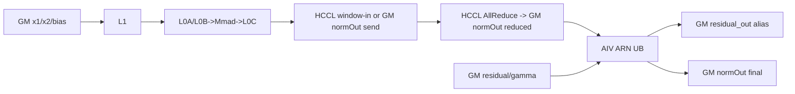
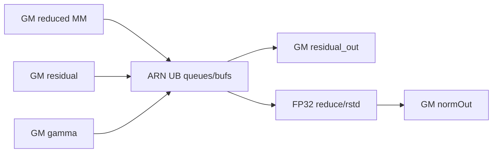
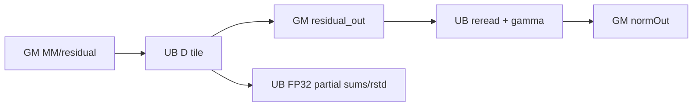

# InplaceMatmulAllReduceAddRmsNorm A2 ACLNN 算子知识

## 算子速览

| 项目 | 内容 |
|---|---|
| 实际入口 | `aclnnInplaceMatmulAllReduceAddRmsNormGetWorkspaceSize` / `aclnnInplaceMatmulAllReduceAddRmsNorm`；公开 ACLNN 两段式接口 |
| 计算语义 | `mm=all_reduce(x1@x2+bias)`；`residual_out=mm+residual` 写回 residual；`normOut=residual_out/sqrt(mean(residual_out²)+epsilon)*gamma` |
| 输入输出 | x1 2D/3D、x2 2D、bias 可空 1D、residual 3D、gamma 1D；公开入口仅 FP16/BF16、ND |
| 执行类型 | 单 AICore Kernel `MIX_CV` + AICPU HCCL KFC 通信任务；AIC MatMul，AIV AddRmsNorm，key 0 还含 AIV ND→NZ |
| Kernel 路线 | R-001 key 260/256 对齐 MM；R-002 key 0 ND→NZ；R-003~R-007 为 Normal/SplitD/MergeN/SingleN/MultiN ARN 子路线 |
| 核心资源 | GM、HCCL window/output、workspace、MatMul L1/L0A/L0B/L0C、ARN UB/TQue/TBuf |
| 来源闭包 | `source_closed`：公开 ACLNN→复用 API→OpDef/Tiling→AICPU KFC task + 单 MIX Kernel→MatMul/HCCL/ARN body→A2 构建接线闭合；固定源码的 MergeN 未初始化 guard 另列为实现限制 |
| 验证状态 | 已完成源码闭包检查；本次知识提取未执行编译、真机、数值或性能测试。 |

## 接口与语义

### 计算语义

令 x1 展平前导轴后为 `[M,K]`，x2 为 `[K,N]`：

```text
mm_local     = MatMul(x1, x2) + bias
mm_reduced   = AllReduceSum(mm_local, group)
residual_out = mm_reduced + residual
rstd         = 1 / sqrt(sum(residual_out^2) / N + epsilon)
normOut      = residual_out * rstd * gamma
```

Inplace 包装把非原地接口的 `y` 参数绑定为输入 `residual`；Kernel 的 `yGM` 因而与 `residualGM` 别名。`normOutGM` 先承接 MM/AllReduce 结果，AIV 再原地覆盖为最终归一化输出。FP16 先以 FP16 相加再转 FP32 求 RMS。BF16 先转 FP32 相加并以 `CAST_RINT` 写 residual_out，但 RMS 的输入精度受 ARN route 影响：Normal 使用尚未 RINT 的 FP32 和；SplitD 用未 RINT 和求 rstd、第二遍却重读已 RINT 的 BF16 residual_out；MergeN/SingleN 在求 RMS 前重读/回转已 RINT 的 BF16 和。gamma 段的关键中间量用 FP32，最终 `CAST_RINT`。

### 输入、输出与属性

| 参数 | shape/layout | dtype | 约束、默认值与语义 |
|---|---|---|---|
| x1 | `[M,K]`/`[B,S,K]`，ND | FP16/BF16 | 必需连续；公开入口固定不转置 |
| x2 | 2D，ND | 同 x1 | 必需；支持最后两轴转置视图 |
| bias | `[N]`，ND | 同 x1 | 可空；BF16 bias 先转 FP32 workspace |
| residual | `[B,S,N]`，ND | 同 x1 | 必需连续；同时是原地 y 输出存储 |
| gamma | `[N]`，ND | 同 residual | 必需连续 |
| epsilon | 标量 | double→float | `(0,1)`；文档默认 `1e-6` |
| group/reduceOp | 字符串 | string | 通信域；reduceOp 仅 `sum` |
| commTurn/streamMode | 标量 | int64 | 分别只支持 0 和 1（`NUM_ACL_STOP_ON_FAILURE`） |
| normOut | `[B,S,N]`，ND | 同 residual | 必需；先作通信结果缓冲，后作最终输出 |

### 入口与版本

固定 Commit 只有无版本后缀公开入口，头文件已标记计划在 2026 年 12 月之后的版本废弃并建议拆成 MatmulAllReduce + AddRmsNorm。README/API 产品表明确 Atlas A2 支持、Atlas A3 与 Ascend 950 不支持，因此无后缀卡平台为 A2。量化与权重量化是不同公开符号和数学语义，不并入本卡。

## Host/Launcher 执行流程

### 参数校验与前处理

1. Inplace 第一段将 `y=residual` 转调非原地第一段；第二段直接转调非原地执行函数。
2. 非原地 API 检查 x1/x2/residual/gamma 非空，检查 `x1.K==x2.dim0`、`residual.N==x2.last`。若必需张量为空，K=0 报参数错；否则返回 0 workspace 与空任务 executor。
3. 非空时检查 streamMode，固定 `transposeX1=false`，用 `IsTransposeLastTwoDims(x2)` 产生 transposeX2；反量化输入传 nullptr。
4. Host Tiling 再检查 x1 2D/3D、x2 2D、bias 1D、residual 3D、gamma 1D、输出 shape/dtype、epsilon、sum、commTurn、rank/platform。
5. 固定源码未调用 Contiguous/ViewCopy；连续性由公开约束承担。

### 参数、Workspace 与生命周期

MatMulAllReduce 先给出 `baseMc2Ws=libApiWorkSpaceSize+biasLen+AC_MAX_AIV*32`（A2 非量化的 `mmOutInt32Len=gmcFloat=0`），MatmulV3 helper 再以 `mc2WorkSpace=max(baseMc2Ws, matmulV3Workspace)` 合并，不是把两者相加。`biasLen=(BF16 && bias!=nullptr)?AlignUp(N,32)*4:0`。ARN tiling 声明 `SYS_WORKSPACE_SIZE+256 B`，融合层共享已有 system workspace：

```text
workspace_total = mc2WorkSpace + 256
```

entry 调 `GetUserWorkspace` 只作空指针 guard；实现对象仍收到原 `workspaceGM`。BF16 bias 转换占 `[workspaceGM, workspaceGM+biasLen)`，然后句柄执行 `workspaceGM += biasLen`；后续 ARN 把这个已前移指针的起始 8 B（即原基址 `+biasLen`）作为 `rcvCntGM`。它不覆盖 bias，而是在全部 MM turn 后复用 Matmul workspace 前 8 B；Tiling 额外计入的 256 B 没有在该 Device body 中以 `mc2WorkSpace` offset 寻址。executor、workspace、tiling payload 与别名输入至少存活到当前 stream 完成。

### 启动图与失败传播

```text
Inplace GetWorkspaceSize
 -> non-inplace GetWorkspaceSize(y=residual)
  -> inner bridge -> Inplace tiling(priority 2)
   -> MatmulAllReduceTiling910 + tile/tail ARN tiling -> executor

graph task generation -> `CommonKFCMc2CalcParamFunc("aicpu kfc server","kfc_stream")`
 -> `MatmulAllReduceGenTaskCallback` prepares the AICPU HCCL server task
Inplace execute -> non-inplace execute -> inner launch(same stream/task graph)
 -> inplace_matmul_all_reduce_add_rms_norm
    AIC: MatMul turn -> SyncAll
    AIV0: after the same SyncAll -> HCCL Commit
    all-turn SyncAll
    AIV: Query completed turn count -> Add+RMSNorm
    final SyncAll -> AIV0 HCCL Finalize
```

第二段对 `workspace==nullptr || workspaceSize==0` 返回成功（空 Tensor）。inner launch 非零映射为 `ACLNN_ERR_INNER`。Kernel 对 workspace/user workspace 空指针直接返回；unknown key 没有错误分支，Host key 与二进制必须一致。

## Route 与参数设计

### 分核与资源计算

`M=prod(x1 前导轴)`、`K=x1.last`、`N=residual.last`。公式化 M-cut 产生 `tileCnt/tileMValue` 与可选 `tailCnt/tailMValue`；两者分别产生 `TCubeTiling`。`blockDim=aicCoreNum`，batch schedule mode=1，A2 默认 AIC:AIV=1:2。

ARN 对 tile/tail 分别计算：`numRow=tileM/tailM`、`numCol=N`、`blockFactor=ceil(numRow/aivCoreNum)`、`ARNNumBlocks=ceil(numRow/blockFactor)`。FP16/BF16 初始 `ubFactor=12288`；SplitD 使用 12096 再按切片数和 16 元素对齐调整。rowFactor 默认 64，MergeN/MultiN 从平台 UB 字节数反推。

### Route 选择

| 顺序 | Route | Key/模板 | 精确选择条件与优先级 | 不适用去向 |
|---:|---|---|---|---|
| 1 | R-001 aligned MM | outer 260/256，`Mc2MatmulBaseKernel` | 260：禁用 mix ND2NZ 且无需 BF16 bias 转换；256：FP_MM、禁用 mix ND2NZ但需 Vector 路径 | R-002 |
| 2 | R-002 mix ND→NZ | outer 0，`Mc2MatmulBaseUnAlignedKernel` | MatmulV3 选择 MIXND2NZ_TRUE | Host 失败 |
| 3 | R-004 SplitD ARN | 11/31 | 第一优先：`N>12288` | R-006 |
| 4 | R-006 SingleN ARN | 13/33 | 第二优先：`blockFactor==1` | R-005 |
| 5 | R-005 MergeN ARN | 12/32 | 第三优先：`AlignUp(N,16)<=2000` | R-007/R-003 |
| 6 | R-007 MultiN ARN | 14，仅 FP16 | 第四优先：N 已 16 对齐且容量式得 rowFactor>0 | R-003 |
| 7 | R-003 Normal ARN | 10/30 | 以上均不命中或 MultiN rowFactor=0 | 终点 |

```text
outer: no mix ND2NZ ? key 260/256 : key 0
ARN: N>12288 ? SplitD
   : blockFactor==1 ? SingleN
   : AlignUp(N,16)<=2000 ? MergeN
   : FP16 && N aligned && rowFactor>0 ? MultiN
   : Normal
```

R-001/R-002 是 MatMul 前半程轴，R-003~R-007 是 ARN 后半程轴；一次真实 launch route 是两轴组合。tile 与 tail 各自运行 `Tiling4AddRmsNorm`，因而它们可选不同 ARN key；组合识别为 `MM key + ARNKeyTile + (tailCnt?ARNKeyTail:N/A)`，不把单一 ARN key 误当整个 launch 的外层 key。

### 模板/实现执行矩阵

| Route | key/selector | dtype/shape/platform 完整命中条件 | 执行族与 kernel 节点 | 实际模板/body | 内存与同步特征 | tail/fallback |
|---|---|---|---|---|---|---|
| R-001 | 260/256 | A2、FP16/BF16、非空、无 mix ND2NZ | MIX_CV AIC MM→HCCL→AIV ARN | `MatmulAllReduceAddRmsNorm910General<...,Mc2MatmulBaseKernel<...,Mc2MatmulBaseBlock,MM_CFG_NO_PRELOAD>>` | L1/L0；256 可含 AIV0 bias cast | tile/tail 独立 tiling |
| R-002 | 0 | 同上但需 ND→NZ | AIV ND2NZ→AIC MM→HCCL→AIV ARN | `Mc2MatmulBaseUnAlignedKernel` | NZ workspace、event 4 | A/B/BOTH 分支 |
| R-003 | 10/30 | Normal 谓词 | AIV | `KernelAddRmsNorm<half/bfloat16_t>` | 单行 UB/FP32 reduce | row tail |
| R-004 | 11/31 | N>12288 | AIV | `KernelAddRmsNormSplitD` | D 两遍、GM y 交接 | col/row tail |
| R-005 | 12/32 | 小 N、多行 | AIV | `KernelAddRmsNormMergeN` | 双队列、多行 reduce/broadcast；`isNumColAlign_` 固定仓未初始化 | row tail；DataCopy 分支运行值不可由源码确定 |
| R-006 | 13/33 | blockFactor=1 | AIV | `KernelAddRmsNormSingleN` | 固定 195584 B unitBuf | 一核一行 |
| R-007 | 14 | FP16、N 对齐 | AIV | `KernelAddRmsNormMultiN<half>` | 双队列、rstd Gather | 容量不足→Normal |

### 隐藏性能 Guard

| Guard | Host/Tiling 条件 | Device/资源原因 | 影响 Route | 不满足时去向 | 源码符号 |
|---|---|---|---|---|---|
| 平台 | README A2 √、A3/950 × | arch22+AICPU HCCL | 全部 | 不发布 | 产品表 |
| 空域/K | M/N 空时 no-op；K=0 error | 避免 0 block/除零 | 全部 | ACLNN 终点 | API GetWorkspaceSize |
| rank/mode | rank 1/2/4/8；A2 comm_mode 缺省或 ai_cpu | HCCL 资源 | 全部 | tiling fail | `CheckRanksizePlatformSupported/CheckCommModeA2` |
| HCCL send buffer | `tileSendOff+tailSendOff < HCCL_BUFFSIZE*MiB`，无 uint64 加法溢出，且非 K-zero/debug/nonreuse | 允许 AIC 直写本 rank window-in | R-001/R-002 | `OUTPUT` buffer | `CalcBufferTypeByWindowSize/setUseBufferType` |
| outer key | 260/256/0 | entry 仅实例化这三种非量化 key | R-001/R-002 | 无 Device fallback | entry |
| ARN 核数 | `aicCoreNum*2 >= max(ARNNumBlocksTile,Tail)` | 核比 1:2 | R-003~R-007 | PostTiling fail | fusion `PostTiling` |
| BF16 bias | bias dtype BF16 | Cube bias 用 FP32 | R-001 | 省略转换 | `GetWorkspaceSize/PreProcForBiasOnVector` |
| SplitD/MergeN/SingleN/MultiN | 见 selector 顺序 | UB 容量/向量利用 | R-003~R-007 | 下一分支 | `SetAddRmsNormTilingData` |
| MergeN copy 分支 | `isNumColAlign_` 没有 Host/POD producer，Device `Init` 也未赋值 | 决定连续 `count` 还是 row/col `DataCopyCustom` | R-005 | 固定仓无确定 fallback | `KernelAddRmsNormMergeN::isNumColAlign_` |

### POD/ABI

复合 POD 使用 `#pragma pack(push,8)`；固定仓未提供最终嵌套实例的 `static_assert(sizeof/offsetof)`，故不伪造数值 offset。AddRMS 子结构字段均为连续 4 B 成员。

| 结构 | 字段 | 类型/位宽 | ABI 布局 | 单位 | Host/launcher producer | Device consumer | 边界 |
|---|---|---|---|---|---|---|---|
| launch | aGM..normOutGM | GM_ADDR/64，各 10 项 | 非聚合参数 | 地址 | executor | entry/body | yGM 与 residualGM 别名 |
| launch | workspaceGM/tilingGM | GM_ADDR/64 各 | 第 11/12 地址 | 地址 | executor/tiling | entry | nullptr 返回 |
| composite | matmulAllReduceTilingData | `MatmulAllReduce910TilingData` | offset 0，pack8 | nested | MM tiling | MM/HCCL | active |
| composite | addRMSNormTileTilingData | `AddRMSNormTilingData` | 前项后 | nested | ARN tiling | tile ARN | active |
| composite | addRMSNormTailTilingData | 同上 | 前项后 | nested | tail tiling | tail ARN | tailCnt=0 inactive |
| composite | addRmsNormTilingeKeyData | key struct | 末项 | nested | fusion tiling | router | active |
| AddRMSNorm(tile/tail) | num_row | uint32/32 | 连续4B | 行 | tileM/tailM | core mapping | >0 Device path |
| 同上 | num_col | uint32/32 | 连续4B | 元素/行 | gamma shape | all ARN | >0 Device path |
| 同上 | block_factor | uint32/32 | 连续4B | 行/核 | ceil(numRow/aivCore) | rowWork | ≥1 |
| 同上 | row_factor | uint32/32 | 连续4B | 行/UB批 | route formula | loops | MultiN 0→Normal |
| 同上 | ub_factor | uint32/32 | 连续4B | 元素 | route formula | InitBuffer | route-specific |
| 同上 | epsilon | float32 | 第 6 个 4 B 成员 | scalar | epsilon attr | RMS Adds | `(0,1)` |
| 同上 | avg_factor | float32 | 第 7 个 4 B 成员；结构 sizeof 28 B/align 4 | scalar | `1/N` | body 重算 `1/num_col` | N=0 时 Host 写0 |
| ARN key | ARNKeyTile | uint32/32 | offset 0 | key | tile selector | `AddRmsNorm` | active |
| ARN key | ARNKeyTail | uint32/32 | offset 4 | key | tail selector | `AddRmsNorm` | tailCnt=0 时 Device 不读 |
| ARN key | ARNNumBlocksTile | uint32/32 | offset 8 | AIV 核 | tile selector | block guard | `<=2*aicCoreNum` |
| ARN key | ARNNumBlocksTail | uint32/32 | offset 12；结构 sizeof 16 B/align 4 | AIV 核 | tail selector | block guard | tailCnt=0 时 Device 不读 |
| MM POD | msg | `Mc2Msg` | first, pack8 | communication | `DoAllReduceTiling` | HCCL | active |
| MM POD | param | `RCSTiling` | after msg | scheduler | RCS/M-cut | MM/HCCL | active |
| MM POD | tilematmulTiling | `Mc2MatmulV3TilingData` | `param` 之后 | matmul | tile helper | tile mmOp | active |
| MM POD | tailmatmulTiling | `Mc2MatmulV3TilingData` | 紧随 tile | matmul | tail helper | tail mmOp | tailCnt=0 时 Device 不读 |
| RCSTiling | rankDim | uint32/32 | declaration order | rank | group analysis | HCCL | 1/2/4/8 |
| RCSTiling | rankID | uint32/32 | declaration order | rank | HCCL context | print/HCCL | active |
| RCSTiling | commtype | uint32/32 | declaration order | enum | Host | `Mc2Msg.commType` | AllReduce |
| RCSTiling | subtype | uint32/32 | declaration order | enum | reduceOp parser | `Mc2Msg.reduceOp` | SUM |
| RCSTiling | tileCnt | uint32/32 | declaration order | turn | M-cut | MM+ARN | >=1 |
| RCSTiling | tailM | uint32/32 | declaration order | row | M-cut | tail tiling/debug | tailCnt=0 inactive |
| RCSTiling | tailCnt | uint32/32 | declaration order | turn | M-cut | MM+ARN | >=0 |
| RCSTiling | biasLen | uint32/32 | declaration order | byte | workspace tiling | bias pointer/ARN counter offset | 0 or `AlignUp(N,32)*4` |
| RCSTiling | isAdd | uint32/32 | declaration order | bool | context | MM | 本逻辑算子 0 |
| RCSTiling | rankM | uint32/32 | declaration order | 元素 | shape | total/offset | <=INT32_MAX |
| RCSTiling | rankN | uint32/32 | declaration order | 元素 | shape | bias/offset | <=INT32_MAX |
| RCSTiling | rankK | uint32/32 | declaration order | 元素 | shape | A offset | <=INT32_MAX |
| RCSTiling | isTransposeA | uint32/32 | declaration order | bool | ACLNN fixed false | Cube offsets | 0 |
| RCSTiling | isTransposeB | uint32/32 | declaration order | bool | x2 view analysis | Cube offsets | 0/1 |
| RCSTiling | aicCoreNum | uint32/32 | declaration order | core | platform | block/sync | hardware AIC count |
| Mc2Msg | preparePosition | uint32/32 | first member | enum | `DoAllReduceTiling(true)` | HCCL | 1, kernel-side prepare |
| Mc2Msg | sendOff | uint64/64 | declaration order/8 B aligned | byte/turn | `tileM*N*T` | HCCL | active |
| Mc2Msg | recvOff | uint64/64 | declaration order | byte/turn | `tileM*N*T` | HCCL | normal mode |
| Mc2Msg | tailSendOff | uint64/64 | declaration order | byte/turn | `tailM*N*T` | HCCL | tail inactive if 0 |
| Mc2Msg | tailRecvOff | uint64/64 | declaration order | byte/turn | `tailM*N*T` | HCCL | tail inactive if 0 |
| Mc2Msg | sendCnt | uint64/64 | declaration order | 元素/turn | `tileM*N` | HCCL | active |
| Mc2Msg | recvCnt | uint64/64 | declaration order | 元素/turn | `tileM*N` | HCCL | active |
| Mc2Msg | tailSendCnt | uint64/64 | declaration order | 元素/turn | `tailM*N` | HCCL | tail inactive if 0 |
| Mc2Msg | tailRecvCnt | uint64/64 | declaration order | 元素/turn | `tailM*N` | HCCL | tail inactive if 0 |
| Mc2Msg | totalCnt | uint64/64 | declaration order | 元素 | `M*N` | HCCL | active |
| Mc2Msg | turnNum | uint32/32 | declaration order | turn | `tileCnt+tailCnt` | HCCL | active |
| Mc2Msg | tailNum | uint32/32 | declaration order | turn | tailCnt | HCCL | active |
| Mc2Msg | workspaceOff | uint32/32 | declaration order | byte | `libApiWorkSpaceSize` | HCCL | 不含 biasLen |
| Mc2Msg | notifyOff | uint32/32 | declaration order | byte | `sizeof(KFCMsgBody)` | HCCL | active |
| Mc2Msg | useBufferType | uint8/8 | declaration order | enum | `setUseBufferType` | HCCL/Init | window/output choice |
| Mc2Msg | reuseMode | uint8/8 | declaration order | turn | `tileCnt+tailCnt` | HCCL | no slice reuse |
| Mc2Msg | commOrder | uint8/8 | declaration order | policy | Host=1 | HCCL | MM before communication |
| Mc2Msg | waitPolicy | uint8/8 | declaration order | policy | Host=1 | HCCL | per-turn wait |
| Mc2Msg | rspPolicy | uint8/8 | declaration order | policy | Host=1 | HCCL | per-turn response |
| Mc2Msg | exitPolicy | uint8/8 | declaration order | policy | Host=0 | HCCL | submit then exit |
| Mc2Msg | dataType | uint8/8 | declaration order | enum | output dtype map | HCCL | FP16/BF16 |
| Mc2Msg | reduceOp | uint8/8 | declaration order | enum | subtype/SUM | HCCL | SUM |

### Route 源码闭包

| Route | Key/selector | Host/Tiling producer | POD/参数 | Kernel entry/router | Kernel body/直接依赖 | 构建接线 |
|---|---|---|---|---|---|---|
| R-001 | 260/256 | MM tiling 910 | composite + TCubeTiling | inplace entry | fusion general + aligned Matmul | A2 FP16/BF16 bins |
| R-002 | 0 | MatmulV3 mixND2NZ | composite + ND2NZ params | inplace entry | unaligned base + aligned body | 同上 |
| R-003~R-007 | 10/30,11/31,12/32,13/33,14 | common ARN tiling | tile/tail ARN POD | `AddRmsNormKernel::AddRmsNorm` | five ARN bodies | shared dependency |

## Kernel 实现

### 公共执行流程

非量化 entry 用 GM/ND A、GM/ND B（transB 编译期 bool）、GM/ND C、GM/ND bias、`Mc2MatmulBaseBlock`、`MM_CFG_NO_PRELOAD` 实例化。AIC 为每个 M turn 产生 C；AIV 不执行 `mmOp.Process`，但 AIV0 在该 turn 的 `Mc2SyncAll` 后执行 `hccl_.Commit(handleId)`。全部 MM turn 后 barrier，AIV0 查询 tile/tail handle，block0 发布连续完成计数并 cache clean/invalidate，全 AIV `SyncAll` 后仅处理已完成 turn。最终 barrier 后 AIV0 Finalize。

### Route R-001：对齐 MatMul + HCCL

#### 适用条件

##### 选择证据

| 层级 | 文件 | 符号 | 源码谓词/参数 | 结果/下一跳 |
|---|---|---|---|---|
| Host | MM tiling 910 | `GetTilingKey` | 禁用 mixND2NZ；是否 bias convert 决定 260/256 | aligned body |
| Router | inplace entry | key 260/256 | nonquant | `Mc2MatmulBaseKernel` |
| Device | Matmul base kernel / MC2 base | `Process/PostProcEachTurn` | AIC `Iterate/GetTensorC`；AIV0 在全核同步后 Commit | HCCL turn |

#### Device 数据流

##### 函数级调用链

```text
entry -> fusion Init/Process -> InnerProcess(tile,tail)
 -> Mc2MatmulBaseKernel::Init/UpdateGlobalTensor
 -> MatmulImpl::Iterate -> GetTensorC(normOutGM)
 -> PostProcEachTurn -> SyncAll -> hccl.Commit
 -> R-003~R-007 ARN
```

##### 源码等价伪码

```text
for each M turn:
  AIC maps L2 m/n tile and basic block, sets A/B/bias offsets, Iterate, writes C
  all MIX cores synchronize; AIV0 commits the turn's AllReduce handle
  advance A by M*K*T and C by M*N*T
```

#### 内存与数据搬运

##### 资源与搬运表

| 层级/缓冲区 | offset/地址公式 | extent/容量公式 | dtype/layout | producer | consumer | owner/lifetime | 对齐/复用 |
|---|---|---|---|---|---|---|---|
| GM x1/x2 | turn/block offsets | M*K*T / K*N*T | FP16/BF16 ND | caller | Matmul | caller | tail M separate |
| L1/L0A/L0B/L0C | TCubeTiling | logical payload baseM*baseK*T, baseK*baseN*T, baseM*baseN*4 | Cube internal | Matmul pipeline | Mmad/Fixpipe | basic block | physical depth/offset inside library |
| HCCL window-in / GM normOut send | turn offset | `turnM*N*T` | T/ND | AIC Matmul | HCCL | HCCL context or output owner | `WINDOW_IN && determinism!=1` 时 cGM 是 window，否则是 normOut |
| GM normOut reduced/temp | turn offset | `turnM*N*T` | T/ND | HCCL AllReduce | ARN | output owner | Query 完成前不可读；ARN 后原地覆盖为最终值 |
| workspace bias (optional) | 0 | `biasLen=AlignUp(N,32)*4` | FP32 | AIV0 cast | AIC | 至全部 MM turn 结束 | 与 `rcvCnt` 不重叠 |
| workspace rcvCnt | `biasLen` | DCCI 以 8 B `GlobalTensor<int64_t>` 视图覆盖（Tiling 保守增加 256 B） | raw `GM_ADDR` scalar + int64 cache view | AIV0 | 全 AIV | ARN 进度循环 | 全部 MM 后复用；`GM_ADDR` 底层标量位宽不在固定仓定义 |

##### 分层内存布局



##### 字节账、交接边与复用顺序

```text
workspace_total = mc2WorkSpace + 256
temporary communication payload per turn = Mturn*N*2 bytes
```

| 边/复用子区 | producer | offset/extent | dtype/layout | consumer | ordering/sync | owner/lifetime | 安全条件 |
|---|---|---|---|---|---|---|---|
| MM→HCCL | GetTensorC | turn M*N*T | T/ND | AllReduce | `Mc2SyncAll` then AIV0 Commit | HCCL window-in or normOut | turn slices distinct |
| HCCL→ARN | HCCL | completed turns | T/ND | ARN | Query count + DCCI + SyncAll | normOut | only count-confirmed turns |
| Matmul workspace→counter | Matmul pipeline | `biasLen + [0,8)` | int64 | ARN router | all-MM `SyncAll` | workspace | Matmul 不再读该 8 B；bias 仍在 `[0,biasLen)` |

#### 同步、精度与尾块

##### 同步与数值边界表

| 阶段 | primitive/机制 | producer | consumer/等待点 | 保护对象 | 精度/尾块 |
|---|---|---|---|---|---|
| bias cast | MTE/Vector events + SyncAll | AIV0 | AIC | FP32 bias | BF16→FP32 chunks |
| MM turn | `Mc2SyncAll` | AIC | AIV0 `Commit` | turn C | tile/tail separate |
| communication | HCCL Query/Commit | HCCL | AIV ARN | normOut temp | SUM FP16/BF16 |

#### 关键实现

##### 符号证据表

| 阶段 | 文件 | 符号/模板实例 | 实现事实 |
|---|---|---|---|
| Host/Tiling producer | MM tiling 910 | `GetTilingKey/Do910Tiling` | 260/256 and tile/tail |
| Kernel entry/router | inplace entry | `TILING_KEY_IS(260/256)` | aligned instance |
| Device body/helper | aligned Matmul + MC2 base | `Process/PostProcEachTurn` | MM→Commit |

### Route R-002：MIX ND→NZ MatMul

#### 适用条件

##### 选择证据

| 层级 | 文件 | 符号 | 源码谓词/参数 | 结果/下一跳 |
|---|---|---|---|---|
| Host | MatmulV3 tiling | mixND2NZ true | key 0 | unaligned body |
| Router | entry | key 0 | nonquant | `Mc2MatmulBaseUnAlignedKernel` |

#### Device 数据流

##### 函数级调用链

```text
ProcessNDtoNZ -> MatrixAtoNZV2 and/or MatrixBtoNZV2 (AIV)
 -> SyncAll -> NotifyEvent<PIPE_MTE3>(4)/WaitEvent(4)
 -> Mc2MatmulBaseKernel<NZ specialization> (AIC) -> HCCL -> ARN
```

##### 源码等价伪码

```text
workspaceA=workspace; workspaceB=workspace+AlignM*AlignK*T
AIV converts selected A/B to NZ; event 4 exposes NZ writes to AIC; AIC runs aligned Matmul
```

#### 内存与数据搬运

##### 资源与搬运表

| 层级/缓冲区 | offset/地址公式 | extent/容量公式 | dtype/layout | producer | consumer | owner/lifetime | 对齐/复用 |
|---|---|---|---|---|---|---|---|
| A-NZ workspace | 0 | AlignM*AlignK*T | NZ | AIV | AIC | executor/turn | ONLY_A/BOTH_AB；M 16, K C0 aligned |
| B-NZ workspace | ONLY_B: 0；BOTH_AB: `AlignM*AlignK*T` | aligned K*N*T | NZ | AIV | AIC | executor/turn | offset 随 `nd2nzFlag` |
| UB ND2NZ | full TOTAL_UB_SIZE | platform UB | T | MTE2 | MTE3 | AIV | helper handles padding/tail |

##### 分层内存布局


##### 字节账、交接边与复用顺序

```text
A_NZ_bytes = alignedM*alignedK*sizeof(T)                 # ONLY_A/BOTH_AB
B_NZ_offset = 0 (ONLY_B) or A_NZ_bytes (BOTH_AB)
```

| 边/复用子区 | producer | offset/extent | dtype/layout | consumer | ordering/sync | owner/lifetime | 安全条件 |
|---|---|---|---|---|---|---|---|
| ND2NZ→Cube | AIV | aligned matrix | T/NZ | AIC | SyncAll + event 4 | workspace | nd2nzFlag matches addresses |

#### 同步、精度与尾块

##### 同步与数值边界表

| 阶段 | primitive/机制 | producer | consumer/等待点 | 保护对象 | 精度/尾块 |
|---|---|---|---|---|---|
| transform | NotifyEvent/WaitEvent id 4 | AIV | AIC | NZ workspace | padding is physical only |

#### 关键实现

##### 符号证据表

| 阶段 | 文件 | 符号/模板实例 | 实现事实 |
|---|---|---|---|
| Host/Tiling producer | MatmulV3 tiling | mixND2NZ selector | key 0 |
| Kernel entry/router | inplace entry | key 0 | unaligned instance |
| Device body/helper | unaligned base | `CalculateabGM/ProcessNDtoNZ` | workspace/event protocol |

### Route R-003：Normal AddRmsNorm

#### 适用条件

##### 选择证据

| 层级 | 文件 | 符号 | 源码谓词/参数 | 结果/下一跳 |
|---|---|---|---|---|
| Tiling | common ARN tiling | `SetAddRmsNormTilingData` | SplitD/SingleN/MergeN/MultiN 均未命中；FP16/BF16 | key 10/30 |
| Router | add_rms_norm_kernel.h | `AddRmsNorm` | `blockIdx<ARNNumBlocks`，key 10/30 | `KernelAddRmsNorm<half/bfloat16_t>` |

#### Device 数据流

##### 函数级调用链

```text
ComputeAddRmsNorm -> Query(tile/tail handles) -> publish rcvCnt -> SyncAll
 -> ComputeAddRmsNormInner -> KernelAddRmsNorm::Init/ComputeProcess
 -> add/store y -> FP32 square+reduce+rsqrt -> gamma multiply -> store normOut
```

##### 源码等价伪码

```text
while completed < tileCnt+tailCnt:
  AIV0 queries HCCL; publishes monotonic completed count
  all AIV synchronize and invalidate counter cache
  for each newly completed tile/tail turn and each owned row:
    load reduced-MM and residual -> add/store residual_out
    cast to FP32 -> square*1/N -> ReduceSum -> rsqrt
    multiply gamma -> store normOut
```

#### 内存与数据搬运

##### 资源与搬运表

| 层级/缓冲区 | offset/地址公式 | extent/容量公式 | dtype/layout | producer | consumer | owner/lifetime | 对齐/复用 |
|---|---|---|---|---|---|---|---|
| Normal UB | per row | `3*U*T+2*U*4+64*4` | T/FP32 | MTE/Vector | Vector/MTE | AIV call | single buffers，`U=12288` |
| GM y | turn+core row offsets | numRow*N*T | T ND | add | caller/second pass | residual alias | logical valid rows only |

##### 分层内存布局



##### 字节账、交接边与复用顺序

```text
UB_total = 3*U*sizeof(T) + 2*U*sizeof(float) + 64*sizeof(float)
```

| 边/复用子区 | producer | offset/extent | dtype/layout | consumer | ordering/sync | owner/lifetime | 安全条件 |
|---|---|---|---|---|---|---|---|
| HCCL→ARN | AllReduce | newly completed turns | T/ND | selected body | Query+DCCI+SyncAll | normOut | monotonic count |

#### 同步、精度与尾块

##### 同步与数值边界表

| 阶段 | primitive/机制 | producer | consumer/等待点 | 保护对象 | 精度/尾块 |
|---|---|---|---|---|---|
| count publication | DCCI + SyncAll | AIV0 | all AIV | workspace int64 | tile/tail counts |
| Vector chain | PIPE_V, V_S/S_V, MTE events | vector/scalar/MTE | next phase | UB data/rstd | FP32 RMS；Normal BF16 对未 RINT 的 FP32 Add 结果求 RMS |
| tails | `rowWork/row_tail` | tiling | copies/vector masks | logical M | `DataCopyCustom(count=N)` 保留有效域 |

#### 关键实现

##### 符号证据表

| 阶段 | 文件 | 符号/模板实例 | 实现事实 |
|---|---|---|---|
| Host/Tiling producer | common ARN tiling | `Tiling4AddRmsNorm/SetAddRmsNormTilingData` | keys/resources |
| Kernel entry/router | add_rms_norm_kernel.h | `ComputeAddRmsNorm/AddRmsNorm` | Query/count/dispatch |
| Device body/helper | `add_rms_norm.h` | `CopyIn/Compute/CopyOutY` | 逐行 Add→FP32 RMS→gamma |

### Route R-004：SplitD AddRmsNorm

#### 适用条件

##### 选择证据

| 层级 | 文件 | 符号 | 源码谓词/参数 | 结果/下一跳 |
|---|---|---|---|---|
| Tiling | `common_add_rms_norm_tiling.cpp` | `SetAddRmsNormTilingData` | 第一分支 `numCol>12288` | FP16 key 11 / BF16 key 31 |
| Router | `add_rms_norm_kernel.h` | `AddRmsNorm` | key 11/31 且 `blockIdx<numBlocks` | `KernelAddRmsNormSplitD<T>` |

#### Device 数据流

##### 函数级调用链

```text
ComputeAddRmsNormInner -> KernelAddRmsNormSplitD::ComputeProcess/Process
 -> ComputeFormer(each D tile): add, store y, FP32 partial square sum
 -> ComputeRstd -> ComputeLatter(each D tile): reread y, gamma, normalize
```

##### 源码等价伪码

```text
j_max=ceil(N/U); col_tail=N-(j_max-1)*U
for row batch: accumulate sum_j((mm+residual)^2/N), writing each y D-slice to GM
rstd=1/sqrt(sum+epsilon)
for each D-slice: reread y, multiply rstd and gamma, write normOut
```

#### 内存与数据搬运

##### 资源与搬运表

| 层级/缓冲区 | offset/地址公式 | extent/容量公式 | dtype/layout | producer | consumer | owner/lifetime | 对齐/复用 |
|---|---|---|---|---|---|---|---|
| SplitD UB | `j*U` | `4*U*T+2*U*4+36*rowFactor+256` | T/FP32 | MTE/Vector | Vector/MTE | AIV call | `U=ceil(N/(ceil(N/12096)*16))*16` |
| GM y | row*N+j*U | N*T/row | T/ND | pass 1 Add | pass 2 reread | residual alias/output | D tail 仅 `col_tail` |

##### 分层内存布局



##### 字节账、交接边与复用顺序

```text
UB_total = 4*U*sizeof(T)+2*U*4+36*rowFactor+256
```

| 边/复用子区 | producer | offset/extent | dtype/layout | consumer | ordering/sync | owner/lifetime | 安全条件 |
|---|---|---|---|---|---|---|---|
| pass1→pass2 | `CopyInAndAdd` | full logical row | T/ND | `CopyInX` | same-core sequential Vector/MTE events | residual output | 所有 D partial 已累加出 rstd |

#### 同步、精度与尾块

##### 同步与数值边界表

| 阶段 | primitive/机制 | producer | consumer/等待点 | 保护对象 | 精度/尾块 |
|---|---|---|---|---|---|
| D 两遍 | `PIPE_V`、V_S/S_V 与 MTE queue | pass 1 | pass 2 | GM y/UB rstd | BF16 rstd 来自未 RINT FP32 和，pass2 值来自已 RINT GM y；`col_tail` 保护 N 尾 |

#### 关键实现

##### 符号证据表

| 阶段 | 文件 | 符号/模板实例 | 实现事实 |
|---|---|---|---|
| Host/Tiling producer | common ARN tiling | `SetAddRmsNormTilingData` | key 11/31 与 U 重算 |
| Kernel entry/router | ARN router | `AddRmsNorm` | key→SplitD<T> |
| Device body/helper | `add_rms_norm_split_d.h` | `ComputeFormer/ComputeLatter` | GM y 两遍 D 切分 |

### Route R-005：MergeN AddRmsNorm

#### 适用条件

##### 选择证据

| 层级 | 文件 | 符号 | 源码谓词/参数 | 结果/下一跳 |
|---|---|---|---|---|
| Tiling | common ARN tiling | ordered selector | `N<=12288 && blockFactor!=1 && AlignUp(N,16)<=2000` | key 12/32 |
| Router | ARN router | `AddRmsNorm` | `blockIdx<numBlocks` | `KernelAddRmsNormMergeN<T>` |

#### Device 数据流

##### 函数级调用链

```text
MergeN::Process -> CopyInX -> ComputeX/CopyOutX
 -> ComputeRstd(multi-row) -> BroadCast rstd/gamma -> ComputeY/CopyOutY
```

##### 源码等价伪码

```text
rowFactor=UB/(AlignN*(FP32?24:18)+260); U=rowFactor*AlignN
load a row batch, add and write residual_out; FP32 reduce each row
broadcast rstd and gamma over rows; normalize and write normOut
```

#### 内存与数据搬运

##### 资源与搬运表

| 层级/缓冲区 | offset/地址公式 | extent/容量公式 | dtype/layout | producer | consumer | owner/lifetime | 对齐/复用 |
|---|---|---|---|---|---|---|---|
| MergeN UB | row-batch | `5*U*T+2*U*4+4*R+256*R` | T/FP32 | MTE/Vector | Vector/MTE | AIV call | input/output queues depth 2 |
| GM y/normOut | block+row offsets | valid rows*N*T | T/ND | Add/normalize | caller | output owner | copy branch depends on `isNumColAlign_` |

##### 分层内存布局


##### 字节账、交接边与复用顺序

```text
UB_total = 5*U*sizeof(T)+2*U*4+4*R+256*R
```

| 边/复用子区 | producer | offset/extent | dtype/layout | consumer | ordering/sync | owner/lifetime | 安全条件 |
|---|---|---|---|---|---|---|---|
| Add→RMS | `ComputeX` | rowFactor*AlignN | T/UB | `ComputeRstd/ComputeY` | queue + `PIPE_V` | current AIV call | 未初始化 `isNumColAlign_` 使 copy 物理形式不可由源码确定 |

#### 同步、精度与尾块

##### 同步与数值边界表

| 阶段 | primitive/机制 | producer | consumer/等待点 | 保护对象 | 精度/尾块 |
|---|---|---|---|---|---|
| multi-row | queues/BroadCast/`PIPE_V` | Add | reduce/gamma | row-batch UB | BF16 Add 先 RINT 到 `xLocal`，再 cast FP32 求 RMS；最终 RINT |
| copy branch | uninitialized bool | `Init` 无 producer | `CopyInX/CopyOutX/CopyOutY` | GM/UB extent | 固定 Commit 行为未定义，不推测 |

#### 关键实现

##### 符号证据表

| 阶段 | 文件 | 符号/模板实例 | 实现事实 |
|---|---|---|---|
| Host/Tiling producer | common ARN tiling | MergeN branch | key 12/32，R/U 容量式 |
| Kernel entry/router | ARN router | key 12/32 | MergeN FP16/BF16 |
| Device body/helper | `add_rms_norm_merge_n.h` | `Init/CopyInX` | 双队列与 `isNumColAlign_` 缺失赋值 |

### Route R-006：SingleN AddRmsNorm

#### 适用条件

##### 选择证据

| 层级 | 文件 | 符号 | 源码谓词/参数 | 结果/下一跳 |
|---|---|---|---|---|
| Tiling | common ARN tiling | ordered selector | `N<=12288 && blockFactor==1` | key 13/33 |
| Router | ARN router | key 13/33 | one row per active AIV | `KernelAddRmsNormSingleN<T>` |

#### Device 数据流

##### 函数级调用链

```text
SingleN::ComputeProcess -> ProcessFp16/ProcessBf16
 -> concurrent MTE2 x/residual -> Add -> store y
 -> FP32 reduce/rstd -> gamma -> store normOut
```

##### 源码等价伪码

```text
core i owns row i; unitBuf partitions x1/x2/xFp32/square/tmp
load x1 and residual with two MTE2 events; add and publish y
reduce FP32 RMS, wait y copy before alias reuse, multiply gamma, publish normOut
```

#### 内存与数据搬运

##### 资源与搬运表

| 层级/缓冲区 | offset/地址公式 | extent/容量公式 | dtype/layout | producer | consumer | owner/lifetime | 对齐/复用 |
|---|---|---|---|---|---|---|---|
| unitBuf | fixed aliases | `191*1024=195584 B` | T/FP32 | MTE/Vector | Vector/MTE | current row | event-protected alias reuse |
| GM row | `blockIdx*N` | N*T | T/ND | HCCL/Add | SingleN/caller | output owner | blockFactor=1 |

##### 分层内存布局


##### 字节账、交接边与复用顺序

```text
UB_total = 195584 B
```

| 边/复用子区 | producer | offset/extent | dtype/layout | consumer | ordering/sync | owner/lifetime | 安全条件 |
|---|---|---|---|---|---|---|---|
| y write→UB alias reuse | MTE3 | one row | T/ND | later Vector/MTE | `MTE3_V` event | output/current call | wait before overwriting aliased x region |

#### 同步、精度与尾块

##### 同步与数值边界表

| 阶段 | primitive/机制 | producer | consumer/等待点 | 保护对象 | 精度/尾块 |
|---|---|---|---|---|---|
| one row | MTE2_V/V_MTE2/V_MTE3/MTE3_V + V_S/S_V | copy/vector | dependent phase | unitBuf aliases | BF16 Add 先 RINT，回转 FP32 求 RMS；N tail by helper |

#### 关键实现

##### 符号证据表

| 阶段 | 文件 | 符号/模板实例 | 实现事实 |
|---|---|---|---|
| Host/Tiling producer | common ARN tiling | `blockFactor==1` | key 13/33 |
| Kernel entry/router | ARN router | key 13/33 | SingleN FP16/BF16 |
| Device body/helper | `add_rms_norm_single_n.h` | `ProcessFp16/ProcessBf16` | one-row event pipeline |

### Route R-007：MultiN AddRmsNorm

#### 适用条件

##### 选择证据

| 层级 | 文件 | 符号 | 源码谓词/参数 | 结果/下一跳 |
|---|---|---|---|---|
| Tiling | common ARN tiling | ordered selector | FP16，`N<=12288`，`blockFactor!=1`，`AlignN>2000`，`N==AlignN`，容量式得 `rowFactor>0` | key 14 |
| Tiling fallback | same | `rowFactor==0` | 恢复 R=64/U=12288 | key 10, R-003 |
| Router | ARN router | key 14 | `blockIdx<numBlocks` | `KernelAddRmsNormMultiN<half>` |

#### Device 数据流

##### 函数级调用链

```text
MultiN::Process -> CopyInX/ComputeX/CopyOutX
 -> per-row ReduceSumCustom -> Gather rstd offsets
 -> row-wise rstd multiply + gamma -> CopyOutY
```

##### 源码等价伪码

```text
R=(UB-1024-256-2*N)/(16*N+64); U=R*N
load R aligned FP16 rows, add/store y, compute FP32 rstd per row
Gather expands row rstd addresses; normalize each row and multiply gamma
```

#### 内存与数据搬运

##### 资源与搬运表

| 层级/缓冲区 | offset/地址公式 | extent/容量公式 | dtype/layout | producer | consumer | owner/lifetime | 对齐/复用 |
|---|---|---|---|---|---|---|---|
| MultiN UB | row-batch | `4*U*2+N*2+2*U*4+64*R+256` | FP16/FP32 | MTE/Vector | Vector/MTE | AIV call | X/Y queues depth 2，N 16-aligned |
| rstd/offset | `i*8` lanes | `R*8*4` each | FP32/u32 | reduce/Host-free offset init | Gather/Mul | current batch | 32-B block lanes |

##### 分层内存布局


##### 字节账、交接边与复用顺序

```text
UB_total = 4*U*2 + N*2 + 2*U*4 + 64*R + 256
```

| 边/复用子区 | producer | offset/extent | dtype/layout | consumer | ordering/sync | owner/lifetime | 安全条件 |
|---|---|---|---|---|---|---|---|
| reduce→Gather | per-row reduce | `i*8` FP32 lanes | FP32 | Gather/rstd Mul | `PIPE_V` | current batch | key14 仅 FP16 且 N 已对齐 |

#### 同步、精度与尾块

##### 同步与数值边界表

| 阶段 | primitive/机制 | producer | consumer/等待点 | 保护对象 | 精度/尾块 |
|---|---|---|---|---|---|
| row batch | queues + `PIPE_V` + Gather | Add/reduce | gamma/output | UB row batch | FP16 add，FP32 RMS；row tail uses `calc_row_num` |

#### 关键实现

##### 符号证据表

| 阶段 | 文件 | 符号/模板实例 | 实现事实 |
|---|---|---|---|
| Host/Tiling producer | common ARN tiling | MultiN branch | key14 容量式/fallback |
| Kernel entry/router | ARN router | key14 | only `half` |
| Device body/helper | `add_rms_norm_multi_n.h` | `ComputeRstd/ComputeY` | FP32 per-row reduce + Gather |

## 算子特定优化

### Trick T-001：原地 API 直接复用非原地 executor

#### 触发与源码依据

- 适用 Route：全部。
- 触发条件：公开 Inplace ACLNN。
- Golden 来源：[`aclnn_inplace_matmul_all_reduce_add_rms_norm.cpp:43-45`](../../../../../../../cann-ops-raw/ascendc/ops-transformer/be33d95bb755cedec3108f70805c1874d1792540/mc2/inplace_matmul_all_reduce_add_rms_norm/op_api/aclnn_inplace_matmul_all_reduce_add_rms_norm.cpp#L43-L45)

**官方源码（固定 Commit 连续逐字摘录）**：

```cpp
return aclnnMatmulAllReduceAddRmsNormGetWorkspaceSize(
    x1, x2, bias, residual, gamma, epsilon, group, reduceOp, commTurn, streamMode, residual, normOut, workspaceSize,
    executor);
```

#### 机制与设计原因

`residual` 同时作为 y 输出，不复制任务图或新增 Kernel；别名一路传到 yGM。

#### 迁移边界

- 适用：允许覆盖旧 residual。
- 前提：y 与 residual shape/dtype 相同。
- 失效：需保留 residual 时用非原地接口。
- 未验证：本次知识提取未执行编译、真机、数值或性能测试。

#### 错误做法

为 y 新分配独立地址会改变 Inplace ABI 和生命周期。

### Trick T-002：单 AICore launch 内 MM/HCCL turn 与 ARN 完成计数交接

#### 触发与源码依据

- 适用 Route：全部非空 Device 路线。
- 触发条件：tile/tail handles 已创建。
- Golden 来源：[`mm_allreduce_add_rms_norm_910_general.h:62-68`](../../../../../../../cann-ops-raw/ascendc/ops-transformer/be33d95bb755cedec3108f70805c1874d1792540/mc2/matmul_all_reduce_add_rms_norm/op_kernel/mm_allreduce_add_rms_norm_910_general.h#L62-L68)

**官方源码（固定 Commit 连续逐字摘录）**：

```cpp
this->InnerProcess(false, this->paramInTiling_->tileCnt, this->tileInfo_);
if (this->tailFlag_) {
    this->InnerProcess(true, this->paramInTiling_->tailCnt, this->tailInfo_);
}

SyncAll<false>();
if ASCEND_IS_AIV {
```

#### 机制与设计原因

每个 MM turn 后 Commit AllReduce；所有 Cube turn 结束后 AIV 用 Query 的单调完成数批量处理新完成 turn，避免中间 Kernel launch，并避免读取未完成通信数据。

#### 迁移边界

- 适用：turn 切片不重叠且 Query 完成数单调。
- 前提：batch-mode 全核 barrier、正确 handle ID 与 DCCI。
- 失效：跨 stream 或乱序完成需要额外 event/owner 协议。
- 未验证：本次知识提取未执行编译、真机、数值或性能测试。

#### 错误做法

仅凭 Host 顺序读取通信输出会破坏 Device 可见性。

### Trick T-003：五种 ARN UB specialization

#### 触发与源码依据

- 适用 Route：R-003~R-007。
- 触发条件：非空 tile/tail。
- Golden 来源：[`common_add_rms_norm_tiling.cpp:228-236`](../../../../../../../cann-ops-raw/ascendc/ops-transformer/be33d95bb755cedec3108f70805c1874d1792540/mc2/matmul_all_reduce_add_rms_norm/op_host/op_tiling/arch22/common_add_rms_norm_tiling.cpp#L228-L236)

**官方源码（固定 Commit 连续逐字摘录）**：

```cpp
if (numCol > ubFactor) {
    modeKey = ModeKey::K_SPLIT_D;
    ubFactor = (dataType == ge::DT_FLOAT) ? UB_FACTOR_B32_CUTD : UB_FACTOR_B16_CUTD;
} else if (blockFactor == 1) {
    modeKey = ModeKey::K_SINGLE_N;
} else if (numColAlign <= SMALL_REDUCE_NUM) {
    modeKey = ModeKey::K_MERGE_N;
```

#### 机制与设计原因

大 D 两遍切分；单行固定缓冲；小 D 合并多行；对齐 FP16 使用 MultiN；其余 Normal。tile/tail 独立选择，保持尾块资源准确。

#### 迁移边界

- 适用：A2 FP16/BF16。
- 前提：保持判断顺序；key14 仅 FP16。
- 失效：UB 或 dtype 变化时重算 rowFactor/ubFactor。
- 未验证：本次知识提取未执行编译、真机、数值或性能测试。

#### 错误做法

把 BF16 发到 key14 没有 Device 分支；交换 SingleN/MergeN 优先级会改变缓冲协议。

### Trick T-004：workspace 指针前移隔离 bias 与完成计数

#### 触发与源码依据

- 适用 Route：全部；BF16+bias 时指针前移非零。
- 触发条件：`PreProcForBiasOnVector` 计算完 `biasLen`，且 MM turn 全部结束后进入 ARN。
- Golden 来源：[`matmul_all_reduce_base.h:96-99`](../../../../../../../cann-ops-raw/ascendc/ops-transformer/be33d95bb755cedec3108f70805c1874d1792540/mc2/matmul_all_reduce/op_kernel/arch22/matmul_all_reduce_base.h#L96-L99)

**官方源码（固定 Commit 连续逐字摘录）**：

```cpp
CastBFtoFloatOnAiv0(addrs_->workspaceGM, addrs_->biasGM, paramInTiling_->rankN, tmpBuf);
SyncAll<false>();
addrs_->biasGM = addrs_->workspaceGM;
addrs_->workspaceGM += paramInTiling_->biasLen;
```

#### 机制与设计原因

AIV0 先在 `[workspaceGM, workspaceGM+biasLen)` 产生 FP32 bias，随后对保存在 `addrs_` 中的指针执行 `+=biasLen`。MM 消费 bias 并完成全部 turn 后，ARN 在前移后地址发布 `rcvCnt`：标量读写保留源码的 raw `*GM_ADDR`，DCCI 则建立 `GlobalTensor<int64_t>` 视图。复用的是 Matmul workspace 的已结束阶段，不是 bias 存储区；固定仓未定义 `GM_ADDR` 的底层标量位宽，不将该读写外推成 64-bit store/load。

#### 迁移边界

- 适用：MM 结束后可复用 Matmul workspace 首部的融合后处理。
- 前提：必须保留 `workspaceGM += biasLen`、all-MM `SyncAll` 和 8 B 的 `int64_t` 可读写容量。
- 失效：后续 Matmul/通信仍会使用该 workspace 前 8 B 时不得复用。
- 未验证：本次知识提取未执行编译、真机、数值或性能测试。

#### 错误做法

把 `rcvCnt` 误放到原始起点会覆盖 BF16 bias；在 all-MM barrier 之前写 `biasLen` 后的 8 B 则可破坏尚在使用的 Matmul workspace。

## 模板与实现对比

| 对比维度 | R-001 aligned | R-002 ND→NZ | R-003 Normal | R-004 SplitD | R-005~R-007 | 设计选择依据 |
|---|---|---|---|---|---|---|
| 命中条件/优先级 | key260/256 | key0 | fallback | N>12288 | small/single/aligned | ordered Host selector |
| 执行族/节点图 | AIC MM→HCCL→AIV | AIV transform→AIC→HCCL→AIV | AIV row | AIV two-pass D | AIV row batch | single MIX launch |
| M/N/K、tile 与 scheduler | M-cut/TCube | aligned M/K/N | rowFactor=64 | D tiles | capacity-derived | tile/tail separate |
| workspace/L1/L0/UB | Matmul WS/L1/L0 | NZ WS+UB | Normal UB | SplitD UB | route UB | source formulas |
| AIC/AIV 或 kernel 交接 | SyncAll/Query | event4+SyncAll/Query | rcvCnt gate | rcvCnt+GM y | rcvCnt gate | explicit visibility |
| 同步、精度与 tail | tile/tail handles | padding physical | FP32 RMS | col/row tail | row tail; BF16 RINT | exact body |
| fallback/失败边界 | unknown key no output | no fallback | terminal | selector next | MultiN→Normal | Host/key consistency |

## 平台差异

| 项目 | A2 | A3 | 950 |
|---|---|---|---|
| 支持状态 | 公开支持 | 公开明确不支持 | API 表明确 950 不支持 |
| Host/Launcher | ascend910b/arch22，AICPU HCCL | 不发布 | 不发布 |
| Kernel/资源 | outer 260/256/0；ARN 10~14/30~33 | N/A | N/A |

## 限制与失败边界

- 仅 FP16/BF16 非量化；量化/权重量化属于其它入口。
- reduceOp 仅 sum，commTurn 仅 0，streamMode 仅 1；A2 comm_mode 仅缺省/ai_cpu。
- x1 不转置；x2 可最后两轴转置；rank 仅 1/2/4/8、HCCS all-mesh。
- M/N 空 Tensor 返回 workspace 0 并不 launch；K=0 报错。
- entry unknown key 无报错分支；Host、模板编译和二进制必须同 Commit。
- `KernelAddRmsNormMergeN::isNumColAlign_` 在固定 Commit 中有声明和读取，但构造/`Init` 没有可追溯赋值；因此 key 12/32 的 aligned/strided `DataCopyCustom` 分支选择在源码层面未定义，本卡不推测运行值。
- `AddRmsNormKernel` 对进度计数用 raw `*GM_ADDR` 读写，同时用 `GlobalTensor<int64_t>` 做 DCCI；`GM_ADDR` 底层类型不在固定仓内，因此实际标量读写位宽是明确缺失，不推测为 int64。
- `MatmulImpl` 属于外部 AscendC Matmul 库边界；固定仓可证明 GM type/layout、`MM_CFG_NO_PRELOAD`、`SetHF32`、tile 与 `GetTensorC`，但 L0C 累加 dtype、Fixpipe 舍入细节与最终 L1/L0 物理 offset 不可见；嵌套 POD 的整体 sizeof/offsetof 也未静态物化，不推测。
- 本次知识提取未执行编译、真机、数值或性能测试；确定性 HCCL 配置未运行验证。

## 源码索引

### 链路索引

| 链路阶段 | 文件 | 关键符号 | 支撑内容 |
|---|---|---|---|
| 产品支持 | `mc2/inplace_matmul_all_reduce_add_rms_norm/README.md` | 产品表/公式 | A2 only 与逻辑语义 |
| 公开约束 | `mc2/inplace_matmul_all_reduce_add_rms_norm/docs/aclnnInplaceMatmulAllReduceAddRmsNorm.md` | 原型/约束 | 参数、shape/dtype、废弃说明 |
| 入口声明 | `mc2/inplace_matmul_all_reduce_add_rms_norm/op_api/aclnn_inplace_matmul_all_reduce_add_rms_norm.h` | 两段 ACLNN 声明 | 公开 ABI |
| 入口实现 | `mc2/inplace_matmul_all_reduce_add_rms_norm/op_api/aclnn_inplace_matmul_all_reduce_add_rms_norm.cpp` | 两段 ACLNN 实现 | y=residual 与执行复用 |
| 复用 API | `mc2/matmul_all_reduce_add_rms_norm/op_api/aclnn_matmul_all_reduce_add_rms_norm.cpp` | GetWorkspaceSize/execute | empty/launch failure |
| API helper | `mc2/matmul_all_reduce_add_rms_norm/op_api/matmul_all_reduce_arn_util.cpp` | ArnCheck/inner | shape/transpose/optional |
| OpDef | `op_host/inplace_matmul_all_reduce_add_rms_norm_def.cpp` | OpDef | IR/A2 config |
| Inplace Tiling 注册 | `mc2/inplace_matmul_all_reduce_add_rms_norm/op_host/op_tiling/arch22/inplace_matmul_all_reduce_add_rms_norm_tiling.cpp` | alias/template priority 2 | 复用 fusion tiling |
| Fusion Tiling | `mc2/matmul_all_reduce_add_rms_norm/op_host/op_tiling/arch22/matmul_all_reduce_add_rms_norm_tiling.cpp` | DoOpTiling/GetWorkspaceSize/PostTiling | composite POD/workspace/blockDim |
| ARN Tiling | `mc2/matmul_all_reduce_add_rms_norm/op_host/op_tiling/arch22/common_add_rms_norm_tiling.cpp` | SetAddRmsNormTilingData | 五种 ARN 子路线 |
| context | `mc2/common/utils/context_transfer.cpp` | AssembleIMRN | IO mapping |
| MC2 POD | `mc2/common/op_kernel/mc2_tiling_struct.h` | `Mc2Msg/RCSTiling` | 通信、turn、workspace 字段声明 |
| MC2 910 Tiling | `mc2/matmul_all_reduce/op_host/op_tiling/arch22/matmul_all_reduce_tiling_910.cpp` | key/MatmulV3 tiling | 260/256/0、tile/tail |
| MC2 公共 Tiling | `mc2/matmul_all_reduce/op_host/op_tiling/matmul_all_reduce_tiling_base.cpp` | M-cut/HCCL/workspace | M/N/K 与通信参数 |
| POD | `matmul_all_reduce_add_rms_norm_tiling_data.h` | structs | ABI |
| MC2 composite POD | `mc2/matmul_all_reduce/op_kernel/arch22/unquant_matmul_all_reduce_tiling_data.h` | `MatmulAllReduce910TilingData` | `msg/param/tile/tail` 排列 |
| Kernel entry | inplace arch22 cpp | entry | GM args/key router |
| Fusion body | `mc2/matmul_all_reduce_add_rms_norm/op_kernel/mm_allreduce_add_rms_norm_910_general.h` | Process | MM→ARN 总流水 |
| HCCL base | `mc2/matmul_all_reduce/op_kernel/arch22/matmul_all_reduce_base.h` | Init/PostProcEachTurn | handle/Commit/bias cast |
| MC2 turn loop | `mc2/matmul_all_reduce/op_kernel/arch22/matmul_all_reduce_910_general.h` | InnerProcess | tile/tail MM 循环 |
| Aligned Matmul | `mc2/3rd/mat_mul_v3/op_kernel/mat_mul_base_kernel.h` | Process | Cube block→Matmul body |
| Cube block mapper | `mc2/3rd/mat_mul_v3/op_kernel/mat_mul_base_block.h` | `Init/InitBlockIndex/CalcGMOffset` | block→M/N tile 和 tail |
| Unaligned Matmul | `mc2/3rd/mat_mul_v3/op_kernel/mat_mul_unaligned_base_kernel.h` | ProcessNDtoNZ | CV transform/event 4 |
| ARN router | `mc2/matmul_all_reduce_add_rms_norm/op_kernel/add_rms_norm_kernel.h` | Query/AddRmsNorm | 完成计数与 key dispatch |
| ARN Normal | `mc2/matmul_all_reduce_add_rms_norm/op_kernel/add_rms_norm.h` | KernelAddRmsNorm | Normal 路线 |
| ARN SplitD | `mc2/matmul_all_reduce_add_rms_norm/op_kernel/add_rms_norm_split_d.h` | KernelAddRmsNormSplitD | 大 D 两遍路线 |
| ARN MergeN | `mc2/matmul_all_reduce_add_rms_norm/op_kernel/add_rms_norm_merge_n.h` | KernelAddRmsNormMergeN | 小 D 多行路线 |
| ARN SingleN | `mc2/matmul_all_reduce_add_rms_norm/op_kernel/add_rms_norm_single_n.h` | KernelAddRmsNormSingleN | 一核一行路线 |
| ARN MultiN | `mc2/matmul_all_reduce_add_rms_norm/op_kernel/add_rms_norm_multi_n.h` | KernelAddRmsNormMultiN | FP16 多行路线 |
| ARN common | `mc2/matmul_all_reduce_add_rms_norm/op_kernel/rms_norm_base.h` | `DataCopyCustom/ReduceSumCustom` | 32 B tail 搬运和 FP32 reduce helper |
| binary config | ascend910b binary json | FP16/BF16 bins | A2 variants |
| AICPU 通信任务 | `mc2/inplace_matmul_all_reduce_add_rms_norm/op_graph/inplace_matmul_all_reduce_add_rms_norm_gen_task.cpp` | `CalcParam/GenerateTask` | KFC server/reuse key 和 MC2 task callback |
| 构建接线 | `op_host/CMakeLists.txt` | module sources/dependencies | target/deps/auto-sync off |

### 实现复用检查

| 检查项 | 可复用事实 | 不得改变的约束 | 源码符号 |
|---|---|---|---|
| ABI/POD | composite tiling + 12 GM args | arg order、pack8、tile/tail/key matching | entry/tiling structs |
| 调用顺序 | Inplace→non-inplace→inner→single MIX kernel | y=residual；empty no-op | ACLNN wrappers |
| workspace/内存 | `max(baseMc2Ws,matmulV3Ws)+256`；`rcvCnt` 位于 `biasLen` offset | bias 区与 counter 不重叠；全 MM 后才复用 Matmul workspace | fusion workspace/bias preproc |
| 同步 | MM SyncAll→Commit；Query+DCCI→ARN；Finalize | 不得用 Host 顺序替代 Device visibility | PostProc/ComputeAddRmsNorm |
| 精度与尾块 | FP32 RMS、BF16 RINT、独立 tile/tail ARN POD | key14 仅 FP16；SplitD 两遍 | ARN bodies |
| 失败边界 | API empty/K0、tiling guards、unknown key | 不补造 A3/950/quant fallback | API/README/entry |
