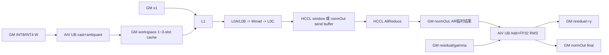
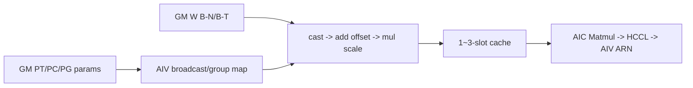

# InplaceWeightQuantMatmulAllReduceAddRmsNorm A2 ACLNN 算子知识

## 算子速览

| 项目 | 内容 |
|---|---|
| 实际入口 | `aclnnInplaceWeightQuantMatmulAllReduceAddRmsNormGetWorkspaceSize` / `aclnnInplaceWeightQuantMatmulAllReduceAddRmsNorm`；公开、已标记 deprecated 的两段式 ACLNN |
| 计算语义 | `z=AllReduce(x1@dequant(x2)+bias)`；`residual:=y=z+residual_old`；`normOut=y/sqrt(mean(y²)+epsilon)*gamma` |
| 输入输出 | `x1` FP16/BF16 ND 2D/3D；`x2` INT8/INT4 ND 2D；`residual/gamma/normOut` 与 `x1` 同 dtype；`residual` 同址写回 `y` |
| 执行类型 | `MIX_CV`：单个 `KERNEL_TYPE_MIX_AIC_1_2` Kernel 的 AIV 反量化/AIC Cube/AIV AddRmsNorm 分支；同图含 AICPU HCCL 通信节点 |
| Kernel 路线 | R-001～R-012：`bTrans × antiQuantType × hasAntiQuantOffset`；再由 ARN key 10/11/12/13/14 或 30/31/32/33 选择 Vector 尾段 |
| 核心资源 | GM、HCCL window/output、user workspace 最多三槽 weight cache/完成计数、AIC Matmul L1/L0A/L0B/L0C、AIV UB |
| 来源闭包 | `source_closed`：公开 ACLNN→共享非原地 API/inner bridge→Tiling→MIX Kernel/HCCL task→实际 body；generated inner bridge和公共 HCCL/Matmul内部为标注边界 |
| 验证状态 | 已完成源码闭包检查；本次知识提取未执行编译、真机、数值或性能测试。 |

## 接口与语义

### 计算语义

令 `M=prod(x1[:-1])`、`K=x1[-1]`、`N=residual[-1]`。权重反量化按 scale shape 分为 per-tensor、per-channel、per-group。Device `Mc2AntiQuant` 的真实顺序是 `W'=(cast(x2)+offset)*scale`，offset 为空时为 `W'=cast(x2)*scale`；公开文档公式写作 `x2*scale+offset`，两者不等价，本卡以实际 Kernel body 为实现事实并在限制中保留冲突。AIC计算 `x1@W'+bias`，逐 M tile提交 SUM AllReduce。每当一轮通信完成，AIV先把该轮 `z` 与 `residual_old` 搬入 UB，再原地写 `residual:=y=z+residual_old`；随后从 UB/已写回的 y 路线以 FP32计算平方和、均值、sqrt、倒数并乘 gamma，覆盖该轮 `normOut` 临时通信结果为最终归一化输出。FP16路线Add先在FP16完成再cast FP32；BF16路线两个加数先cast FP32，相加后 `CAST_RINT` 写 y，RMS中间为FP32。

### 输入、输出与属性

| 参数 | shape/layout | dtype | 约束、默认值与语义 |
|---|---|---|---|
| `x1` | `(s,k)`/`(b,s,k)` ND | FP16/BF16 | 不转置；M≤INT32_MAX，1≤K≤65535 |
| `x2` | 2D ND，逻辑 `(k,n)` 或转置view | INT8/INT4 | `IsTransposeLastTwoDims` 产生 `is_trans_b`；INT4内轴为偶数 |
| `bias` | 可空；非空 `(n)` | 与x1同 | BF16 bias由AIV0转FP32到workspace |
| `antiquantScale` | `(1)`、`(n)/(1,n)`、`(ceil(k/group),n)` | 与x1同 | 必需；shape决定PT/PC/PG |
| `antiquantOffset` | 可空；非空与scale同shape | 与scale同 | 存在性进入主key |
| `residual` | `(b,s,n)` ND | 与x1同 | 必需、连续；既是旧残差又是原地y |
| `gamma` | `(n)` ND | 与residual同 | 必需、连续 |
| `epsilon` | Host double→POD float | 标量 | `(0,1)`，默认1e-6 |
| `group` | Host string | char* | HCCL域；1/2/4/8卡，文档限定HCCS all-mesh |
| `reduceOp` | Host string | char* | 仅 `sum` |
| `commTurn` | Host int64 | 标量 | 仅0 |
| `streamMode` | Host int64 | 标量 | 仅 `NUM_ACL_STOP_ON_FAILURE`（值1） |
| `antiquantGroupSize` | Host int64 | 标量 | 0或32倍数，范围 `[32,min(K-1,INT_MAX)]` |
| `normOut` | 与residual同shape | 与residual同 | 先作MatMul/AllReduce临时区，再被RMSNorm最终值覆盖 |

### 入口与版本

固定 Commit 的无后缀最新公开入口即本接口；头文件声明计划在2026年12月之后的版本废弃，建议拆为 WeightQuantMatmulAllReduce 与 AddRmsNorm。文档只支持 Atlas A2，明确 A3、Ascend 950、200I/500 A2及旧产品不支持。原地第一段仅把 `residual` 同时作为共享非原地API的 `y` 参数传入，第二段直接转发；其它量化/非原地语义不并入本卡。

## Host/Launcher 执行流程

### 参数校验与前处理

原地接口转发到共享 weight-quant API。共享第一段依次检查 `x1/x2/residual/gamma`、`antiquantScale` 非空及K/N关系。任一必需张量为空时：K=0报参数错误，否则创建空executor、写 `workspaceSize=0` 并返回成功。非空时检查streamMode，然后 `InnerMatmulAllReduceAddRmsNormGetWorkspaceSize` 固定 `transposeX1=false`、由 `IsTransposeLastTwoDims(x2)` 得到 `transposeX2`，进入generated inner bridge。运行段遇 `workspace==nullptr || workspaceSize==0` 直接成功，否则inner执行非零统一转 `ACLNN_ERR_INNER`。

### 参数、Workspace 与生命周期

weight-quant tiler取得 `libApiWorkSpaceSize_`、AIC核数与UB大小；custom Matmul tiler给出 `workspaceNum + cache_slots*align_up(cache_elems,256)*sizeof(xType)`，其中 `cache_slots=min(3,cubeSingleNLoop)`。MC2还纳入BF16 bias区。AddRmsNorm声明 `16 MiB system + 256 B user`，外层复用MC2 system部分，最终 `workspace_total=mc2_workspace+256`。BF16 bias存在时，AIV0先把 bias 转为 FP32 写 `align_up(N,32)*4` 字节，`SyncAll<false>` 后所有核把工作指针后移 `biasLen`。反量化cache紧接其后；完成全部Matmul/Commit并再次 `SyncAll<false>` 后，ARN才把当前工作指针首8字节复用成 `rcvCntGM`。额外256B的精确Device切片在固定源码未显式出现，不推测。

executor拥有inner task、tiling payload与HCCL task；调用方workspace、输入输出和HCCL context需活到stream完成。Graph callback申请复用键 `kfc_stream` 的 `aicpu kfc server`，并用 `MatmulAllReduceGenTaskCallback` 生成通信task。

### 启动图与失败传播

```text
ACLNN -> shared API(y=residual) -> generated inner/OpDef
  -> WeightQuant MC2 tiling + AddRmsNorm tiling
    -> KFC AICPU HCCL task + one MIX_AIC_1_2 launch
      -> AIV dequant W -> workspace -> AIC Matmul -> Hccl::Commit
        -> AIV Hccl::Query -> Add+RMSNorm -> residual/normOut -> Finalize
```

Host任一步失败不launch；Kernel对null `workspaceGM`/user workspace直接返回。12个key之外没有Device fallback。`PostTiling`设置 `blockDim=aicCoreNum`、schedule mode 1，保证所有涉及 `SyncAll` 的核同时启动。

## Route 与参数设计

### 分核与资源计算

Host令 `M=x1[0]`（3D再乘x1[1]）、`K=x1[-1]`、`N=y[-1]`。通信tiler给出long/short M tile，写 `tileCnt/tailCnt/tailM`；每种M tile独立调用custom weight-quant tiler产生 `TCubeTiling`、AIC/AIV分核和 `vecSingleK/N`。ND INT8 默认向量块为：BF16 B-T `K×N=512×32`、BF16 B-N `32×512`、FP16 B-T `512×40`、FP16 B-N `48×512`；INT4/PG 路线再由真实UB字节式二分或full-load guard修订。cache槽数为 `min(3,cubeSingleNLoop)`。

AddRmsNorm对主/尾分别令 `numRow=tileM`、`numCol=N`、`blockFactor=ceil(numRow/AIV核数)`、`numBlocks=ceil(numRow/blockFactor)`。二级优先级：`N>ubFactor`→SplitD；否则 `blockFactor==1`→SingleN；否则 `align16(N)<=2000`→MergeN；否则 FP16且N已16对齐→MultiN（rowFactor为0回Normal）；其余Normal。B16初始ubFactor=12288，SplitD基准12096后按切片数16对齐。

### Route 选择

| 顺序 | Route | Key/模板 | 精确选择条件与优先级 | 不适用去向 |
|---:|---|---|---|---|
| 1 | R-001 | 2293772 / `<false,PT,false>` | scale size1；B不转置；offset空 | 其它组合或Host失败 |
| 2 | R-002 | 3342348 / `<false,PT,true>` | R-001+offset | 同上 |
| 3 | R-003 | 69402636 / `<true,PT,false>` | PT；B转置；offset空 | 同上 |
| 4 | R-004 | 70451212 / `<true,PT,true>` | R-003+offset | 同上 |
| 5 | R-005 | 4390924 / `<false,PC,false>` | scale sizeN、group=0；B不转置；offset空 | 同上 |
| 6 | R-006 | 5439500 / `<false,PC,true>` | R-005+offset | 同上 |
| 7 | R-007 | 71499788 / `<true,PC,false>` | PC；B转置；offset空 | 同上 |
| 8 | R-008 | 72548364 / `<true,PC,true>` | R-007+offset | 同上 |
| 9 | R-009 | 6488076 / `<false,PG,false>` | group合法；B不转置；offset空 | 同上 |
| 10 | R-010 | 73596940 / `<true,PG,false>` | group合法；B转置；offset空 | 同上 |
| 11 | R-011 | 7536652 / `<false,PG,true>` | R-009+offset | 同上 |
| 12 | R-012 | 74645516 / `<true,PG,true>` | R-010+offset | 无Device fallback |

```text
antiQuantType = scale_size==1 ? PT : groupSize>0 ? PG : PC
key = encode(CUSTOM_ANTIQUANT, hasOffset, antiQuantType, transA=false, transB, B_ND)
switch exact key -> R-001...R-012
ARN key = dtype*10 + mode(SplitD/SingleN/MergeN/MultiN/Normal priority above)
effective path = one weight route R-xxx + independently selected tile ARN route A-xx + optional tail ARN route A-yy
```

### 模板/实现执行矩阵

| Route | key/selector | dtype/shape/platform 完整命中条件 | 执行族与 kernel 节点 | 实际模板/body | 内存与同步特征 | tail/fallback |
|---|---|---|---|---|---|---|
| R-001/002 | 2293772/3342348 | A2；A16W8/W4；PT、B-N、offset0/1 | AIV→AIC→AICPU HCCL→AIV | `CustomKernel<...,false,PT,0/1,NONE>` | 标量参数；flag6/7/8/9；1～3槽cache | M/N/K tail；unknown key无输出 |
| R-003/004 | 69402636/70451212 | 同上但B-T | 同上 | `<...,true,PT,0/1,NONE>` | B行跳读、K内轴对齐 | 同上 |
| R-005/006 | 4390924/5439500 | PC、B-N | 同上 | `<...,false,PC,0/1,NONE>` | 每N tile搬参数 | 同上 |
| R-007/008 | 71499788/72548364 | PC、B-T | 同上 | `<...,true,PC,0/1,NONE>` | 参数broadcast+B跳读 | 同上 |
| R-009/011 | 6488076/7536652 | PG、B-N | 同上 | `<...,false,PG,0/1,NONE>` | K-group×N参数 | 同上 |
| R-010/012 | 73596940/74645516 | PG、B-T | 同上 | `<...,true,PG,0/1,NONE>` | full-load/非full-load参数布局 | 同上 |
| A-10/A-30 Normal | 10/30 | `N<=ubFactor`，非SingleN/MergeN/MultiN；FP16/BF16 | 同一MIX Kernel的AIV尾段 | `KernelAddRmsNorm<half/bfloat16_t>` | 单缓冲；逐行；`UB=3U*sizeof(T)+8U+256` | 行尾按blockFactor |
| A-11/A-31 SplitD | 11/31 | `N>12288`（FP16/BF16初值），U由12096按切片数回算 | 同上 | `KernelAddRmsNormSplitD<...>` | N分段，两遍读写y；`UB=4U*sizeof(T)+8U+36R+256` | col tail=`N-(jmax-1)U` |
| A-12/A-32 MergeN | 12/32 | 前序不命中且`align16(N)<=2000` | 同上 | `KernelAddRmsNormMergeN<...>` | 多行合并、输入/输出双缓冲；`UB=5U*sizeof(T)+8U+260R` | row/column padding |
| A-13/A-33 SingleN | 13/33 | 前序SplitD不命中且`blockFactor==1` | 同上 | `KernelAddRmsNormSingleN<...>` | 单行固定 `195584B` unitBuf | 每核一行 |
| A-14 MultiN | 14 | FP16，前序不命中，`N==align16(N)`，且计算得`rowFactor>0` | 同上 | `KernelAddRmsNormMultiN<half>` | 多行输入/输出双缓冲；`UB=16U+2*align16(N)+64R+256` | BF16无此key |

这里 `U=ubFactor`、`R=rowFactor`，UB公式单位为字节。FP16 Normal/SplitD/MergeN/SingleN/MultiN key为10/11/12/13/14；BF16为30/31/32/33，无MultiN。主/尾可分别选择不同ARN key和numBlocks，所以实际完整路径是12个weight specialization与主/尾ARN specialization的可达组合，不能把不同ARN body误当成同一执行Route。

### 隐藏性能 Guard

| Guard | Host/Tiling 条件 | Device/资源原因 | 影响 Route | 不满足时去向 | 源码符号 |
|---|---|---|---|---|---|
| A16W8/W4 | `isA16W8_\|\|isA16W4_` | 只编译weight-quant模板 | 全部 | tiler不可用 | `IsCapable` |
| 轴上界 | M≤INT32_MAX，K/N≤UINT16_MAX | POD/Cube/通信上界 | 全部 | Host失败 | `CheckAxisSize` |
| INT4内轴 | innerN偶数 | packed int4 | W4 | Host失败 | `CheckA16W4Shape` |
| BF16 bias | bias存在且BF16 | Matmul bias用FP32 | BF16 | AIV0 cast后SyncAll | `PreProcForBiasOnVector` |
| cache槽数 | `cache_slots=min(3,cubeSingleNLoop)`；Device索引仍为 `cubeNLoopIdx%3` | 一或两轮不多分配；三轮以上保持AIV领先AIC并防覆盖 | 全部 | flags 8/9 等待；无其它fallback | `GetWorkspaceSize/ProcessVector/ProcessCube` |
| HCCL send buffer | `useBufferType==WINDOW_IN && determinism!=1` | Matmul结果直接写本rank HCCL input window；否则保留初始`cGM=normOutGM` | 全部 | 确定性或非WINDOW_IN路线以`normOut`作send | `MatmulAllReduceBase::Init` |
| ARN mode | N、blockFactor、dtype、UB顺序谓词 | 各UB specialization容量 | 全部 | 下一mode/Normal | `SetAddRmsNormTilingData` |
| rank/comm | rank 1/2/4/8，sum，commTurn0，AICPU mode | A2通信接线 | 全部 | Host失败 | `CheckCommModeA2` |

### POD/ABI

固定自定义结构使用 `#pragma pack(8)`；`Mc2Msg` 为128B/align8，`RCSTiling` 为128B/align8，custom POD在 `TCubeTiling` 前的固定前缀为280B。令 `T=sizeof(TCubeTiling)`、`C=align_up(280+T,8)`、`S=256+2*C`，则outer的两个custom POD结束后才接ARN数据。公共 `TCubeTiling` 定义不在固定仓，因此 `T`、`C` 和outer最终 `sizeof` 不能化成数值；下列 offset 在该边界前均可由定宽字段直接闭合。未被当前custom body读取的兼容字段仍保留ABI位置，不赋予语义。

| 结构 | 字段 | 类型/位宽 | ABI 布局 | 单位 | Host/launcher producer | Device consumer | 边界 |
|---|---|---|---|---|---|---|---|
| outer | `weightQuantMatmulAllReduceTilingData` | nested/align8 | offset0，size=`S` | POD | helper/weight-quant tiler | MC2 base/custom body | 含msg/param/tile/tail |
| outer | `addRMSNormTileTilingData` | 28B/align4 | offset=`S` | POD | outer tiler | ARN tile body | 始终有效 |
| outer | `addRMSNormTailTilingData` | 28B/align4 | offset=`S+28` | POD | outer tiler | ARN tail body | `tailCnt=0`时不读 |
| outer | `addRmsNormTilingeKeyData` | 16B/align4 | offset=`S+56` | POD | outer tiler | ARN router | outer size=`align_up(S+72,8)` |
| `AddRMSNormTilingData` | `num_row` | uint32/32 | sizeof28/align4/offset0 | 行 | `SetTilingData(numRow)` | 分核、GM轮偏移 | 主/尾tile M |
| 同上 | `num_col` | uint32/32 | offset4 | 元素/行 | `gammaShape.GetShapeSize()` | 所有ARN body | 允许0的空域tiling |
| 同上 | `block_factor` | uint32/32 | offset8 | 行/核 | `ceil(numRow,numCore)` | 每核rowWork | 必须使numBlocks非0 |
| 同上 | `row_factor` | uint32/32 | offset12 | 行/UB批 | mode tiler | Normal/SplitD/MergeN/MultiN | MultiN为0时回Normal |
| 同上 | `ub_factor` | uint32/32 | offset16 | 元素 | mode tiler | UB分配/N切分 | 依dtype/mode |
| 同上 | `epsilon` | float32/32 | offset20 | 标量 | Host double经inner attr→float | RMS `Adds` | `(0,1)` |
| 同上 | `avg_factor` | float32/32 | offset24 | `1/N` | `numCol==0?0:1/N` | POD中保存；各body又按N重算 | N=0为0 |
| `AddRMSNormTilingeKeyData` | `ARNKeyTile` | uint32/32 | sizeof16/align4/offset0 | key | `tilingOutAddRmsNormTile_.tilingKey` | `AddRmsNorm` router | 10～14或30～33 |
| 同上 | `ARNKeyTail` | uint32/32 | offset4 | key | tail tiler | tail router | `tailCnt=0` inactive |
| 同上 | `ARNNumBlocksTile` | uint32/32 | offset8 | AIV核数 | tile tiler | `GetBlockIdx()<numBlocks` | ≤平台AIV核数 |
| 同上 | `ARNNumBlocksTail` | uint32/32 | offset12 | AIV核数 | tail tiler | tail ARN | `tailCnt=0` inactive |
| `Mc2Msg` | `preparePosition` | uint32/32 | sizeof128/align8/offset0 | 枚举 | `DoAllReduceTiling(true)`写1 | KFC任务准备 | weight-quant固定HCCL API |
| 同上 | `sendOff` | uint64/64 | offset8 | 字节/轮 | `M*N*sizeof(T)` | HCCL send步进 | 主tile |
| 同上 | `recvOff` | uint64/64 | offset16 | 字节/轮 | `M*columnNum*sizeof(T)` | HCCL recv步进 | debug可改columnNum |
| 同上 | `tailSendOff` | uint64/64 | offset24 | 字节/轮 | tail M公式 | tail HCCL | tail inactive为0 |
| 同上 | `tailRecvOff` | uint64/64 | offset32 | 字节/轮 | tail M公式 | tail HCCL | 同上 |
| 同上 | `sendCnt` | uint64/64 | offset40 | 元素/轮 | `M*N` | HCCL | 主tile |
| 同上 | `recvCnt` | uint64/64 | offset48 | 元素/轮 | `M*columnNum` | HCCL | 主tile |
| 同上 | `tailSendCnt` | uint64/64 | offset56 | 元素/轮 | tail tiler | HCCL | tail route |
| 同上 | `tailRecvCnt` | uint64/64 | offset64 | 元素/轮 | tail tiler | HCCL | tail route |
| 同上 | `totalCnt` | uint64/64 | offset72 | 元素 | `rankM*rankN` | KFC/HCCL | 乘法在uint64 |
| 同上 | `turnNum` | uint32/32 | offset80 | 轮 | `tileCnt+tailCnt` | handle/任务次数 | 与ARN终止计数一致 |
| 同上 | `tailNum` | uint32/32 | offset84 | 轮 | `tailCnt` | tail handle | 可0 |
| 同上 | `stride` | uint32/32 | offset88 | 字节步长 | 固定0 | HCCL | 当前route无跳写 |
| 同上 | `workspaceOff` | uint32/32 | offset92 | 字节 | `libApiWorkSpaceSize_` | KFC workspace | 32位字段窄化边界由公共库承担 |
| 同上 | `notifyOff` | uint32/32 | offset96 | 字节 | `sizeof(KFCMsgBody)` | notify队列 | 外部类型size边界 |
| 同上 | `notifyBeginCnt` | uint16/16 | offset100 | 个数 | `NOTIFY_WRITE_CNT` | KFC | 外部常量 |
| 同上 | `notifyEndCnt` | uint16/16 | offset102 | 个数 | 固定1 | KFC | 当前route |
| 同上 | `useBufferType` | uint8/8 | offset104 | 枚举 | window容量/确定性前的Host选择 | `Init`重定向`cGM` | window或output |
| 同上 | `funID` | uint8/8 | offset105 | 枚举 | `ALL_REDUCE_FUNC_ID` | KFC | AllReduce |
| 同上 | `dataType` | uint8/8 | offset106 | HCCL dtype | `geCType`映射 | HCCL | FP16/BF16 |
| 同上 | `groupNum` | uint8/8 | offset107 | 组数 | 固定1 | KFC | 单group |
| 同上 | `reuseMode` | uint8/8 | offset108 | 轮/槽语义 | `tileCnt+tailCnt`窄化 | buffer选择/KFC | 超255的保护在固定仓未见 |
| 同上 | `commType` | uint8/8 | offset109 | 枚举 | `HCCL_CMD_ALLREDUCE` | KFC | 固定 |
| 同上 | `reduceOp` | uint8/8 | offset110 | 枚举 | `sum`→HCCL SUM | HCCL | 其它值Host失败 |
| 同上 | `commOrder` | uint8/8 | offset111 | 枚举 | 固定1 | KFC | MM后通信 |
| 同上 | `waitPolicy` | uint8/8 | offset112 | 枚举 | 固定1 | KFC | 每轮等待 |
| 同上 | `rspPolicy` | uint8/8 | offset113 | 枚举 | 固定1 | KFC | 每轮响应 |
| 同上 | `exitPolicy` | uint8/8 | offset114 | 枚举 | 固定0 | KFC | 下发完成退出 |
| 同上 | `commAlg` | uint8/8 | offset115 | 枚举 | 固定0 | HCCL | default算法 |
| 同上 | `taskType` | uint8/8 | offset116 | 枚举 | `KFC_TASK_HCC_TASK_DELIVER` | KFC | 直接任务下发 |
| 同上 | `debugMode` | uint8/8 | offset117 | bitmask | 环境/tiler | Host/Device debug分支 | 非API语义 |
| 同上 | `stepSize` | uint8/8 | offset118 | 步长 | 固定仓当前赋值不可见 | KFC | 当前body不读 |
| 同上 | `sendArgIndex` | uint8/8 | offset119 | IR索引 | 固定0 | KFC | x1/cGM协议 |
| 同上 | `recvArgIndex` | uint8/8 | offset120 | IR索引 | `inputs+outputs-1` | KFC | 依Op IR顺序 |
| 同上 | `commOutArgIndex` | uint8/8 | offset121 | IR索引 | 固定仓当前赋值不可见 | KFC | `hasCommOut=1` |
| 同上 | `hasCommOut` | uint8/8 | offset122 | bool | HCCL API route写1 | KFC | 固定 |
| 同上 | `reserve` | uint8/8 | offset123 | 保留 | 无语义赋值 | 无当前consumer | 不得复用 |
| 同上 | `reserve2` | uint32/32 | offset124 | 保留 | 无语义赋值 | 无当前consumer | 不得复用 |
| `RCSTiling` | `rankDim` | uint32/32 | sizeof128/align8/offset0 | rank数 | `GetRankSize(group)` | HCCL/Device | 1/2/4/8 |
| 同上 | `rankID` | uint32/32 | offset4 | rank id | 公共tiler | 当前body未读 | 固定仓producer细节未闭合 |
| 同上 | `commtype` | uint32/32 | offset8 | 枚举 | AllReduce | `Mc2Msg.commType` | 固定 |
| 同上 | `subtype` | uint32/32 | offset12 | reduce枚举 | `sum`映射 | `Mc2Msg.reduceOp` | 非sum失败 |
| 同上 | `tileCnt` | uint32/32 | offset16 | 轮 | M切分 | MC2/ARN | 主轮数 |
| 同上 | `tailM` | uint32/32 | offset20 | 行 | M切分 | tail tiler | tail=0 inactive |
| 同上 | `tailCnt` | uint32/32 | offset24 | 轮 | M切分 | MC2/ARN | 可0 |
| 同上 | `biasLen` | uint32/32 | offset28 | 字节 | BF16 bias guard | workspace指针推进 | `align_up(N,32)*4`或0 |
| 同上 | `isAdd` | uint32/32 | offset32 | bool | x3存在性 | MC2 base | 本算子无x3，0 |
| 同上 | `rankM` | uint32/32 | offset36 | 行 | 原始M | Device/通信 | ≤INT32_MAX |
| 同上 | `rankN` | uint32/32 | offset40 | 元素 | 原始N | bias/通信 | ≤UINT16_MAX |
| 同上 | `rankK` | uint32/32 | offset44 | 元素 | 原始K | Device | ≤UINT16_MAX |
| 同上 | `gatherIndex` | uint32/32 | offset48 | 保留业务索引 | 当前route无赋值语义 | 当前body未读 | inactive |
| 同上 | `isTransposeA` | uint32/32 | offset52 | bool | 固定false | Device元数据 | 不支持true |
| 同上 | `isTransposeB` | uint32/32 | offset56 | bool | `IsTransposeLastTwoDims` | Tiling/key/body | 0/1 |
| 同上 | `storageGather` | uint32/32 | offset60 | bool | 当前route无语义 | 当前body未读 | inactive |
| 同上 | `nd2NzWorkLen` | uint64/64 | offset64 | 字节 | 当前ND route为0语义 | 当前body未读 | inactive |
| 同上 | `cToFloatLen` | uint64/64 | offset72 | 字节 | 当前route无语义 | 当前body未读 | inactive |
| 同上 | `gatherLen` | uint64/64 | offset80 | 字节 | 当前route无语义 | 当前body未读 | inactive |
| 同上 | `workspaceAddr4` | uint32/32 | offset88 | 字节offset | 公共tiler | 当前body未读 | inactive |
| 同上 | `aicCoreNum` | uint32/32 | offset92 | AIC核数 | platform | blockDim/PostTiling | `blockDim=aicCoreNum` |
| 同上 | `needUbBuffer` | uint32/32 | offset96 | bool | 公共tiler | 当前body未读 | inactive |
| 同上 | `addX3UbCnt` | uint32/32 | offset100 | 元素 | 仅isAdd时 | x3 add body | 本算子inactive |
| 同上 | `commWorkSpaceSize` | uint32/32 | offset104 | 字节 | 当前route无低bit通信 | 当前body未读 | inactive |
| 同上 | `isInputCommQuantScale` | uint32/32 | offset108 | bool | 无comm scale→0 | buffer tiler | 固定0 |
| 同上 | `dataType` | uint32/32 | offset112 | dtype枚举 | 公共tiler | 当前body未读 | 与xType一致 |
| 同上 | `commInt8WorkSpace` | uint32/32 | offset116 | 字节 | 无低bit通信 | 当前body未读 | 0语义 |
| 同上 | `dynamicQuantTempBuffSize` | uint32/32 | offset120 | 字节 | 无动态量化 | 当前body未读 | 0语义；尾部padding至128B |
| custom MM POD | `vecBlockDimN` | uint8/8 | offset0 | AIV N分核 | `ceil(taskNum,singleCoreVecLoop)` | `AntiquantWeight` | ≤AIV核数 |
| 同上 | `vecBlockDimK` | uint8/8 | offset1 | AIV K分核 | custom route固定1 | core映射 | 当前route1 |
| 同上 | `cubeBlockDimN` | uint8/8 | offset2 | AIC N分核 | Matmul tiler/cache | AIC映射/cache extent | 与M分核乘积为usedCoreNum |
| 同上 | `cubeBlockDimM` | uint8/8 | offset3 | AIC M分核 | Matmul tiler/cache | AIC映射/M tail | 同上 |
| 同上 | `cubeBlockDimK` | uint8/8 | offset4 | 兼容字段 | 当前custom route无语义赋值 | body未读 | inactive |
| 同上 | `kPadSize` | uint8/8 | offset5 | 元素 | B-T `kAlign-kSize` | 兼容/搬运元数据 | ≤255 |
| 同上 | `nPadSize` | uint8/8 | offset6 | 元素 | B-N `nAlign-nSize` | 兼容/搬运元数据 | ≤63 |
| 同上 | `haveBatchA` | uint8/8 | offset7 | bool | 固定0 | body兼容 | 不支持batch维 |
| 同上 | `haveBatchB` | uint8/8 | offset8 | bool | 固定0 | body兼容 | 不支持batch维 |
| 同上 | `reserve1` | uint8/8 | offset9 | 保留 | 无语义 | 无consumer | 不得复用 |
| 同上 | `reserve2` | uint8/8 | offset10 | 保留 | 无语义 | 无consumer | 不得复用 |
| 同上 | `reserve3` | uint8/8 | offset11 | 保留 | 无语义 | 无consumer | 不得复用 |
| 同上 | `vecSingleKGroupNum` | uint16/16 | offset12 | group数 | 当前body未读 | 兼容字段 | inactive |
| 同上 | `vecSingleKTailGroupNum` | uint16/16 | offset14 | group数 | 当前body未读 | 兼容字段 | inactive |
| 同上 | `AL1Pingpong` | uint16/16 | offset16 | depth | Matmul tiler/cache | 兼容/L1事实由TCube为准 | 不单独外推 |
| 同上 | `BL1Pingpong` | uint16/16 | offset18 | depth | 同上 | 同上 | 不单独外推 |
| 同上 | `vecSingleK` | uint32/32 | offset20 | 元素 | UB容量公式 | AIV K piece | K tail重算 |
| 同上 | `vecSingleN` | uint32/32 | offset24 | 元素 | UB容量公式 | AIV N piece | N tail重算 |
| 同上 | `vec2SingleM` | uint32/32 | offset28 | 兼容字段 | 当前route无语义 | body未读 | inactive |
| 同上 | `vecSingleKTail` | uint32/32 | offset32 | 兼容tail | 当前body按公式重算 | body未读 | inactive |
| 同上 | `vecSingleNTail` | uint32/32 | offset36 | 兼容tail | 当前body按公式重算 | body未读 | inactive |
| 同上 | `wInQueueSize` | uint32/32 | offset40 | 字节 | 当前body直接由shape InitBuffer | body未读 | inactive ABI |
| 同上 | `offsetInQueueSize` | uint32/32 | offset44 | 字节 | 同上 | body未读 | inactive ABI |
| 同上 | `scaleInQueueSize` | uint32/32 | offset48 | 字节 | 同上 | body未读 | inactive ABI |
| 同上 | `wOutQueueSize` | uint32/32 | offset52 | 字节 | 同上 | body未读 | inactive ABI |
| 同上 | `antiQuantTmpBufferSize` | uint32/32 | offset56 | 字节 | 同上 | body未读 | inactive ABI |
| 同上 | `vecCubeNRatio` | uint32/32 | offset60 | 比例 | 当前body未读 | 兼容字段 | inactive |
| 同上 | `vecCubeTailNRatio` | uint32/32 | offset64 | 比例 | 当前body未读 | 兼容字段 | inactive |
| 同上 | `vecCubeKRatio` | uint32/32 | offset68 | 比例 | 当前body未读 | 兼容字段 | inactive |
| 同上 | `vecCubeTailKRatio` | uint32/32 | offset72 | 比例 | 当前body未读 | 兼容字段 | inactive |
| 同上 | `cubeTailM` | uint32/32 | offset76 | 元素 | `Mc2CalcTailSize(M,singleCoreM)` | `SetTail` | 最后M核 |
| 同上 | `cubeTailN` | uint32/32 | offset80 | 元素 | `Mc2CalcTailSize(N,baseN)` | 兼容；body也按nOffset重算 | N tail |
| 同上 | `cubeSingleNLoop` | uint32/32 | offset84 | 轮/AIC | `ceil(cubeEachCoreN,baseN)` | AIC/AIV/cache槽 | ≥1非空域 |
| 同上 | `cubeSingleNTailLoop` | uint32/32 | offset88 | 轮 | 最后一N核公式 | 当前custom body未直接读 | 兼容 |
| 同上 | `repeatAxisMax` | uint32/32 | offset92 | 元素 | PG B-T repeat stride guard | AIV PG reshape | 255×block元素 |
| 同上 | `vecSingleKLoop` | uint64/64 | offset96 | 轮 | `ceil(K,vecSingleK)` | AIV任务映射 | K tail保护 |
| 同上 | `vecSingleNLoop` | uint64/64 | offset104 | 轮 | 主N范围公式 | AIV任务映射 | 主N核 |
| 同上 | `vecSingleKTailLoop` | uint64/64 | offset112 | 兼容轮数 | 当前body未读 | 无consumer | inactive |
| 同上 | `vecSingleNTailLoop` | uint64/64 | offset120 | 轮 | 尾N范围公式 | AIV最后cubeNLoop | 可小于主轮 |
| 同上 | `vec2SingleMLoop` | uint64/64 | offset128 | 兼容轮数 | 当前body未读 | 无consumer | inactive |
| 同上 | `kAlign` | uint64/64 | offset136 | 元素 | B layout对齐 | cache extent | B-T按weight block；workspace另按256对齐 |
| 同上 | `nAlign` | uint64/64 | offset144 | 元素 | B layout对齐 | UB/tiler | B-N按INT8/4内轴 |
| 同上 | `kSize` | uint64/64 | offset152 | 元素 | 原始K | DMA/PG/tail | ≤65535 |
| 同上 | `nSize` | uint64/64 | offset160 | 元素 | 原始N | DMA/core/tail | ≤65535 |
| 同上 | `groupSize` | uint64/64 | offset168 | 元素/group | API attr | PG参数映射 | 非PG为0 |
| 同上 | `mSize` | uint64/64 | offset176 | 行 | 当前M tile | Matmul tiler元数据 | 主/尾各自 |
| 同上 | `blockBatch` | uint64/64 | offset184 | batch分核 | cache tiler结果或0 | 当前body未读 | batch不支持 |
| 同上 | `shapeBatch` | uint64/64 | offset192 | batch数 | 固定1 | 当前body兼容 | 固定1 |
| 同上 | `mAubSize` | uint64/64 | offset200 | 元素 | 当前route无语义 | body未读 | inactive |
| 同上 | `kAubSize` | uint64/64 | offset208 | 元素 | 当前route无语义 | body未读 | inactive |
| 同上 | `nBubSize` | uint64/64 | offset216 | 元素 | 当前route无语义 | body未读 | inactive |
| 同上 | `kBubSize` | uint64/64 | offset224 | 元素 | 当前route无语义 | body未读 | inactive |
| 同上 | `mCubSize` | uint64/64 | offset232 | 元素 | 当前route无语义 | body未读 | inactive |
| 同上 | `nCubSize` | uint64/64 | offset240 | 元素 | 当前route无语义 | body未读 | inactive |
| 同上 | `mAL1Size` | uint64/64 | offset248 | 元素 | 当前route无语义 | body未读 | L1以TCube字段为准 |
| 同上 | `kAL1Size` | uint64/64 | offset256 | 元素 | 当前route无语义 | body未读 | 同上 |
| 同上 | `nBL1Size` | uint64/64 | offset264 | 元素 | 当前route无语义 | body未读 | 同上 |
| 同上 | `kBL1Size` | uint64/64 | offset272 | 元素 | 当前route无语义 | body未读 | 同上 |
| 同上 | `matmulTiling` | `TCubeTiling` | offset280，size/内部offset缺失 | Cube POD | MultiCoreMatmulTiling/cache | `MatmulImpl` | 固定仓外部ABI边界 |

### Route 源码闭包

| Route | Key/selector | Host/Tiling producer | POD/参数 | Kernel entry/router | Kernel body/直接依赖 | 构建接线 |
|---|---|---|---|---|---|---|
| R-001～R-012 | 上表12 key | alias tiler→WeightQuant tiler→Common ARN tiler | outer POD | inplace arch22 entry | MC2 weight-quant→custom MIX→ARN | inplace op_host CMake；依赖mc2/3rd/common/matmul_all_reduce*；910b auto-sync off |

## Kernel 实现

### 公共执行流程

所有route共用12个GM参数、同一 `TPipe`、`KERNEL_TYPE_MIX_AIC_1_2` 与 `blockDim=aicCoreNum`。宏初始把MatMul send地址 `cGM` 和AllReduce receive地址 `outputGM` 都绑定到 `normOutGM`；`Init`在 `useBufferType==WINDOW_IN && determinism!=1` 时仅将 `cGM` 重定向本rank HCCL input window，`outputGM` 仍是 `normOutGM`。ARN地址为 `{residualGM,gammaGM,yGM,normOutGM}`；原地入口的 `yGM` 与 `residualGM` 指向同一存储。`Init`在notify AIV0创建主/尾HCCL AllReduce handle。每个M tile由AIV反量化weight到workspace，AIC消费cache做MatMul并提交通信；全部MatMul轮次发出后，AIV用 `Query(handle)` 观察完成数并逐轮AddRmsNorm。两次 `SyncAll<false>` 包住ARN，最后notify核 `Finalize`。

### Route R-001：PT、B不转置、无offset

#### 适用条件

##### 选择证据

| 层级 | 文件 | 符号 | 源码谓词/参数 | 结果/下一跳 |
|---|---|---|---|---|
| API | `op_api/aclnn_inplace...cpp` | 第一段入口 | `y=residual`转发 | 原地语义 |
| Host/Tiling | `weight_quant_matmul_all_reduce_tiling.cpp` | `GetAntiQuantType/GetTilingKey` | scale size1、group0、B-N、offset空 | key 2293772 |
| Router | inplace Kernel entry | key分支 | `TILING_KEY_IS(2293772)` | `<false,PER_TENSOR,false>` |
| ARN | `common_add_rms_norm_tiling.cpp` | mode selector | N/blockFactor/dtype | key10～14/30～33 |

#### Device 数据流

##### 函数级调用链

```text
entry -> macro -> op.Init -> op.Process
  -> InnerProcess -> mmOp.Init/Process
    -> AIV ProcessVector -> WeightCopyInAndCast -> Mc2AntiQuant -> WeightCopyOut(workspace)
    -> AIC ProcessCube -> MatmulImpl::IterateAll(cGM: HCCL window or normOut)
    -> PostProcEachTurn -> Hccl::Commit
  -> SyncAll -> AIV AddRmsNormKernel::ComputeAddRmsNorm(Query)
    -> selected KernelAddRmsNorm*::ComputeProcess
  -> SyncAll -> Hccl::Finalize
```

##### 源码等价伪码

```text
scale = antiquantScale[0]
for each M tile/tail:
  AIV: cast assigned W piece; wDeq=w*scale; write cache[nLoop%3]; signal AIC
  AIC: wait; Matmul(x1Tile,cache,bias)->sendBufferTile; signal cache reusable
  all cores sync; notify AIV0 Commit(AllReduce)
for completed=Query(main/tail handles):
  AIV0 publish count; DCCI; all AIV sync
  for new turns:
    load allreduceResult(normOut) and residual_old before either alias is overwritten
    residual(y)=allreduceResult+residual_old
    normOut=rmsnorm(y,gamma)
all cores sync; AIV0 Finalize
```

#### 内存与数据搬运

##### 资源与搬运表

| 层级/缓冲区 | offset/地址公式 | extent/容量公式 | dtype/layout | producer | consumer | owner/lifetime | 对齐/复用 |
|---|---|---|---|---|---|---|---|
| GM x1 | `turn*aAddrOffset+mOffset*K` | tileM×K | FP16/BF16 ND | caller | Matmul | caller/stream | M tail由TCube |
| GM weight | `kOffset*N+originNOffset` | blockCount=vecK，blockLen=vecN×sizeof(W) | INT8/packed INT4 ND | caller | AIV | caller | INT4长度/stride除2 |
| AIV UB weight | `weightShape=vecK*align(vecN,32B/W)` | W queue+xType/fp32 temps+参数 | W→FP16→xType | MTE/V | antiquant | 当前piece | output queue depth2 |
| workspace cache | `slot*cacheAlignElems+pieceOffset`，slot=`nLoop%3` | `cacheSlots*cacheAlignElems*sizeof(xType)`；`cacheSlots=min(3,cubeSingleNLoop)` | xType ND | AIV | AIC B | 所有MM轮结束前 | 起点512B对齐；元素数向256对齐 |
| L1/L0A/B/C | `TCubeTiling`决定 | 固定仓公共Matmul库内部计算 | xType/acc traits | MatmulImpl | Mmad/Fixpipe | Cube tile | 数值缺失，不推测 |
| HCCL send buffer | `turn*cAddrOffset+mOffset*N+nOffset` | tileM×N×sizeof(T) | T ND | AIC Fixpipe | HCCL | 至该轮Commit消费 | `useBufferType=WINDOW_IN && determinism!=1`时为local-rank window，否则为`normOut` |
| GM normOut临时/最终 | `turn*cAddrOffset+mOffset*N+nOffset` | tileM×N×sizeof(T) | T ND | HCCL output→ARN | ARN→caller | Query完成前是AllReduce结果，ARN后是最终norm | 同一地址分阶段复用；ARN先搬入UB再覆盖 |
| GM residual/y | 同址 | M×N×sizeof(T) | T ND | caller旧残差→ARN Add | ARN RMS/caller | caller全程持有 | 每行先搬旧值入UB，再原地写y |
| ARN UB Normal | 当前行/row批 | `3*ubFactor*sizeof(T)+8*ubFactor+256` | T/FP32 | MTE2 | Vector | 当前行 | single buffer |

##### 分层内存布局



##### 字节账、交接边与复用顺序

```text
workspace_total = mc2_workspace + 256
mc2_workspace >= 16 MiB system workspace and includes custom-MM requirement + optional BF16 bias region
bias_region(BF16,bias) = align_up(N,32)*4 bytes
cache_slots = min(3,cubeSingleNLoop)
cache_elems(B-N) = kAlign*singleCoreN*cubeBlockDimN
cache_elems(B-T) = align_up(kSize,256)*singleCoreN*cubeBlockDimN
weight_cache = cache_slots*align_up(cache_elems,256)*sizeof(xType)
ARN_Normal_UB = 3*ubFactor*sizeof(T)+8*ubFactor+256 bytes
ARN_SplitD_UB = 4*ubFactor*sizeof(T)+8*ubFactor+36*rowFactor+256 bytes
ARN_MergeN_UB = 5*ubFactor*sizeof(T)+8*ubFactor+260*rowFactor bytes
ARN_SingleN_UB = 195584 bytes
ARN_MultiN_FP16_UB = 16*ubFactor+2*align16(N)+64*rowFactor+256 bytes
L1/L0 = TCubeTiling-dependent; exact bytes unavailable in fixed repository
```

| 边/复用子区 | producer | offset/extent | dtype/layout | consumer | ordering/sync | owner/lifetime | 安全条件 |
|---|---|---|---|---|---|---|---|
| AIV→AIC weight | `WeightCopyOut` | slot=`nLoop%3` | xType ND | `SetTensorB` | flags8/9，族内flags6/7 | workspace/turn | 覆盖前等待AIC |
| AIC→HCCL | `IterateAll` | turn×tileM×N | T ND | AllReduce | `Mc2SyncAll`→Commit | window或normOut send buffer | Matmul完成；buffer选择见`Init` |
| HCCL→ARN | AllReduce | 同turn | T ND | ARN | Query count+DCCI+SyncAll | normOut | 只读完成轮 |
| normOut临时→最终 | ARN `CopyIn` | 同一轮tile | T ND→UB FP32/T | ARN `CopyOutY` | 同AIV队列/event/pipe | caller的normOut存储 | 先完成输入搬运和计算，后覆盖相同GM地址 |
| residual旧值→y | ARN Add（`CopyIn/CopyInX`已载入旧值） | 与caller residual同一GM地址 | T UB→ND | y store（直接`DataCopyCustom`或`CopyOutX`） | MTE2/V/MTE3队列或event | caller的residual存储 | 当前行/分段旧值已进入UB后才原位写回 |
| cache→rcvCnt | MM cache | 当前workspace首8B | int64 | ARN AIV | MM结束后的SyncAll | kernel | 不再读weight cache |

#### 同步、精度与尾块

##### 同步与数值边界表

| 阶段 | primitive/机制 | producer | consumer/等待点 | 保护对象 | 精度/尾块 |
|---|---|---|---|---|---|
| weight流水 | flags6/7/8/9，PIPE_MTE3/FIX | AIV/AIC | `WaitForVector/Cube` | 1～3槽cache | N/K最后piece重算长度；3轮以上才发生槽复用 |
| Matmul→comm | `Mc2SyncAll`+Commit | AIC/AIV | notify AIV0 | C tile | Cube `SetTail` |
| comm→ARN | Query+DCCI+SyncAll | HCCL/AIV0 | 全AIV | count/result | 主/尾handle分别累计 |
| Add/RMS | PipeBarrier、V↔S event | Vector | 同核下一阶段 | UB行 | FP32归约；BF16 RINT |
| finalize | SyncAll+Finalize | ARN | notify核 | handles | 等全部轮 |

#### 关键实现

##### 符号证据表

| 阶段 | 文件 | 符号/模板实例 | 实现事实 |
|---|---|---|---|
| Host/Tiling producer | `weight_quant_matmul_all_reduce_tiling.cpp` | `GetTilingKey/DoWeightQuantTiling` | key、主尾tiling |
| Kernel entry/router | inplace arch22 Kernel | key2293772 | PT/B-N/no-offset实例 |
| Device body/helper | `weight_quant_batch_matmul_v2_custom*.h` | `ProcessVector/ProcessCube` | MIX反量化与Cube |
| Device body/helper | `add_rms_norm_kernel.h` | `ComputeAddRmsNorm` | Query后逐轮ARN |

### Route R-002～R-012：模板差分

#### 适用条件

##### 选择证据

精确key/条件见“Route选择”。`bTrans`改变B的GM blockCount/stride及 `SetTensorB(...,true)`；PC每个N tile搬参数并可能broadcast；PG按当前K piece覆盖的group搬二维参数；`hasAntiQuantOffset=true` 才读取offset并在scale乘法前加。MC2/HCCL/ARN图相同，但这些constexpr差分不合并为同一key。

#### Device 数据流

##### 函数级调用链

```text
R-002...R-012 -> R-001 common chain
  -> specialized bTrans / antiQuantType / hasAntiQuantOffset
    -> CopyInAntiquantParams -> WeightCopyInAndCast -> Mc2AntiQuant
```

##### 源码等价伪码

```text
params = PT scalar | PC[N tile] | PG[covered K groups,N tile]
if bTrans: copy W as N rows with K blockLen/stride
else: copy W as K rows with N blockLen/stride
w=cast(W); if hasOffset: w+=broadcast(offset); w*=broadcast(scale)
BF16 path computes in FP32 and CAST_RINT to cache
```

#### 内存与数据搬运

##### 资源与搬运表

| 层级/缓冲区 | offset/地址公式 | extent/容量公式 | dtype/layout | producer | consumer | owner/lifetime | 对齐/复用 |
|---|---|---|---|---|---|---|---|
| 参数UB | `ComputeAntiquantShape()` | PT/PC=`align(vecN,32B/T)`；PG按transpose/full-load公式 | xType→FP32(BF16) | GM参数 | antiquant | piece | offset false时不读 |
| B GM | T:`originN*K+kOffset`；N:`kOffset*N+originN` | T:N blocks×K bytes；N:K blocks×N bytes | packed W | caller | AIV | stream | W4 bytes/stride÷2 |
| cache/Cube/HCCL/ARN | 与R-001相同 | 共同POD决定 | xType/T | common body | common body | kernel | transpose仅改B地址 |

##### 分层内存布局



##### 字节账、交接边与复用顺序

沿用R-001；BF16另分配 `weightShape*4` FP32权重临时区，B转置BF16再分配 `antiquantShape*4` 参数转换区。参数UB随PT/PC/PG变化；跨族边、count和workspace lifetime不变。

#### 同步、精度与尾块

##### 同步与数值边界表

| 阶段 | primitive/机制 | producer | consumer/等待点 | 保护对象 | 精度/尾块 |
|---|---|---|---|---|---|
| 参数搬运 | TQue+DataCopyPad+Brcb | GM | antiquant | scale/offset | PC N-tail、PG group-tail |
| BF16 antiquant | FP16→FP32→BF16 | AIV | cache | weight | CopyOut RINT |
| INT4 unpack | Cast+byte-adjusted DMA | GM | temp | packed W | length/stride÷2 |
| 后续 | 同R-001 | AIV/AIC/HCCL | ARN | cache/result | 同R-001 |

#### 关键实现

##### 符号证据表

| 阶段 | 文件 | 符号/模板实例 | 实现事实 |
|---|---|---|---|
| Host/Tiling producer | weight-quant tiler | `GetWeightQuantMatmulTPLParam` | 编码T/PC/PG/offset |
| Kernel entry/router | inplace arch22 Kernel | 其余11 key | key到模板实参 |
| Device body/helper | `weight_quant_batch_matmul_v2_common.h` | 参数/反量化helpers | route差分 |

## 算子特定优化

### Trick T-001：最多三槽反量化 Weight Cache 的 AIV/AIC 流水

#### 触发与源码依据

- 适用 Route：R-001～R-012
- 触发条件：ND custom specialization；`cubeSingleNLoop>=3` 时形成三槽稳态流水，1/2轮只分配1/2槽
- Golden 来源：[`weight_quant_batch_matmul_v2_custom.h:143-157`](../../../../../../../cann-ops-raw/ascendc/ops-transformer/be33d95bb755cedec3108f70805c1874d1792540/mc2/3rd/weight_quant_batch_matmul_v2/op_kernel/weight_quant_batch_matmul_v2_custom.h#L143-L157)

**官方源码（固定 Commit 连续逐字摘录）**：

```cpp
    for (int32_t cubeNLoopIdx = 0; cubeNLoopIdx < this->tiling_->cubeSingleNLoop; cubeNLoopIdx++) {
        uint64_t nBaseOffset = cubeNLoopIdx * nBaseSize;
        uint64_t nLoopLimit = this->tiling_->vecSingleNLoop;
        if (unlikely(cubeNLoopIdx + 1 == this->tiling_->cubeSingleNLoop)) {
            nLoopLimit = this->tiling_->vecSingleNTailLoop;
            nRealSize = this->tiling_->nSize - nBaseOffset;
        }
        // 为节约workspace空间，weight缓存空间整体分成WEIGHT_CACHE_COUNT块轮询使用，需要根据cubeNLoopIdx确定当前使用哪块地址
        this->weightCacheIdx_ = cubeNLoopIdx % this->WEIGHT_CACHE_COUNT;

        this->AntiquantWeight(cubeNLoopIdx, nBaseOffset, nRealSize, nLoopLimit, weightSplitInfo);

        CrossCoreSetFlag<SYNC_MODE0, PIPE_MTE3>(this->SYNC_AIV_ONLY_ALL_FLAG);
    }
    NotifyCube();
```

#### 机制与设计原因

AIV把weight反量化成xType写workspace，AIC从对应槽作TensorB。Host只分配 `min(3,cubeSingleNLoop)` 槽；Device以常量3取模，因此三轮以上才循环覆盖。flag8通知AIC数据可见，flag9允许覆盖；flags6/7收束族内多核。该协议让AIV领先，同时保护仍被AIC读取的槽。

#### 迁移边界

- 适用：AIV生产、AIC消费且经GM workspace交接的MIX Kernel
- 前提：core mapping、cache容量、flag ID/PIPE与auto-sync off协议一致
- 失效：槽数、N loop调度或core mapping改变时需重证防覆盖；少于三轮不能假设存在三槽；NZ/arch35不可直接套用
- 未验证：本次知识提取未执行编译、真机、数值或性能测试。

#### 错误做法

在三轮以上路线移除 `WaitForCube` 或强制降为单槽会覆盖仍被AIC读取的数据；固定源码的显式等待就是反例。

### Trick T-002：按 HCCL 完成轮数渐进执行 AddRmsNorm

#### 触发与源码依据

- 适用 Route：R-001～R-012
- 触发条件：AIV进入 `ComputeAddRmsNorm`
- Golden 来源：[`add_rms_norm_kernel.h:63-67`](../../../../../../../cann-ops-raw/ascendc/ops-transformer/be33d95bb755cedec3108f70805c1874d1792540/mc2/matmul_all_reduce_add_rms_norm/op_kernel/add_rms_norm_kernel.h#L63-L67)

**官方源码（固定 Commit 连续逐字摘录）**：

```cpp
                const uint32_t curCnt = GetCurFinishedCnt();
                if (curCnt <= lastCnt) {
                    continue;
                }
                *rcvCntGM = curCnt;
```

#### 机制与设计原因

block0查询主/尾handle并把单调完成数写GM、DCCI；全AIV SyncAll后消费 `[addRmsNormCount,lastCnt]`，无需等全部AllReduce结束。主/尾各用自己的tiling和handle，地址按 `num_row*num_col*sizeof(T)`推进。

#### 迁移边界

- 适用：collective提供可查询轮次，后处理只依赖对应轮结果
- 前提：count全AIV可见、Query单调、结果按M tile连续
- 失效：通信乱序、非连续布局或无DCCI/同步时不可复用
- 未验证：本次知识提取未执行编译、真机、数值或性能测试。

#### 错误做法

各核独立Query或去掉DCCI/SyncAll可能提前读取未归约数据；源码用block0集中发布规避。

### Trick T-003：AddRmsNorm 按 N/行分核选择五种 UB 路线

#### 触发与源码依据

- 适用 Route：全部route的ARN二级分支
- 触发条件：依次判断N、blockFactor、对齐、dtype与rowFactor
- Golden 来源：[`common_add_rms_norm_tiling.cpp:222-251`](../../../../../../../cann-ops-raw/ascendc/ops-transformer/be33d95bb755cedec3108f70805c1874d1792540/mc2/matmul_all_reduce_add_rms_norm/op_host/op_tiling/arch22/common_add_rms_norm_tiling.cpp#L222-L251)

**官方源码（固定 Commit 连续逐字摘录）**：

```cpp
    uint32_t modeKey = ModeKey::K_NORMAL; // 0: Normal, 1: SplitD, 2: MergeN, 3: SingleN 4: MultiN
    uint32_t numColAlign = Ops::Base::CeilDiv(numCol, static_cast<int64_t>(BLOCK_ALIGN_NUM)) * BLOCK_ALIGN_NUM;
    uint32_t rowFactor = VALUE_64;
    uint64_t ubSize;
    const auto& ascendcPlatform = platform_ascendc::PlatformAscendC(&addRmsNormTilingDepend.platFormInfos);
    ascendcPlatform.GetCoreMemSize(platform_ascendc::CoreMemType::UB, ubSize);
    if (numCol > ubFactor) {
        modeKey = ModeKey::K_SPLIT_D;
        ubFactor = (dataType == ge::DT_FLOAT) ? UB_FACTOR_B32_CUTD : UB_FACTOR_B16_CUTD;
        uint32_t colTileNum = Ops::Base::CeilDiv(numCol, static_cast<int64_t>(ubFactor));
        ubFactor = Ops::Base::CeilDiv(numCol, static_cast<int64_t>(colTileNum * BLOCK_ALIGN_NUM)) * BLOCK_ALIGN_NUM;
    } else if (blockFactor == 1) {
        modeKey = ModeKey::K_SINGLE_N;
    } else if (numColAlign <= SMALL_REDUCE_NUM) {
        modeKey = ModeKey::K_MERGE_N;
        uint64_t numColAlignWeight = (dtypeKey == DTYPE_KEY_FP32) ? 24 : 18;
        rowFactor = ubSize / (numColAlign * numColAlignWeight + COL_ALIGN_SIZE);
        ubFactor = rowFactor * numColAlign;
    } else if (dataType == ge::DT_FLOAT16 && numCol == numColAlign) {
        modeKey = ModeKey::K_MULTI_N;
        MC2_CHECK_TRUE_RET(addRmsNormTilingDepend.nodeName, ubSize >= VALUE_1024 + VALUE_256 + numColAlign * VALUE_2);
        MC2_CHECK_TRUE_RET(addRmsNormTilingDepend.nodeName, numColAlign * VALUE_16 + VALUE_64 != 0);
        // reserve 1024byte
        rowFactor = (ubSize - VALUE_1024 - VALUE_256 - numColAlign * VALUE_2) / (numColAlign * VALUE_16 + VALUE_64);
        ubFactor = rowFactor * numColAlign;
        if (rowFactor == 0) {
            modeKey = ModeKey::K_NORMAL;
            rowFactor = VALUE_64;
            ubFactor = UB_FACTOR_B16;
        }
```

#### 机制与设计原因

SplitD分段N并先写y、汇总平方和，再读y归一化；SingleN用固定195584B buffer；MergeN/MultiN合批多行，MultiN双缓冲；Normal逐行。主/尾M可分别选择，避免用最大M/N配置覆盖所有轮。

#### 迁移边界

- 适用：逐末维RMSNorm且Add结果也需输出
- 前提：按平台UB、dtype、16元素对齐和核数重算
- 失效：BF16无MultiN；N超factor必走SplitD；rowFactor=0回Normal
- 未验证：本次知识提取未执行编译、真机、数值或性能测试。

#### 错误做法

固定源码在MultiN `rowFactor==0` 时回Normal，证明不能只因FP16/N对齐就强制MultiN。

### Trick T-004：offset 是零点项，先加后乘 scale

#### 触发与源码依据

- 适用 Route：R-002/R-004/R-006/R-008/R-011/R-012
- 触发条件：`hasAntiQuantOffset=true`；PT/PC/PG和B转置状态不改变运算顺序
- Golden 来源：[`anti_quant.h:267-276`](../../../../../../../cann-ops-raw/ascendc/ops-transformer/be33d95bb755cedec3108f70805c1874d1792540/mc2/3rd/weight_quant_batch_matmul_v2/op_kernel/anti_quant.h#L267-L276)

**官方源码（固定 Commit 连续逐字摘录）**：

```cpp
    uint32_t calCount = src.GetSize();
    if constexpr (IsSameType<SrcDataType, float>::value || IsSameType<SrcDataType, half>::value) {
        // preprocess: f32->f32
        // preprocess: f16->f16
        if constexpr (HasOffset) {
            Adds(src, src, offset, calCount);
            PipeBarrier<PIPE_V>();
        }
        Muls(dst, src, scale, calCount);
        PipeBarrier<PIPE_V>();
```

#### 机制与设计原因

offset在模板期决定是否执行，实际数据流是 `dst=(src+offset)*scale`；BF16先把weight和参数转FP32执行相同次序，再以 `CAST_RINT` 回BF16 cache。PC/PG的broadcast helper也保持Add→barrier→Mul。这样offset语义不能改写成乘后加。

#### 迁移边界

- 适用：复用本custom antiquant实例的PT/PC/PG路线
- 前提：offset沿用本实现的零点表示；dtype、broadcast shape和group映射一致
- 失效：若上层参数把offset定义成已缩放加数，必须先换算，不能直接代入本Kernel
- 未验证：本次知识提取未执行编译、真机、数值或性能测试。

#### 错误做法

公开文档公式写作 `x2*scale+offset`，但固定Device源码明确先 `Adds` 后 `Muls`；直接照文档交换顺序会改变非零offset结果。

## 模板与实现对比

| 对比维度 | R-001/002 PT-BN | R-003～R-012 T/PC/PG | 设计选择依据 |
|---|---|---|---|
| 命中条件/优先级 | scale size1、B-N | transpose、shape/group、offset组合 | 12互斥key |
| 执行族/节点图 | AIV→AIC→AICPU→AIV | 相同 | 反量化specialization差分 |
| M/N/K、tile与scheduler | 公式化M切分 | PG/T改变K/N piece | Matmul和通信共切M |
| workspace/L1/L0/UB | 标量参数、1～3槽cache | 参数UB/T跳读/BF16 FP32 temp | layout/shape决定 |
| AIC/AIV交接 | flags6/7/8/9 | 相同 | 显式同步协议 |
| 同步、精度与tail | scalar、offset可选 | group-tail、broadcast、RINT | constexpr固定顺序 |
| fallback/失败边界 | unknown key无输出 | 同上 | 无Device fallback |

## 平台差异

| 项目 | A2 | A3 | 950 |
|---|---|---|---|
| 支持状态 | 公开支持 | 公开文档明确不支持 | 公开文档明确不支持950PR/DT |
| Host/Launcher | ascend910b；AICPU KFC/HCCL | 不发布 | 不发布 |
| Kernel/资源 | arch22、MIX_AIC_1_2 | 不得从其它MC2外推 | 不得从arch35公共依赖外推 |

## 限制与失败边界

- 接口已deprecated；固定源码仍公开闭合，新实现应优先评估拆分接口。
- 公开文档把反量化写成 `x2*scale+offset`，而实际 `anti_quant.h` 的所有当前custom分支均先Add offset再Mul scale，即 `(x2+offset)*scale`；非零offset调用方必须按Device顺序理解，不能静默交换。
- 仅sum、commTurn=0、streamMode=1、A2 comm mode缺省/`ai_cpu`；rank仅1/2/4/8且文档限定HCCS all-mesh。
- 必需输入空且K非0会返回空executor/0 workspace，不launch且不保证写输出；K=0报错。
- unknown主key/ARN key无fallback；Host/binary不一致会不写相应结果。
- `Mc2Msg.reuseMode` 是uint8，Host直接赋 `tileCnt+tailCnt`；`workspaceOff` 是uint32，Host直接赋 `libApiWorkSpaceSize_`。固定仓未见显式窄化检查，超出字段范围的配置不得视为已支持。
- 固定仓缺公共 `TCubeTiling` 定义、Matmul库内部L1/L0容量计算及generated inner bridge源码，未推测补齐。
- 本次知识提取未执行编译、真机、数值或性能测试；确定性环境变量、HCCL可见性与原地别名运行行为未验证。

## 源码索引

### 链路索引

| 链路阶段 | 文件 | 关键符号 | 支撑内容 |
|---|---|---|---|
| 入口声明/约束 | `mc2/inplace_matmul_all_reduce_add_rms_norm/docs/aclnnInplaceWeightQuantMatmulAllReduceAddRmsNorm.md` | 产品表/约束 | A2支持、A3/950不支持、参数 |
| 入口声明/约束 | `mc2/inplace_matmul_all_reduce_add_rms_norm/op_api/aclnn_inplace_weight_quant_matmul_all_reduce_add_rms_norm.h` | 两段API | 签名/deprecated |
| 入口实现 | `mc2/inplace_matmul_all_reduce_add_rms_norm/op_api/aclnn_inplace_weight_quant_matmul_all_reduce_add_rms_norm.cpp` | 两入口 | residual绑定y |
| 入口实现 | `mc2/matmul_all_reduce_add_rms_norm/op_api/aclnn_weight_quant_matmul_all_reduce_add_rms_norm.cpp` | 共享API | 校验/空域/错误 |
| 入口实现 | `mc2/matmul_all_reduce_add_rms_norm/op_api/matmul_all_reduce_arn_util.cpp` | `Inner...` | transpose/inner参数 |
| Host定义 | `mc2/inplace_matmul_all_reduce_add_rms_norm/op_host/inplace_matmul_all_reduce_add_rms_norm_def.cpp` | OpDef | dtype/A2/MC2 group |
| Host/Tiling | `mc2/inplace_matmul_all_reduce_add_rms_norm/op_host/op_tiling/arch22/inplace_weight_quant_matmul_all_reduce_add_rms_norm_tiling.cpp` | alias/register | 原地复用共享tiler |
| Host/Tiling | `mc2/matmul_all_reduce_add_rms_norm/op_host/op_tiling/arch22/weight_quant_matmul_all_reduce_add_rms_norm_tiling.cpp` | outer tiler | ARN/workspace/blockDim |
| Host/Tiling | `mc2/matmul_all_reduce_add_rms_norm/op_host/op_tiling/arch22/common_add_rms_norm_tiling.cpp` | ARN tiler | 二级route/UB |
| Host/Tiling | `mc2/matmul_all_reduce/op_host/op_tiling/arch22/weight_quant_matmul_all_reduce_tiling.cpp` | weight tiler | 12key/custom MM |
| Host/Tiling | `mc2/matmul_all_reduce/op_host/op_tiling/matmul_all_reduce_tiling_base.cpp` | base tiler | M切分/HCCL/guard |
| POD/ABI | `mc2/matmul_all_reduce_add_rms_norm/op_kernel/matmul_all_reduce_add_rms_norm_tiling_data.h` | TilingData | outer/ARN字段 |
| POD/ABI | `mc2/common/op_kernel/mc2_tiling_struct.h` | `Mc2Msg/RCSTiling` | HCCL消息与MC2通信POD |
| POD/ABI | `mc2/3rd/weight_quant_batch_matmul_v2/op_kernel/weight_quant_batch_matmul_v2_tiling_data.h` | custom TilingData | 反量化/Cube字段与ABI前缀 |
| Host/Tiling | `mc2/3rd/weight_quant_batch_matmul_v2/op_host/op_tiling/weight_quant_batch_matmul_v2_tiling_custom.cpp` | custom tiler | 分核、UB与workspace槽数 |
| Kernel entry/body | `mc2/inplace_matmul_all_reduce_add_rms_norm/op_kernel/arch22/inplace_matmul_all_reduce_add_rms_norm.cpp` | entry/router | MIX/12key |
| Kernel body | `mc2/matmul_all_reduce_add_rms_norm/op_kernel/mm_allreduce_add_rms_norm_weight_quant.h` | Process/macro | GM绑定/阶段顺序 |
| Kernel body | `mc2/matmul_all_reduce/op_kernel/arch22/matmul_all_reduce_base.h` | Init/PostProc | HCCL handle/commit |
| Kernel body | `mc2/3rd/weight_quant_batch_matmul_v2/op_kernel/weight_quant_batch_matmul_v2_custom.h` | ProcessVector/Cube | MIX流水 |
| Kernel body | `mc2/3rd/weight_quant_batch_matmul_v2/op_kernel/weight_quant_batch_matmul_v2_common.h` | antiquant helpers | UB/cache/DMA/精度 |
| Kernel body | `mc2/3rd/weight_quant_batch_matmul_v2/op_kernel/anti_quant.h` | `Mc2AntiQuant` | offset先Add、scale后Mul |
| Kernel body | `mc2/matmul_all_reduce_add_rms_norm/op_kernel/add_rms_norm_kernel.h` | ComputeAddRmsNorm | Query/router |
| Kernel body | `mc2/matmul_all_reduce_add_rms_norm/op_kernel/add_rms_norm.h` | Normal body | Add/RMS/UB |
| Kernel body | `mc2/matmul_all_reduce_add_rms_norm/op_kernel/add_rms_norm_split_d.h` | SplitD body | N分段/两遍y |
| Kernel body | `mc2/matmul_all_reduce_add_rms_norm/op_kernel/add_rms_norm_merge_n.h` | MergeN body | 小N多行合并 |
| Kernel body | `mc2/matmul_all_reduce_add_rms_norm/op_kernel/add_rms_norm_single_n.h` | SingleN body | 单行专用路线 |
| Kernel body | `mc2/matmul_all_reduce_add_rms_norm/op_kernel/add_rms_norm_multi_n.h` | MultiN body | FP16多行双缓冲 |
| 构建/任务接线 | `mc2/inplace_matmul_all_reduce_add_rms_norm/op_graph/inplace_matmul_all_reduce_add_rms_norm_gen_task.cpp` | CalcParam/GenerateTask | KFC/HCCL task |
| 构建接线 | `mc2/inplace_matmul_all_reduce_add_rms_norm/op_host/CMakeLists.txt` | options/depends | deps/auto-sync off |
| 构建接线 | `mc2/inplace_matmul_all_reduce_add_rms_norm/op_host/config/ascend910b/inplace_matmul_all_reduce_add_rms_norm_binary.json` | binary config | 12个tiling key、MIX任务类型 |

### 实现复用检查

| 检查项 | 可复用事实 | 不得改变的约束 | 源码符号 |
|---|---|---|---|
| ABI/POD | outer顺序、ARN 28B/16B、12key | pack8、字段序、主尾inactive | TilingData/router |
| 调用顺序 | API→tiling→MIX→Commit→Query ARN→Finalize | residual须同时作y；失败不继续 | APIs/Process |
| workspace/内存 | BF16 bias、1～3槽cache、rcvCnt复用 | slot/对齐/count复用时机/lifetime | InitWorkSpace/ARN |
| 同步 | flags6/7/8/9、SyncAll、DCCI、HCCL | PIPE、producer/consumer、batch schedule | MIX bodies |
| 精度与尾块 | BF16 FP32+RINT、FP16 Add顺序、M/N/K/group tail | 不交换offset/scale，不提前覆盖 | antiquant/ARN |
| 失败边界 | API空域、Host guard、unknown key | 不跨平台/语义猜fallback | API/tiler/router |
