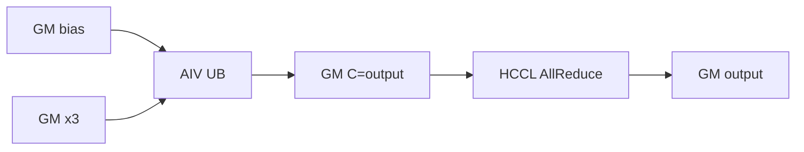
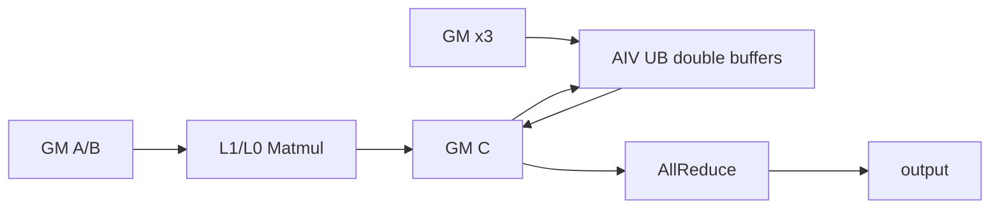
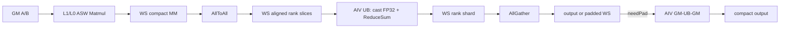
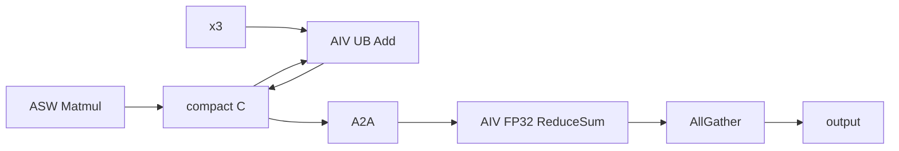

# MatmulAllReduce 950 ACLNN 算子知识

## 算子速览

| 项目 | 内容 |
|---|---|
| 实际入口 | `aclnnMatmulAllReduceV3GetWorkspaceSize` / `aclnnMatmulAllReduceV3`，公开 ACLNN 两段式接口；V3 是固定仓内 950 最新非量化公开版本 |
| 计算语义 | `output = AllReduce(x1 @ x2 + bias + x3)`；`bias`、`x3` 均可缺省，K=0 时设备端构造 `bias+x3` 后通信 |
| 输入输出 | `x1:[M,K]` 或 `[B,S,K]`，`x2:[K,N]`，`bias:[N]`，`x3/output:[M,N]` 或 `[B,S,N]`；FP16/BF16、ND |
| 执行类型 | `AIC_CUBE`、`MIX_CV` 与通信 Hybrid；4/8 卡 950 走 `AllToAll→AIV ReduceSum→AllGather`，其余 rank 走 AllReduce |
| Kernel 路线 | R-001 K=0；R-002 AllReduce/Cube；R-003 AllReduce/Cube+AIV add；R-004 A2A+ReduceSum+AG；R-005 A2A+add+ReduceSum+AG |
| 核心资源 | GM 输入/输出、user workspace、HCCL window、L1/L0A/L0B/L0C、AIV UB；ASW Matmul 为 `MM_CFG_NO_PRELOAD` |
| 来源闭包 | `source_closed`：公开 V3→generated inner bridge→950 Host tiling/key/POD→单一 `matmul_all_reduce` entry→ASW Matmul、x3 AIV、HCCL 与 A2A ReduceSum body 均闭合 |
| 验证状态 | 已完成源码闭包检查；本次知识提取未执行编译、真机、数值或性能测试。 |

## 接口与语义

### 计算语义

设把 `x1` 的批次/序列前缀折叠为 `M`，`x2` 最后两轴给出 `K,N`。正常路线先由 Cube 计算 `C0=x1@x2+bias`；若 `x3!=nullptr`，AIV 在 GM 中原地计算 `C1=C0+x3`；随后执行 SUM 通信。950 的 4/8 卡 specialization 把 SUM 展开为 `AllToAll(C1)`、AIV 以 FP32 累加各 rank 分片、转换回 Y dtype、`AllGather`；其它 rank 直接 `AllReduce(C1)`。K=0 不运行 Matmul，先把 C 清零，再广播 bias 并加 x3，最后 AllReduce。

FP16/BF16 Matmul 的累加、L1/L0 搬运和 Fixpipe 由 `MatmulImpl<...,MM_CFG_NO_PRELOAD>` 完成；本 route 的 `isHf32=false`。A2A ReduceSum 对非 FP32 输入使用 `CAST_NONE` 转 FP32、FP32 `Add` 累加，再以 `CAST_RINT` 转回 FP16/BF16。950 x3 add 直接使用同 dtype `Add`；950 编译分支不执行旧平台 BF16→FP32→BF16 add 路径。

### 输入、输出与属性

| 参数 | shape/layout | dtype | 约束、默认值与语义 |
|---|---|---|---|
| `x1` | `[M,K]` 或 `[B,S,K]`，ND | FP16/BF16 | 2D/3D；V3 固定 `transposeX1=false`；`B*S/M/K <= INT32_MAX` |
| `x2` | 逻辑 `[K,N]`，ND | 与 x1 相同 | 2D；普通连续张量或以最后两轴 stride 表示的转置 view；Host 把 `isTransposeB` 写入 POD，Kernel 在 `BType<...,true/false>` 间运行时分支 |
| `bias` | `[N]`，ND，可选 | 与 x1/output 相同 | 只在 Matmul `isBias` 分支读取；950 BF16 bias 不需要 base 类的 BF16→FP32 workspace 转换，因为 ASW `BiasType` 固定为 `DTYPE_Y` |
| `x3` | 与 output 完全相同，ND，可选 | 与 x1 相同 | 存在时 `RCSTiling.isAdd=1`，选择 `MATMUL_WITH_ADD=1` 和 MIX 1AIC:2AIV kernel |
| `group` | 字符串 | String | 通信域；Host 从 group 查询 rankSize；公开文档约束 950 支持 1/2/4/8/16/32/64 卡、HCCS all-mesh |
| `reduceOp` | 标量属性 | String | 仅 `"sum"` |
| `commMode` | 标量属性 | String | 950 必须非空且仅 `"ccu"` 或 `"ai_cpu"`；映射到 template 0/1 与 HCCL server type；CCU 仅单机 UB 域，AICPU 可跨机 UB 域 |
| `commTurn` | 标量属性 | int64 | 公开 V3 仅 0；Host 内部将 0 归一为 `COMM_TILE=8` |
| `streamMode` | 标量属性 | int64 | 仅 1（stop-on-failure） |
| `output` | `[M,N]` 或 `[B,S,N]`，ND | 与 x1 相同 | 非空逻辑输出；M/N 为 0 时框架直接返回，不进入 Kernel；K=0 进入 R-001 |

### 入口与版本

固定仓公开文档明确 950 支持 V3，V3 在 V2 基础上新增 `commMode`，允许选择 CCU/AICPU；目录中没有更高版本的非量化 `aclnnMatmulAllReduce`。`aclnnQuantMatmulAllReduceV*` 与 `aclnnWeightQuantMatmulAllReduceV*` 是不同数学语义，不属于本卡。

第一段 API 调 `MatmulAllReduceCheckParams`，随后把 6 个量化可选输入设为 nullptr，把 transposeX1 固定 false、从 x2 stride 推导 transposeX2，再调用 generated `aclnnInnerMatmulAllReduceGetWorkspaceSize`。成功后 `commMode` 枚举被存进 executor user handle，并禁用 inner op 的 IR input 4..9。第二段在 950 按该 handle 选择 HCCL server type，再调用 generated `aclnnInnerMatmulAllReduce`。generated inner bridge 是框架边界；算子拥有的属性、Host tiling、POD 和 Device body 均在固定仓闭合。

## Host/Launcher 执行流程

### 参数校验与前处理

顺序为：必需指针 `x1/x2/output`→FP16/BF16 及同 dtype→`reduceOp=sum`、`streamMode=1`→950 x2 禁止 FRACTAL_NZ→shape 关系→`commMode` 非空且为 ccu/ai_cpu。shape 校验要求 x2 2D、x1 2D/3D、K 相等、output 以 x2.N 替换 x1 最后一轴，bias 为 `[N]`，x3 与 output 完全相同。V3 不调用 `Contiguous` 或 `ViewCopy`；x2 的转置只由 view stride 识别并传给 inner op。

`aclnnMatmulAllReduceV3` 要求 executor 非空。若可用 `NnopbaseSetHcclServerType`，950 上 `commMode=CCU` 选择 CCU server，其它合法值选择 AICPU；inner launch 非成功统一转为 `ACLNN_ERR_INNER`，不会继续提交。

### 参数、Workspace 与生命周期

Host 先取得平台 `aicCoreNum`、UB size 与 lib-api workspace。公共 950 user workspace 基数为：

```text
biasLen = isBias && biasType==BF16 ? AlignUp(N, SHAPE_ALIGN_SIZE)*4 : 0
softSyncSize = AC_MAX_AIV * 32
gmcFloat = M*N*sizeof(Y)                       // A5 独立 Matmul 输出区
workspace_base = libApiWorkSpaceSize + biasLen + softSyncSize + gmcFloat
workspace = max(workspace_base, myWorkSpaceSize_)
```

4/8 卡再追加：

```text
cgmPadLen = (tileCnt + tailCnt) * 512          // 元素；实现按每轮最多加 512 元素
commWS = (tileM*N*tileCnt + tailM*N*tailCnt + cgmPadLen) * sizeof(Y)
workspace += 3*commWS + commWS/rankDim
```

`GetUserWorkspace(workspaceGM)` 返回框架划出的 userWS；entry 要求原始 `workspaceGM` 与 userWS 均非空。当前 FP 宏在通过该 null guard 后没有再使用 `userWS`，而是把 entry 的原始 `workspaceGM` 写入 `MC2GmAddrs.workspaceGM`，因此卡中的 C/通信 offset 均以该指针为基址。executor 持有 generated inner graph、workspace size、commMode user handle；调用方拥有并分配 workspace，workspace、tiling payload 与 output 都必须活到当前 stream 完成，HCCL window 由通信框架管理；`HcclFinalize` 前不得复用通信切片。

### 启动图与失败传播

```text
aclnnMatmulAllReduceV3GetWorkspaceSize
  -> aclnnInnerMatmulAllReduceGetWorkspaceSize (generated bridge)
    -> MatmulAllReduceTilingFunc
      -> A5 TilingRegistryArch
        -> QuantMatmulAllReduceTilingA5(priority=0, IsCapable=false：无 dequant/量化 dtype)
        -> WeightQuantMatmulAllReduceTilingA5(priority=1, IsCapable=false：x2 非低比特且无 antiquant)
        -> MatmulAllReduceTilingA5(priority=2, IsCapable=true)
        -> Check -> SetMc2Hcomm -> DoRCSTiling -> DoSplitMTiling
        -> Mc2MatMulV3 ASW tiling(priority BASE=999) 或 K=0 tiling
        -> DoAllReduceTiling -> GetWorkspaceSize -> GetTilingKey -> PostTiling
aclnnMatmulAllReduceV3(stream)
  -> matmul_all_reduce<<<blockDim=aicCoreNum, scheduleMode=1>>>
     -> R-001 / R-002 / R-003 / R-004 / R-005
```

950 `PostTiling` 按 8 字节对齐复制 `MatmulAllReduce910TilingDataA5`，设置 `blockDim=aicCoreNum` 和 `scheduleMode=1`；注释说明独占全核是多核同步避免网络挂死的必要条件。任一 API 检查、HCCL tiling、ASW tiling、workspace 或 memcpy 失败均返回失败而不 launch。Device entry 对空 workspace/userWS 直接返回；固定 entry 没有 unknown-key runtime switch，tiling key 在 APT 编译期实例化。

## Route 与参数设计

### 分核与资源计算

`M=product(x1 前缀轴)`，`K=x1[-1]`，`N=output[-1]`，batch 为 x1 三维时的第 0 轴。`DoSplitMTiling` 通常用公式 tiling 得到长/短 M 块及 `tileCnt/tailCnt`；K=0 固定 `tileCnt=1,tailCnt=0,tileM=M`。950 4/8 卡使用 `MMAllReduceFitBalanceTiling(...ALL_REDUCE_VIA_TWO_SHOT...)`，其它 rank 使用 `MMPlusAllReduce(...ALL_REDUCE...)`。

非空 tile/tail 分别调用唯一可达 `Mc2MatMulV3AswTiling`（`NewGetMatmulV3PriorityPolicy(DAV_3510)={BASE}`），产生 `TCubeTiling`、M/N 尾块平衡参数和 `aswWindowLen`。Device 把 `ceil(M/baseM)*ceil(N/baseN)` 任务用 ASW 窗口蛇形映射到 `usedCoreNum` AIC；最后一轮可把尾 base 再切分。Matmul 库真实内部层级是 GM→L1→L0A/L0B→Mmad/MatmulImpl→L0C→Fixpipe→GM，具体 L1/L0 容量由 `TCubeTiling` 的 `baseM/baseN/baseK/step/depth` 字段消费，固定仓没有把这些容量另存为算子私有常量。

### Route 选择

| 顺序 | Route | Key/模板 | 精确选择条件与优先级 | 不适用去向 |
|---:|---|---|---|---|
| 1 | R-001 K=0 | `MMTYPE_FP_NULL_TENSOR`；`MIX_AIV_1_0`；commMode 0/1 | `K==0`；key 强制 `A2A_RS_AG=false`、`MATMUL_WITH_ADD=false`，bias/x3 由 POD 运行时判断 | K!=0→R-002..R-005 |
| 2 | R-002 AllReduce/Cube | `MMTYPE_FP_MM,A2A=0,MATMUL_WITH_ADD=0`；`MIX_AIC_1_0` | K!=0，rank 不为 950 4/8，x3 缺省；commMode 0/1 各自实例 | x3 存在→R-003；rank 4/8→R-004 |
| 3 | R-003 AllReduce/Cube+AIV add | `MMTYPE_FP_MM,A2A=0,MATMUL_WITH_ADD=1`；`MIX_AIC_1_2` | K!=0，rank 不为 950 4/8，x3 存在；commMode 0/1 | rank 4/8→R-005 |
| 4 | R-004 A2A+ReduceSum+AG | `MMTYPE_FP_MM,A2A=1,MATMUL_WITH_ADD=0`；`MIX_AIC_1_2` | K!=0，`rankDim==4 \|\| rankDim==8`，x3 缺省；commMode 0/1 | x3 存在→R-005 |
| 5 | R-005 A2A+add+ReduceSum+AG | `MMTYPE_FP_MM,A2A=1,MATMUL_WITH_ADD=1`；`MIX_AIC_1_2` | K!=0，`rankDim==4 \|\| rankDim==8`，x3 存在；commMode 0/1 | 不满足则 R-002/R-003 |

```text
A5 registry priority 0 Quant IsCapable=false
  -> priority 1 WeightQuant IsCapable=false
    -> priority 2 FP16/BF16 MatmulAllReduce IsCapable=true
      -> if K == 0: R-001
      -> else if rankDim in {4,8}: x3 ? R-005 : R-004
      -> else:                       x3 ? R-003 : R-002
每条路线内 commMode=="ccu" -> Hccl<CCU>, commMode=="ai_cpu" -> Hccl<AICPU>
每条非空路线内 isTransposeB 再选择 BType<ND,true/false>
```

### 模板/实现执行矩阵

| Route | key/selector | dtype/shape/platform 完整命中条件 | 执行族与 kernel 节点 | 实际模板/body | 内存与同步特征 | tail/fallback |
|---|---|---|---|---|---|---|
| R-001 | FP_NULL；comm 0/1 | 950、FP16/BF16、K=0、M/N>0 | AIV 初始化/bias/add + HCCL AllReduce | `MatmulAllReduceEmptyTensorKGeneral<Y,comm>` | C 为 output GM；UB=`TOTAL_UB_SIZE`；`SyncAll` 后 commit/wait；固定源码构造函数未保存 tiling 指针，见限制 | M/N=0 框架短路；无 Device fallback |
| R-002 | FP_MM,A2A0,ADD0 | 950、K>0、rank∉{4,8}、x3=null | AIC ASW Cube + HCCL | `MatmulAllReduce910General<...,Mc2MatmulAswKernel,ON_CUBE,false,comm>` | Matmul 写 workspace C；每 turn 全核同步后 commit AllReduce | tile/tail 各自 ASW tiling；失败返回 Host error |
| R-003 | FP_MM,A2A0,ADD1 | 同 R-002 且 x3!=null | AIC ASW→AIV add→HCCL | 同上但 `ON_CUBE_AND_VECTOR` | AIV 双缓冲 UB 原地 add；`Mc2SyncAll` 保护 C→add→comm | add 尾由 `DataCopyPad(calcCnt)` |
| R-004 | FP_MM,A2A1,ADD0 | 950、K>0、rank∈{4,8}、x3=null | AIC ASW→AllToAll→AIV FP32 ReduceSum→AllGather | `MatmulAllReduceBase<...,true,comm>` | 4 个连续 workspace region；AIV `SyncAll`/HCCL wait/commit | 每 turn 512 元素 pad；needPad 时最终 GM→UB→GM 去 pad |
| R-005 | FP_MM,A2A1,ADD1 | 同 R-004 且 x3!=null | R-004 前增加 AIV add | R-004 + `MatmulAllReduceAddX3<Y>` | add 完成后 `SyncAll<false>` 才 commit A2A | add 与 reduce/copy 均有独立尾块 |

### 隐藏性能 Guard

| Guard | Host/Tiling 条件 | Device/资源原因 | 影响 Route | 不满足时去向 | 源码符号 |
|---|---|---|---|---|---|
| tiler priority | priority 0 的 `isA8W8/FP8/MX` 均假；priority 1 的 `isA16W8/isA16W4` 均假；priority 2 `IsCapable=true` | 同一个内部 OpDef 承载量化与非量化 API，必须先排除不同数学语义 tiler | 全部 | dtype/scale 命中时属于其它逻辑算子，不进入本卡 | 三个 arch35 `IsCapable/REGISTER_TILING_TEMPLATE_WITH_ARCH` |
| A2A topology | `IsUseA2APath = DAV_3510 && rankDim in {4,8}` | 两阶段 workspace、AIV ReduceSum 与双 HCCL tiling 仅该 topology 配置 | R-004/R-005 | R-002/R-003 |
| x3 MIX ratio | `param.isAdd!=0` | x3 为 AIV GM→UB→GM，需 1AIC:2AIV | R-003/R-005 | 无 x3 使用 R-002/R-004 |
| Matmul core activity | `block_idx < tCubeTiling.usedCoreNum` | 只有 tiler 分配的 AIC 执行 ASW tile；blockDim 仍占全 AIC | R-002..R-005 | 该 AIC 跳过 Matmul，仍参与后续同步 |
| ASW task validity | `index < ceil(M/baseM)*ceil(N/baseN)` 且 singleCoreM/N>0 | 尾 base 再切分可产生空子任务 | R-002..R-005 | 跳过该 Matmul 子任务 |
| ASW custom split-K | Device 仅当 `C_TYPE=float && !isHf32 && B=ND && singleCoreK>8192` 才切 K；本卡 C_TYPE 为 FP16/BF16 | 本卡 `splitKRound=1`，不走 `kIndex!=0` 的 atomic C 累加 | R-002..R-005 | K 尾仍由外部 MatmulImpl/TCube 处理，无本地 split-K fallback | `Mc2MatmulAswBlock::Init` |
| 950 C placement | `__NPU_ARCH__==3510` 编译分支无条件令 `cGM=workspaceGM+nd2NzWorkLen+biasLen` | 950 为 Matmul 输出单独保留 M*N 区；源码中的 window-in/determinism 判断只在非 950 分支 | R-002/R-003 | 950 无 window-in fallback；workspace 不足由 Host/框架失败 | `MatmulAllReduceBase<...,false>::Init` |
| A2A handle bound | `tileCnt+tailCnt <= 16`（Device 固定数组） | handle/send/recv 数组容量 16 | R-004/R-005 | Host formula tiling 必须满足；固定仓无 Device 越界 fallback |
| A2A alignment | 每 turn `ceilAlign(cOffset,512)` 元素 | AllToAll recv/ReduceSum/AllGather slice 物理间隔按 512 元素对齐 | R-004/R-005 | 追加 pad；`needPad` 时末尾拷回紧凑 output |
| AIV ReduceSum UB | `perBlockNum=min(15360,floorAlign(TOTAL_UB_SIZE/6,32)/sizeof(Y))` | 源码按 6 个 Y buffer 估算，但实际申请为 4 个 Y buffer 加 2 个 FP32 TBuf；FP16/BF16 下实际为 `16*p` 字节，大于公式隐含的 `12*p`，见限制 | R-004/R-005 | 多轮分块；固定仓无二次收缩 |
| add UB | `addX3UbCnt=AlignDown(UB/(6*sizeof(Y)),32)`（950） | 三个 depth=2 dtype 队列 | R-003/R-005/R-001 x3 | 分块处理 |
| K=0 | `isKZero_` | Matmul 无合法 K 循环，改为零/bias/add | R-001 | K>0 使用 ASW |
| schedule mode | 950 固定 `SetScheduleMode(1)` | Kernel 含全核同步；非独占启动可能网络挂死 | 全部 | Host 设置失败未单独检查，属于框架边界 |

### POD/ABI

`MatmulAllReduce910TilingDataA5` 以 `#pragma pack(push,8)`、`alignas(8)` 定义；固定仓未展开外部 `Mc2InitTiling/Mc2CcTiling/TCubeTiling` 的数值 `sizeof/offsetof`，因此外层位置用符号偏移，不能臆造数字。`RCSTiling` 的固定宽度字段布局可由定义闭合为 128 字节、alignof 8。

| 结构 | 字段 | 类型/位宽 | ABI 布局 | 单位 | Host/launcher producer | Device consumer | 边界 |
|---|---|---|---|---|---|---|---|
| launch ABI | 13 个 GM 参数 | `GM_ADDR`/64 bit | 按 entry 参数顺序：a,b,bias,x3,6 个量化占位,c,workspace,tiling | 地址 | generated inner launcher | `matmul_all_reduce` | V3 禁用 IR 4..9；workspace/tiling 非空 |
| 950 POD | `mc2InitTiling` | 外部结构 | offset 0；pack/align 8 | 通信初始化 | `Mc2CcTilingConfig::GetTiling` | `Hccl::InitV2` | 数值 sizeof 固定仓不可见 |
| 950 POD | `mc2CcTiling` | 外部结构 | offset `sizeof(Mc2InitTiling)` | 通信描述 | AllReduce 或 AllToAll config | `SetCcTilingV2` | opType 随 topology |
| 950 POD | `mc2CcTilingComm` | 外部结构 | 前两字段之后 | 通信描述 | A2A route 的 AllGather config | A2A base 第二次 `SetCcTilingV2` | 普通 AllReduce inactive/零 |
| 950 POD | `param` | `RCSTiling`/128 B | 前 3 个通信结构之后，8B 对齐 | 混合 | base/950 tiling | 所有 Device body | 字段逐项见下 |
| `RCSTiling` | `rankDim` | uint32/32 | off 0 | rank 数 | `DoRCSTiling=args_.rankDim` | A2A base/通信 | 950 文档 1/2/4/8/16/32/64 |
| `RCSTiling` | `rankID` | uint32/32 | off 4 | rank id | 固定对象零初始化；本 tiler 未赋值 | 仅 Host print | inactive=0 |
| `RCSTiling` | `commtype` | uint32/32 | off 8 | HCCL command enum | `DoRCSTiling=args_.cmdType` | 公共通信描述/诊断 | 本卡为 ALLREDUCE 语义 |
| `RCSTiling` | `subtype` | uint32/32 | off 12 | HCCL reduce enum | `DoRCSTiling` 解析 `reduceOp` | 公共通信描述/诊断 | V3 仅 SUM |
| `RCSTiling` | `tileCnt` | uint32/32 | off 16 | turn | `DoSplitMTiling` | tile turn 循环/handle 数 | 与 `tailCnt` 之和是 A2A 数组下标上界 |
| `RCSTiling` | `tailM` | uint32/32 | off 20 | elements on M | `DoSplitMTiling` | Host print；tail TCube 的 M 由独立 tiling 产生 | 无短块时 0 |
| `RCSTiling` | `tailCnt` | uint32/32 | off 24 | turn | `DoSplitMTiling` | tail turn 循环/handle 数 | 0 表示无 tail family |
| `RCSTiling` | `biasLen` | uint32/32 | off 28 | bytes | `GetWorkspaceSize` | workspace C offset | 950 BF16 可写转换区长度，但 950 ASW route不调用 `PreProcForBiasOnVector` |
| `RCSTiling` | `isAdd` | uint32/32 | off 32 | bool | `GetAtomicAddData` | key + base PostProc | 0/1 |
| `RCSTiling` | `rankM` | uint32/32 | off 36 | elements | `DoRCSTiling=args_.orgMValue` | empty body、总输出域 | Host 先检查 `<=INT32_MAX` |
| `RCSTiling` | `rankN` | uint32/32 | off 40 | elements | `DoRCSTiling=args_.orgNValue` | empty body、workspace/address | Host 先检查 `<=INT32_MAX` |
| `RCSTiling` | `rankK` | uint32/32 | off 44 | elements | `DoRCSTiling=args_.orgKValue` | 诊断/公共 body | Host 先检查 `<=INT32_MAX`；R-001 为 0 |
| `RCSTiling` | `gatherIndex` | uint32/32 | off 48 | index | 本 route 零初始化 | 本 route不读 | inactive=0 |
| `RCSTiling` | `isTransposeA` | uint32/32 | off 52 | bool | V3 固定 false | 公共字段；本卡 AType 固定不转置 | 必须为 0 |
| `RCSTiling` | `isTransposeB` | uint32/32 | off 56 | bool | API 从 x2 最后两轴 stride 推导 | `INVOKE_MC2_910_OP_IMPL` 的 BType 分支 | 0/1 |
| `RCSTiling` | `storageGather` | uint32/32 | off 60 | bool | 本 route 零初始化 | 本 route不读 | inactive=0 |
| `RCSTiling` | `nd2NzWorkLen` | uint64/64 | off 64 | bytes | 本 route零初始化 | AllReduce base 的 950 C offset | 非量化 950 为 0 |
| `RCSTiling` | `cToFloatLen` | uint64/64 | off 72 | bytes | 本 route零初始化 | 本 route不读 | inactive=0 |
| `RCSTiling` | `gatherLen` | uint64/64 | off 80 | bytes | 本 route零初始化 | 本 route不读 | inactive=0 |
| `RCSTiling` | `workspaceAddr4` | uint32/32 | off 88 | bytes/offset | 本 route零初始化 | 本 route不读 | inactive=0 |
| `RCSTiling` | `aicCoreNum` | uint32/32 | off 92 | core | `DoRCSTiling` | 诊断/共用 helper | 同 blockDim 平台 AIC 数 |
| `RCSTiling` | `needUbBuffer` | uint32/32 | off 96 | bool | 本 route零初始化 | 本 route不读 | inactive=0 |
| `RCSTiling` | `addX3UbCnt` | uint32/32 | off 100 | elements/tile | `CalcUbTiling` | `MatmulAllReduceAddX3Kernel` | 仅 isAdd 有效 |
| `RCSTiling` | `commWorkSpaceSize` | uint32/32 | off 104 | bytes | 本 route未赋值 | 本 route不读 | inactive=0；A2A实际 workspace公式不存此字段 |
| `RCSTiling` | `isInputCommQuantScale` | uint32/32 | off 108 | enum | `SetCommQuantScale` | 量化路线 | 本卡固定 0 |
| `RCSTiling` | `dataType` | uint32/32 | off 112 | enum | 本 route零初始化 | 量化路线 | 本卡 inactive=0 |
| `RCSTiling` | `commInt8WorkSpace` | uint32/32 | off 116 | bytes | 本 route零初始化 | 量化路线 | 本卡 inactive=0 |
| `RCSTiling` | `dynamicQuantTempBuffSize` | uint32/32 | off 120 | bytes | 本 route零初始化 | 量化路线 | 本卡 inactive=0；尾随 4B padding 使 struct sizeof=128 |
| 950 POD | `mC2Mmv3TileTilingData` | `Mc2MatMulV3TilingData` | param 后 8B 对齐 | Matmul tiling | `DoMatmulV3Tiling(tile)` | ASW tile body | K=0 仅写 M/N/isBias/usedCoreNum |
| 950 POD | `mC2Mmv3TailTilingData` | 同上 | tile tiling 后 | Matmul tiling | tailM!=0 时 producer | ASW tail body | 无 tail 时零 |
| MMV3 | `tCubeTiling` | 外部 `TCubeTiling` | 子结构首字段 | elements/core/depth | `Mc2MatMulV3AswTiling` | `MatmulImpl` 与 ASW block | 关键 consumer：M/N/Ka/Kb/baseM/baseN/singleCoreK/usedCoreNum/isBias |
| MMV3 | `mTailCnt` | uint32/32 | `TCubeTiling` 后首个 uint32 | split count | BASE ASW tiler | 最后一轮 M 尾 base 再切分 | 必须非 0 |
| MMV3 | `nTailCnt` | uint32/32 | `mTailCnt` 后 | split count | BASE ASW tiler | 最后一轮 N 尾 base 再切分 | 必须非 0 |
| MMV3 | `kTailCnt` | uint32/32 | `nTailCnt` 后 | split count | BASE ASW tiler | 本 ASW body 不直接读取 | 保留字段 |
| MMV3 | `mBaseTailSplitCnt` | uint32/32 | `kTailCnt` 后 | split count | BASE ASW tiler | `mBaseNormCnt` 与尾 base 分段 | 默认 1 |
| MMV3 | `nBaseTailSplitCnt` | uint32/32 | 前字段后 | split count | BASE ASW tiler | `nBaseNormCnt` 与尾 base 分段 | 默认 1 |
| MMV3 | `mTailMain` | uint32/32 | 前字段后 | elements | BASE ASW tiler | 多段 M 尾块的主段长度 | `mBaseTailSplitCnt==1` 时不读 |
| MMV3 | `nTailMain` | uint32/32 | 前字段后 | elements | BASE ASW tiler | 多段 N 尾块的主段长度 | `nBaseTailSplitCnt==1` 时不读 |
| MMV3 | `isHf32` | uint32/32 | 倒数第二字段 | bool | `NewUpdateMatmulV3Args=false` 经 tiler写入 | `mm_.SetHF32` 与 FP32 split-K guard | 本卡为 0 |
| MMV3 | `aswWindowLen` | uint32/32 | 末字段 | M base blocks/window | BASE ASW tiler | `mainWindow` 与蛇形映射 | 必须使 `min(aswWindowLen,mCnt)>0` |

### Route 源码闭包

| Route | Key/selector | Host/Tiling producer | POD/参数 | Kernel entry/router | Kernel body/直接依赖 | 构建接线 |
|---|---|---|---|---|---|---|
| R-001 | `GetTilingKey` K=0 | `MatmulAllReduceTilingA5::DoEmptyTensorTiling` | 950 POD + RCSTiling | `matmul_all_reduce` FP_NULL | `MatmulAllReduceEmptyTensorKGeneral` + add helper | APT tiling key + `op_host/CMakeLists.txt` |
| R-002 | A2A0/ADD0/comm0,1 | `DoSplitMTiling` + BASE ASW | tile/tail MMV3 | entry→`fp_matmul_all_reduce` | general + based_all_reduce + ASW kernel/block | 同上 |
| R-003 | A2A0/ADD1/comm0,1 | 同 R-002 + `CalcUbTiling` | `isAdd/addX3UbCnt` | 同 entry MIX 1:2 | R-002 + add helper | 同上 |
| R-004 | A2A1/ADD0/comm0,1 | fit-balance + `SetMc2HcommTwoShot` | 双 CC tiling + A2A workspace | 同 entry MIX 1:2 | general + based_a2a + reduce_sum + gm copy | 同上 |
| R-005 | A2A1/ADD1/comm0,1 | R-004 + `CalcUbTiling` | R-004 + add字段 | 同 entry MIX 1:2 | R-004 + add helper | 同上 |

## Kernel 实现

### 公共执行流程

entry 注册当前最大 950 tiling struct，仅用于编译期 tiling buffer 上界；各 specialization 再用准确结构读取 tiling。它先检查 workspace、取得 userWS、构造 `TPipe`，再按 `APT_MM_TYPE` 编译期分支。所有非空 FP route 固定实例化：

```text
AType = MatmulType<GM,ND,DTYPE_X1,false>
BType = MatmulType<GM,ND,DTYPE_X2,isTransposeB>
CType/BiasType = MatmulType<GM,ND,DTYPE_Y>
OpType = Mc2MatmulAswKernel<A,B,C,Bias,Mc2MatmulAswBlock,MM_CFG_NO_PRELOAD>
MatmulAllReduce910General<X,W,Y,OpType,CoreType,basedA2a,commMode>
```

每个 tile/tail turn：活动 AIC 执行 `mmOp.Init→Process→End`；可选 AIV 原地 add；全核同步后仅 notify core 提交通信。`Process` 最后等待/Finalize，保证输出对 stream 后继可见。

### Route R-001：K=0 零矩阵路线

#### 适用条件

##### 选择证据

| 层级 | 文件 | 符号 | 源码谓词/参数 | 结果/下一跳 |
|---|---|---|---|---|
| API | `op_api/matmul_all_reduce_util.cpp` | `MatmulAllReduceCheckValidEmptyTensor` | K=0 放行 | inner op |
| Tiling | `arch35/matmul_all_reduce_tiling_950.cpp` | `GetTilingKey` | `unlikely(isKZero_)` | FP_NULL key |
| APT | `matmul_all_reduce_apt_tiling_key.h` | FP_NULL selector | MIX_AIV_1_0，comm 0/1 | empty body |

#### Device 数据流

##### 函数级调用链

```text
matmul_all_reduce -> INVOKE_MC2_EMPTY_TENSOR_OP_IMPL
  -> MatmulAllReduceEmptyTensorKGeneral::Init
  -> Process: InitOutput(C,0) -> ProcessBias? -> ProcessAdd? -> AllReduce commit/wait/finalize
```

##### 源码等价伪码

下列是 body 的源码意图；固定 Commit 的构造函数没有执行 `tilingData_=tilingData`，而 `Init()` 随后把该成员传给 HCCL，因此这条路线的实际可运行性不能仅由当前源码证明。

```text
C[0:M*N] = 0
SyncAll()
if bias: for each row, C[row,:] = bias[:]       // aligned copy + DataCopyPad tail
if x3:   for each row, C[row,:] += x3[row,:]   // AIV tiled add
SyncAll(); core0 Commit(AllReduce(C->output)); Wait(); Finalize()
```

#### 内存与数据搬运

##### 资源与搬运表

| 层级/缓冲区 | offset/地址公式 | extent/容量公式 | dtype/layout | producer | consumer | owner/lifetime | 对齐/复用 |
|---|---|---|---|---|---|---|---|
| GM bias/x3 | bias `[0,N)`；x3 row `i*N` | N / M*N elements | Y/ND | caller | bias/add | caller/stream | bias 32B 主段+pad tail |
| GM C/output | `cGM`；entry 令 C=output | M*N*sizeof(Y) | Y/ND | InitOutput/bias/add | HCCL | caller/HCCL完成前 | 紧凑 |
| UB bias | 0 | `TOTAL_UB_SIZE` | Y | GM copy | row copy | TPipe/阶段内 | 分块、32B |
| UB add | 3 queues×depth2 | `6*addX3UbCnt*sizeof(Y)` | Y | GM copy | Add/GM copy | TPipe/每 tile | double buffer |
| L1/L0A/B/C | N/A | N/A | N/A | 无 Matmul | 无 | N/A | 实际替代为 GM→UB/InitOutput |

##### 分层内存布局



##### 字节账、交接边与复用顺序

```text
workspace_device = API/通信框架要求；算子 body 的 C 直接使用 output
UB_bias = TOTAL_UB_SIZE（只在 bias 阶段）
UB_add = 6*addX3UbCnt*sizeof(Y)（只在 x3 阶段，TPipe Reset 后复用）
```

| 边/复用子区 | producer | offset/extent | dtype/layout | consumer | ordering/sync | owner/lifetime | 安全条件 |
|---|---|---|---|---|---|---|---|
| C→HCCL | zero/bias/add | 0 / M*N | Y/ND | AllReduce | `SyncAll` 后 commit | output/HCCL wait | M,N>0 |

#### 同步、精度与尾块

##### 同步与数值边界表

| 阶段 | primitive/机制 | producer | consumer/等待点 | 保护对象 | 精度/尾块 |
|---|---|---|---|---|---|
| zero→bias/add | `SyncAll` | InitOutput | AIV body | C | InitOutput 以 half 粒度覆盖等字节 C |
| bias tail | `DataCopyPad` | UB bias | GM C | row tail | 只写 N 尾有效字节 |
| compute→comm | `SyncAll`; HCCL commit/wait | all AIV | notify core | C/output | 同 dtype sum |

#### 关键实现

##### 符号证据表

| 阶段 | 文件 | 符号/模板实例 | 实现事实 |
|---|---|---|---|
| Host/Tiling producer | `arch35/matmul_all_reduce_tiling_950.cpp` | `DoEmptyTensorTiling/GetTilingKey` | M/N/isBias/usedCoreNum=1，FP_NULL |
| Kernel entry/router | `arch35/matmul_all_reduce_apt.cpp` | `matmul_all_reduce` | empty specialization |
| Device body/helper | `arch35/matmul_all_reduce_empty_tensor_k_general.h` | `Process/ProcessBias/ProcessAdd` | 零、bias、x3、AllReduce |

### Route R-002：普通 AllReduce 的 Cube 路线

#### 适用条件

##### 选择证据

| 层级 | 文件 | 符号 | 源码谓词/参数 | 结果/下一跳 |
|---|---|---|---|---|
| Host | 950 tiling | `IsUseA2APath` | rank 非4/8 | A2A=false |
| Key | 950 tiling | `GetTilingKey` | K>0、`isAdd=0` | FP_MM/A2A0/ADD0 |
| APT | tiling key | FP selector | MIX_AIC_1_0；comm 0/1 | `CoreType::ON_CUBE` |

#### Device 数据流

##### 函数级调用链

```text
entry -> fp_matmul_all_reduce -> MatmulAllReduce910General::Init/Process
  -> InnerProcess(tile/tail) -> Mc2MatmulAswKernel::Init/Process/End
  -> PostProcEachTurn -> Hccl::Commit(AllReduce handle)
  -> HcclFinalize: Wait each turn -> SyncAll -> Finalize
```

##### 源码等价伪码

```text
for tile-family in [tile, tail-if-any]:
  for turn:
    if AIC id < usedCoreNum:
      ASW snake-map AIC to (mTile,nTile); MatmulImpl(A,B,bias)->workspace C
    advance A/C by tile bytes
    Mc2SyncAll<ON_CUBE>(); core0 Commit(prepared AllReduce handle)
core0 Wait(handle) for every turn; Mc2SyncAll; core0 Finalize
```

#### 内存与数据搬运

##### 资源与搬运表

| 层级/缓冲区 | offset/地址公式 | extent/容量公式 | dtype/layout | producer | consumer | owner/lifetime | 对齐/复用 |
|---|---|---|---|---|---|---|---|
| GM A/B/bias | A per turn += `tileM*Ka*sizeof(X)`；B固定；bias N | input extents | X/Y ND | caller | ASW | caller/stream | B transpose改变 offset公式 |
| GM C workspace | `workspaceGM+biasLen` | M*N*sizeof(Y) | Y/ND | Fixpipe | HCCL | executor/Finalize前 | turn 紧凑排列 |
| L1/L0 | MatmulImpl private | 由 TCube base/step/depth | A/B/acc | GM copy | Mmad/Fixpipe | 每 ASW tile | `MM_CFG_NO_PRELOAD`，不跨 turn 保留 |
| GM output | turn offset同 C | M*N*sizeof(Y) | Y/ND | HCCL | caller | caller | HCCL handle准备时绑定 |
| UB | N/A（无 x3/A2A reduce） | N/A | N/A | 无 | 无 | N/A | 通信库内部为外部边界 |

##### 分层内存布局


##### 字节账、交接边与复用顺序

```text
C_total = M*N*sizeof(Y)
workspace_base = libApiWS + biasLen + AC_MAX_AIV*32 + C_total
L1/L0 = 外部 MatmulImpl 按 TCubeTiling 的 base/step/depth 分配；固定仓未提供该库的逐层字节公式，不能补造
```

| 边/复用子区 | producer | offset/extent | dtype/layout | consumer | ordering/sync | owner/lifetime | 安全条件 |
|---|---|---|---|---|---|---|---|
| Matmul C→AllReduce | ASW Fixpipe | turn*Cbytes / tileM*N | Y/ND | HCCL | `Mc2SyncAll<ON_CUBE>`→Commit→Wait | workspace/turn wait | 活动 AIC 完成 |

#### 同步、精度与尾块

##### 同步与数值边界表

| 阶段 | primitive/机制 | producer | consumer/等待点 | 保护对象 | 精度/尾块 |
|---|---|---|---|---|---|
| Cube内部 | MatmulImpl pipeline | MTE/L0 | Mmad/Fixpipe | L1/L0 | HF32=false；C_TYPE 非 FP32，故 ASW 自定义 `splitKRound=1`、`GetTensorC` 不启用后续 K round atomic；M/N/K tail来自 TCube/外部 MatmulImpl |
| Cube→comm | `PipeBarrier<PIPE_ALL>`→`CrossCoreSetFlag<0x0,PIPE_FIX>(3)`→`CrossCoreWaitFlag(3)` | AIC/Fixpipe | AIC core0 commit | turn C | `Mc2SyncAll<ON_CUBE>` 的固定展开；Y dtype output |
| comm→return | HCCL Wait/Finalize | HCCL | all cores SyncAll | output | SUM |

#### 关键实现

##### 符号证据表

| 阶段 | 文件 | 符号/模板实例 | 实现事实 |
|---|---|---|---|
| Host/Tiling producer | `arch35/matmul_all_reduce_tiling_950.cpp` | `Do910Tiling/GetTilingKey` | BASE ASW、A2A0/ADD0 |
| Kernel entry/router | `arch35/matmul_all_reduce_apt.cpp` | `fp_matmul_all_reduce` | ON_CUBE specialization |
| Device body/helper | `arch35/matmul_all_reduce_910_general.h` + `mat_mul_asw_kernel.h` | `InnerProcess/Mc2MatmulAswKernel::Process` | ASW Matmul→AllReduce |

### Route R-003：普通 AllReduce 的 Cube+AIV add 路线

#### 适用条件

##### 选择证据

| 层级 | 文件 | 符号 | 源码谓词/参数 | 结果/下一跳 |
|---|---|---|---|---|
| Host | base tiling | `GetAtomicAddData/CalcUbTiling` | x3!=nullptr | isAdd=1/addX3UbCnt |
| Key | 950 tiling | `GetTilingKey` | A2A=false,ADD=true | R-003 |
| APT | tiling key | FP selector | MIX_AIC_1_2 | ON_CUBE_AND_VECTOR |

#### Device 数据流

##### 函数级调用链

```text
R-002 ASW Matmul
  -> PostProcEachTurn -> Mc2SyncAll -> MatmulAllReduceAddX3Kernel
     -> MatmulAllReduceAddX3::Init/Process
  -> Mc2SyncAll -> HCCL Commit/Wait/Finalize
```

##### 源码等价伪码

```text
ASW_Matmul(C)
sync AIC/AIV
each AIV owns contiguous quotient of turn elements:
  for UB tile: DataCopyPad(C), DataCopyPad(x3), Add(Y), DataCopyPad(C)
advance x3/A/C; sync; notify AIV0 commits AllReduce(C->output)
```

#### 内存与数据搬运

##### 资源与搬运表

| 层级/缓冲区 | offset/地址公式 | extent/容量公式 | dtype/layout | producer | consumer | owner/lifetime | 对齐/复用 |
|---|---|---|---|---|---|---|---|
| Cube层级 | 同 R-002 | 同 R-002 | 同 R-002 | ASW | C | AIC turn | 同 R-002 |
| GM x3/C | 每 turn `cOffset` | tileM*N elements | Y/ND | caller/ASW | AIV add | caller/workspace | AIV 末核取得余数 |
| UB inX/inY/outZ | 3×depth2 | `6*addX3UbCnt*sizeof(Y)` | Y | MTE2 | Add/MTE3 | AIV tile | `TPipe::Reset` 每 turn |

##### 分层内存布局



##### 字节账、交接边与复用顺序

```text
UB_add = 2*(inX+inY+outZ)*addX3UbCnt*sizeof(Y)
workspace = R-002 workspace；x3 add 原地覆盖 C，不追加 GM slice
```

| 边/复用子区 | producer | offset/extent | dtype/layout | consumer | ordering/sync | owner/lifetime | 安全条件 |
|---|---|---|---|---|---|---|---|
| Cube C→AIV add | Fixpipe | turn offset/tileM*N | Y/ND | add | `Mc2SyncAll` | workspace | 所有活动 AIC完成 |
| add C→comm | AIV | 同上 | Y/ND | AllReduce | 第二次 `Mc2SyncAll` | workspace | 所有 AIV写回完成 |

#### 同步、精度与尾块

##### 同步与数值边界表

| 阶段 | primitive/机制 | producer | consumer/等待点 | 保护对象 | 精度/尾块 |
|---|---|---|---|---|---|
| add queues | TQue EnQue/DeQue | MTE2 | Vector/MTE3 | UB tile | 950 同 dtype Add |
| AIV tail | `calcCnt`+DataCopyPad | x3/C | C | 最后一 UB tile | 不写 padding |
| cross-core | `SyncAll<false>` | AIC/AIV | add/comm | C | `Mc2SyncAll<ON_CUBE_AND_VECTOR>` 的固定展开；顺序固定 |

#### 关键实现

##### 符号证据表

| 阶段 | 文件 | 符号/模板实例 | 实现事实 |
|---|---|---|---|
| Host/Tiling producer | base/950 tiling | `CalcUbTiling/GetTilingKey` | isAdd选择MIX |
| Kernel entry/router | APT cpp | `fp_matmul_all_reduce` | ON_CUBE_AND_VECTOR |
| Device body/helper | based_all_reduce + add_x3 | `PostProcEachTurn/MatmulAllReduceAddX3` | C原地add后通信 |

### Route R-004：4/8 卡 A2A→AIV ReduceSum→AllGather 路线

#### 适用条件

##### 选择证据

| 层级 | 文件 | 符号 | 源码谓词/参数 | 结果/下一跳 |
|---|---|---|---|---|
| topology | `mc2_tiling_utils.h` | `IsUseA2APath` | 950 && rank=4/8 | true |
| Host | 950 tiling | `SetMc2HcommTwoShot/GetTilingResult` | standard4P或8P | AllToAll+AllGather + fit balance |
| Key/APT | 950 key/APT selector | A2A1,ADD0 | K>0,x3=null | MIX 1AIC:2AIV |

#### Device 数据流

##### 函数级调用链

```text
ASW Matmul each turn -> PostProcEachTurn -> Commit(AlltoAll)
 -> WaitAlltoAllEachTurn (AIV; last turn may overlap first ReduceSum)
 -> ReduceSumAndAllGather (AIV FP32 accumulation; pipelined AG commits)
 -> HcclFinalize: Wait all AG -> optional GmUbGmCopy(remove pad) -> Finalize
```

##### 源码等价伪码

```text
prepare A2A and AG handles for each compact turn and 512-element-aligned recv slice
for turn: Matmul(compact C); SyncAll; AIV0 Commit(A2A[turn])
AIV: Wait A2A turns with SyncAll visibility
for turns:
  reduce rankDim aligned recv slices in FP32 UB -> compact-rank slice
  SyncAll; pipeline Commit(previous AG)
Commit(last AG); AIV0 Wait(all AG)
if M tile is not rank-divisible: GM->UB->GM copy padded AG result to compact output
Finalize
```

#### 内存与数据搬运

##### 资源与搬运表

| 层级/缓冲区 | offset/地址公式 | extent/容量公式 | dtype/layout | producer | consumer | owner/lifetime | 对齐/复用 |
|---|---|---|---|---|---|---|---|
| MM/A2A input | `all2allIn=cGM`；turn compact offset | `cgmAddr` | Y/ND compact | ASW | AllToAll | workspace/window | no per-turn gap |
| A2A output/Reduce input | `all2allOut=all2allIn+cgmAddr+padBytes` | commWS | Y/rank slices | HCCL | AIV reduce | workspace | each turn ceilAlign(cOffset,512) elements |
| Reduce output/AG input | `reduceOut=all2allOut+cgmAddr+padBytes` | commWS/rank | Y/rank shard | AIV | AllGather | workspace | per-turn aligned/rank |
| AG output | output if no pad；否则 reduceOut+(cgmAddr+pad)/rank | cgmAddr(+pad) | Y | HCCL | caller/copy | output/workspace | compact only when M%rank==0 |
| Reduce UB | vecIn depth2 + vecOut depth2 + sum/cast FP32 | `2*2*p*sizeof(Y)+2*p*4`，p=min(15360,UB/6 aligned) | Y/FP32 | GM | FP32 Add/GM | AIV reduce call | 32B；tail pad read、有效字节写 |
| L1/L0 | 同 R-002 | TCubeTiling | X/Y/acc | ASW | Fixpipe | AIC turn | no preload |

##### 分层内存布局



##### 字节账、交接边与复用顺序

```text
turnElems = tileM*N or tailM*N
alignedTurnElems = ceilAlign(turnElems,512)
commWS = sum(alignedTurnElems)*sizeof(Y)
workspace_extra = 3*commWS + commWS/rankDim
UB_reduce_actual = 4*p*sizeof(Y) + 2*p*sizeof(float)
p = min(15360, floorAlign(TOTAL_UB_SIZE/6,32)/sizeof(Y))
UB_copy = 2*p*sizeof(Y)
```

| 边/复用子区 | producer | offset/extent | dtype/layout | consumer | ordering/sync | owner/lifetime | 安全条件 |
|---|---|---|---|---|---|---|---|
| MM→A2A | ASW | compact turn | Y/ND | AllToAll | `SyncAll<false>`→Commit | workspace | all AIC done |
| A2A→Reduce | HCCL | aligned turn/rank slices | Y | AIV | Wait(handle)→`SyncAll` | workspace | communication complete on all ranks |
| Reduce→AG | AIV | aligned turn/rank | Y | AllGather | `SyncAll`→Commit | workspace | all AIV reductions done |
| AG padded→output | HCCL | cgmLen valid elements | Y | GmUbGmCopy | Wait all AG→SyncAll | temp WS→caller | only needPad |

#### 同步、精度与尾块

##### 同步与数值边界表

| 阶段 | primitive/机制 | producer | consumer/等待点 | 保护对象 | 精度/尾块 |
|---|---|---|---|---|---|
| Matmul→A2A | `SyncAll<false>` | AIC | AIV0 commit | MM turn | Matmul Y output |
| A2A→reduce | HCCL Wait + `SyncAll` | HCCL | all AIV | aligned recv | 注释明确缺失同步会导致非0卡提前reduce |
| reduce | TQue + FP32 Add | rank slices | reduceOut | UB | nonfloat CAST_NONE→FP32，CAST_RINT回Y |
| reduce→AG | `SyncAll` | AIV | AIV0 commit | shard | 第一块可与A2A重叠，后续与前一AG重叠 |
| tail | 32B aligned read + DataCopyPad write | GM/UB | GM | last block | 仅 tailBytes 写回 |

#### 关键实现

##### 符号证据表

| 阶段 | 文件 | 符号/模板实例 | 实现事实 |
|---|---|---|---|
| Host/Tiling producer | 950 tiling | `SetMc2HcommTwoShot/GetWorkspaceSizeForA2ARSAG` | 双通信描述与四区 workspace |
| Kernel entry/router | APT key/cpp | A2A1 FP_MM | MIX 1:2 |
| Device body/helper | based_a2a + reduce_sum | `CalcGMAddr/WaitAlltoAllEachTurn/ReduceSumAndAllGather` | 完整两阶段通信与AIV reduce |

### Route R-005：4/8 卡 A2A 路线并融合 x3

#### 适用条件

##### 选择证据

| 层级 | 文件 | 符号 | 源码谓词/参数 | 结果/下一跳 |
|---|---|---|---|---|
| Host | base/950 tiling | `isAdd` + `IsUseA2APath` | x3存在且rank4/8 | A2A1/ADD1 |
| APT | tiling key | FP selector | MIX_AIC_1_2 | basedA2A + AIV add |
| Device | based_a2a | `PostProcEachTurn` | `addFlag && cGM!=addGM` | add后commit A2A |

#### Device 数据流

##### 函数级调用链

```text
R-004 ASW Matmul
 -> SyncAll -> MatmulAllReduceAddX3Kernel(C,x3) -> SyncAll -> Commit A2A
 -> R-004 Wait/ReduceSum/AllGather/final copy
```

##### 源码等价伪码

```text
for turn:
  ASW_Matmul(C)
  SyncAll(); AIV add x3 into C; advance x3
  advance A/C; SyncAll(); AIV0 Commit(A2A)
then identical to R-004
```

#### 内存与数据搬运

##### 资源与搬运表

| 层级/缓冲区 | offset/地址公式 | extent/容量公式 | dtype/layout | producer | consumer | owner/lifetime | 对齐/复用 |
|---|---|---|---|---|---|---|---|
| R-004 all buffers | 同 R-004 | 同 R-004 | 同 R-004 | 同 R-004 | 同 R-004 | 同 R-004 | 同 R-004 |
| GM x3 | turn compact offset | M*N*sizeof(Y) | Y/ND | caller | AIV add | caller | 与 compact MM 完全同 shape |
| UB add | 3×depth2 | `6*addX3UbCnt*sizeof(Y)` | Y | GM | Add/GM | 每 turn；随后 TPipe Reset 给 reduce | 32B/DataCopyPad |

##### 分层内存布局



##### 字节账、交接边与复用顺序

```text
workspace = R-004
peak UB阶段互斥：max(6*addX3UbCnt*sizeof(Y), UB_reduce, UB_copy)
```

| 边/复用子区 | producer | offset/extent | dtype/layout | consumer | ordering/sync | owner/lifetime | 安全条件 |
|---|---|---|---|---|---|---|---|
| Matmul→add | AIC Fixpipe | compact turn | Y/ND | AIV add | first SyncAll | workspace | AIC完成 |
| add→A2A | AIV add | compact turn | Y/ND | HCCL | second SyncAll→commit | workspace | AIV完成 |
| 后续 | 同 R-004 | 同 R-004 | 同 R-004 | 同 R-004 | 同 R-004 | 同 R-004 | 同 R-004 |

#### 同步、精度与尾块

##### 同步与数值边界表

| 阶段 | primitive/机制 | producer | consumer/等待点 | 保护对象 | 精度/尾块 |
|---|---|---|---|---|---|
| Cube→add→A2A | 两次 `SyncAll<false>` | AIC/AIV | add/HCCL | compact C | 950同dtype Add；DataCopyPad tail |
| A2A后 | 同 R-004 | 同 R-004 | 同 R-004 | aligned regions | FP32 reduce、CAST_RINT |

#### 关键实现

##### 符号证据表

| 阶段 | 文件 | 符号/模板实例 | 实现事实 |
|---|---|---|---|
| Host/Tiling producer | base/950 tiling | `CalcUbTiling/GetTilingKey` | A2A1+ADD1 |
| Kernel entry/router | APT cpp/key | FP_MM MIX 1:2 | 模板闭包 |
| Device body/helper | based_a2a + add_x3 | `PostProcEachTurn` | add位于Matmul与A2A之间 |

## 算子特定优化

### Trick T-001：ASW 蛇形窗口复用 B 方向局部性

#### 触发与源码依据

- 适用 Route：R-002～R-005
- 触发条件：K>0，950 BASE ASW tiling 成功，`aswWindowLen>0`
- Golden 来源：[`mc2/3rd/mat_mul_v3/op_kernel/arch35/mat_mul_asw_block.h:177-190`](../../../../../../../cann-ops-raw/ascendc/ops-transformer/be33d95bb755cedec3108f70805c1874d1792540/mc2/3rd/mat_mul_v3/op_kernel/arch35/mat_mul_asw_block.h#L177-L190)

**官方源码（固定 Commit 连续逐字摘录）**：

```cpp
params_.index = newBlockIdx + roundIdx * matmulTilingData_->tCubeTiling.usedCoreNum;
uint64_t rowIdx = params_.index / params_.nCnt / params_.mainWindow;
if (rowIdx < params_.mainRow) {
    params_.mCntIndex = rowIdx * params_.mainWindow + params_.index % params_.mainWindow;
    params_.nCntIndex = (params_.index / params_.mainWindow) % params_.nCnt;
} else {
    rowIdx = params_.mainRow;
    uint64_t tailIndex = params_.index - params_.mainRow * params_.mainWindow * params_.nCnt;
    params_.mCntIndex = params_.mainRow * params_.mainWindow + tailIndex % params_.tailWindow;
    params_.nCntIndex = (tailIndex / params_.tailWindow) % params_.nCnt;
}
// mod 2 means even row, need reverse scan
if (rowIdx % NUM_TWO != 0UL) {
    params_.nCntIndex = params_.nCnt - 1UL - params_.nCntIndex;
}
```

#### 机制与设计原因

Host 选择的 `aswWindowLen` 把 M base 块组成窗口；Device 每个奇数窗口反转 N 扫描方向，形成蛇形遍历，避免窗口边界从 N 尾跳回 N 头。该机制只改变 tile 调度和潜在数据复用，不改变数学顺序；实际收益未做运行测试。

#### 迁移边界

- 适用：同为 ND A/B、ASW baseM/baseN 和 usedCoreNum 已由配套 tiler生成的 Matmul。
- 前提：`mCnt/nCnt/mainWindow/totalSplitCnt` 均合法，Host 与 Device 使用同一 `Mc2MatMulV3TilingData`。
- 失效：K=0；不能把其它 full-load/stream-K tiling 填入本硬编码 `Mc2MatmulAswKernel`。
- 未验证：本次知识提取未执行编译、真机、数值或性能测试。

#### 错误做法

固定仓未提供可验证反例。

### Trick T-002：Matmul turn 与通信 Commit 的细粒度交叠

#### 触发与源码依据

- 适用 Route：R-002～R-005
- 触发条件：`tileCnt+tailCnt>=1`，当前 turn 计算完成且 notify core 有效
- Golden 来源：[`mc2/matmul_all_reduce/op_kernel/arch35/matmul_all_reduce_based_all_reduce.h:105-139`](../../../../../../../cann-ops-raw/ascendc/ops-transformer/be33d95bb755cedec3108f70805c1874d1792540/mc2/matmul_all_reduce/op_kernel/arch35/matmul_all_reduce_based_all_reduce.h#L105-L139)

**官方源码（固定 Commit 连续逐字摘录）**：

```cpp
__aicore__ inline void PostProcEachTurn(AscendC::HcclHandle handleId, uint64_t aOffset, uint64_t cOffset, uint64_t index = 0)
{
    if (addFlag_ && addrs_->cGM != addrs_->addGM) {
        Mc2SyncAll<CoreType>();
        MatmulAllReduceAddX3Kernel<YType>(
            addrs_->cGM, addrs_->addGM, cOffset / sizeof(YType), paramInTiling_->addX3UbCnt, tPipe_);
        addrs_->addGM += cOffset;
    }

    addrs_->aGM += aOffset;
    addrs_->cGM += cOffset;

    Mc2SyncAll<CoreType>();
    if (notifyFlag_) {
        hccl_.Commit(handleId);
    }
}

__aicore__ inline void HcclFinalize()
{
    if (notifyFlag_) {
        for (uint32_t i = 0; i < paramInTiling_->tileCnt; ++i) {
            hccl_.Wait(tileInfo_.hcclHandleId);
        }

        if (tailFlag_) {
            for (uint32_t i = 0; i < paramInTiling_->tailCnt; ++i) {
                hccl_.Wait(tailInfo_.hcclHandleId);
            }
        }
    }

    Mc2SyncAll<CoreType>();
    if (notifyFlag_) {
        hccl_.Finalize();
    }
}
```

#### 机制与设计原因

通信 handle 在 Init 中按 tile/tail 和 turn 数预备；每轮 Matmul（及可选 x3）完成后立即 commit，而 Wait 集中在 finalize。下一轮 ASW 计算可与前一轮通信并行；`Mc2SyncAll` 是 C 可见和防覆盖边界。

#### 迁移边界

- 适用：每轮 C 使用不重叠 turn 区，handle count 与 tile/tail 一致。
- 前提：独占 `scheduleMode=1`、相同 HCCL context、notify core 唯一。
- 失效：去掉同步、复用未 Wait 的 C slice，或在 launch 失败后继续提交后继。
- 未验证：本次知识提取未执行编译、真机、数值或性能测试。

#### 错误做法

固定仓未提供可验证反例。

### Trick T-003：两阶段通信中 ReduceSum 与 A2A/AllGather 流水

#### 触发与源码依据

- 适用 Route：R-004、R-005
- 触发条件：950 rank 4/8、K>0、A2A specialization，`tileCnt+tailCnt<=16`
- Golden 来源：[`mc2/matmul_all_reduce/op_kernel/arch35/matmul_all_reduce_based_a2a_rs_ag.h:207-226`](../../../../../../../cann-ops-raw/ascendc/ops-transformer/be33d95bb755cedec3108f70805c1874d1792540/mc2/matmul_all_reduce/op_kernel/arch35/matmul_all_reduce_based_a2a_rs_ag.h#L207-L226)

**官方源码（固定 Commit 连续逐字摘录）**：

```cpp
for (int i = 0; i < paramInTiling_->tileCnt; i++) {
    SyncAll();      // allgather通信前需要确保ReduceSum计算完成，否则0卡快的情况下 allgather通信会有精度问题
    if (notifyFlag_) {
        if (i >= 1) {
            // 第一块ReduceSum会和A2A掩盖
            // 除第一块外，当前ReduceSum会和AG掩盖
            hccl_.Commit(allgatherHandleId_[i - 1]);
        }
    }
    if (isOneTileFlag_ || (!isOneTileFlag_ && i >= 1)) {
        // 如果只有一轮计算，无任何掩盖可能，串行计算
        // 第一轮ReuceSum已和A2A掩盖
        tPipe_->Reset();
        uint64_t ceilDataCount = CeilDiv(tileInfo_.cOffset, rankNum_);
        reduceSum_.Init(ceilDataCount, 0, rankNum_, aivNum_, reduceSumInGM_, reduceSumOutGM_, tPipe_);
        reduceSum_.ExecuteReduceSum();
        reduceSumInGM_ += tileAddrAlign_;                       // reduceSumIn 切块之间是非连续的
        reduceSumOutGM_ += tileAddrAlign_ / rankNum_;           // reduceSumOut 切块之间是非连续的
    }
}
```

#### 机制与设计原因

多 turn 时，最后一次 A2A 等待阶段可先做第一块 ReduceSum；主循环从第二块开始计算当前 ReduceSum，同时提交前一块 AllGather。每块之间用 `SyncAll` 建立 AIV 写回→HCCL 读的可见性。ReduceSum 用 FP32 累加减少 FP16/BF16 多 rank 累加误差，再舍入回输出 dtype。

#### 迁移边界

- 适用：AllToAll 输出按 rank 连续，stride=0，turn 物理间隔按 512 元素对齐。
- 前提：handle 数、workspace 四区、rankDim 和 ceilDataCount 完全一致。
- 失效：其它 rank topology、未分配 `3*commWS+commWS/rank`，或消费者使用紧凑而 producer 使用对齐 stride。
- 未验证：本次知识提取未执行编译、真机、数值或性能测试。

#### 错误做法

源码注释明确：省略 A2A Wait 后的 `SyncAll` 会让非零卡在通信未完成时开始 ReduceSum；省略 ReduceSum 后的同步会使较快的 0 卡提前 AllGather，造成精度错误。

### Trick T-004：512 元素物理 pad 与条件去 pad

#### 触发与源码依据

- 适用 Route：R-004、R-005
- 触发条件：A2A route；每 turn 以 512 元素对齐；当 tile/tail M 不能被 rank 整除时 `needPad=true`
- Golden 来源：[`mc2/matmul_all_reduce/op_kernel/arch35/matmul_all_reduce_based_a2a_rs_ag.h:90-99`](../../../../../../../cann-ops-raw/ascendc/ops-transformer/be33d95bb755cedec3108f70805c1874d1792540/mc2/matmul_all_reduce/op_kernel/arch35/matmul_all_reduce_based_a2a_rs_ag.h#L90-L99)

**官方源码（固定 Commit 连续逐字摘录）**：

```cpp
uint64_t padLen = CalcCeilAlignGMSize(tileInfo_.cOffset, paramInTiling_->tileCnt) +
                  CalcCeilAlignGMSize(tailInfo_.cOffset, paramInTiling_->tailCnt);
uint64_t padAddrSize = padLen * sizeof(YType);
cgmAddr_ = tileInfo_.cAddrOffset * paramInTiling_->tileCnt + tailInfo_.cAddrOffset * paramInTiling_->tailCnt;
cgmLen_ = tileInfo_.cOffset * paramInTiling_->tileCnt + tailInfo_.cOffset * paramInTiling_->tailCnt;
all2allInGM_ = addrs_->cGM;
all2allOutGM_ = all2allInGM_ + cgmAddr_ + padAddrSize;       // MM结果
reduceSumInGM_ = all2allOutGM_;
reduceSumOutGM_ = reduceSumInGM_ + cgmAddr_ + padAddrSize;   // alltoall结果
allgatherInGM_ = reduceSumOutGM_;
```

#### 机制与设计原因

MM 输出保持紧凑，A2A recv、ReduceSum 和 AG shard 使用固定对齐 turn stride，避免不同 turn 的通信块相互覆盖。若 rank 切分引入输出 pad，AG 先写临时区，全部 Wait 后 AIV 用 `GmUbGmCopy` 只复制 `cgmLen` 有效元素到 output。

#### 迁移边界

- 适用：Y dtype 相同、物理 offset 全以元素对齐后再乘 sizeof(Y)。
- 前提：Host workspace 与 Device `CalcGMAddr` 使用相同 cgm/pad 上界。
- 失效：把 512 当字节、忽略 tail turn、或直接让 padded AG 写紧凑 output。
- 未验证：本次知识提取未执行编译、真机、数值或性能测试。

#### 错误做法

固定仓未提供可验证反例。

## 模板与实现对比

| 对比维度 | R-001 K=0 | R-002/R-003 AllReduce | R-004/R-005 A2A+RS+AG | 设计选择依据 |
|---|---|---|---|---|
| 命中条件/优先级 | K=0 首判 | K>0，rank非4/8 | K>0，rank4/8 | 950 `GetTilingKey`/`IsUseA2APath` |
| 执行族/节点图 | AIV+HCCL | AIC；有x3则MIX+HCCL | MIX AIC:2AIV+两次HCCL | 是否需Matmul、AIV add/reduce |
| M/N/K、tile 与 scheduler | 单 turn，无K | formula M cut + BASE ASW | fit-balance M cut + BASE ASW | 通信 topology |
| workspace/L1/L0/UB | output C；UB bias/add | M*N C + Matmul L1/L0；add route有UB | 额外 `3*commWS+commWS/rank` + reduce UB | 中间通信物化 |
| AIC/AIV 或 kernel 交接 | zero/bias/add→comm | Fixpipe→可选add→comm | Fixpipe→可选add→A2A→reduce→AG | `SyncAll/Mc2SyncAll` |
| 同步、精度与 tail | SyncAll，bias/add tail | Matmul tail + add tail | 512 pad、FP32 reduce、最终去pad | 可见性/数值/通信对齐 |
| fallback/失败边界 | M/N=0框架返回 | tiling失败 | workspace/handle上界、tiling失败 | 无 Device fallback |

## 平台差异

| 项目 | A2 | A3 | 950 |
|---|---|---|---|
| 支持状态 | 公开 V3 支持 | 公开文档明确不支持 | 公开 V3 支持（950PR/950DT） |
| Host/Launcher | 仅 ai_cpu；非 950 registry | N/A | `TilingRegistryArch`、ccu/ai_cpu、rank 4/8 A2A specialization |
| Kernel/资源 | arch22 实现，不在本卡 | N/A | arch35 APT；BASE ASW；950独立 M*N C workspace；scheduleMode=1 |

## 限制与失败边界

- 仅 FP16/BF16 且 x1/x2/bias/x3/output 同 dtype；x1 2D/3D，x2 2D ND，bias `[N]`，x3=output shape，M/K/N 不超过 INT32_MAX。
- `reduceOp` 仅 sum、`commTurn=0`、`streamMode=1`；950 `commMode` 必须显式为 ccu 或 ai_cpu。同一通信链路不能混用引擎。
- 950 文档仅支持 HCCS all-mesh；CCU 仅单机 UB 域，跨机应使用 AICPU。rank 支持 1/2/4/8/16/32/64；4/8 固定选择两阶段路线。
- K=0 受支持；M/N=0 由框架短路。K=0 key 不选择 A2A specialization，即使 rank 为4/8；卡只记录这一源码事实，不推断未展示的通信库内部改写。
- A2A Device 固定 16 个 handle/address slot；Host 公式 tiling必须保证 `tileCnt+tailCnt<=16`，固定仓没有 Device 越界检查或 fallback。
- R-001 的 `MatmulAllReduceEmptyTensorKGeneral` 构造函数只保存 `param_` 和 `tPipe_`，没有把形参 `tilingData` 赋给成员 `tilingData_`；`Init()` 随后调用 `hccl_.InitV2(..., tilingData_)`。这是固定 Commit 可直接定位的初始化缺口，本卡不推测编译器或框架会补值；K=0 的数学 body 已闭合，但该通信初始化的运行安全性缺少源码保证。
- R-004/R-005 的 `ReduceSumForAlltoAll::InitParams` 用 `TOTAL_UB_SIZE/6/sizeof(Y)` 计算 `p`，但 `InitBuffers` 实际申请两个 depth=2 的 Y 队列及两个 FP32 TBuf，即 `4*p*sizeof(Y)+2*p*sizeof(float)`；对 FP16/BF16 是 `16*p` 字节，而公式按 `12*p` 字节估算。固定仓未给出 alias 或二次容量检查，故源码不能证明 `p` 未被 15360 上限截断时一定满足 UB 容量。
- 外部 generated ACLNN bridge、HCCL/CATLASS/MatmulImpl 内部、`Mc2InitTiling/Mc2CcTiling/TCubeTiling` 数值 ABI 是固定仓边界；本卡不补造其内部字段或容量。
- `GetAndConvertCommMode` 的 nullptr 分支在赋默认值后仍继续 `strcmp(commModeStr,...)`；公开 950 API 已先拒绝 nullptr，因此 950 V3 可达链不触发该路径。
- 固定仓未执行编译、真机通信、数值或性能测试，不能从静态流水宣称收益数值。

## 源码索引

### 链路索引

| 链路阶段 | 文件 | 关键符号 | 支撑内容 |
|---|---|---|---|
| 公开约束 | `docs/aclnnMatmulAllReduceV3.md` | 产品支持/约束说明 | 950、V3、shape/dtype/rank/commMode |
| 入口声明 | `op_api/aclnn_matmul_all_reduce_v3.h` | 两段式 API | 签名与 executor 生命周期 |
| 入口实现 | `op_api/aclnn_matmul_all_reduce_v3.cpp` | `Inner.../aclnnMatmulAllReduceV3` | inner bridge、handle、server type、失败传播 |
| API校验 | `op_api/matmul_all_reduce_util.cpp` | `MatmulAllReduceCheckParams/Shape/IsCommModeValid` | 校验顺序与边界 |
| Host router | `op_host/op_tiling/matmul_all_reduce_tiling.cpp` | `MatmulAllReduceTilingFunc` | 950 arch registry |
| 公共 Host | `op_host/op_tiling/matmul_all_reduce_tiling_base.cpp` | `DoRCS/DoSplitM/GetWorkspace/DoAllReduce` | 维度、tile、workspace、POD |
| 950 Host | `op_host/op_tiling/arch35/matmul_all_reduce_tiling_950.cpp` | `MatmulAllReduceTilingA5` | topology、HCCL、key、ASW、workspace、launch |
| 950 quant guard | `op_host/op_tiling/arch35/quant_matmul_all_reduce_tiling_950.cpp` | `QuantMatmulAllReduceTilingA5::IsCapable` | priority 0 对非量化输入返回 false |
| 950 weight-quant guard | `op_host/op_tiling/arch35/weight_quant_matmul_all_reduce_tiling_950.cpp` | `WeightQuantMatmulAllReduceTilingA5::IsCapable` | priority 1 对非量化输入返回 false |
| MMV3 selector | `common/op_host/op_tiling/new_mc2_tiling_utils.cpp` | `NewGetMatmulV3PriorityPolicy` | 950仅BASE=999 |
| topology helper | `common/op_host/op_tiling/mc2_tiling_utils.h` | `IsUseA2APath` | 950 4/8 卡选择两阶段通信 |
| 普通 M 切分 | `op_host/op_tiling/all_reduce_formulaic_tiling.cpp` | `MMPlusAllReduce` | 非 4/8 卡的通算配平与长短块 |
| 4/8 卡 M 切分 | `op_host/op_tiling/arch35/all_reduce_fit_balance_tiling.cpp` | `MMAllReduceFitBalanceTiling` | two-shot 路线长短块配平 |
| APT key | `op_kernel/matmul_all_reduce_apt_tiling_key.h` | `Mc2MatmulAllReduceApt` | kernel type/template key闭包 |
| 950 POD | `op_kernel/arch35/matmul_all_reduce_tiling_struct_ar35.h` | `MatmulAllReduce910TilingDataA5` | 外层 ABI |
| 公共 POD | `common/op_kernel/mc2_tiling_struct.h` | `RCSTiling` | 字段顺序、位宽与单位 |
| Kernel entry | `op_kernel/arch35/matmul_all_reduce_apt.cpp` | `matmul_all_reduce/fp_matmul_all_reduce` | entry/router/模板 |
| 公共同步 | `op_kernel/common.h` | `Mc2SyncAll` | Cube flag 3/PIPE_FIX 与 MIX `SyncAll<false>` |
| FP body | `op_kernel/arch35/matmul_all_reduce_910_general.h` | `MatmulAllReduce910General` | turn循环与ASW调用 |
| AllReduce base | `op_kernel/arch35/matmul_all_reduce_based_all_reduce.h` | false specialization | AllReduce handle/commit/wait |
| A2A base | `op_kernel/arch35/matmul_all_reduce_based_a2a_rs_ag.h` | true specialization | workspace图、A2A/RS/AG同步 |
| K=0 body | `op_kernel/arch35/matmul_all_reduce_empty_tensor_k_general.h` | empty general | 零/bias/x3/通信 |
| x3 helper | `op_kernel/arch35/matmul_all_reduce_add_x3.h` | `MatmulAllReduceAddX3` | AIV队列、add、tail |
| ASW Matmul | `3rd/mat_mul_v3/op_kernel/arch35/mat_mul_asw_kernel.h` | `Mc2MatmulAswKernel` | MatmulImpl调用与GM/L0C提交 |
| ASW scheduler | `3rd/mat_mul_v3/op_kernel/arch35/mat_mul_asw_block.h` | `Mc2MatmulAswBlock` | 蛇形映射、offset、尾块 |
| ASW POD | `3rd/mat_mul_v3/op_kernel/arch35/mat_mul_tiling_data.h` | `Mc2MatMulV3TilingData` | TCube 后置字段与 8B pack |
| AIV ReduceSum | `common/op_kernel/reduce_sum_cast_fp32.h` | `ReduceSumForAlltoAll` | UB字节账、FP32累加、tail |
| AIV 去 pad | `common/op_kernel/gm_ub_gm_copy.h` | `GmUbGmCopy` | padded AG 结果到紧凑 output |
| 构建接线 | `op_host/CMakeLists.txt` | ascend950 compile options | APT依赖、auto-sync off、SSBUF |

每行只写一个文件，并确保该文件存在于 Frontmatter `sources`。

### 实现复用检查

| 检查项 | 可复用事实 | 不得改变的约束 | 源码符号 |
|---|---|---|---|
| ABI/POD | 950外层顺序、RCSTiling 128B布局、tile/tail MMV3 | pack/align 8、字段位宽、通信结构先于 param、inactive零值 | `MatmulAllReduce910TilingDataA5/RCSTiling` |
| 调用顺序 | API check→inner executor→950 tiling→单entry→route | Host失败不得launch；V3 user handle决定server type | V3 API / `MatmulAllReduceTilingFunc` |
| workspace/内存 | 950 M*N C，A2A四区与512元素stride | offset以元素对齐后乘dtype字节；Finalize前不得复用 | `GetWorkspaceSize/CalcGMAddr` |
| 同步 | 独占scheduleMode、Matmul/add/comm边、A2A wait/reduce/AG边 | 不得删 `Mc2SyncAll/SyncAll` 或移动 commit 到 producer完成前 | `PostProcEachTurn/ReduceSumAndAllGather` |
| 精度与尾块 | ASW HF32=false；A2A FP32 accumulate→CAST_RINT；DataCopyPad tail | 不得把A2A按Y dtype直接链式累加；只写有效tail bytes | ASW kernel / `ReduceSumForAlltoAll` |
| 失败边界 | 严格 dtype/shape/attr/topology、workspace非空、ASW tiling成功 | 不得把量化、A2/A3 key或未注册 template当 fallback | API checks / 950 key / APT selector |

- [AllReduce](../../../../apis/simd_api/adv_api/hccl_communication/hccl_kernel/all_reduce.md)
- [InitV2](../../../../apis/simd_api/adv_api/hccl_communication/hccl_kernel/init_v2.md)
- [SetCcTilingV2](../../../../apis/simd_api/adv_api/hccl_communication/hccl_kernel/set_cc_tiling_v2.md)
