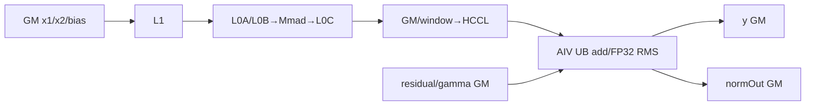

# MatmulAllReduceAddRmsNorm A2 ACLNN 算子知识

## 算子速览

| 项目 | 内容 |
|---|---|
| 实际入口 | `aclnnMatmulAllReduceAddRmsNormGetWorkspaceSize` + `aclnnMatmulAllReduceAddRmsNorm`；公开、无版本后缀 ACLNN |
| 计算语义 | `mmOut=AllReduce(x1@x2+bias,SUM)`；`y=mmOut+residual`；`normOut=y*gamma/sqrt(mean(y²)+epsilon)` |
| 输入输出 | `x1:[M,K]`/`[B,S,K]`，`x2:[K,N]`，可选 `bias:[N]`，`residual/y/normOut:[B,S,N]`，`gamma:[N]`；ND；FP16/BF16 |
| 执行类型 | 单 Kernel `MIX_CV`：AIC_CUBE Matmul、可选 AIV_VECTOR ND→NZ、AICPU-HCCL AllReduce、AIV_VECTOR AddRmsNorm |
| Kernel 路线 | MM key `260/256/0` 与 ARN key `10/30、11/31、12/32、13/33、14` 组合；主块、尾块可选不同 ARN body |
| 核心资源 | GM/HCCL window、workspace、Matmul L1/L0A/L0B/L0C、AIV UB、完成计数 cache line |
| 来源闭包 | `source_closed`：ACLNN→generated inner bridge→OpDef/Host/Tiling/POD→MIX_CV entry→Matmul/HCCL/五种 ARN body 与构建接线闭合；generated bridge、HCCL 网络实现和 AscendC `MatmulImpl` 内部为库边界 |
| 验证状态 | 已完成源码闭包检查；本次知识提取未执行编译、真机、数值或性能测试。 |

## 接口与语义

### 计算语义

令二维 `x1` 的首维或三维 `x1` 的 `B*S` 为 `M`，`K=x1[-1]`，`N=residual[-1]`。AIC 按 M turn 计算 `x1@x2+bias`；AICPU HCCL 在通信域内 SUM，接收地址为 `normOut`。AIV 读取已完成 turn 的 `normOut` 和 residual，写 `y=normOut+residual`，以 FP32 完成平方和、均值、epsilon、sqrt、倒数和归一化，再乘 gamma 覆盖 `normOut`。BF16 add 与乘法升 FP32，并在 `y`、归一化中间值和最终输出处 `CAST_RINT`。

### 输入、输出与属性

| 参数 | shape/layout | dtype | 约束、默认值与语义 |
|---|---|---|---|
| `x1` | `[M,K]`/`[B,S,K]`，ND | FP16/BF16 | 必选、2～3D、连续；ACLNN 固定不转置 |
| `x2` | 逻辑 `[K,N]`，ND | 同 x1 | 必选、2D；仅最后两轴转置 view；Host 禁止 FRACTAL_NZ 输入 |
| `bias` | `[N]`，ND | 同 x1 | 可空；BF16 bias 由 AIV0 转 FP32 workspace |
| `residual` | `[B,S,N]`，ND | 同 x1 | 必选、3D、连续；`B*S=M` |
| `gamma` | `[N]`，ND | 同 x1 | 必选、1D、连续 |
| `epsilon` | Host double→attr float | 标量 | `(0,1)`，默认 `1e-6` |
| `group/reduceOp` | Host string | char* | 通信域；仅 SUM；公开支持 1/2/4/8 卡 HCCS all-mesh |
| `commTurn/streamMode` | Host 标量 | int64 | 只允许 0 / `NUM_ACL_STOP_ON_FAILURE`(1) |
| `y` | 同 residual | FP16/BF16 | Add 结果 |
| `normOut` | 同 residual | FP16/BF16 | AllReduce 临时接收区，随后覆盖为最终 RMSNorm 输出 |

### 入口与版本

固定 Commit 只公开无 V2/V3 后缀的接口，它是 A2 上实际支持的最新公开版本。头文件与文档标记其计划在 2026 年 12 月之后废弃，迁移目标为 `aclnnMatmulAllReduce` + `aclnnAddRmsNorm`。Quant、WeightQuant 和 Inplace 改变量化或别名语义，是独立逻辑算子。

## Host/Launcher 执行流程

### 参数校验与前处理

`GetWorkspaceSize` 依次执行 `ArnCheckNotNull`、`ArnCheckShape`；校验 `x1.K==x2[0]`、`residual.N==x2[-1]`。必选 tensor 为空时，K=0 报参数无效，否则创建零 workspace 空 executor。非空路径要求 streamMode=1，固定 `transposeX1=false`，用 `IsTransposeLastTwoDims(x2)` 得到 `transposeX2`，以 antiquant/dequant 全空进入 generated inner bridge。`ContextTransfer` 将 x1/x2/bias 映射给 MMR，将 residual/gamma/y/normOut 映射给 ARN；`mmr.x3=nullptr`。

### 参数、Workspace 与生命周期

```text
arn_declared       = SYS_WORKSPACE_SIZE + 256 B
mc2_base_workspace = libApiWorkSpaceSize + biasLen + 32*AC_MAX_AIV
biasLen            = bias存在且BF16 ? AlignUp(N,SHAPE_ALIGN_SIZE)*4 : 0
mc2_workspace      = max(mc2_base_workspace, MatmulV3 workspaceSize_)
workspace_total    = mc2_workspace + 256 B
```

Kernel 以 `GetUserWorkspace` 跳过系统区。BF16 bias 使用 `[0,biasLen)`，随后 `workspaceGM += biasLen`；全部 MM turn 提交后，ARN 将推进后 workspace 首 cache line 复用为 `rcvCntGM`。计数写入发生在 Matmul 使用期结束之后。executor、workspace 和 tensor 必须存活到调用 stream 完成。

### 启动图与失败传播

```text
ACLNN GetWorkspaceSize
 -> generated inner bridge/executor
 -> MatmulAllReduceAddRmsNormTiling(priority 2)
    -> MatmulAllReduceTiling910: M切分、TCubeTiling、HCCL msg、MM key
    -> CommonAddResNormTiling: tile/tail ARN key、UB、AIV block数
 -> packed POD；blockDim=aicCoreNum；scheduleMode=1
ACLNN execute(stream)
 -> matmul_all_reduce_add_rms_norm<<<KERNEL_TYPE_MIX_AIC_1_2>>>
    -> HCCL Init/AllReduce handle
    -> 可选 AIV ND2NZ 或 BF16 bias→FP32
    -> AIC MM turn -> SyncAll -> AIV0 Commit
    -> SyncAll -> AIV Query完成前缀 -> ARN
    -> SyncAll -> AIV0 Finalize
```

Host/Tiling/launch 失败向上返回，inner launch 非零折叠为 `ACLNN_ERR_INNER`。第二段仅对第一段生成的空 executor 因 workspace 空/0 直接成功。

## Route 与参数设计

### 分核与资源计算

Host 从 shape/transpose 得到 M/N/K/rank，再由公式化 AllReduce tiling 得到 `tileMValue/tileCnt` 和可选 `tailMValue/tailCnt`。长、短 M 分别生成 `TCubeTiling`，包含 M/N/Ka/Kb、singleCore/base/depth/step/dbL0C/usedCoreNum；具体值由 shape 和资源决定。ARN 对长、短段独立计算 `numRow=segmentM`、`numCol=N`、`blockFactor=ceil(numRow,numCore)`、`numBlocks=ceil(numRow,blockFactor)`；`useHalfNumBlocks=true` 使 selector 使用 `AIVCoreNum/2`。`PostTiling` 要求 ARN 最大 block 数不超过 `2*aicCoreNum`，MIX entry 的 AIC:AIV 比为 1:2。

### Route 选择

| 顺序 | Route | Key/模板 | 精确选择条件与优先级 | 不适用去向 |
|---:|---|---|---|---|
| 1 | R-001 Normal | 10/30 | 未命中以下特化，或 MultiN `rowFactor==0` | 无 device fallback |
| 2 | R-002 SplitD | 11/31 | 最高优先级：`N>12288` | Tiling失败 |
| 3 | R-003 MergeN | 12/32 | `N<=12288 && blockFactor!=1 && AlignUp(N,16)<=2000` | 后续 selector |
| 4 | R-004 SingleN | 13/33 | `N<=12288 && blockFactor==1` | Tiling失败 |
| 5 | R-005 MultiN | 14 | FP16、`blockFactor!=1`、`N==AlignUp(N,16)>2000`、UB guard 且 `rowFactor>0` | rowFactor0→R-001 |

```text
MM prefix:
  NO_ND2NZ && !BF16BiasConvert -> key260 / Mc2MatmulBaseKernel
  NO_ND2NZ &&  BF16BiasConvert -> key256 / Mc2MatmulBaseKernel + bias preprocess
  needs Mix ND2NZ              -> key0   / Mc2MatmulBaseUnAlignedKernel
ARN suffix（tile/tail独立）:
  N>12288 -> SplitD
  else blockFactor==1 -> SingleN
  else NAlign<=2000 -> MergeN
  else FP16 && N==NAlign -> MultiN（rowFactor0回Normal）
  else Normal
```

每个正式端到端实例是一个 MM prefix 与一个 ARN suffix 的组合；三种 prefix 的 workspace/POD/交接边不同，后文在每条 ARN Route 内分别保留 260/256/0 差异。

### 模板/实现执行矩阵

| Route | key/selector | dtype/shape/platform 完整命中条件 | 执行族与 kernel 节点 | 实际模板/body | 内存与同步特征 | tail/fallback |
|---|---|---|---|---|---|---|
| R-001 | 260/256/0 × 10/30 | A2 FP16/BF16；Normal 谓词 | 可选AIV ND2NZ→AIC MM→HCCL→AIV ARN | `KernelAddRmsNorm<T>` | 整行 UB；Query 前缀 | tile/tail独立 |
| R-002 | 260/256/0 × 11/31 | `N>12288` | 同上 | `KernelAddRmsNormSplitD<T>` | 两遍D；y为遍间GM | col tail |
| R-003 | 260/256/0 × 12/32 | 短N、多行 | 同上 | `KernelAddRmsNormMergeN<T>` | broadcast、depth2 queue | 行尾；有源码缺口 |
| R-004 | 260/256/0 × 13/33 | blockFactor=1 | 同上 | `KernelAddRmsNormSingleN<T>` | 195584B TBuf、显式event | 一核一行 |
| R-005 | 260/256/0 × 14 | 仅FP16、对齐多行 | 同上 | `KernelAddRmsNormMultiN<half>` | depth2、Gather rstd | rowFactor0→R-001 |

### 隐藏性能 Guard

| Guard | Host/Tiling 条件 | Device/资源原因 | 影响 Route | 不满足时去向 | 源码符号 |
|---|---|---|---|---|---|
| dtype/shape | 同型FP16/BF16；x1 2～3D、x2 2D、residual/y/normOut 3D、gamma 1D；M/K/N≤INT32_MAX；K≠0 | 固定模板/u32字段 | 全部 | API/Tiling失败或空executor | `ArnCheckShape/CheckAxisSize/CheckMRNCtxInfo` |
| 通信 | rank 1/2/4/8；SUM；A2 comm_mode空或ai_cpu | AICPU HCCL | 全部 | Tiling失败 | `CheckCommModeA2` |
| AIV数 | `max(tileBlocks,tailBlocks)<=2*aicCoreNum` | MIX 1:2 | 全部 | PostTiling失败 | `PostTiling` |
| SplitD | N>12288；ubFactor按D片重算 | 常规整行UB不足 | R-002 | 无fallback | `SetAddRmsNormTilingData` |
| MergeN | NAlign≤2000；`rowFactor=UB/(18*NAlign+260)` | 多短行融合 | R-003 | 后续selector | 同上 |
| MultiN | `UB>=1280+2*NAlign`；`rowFactor=(UB-1280-2*NAlign)/(16*NAlign+64)` | FP16双缓冲 | R-005 | rowFactor0→R-001 | 同上 |
| BF16 bias | bias存在且BF16 | Matmul bias trait为FP32 | 任意ARN+key256 | 无bias不分配 | `GetWorkspaceSize/PreProcForBiasOnVector` |
| window | turn总发送字节小于HCCL_BUFFSIZE | window或正式输出作通信缓冲 | 全部 | 超界→OUTPUT | `CalcBufferTypeByWindowSize` |

### POD/ABI

融合 POD `#pragma pack(push,8)`；nested `TCubeTiling` 的本构建 `sizeof/offsetof` 固定仓未给出，故不猜测数值。

| 结构 | 字段 | 类型/位宽 | ABI 布局 | 单位 | Host/launcher producer | Device consumer | 边界 |
|---|---|---|---|---|---|---|---|
| `MatmulAllReduceAddRmsNormTilingData` | `matmulAllReduceTilingData` | nested POD | offset0；总结构8B对齐 | 复合 | MM helper | fused outer | msg/param/tile/tail |
| 同上 | `addRMSNormTileTilingData` | nested POD | 紧随MMR | 复合 | tile ARN tiling | ARN body | 始终有效 |
| 同上 | `addRMSNormTailTilingData` | nested POD | 紧随tile | 复合 | tail ARN tiling | ARN body | tailCnt非0有效 |
| 同上 | `addRmsNormTilingeKeyData` | 4×u32 | 末尾 | key/核 | `DoOpTiling` | router | tail字段条件有效 |
| `AddRMSNormTilingData` | `num_row` | u32 | 字段0 | 行/turn | segmentM | GM offset/分核 | M≤INT32_MAX |
| 同上 | `num_col` | u32 | 字段1 | 元素/行 | gamma shape | 搬运/reduce | 正式route N>0 |
| 同上 | `block_factor` | u32 | 字段2 | 行/AIV | ceil(numRow,numCore) | rowWork | ≥1 |
| 同上 | `row_factor` | u32 | 字段3 | 行/UB批 | selector | 行循环 | 模式相关 |
| 同上 | `ub_factor` | u32 | 字段4 | 元素 | selector | InitBuffer/D片 | 乘dtype字节 |
| 同上 | `epsilon/avg_factor` | float×2 | 字段5/6 | 标量 | attr、1/N | RMS body | N=0时avg=0 |
| `AddRMSNormTilingeKeyData` | `ARNKeyTile/ARNKeyTail` | u32×2 | 字段0/1 | key | selector | router | tail条件有效 |
| 同上 | `ARNNumBlocksTile/Tail` | u32×2 | 字段2/3 | AIV核 | selector | block guard | ≤2×AIC |
| `RCSTiling` | `tileCnt/tailM/tailCnt/biasLen` | u32×4 | 共享固定顺序 | 轮/行/字节 | M切分/workspace | outer | biasLen可0 |
| 同上 | `rankM/rankN/rankK/aicCoreNum` | u32×4 | 共享固定顺序 | 元素/核 | `DoRCSTiling` | MM/bias cast | 轴≤INT32_MAX |
| `Mc2Msg` | `sendOff/recvOff/tail*Off` | u64 | 共享固定顺序 | 字节/turn | AllReduce tiling | HCCL | `segmentM*N*sizeof(T)` |
| 同上 | `sendCnt/recvCnt/tail*Cnt/totalCnt` | u64 | 共享固定顺序 | 元素 | 同上 | HCCL | total=M*N |
| 同上 | `turnNum/tailNum/reuseMode/useBufferType` | u32/u8 | 共享固定顺序 | 轮/枚举 | `DoAllReduceTiling` | HCCL | turn=tile+tail |

### Route 源码闭包

| Route | Key/selector | Host/Tiling producer | POD/参数 | Kernel entry/router | Kernel body/直接依赖 | 构建接线 |
|---|---|---|---|---|---|---|
| R-001 | 10/30 | common ARN tiling | fused POD+MMR POD | entry/ARN router | `add_rms_norm.h`+MM/HCCL | Host CMake+binary JSON |
| R-002 | 11/31 | 同上 | 同上 | 同上 | `add_rms_norm_split_d.h` | 同上 |
| R-003 | 12/32 | 同上 | 同上 | 同上 | `add_rms_norm_merge_n.h` | 同上 |
| R-004 | 13/33 | 同上 | 同上 | 同上 | `add_rms_norm_single_n.h` | 同上 |
| R-005 | 14 | 同上 | 同上 | 同上 | `add_rms_norm_multi_n.h` | 同上 |

## Kernel 实现

### 公共执行流程

entry 校验 user workspace，注册 `KERNEL_TYPE_MIX_AIC_1_2`，按 MM key 分派。当前模板为 `MatmulType<GM,ND,DTYPE_X1,false>`、`MatmulType<GM,ND,DTYPE_X2,transB>`、`MatmulType<GM,ND,DTYPE_Y>`、`MatmulType<GM,ND,DTYPE_BIAS_FOR_MC2>`，block=`Mc2MatmulBaseBlock`，配置=`MM_CFG_NO_PRELOAD`。`MatmulImpl` 按 TCubeTiling 实现 `GM→L1→L0A/L0B→Mmad→L0C→GetTensorC`；内部物理 L1/L0 字节是外部库边界。每 turn 经 `Mc2SyncAll` 后由 AIV0 Commit；全部 turn 后 AIV Query、ARN，末尾全核同步再由 AIV0 Finalize。

key260 无 ND2NZ/无 bias cast；key256 同 Matmul body但先做 BF16 bias cast；key0 由 AIV 将 A/B 转 NZ 到 GM workspace，`NotifyEvent<PIPE_MTE3>(4)` 后 AIC Matmul。

### Route R-001：Normal AddRmsNorm

#### 适用条件

##### 选择证据

| 层级 | 文件 | 符号 | 源码谓词/参数 | 结果/下一跳 |
|---|---|---|---|---|
| Tiling | `common_add_rms_norm_tiling.cpp` | `SetAddRmsNormTilingData` | 未命中特化或MultiN rowFactor0 | key10/30 |
| Router | `add_rms_norm_kernel.h` | `AddRmsNorm` | key10/30 | `KernelAddRmsNorm<half/bfloat16_t>` |

#### Device 数据流

##### 函数级调用链

```text
entry -> fused Process -> MM InnerProcess/Commit -> AddRmsNormKernel
 -> KernelAddRmsNorm::Init/ComputeProcess/Process -> CopyIn/Compute/CopyOutY
```

##### 源码等价伪码

```text
gammaUB=gamma[0:N]
for completed turn, assigned row:
  mm,residual -> UB; y=mm+residual; y -> GM
  rstd=1/sqrt(sum(float(y)^2)/N+epsilon)
  normOut=cast(float(y)*rstd)*gamma with dtype-specific cast order
```

#### 内存与数据搬运

##### 资源与搬运表

| 层级/缓冲区 | offset/地址公式 | extent/容量公式 | dtype/layout | producer | consumer | owner/lifetime | 对齐/复用 |
|---|---|---|---|---|---|---|---|
| GM normOut临时 | turnOff+row*N*sizeof(T) | segmentM*N*sizeof(T) | T/ND | HCCL | ARN | caller；最终覆盖 | Query保护 |
| L1/L0A/B/C | TCubeTiling | 物理字节库边界 | MM traits | MatmulImpl | GetTensorC | MM tile | base/depth/step/dbL0C |
| UB T queues | 0 | `3*ubFactor*sizeof(T)` | T | MTE2 | Vector/MTE3 | row | 单缓冲 |
| UB FP32 | 后续 | `2*ubFactor*4+64*4` | FP32 | cast/mul | reduce/norm | row | sqx复用 |

##### 分层内存布局



##### 字节账、交接边与复用顺序

```text
workspace_total=max(libApiWorkspace+biasLen+32*AC_MAX_AIV,MatmulV3Workspace)+256
UB_Normal=3*ubFactor*sizeof(T)+2*ubFactor*4+64*4
L1/L0=TCubeTiling当前实例；MatmulImpl物理分配固定仓不可见
```

| 边/复用子区 | producer | offset/extent | dtype/layout | consumer | ordering/sync | owner/lifetime | 安全条件 |
|---|---|---|---|---|---|---|---|
| HCCL→ARN | AllReduce | turn×segmentM*N*sizeof(T) | T/ND | Normal | Query+DCCI+SyncAll | normOut | 仅消费完成前缀 |
| workspace→counter | MM workspace | biasLen后首cache line | int64 | 各AIV | AIV0写+DCCI+SyncAll | executor workspace | MM使用期结束 |

#### 同步、精度与尾块

##### 同步与数值边界表

| 阶段 | primitive/机制 | producer | consumer/等待点 | 保护对象 | 精度/尾块 |
|---|---|---|---|---|---|
| MM→HCCL | `Mc2SyncAll` | AIC MM | AIV0 Commit | turn C | 输出T |
| HCCL→ARN | Query/DCCI/SyncAll | HCCL/AIV0 | 全AIV | 完成前缀 | tile/tail key独立 |
| ARN | PIPE_V、V_S/S_V、V_MTE2 | Vector | scalar/MTE | UB slot | FP32 RMS；BF16 RINT；DataCopyPad尾列 |

#### 关键实现

##### 符号证据表

| 阶段 | 文件 | 符号/模板实例 | 实现事实 |
|---|---|---|---|
| Host/Tiling producer | common ARN tiling | Normal branch | key/UB |
| Kernel entry/router | ARN router | key10/30 | dtype实例 |
| Device body/helper | `add_rms_norm.h/rms_norm_base.h` | CopyIn/Compute/DataCopyCustom | 数值/尾搬运 |

### Route R-002：SplitD AddRmsNorm

#### 适用条件

##### 选择证据

| 层级 | 文件 | 符号 | 源码谓词/参数 | 结果/下一跳 |
|---|---|---|---|---|
| Tiling | common ARN tiling | SplitD branch | `N>12288` | key11/31；D片16对齐 |
| Router | ARN router | key11/31 | dtype | SplitD body |

#### Device 数据流

##### 函数级调用链

```text
公共MM/HCCL -> SplitD::SubProcess -> ComputeFormer -> ComputeRstd -> ComputeLatter
```

##### 源码等价伪码

```text
pass1每D片: y=mm+residual; y写GM; FP32平方和跨片累加
rstd=rsqrt(sum+epsilon)
pass2每D片: 重读y/gamma; normOut=y*rstd*gamma
```

#### 内存与数据搬运

##### 资源与搬运表

| 层级/缓冲区 | offset/地址公式 | extent/容量公式 | dtype/layout | producer | consumer | owner/lifetime | 对齐/复用 |
|---|---|---|---|---|---|---|---|
| GM y | row*N+j*ubFactor | N/row | T/ND | pass1 | pass2 | caller | 跨pass |
| UB T | 0 | `4*ubFactor*sizeof(T)` | T | copy/add | output | D片 | 单缓冲 |
| UB FP32 | 后续 | `8*ubFactor+36*rowFactor+256` | FP32 | cast/reduce | rstd/norm | row批 | 跨片累加 |

##### 分层内存布局


##### 字节账、交接边与复用顺序

```text
UB_SplitD=4*ubFactor*sizeof(T)+8*ubFactor+36*rowFactor+256
```

| 边/复用子区 | producer | offset/extent | dtype/layout | consumer | ordering/sync | owner/lifetime | 安全条件 |
|---|---|---|---|---|---|---|---|
| pass1→pass2 | CopyInAndAdd | y slice/num*sizeof(T) | T/ND | CopyInX | 同AIV程序顺序 | y | 全部D片pass1完成 |

#### 同步、精度与尾块

##### 同步与数值边界表

| 阶段 | primitive/机制 | producer | consumer/等待点 | 保护对象 | 精度/尾块 |
|---|---|---|---|---|---|
| 跨D | FP32 BlockReduce+Add | slice | ComputeRstd | rstdBuf | col_tail按真实N |
| norm | V_S/S_V、PIPE_V | rstd | ComputeY | 行标量 | BF16 RINT |

#### 关键实现

##### 符号证据表

| 阶段 | 文件 | 符号/模板实例 | 实现事实 |
|---|---|---|---|
| Host/Tiling producer | common tiling | SplitD branch | ubFactor |
| Kernel entry/router | ARN router | 11/31 | 实例化 |
| Device body/helper | SplitD body | Former/Latter | y GM双遍 |

### Route R-003：MergeN AddRmsNorm

#### 适用条件

##### 选择证据

| 层级 | 文件 | 符号 | 源码谓词/参数 | 结果/下一跳 |
|---|---|---|---|---|
| Tiling | common tiling | MergeN branch | blockFactor!=1、NAlign≤2000 | key12/32 |
| Router | ARN router | 12/32 | dtype | MergeN body |

#### Device 数据流

##### 函数级调用链

```text
公共MM/HCCL -> BroadcastGamma -> ComputeX -> ReduceSumMultiN -> BroadcastRstd -> ComputeY
```

##### 源码等价伪码

```text
gamma广播到rowFactor行；多行add并写y；FP32多行reduce得到rstd；广播rstd后乘gamma写normOut
```

#### 内存与数据搬运

##### 资源与搬运表

| 层级/缓冲区 | offset/地址公式 | extent/容量公式 | dtype/layout | producer | consumer | owner/lifetime | 对齐/复用 |
|---|---|---|---|---|---|---|---|
| UB x/y queues | 0 | `4*ubFactor*sizeof(T)` | T/[rows,NAlign] | MTE/add | output/norm | row批 | depth2 |
| UB gamma/FP32/tmp | 后续 | `ubFactor*sizeof(T)+8*ubFactor+260*rowFactor` | T/FP32 | broadcast/reduce | norm | row批 | tmp复用 |

##### 分层内存布局


##### 字节账、交接边与复用顺序

```text
UB_MergeN=5*ubFactor*sizeof(T)+8*ubFactor+260*rowFactor
```

| 边/复用子区 | producer | offset/extent | dtype/layout | consumer | ordering/sync | owner/lifetime | 安全条件 |
|---|---|---|---|---|---|---|---|
| xLocal alias | ComputeX | outQueueY slot | T | Reduce/Norm | queue+PIPE_V | row批 | CopyOutX后源码仍复用LocalTensor |

#### 同步、精度与尾块

##### 同步与数值边界表

| 阶段 | primitive/机制 | producer | consumer/等待点 | 保护对象 | 精度/尾块 |
|---|---|---|---|---|---|
| 多行reduce | ReduceSumMultiN | FP32 square | rstd | NAlign布局 | 真实N mask、行尾calc_row_num |
| 缺口 | 无初始化 | `isNumColAlign_` | CopyIn/Out分支 | padding | 固定仓仅声明/读取，不推测 |

#### 关键实现

##### 符号证据表

| 阶段 | 文件 | 符号/模板实例 | 实现事实 |
|---|---|---|---|
| Host/Tiling producer | common tiling | MergeN branch | key12/32 |
| Kernel entry/router | ARN router | 12/32 | 实例化 |
| Device body/helper | MergeN body | Broadcast/ReduceSumMultiN | 多行融合与缺口 |

### Route R-004：SingleN AddRmsNorm

#### 适用条件

##### 选择证据

| 层级 | 文件 | 符号 | 源码谓词/参数 | 结果/下一跳 |
|---|---|---|---|---|
| Tiling | common tiling | SingleN branch | blockFactor==1 | key13/33 |
| Router | ARN router | 13/33 | dtype | SingleN body |

#### Device 数据流

##### 函数级调用链

```text
公共MM/HCCL -> SingleN::ComputeProcess -> ProcessFp16或ProcessBf16
```

##### 源码等价伪码

```text
一AIV一行：异步载入mm/residual；add并发起y写回；复用residual槽加载gamma；FP32 RMS；等待槽安全后写normOut
```

#### 内存与数据搬运

##### 资源与搬运表

| 层级/缓冲区 | offset/地址公式 | extent/容量公式 | dtype/layout | producer | consumer | owner/lifetime | 对齐/复用 |
|---|---|---|---|---|---|---|---|
| UB unitBuf | 0 | `(192-1)*1024=195584B` | byte/T/FP32 views | MTE/Vector | Vector/MTE3 | 一行 | x2→gamma、x1→output复用 |

##### 分层内存布局


##### 字节账、交接边与复用顺序

```text
UB_SingleN=195584B
```

| 边/复用子区 | producer | offset/extent | dtype/layout | consumer | ordering/sync | owner/lifetime | 安全条件 |
|---|---|---|---|---|---|---|---|
| x2→gamma | residual load | x2Local/N | T | gamma load | V_MTE2/MTE2_V | unitBuf | add已读完 |
| x1→norm | add/y copy | x1Local/N | T | norm | MTE3_V | unitBuf | y写回完成 |

#### 同步、精度与尾块

##### 同步与数值边界表

| 阶段 | primitive/机制 | producer | consumer/等待点 | 保护对象 | 精度/尾块 |
|---|---|---|---|---|---|
| load/add | MTE2_V | MTE | Vector | input slots | BF16先FP32 |
| y/norm | V_MTE3/MTE3_V | Vector/MTE3 | slot复用 | x1 slot | 一核一行；列按真实N |

#### 关键实现

##### 符号证据表

| 阶段 | 文件 | 符号/模板实例 | 实现事实 |
|---|---|---|---|
| Host/Tiling producer | common tiling | SingleN branch | key13/33 |
| Kernel entry/router | ARN router | 13/33 | 实例化 |
| Device body/helper | SingleN body | ProcessFp16/Bf16 | 固定UB与事件生命周期 |

### Route R-005：MultiN AddRmsNorm

#### 适用条件

##### 选择证据

| 层级 | 文件 | 符号 | 源码谓词/参数 | 结果/下一跳 |
|---|---|---|---|---|
| Tiling | common tiling | MultiN branch | FP16、N对齐、UB guard | key14/rowFactor0回Normal |
| Router | ARN router | 14 | FP16 | MultiN body |

#### Device 数据流

##### 函数级调用链

```text
公共MM/HCCL -> MultiN::SubProcess -> ComputeX -> ComputeRstd -> Gather -> ComputeY
```

##### 源码等价伪码

```text
depth2载多行FP16；add写y；逐行FP32 reduce；Gather rstd槽；repeat-stride广播；乘gamma写normOut
```

#### 内存与数据搬运

##### 资源与搬运表

| 层级/缓冲区 | offset/地址公式 | extent/容量公式 | dtype/layout | producer | consumer | owner/lifetime | 对齐/复用 |
|---|---|---|---|---|---|---|---|
| UB x/y | 0 | `4*ubFactor*sizeof(half)` | FP16/[rows,N] | MTE/add | output/norm | row批 | depth2 |
| UB FP32/rstd/offset | 后续 | `2*ubFactor*4+64*rowFactor+256+2*NAlign` | FP32/u32 | cast/reduce | Gather/norm | row批 | 每行32B rstd slot |

##### 分层内存布局


##### 字节账、交接边与复用顺序

```text
UB_MultiN=16*ubFactor+2*NAlign+64*rowFactor+256 bytes
Host求rowFactor时另保守预留1024B。
```

| 边/复用子区 | producer | offset/extent | dtype/layout | consumer | ordering/sync | owner/lifetime | 安全条件 |
|---|---|---|---|---|---|---|---|
| rstd slots | ComputeRstd | i*8 FP32/32B | FP32 | Gather/Mul | PIPE_V | row批 | offset=i*32B |

#### 同步、精度与尾块

##### 同步与数值边界表

| 阶段 | primitive/机制 | producer | consumer/等待点 | 保护对象 | 精度/尾块 |
|---|---|---|---|---|---|
| queue | depth2+PIPE_V | MTE/add | reduce/output | alternating slots | 仅FP16；N无列尾 |
| row tail | calc_row_num | selector | loop | final batch | 只处理剩余行 |

#### 关键实现

##### 符号证据表

| 阶段 | 文件 | 符号/模板实例 | 实现事实 |
|---|---|---|---|
| Host/Tiling producer | common tiling | MultiN branch | UB方程/回退 |
| Kernel entry/router | ARN router | 14 | half实例 |
| Device body/helper | MultiN body | ComputeRstd/ComputeY | 双缓冲/Gather/行尾 |

## 算子特定优化

### Trick T-001：HCCL 完成前缀增量消费

#### 触发与源码依据

- 适用 Route：R-001～R-005。
- 触发条件：HCCL handle 可查询单调连续完成 turn。
- Golden 来源：[`add_rms_norm_kernel.h:61-74`](../../../../../../../cann-ops-raw/ascendc/ops-transformer/be33d95bb755cedec3108f70805c1874d1792540/mc2/matmul_all_reduce_add_rms_norm/op_kernel/add_rms_norm_kernel.h#L61-L74)

**官方源码（固定 Commit 连续逐字摘录）**：

```cpp
while (true) {
    if (GetBlockIdx() == 0) {
        const uint32_t curCnt = GetCurFinishedCnt();
        if (curCnt <= lastCnt) {
            continue;
        }
        *rcvCntGM = curCnt;
        rcvCntGMTensor.SetGlobalBuffer(reinterpret_cast<__gm__ int64_t*>(rcvCntGM));
        DataCacheCleanAndInvalid<
            int64_t, AscendC::CacheLine::SINGLE_CACHE_LINE, AscendC::DcciDst::CACHELINE_OUT>(rcvCntGMTensor);
    }
    SyncAll();
    DataCacheCleanAndInvalid<int64_t, AscendC::CacheLine::SINGLE_CACHE_LINE, AscendC::DcciDst::CACHELINE_OUT>(
        rcvCntGMTensor);
```

#### 机制与设计原因

AIV0 发布增长后的完成数，DCCI 清理/失效 cache line 后全 AIV 同步，只处理 `[addRmsNormCount,lastCnt]`，让 ARN 与后续通信重叠且不读取未完成区。

#### 迁移边界

- 适用：通信 runtime 返回连续完成前缀。
- 前提：turn GM 连续、handle顺序与offset一致、计数广播协议不变。
- 失效：只能报告全局完成时必须等待 collective 完成。
- 未验证：本次知识提取未执行编译、真机、数值或性能测试。

#### 错误做法

在 Query 前读取完整 normOut 会消费未完成 turn；固定仓无自动 fallback。

### Trick T-002：Shape/UB 驱动五种 ARN body

#### 触发与源码依据

- 适用 Route：R-001～R-005。
- 触发条件：N、blockFactor、dtype、16对齐、实际UB size。
- Golden 来源：[`common_add_rms_norm_tiling.cpp:228-236`](../../../../../../../cann-ops-raw/ascendc/ops-transformer/be33d95bb755cedec3108f70805c1874d1792540/mc2/matmul_all_reduce_add_rms_norm/op_host/op_tiling/arch22/common_add_rms_norm_tiling.cpp#L228-L236)

**官方源码（固定 Commit 连续逐字摘录）**：

```cpp
if (numCol > ubFactor) {
    modeKey = ModeKey::K_SPLIT_D;
    ubFactor = (dataType == ge::DT_FLOAT) ? UB_FACTOR_B32_CUTD : UB_FACTOR_B16_CUTD;
    uint32_t colTileNum = Ops::Base::CeilDiv(numCol, static_cast<int64_t>(ubFactor));
    ubFactor = Ops::Base::CeilDiv(numCol, static_cast<int64_t>(colTileNum * BLOCK_ALIGN_NUM)) * BLOCK_ALIGN_NUM;
} else if (blockFactor == 1) {
    modeKey = ModeKey::K_SINGLE_N;
} else if (numColAlign <= SMALL_REDUCE_NUM) {
    modeKey = ModeKey::K_MERGE_N;
```

#### 机制与设计原因

超长N双遍切D，一核一行用固定TBuf，短N合并多行，对齐FP16用MultiN，其余Normal；Host以真实UB方程生成ubFactor/rowFactor。

#### 迁移边界

- 适用：相同FP16/BF16数值顺序与A2 UB模型。
- 前提：保持 selector 优先级和key编码。
- 失效：BF16不得进入key14；MergeN缺口不可外推。
- 未验证：本次知识提取未执行编译、真机、数值或性能测试。

#### 错误做法

key12是MergeN、key13是SingleN；对调会路由到错误body。

### Trick T-003：BF16 bias 单次转 FP32并切片复用 workspace

#### 触发与源码依据

- 适用 Route：R-001～R-004 的 BF16+bias key256。
- 触发条件：Host 写 `biasLen=AlignUp(N,...)*4`。
- Golden 来源：[`matmul_all_reduce_base.h:90-100`](../../../../../../../cann-ops-raw/ascendc/ops-transformer/be33d95bb755cedec3108f70805c1874d1792540/mc2/matmul_all_reduce/op_kernel/arch22/matmul_all_reduce_base.h#L90-L100)

**官方源码（固定 Commit 连续逐字摘录）**：

```cpp
if (paramInTiling_->biasLen == 0U) {
    return;
}

TBuf<TPosition::VECCALC> tmpBuf;
tPipe_->InitBuffer(tmpBuf, TOTAL_UB_SIZE);
CastBFtoFloatOnAiv0(addrs_->workspaceGM, addrs_->biasGM, paramInTiling_->rankN, tmpBuf);
SyncAll<false>();
addrs_->biasGM = addrs_->workspaceGM;
addrs_->workspaceGM += paramInTiling_->biasLen;
```

#### 机制与设计原因

仅AIV0 cast，所有AIC在全核同步后复用FP32 bias；指针推进隔离后续Matmul workspace和ARN counter。

#### 迁移边界

- 适用：BF16 bias、FP32 bias trait。
- 前提：workspace含对齐biasLen且保留SyncAll。
- 失效：FP16/无bias不得推进指针。
- 未验证：本次知识提取未执行编译、真机、数值或性能测试。

#### 错误做法

同步前让AIC读取workspace bias会破坏producer/consumer协议。

### Trick T-004：key0 的 AIV ND→NZ 与 event4 交接

#### 触发与源码依据

- 适用 Route：所有 Route 的 MM key0 prefix。
- 触发条件：MatmulV3选择Mix ND2NZ。
- Golden 来源：[`mat_mul_unaligned_base_kernel.h:182-189`](../../../../../../../cann-ops-raw/ascendc/ops-transformer/be33d95bb755cedec3108f70805c1874d1792540/mc2/3rd/mat_mul_v3/op_kernel/mat_mul_unaligned_base_kernel.h#L182-L189)

**官方源码（固定 Commit 连续逐字摘录）**：

```cpp
SyncAll();
// CV SYNC
if ASCEND_IS_AIV {
    NotifyEvent<PIPE_MTE3>(CV_FLAG);
}
if ASCEND_IS_AIC {
    WaitEvent(CV_FLAG);
}
```

#### 机制与设计原因

AIV将A/B写入GM NZ staging；AIC等待event id4后读取。BOTH_AB时B slice位于对齐A slice之后。

#### 迁移边界

- 适用：同一MIX launch内AIV ND2NZ→AIC MM。
- 前提：保持flag4、workspace容量、transpose/base参数。
- 失效：key260/256不创建staging、不等待event4。
- 未验证：本次知识提取未执行编译、真机、数值或性能测试。

#### 错误做法

只保留SyncAll而删除PIPE_MTE3 event不能替代AIV写GM到AIC读GM的显式交接。

## 模板与实现对比

| 对比维度 | R-001 Normal | R-002 SplitD | R-003 MergeN | R-004 SingleN | R-005 MultiN | 设计选择依据 |
|---|---|---|---|---|---|---|
| 命中条件/优先级 | default | N>12288 | NAlign≤2000 | blockFactor=1 | FP16对齐且UB够 | 固定if/else顺序 |
| 执行族/节点图 | MM/HCCL/AIV | 同左 | 同左 | 同左 | 同左 | MM prefix正交 |
| M/N/K、tile与scheduler | 完整行 | D切片 | 多短行 | 一核一行 | 多对齐行 | MM TCube共用 |
| workspace/L1/L0/UB | 常规 | y GM双遍 | broadcast/depth2 | 195584B | depth2/Gather | 字节方程 |
| AIC/AIV交接 | Query；key0 event4 | 同左 | 同左 | 同左 | 同左 | 单MIX kernel |
| 同步、精度与tail | FP32 RMS | 跨片FP32 | 多行reduce/缺口 | 显式event | FP16 only | tile/tail独立 |
| fallback/失败边界 | 无 | 无 | 无 | 无 | rowFactor0→Normal | unknown key无body |

## 平台差异

| 项目 | A2 | A3 | 950 |
|---|---|---|---|
| 支持状态 | 支持；公开产品表与ascend910b接线一致 | README/docs明确不支持 | ACLNN文档明确950PR/950DT不支持 |
| Host/Launcher | arch22 tiling、AICPU HCCL | N/A | N/A |
| Kernel/资源 | MIX_AIC_1_2、key260/256/0 | N/A | N/A |

## 限制与失败边界

- 仅覆盖公开非量化、非inplace ACLNN；Quant、WeightQuant、Inplace是独立逻辑算子。
- 只支持FP16/BF16同型、x1不转置、x2最后两轴转置、SUM、commTurn0、streamMode1。
- `(B*S)、N` 可为0，K不可为0；空域走零workspace executor，不进入Device。
- AIC L1/L0物理字节和Mmad/Fixpipe内部参数在外部 `MatmulImpl` 边界；本卡只固化template traits、TCubeTiling和GM交接。
- HCCL网络transport及generated inner bridge生成代码不在固定仓；POD与handle/Commit/Query/Finalize契约已闭合。
- `KernelAddRmsNormMergeN::isNumColAlign_` 只有声明和读取，没有初始化；R-003分支选择是源码缺失。
- 未注册MM key或未知ARN key没有device fallback body。
- 本次知识提取未执行编译、单元测试、真机、数值、性能测试或validator。

## 源码索引

### 链路索引

| 链路阶段 | 文件 | 关键符号 | 支撑内容 |
|---|---|---|---|
| 入口声明/约束 | `mc2/matmul_all_reduce_add_rms_norm/docs/aclnnMatmulAllReduceAddRmsNorm.md` | 产品表/API | A2、公式、约束 |
| 入口声明/约束 | `mc2/matmul_all_reduce_add_rms_norm/op_api/aclnn_matmul_all_reduce_add_rms_norm.h` | ACLNN | 入口/版本 |
| 入口实现 | `mc2/matmul_all_reduce_add_rms_norm/op_api/aclnn_matmul_all_reduce_add_rms_norm.cpp` | 两段接口 | 校验/空域/错误 |
| 入口实现 | `mc2/matmul_all_reduce_add_rms_norm/op_api/matmul_all_reduce_arn_util.cpp` | inner workspace | transpose/bridge |
| Host/Tiling/Launcher | `mc2/matmul_all_reduce_add_rms_norm/op_host/matmul_all_reduce_add_rms_norm_def.cpp` | OpDef | ascend910b/dtype |
| Host/Tiling/Launcher | `mc2/matmul_all_reduce_add_rms_norm/op_host/op_tiling/arch22/matmul_all_reduce_add_rms_norm_tiling.cpp` | fused tiling | workspace/block/POD |
| Host/Tiling/Launcher | `mc2/matmul_all_reduce_add_rms_norm/op_host/op_tiling/arch22/common_add_rms_norm_tiling.cpp` | ARN tiling | selector/UB/key |
| Host/Tiling/Launcher | `mc2/common/utils/context_transfer.cpp` | MRN context | MMR/ARN映射 |
| Host/Tiling/Launcher | `mc2/matmul_all_reduce/op_host/op_tiling/arch22/matmul_all_reduce_tiling_910.cpp` | MM tiling | MM key/TCube |
| Host/Tiling/Launcher | `mc2/matmul_all_reduce/op_host/op_tiling/matmul_all_reduce_tiling_base.cpp` | base tiling | turn/HCCL/workspace |
| Host/Tiling/Launcher | `mc2/matmul_all_reduce_add_rms_norm/op_kernel/matmul_all_reduce_add_rms_norm_tiling_data.h` | fused POD | ARN ABI |
| Host/Tiling/Launcher | `mc2/common/op_kernel/mc2_tiling_struct.h` | Mc2Msg/RCSTiling | 通信ABI |
| Kernel entry/body | `mc2/matmul_all_reduce_add_rms_norm/op_kernel/arch22/matmul_all_reduce_add_rms_norm.cpp` | entry | MIX/MM router |
| Kernel entry/body | `mc2/matmul_all_reduce_add_rms_norm/op_kernel/mm_allreduce_add_rms_norm_910_general.h` | fused Process | 生命周期 |
| Kernel entry/body | `mc2/matmul_all_reduce/op_kernel/arch22/matmul_all_reduce_base.h` | Init/PostProc | HCCL/bias |
| Kernel entry/body | `mc2/matmul_all_reduce/op_kernel/arch22/matmul_all_reduce_910_general.h` | InnerProcess | MM turn |
| Kernel entry/body | `mc2/matmul_all_reduce/op_kernel/common.h` | GM/traits/sync | dtype/地址/同步 |
| Kernel entry/body | `mc2/3rd/mat_mul_v3/op_kernel/mat_mul_base_kernel.h` | base MM | Matmul body contract |
| Kernel entry/body | `mc2/3rd/mat_mul_v3/op_kernel/mat_mul_unaligned_base_kernel.h` | unaligned MM | ND2NZ/event4 |
| Kernel entry/body | `mc2/matmul_all_reduce_add_rms_norm/op_kernel/add_rms_norm_kernel.h` | router/query | 完成前缀/offset |
| Kernel entry/body | `mc2/matmul_all_reduce_add_rms_norm/op_kernel/add_rms_norm.h` | Normal | R-001 |
| Kernel entry/body | `mc2/matmul_all_reduce_add_rms_norm/op_kernel/add_rms_norm_split_d.h` | SplitD | R-002 |
| Kernel entry/body | `mc2/matmul_all_reduce_add_rms_norm/op_kernel/add_rms_norm_merge_n.h` | MergeN | R-003 |
| Kernel entry/body | `mc2/matmul_all_reduce_add_rms_norm/op_kernel/add_rms_norm_single_n.h` | SingleN | R-004 |
| Kernel entry/body | `mc2/matmul_all_reduce_add_rms_norm/op_kernel/add_rms_norm_multi_n.h` | MultiN | R-005 |
| Kernel entry/body | `mc2/matmul_all_reduce_add_rms_norm/op_kernel/rms_norm_base.h` | helper | copy/reduce/tail |
| 构建接线 | `mc2/matmul_all_reduce_add_rms_norm/op_host/CMakeLists.txt` | module/options | ACLNN inner/MC2 |
| 构建接线 | `mc2/matmul_all_reduce_add_rms_norm/op_host/config/ascend910b/matmul_all_reduce_add_rms_norm_binary.json` | binary entries | FP16/BF16/ND |

### 实现复用检查

| 检查项 | 可复用事实 | 不得改变的约束 | 源码符号 |
|---|---|---|---|
| ABI/POD | MMR+tile/tail ARN嵌套 | pack8、字段顺序/位宽、tail inactive | fused POD |
| 调用顺序 | Init→MM/Commit→Query/ARN→Finalize | Query前不得读结果 | fused Process/router |
| workspace/内存 | bias/MM/counter按生命周期切片复用 | biasLen推进、ND2NZ slice、256B用户区 | workspace producer/consumer |
| 同步 | MM/HCCL SyncAll、counter DCCI、event4 | MIX1:2、scheduleMode1、event方向 | PostProc/ProcessNDtoNZ |
| 精度与尾块 | FP32 RMS、BF16 RINT、tile/tail独立key | BF16不得进MultiN；真实N尾搬运 | ARN bodies |
| 失败边界 | 空tensor空executor；Host只产已注册key | K=0、unknown key、MergeN缺口不可补造 | ACLNN/entry/router |

- [AllReduce](../../../../apis/simd_api/adv_api/hccl_communication/hccl_kernel/all_reduce.md)
- [DataCacheCleanAndInvalid](../../../../apis/simd_api/basic_api/cache_control/data_cache_clean_and_invalid.md)
