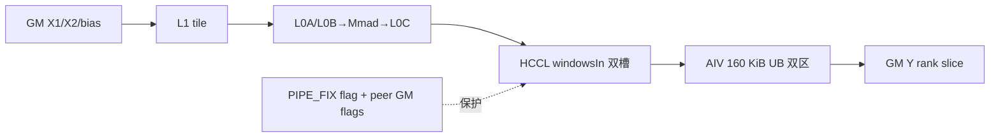
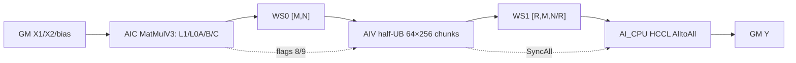

# MatmulAlltoAll A2/A3 ACLNN 算子知识

## 算子速览

| 项目 | 内容 |
|---|---|
| 实际入口 | `aclnnMatmulAlltoAllV2GetWorkspaceSize` / `aclnnMatmulAlltoAllV2`，公开 ACLNN V2；固定提交中它是增加 `commMode` 的最新非量化接口 |
| 计算语义 | `C=X1@X2+bias`（bias 可空），`P=C.view(BS,R,H2/R).permute(1,0,2)`，`Y=AlltoAll(P).view(R*BS,H2/R)` |
| 输入输出 | `x1[BS,H1]`、`x2[H1,H2]` 或转置存储 `[H2,H1]`、可选 `bias[H2]`，`y[R*BS,H2/R]`；ND；FP16/BF16 |
| 执行类型 | 单 Kernel `MIX_CV`。A2：AIC Catlass Cube + AIV/MTE window 搬运；A3：AIC MatMulV3 + AIV Vector 重排 + AIV 控制的 AI_CPU HCCL AlltoAll |
| Kernel 路线 | R-001 A2 window ping-pong；R-002 A3 MatMul→重排→AlltoAll 流水。各 Route 内的转置/bias key 是不可互换的具体子路线 |
| 核心资源 | A2 HCCL windows、L1/L0A/L0B/L0C、160 KiB AIV UB；A3 system workspace、两块对齐 GM 中间区、MatMulV3 层级缓存、半 UB 重排队列 |
| 来源闭包 | `source_closed`：公开 ACLNN→inner bridge→Host Tiling/POD→单 MIX_CV kernel→实际计算/重排/通信 wrapper 已闭合；HCCL engine 与生成式 `Mc2InitTiling/Mc2CcTiling` ABI 是固定仓外库边界 |
| 验证状态 | 已完成源码闭包检查；本次知识提取未执行编译、真机、数值或性能测试。 |

## 接口与语义

### 计算语义

令 `M=BS, K=H1, N=H2, R=rankSize`。先计算 `C[M,N]=X1[M,K]@X2[K,N]+bias[N]`，再按 `[M,R,N/R]→[R,M,N/R]` 重排，每个 rank 向所有目标 rank 发送 `M*(N/R)` 个元素，最终本 rank 输出 `[R*M,N/R]`。FP16/BF16 的累加、bias 和输出转换由命中的 MatMul/Catlass 实例决定；本逻辑算子没有 scale、offset 或量化步骤。

### 输入、输出与属性

| 参数 | shape/layout | dtype | 约束、默认值与语义 |
|---|---|---|---|
| `x1` | `[M,K]`，ND、连续 | FP16/BF16 | 必选；A2/A3 `M>0`，`1<=K<=65535` |
| `x2` | `transposeX2=false:[K,N]`；`true:[N,K]`，ND、连续 | 与 `x1` 相同 | A2/A3 不接受非连续 tensor；模板 layout 随 `transposeX2` 变更 |
| `biasOptional` | `[N]`，ND、连续 | FP16 输入配 FP16 bias；BF16 输入配 FP32 bias | 可空；A3 与 ACLNN 均执行这一组合约束 |
| `alltoAllAxesOptional` | 空或 `[-1,-2]` | int64 数组 | 固定描述 Matmul 后按最后两轴交换 |
| `group` | 长度 1..127 的通信域名 | string | 必选；rank 可由 group 获取，公开 V2 不显式传 `worldSize` |
| `commMode` | A2=`"aiv"`；A3=`"ai_cpu"` | string | V2 新增；第二段接口分别把 server type 设为 MTE、AI_CPU |
| `transposeX1` / `transposeX2` | 标量 | bool | `transposeX1` 必须 false；`transposeX2` 可选 |
| `output` | `[R*M,N/R]`，ND、连续 | 与 `x1` 相同 | `N%R==0`，`M*R` 与 `N` 不超过 INT32_MAX |

### 入口与版本

`aclnnMatmulAlltoAllV2` 相对 V1 增加 `commMode`；固定提交同时公开 V1/V2，而 README、V2 文档、头文件与 base 实现均接通 V2，因此本卡选择 V2。V2 第一段只做校验、默认参数填充并调用 generated `aclnnInnerMatmulAlltoAllGetWorkspaceSize`；第二段依据平台设置 HCCL server type 后调用 generated `aclnnInnerMatmulAlltoAll`。量化 ACLNN 是独立逻辑算子，不进入本卡。

## Host/Launcher 执行流程

### 参数校验与前处理

`aclnnMatmulAlltoAllBaseGetWorkspaceSize` 先验证 `x2`，A2/A3 拒绝不连续 `x2`；随后按必选非空→非空 tensor→矩阵/bias shape→dtype 组合→非私有格式→`alltoAllAxes`→`transposeX1=false`→group→`commMode` 的顺序校验。`InnerMatmulAlltoAllGetWorkspaceSize` 固定传入 scale/offset 空指针、`worldSize=-1`、`yDtype=GE_UNDEFINED`、两个 quant mode 为 0。任一步失败即返回 ACLNN 错误，不产生 Device fallback。

### 参数、Workspace 与生命周期

- A2 非量化 `workspace[0]=16 MiB` system workspace；当前 `CatlassMatmul`/AIV 搬运 body 不读取 user workspace，计算中间结果写 HCCL `windowsIn[rank]`。HCCL window 由通信上下文持有，不归 ACLNN workspace owner。
- A3：`mmResultLen=AlignUp(M*N*sizeof(Y),512)`，`permuteLen=mmResultLen`；存在 bias 时另报 `biasLen=AlignUp(N,32)*4`，总量是 `libApiWorkSpaceSize+mmResultLen+permuteLen+biasLen`。Kernel 所见 `workspaceGM` 到 user slice 的框架偏移在固定仓不可见；Kernel 内只显式使用 `[0,mmResultLen)` 与 `[mmResultLen,mmResultLen+permuteLen)`，`biasLen` 未被本算子 Device body 显式寻址。
- executor 保存 inner op、通信 engine 枚举与临时描述；调用者必须让 workspace/executor/输入输出存活到同一 stream 执行完成。

### 启动图与失败传播

```text
aclnnMatmulAlltoAllV2GetWorkspaceSize
  -> aclnnMatmulAlltoAllBaseGetWorkspaceSize
  -> generated aclnnInnerMatmulAlltoAllGetWorkspaceSize
  -> MatmulAlltoAllTilingFunc
     -> A2 MatmulAlltoAllTiling910B
     -> A3 FpMatmulAllToAllTilingBaseA3
  -> executor
aclnnMatmulAlltoAllV2(workspace, executor, stream)
  -> NnopbaseSetHcclServerType(A2=MTE, A3=AICPU)
  -> generated aclnnInnerMatmulAlltoAll
  -> single matmul_allto_all MIX_CV kernel
```

A2 `PostTiling` 使用 `CalcTschBlockDim(aivNum,aicNum,aivNum)`，A3 设置 `blockDim=aicCoreNum`；entry 固定声明 `KERNEL_TYPE_MIX_AIC_1_2`。generated inner launch 的精确失败码与 stream 提交细节不在仓内；base 将 inner 执行失败归一为 `ACLNN_ERR_INNER`，不会继续提交虚假输出。

## Route 与参数设计

### 分核与资源计算

A2 从 HCCL group 得到 `R∈{2,4,8}`，按 M/K/N 查表选择 `m0∈{128,256}`、`pValue` 与 `ubMoveNum`，令 `k0=256`、`n0=(m0==128?256:128)`；若 `m0*pValue*N` 超过双 ping-pong window 单槽容量，则回退 `m0=128,n0=256` 并缩小 `pValue`。AIC 按 `(m tile,n/rank tile)` 分核，AIV 仅子核 0 且 `core_idx<R` 搬运 rank slice。

A3 公式化切分从 M/K/N、R、AIC 核数和通信/计算估算得到一组长短 M tile，最多 8 轮；每种 tile 再调用 MatMulV3 tiling 生成 `baseM/baseN/baseK/singleCore*`、L2 tile 和 tail。AIV 重排把每轮 `[tileM,N]` 分为 `64×256` 子块，使用最多 `2*aicCoreNum` 个 AIV block。

### Route 选择

| 顺序 | Route | Key/模板 | 精确选择条件与优先级 | 不适用去向 |
|---:|---|---|---|---|
| 1 | R-001 A2 window ping-pong | `GET_TPL_TILING_KEY(transB,hasBias,biasKind,SOC_ASCEND910B)` | SoC `Ascend910B`；非量化 FP16/BF16；R=2/4/8；`commMode=aiv` | 任一校验失败则 Tiling/ACLNN 失败 |
| 2 | R-002 A3 staged pipeline | `GET_TPL_TILING_KEY(transB,hasBias,biasKind,SOC_ASCEND910_93)` | `QuantMode::NON_QUANT && Short_SoC_version==Ascend910_93`；R=2/4/8/16；`commMode=ai_cpu` | 不命中 `IsCapable` 或校验失败 |

```text
platform DAV_2201
  -> Ascend910B -> R-001
  -> Ascend910_93 && NON_QUANT -> R-002
每条 Route 内：transposeX2 {0,1} × bias {absent, FP16/same-X, FP32}
  -> 对应独立 tiling key；BF16+BF16 bias 不经 ACLNN 校验
```

### 模板/实现执行矩阵

| Route | key/selector | dtype/shape/platform 完整命中条件 | 执行族与 kernel 节点 | 实际模板/body | 内存与同步特征 | tail/fallback |
|---|---|---|---|---|---|---|
| R-001a | `transB=0,hasBias=0,biasKind=0,SOC=0` | A2；FP16/BF16；无 bias；B 不转置 | 单 MIX_CV | `MatmulAlltoAll<...,false,false>`；Catlass `MmadAtlasA2Preload` | AIC→window，以 `PIPE_FIX` flag；AIV window→UB→Y | M/N tail 由 Catlass block；无 fallback |
| R-001b | `transB=1,hasBias=0,biasKind=0,SOC=0` | A2；FP16/BF16；无 bias；B 转置 | 单 MIX_CV | `MatmulAlltoAll<...,false,true>`；Catlass preload | 同上 | 同上 |
| R-001c | `transB=0,hasBias=1,biasKind=FP16,SOC=0` | A2；FP16；bias FP16；B 不转置 | 单 MIX_CV | `MmadAtlasA2PingpongBias`，非转置 B layout | 同上 | 同上 |
| R-001d | `transB=1,hasBias=1,biasKind=FP16,SOC=0` | A2；FP16；bias FP16；B 转置 | 单 MIX_CV | 同一 bias dispatch，转置 B layout | 同上 | 同上 |
| R-001e | `transB=0,hasBias=1,biasKind=FP32,SOC=0` | A2；BF16；bias FP32；B 不转置 | 单 MIX_CV | bias dispatch，`ElementBias=float` | 同上 | 同上 |
| R-001f | `transB=1,hasBias=1,biasKind=FP32,SOC=0` | A2；BF16；bias FP32；B 转置 | 单 MIX_CV | 同上，转置 B layout | 同上 | 同上 |
| R-002a | `transB=0,hasBias=0,biasKind=0,SOC=1` | A3；FP16/BF16；无 bias；B 不转置 | 单 MIX_CV：AIC MatMul→AIV transpose→AIV HCCL | `MC2FpMatmul<Mc2MatmulBaseKernel<...,MM_CFG_NO_PRELOAD>>`，B ND | workspace 两片；flags 8/9；`SyncAll<true>` | 主/尾 tile 分别 POD；无 fallback |
| R-002b | `transB=1,hasBias=0,biasKind=0,SOC=1` | A3；FP16/BF16；无 bias；B 转置 | 同 R-002 | 同一 MatMul body，B transpose template=true | 同上 | 同上 |
| R-002c | `transB=0,hasBias=1,biasKind=FP16,SOC=1` | A3；FP16；bias FP16；B 不转置 | 同 R-002 | MatMul `isBias=1,DtypeBias=DTYPE_X1` | 同上 | 同上 |
| R-002d | `transB=1,hasBias=1,biasKind=FP16,SOC=1` | A3；FP16；bias FP16；B 转置 | 同 R-002 | 同上，B transpose template=true | 同上 | 同上 |
| R-002e | `transB=0,hasBias=1,biasKind=FP32,SOC=1` | A3；BF16；bias FP32；B 不转置 | 同 R-002 | MatMul `isBias=1,DtypeBias=float` | 同上 | 同上 |
| R-002f | `transB=1,hasBias=1,biasKind=FP32,SOC=1` | A3；BF16；bias FP32；B 转置 | 同 R-002 | 同上，B transpose template=true | 同上 | 同上 |

### 隐藏性能 Guard

| Guard | Host/Tiling 条件 | Device/资源原因 | 影响 Route | 不满足时去向 | 源码符号 |
|---|---|---|---|---|---|
| A2 window | `m0*pValue*N <= (180 MiB/sizeof(T))/2`，否则缩 `pValue` | 两个 flag-index ping-pong 槽不能覆盖 | R-001 | 调整为 `m0=128,n0=256`；仍非法则失败 | `TilingParamDeal` |
| A2 最大N | `N <= (200 MiB-20 MiB)/(2 slots*2 bytes*128)=368640` | 即使 `pValue=1,m0=128` 也必须容纳双槽 | R-001 | Tiling失败 | `CheckShapeInfo::maxN` |
| A2 HCCL buffer | 可查询时 `HCCL_BUFFSIZE>=200 MiB` | 180 MiB 数据区+20 MiB flag 区 | R-001 | Tiling 失败 | `DoOpTiling` |
| A2 UB | `ubMoveNum/2` 再向下对齐 `n0`；实际 TBuf 固定 160 KiB | 两个搬运 buffer 用 event 0/1 ping-pong | R-001 | 查表/默认值；无 Device fallback | `CommBase::SetTiling/SetArgs` |
| A3 task 数 | 公式化切分最多 8 轮 | HCCL handle 与流水调度上界 | R-002 | 重新拟合 tile；失败则 Tiling 失败 | `AlltoAllMM::SetCommTimeFactor` |
| A3 通算失衡 | `commTime>2*matmulTime && K>=8192` 时将最小tile降到对齐粒度；`2*commTime<=matmulTime<3*commTime` 时将最小tile抬到至少 `4 MiB/N` | 前者鼓励多切以覆盖通信，后者减少计算bound路线的过切 | R-002 | 重新生成long/short M tile；不切换Kernel | `AlltoAllMM::EstimateKernelTime` |
| A3 2P小维 | `R<=2 && shortTileAtBack && (N<smallShapeBar \|\| K<smallShapeBar)` | 只在2P、计算bound且N/K较小时启用小维向上对齐策略 | R-002 | `FitTileLengthDiscrete`采用`smallDimAlignUp=true` | `AlltoAllMM::SelectTilingMethod` |
| 重排子块 | `ceil(tileM/64)*ceil((N/R)/256)`，used cores 取该值与 `2*aicCoreNum` 最小值 | 每 AIV block 搬一个或多个 64×256 子块 | R-002 | tail 使用实际 `blockCount/blockLen` | `MC2VecTranspose::getSplitCnt` |
| dtype/bias | FP16→bias FP16；BF16→bias FP32 | ACLNN/Host 与 MatMul bias specialization 一致 | 两者 | 参数错误 | `CheckAllDtypesValid910B`、`CheckA3NonQuantTensorDataType` |

### POD/ABI

| 结构 | 字段 | 类型/位宽 | ABI 布局 | 单位 | Host/launcher producer | Device consumer | 边界 |
|---|---|---|---|---|---|---|---|
| `MatmulAlltoAllInfo` | `M` | uint32 | offset 0；struct sizeof=16, align=4 | 元素 | A2 `CheckShapeInfo` | `CommBase::SetTiling/SetArgs` | 非零 |
| 同上 | `K` | uint32 | offset 4 | 元素 | 同上 | 同上 | `1..65535` |
| 同上 | `N` | uint32 | offset 8 | 元素 | 同上 | 同上 | 非零且可按 rank 整分 |
| 同上 | `worldSize` | uint32 | offset 12 | rank | `CheckAndSetAttrsInfo` | 同上 | 2/4/8 |
| `CoCTiling` | `m0` | int32 | offset 0；struct sizeof=20, align=4 | 元素 | `Do*RankTiling` | Catlass tile、`CommBase` | 128/256 |
| 同上 | `k0` | int32 | offset 4 | 元素 | 同上 | 同上 | 256 |
| 同上 | `n0` | int32 | offset 8 | 元素 | 同上 | 同上 | 128/256 |
| 同上 | `pValue` | int32 | offset 12 | tile 轮数 | `CalTilingParam` | Catlass/window 轮转 | 受单槽 window 容量约束 |
| 同上 | `ubMoveNum` | int32 | offset 16 | 元素 | 同上 | `CommBase` | Device 再除 2 做双缓冲 |
| `MatmulAlltoAllTilingInfoA3` | `rankDim` | uint32 | offset 0；struct sizeof=64, align=8 | rank | `SetTilingInfo` | transpose/HCCL context | 2/4/8/16 |
| 同上 | `tileM` | uint32 | offset 4 | 元素 | 同上 | `ProcessTile` | 主 tile M |
| 同上 | `tileCnt` | uint32 | offset 8 | 次数 | 同上 | `Process` | 主 tile 次数 |
| 同上 | `tailM` | uint32 | offset 12 | 元素 | 同上 | `ProcessTail` | 尾 tile M |
| 同上 | `tailCnt` | uint32 | offset 16 | 次数 | 同上 | `Process` | 为 0 时 tail POD inactive |
| 同上 | `rankM` | uint32 | offset 20 | 元素 | 同上 | 地址/count 公式 | Host 范围校验 |
| 同上 | `rankN` | uint32 | offset 24 | 元素 | 同上 | 地址/count 公式 | Host 范围校验 |
| 同上 | `rankK` | uint32 | offset 28 | 元素 | 同上 | MatMul 维度 | Host 范围校验 |
| 同上 | `mmResultLen` | uint64 | offset 32 | 字节 | `SetUserWorkSpace` | `Init`、workspace 切片 | `AlignUp(M*N*sizeof(Y),512)` |
| 同上 | `permuteLen` | uint64 | offset 40 | 字节 | 同上 | 同上 | 与 `mmResultLen` 相等 |
| 同上 | `biasLen` | uint32 | offset 48 | 字节 | 同上 | 无显式 Device reader | 无 bias 时 0 |
| 同上 | `aicCoreNum` | uint32 | offset 52 | 核 | `GetPlatformInfo` | AIV 分核间接使用 block 数 | 平台 AIC 核数 |
| `MatmulAlltoAllTilingInfoA3` | `hcclDataType` | uint64 | offset 56；sizeof(info)=64 | HCCL enum | `ConvertGeTypeToHcclType` | `MC2AlltoAllContext` | RESERVED 则 Tiling 失败 |
| `MatmulAlltoAllTilingData{A3}` | `mc2InitTiling` | generated POD | `sizeof/alignof/offsetof` 固定仓不可见 | HCCL 初始化配置 | `Mc2CcTilingConfig::GetTiling` | `Hccl::InitV2` | backing 随 by-value tiling buffer；字段 ABI 属外部 SDK |
| 同上 | `mc2CcTiling` | generated POD | 同上 | HCCL CC 配置 | 同上 | `SetCcTilingV2` | 同一外部 SDK ABI 边界 |
| `MatmulAlltoAllTilingDataA3` | `mc2MmV3TileTilingData` | MatMulV3 POD | 完整布局由仓内 MatMulV3 header 定义；outer offset 依赖 generated POD | 元素/核/tile | `FpMatmulAllToAllHelper::DoTiling` | `Mc2MatmulBaseKernel` | 主 tile active |
| 同上 | `mc2MmV3TailTilingData` | MatMulV3 POD | 同上 | 元素/核/tile | 同上 | 同上 | `tailCnt=0` 时不读取 |

### Route 源码闭包

| Route | Key/selector | Host/Tiling producer | POD/参数 | Kernel entry/router | Kernel body/直接依赖 | 构建接线 |
|---|---|---|---|---|---|---|
| R-001 | `SOC_ASCEND910B` key family | `matmul_allto_all_tiling_910b.cpp::DoOpTiling` | `MatmulAlltoAllTilingData` | `arch22/matmul_allto_all.cpp::matmul_all_to_all` | `MatmulAlltoAll::CatlassMatmul/Process`、`MatmulAlltoAllKernel`、`CommBase` | `op_host/CMakeLists.txt` + ascend910b binary config |
| R-002 | `SOC_ASCEND910_93` key family | `fp_matmul_allto_all_tiling_910_93.cpp::DoOpTiling` | `MatmulAlltoAllTilingDataA3` | 同一 arch22 entry 的 A3 constexpr 分支 | `MatmulAlltoAllArch35`、`MatmulAlltoAllPipeLine`、`MC2FpMatmul`、`MC2VecTranspose`、`HcclCommunicator` | `op_host/CMakeLists.txt` 的 ascend910_93 选项 |

## Kernel 实现

### 公共执行流程

唯一 Device 节点是 `matmul_all_to_all`，task type 为 AIC:AIV=1:2。entry 的四个模板量决定平台、B layout、bias 是否存在和 bias 类型；量化输入编译分支不属于本逻辑算子。AIC/AIV 共用 tiling POD，但只运行各自分支，末尾依赖 route 特定同步后 `SyncAll<false>()` 或 pipeline `End()`。

### Route R-001：A2 window ping-pong

#### 适用条件

##### 选择证据

| 层级 | 文件 | 符号 | 源码谓词/参数 | 结果/下一跳 |
|---|---|---|---|---|
| API | `op_api/matmul_allto_all_base.cpp` | `CheckAndHandleCommMode` | 910B 只接受 `aiv` | executor server type=MTE |
| Tiling | `op_host/op_tiling/arch22/matmul_allto_all_tiling_910b.cpp` | `IsCapable` | `Short_SoC_version==Ascend910B` | priority 0 R-001 |
| Tiling key | 同上 | `SetTilingKey` | `(needTransX2,hasBias,quantBiasType,SOC_ASCEND910B)` | 六个公开可达非量化 key |
| entry | `op_kernel/arch22/matmul_allto_all.cpp` | `matmul_all_to_all` | `SOC==0` 且原始 dtype 为 FP16/BF16 | `MatmulAlltoAll<...>::Process` |

#### Device 数据流

##### 函数级调用链

```text
matmul_all_to_all
  -> MatmulAlltoAll::Init
     -> CommBase::SetArgs (HCCL windows, rank, tiling)
  -> MatmulAlltoAll::Process
     -> CatlassMatmul [AIC]
        -> Catlass::Gemm::Kernel::MatmulAlltoAllKernel
           -> BlockMmad (GM->L1->L0A/L0B->Mmad->L0C->window)
     -> WaitEvent/CrossRankSyncV1/CopyGMToGM [AIV]
  -> SyncAll<false>
```

##### 源码等价伪码

```text
伪码：
slotBytes = m0 * pValue * N * sizeof(T)
AIC: for commIdx, for assigned (mTile, rank,nTile):
       wait slot if reused
       Ctile = matmul(A_tile, B_tile[,bias])
       write windowsIn[localRank] + slot + rankSliceOffset
       CrossCoreSetFlag<PIPE_FIX,mode=2>(slot)
AIV: for commIdx:
       WaitEvent(slot)
       local AIV barrier; publish rank flag(commIdx+1); wait all peer flags
       if subBlock==0 && coreIdx<R:
           copy peer window[coreIdx][slot,localRankSlice] through two UB regions to Y[coreIdx]
       local barrier; second cross-rank flag; release slot to AIC when safe
```

#### 内存与数据搬运

##### 资源与搬运表

| 层级/缓冲区 | offset/地址公式 | extent/容量公式 | dtype/layout | producer | consumer | owner/lifetime | 对齐/复用 |
|---|---|---|---|---|---|---|---|
| GM X1/X2/bias | Catlass layout offsets | M*K、K*N、N | ND；B RowMajor/ColumnMajor | caller | AIC BlockMmad | caller至 stream 完成 | Catlass tail |
| HCCL window slot | `flagIdx*m0*pValue*N + rankIdx*(slot/R)+mTile*(N/R)+nTile` | 2 slots，各 `m0*pValue*N` 元素 | rank-major packed T | AIC Fixpipe | peer AIV | HCCL context | `flagIdx=commIdx%2` |
| L1/L0A/L0B/L0C/BT | current Catlass tile | 两个 shape 的 A/B L1 双 stage 均为 384 KiB；bias 另占 `n0*sizeof(BiasType)`；L0A/L0B 活跃双 stage 见下方字节账；FP32 L0C 为 128 KiB；bias BT 为 `n0*4` B | Cube internal | GM copy | Mmad/Fixpipe | current block | `STAGES=2`，event list 管理 ping-pong |
| AIV UB | byte offset 0 and 97,440（16-bit 元素 offset 48,720） | TBuf 160 KiB；每次最多 `ubMoveNum/2` 元素并向下对齐 n0 | T | peer window | Y | current AIV kernel | event 0/1 ping-pong |
| ACLNN workspace | system 16 MiB | 16 MiB | opaque | runtime | lower library | executor | 本 route body 无显式 user slice |

##### 分层内存布局



##### 字节账、交接边与复用顺序

```text
workspace_total = 16 MiB system workspace（Device body 无显式 user slice）
window_data = 2 * m0 * pValue * N * sizeof(T) <= 180 MiB
UB_alloc = 160 KiB；单槽有效元素 <= floor((ubMoveNum/2)/n0)*n0
Catlass STAGES = 2
m0=128,n0=256: L1_A=2*128*256*2=128 KiB; L1_B=2*256*256*2=256 KiB
                 L0A_active=2*128*64*2=32 KiB; L0B_active=2*64*256*2=64 KiB
m0=256,n0=128: L1_A=2*256*256*2=256 KiB; L1_B=2*128*256*2=128 KiB
                 L0A_active=2*256*64*2=64 KiB; L0B_active=2*64*128*2=32 KiB
L0C= m0*n0*sizeof(float)=128 KiB
bias route: L1_bias=n0*sizeof(BiasType)=256..1024 B; BT=n0*sizeof(float)=512 or 1024 B
AtlasA2 capacity: L1=512 KiB, L0A=64 KiB, L0B=64 KiB, L0C=128 KiB, BT=1 KiB
```

| 边/复用子区 | producer | offset/extent | dtype/layout | consumer | ordering/sync | owner/lifetime | 安全条件 |
|---|---|---|---|---|---|---|---|
| AIC→window | `BlockMmad/Fixpipe` | 上表 slot；实际 tail `token_total` | T/rank-major | peer AIV | `FFTSCrossCoreSync<PIPE_FIX,2>`→`WaitEvent` | HCCL context | slot 两轮后重用前等 AIV release |
| window→Y | peer `windowsIn[coreIdx]` | `src=slot+slot/R*rank`；`dst=coreIdx*M*N/R+commIdx*m0*pValue*N/R` | T/ND | `CopyGMToGM` | 两次 local AIV barrier + 两组 cross-rank GM flag | output owner=caller | 仅 `coreIdx<R && aiv_idx==0` |
| UB ping-pong | MTE2 | byte 0 与 byte 97,440 起始的两个子区 | T | MTE3 | `MTE3_MTE2` 与 `MTE2_MTE3` event 0/1 | current AIV | 每区有效 chunk 不超过 `max_ub_ping_pong_size`，且不得把两个子区误当作等分 half-UB |

#### 同步、精度与尾块

##### 同步与数值边界表

| 阶段 | primitive/机制 | producer | consumer/等待点 | 保护对象 | 精度/尾块 |
|---|---|---|---|---|---|
| AIC完成 | `CrossCoreSetFlag<2,PIPE_FIX>(slot)` | AIC Fixpipe | AIV `WaitEvent(slot)` | window slot | Catlass M/N actual shape |
| rank 到齐 | GM flag 0/1 + `SetAndWaitAivSync` | local rank AIV0 | 各 rank AIV0 polling | peer window 可见性与 slot 释放 | flag value=`commIdx+1` |
| MatMul | FP16/BF16 Catlass | L0C accumulator | output T | tile | bias dispatch 在 Mmad 路径；具体 accum 类型由 Catlass traits |
| tail | `actualPValue/mActual/nActual/token_total` | scheduler | copy/Fixpipe | 最后一轮 | 只搬有效元素 |

#### 关键实现

##### 符号证据表

| 阶段 | 文件 | 符号/模板实例 | 实现事实 |
|---|---|---|---|
| Host/Tiling producer | `op_host/op_tiling/arch22/matmul_allto_all_tiling_910b.cpp` | `DoMmCommTiling/TilingParamDeal` | shape 查表并受 180 MiB 双槽约束 |
| Kernel entry/router | `op_kernel/arch22/matmul_allto_all.cpp` | `SOC_ASCEND910B` constexpr branch | key 到 `MatmulAlltoAll<...>` |
| Device body/helper | `op_kernel/arch22/matmul_allto_all.h`、`matmul.hpp`、`matmul_allto_all_util.h` | `CatlassMatmul/MatmulAlltoAllKernel/CommBase` | AIC window producer与 AIV peer-window consumer闭环 |

### Route R-002：A3 MatMul→重排→AI_CPU AlltoAll

#### 适用条件

##### 选择证据

| 层级 | 文件 | 符号 | 源码谓词/参数 | 结果/下一跳 |
|---|---|---|---|---|
| API | `matmul_allto_all_base.cpp` | `CheckAndHandleCommMode` | 910_93 只接受 `ai_cpu` | server type AI_CPU |
| Tiling | `fp_matmul_allto_all_tiling_910_93.cpp` | `IsCapable` | NON_QUANT 且 `Ascend910_93` | R-002 |
| key | 同上 | `GetTilingKey` | transB、hasBias、biasKind、SOC=1 | 六个公开可达 key |
| entry | `arch22/matmul_allto_all.cpp` | `MATMUL_ALL_TO_ALL_A3_FP_IMPL` | SOC=1 | A3 MatMulBase + shared pipeline |

#### Device 数据流

##### 函数级调用链

```text
matmul_all_to_all
  -> MatmulAlltoAllArch35::Init
  -> ProcessTile/ProcessTail
  -> MatmulAlltoAllPipeLine::ProcessDefault
     -> MC2FpMatmul::Process [AIC]
     -> flag 8/9
     -> MC2VecTranspose::Process [AIV]
     -> SyncAll<true>
     -> HcclCommunicator::Process [AIV block 0]
  -> HcclCommunicator::End
```

##### 源码等价伪码

```text
伪码：
for tile class in [main, tail if present]:
  PrepareAll(taskCnt)
  for i in 0..taskCnt-1:
    AIC: MatMulV3(X1[tile i],X2[,bias]) -> WS0[tile i]
         set/wait flag8; set flag9
    AIV: wait flag9
         for rank and assigned 64x256 block:
             DataCopyPad WS0 -> half-UB -> WS1(rank-major)
         SyncAll<true>()
         AIV block0 Commit AlltoAll(WS1 tile -> Y tile)
End waits every outstanding HCCL handle then Finalize
```

#### 内存与数据搬运

##### 资源与搬运表

| 层级/缓冲区 | offset/地址公式 | extent/容量公式 | dtype/layout | producer | consumer | owner/lifetime | 对齐/复用 |
|---|---|---|---|---|---|---|---|
| WS0 MatMul result | base + `tileIndex*tileM*N*sizeof(T)` | `AlignUp(M*N*sizeof(T),512)` | `[M,N]` ND | AIC MatMulV3 | AIV transpose | executor workspace | main/tail non-overlap in logical extent |
| WS1 permute | base + `mmResultLen` | same as WS0 | `[R,M,N/R]` rank-major | AIV transpose | HCCL | executor workspace | each tile uses `tileM*N/R` bytes per rank |
| AIV UB queue | one queue depth 1 | `TOTAL_UB_SIZE/2` bytes | T | `DataCopyPad` | `DataCopyPad` | `MC2VecTranspose` Process | Reset/FreeAllEvent each task |
| L1/L0A/L0B/L0C | MatMulV3 tiling fields | `base*/step*/depth*` from tile/tail POD | ND→Cube internal→ND | MatMulV3 | WS0 | current task | `MM_CFG_NO_PRELOAD`; no explicit AIV use |
| Y | `tileBase*(N/R)*sizeof(T)` | M*N elements total per rank output | `[R*M,N/R]` | HCCL AlltoAll | caller | caller | same dtype |

##### 分层内存布局



##### 字节账、交接边与复用顺序

```text
mmResultLen = AlignUp(M*N*sizeof(T), 512)
permuteLen = mmResultLen
biasLen = hasBias ? AlignUp(N,32)*4 : 0
workspace_total = libApiWorkSpaceSize + mmResultLen + permuteLen + biasLen
UB_transpose = TOTAL_UB_SIZE/2
L1/L0 = tile/tail MatMulV3 POD 的 base/step/depth 实例；固定 shape 下由 DoTiling 唯一生成
```

| 边/复用子区 | producer | offset/extent | dtype/layout | consumer | ordering/sync | owner/lifetime | 安全条件 |
|---|---|---|---|---|---|---|---|
| AIC→AIV | MatMulV3 | WS0 tile，`tileM*N` elements | T/[tileM,N] | transpose | flag 9 after PIPE_FIX flag 8 handshake | executor | AIV wait 9 before read |
| transpose→HCCL | `MC2VecTranspose` | WS1 tile；sendCount=`tileM*N/R`，stride=`M*N/R` | T/rank-major | `AlltoAll<false>` | `SyncAll<true>` then Commit | executor/HCCL handle | all participating AIV finished writes |
| HCCL→Y | HCCL engine | recvOffset=sendOffset | T/[R*tileM,N/R] | caller/next tile | End waits all unfinished handles | caller | task handles <= fixed communicator capacity; A3 max tile 8 |

#### 同步、精度与尾块

##### 同步与数值边界表

| 阶段 | primitive/机制 | producer | consumer/等待点 | 保护对象 | 精度/尾块 |
|---|---|---|---|---|---|
| AIC→AIV | `CrossCoreSetFlag<0,PIPE_FIX>(8)` / wait 8 / set mode2 flag9 | MatMul | transpose wait9 | WS0 tile | MatMulV3按 `singleCoreM/N/K` 与 tail |
| AIV重排 | depth-1 TQue + `PIPE_ALL` barriers | GM2UB | UB2GM | queue slot | `blockCount=tailM or 64`; `blockLen=tailInner or 256` elements |
| AIV→HCCL | `SyncAll<true>` | all AIV transpose blocks | AIV block0 communicator | WS1 tile | no cast；HCCL dtype来自输出 dtype |
| HCCL生命周期 | Commit each task，End `Wait` all unfinished | communicator | Finalize | Y tile | launch body不返回单任务错误码 |

#### 关键实现

##### 符号证据表

| 阶段 | 文件 | 符号/模板实例 | 实现事实 |
|---|---|---|---|
| Host/Tiling producer | `op_host/op_tiling/arch22/fp_matmul_allto_all_tiling_910_93.cpp` | `TileCommAndCompute/DoMMTiling/SetTilingInfo` | 长短块、两份 MatMulV3 POD、workspace |
| Kernel entry/router | `op_kernel/arch22/matmul_allto_all.cpp` | `MATMUL_ALL_TO_ALL_A3_FP_IMPL` | A3 使用 `Mc2MatmulBaseKernel` 与 AI_CPU communicator |
| Device body/helper | `arch35/matmul_allto_all_arch35.h`、`matmul_allto_all_pipeline.h`、common templates | `ProcessTile/ProcessDefault/MC2VecTranspose/HcclCommunicator` | 三阶段地址、同步与 HCCL 参数闭环 |

## 算子特定优化

### Trick T-001：A2 直接把 Cube 结果排入双槽通信 window

#### 触发与源码依据

- 适用 Route：R-001
- 触发条件：A2 非量化，window 容量满足经 `TilingParamDeal` 修正后的 `m0*pValue*N`
- Golden 来源：[`op_kernel/arch22/matmul_allto_all.h:420-444`](../../../../../../../cann-ops-raw/ascendc/ops-transformer/be33d95bb755cedec3108f70805c1874d1792540/mc2/matmul_allto_all/op_kernel/arch22/matmul_allto_all.h#L420-L444)

**官方源码（固定 Commit 连续逐字摘录）**：

```cpp
uint64_t flag_idx = commIdx % MAX_BLOCK_COUNT;
WaitEvent(flag_idx);

commUtil.SetAndWaitAivSync(flag_idx);
commUtil.CrossRankSyncV1(FLAG_ZERO_IDX, commIdx + 1);
commUtil.SetAndWaitAivSync(flag_idx);
```

#### 机制与设计原因

Catlass 的 `ptrC` 直接指向本 rank HCCL window 的 rank-major slot，避免先形成完整 `[M,N]` ACLNN workspace；双槽由 `commIdx%2` 与 AIC/AIV、跨 rank 两级 flag 防覆盖。AIV 只把本 rank 应收的每个 peer slice搬到最终 Y。

#### 迁移边界

- 适用：可让 Cube 直接写通信 window、且 window 能覆盖双槽的先算后通信融合。
- 前提：A2 MTE/HCCL context、1:2 MIX 核映射、200 MiB window、相同 rank-major layout。
- 失效：A3/950 使用显式 WS0/WS1 与 HCCL task；不能复用本协议。
- 未验证：本次知识提取未执行编译、真机、数值或性能测试。

#### 错误做法

去掉第二组跨 rank flag 后提前释放 slot，会允许下一轮 AIC 覆盖仍被 peer AIV 读取的数据。

### Trick T-002：A3 用 flags 8/9 串接 AIC 与 AIV，并先准备全部通信 handle

#### 触发与源码依据

- 适用 Route：R-002
- 触发条件：A3 非量化单 MIX_CV kernel，`taskCnt` 为公式化主块或尾块数
- Golden 来源：[`op_kernel/arch35/matmul_allto_all_pipeline.h:98-111`](../../../../../../../cann-ops-raw/ascendc/ops-transformer/be33d95bb755cedec3108f70805c1874d1792540/mc2/matmul_allto_all/op_kernel/arch35/matmul_allto_all_pipeline.h#L98-L111)

**官方源码（固定 Commit 连续逐字摘录）**：

```cpp
commStage_->PrepareAll(taskCnt);
for (uint32_t index = 0; index < taskCnt; index++) {
    if ASCEND_IS_AIC {
        computeStage_->Process(index);
        AscendC::CrossCoreSetFlag<0, PIPE_FIX>(8);
        AscendC::CrossCoreWaitFlag(8);
        AscendC::CrossCoreSetFlag<2, PIPE_FIX>(9);
    }
```

#### 机制与设计原因

通信描述先批量 `Prepare`，每轮 AIC 完成 WS0 后只通过固定 flag 交给 AIV；AIV 重排结束再 Commit 当前 AlltoAll，因此主机无需发多个 kernel，且通信 handle 生命周期延续到 `End()` 统一等待。

#### 迁移边界

- 适用：单 Kernel 内 AIC producer、AIV layout transform、AIV 控制 HCCL 的三段流水。
- 前提：`KERNEL_TYPE_MIX_AIC_1_2`、WS0/WS1 不别名、task 数不超过 communicator handle 上界。
- 失效：A2 直接 window route；节点和同步协议完全不同。
- 未验证：本次知识提取未执行编译、真机、数值或性能测试。

#### 错误做法

省略 flag9 或 `SyncAll<true>` 会分别允许 AIV 读未完成 WS0、或 HCCL 读未完成 WS1。

## 模板与实现对比

| 对比维度 | R-001 A2 | R-002 A3 | 设计选择依据 |
|---|---|---|---|
| 命中条件/优先级 | Ascend910B，R=2/4/8，aiv | Ascend910_93+NON_QUANT，R=2/4/8/16，ai_cpu | platform selector + commMode |
| 执行族/节点图 | 单 MIX：AIC Catlass→window→AIV copy | 单 MIX：AIC MatMulV3→AIV transpose→AIV HCCL | 通信 engine 与 kernel库不同 |
| M/N/K、tile 与 scheduler | MKN 查表，m0 128/256，pValue | 公式化长短 M tile + MatMulV3 tile | A2 window 容量 vs A3 通算估算 |
| workspace/L1/L0/UB | user WS不参与；HCCL window；160 KiB UB | 两块 M*N GM；半 UB；MatMulV3 层级 | 中间物化策略不同 |
| AIC/AIV 或 kernel 交接 | PIPE_FIX slot flag + rank GM flag | flags 8/9 + AIV SyncAll | 防覆盖范围不同 |
| 同步、精度与 tail | Catlass actual block + token_total | MatMulV3 main/tail POD + 64×256 copy tail | 各自 body |
| fallback/失败边界 | 缩 pValue；否则失败 | 重新拟合 tile；否则失败 | 均无 Device fallback |

## 平台差异

| 项目 | A2 | A3 | 950 |
|---|---|---|---|
| 支持状态 | 公开 V2 支持 | 公开 V2 支持 | 公开 V2 支持，见 `_950` 卡 |
| Host/Launcher | 910B 查表 Tiling；MTE server；拒绝空 tensor | 910_93 公式化 Tiling；AI_CPU server；拒绝空 tensor | arch35；AI_CPU/CCU；M=0 返回空 executor |
| Kernel/资源 | Catlass→HCCL window；160 KiB UB | MatMulV3→WS0→WS1→AI_CPU HCCL | ASW MatMulV3；AICPU/CCU key |

## 限制与失败边界

- A2/A3 仅 FP16/BF16 非量化，ND 连续 tensor；`transposeX1=false`；R 分别为 2/4/8 与 2/4/8/16；不支持空 tensor、并发通算融合调用或跨超节点通信。
- A2 依赖至少 200 MiB HCCL buffer（查询接口成功时强校验）；A3 的 generated inner launch、`Mc2InitTiling/Mc2CcTiling` 字段 ABI 与 HCCL engine 内部不在固定仓，本文只固定其 producer/consumer、offset、count、stride 和生命周期。
- A3 Host 报告的 `biasLen` 在本算子可达 Device body 中没有显式 reader；不能据注释推测它被如何使用。MatMulV3 具体 L1/L0 字节数随 shape 产生的 POD 变化，不能写成单一常量。
- 本次知识提取未执行编译、真机、数值或性能测试。

## 源码索引

### 链路索引

| 链路阶段 | 文件 | 关键符号 | 支撑内容 |
|---|---|---|---|
| 入口声明/约束 | `mc2/matmul_allto_all/docs/aclnnMatmulAlltoAllV2.md` | V2 prototype/约束 | 平台、dtype、shape、commMode、生命周期 |
| 入口实现 | `mc2/matmul_allto_all/op_api/aclnn_matmul_allto_all_v2.cpp` | 两个 V2 ACLNN | 转发至 base |
| API base | `mc2/matmul_allto_all/op_api/matmul_allto_all_base.cpp` | `CheckAndHandleParams/BaseGetWorkspaceSize/Base` | 校验、默认 inner 参数、server type、错误传播 |
| API 公共校验 | `mc2/matmul_allto_all/op_api/matmul_allto_all_util.cpp` | `CheckAndHandleCommMode/CheckShapeMMAA` | 平台 commMode、shape 与公共属性约束 |
| 平台注册 | `mc2/matmul_allto_all/op_host/matmul_allto_all_def.cpp` | `MatmulAlltoAll` OpDef | A2/A3 ACLNN 支持与 opFile |
| A2 Host/Tiling | `mc2/matmul_allto_all/op_host/op_tiling/arch22/matmul_allto_all_tiling_910b.cpp` | `MatmulAlltoAllTiling910B` | key、MKN 查表、window guard、blockDim |
| A3 Host/Tiling | `mc2/matmul_allto_all/op_host/op_tiling/arch22/fp_matmul_allto_all_tiling_910_93.cpp` | `FpMatmulAllToAllTilingBaseA3` | selector、workspace、POD、MatMul tiling |
| A3 公式切分 | `mc2/matmul_allto_all/op_host/op_tiling/common/allto_all_formulaic_tiling.cpp` | `AlltoAllMM::SetCommTimeFactor` | A3 最多八轮与通算估算 guard |
| Kernel entry | `mc2/matmul_allto_all/op_kernel/arch22/matmul_allto_all.cpp` | `matmul_all_to_all` | A2/A3 constexpr router与1:2 task type |
| A2 body | `mc2/matmul_allto_all/op_kernel/arch22/matmul_allto_all.h` | `MatmulAlltoAll::Process` | Cube/window/AIV通信闭环 |
| A2 Catlass 调度 | `mc2/matmul_allto_all/op_kernel/arch22/matmul.hpp` | `MatmulAlltoAllKernel` | rank-major window offset、actual M/N 与 PIPE_FIX 交接 |
| A2 Catlass 容量/精度 | `mc2/3rd/template_linear_algebra/op_kernel/template_linear_algebra/arch/arch.hpp`、`gemm/helper.hpp` | `AtlasA2`、`ElementAccumulatorSelector` | L1/L0/BT 物理容量；FP16/BF16 均以 FP32 累加 |
| A2 Catlass 双 stage | `mc2/3rd/template_linear_algebra/op_kernel/template_linear_algebra/gemm/dispatch_policy.hpp`、`gemm/block/block_mmad_preload.hpp`、`gemm/block/block_mmad_pingpong_bias.hpp` | `MmadAtlasA2Preload/PingpongBias`、`BlockMmad` | `STAGES=2`、L1/L0 buffer offset、bias L1/BT 切片与静态容量约束 |
| A2 POD | `mc2/matmul_allto_all/op_kernel/arch22/matmul_allto_all_tiling.h` | `MatmulAlltoAllInfo/CoCTiling` | 字段顺序、位宽与单位 |
| A3 POD | `mc2/matmul_allto_all/op_kernel/arch22/matmul_allto_all_tiling_data_910_93.h` | `MatmulAlltoAllTilingInfoA3` | 64-byte info 与 main/tail MatMul POD |
| A3 body | `mc2/matmul_allto_all/op_kernel/arch35/matmul_allto_all_arch35.h` | `ProcessTile/ProcessTail` | WS0/WS1/HCCL地址公式 |
| A3 pipeline | `mc2/matmul_allto_all/op_kernel/arch35/matmul_allto_all_pipeline.h` | `ProcessDefault` | AIC/AIV同步和阶段顺序 |
| A3 MatMul wrapper | `mc2/common/op_kernel/mc2_templates/computation/matmul/mc2_fp_matmul.h` | A3 FP macros、`MC2FpMatmul` | `Mc2MatmulBaseKernel` 完整实例与 task 地址 |
| A3 MatMul body | `mc2/3rd/mat_mul_v3/op_kernel/mat_mul_base_kernel.h` | `Mc2MatmulBaseKernel::Process` | L2 tile 蛇形遍历、Matmul iterate 与 Fixpipe 输出 |
| 重排 helper | `mc2/common/op_kernel/mc2_templates/computation/math/mc2_vec_transpose.h` | `MC2VecTranspose` | 64×256、UB、DataCopy tail |
| 通信 helper | `mc2/common/op_kernel/mc2_templates/communication/communicator/hccl_communicator.h` | `HcclCommunicator` | Prepare/Commit/Wait/Finalize |
| 通信 primitive | `mc2/common/op_kernel/mc2_templates/communication/primitives/hccl_primitives.h` | `MC2AlltoAllPrimitives` | send/recv offset、count、stride 与 repeat |
| 构建接线 | `mc2/matmul_allto_all/op_host/CMakeLists.txt` | `add_mc2_modules_sources/add_ops_compile_options` | A2/A3 kernel与依赖接线 |
| A2 binary 接线 | `mc2/matmul_allto_all/op_host/config/ascend910b/matmul_allto_all_binary.json` | `MatmulAlltoAll` binary entries | 910B dtype/format 二进制实例 |

### 实现复用检查

| 检查项 | 可复用事实 | 不得改变的约束 | 源码符号 |
|---|---|---|---|
| ABI/POD | A2 `MatmulAlltoAllInfo/CoCTiling`；A3 64-byte info 与两份 MatMul POD | 字段位宽、单位、tail inactive 条件；generated HCCL POD 不得自造 | 对应 tiling headers、`SetTilingInfo` |
| 调用顺序 | V2两段式；单 MIX kernel内先算后通信 | GetWorkspaceSize先于执行；AIC→AIV→HCCL顺序 | `aclnnMatmulAlltoAllV2`、`ProcessDefault` |
| workspace/内存 | A2 window 双槽；A3 WS0/WS1 512B 对齐 | offset、rank-major layout、owner/lifetime | `TilingParamDeal`、`MatmulAlltoAllArch35::Init` |
| 同步 | A2 slot+peer flags；A3 flags8/9+SyncAll | producer完成前 consumer不可读，Commit未完成不得释放 | `CommBase`、`ProcessDefault/HcclCommunicator::End` |
| 精度与尾块 | dtype/bias key、MatMul POD、64×256 copy tail | BF16 bias规则、B transpose layout、有效 tail | key headers、MatMul/transpose body |
| 失败边界 | Host/API/Tiling均显式失败 | 不得把非法 rank、commMode、window、shape 静默成功 | `CheckAndHandleParams`、两平台 `DoOpTiling` |

- [AlltoAll](../../../../apis/simd_api/adv_api/hccl_communication/hccl_kernel/allto_all.md)
- [SetCcTilingV2](../../../../apis/simd_api/adv_api/hccl_communication/hccl_kernel/set_cc_tiling_v2.md)
